# Image pilot gallery

Pilot of the Gemini-only image pipeline. Nothing has been placed in the notes. Every picture below is shown with the placeholder text it answers underneath.

**Contents:** 1. How to read this page and the cost. 2. Ten AI-generated Biology B images. 3. Ten code-drawn images from ten subjects. 4. Section A images for style comparison.

## 1. Cost and models

| Model | Price per image (real, from the token counts) | Used for |
|---|---|---|
| `gemini-3.1-flash-image` | about $0.069 | 14 images (the main pilot run and retries) |
| `gemini-3-pro-image` | about $0.146 | 4 images (the hardest diagrams) |
| `gemini-2.5-flash-image` | about $0.039 | 1 test image of the heart, deleted: crude and wrong |

Total spent on the pilot (all attempts, including tests and retries): **$1.51** of the $2 cap. Rates are best-known list prices and are unverified; the cost per image is computed from the token counts the API returned.

## 2. AI-generated images (Biology B)

### 1. Mammalian heart, internal section

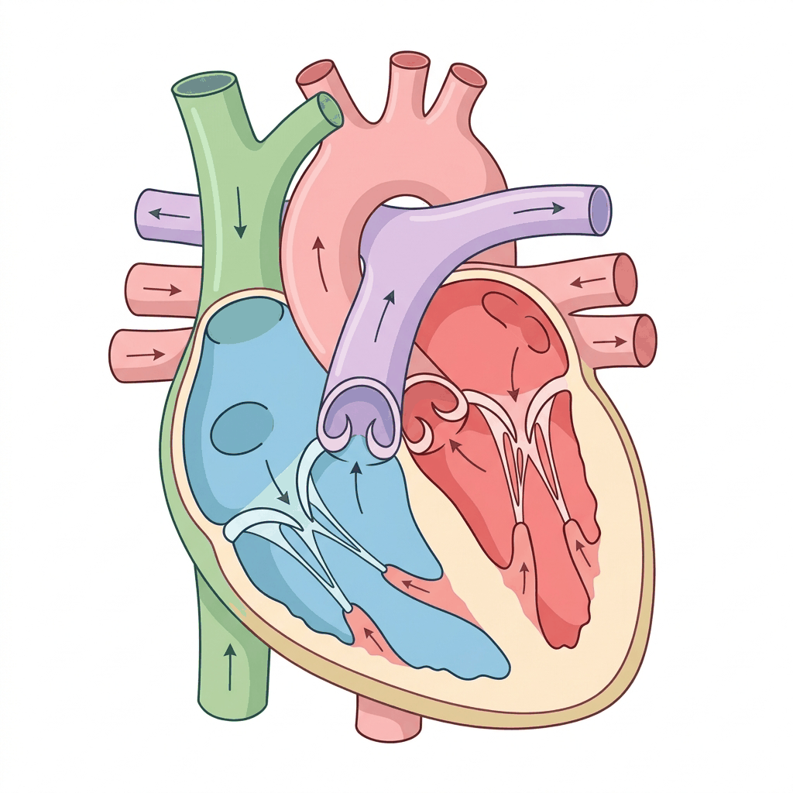

*Shown: gemini-3.1-flash-image, $0.000.*

Comparison (other model or earlier try):

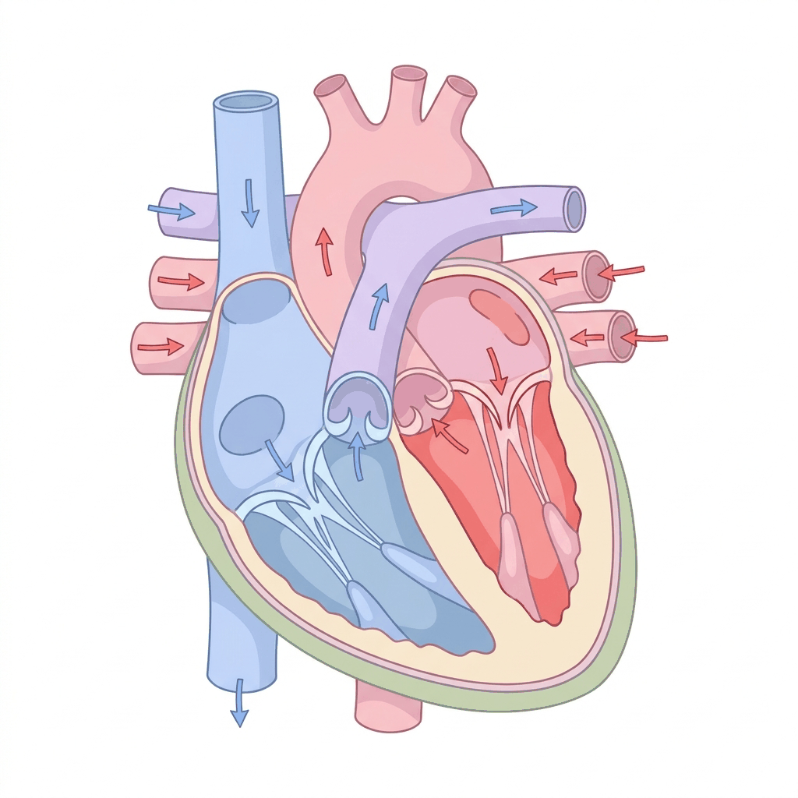

*$0.000.*

**Check:** Four chambers, valves, chordae and vessels are all present and in plausible places; blue right side and red left side as asked. The arrows were drawn because the placeholder asks for "small arrows showing flow". The left ventricle wall is not clearly the thickest. Pro (second picture) is slightly cleaner at twice the price.

**Placeholder text:**

> Longitudinal (vertical) section of the mammalian heart in front view (so the right side of the heart is on the viewer's left). Show the four chambers with the thin-walled atria at the top and thick-walled ventricles below, the left ventricle wall clearly thickest, the septum, the tricuspid and bicuspid valves with chordae tendineae and papillary muscles, semilunar valves at the base of the pulmonary artery and aorta, and the major vessels. Blood on the right side tinted blue and on the left side tinted red, with small arrows showing flow. Labels to add: "superior vena cava", "inferior vena cava", "right atrium", "tricuspid valve", "right ventricle", "pulmonary artery", "semilunar valves", "pulmonary veins", "left atrium", "bicuspid (mitral) valve", "chordae tendineae", "papillary muscle", "left ventricle", "septum", "aorta". Clean flat textbook style, white background.

### 2. Nephron with blood supply

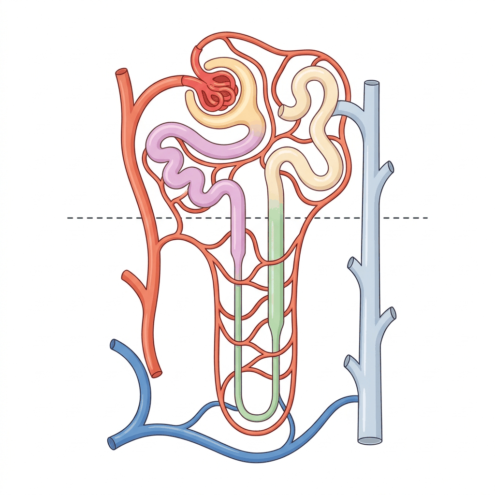

*Shown: gemini-3.1-flash-image, $0.069.*

**Check:** Glomerulus, tubules, loop of Henle, collecting duct and capillary network are all there. The afferent and efferent arterioles are hard to tell apart, and the dashed cortex/medulla line does not sit exactly where the placeholder says. No text. Needs a careful label check.

**Placeholder text:**

> Detailed diagram of a single nephron with its blood supply, arranged vertically with a dashed line marking the boundary between cortex (top) and medulla (bottom). Show the cup-shaped Bowman's capsule enclosing a red glomerulus; a wide afferent arteriole entering and a narrower efferent arteriole leaving; the proximal convoluted tubule coiling in the cortex; the loop of Henle dipping into the medulla with descending and ascending limbs; the distal convoluted tubule back in the cortex; and the collecting duct running down into the medulla towards the pelvis. A network of capillaries surrounds the tubules and joins into a blue branch of the renal vein. Labels: cortex, medulla, branch of renal artery, afferent arteriole, efferent arteriole, glomerulus, Bowman's capsule, proximal convoluted tubule, loop of Henle, distal convoluted tubule, collecting duct, capillary network, branch of renal vein, to pelvis. Red for oxygenated blood, blue for venous blood, tubules pale yellow. Clean flat textbook style, white background.

### 3. Long bone and osteon

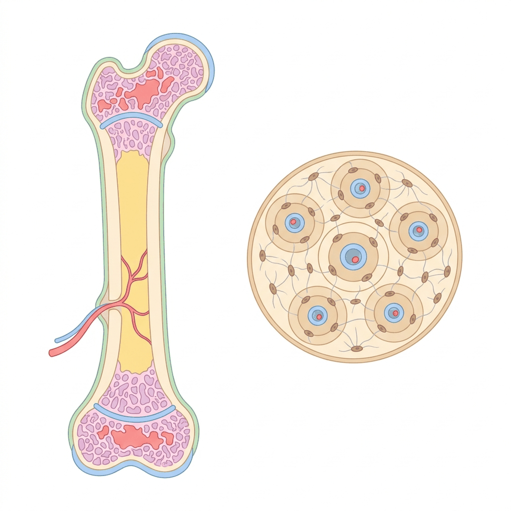

*Shown: gemini-3-pro-image, $0.146.*

Comparison (other model or earlier try):

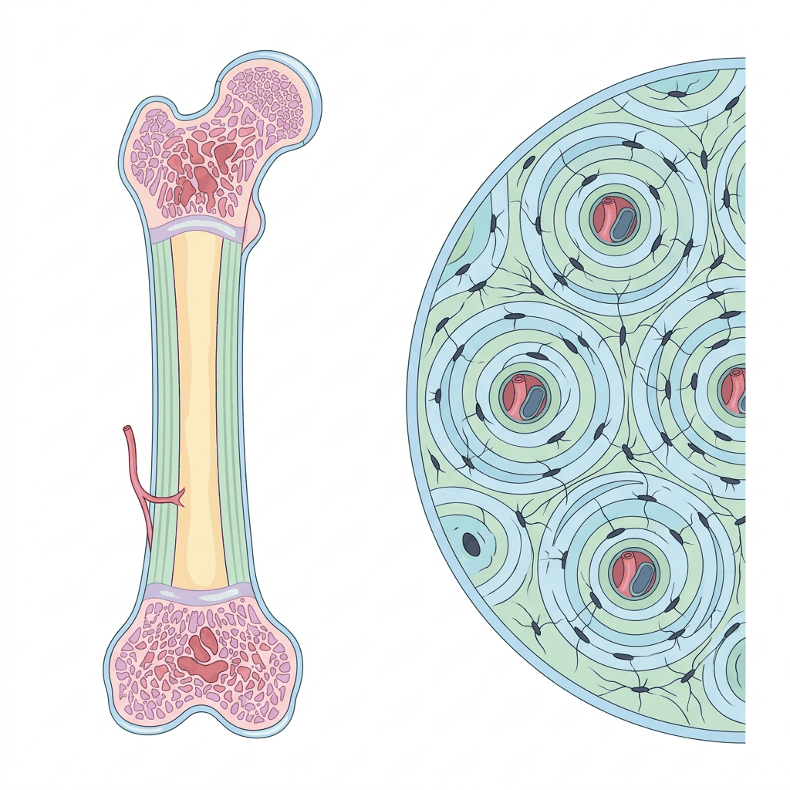

*$0.069.*

**Check:** Pro (first picture) gave a complete, well-balanced layout. The Flash try (second picture) cut the osteon circle off at the edge; its first try (not shown) wrote its own labels, including "Marrow marrow".

**Placeholder text:**

> Two diagrams side by side. Left: a long bone (femur) cut lengthwise, showing the shaft (diaphysis) of thick compact bone around a marrow cavity with yellow marrow, the two enlarged ends (epiphyses) of spongy bone with red marrow, the growth plates, the articular cartilage covering each end, the periosteum on the outside, and a blood vessel entering the bone. Right: an enlarged transverse section of compact bone showing several Haversian systems, each with a central Haversian canal containing a blood vessel, concentric lamellae, osteocytes in lacunae and fine canaliculi radiating out. Labels: articular cartilage, epiphysis, spongy bone, red marrow, growth plate, diaphysis, compact bone, marrow cavity, yellow marrow, periosteum, blood vessel, Haversian canal, lamellae, lacuna, osteocyte, canaliculi. Clean flat textbook style, white background.

### 4. Synovial joint

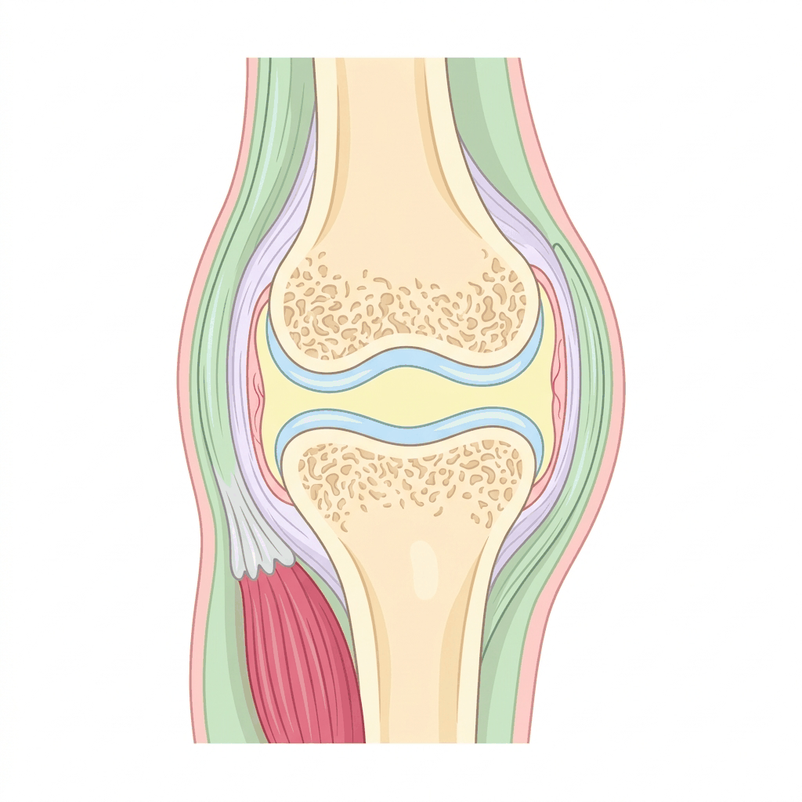

*Shown: gemini-3.1-flash-image, $0.068.*

**Check:** Bone ends, cartilage, joint cavity, capsule, ligaments and a muscle are present and clear. No text. The best result of the pilot.

**Placeholder text:**

> Longitudinal section through a typical synovial joint (e.g. the knee, simplified), showing the ends of two bones covered with smooth blue articular cartilage, the joint cavity filled with pale yellow synovial fluid, the synovial membrane lining the inside of the capsule, the fibrous joint capsule, ligaments on the outside joining bone to bone, and a muscle with its tendon attached to one bone. Labels: bone, articular cartilage, synovial membrane, synovial fluid, synovial cavity, joint capsule, ligament, muscle, tendon. Clean flat textbook style, white background.

### 5. Tadpole with external and internal gills

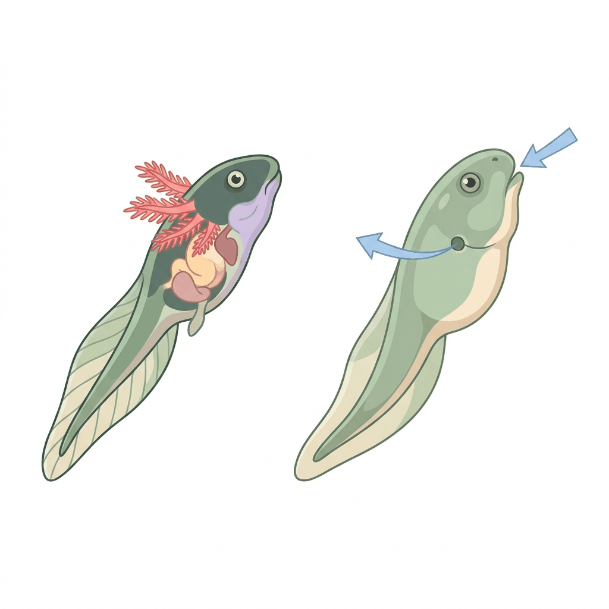

*Shown: gemini-3.1-flash-image, $0.069.*

**Check:** Right tadpole is correct (gills covered, spiracle, water arrows). **Accuracy problem:** the left tadpole shows its internal organs through the body, which was not asked for, and its gills are drawn on one side only.

**Placeholder text:**

> Two stages of a tadpole in side view. Left: a young tadpole with three pairs of feathery external gills (bright red) sticking out on each side behind the head. Right: an older tadpole with the gills covered by skin, and a small opening (the spiracle) on the left side, with arrows showing water entering the mouth and leaving through the spiracle. Labels to add: "young tadpole", "external gills", "older tadpole", "operculum (skin fold covering gills)", "spiracle", "water in through mouth", "water out", "tail". Clean flat textbook style, white background.

### 6. Rhizopus on bread

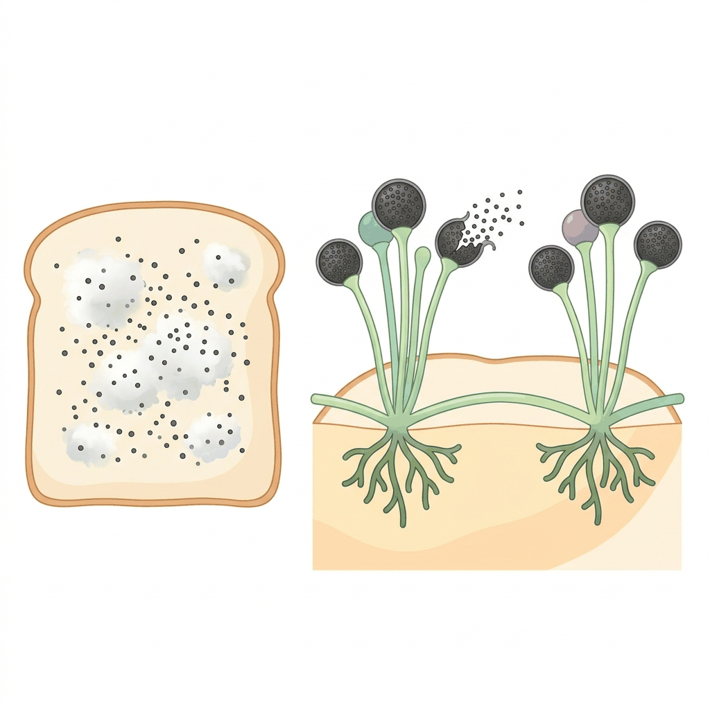

*Shown: gemini-3.1-flash-image, $0.068.*

**Check:** Matches the placeholder well: stolons, rhizoids, sporangiophores, black sporangia and one bursting. The enzyme and food arrows in the placeholder are left for the label step. Compare with the Section A Rhizopus below.

**Placeholder text:**

> Rhizopus growing on a slice of bread. Left: a slice of bread with patches of white fluffy mould and black dots. Right: an enlarged drawing of the mould: horizontal stolons arching over the bread surface; at each point where a stolon touches the bread, a cluster of branched rhizoids going down into the bread and a group of upright sporangiophores going up, each ending in a round black sporangium full of spores; one sporangium bursting to release spores. Show small arrows from the rhizoid tips into the bread labelled as enzymes, and arrows back into the rhizoids labelled as soluble food absorbed. Labels: bread (food), hypha, stolon, rhizoids, sporangiophore, sporangium, spores, enzymes secreted, soluble food absorbed. Clean flat textbook style, white background.

### 7. Paramecium binary fission

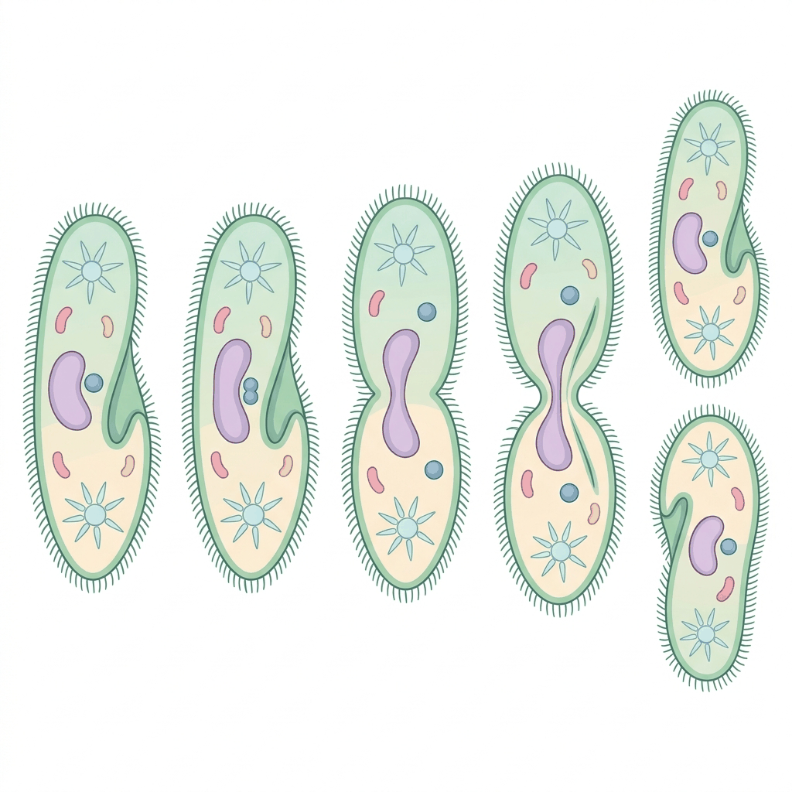

*Shown: gemini-3.1-flash-image, $0.069.*

**Check:** Five stages in the right order with macronucleus, micronucleus and vacuoles. No text. Very good.

**Placeholder text:**

> Step-by-step diagram of transverse binary fission in Paramecium in five stages from left to right: (1) a full-grown slipper-shaped Paramecium with cilia, an oral groove, a large bean-shaped macronucleus, a small round micronucleus beside it and two star-shaped contractile vacuoles; (2) the micronucleus dividing into two and the macronucleus elongating; (3) a constriction forming across the middle of the cell, with each half receiving a micronucleus and half of the macronucleus; (4) the constriction deepening; (5) two small daughter Paramecia separating. Labels: cilia, oral groove, macronucleus, micronucleus, contractile vacuole, micronucleus divides by mitosis, macronucleus elongates, constriction, daughter Paramecia. Soft pale blue cytoplasm. Clean flat textbook style, white background.

### 8. Double fertilisation

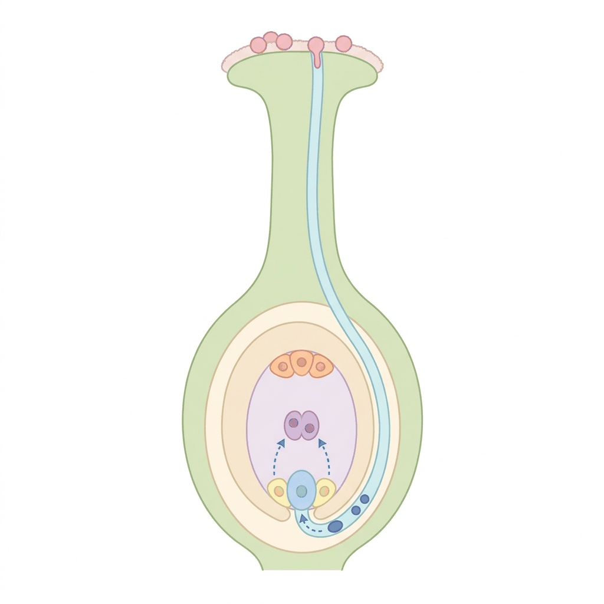

*Shown: gemini-3-pro-image, $0.147.*

Comparison (other model or earlier try):

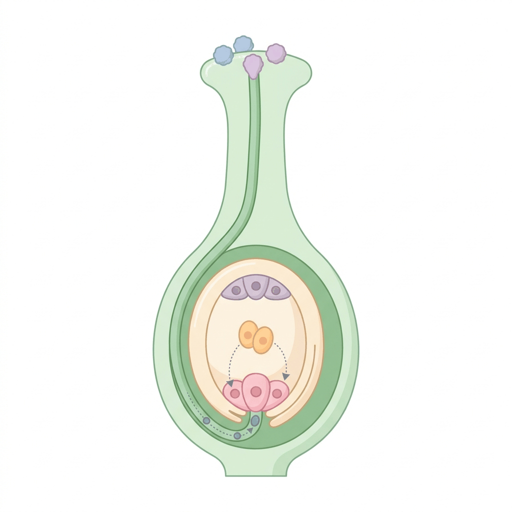

*$0.069.*

**Check:** Pro (first picture): pollen tube enters the micropyle, egg and synergids at the micropyle end, polar nuclei in the centre, antipodals at the far end, two dotted arrows. The Flash try (second picture) is similar. After the stricter no-text rule neither wrote labels (Flash's first try wrote "3 Tube nucleus").

**Placeholder text:**

> Diagram of a carpel in longitudinal section showing double fertilisation. Show pollen grains on the stigma, one of which has grown a long pollen tube down through the style into the ovary and through the micropyle of an ovule. Inside the tube near its tip: a tube nucleus and two male nuclei. Inside the ovule's embryo sac: the egg cell with two synergids at the micropyle end, two polar nuclei in the centre and three antipodal cells at the far end. Use two dotted arrows: one from a male nucleus to the egg cell (labelled "male nucleus + egg = zygote 2n") and one from the other male nucleus to the polar nuclei (labelled "male nucleus + 2 polar nuclei = endosperm nucleus 3n"). Labels: pollen grain, stigma, style, pollen tube, tube nucleus, male nuclei, ovary wall, ovule, micropyle, integuments, egg cell, synergids, polar nuclei, antipodal cells. Soft green carpel, yellow pollen, purple nuclei. Clean flat textbook style, white background.

### 9. Coleoptile phototropism experiments

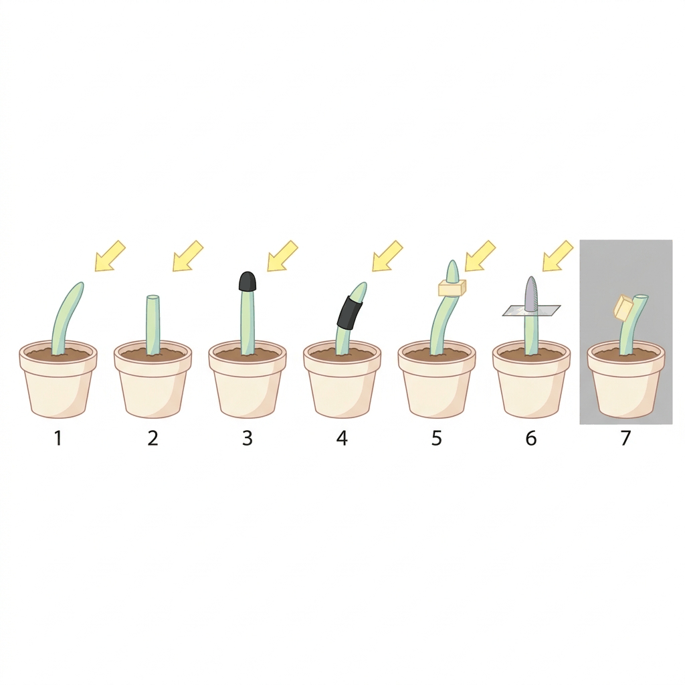

*Shown: gemini-3-pro-image, $0.145.*

Comparison (other model or earlier try):

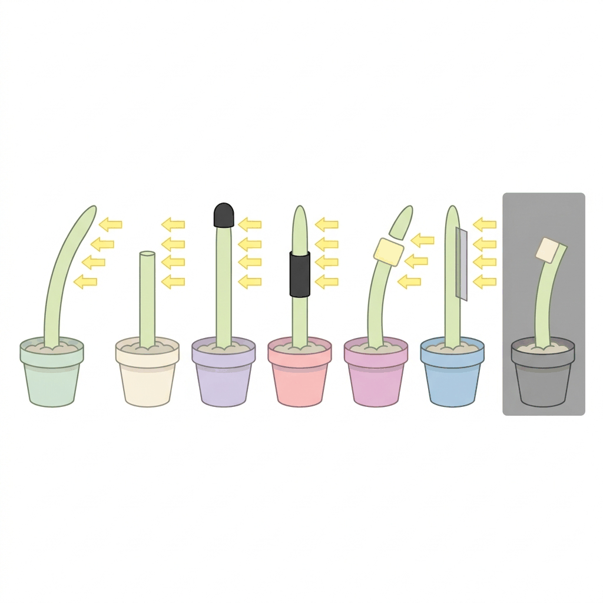

*$0.069.*

**Check:** Seven experiments in the right order. **Accuracy problems:** Pro (first picture) printed the numbers 1 to 7 under the pots (text) and drew the mica sheet flat across the tip instead of vertically on the shaded side; the Flash try (second picture) shows the experiment with the sleeve (4) standing straight when it should bend.

**Placeholder text:**

> A row of seven simple coleoptile experiment drawings, each showing a small pale-green coleoptile growing from a little pot of soil, with yellow light arrows coming from the right-hand side in experiments 1 to 6 and no light (darkness shown by a grey background panel) in experiment 7. 1: intact coleoptile bending towards the light. 2: coleoptile with its tip removed, standing straight and short. 3: coleoptile with a black opaque cap on its tip, standing straight. 4: coleoptile with a black opaque sleeve around the part below the tip, bending towards the light. 5: tip removed and replaced on a thin pale-yellow agar block, bending towards the light. 6: a thin grey mica sheet inserted into the shaded left side just below the tip, standing straight. 7: decapitated coleoptile in darkness with a small agar block placed on its left side only, bending to the right. Labels: light, intact, tip removed, opaque cap, opaque sleeve, agar block, mica sheet, darkness, agar block containing auxin. Clean flat textbook style, white background.

### 10. Starch test on a leaf

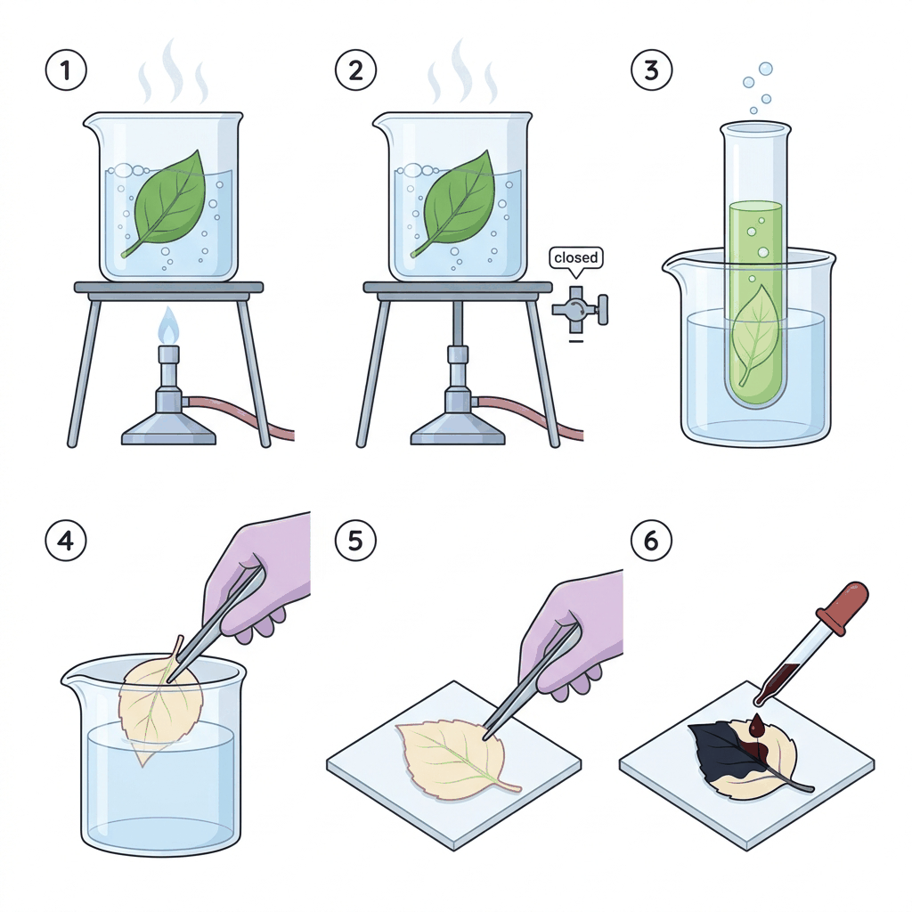

*Shown: gemini-3.1-flash-image, $0.069.*

Comparison (other model or earlier try):

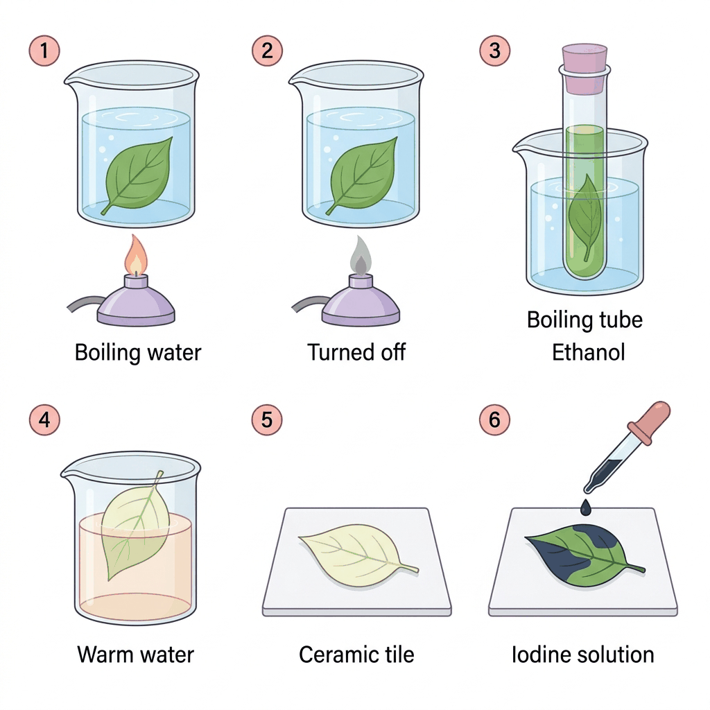

*$0.000.*

**Check:** Six steps are right. **Text problem:** circled step numbers 1 to 6 and a tiny word on a gas tap in step 2 (the first try, second picture, wrote a caption under every panel). The numbers are correct, but the house style says no text; fix by painting them out with `label.py` or re-rolling.

**Placeholder text:**

> Step-by-step diagram of the iodine test for starch in a leaf, in six numbered panels in two rows. 1: a leaf in a beaker of boiling water over a Bunsen flame. 2: the flame turned off. 3: the leaf in a boiling tube of ethanol standing in the beaker of hot water (water bath), the ethanol turning green. 4: the now pale leaf being dipped in a beaker of warm water. 5: the leaf spread flat on a white tile. 6: iodine solution being added with a dropper, the leaf turning blue-black. Labels: boil in water 1–2 minutes (kills cells), turn off flame, ethanol in water bath (removes chlorophyll), warm water (softens leaf), white tile, iodine solution, blue-black = starch. Clean flat textbook style, white background.

## 3. Code-drawn images (matplotlib)

### Mathematics A2

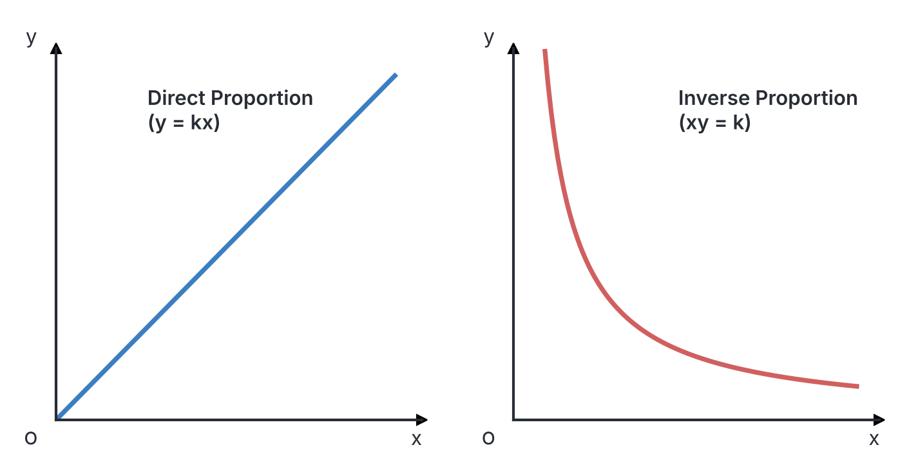

**Check:** Direct line through the origin and inverse curve, with the two titles from the placeholder. Matches.

**Placeholder text:**

> Two side-by-side graphs illustrating proportion. On the left, a straight line passing through the origin on a Cartesian plane, labelled "Direct Proportion (y = kx)". On the right, a curve resembling a hyperbola in the first quadrant, labelled "Inverse Proportion (xy = k)". Clean flat textbook illustration, white background.

### Physics A31

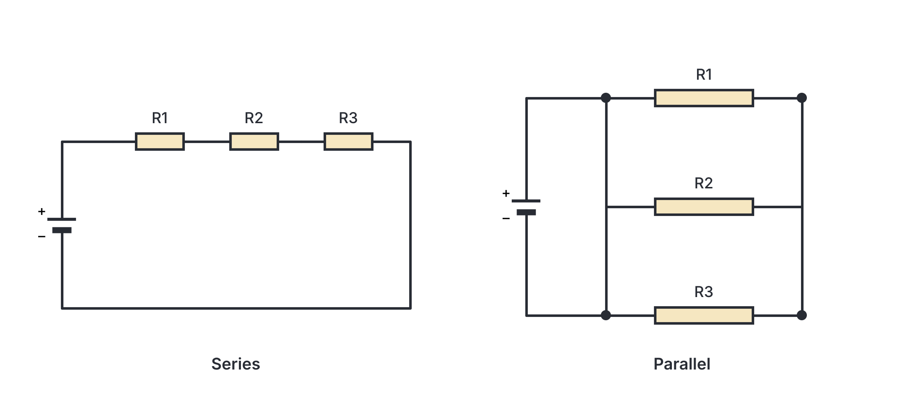

**Check:** Three resistors in series, and in parallel across two junctions, each with a cell. Matches (I added only the two words Series and Parallel).

**Placeholder text:**

> Two circuit diagrams side by side. Left: Three resistors R1, R2, and R3 connected in a single continuous line (series). Right: The same three resistors connected across two common junction points, forming three parallel branches (parallel). Clean flat textbook style, white background.

### Chemistry A16a

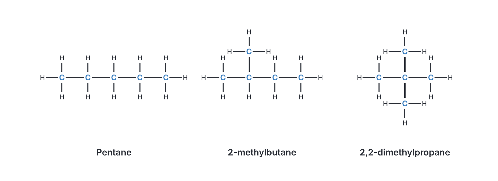

**Check:** Full structural formulas of the three C5H12 isomers; every carbon has four bonds and the hydrogen counts are right (12 each). Matches.

**Placeholder text:**

> The structural formulas of the three isomers of pentane (C5H12). Left: a straight zigzag chain of 5 carbons (pentane). Middle: a 4-carbon chain with a methyl branch on the second carbon (2-methylbutane). Right: a central carbon atom bonded to four methyl groups (2,2-dimethylpropane), forming a cross shape. Clean flat textbook style, white background.

### Economics A7

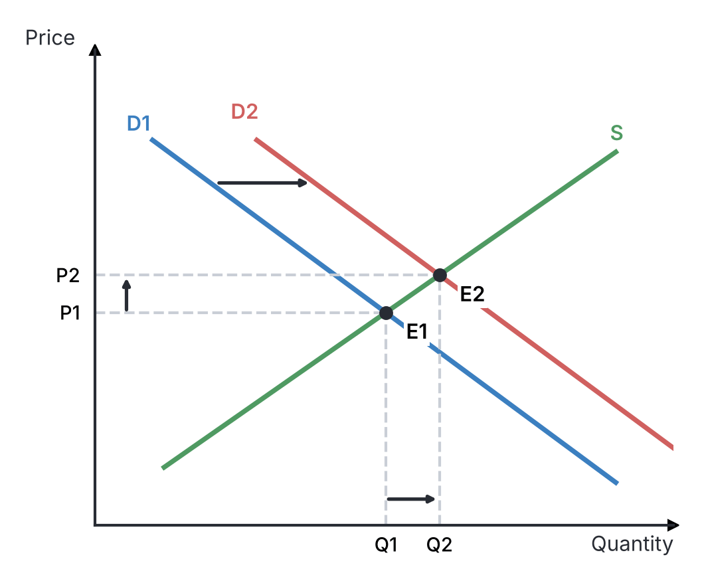

**Check:** D1, D2, S, E1, E2, P1, P2, Q1, Q2, with the three arrows. Matches.

**Placeholder text:**

> A supply and demand graph showing a shift in demand. The original demand curve D1 and supply curve S intersect at E1 (Price P1, Quantity Q1). A new demand curve D2 is drawn to the right of D1. The new intersection with supply S is at E2, showing a higher price P2 and a higher quantity Q2. Arrows point from D1 to D2 (rightward shift), from P1 to P2 (upward movement), and from Q1 to Q2 (rightward movement). Clean flat textbook illustration, white background.

### Geography B11 (sketch map)

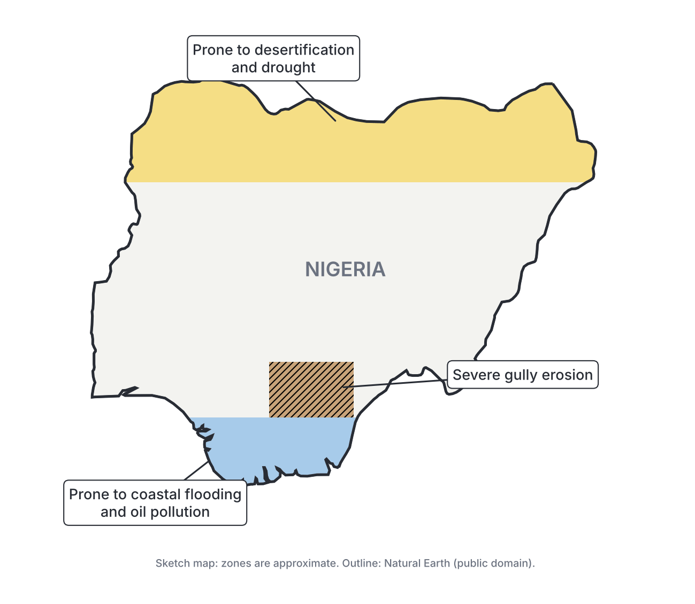

**Check:** Nigeria outline from Natural Earth (public domain), three shaded zones as described. Zones are approximate and say so in a caption. Matches, as a sketch.

**Placeholder text:**

> Outline map of Nigeria showing three shaded zones for environmental hazards. The northern strip is shaded yellow and labelled "Prone to Desertification and Drought". The south-eastern area is shaded brown with hatch marks, labelled "Severe Gully Erosion". The southern coastal strip and the Niger Delta region are shaded blue, labelled "Prone to Coastal Flooding and Oil Pollution". Clean flat textbook illustration, white background.

### Accounting A11

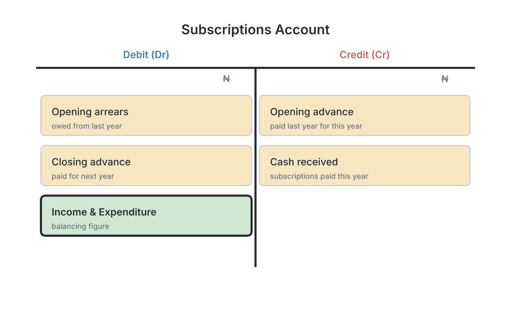

**Check:** T-account with the five items on the correct sides and the balancing figure highlighted. I left out the calendar and naira-note icons.

**Placeholder text:**

> A visual representation of the Subscriptions T-account layout. A large 'T' shape. On the top left (Debit side): "Opening Arrears" (with an arrow pointing down from a calendar showing last year) and "Closing Advance". On the top right (Credit side): "Opening Advance" and "Cash Received" (with an icon of naira notes). The balancing figure "Income & Expenditure" is highlighted in bold on the debit side. Clean flat textbook illustration, white background.

### Biology B2b

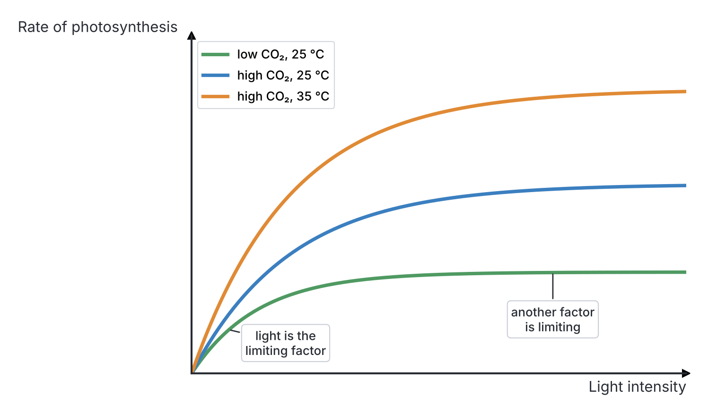

**Check:** Three saturating curves in green, blue and orange with key, and the two callouts on the lowest curve. Matches.

**Placeholder text:**

> A line graph of the rate of photosynthesis (y-axis) against light intensity (x-axis). Three curves: the lowest curve levels off early (labelled low CO₂, 25 °C); the middle curve levels off higher (high CO₂, 25 °C); the top curve levels off highest (high CO₂, 35 °C). On the lowest curve, mark the rising part as "light is the limiting factor" and the flat part as "another factor is limiting". Axis labels: rate of photosynthesis, light intensity. Simple coloured lines (green, blue, orange) with a small key. Clean flat textbook style, white background.

### History C6

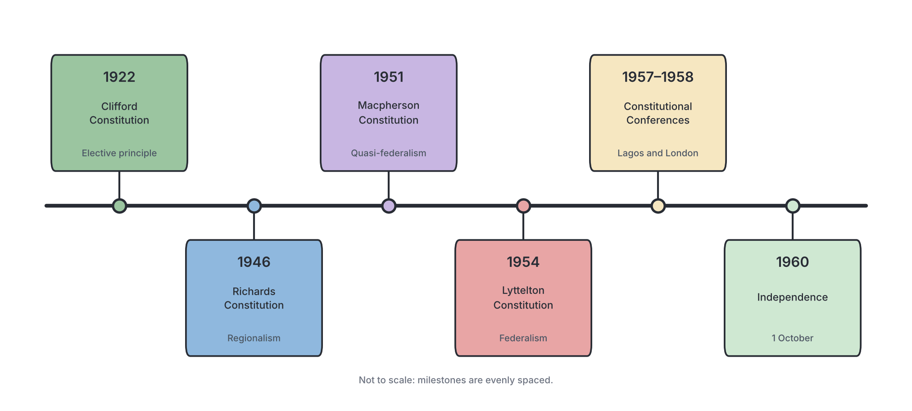

**Check:** Six milestones, evenly spaced (not to scale; stated on the image) because 1954, 1957-58 and 1960 are too close to label otherwise. Matches.

**Placeholder text:**

> A horizontal timeline from 1922 to 1960 showing key milestones in Nigeria's constitutional development. 1922: Clifford Constitution (Elective Principle). 1946: Richards Constitution (Regionalism). 1951: Macpherson Constitution (Quasi-Federalism). 1954: Lyttelton Constitution (True Federalism). 1957-1958: Constitutional Conferences. 1960: Independence. Clean flat textbook style, white background.

### Government A4

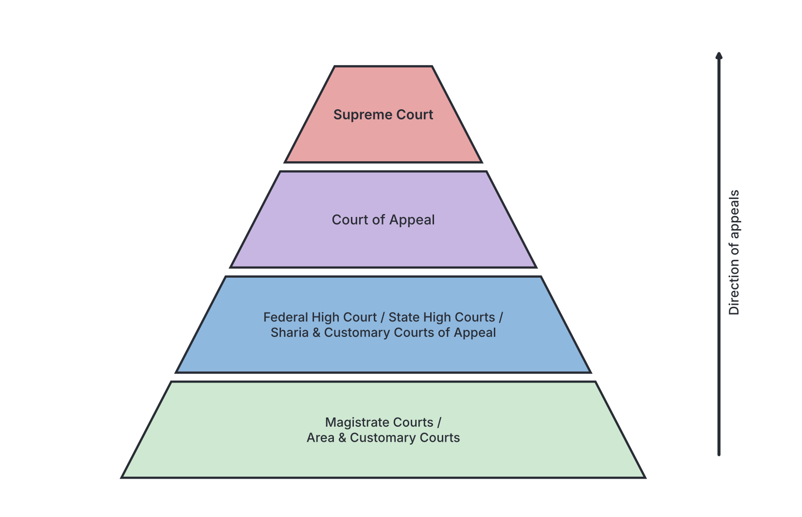

**Check:** Four-tier pyramid with the arrow "Direction of appeals". Matches.

**Placeholder text:**

> A pyramid diagram showing the hierarchy of courts in Nigeria. At the peak, a small section labeled "Supreme Court". Below it, a wider section labeled "Court of Appeal". Below that, "Federal High Court / State High Courts / Sharia & Customary Courts of Appeal". At the base, the widest section labeled "Magistrate Courts / Area & Customary Courts". An arrow points upwards along the side labeled "Direction of Appeals". Clean flat textbook style, white background.

### Commerce A4a

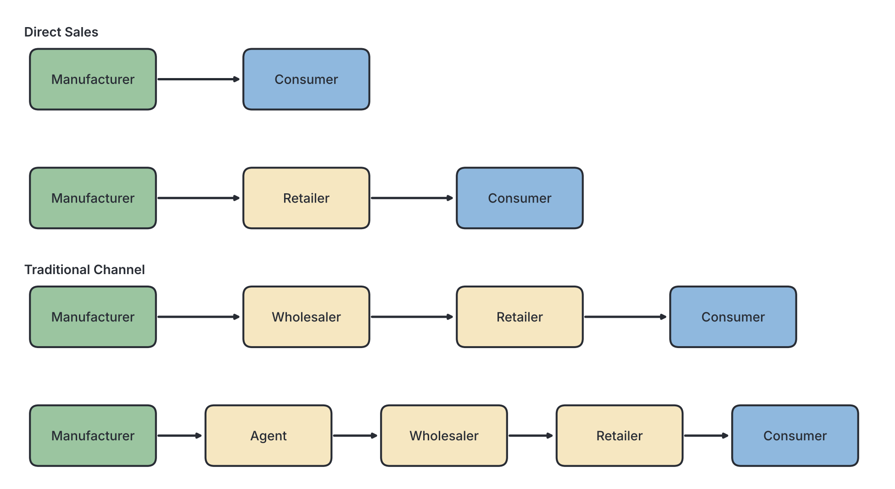

**Check:** Four rows with the right boxes and colours; the two row labels from the placeholder. Matches.

**Placeholder text:**

> A flowchart showing the four channels of distribution. Row 1: Manufacturer box with an arrow pointing directly to Consumer box. Label: "Direct Sales". Row 2: Manufacturer box -> Retailer box -> Consumer box. Row 3: Manufacturer box -> Wholesaler box -> Retailer box -> Consumer box. Label: "Traditional Channel". Row 4: Manufacturer box -> Agent box -> Wholesaler box -> Retailer box -> Consumer box. Style: Clean flat textbook illustration, white background, distinct colours for Manufacturer, Middlemen, and Consumer boxes.

## 4. Section A images for style comparison

### Rhizopus (Section A), for comparison with pilot image 6

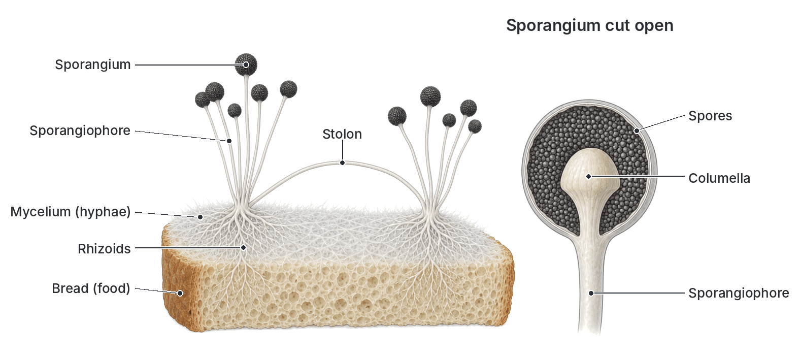

### Plant cell (Section A, labelled)

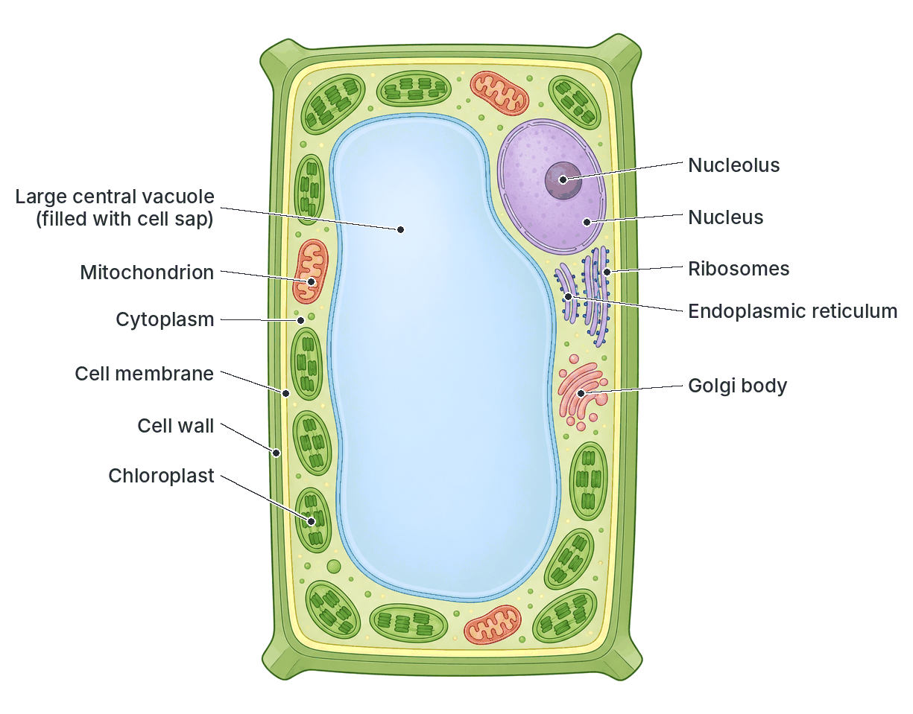

### Camouflage and defence (Section A, labelled; the "Parotoid" fix)

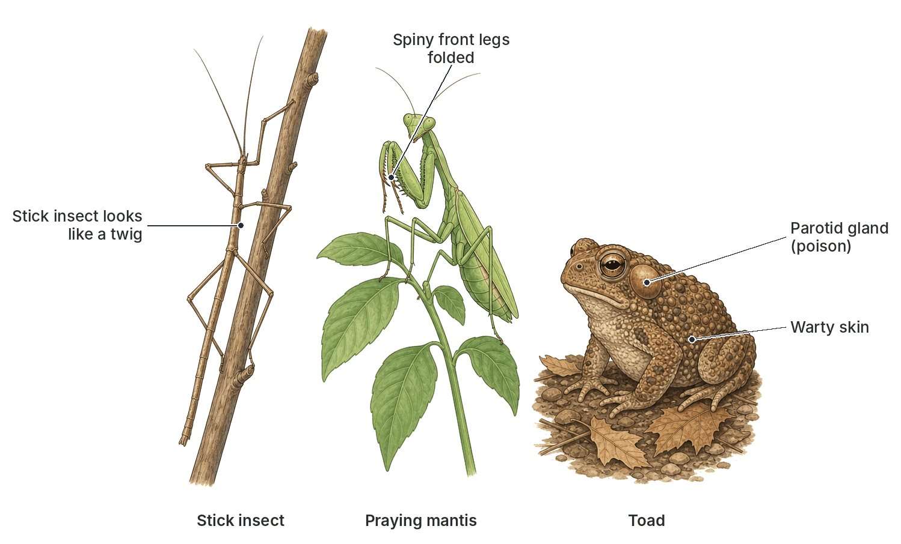

### Fern life cycle (Section A)

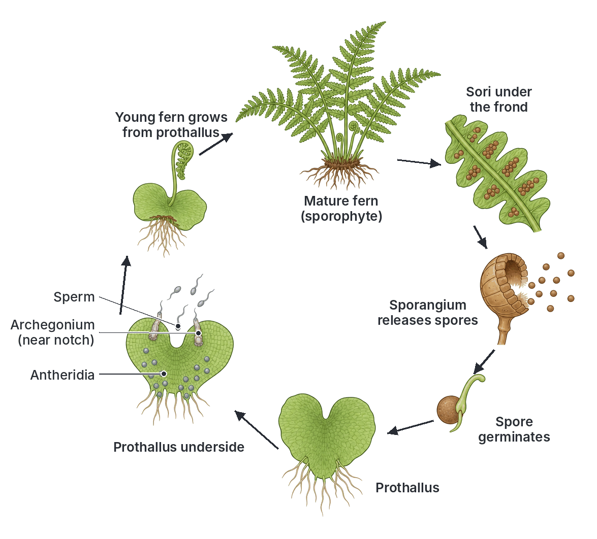
