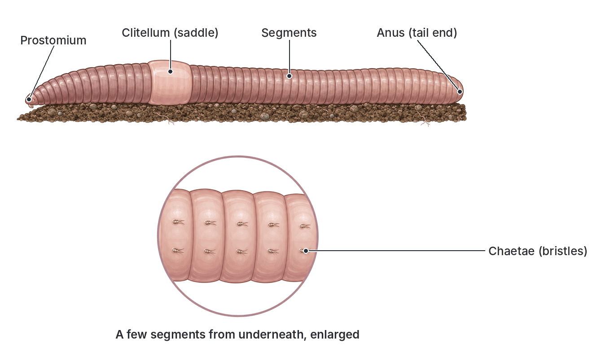
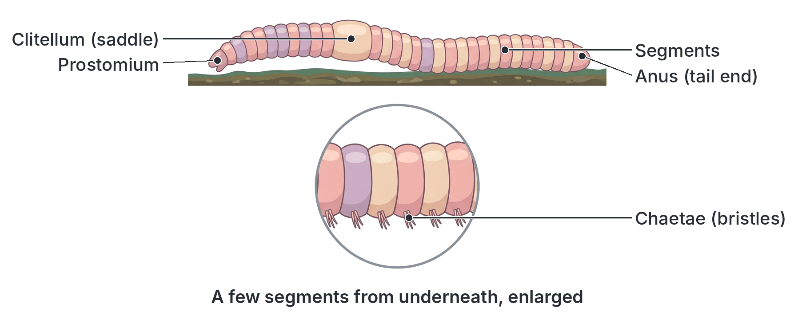
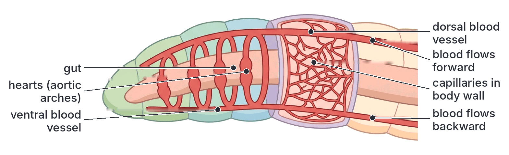
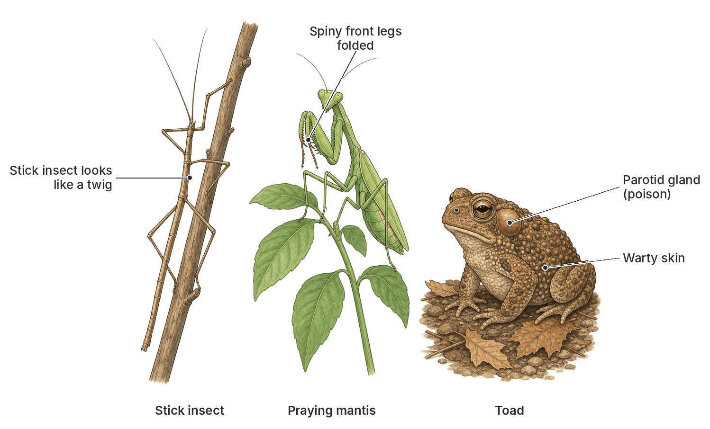
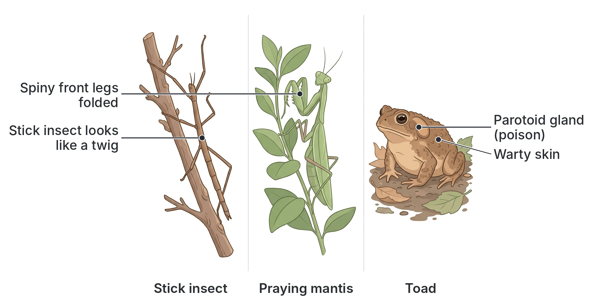
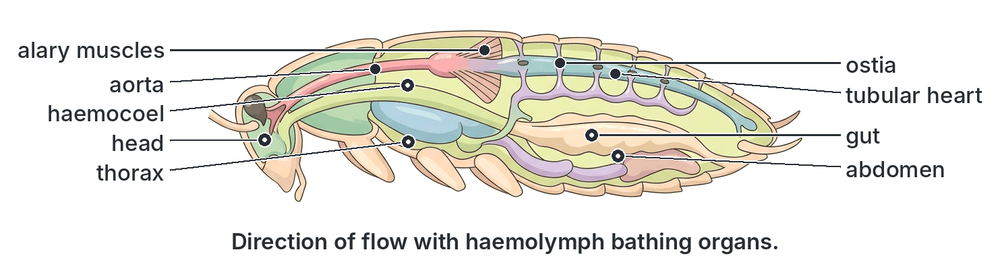

# Style test: redoing Biology Section A in Gemini

Two Section A images redone with the current Gemini pipeline (Flash image, no text in the picture, vision check, labels drawn by `label.py`). **Nothing was replaced**: the originals and the notes are untouched; the new versions are in `subjects/biology/images/style-test/`.

Each row: **left** = original (OpenAI), **middle** = new Gemini version of the same placeholder, **right** = an existing Gemini image from Section B on a similar topic. Tap an image to enlarge.

## 1. Labelled structure diagram: earthworm (A2c)

<table>
<tr>
<th width="33%">Original (OpenAI)</th>
<th width="33%">New (Gemini)</th>
<th width="33%">Section B (Gemini)</th>
</tr>
<tr>
<td></td>
<td></td>
<td></td>
</tr>
<tr>
<td>A2c-earthworm</td><td>style-test/A2c-earthworm</td><td>B3a-18 earthworm circulatory system</td>
</tr>
</table>

## 2. Scene with panels: camouflage and defence (A3)

<table>
<tr>
<th width="33%">Original (OpenAI)</th>
<th width="33%">New (Gemini)</th>
<th width="33%">Section B (Gemini)</th>
</tr>
<tr>
<td></td>
<td></td>
<td></td>
</tr>
<tr>
<td>A3-camouflage-defence</td><td>style-test/A3-camouflage-defence</td><td>B3a-17 cockroach circulatory system</td>
</tr>
</table>

If the table is small on your phone, open the images directly:
[A2c original](subjects/biology/images/A2c-earthworm.png) · [A2c new](subjects/biology/images/style-test/A2c-earthworm.png) · [B3a-18](subjects/biology/images/B3a-18-earthworm-closed-circulatory-system.png) · [A3 original](subjects/biology/images/A3-camouflage-defence.png) · [A3 new](subjects/biology/images/style-test/A3-camouflage-defence.png) · [B3a-17](subjects/biology/images/B3a-17-cockroach-open-circulatory-system.png)

## How the new versions were made

- Same placeholder text as the originals (from `tools/specs/biology/A2c-prompts.json` and `A3-prompts.json`), same label lists (`A2c-labels.json`, `A3-labels.json`). The A3 label reads "Parotoid gland", as corrected earlier.
- `gemini-3.1-flash-image`, one generation each; both pictures passed the vision check first time, so Pro was not needed. Positions of the labels were found by Gemini vision, the text and lines are drawn by `label.py` (readable font, no crossing lines). The panel names of A3 and the inset caption of A2c are captions under the pictures, as in the originals.

## Cost

| Item | Cost |
|---|---|
| 2 picture generations (standard price, not Batch) | $0.137 |
| Vision checks and label placement | $0.011 |
| **Total** | **$0.15** (cap $1) |

## My view

**Style: the new versions match Sections B to E much better.** They use the same flat, soft-colour look, the same label font and leader lines as the 1,300+ images in Sections B to E, and they are readable on a phone. The originals are shaded, almost engraved illustrations: they look good alone but clearly different from the rest of the notes (that is the main inconsistency a student sees when moving from Section A to B).

**Quality: the old images are more detailed and, for the earthworm, more accurate.** The new earthworm is short and stubby with arbitrarily coloured segments and a lumpy back; the old one is a long, correctly segmented worm with an accurate clitellum and bristles. The new camouflage panels are clean and correct (stick insect on a twig, mantis with folded forelegs, toad with the parotoid gland), but smaller and plainer than the old ones. So expect: consistent look, some loss of detail, and for hard anatomy about one in five pictures needing Pro or a retry (as in Sections B to E).

**Recommendation:** redo Section A in Gemini if consistency matters more than richness. For detailed anatomy (earthworm, tapeworm, Ascaris, skin section, cells) use Pro from the start (about $0.15 a picture instead of $0.07), and keep a few originals that Gemini cannot beat.

## Estimate for redoing all of Section A

Section A has 67 images (A1: 10, A2a: 14, A2b: 12, A2c: 17, A3: 14). About 47 are pictures of organisms, cells or scenes (AI) and about 20 are diagrams, life cycles and charts (code templates).

| Part | Count | Cost each | Cost |
|---|---|---|---|
| Pictures with labels (Flash first, Pro for retries, Batch) | 47 | $0.107 (measured in Sections B to E, includes retries) | about $5.0 |
| Pictures started on Pro (hard anatomy, about 15) | 15 of the 47 | +$0.05 | about $0.8 |
| Code drawings (templates) | 20 | $0.09 | about $1.8 |
| Cleanup (placeholders left, retries) | | | about $1 |
| **Total** | **67** | | **about $8 (range $5 to $12)** |

Waiting for your approval before anything is replaced.
