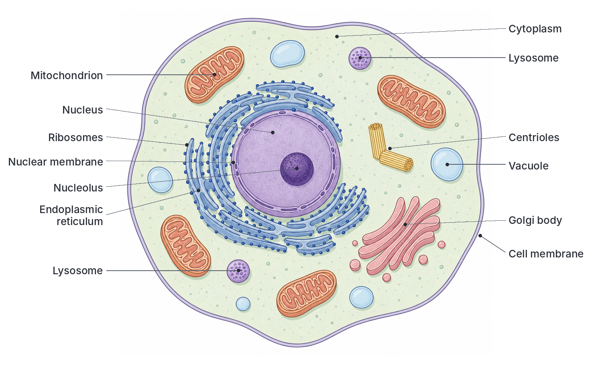
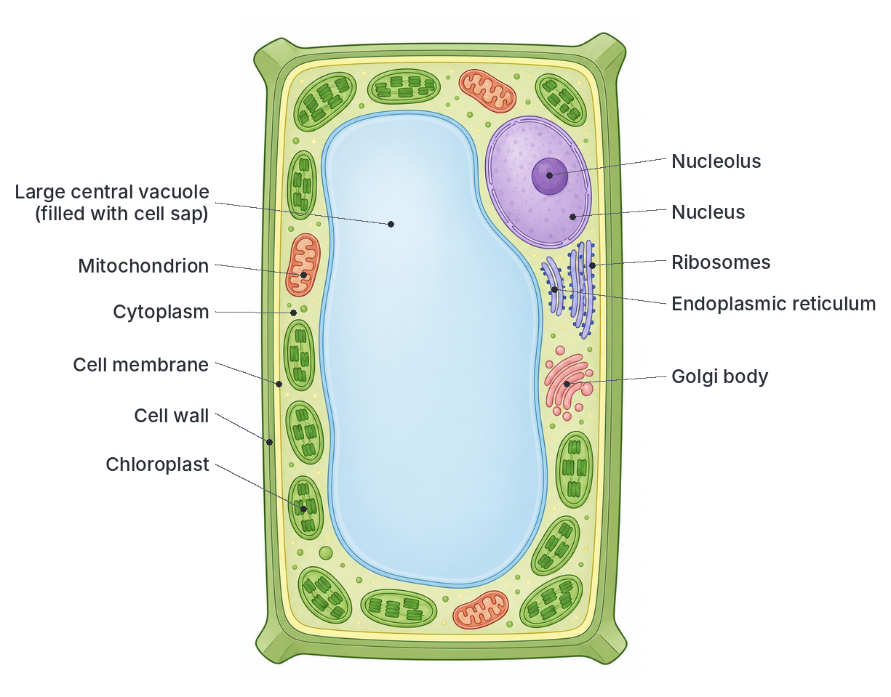
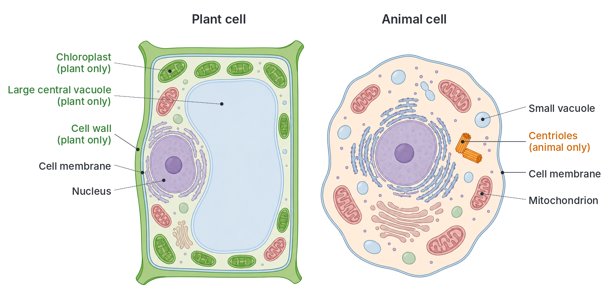
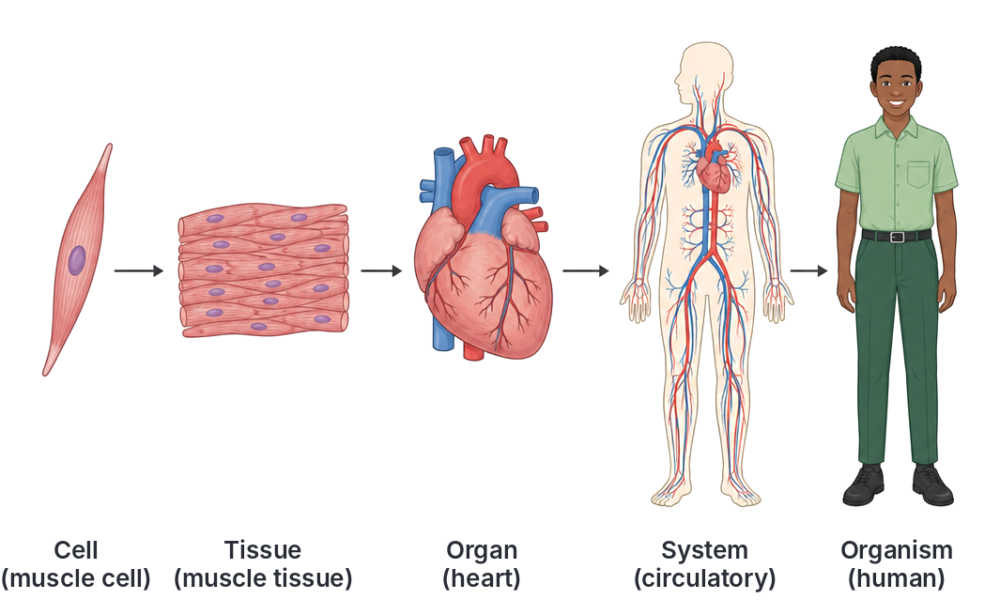
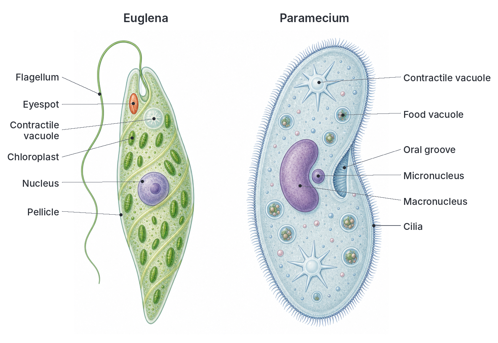
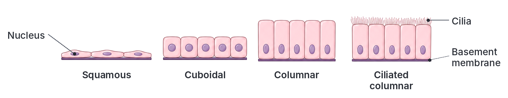
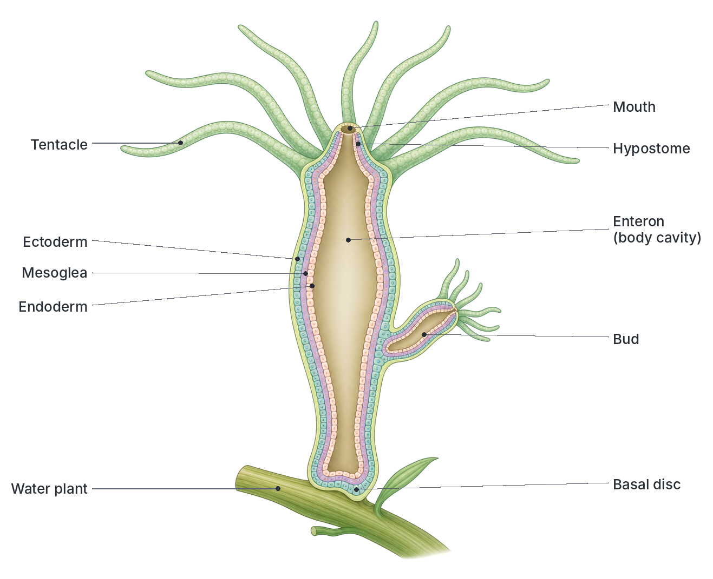
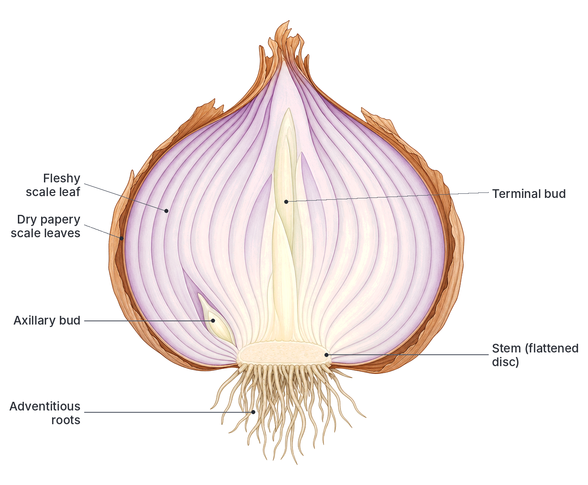
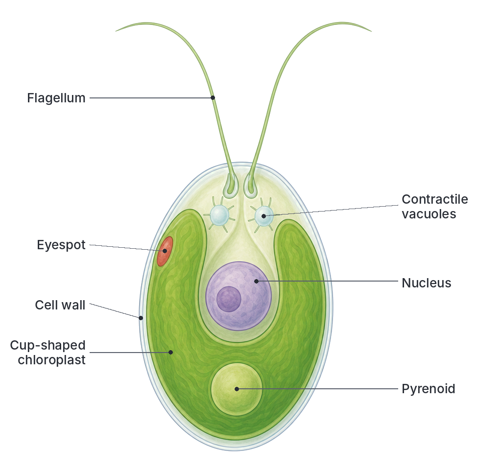

# JAMB Biology Notes: Living Organisms

## What JAMB expects

This topic is Section A, Topic 1 of the JAMB Biology syllabus: Variety of Organisms – Living organisms. It covers three content items: (a) characteristics of living things, (b) cell structure and the functions of cell components, and (c) the levels of organisation. By the end of these notes, you should be able to:

1. Differentiate between the characteristics of living and non-living things.
2. Identify the structures of plant and animal cells.
3. Analyse the functions of the components of plant and animal cells.
4. Compare and contrast the structure of plant and animal cells.
5. Trace the levels of organisation among organisms in their logical order: cell, tissue, organ, system, organism.

Syllabus examples you must know: *Euglena* and *Paramecium* (cell level), epithelial tissues and *Hydra* (tissue level), onion bulb (organ level), the reproductive, digestive and excretory systems (system level), and *Chlamydomonas* (organism level).

## Characteristics of living things

A living thing (an organism) is anything that carries out **all** the life processes below. A non-living thing, like a stone, a car or a candle flame, may seem to show one or two of them, but never all of them, and it is never made of cells.

An easy way to remember them is **MR NIGER D**:

| Letter | Characteristic | What it means | Example |
| --- | --- | --- | --- |
| M | Movement | Changing position (locomotion) or moving parts of the body | A goat walks; a sunflower head turns towards the sun; *Paramecium* swims with its cilia |
| R | Respiration | Breaking down food inside the cells to release energy | Your cells break down glucose to give you energy for walking to school |
| N | Nutrition | Taking in or making food | Plants make food by photosynthesis; a goat eats grass |
| I | Irritability (sensitivity) | Detecting and responding to changes (stimuli) around them | You pull your hand away from a hot pot; the leaves of *Mimosa pudica* ("touch-me-not") fold when touched |
| G | Growth | A permanent increase in size and dry mass, by making new cells | A maize seedling grows into a tall plant; a baby grows into an adult |
| E | Excretion | Removing the waste products made by the body's chemical reactions | Humans pass out urea in urine and carbon dioxide in breath |
| R | Reproduction | Producing new young ones of the same kind | A hen lays eggs; a yam tuber sprouts into a new plant |
| D | Death | Every living thing has a limited lifespan | All organisms eventually die |

### Each characteristic in more detail

**1. Movement.** Animals usually move from place to place (locomotion) using legs, wings, fins, cilia or flagella. Most plants are fixed to one place, but they still move parts of their body: shoots bend towards light, roots grow towards water, and flowers open and close. Plant movements are slow and are usually growth movements.

**2. Respiration.** Respiration is a chemical process inside every living cell. Food (mainly glucose) is broken down to release energy. In **aerobic respiration**, oxygen is used and carbon dioxide and water are given off:

glucose + oxygen → carbon dioxide + water + energy

Do not confuse respiration with **breathing**. Breathing is the movement of air in and out of the lungs. Respiration is the release of energy in the cells.

**3. Nutrition.** Living things need food for energy and to build their bodies. Green plants are **autotrophic**: they make their own food from carbon dioxide and water using sunlight (photosynthesis). Animals and fungi are **heterotrophic**: they take in ready-made food.

**4. Irritability (sensitivity).** A change in the surroundings, such as light, heat, touch or a chemical, is called a **stimulus** (plural: stimuli). Living things detect the stimulus and make a **response**. A cockroach runs away when the light is switched on; the shoot of a bean seedling grows towards a window.

**5. Growth.** Growth is a permanent increase in size and dry mass. It happens from **inside**, as the organism takes in food, makes new protoplasm and new cells by cell division. Animals usually stop growing when they reach adult size. Many plants keep growing all their lives at their root and shoot tips.

**6. Excretion.** The chemical reactions in cells (metabolism) produce waste substances that are poisonous if they build up. Excretion removes them. Examples in animals: carbon dioxide (from the lungs), urea and excess salts (in urine from the kidneys), sweat (from the skin). Plants have no special excretory organs. They get rid of carbon dioxide and water vapour through the stomata, and store some wastes (such as tannins, resins and calcium oxalate crystals) in old leaves and bark, which later fall off.

**7. Reproduction.** Every living thing dies, so it must produce new individuals to keep its kind alive. **Asexual reproduction** needs only one parent (e.g. *Amoeba* splitting in two, a yam tuber sprouting). **Sexual reproduction** involves male and female sex cells (gametes) joining (e.g. a cock and a hen producing a fertile egg).

**8. Death.** Every organism has a limited lifespan. After death, all the life processes stop and the body decays.

**Textbook variations:** different textbooks list different numbers of characteristics. Some give seven (often remembered as **MRS GREN**: Movement, Respiration, Sensitivity, Growth, Reproduction, Excretion, Nutrition) and leave out death, because death is the end of life rather than a life process. Others add more, such as being made of cells, adaptation, or competition. "Irritability" and "sensitivity" mean the same thing. Some West African textbooks also call the oxygen given out by plants during photosynthesis an excretory product; others call it a by-product, because it is made by photosynthesis, not by the breakdown of food. Learn MR NIGER D, but know that both lists are correct.

### Living vs non-living things

**Objective i: differentiate between the characteristics of living and non-living things.**

| Feature | Living things | Non-living things |
| --- | --- | --- |
| Made of cells | Yes, one or many cells | No |
| Respiration | Yes, they release energy from food in their cells | No |
| Nutrition | Yes, they take in or make food | No |
| Growth | From inside, by making new cells (intussusception) | Some get bigger only by adding material to the outside (accretion), e.g. a crystal or a heap of sand |
| Reproduction | Yes, they produce young ones of their own kind | No |
| Irritability | Yes, they respond to stimuli | No |
| Excretion | Yes, they remove metabolic wastes | No |
| Movement | Yes, by their own energy | Only when pushed or driven by an outside force (wind, water, an engine) |
| Death | Yes, they have a limited lifespan | No, they do not die; they may wear out or break |

**Watch out:** a car moves and burns fuel to release energy; a fire "grows", "feeds" on fuel and gives out carbon dioxide; a crystal "grows" in a salt solution. None of these is living, because they are not made of cells and do not show all the characteristics.

**Note on viruses:** viruses can reproduce, but only inside a living cell. Outside a cell they show no life processes and can even be crystallised like salt. They are not made of cells. For this reason, many textbooks describe viruses as being on the border between living and non-living things.

## The cell: structure and functions

The **cell** is the basic unit of structure and function in all living things. Every organism is made of one or more cells, and every life process happens inside cells.

- **Unicellular** organisms are made of just one cell, e.g. *Amoeba*, *Paramecium*, *Euglena* and *Chlamydomonas*.
- **Multicellular** organisms are made of many cells, e.g. humans, goats, mango trees and maize.

### A short history: the cell theory

- In **1665**, **Robert Hooke** looked at thin slices of cork under his microscope and saw tiny box-like spaces. He called them "cells".
- In **1838–1839**, **Matthias Schleiden** (studying plants) and **Theodor Schwann** (studying animals) concluded that all living things are made of cells.
- In **1855**, **Rudolf Virchow** added that all cells come from pre-existing cells.

Together these ideas form the **cell theory**:

1. All living things are made of one or more cells.
2. The cell is the basic unit of structure and function in living things.
3. All cells come from pre-existing cells by cell division.

### Protoplasm

All the living material in a cell is called **protoplasm**. It is made up of the **cytoplasm** and the **nucleus**. The protoplasm is mostly water, with proteins, fats, carbohydrates and mineral salts dissolved or suspended in it.

### Identifying plant and animal cells

**Objective ii: identify the structures of plant and animal cells.**

Most cells are too small to see with the naked eye. We use a **light microscope** to see the cell wall, cell membrane, cytoplasm, nucleus, vacuole and chloroplasts. The tiny organelles, such as ribosomes, endoplasmic reticulum, Golgi body and lysosomes, can only be seen clearly with an **electron microscope**, which magnifies far more.

**Two simple practicals you may meet:**

1. **Onion epidermis (plant cells):** peel the thin inner skin from a fleshy leaf of an onion bulb, place it flat on a slide in a drop of water or dilute iodine solution, cover with a cover slip and look under the microscope. You will see brick-shaped cells arranged in rows, each with a clear cell wall, a nucleus pushed to one side and a large vacuole. Iodine stains the nucleus yellow-brown. Onion epidermis cells have **no chloroplasts**, because the bulb grows underground and gets no light.
2. **Cheek cells (animal cells):** gently scrape the inside of your cheek with a clean spatula, smear it on a slide, add a drop of methylene blue stain and cover. You will see flat, irregular cells, each with a thin cell membrane, cytoplasm and a dark-blue nucleus in the middle. There is no cell wall and no large vacuole.

### Parts of the cell and what they do

**Objective iii: analyse the functions of the components of plant and animal cells.**

| Part | Found in | Structure | Function |
| --- | --- | --- | --- |
| Cell membrane (plasma membrane) | Plant and animal cells | Very thin, flexible layer of protein and fat (lipid) around the cytoplasm | Controls what enters and leaves the cell. It is **selectively (partially) permeable**: it lets some substances through and stops others |
| Cytoplasm | Plant and animal cells | Jelly-like fluid inside the membrane, around the nucleus | Site of most of the cell's chemical reactions. Holds the organelles in place |
| Nucleus | Plant and animal cells | Large, usually round body, surrounded by a double **nuclear membrane** (nuclear envelope) with pores | Controls all the activities of the cell. Contains the **chromosomes**, made of DNA, which carry the genes (hereditary information). Needed for cell division |
| Nucleolus | Plant and animal cells | Small dense body inside the nucleus | Makes ribosomes (ribosomal RNA) |
| Mitochondria (singular: mitochondrion) | Plant and animal cells | Sausage-shaped, with a double membrane; the inner membrane is folded into **cristae** | The "powerhouse" of the cell. Site of aerobic respiration, where energy (as ATP) is released from food |
| Ribosomes | Plant and animal cells | Tiny granules, free in the cytoplasm or attached to the ER | Site of protein synthesis |
| Endoplasmic reticulum (ER) | Plant and animal cells | Network of membranes forming channels through the cytoplasm | Transports materials within the cell. **Rough ER** has ribosomes on it and makes and carries proteins. **Smooth ER** has no ribosomes and makes fats (lipids) |
| Golgi body (Golgi apparatus) | Plant and animal cells | A stack of flattened, curved sacs with small vesicles | Modifies, packages and sends out (secretes) substances made by the cell, such as enzymes, mucus and hormones. In plant cells it helps make the cell wall |
| Lysosomes | Mainly animal cells | Small round sacs surrounded by a single membrane | Contain digestive enzymes that break down worn-out organelles, food particles and bacteria taken in by the cell |
| Centrioles | Animal cells (and some lower plants) | Two short hollow cylinders at right angles, near the nucleus | Form the spindle fibres that separate chromosomes during cell division |
| Cell wall | Plant cells only | Tough outer layer made mainly of **cellulose** | Gives the cell a fixed shape, support and protection. It stops the cell bursting when it takes in water. It is **fully (freely) permeable** |
| Chloroplasts | Plant cells only (green parts) | Oval bodies with a double membrane, containing stacks of membranes (**grana**) in a fluid (**stroma**) | Contain **chlorophyll**, the green pigment that traps light energy for **photosynthesis** |
| Large central vacuole | Plant cells | A big fluid-filled space surrounded by a membrane called the **tonoplast** | Filled with **cell sap** (water, sugars, salts and pigments). Keeps the cell firm (turgid) and stores substances |
| Small vacuoles | Animal cells | Small, temporary sacs | Store food and water, or remove waste. **Food vacuoles** digest food; **contractile vacuoles** in *Amoeba* and *Paramecium* pump out excess water |
| Food granules (stored food) | Plant and animal cells | Grains in the cytoplasm | Plant cells store **starch** grains (and oil droplets, e.g. in groundnut seeds). Animal cells store **glycogen** granules and fat droplets |

**Structure matches function:**

- The **inner membrane of the mitochondrion** is folded into cristae. This gives a large surface area for the enzymes of respiration, so more energy can be released. Very active cells, such as muscle cells and sperm cells, have many mitochondria.
- The **cell wall** is made of strong cellulose fibres, so it can resist the pressure of water pushing outwards when the vacuole is full. That keeps soft plant parts like leaves firm.
- **Palisade cells** in a leaf are packed with chloroplasts and sit just under the upper surface, where they get the most light for photosynthesis.
- The **cell membrane** is selectively permeable, so the cell can keep useful substances in and let wastes out.

**Tip:** the cell membrane is *selectively* permeable (it chooses what passes), while the cell wall is *fully* permeable (it lets almost everything pass). JAMB often tests this difference.

**Textbook variations:** some older textbooks say plant cells have **no** lysosomes; modern books say plant cells have few lysosome-like bodies, and the large vacuole does much of the same work. Similarly, most textbooks say plant cells have **no centrioles**, but some lower plants (e.g. mosses and ferns, which have swimming sperm) do have them. In the exam, use the standard answers: lysosomes and centrioles are features of **animal** cells.

## Comparing plant and animal cells

**Objective iv: compare and contrast the structure of plant and animal cells.**

Plant and animal cells share the same basic parts, but a few key structures are found in only one of them.

### Similarities

Both plant and animal cells:

1. Have a cell membrane that is selectively permeable.
2. Have cytoplasm where chemical reactions take place.
3. Have a nucleus containing chromosomes (DNA).
4. Have mitochondria for respiration.
5. Have ribosomes, endoplasmic reticulum and Golgi body.
6. Are eukaryotic: their DNA is enclosed inside a true nucleus.

### Differences

| Feature | Plant cell | Animal cell |
| --- | --- | --- |
| Cell wall | Present (made of cellulose) | Absent |
| Shape | Fixed, regular (often rectangular) | Irregular, can change shape |
| Size | Usually larger | Usually smaller |
| Chloroplasts | Present in green parts | Absent |
| Vacuole | One large, central and permanent, filled with cell sap | Small, many and temporary (if present) |
| Nucleus position | Pushed to the side by the large vacuole | Usually in the centre |
| Centrioles | Absent (in most plants) | Present |
| Lysosomes | Rare | Common |
| Food stored as | Starch (and oil) | Glycogen (and fat) |
| Cytoplasm | A thin layer pressed against the cell wall | Fills most of the cell |

**Memory trick:** plants need a **wall** to stand up, **chloroplasts** to make food and a **big vacuole** to stay firm. Animals move around and eat their food, so they don't need these.

## Levels of organisation

**Objective v: trace the levels of organisation among organisms in their logical sequence.**

In living things, the work of life is shared out in five levels, from the simplest to the most complex:

**Cell → Tissue → Organ → System → Organism**

As you go up the levels:

- More cells are involved.
- The cells become more **specialised**: each type is shaped for one job.
- There is more **division of labour**: different jobs are done by different parts.
- The parts depend more on each other, so they must be **coordinated**.

Simple organisms stop at a low level. Complex organisms, like humans, reach every level. That is why the syllabus gives examples of whole organisms at the cell and tissue levels.

### 1. Cell level

At the cell level, a single cell is the whole organism. It carries out **all** the life processes on its own: feeding, respiration, excretion, movement, response and reproduction. There is no division of labour between cells, but inside the cell, different organelles do different jobs.

**Syllabus examples:** *Euglena* and *Paramecium*. (*Amoeba* and *Chlamydomonas* are also at this level.)

#### *Euglena*

*Euglena* is a tiny, spindle-shaped, single-celled organism found in fresh water, especially in ponds and puddles rich in decaying matter, which often look green because of it.

| Life process | How *Euglena* does it |
| --- | --- |
| Shape and covering | Bounded by a flexible **pellicle** (not a cellulose cell wall), so it can change its shape a little |
| Movement | Lashes a long **flagellum**, which comes out of a flask-shaped **reservoir** at the front end. It can also wriggle by changing shape ("euglenoid movement") |
| Sensing light | A red **eyespot** (stigma) near the reservoir shades a light-sensitive swelling at the base of the flagellum, helping *Euglena* swim towards light |
| Nutrition | In light, its many **chloroplasts** make food by photosynthesis (autotrophic, like a plant). In darkness, it can absorb dissolved food from the water (heterotrophic, like an animal) |
| Food storage | Stores food as **paramylon** (paramylum) granules, a starch-like carbohydrate |
| Water balance | A **contractile vacuole** near the reservoir collects excess water and empties it into the reservoir |
| Control | A large **nucleus** near the middle controls the cell |
| Reproduction | Asexually, by **longitudinal binary fission**: the cell splits lengthwise into two |

Because *Euglena* has features of both plants (chloroplasts) and animals (no cell wall, moves actively, can take in food), it is a classic "borderline" organism. Botanists once called it an alga and zoologists called it a protozoan. Today it is placed in the kingdom **Protista** (see Topic A2a).

#### *Paramecium*

*Paramecium* (the "slipper animalcule") is a slipper-shaped, single-celled organism found in fresh water such as ponds and stagnant pools.

| Life process | How *Paramecium* does it |
| --- | --- |
| Shape and covering | A firm **pellicle** gives it a fixed slipper shape |
| Movement | Thousands of tiny hair-like **cilia** cover the body. They beat together in waves, so it swims and rotates through the water |
| Nutrition | Holozoic (eats solid food, mainly bacteria). Cilia in the **oral groove** sweep food into the **gullet**, where it is enclosed in a **food vacuole**. Enzymes digest the food as the vacuole moves around the cytoplasm |
| Egestion | Undigested waste leaves through a fixed point called the **anal pore** (cytoproct) |
| Water balance | Two **contractile vacuoles**, one at each end, each with radiating canals, collect and pump out excess water |
| Control | A large **macronucleus** controls everyday activities; a small **micronucleus** controls reproduction |
| Defence | **Trichocysts** under the pellicle can shoot out threads for defence |
| Reproduction | Asexually by **transverse binary fission** (splitting across the middle); sexually by **conjugation**, where two individuals join and exchange micronuclear material |

**Note:** *Euglena* and *Paramecium* are complete organisms, so they are also at the organism level. They are placed at the cell level because their whole body is one cell.

### 2. Tissue level

A **tissue** is a group of similar cells that work together to perform one function. Organisms at the tissue level have cells that are grouped into tissues, but the tissues are not yet built into true organs.

**Syllabus examples:** epithelial tissues and *Hydra*.

#### Epithelial tissues

**Epithelium** (epithelial tissue) is the tissue that covers the outside of the body and lines the inside of tubes and cavities, such as the gut, blood vessels and air passages. Its cells sit close together on a thin **basement membrane**, with very little space between them. Its main jobs are protection, absorption, secretion and allowing substances to pass through.

| Type of epithelium | Shape of cells | Where found | Function |
| --- | --- | --- | --- |
| Squamous (pavement) | Thin, flat cells like floor tiles | Lining of the air sacs (alveoli) of the lungs, blood vessels, cheek lining | Thin, so gases and substances can pass through easily |
| Cuboidal | Cube-shaped | Kidney tubules, lining of glands (e.g. salivary and thyroid glands) | Secretion and absorption |
| Columnar | Tall, column-shaped | Lining of the stomach and intestines | Absorption of digested food; secretion of mucus and enzymes |
| Ciliated | Columnar cells with cilia | Trachea, bronchi, oviducts (fallopian tubes) | Cilia sweep mucus and trapped dust out of the airways; they move the egg along the oviduct |
| Stratified | Many layers of cells | Skin (epidermis), lining of the mouth and oesophagus | Protects against wear and tear |

Other important tissues include:

- **Animal tissues:** muscle tissue (contraction and movement), nervous tissue (carries impulses), connective tissue such as bone, cartilage and blood (support, binding and transport).
- **Plant tissues:** xylem (carries water and mineral salts), phloem (carries food), epidermis (protection), parenchyma (packing and storage), collenchyma and sclerenchyma (support), meristem (growth by cell division).

#### *Hydra*

*Hydra* is a small, freshwater animal, about 1 cm long, found attached to water plants and stones in ponds and streams. It belongs to the **Coelenterata** (Cnidaria), and is the syllabus example of an **organism** at the tissue level.

- Its body is a hollow tube with a **mouth** at the top, on a raised cone called the **hypostome**, surrounded by 6 to 10 **tentacles**. The bottom end is a **basal disc** that sticks to surfaces.
- The body wall has only **two layers of cells** (it is **diploblastic**):
  - the outer **ectoderm** (epidermis), which protects and senses;
  - the inner **endoderm** (gastrodermis), which digests food;
  - a thin, non-cellular jelly called **mesoglea** between them.
- The hollow space inside is the **enteron** (gastrovascular cavity), where food is digested. It has only one opening, the mouth, which is used to take in food and to pass out waste.
- Different cells are specialised for different jobs:
  - **stinging cells** (cnidoblasts) with **nematocysts** to catch prey such as water fleas;
  - **musculo-epithelial cells** for contraction and movement;
  - **nerve cells** forming a simple **nerve net**;
  - **gland cells** that make digestive enzymes;
  - **interstitial cells** that can turn into other cell types.
- It reproduces asexually by **budding** (a small *Hydra* grows out from the side and breaks off) and sexually using testes and ovaries that form on the body wall.

**Why tissue level?** *Hydra*'s cells are grouped into layers that act as simple tissues, but it has no true organs, such as a heart, kidney or brain.

### 3. Organ level

An **organ** is a structure made of different tissues working together to perform a particular function. For example, the heart contains muscle tissue, nervous tissue, connective tissue and blood, all working together to pump blood.

**Syllabus example:** the onion bulb.

#### The onion bulb

The onion bulb is an underground **storage organ**. It helps the onion plant survive the dry season and grow again when conditions are good (it is an organ of **perennation**). It is made of several tissues (epidermis, storage parenchyma, vascular tissue) working together.

Parts of an onion bulb (cut lengthwise):

| Part | Description | Function |
| --- | --- | --- |
| Stem (basal plate) | A very short, flattened, disc-like stem at the bottom | Holds the leaves together; roots and buds grow from it |
| Fleshy scale leaves | Thick, white, juicy leaves wrapped around each other | Store food (mainly sugars) and water |
| Dry scale leaves | Thin, brown, papery outer leaves | Protect the inner fleshy leaves from drying out and injury |
| Terminal (apical) bud | In the centre, at the top of the stem | Grows into the new green shoot and flowers |
| Axillary (lateral) buds | In the angles between the scale leaves | Can grow into new bulbs (vegetative reproduction) |
| Adventitious roots | Thin roots growing from the underside of the stem | Absorb water and mineral salts; anchor the bulb |

**Textbook variation:** strictly speaking, a bulb is a whole **modified shoot** (a short stem plus fleshy leaves), so some textbooks describe it as a "storage organ" and others as a "modified shoot made of several organs". JAMB uses the onion bulb as its example of the organ level, so in the exam, the answer is **organ level**.

Other examples of organs: in animals, the heart, stomach, kidney, eye and brain; in plants, the leaf, root, stem and flower.

### 4. System level

A **system** is a group of organs that work together to carry out a major function. Systems are found only in complex multicellular organisms.

**Syllabus examples:** the reproductive, digestive and excretory systems.

| System | Main organs | Function |
| --- | --- | --- |
| Digestive system | Mouth, oesophagus (gullet), stomach, small intestine (duodenum and ileum), large intestine (colon and rectum), anus; with the liver, gall bladder and pancreas | Breaks down (digests) food into small, soluble molecules, absorbs them into the blood, and removes undigested waste (egestion) |
| Excretory system | Kidneys, ureters, urinary bladder, urethra; also the skin, lungs and liver | Removes waste products of metabolism (urea, excess salts, water and carbon dioxide) from the body |
| Reproductive system | Male: testes, sperm ducts, prostate gland, seminal vesicles, penis. Female: ovaries, oviducts (fallopian tubes), uterus (womb), cervix, vagina | Produces sex cells (sperm and eggs) and sex hormones; in females, protects and nourishes the developing baby |

**How the organs of the excretory system work together:**

1. Body cells break down proteins, and the liver turns the extra amino acids into **urea**.
2. The blood carries urea to the **kidneys**, which filter it out of the blood with excess water and salts, forming **urine**.
3. Urine flows down the **ureters** to the **bladder**, where it is stored.
4. Urine leaves the body through the **urethra**.
5. Meanwhile, the **lungs** remove carbon dioxide and some water vapour, and the **skin** removes water, salts and a little urea in sweat.

**Textbook variation:** some textbooks list only the kidneys, ureters, bladder and urethra as the "urinary system", and treat the skin, lungs and liver as excretory organs that belong to other systems. Both views are correct.

Other systems include the circulatory (transport), respiratory, nervous, skeletal, muscular and endocrine systems. Plants have a **root system** and a **shoot system**.

### 5. Organism level

The **organism** is the whole living thing. At this level, all the cells, tissues, organs and systems work together as one independent individual that can survive on its own.

**Syllabus example:** *Chlamydomonas*.

#### *Chlamydomonas*

*Chlamydomonas* is a tiny, single-celled **green alga** found in freshwater ponds, puddles and damp soil. It is a complete, free-living organism.

| Feature | Description and function |
| --- | --- |
| Shape | Oval or pear-shaped, with a **cellulose cell wall** (like a plant) |
| Flagella | Two equal **flagella** at the front end, which pull it through the water |
| Chloroplast | One large **cup-shaped chloroplast** filling most of the cell; makes food by photosynthesis |
| Pyrenoid | A round body inside the chloroplast where **starch** is formed and stored |
| Eyespot | A red **eyespot** (stigma) that detects light, so it can swim to where it can photosynthesise |
| Contractile vacuoles | Two small contractile vacuoles near the base of the flagella, which remove excess water |
| Nucleus | Sits inside the "cup" of the chloroplast; controls the cell |
| Reproduction | Asexually by dividing inside the parent wall to form 2 to 8 (sometimes more) daughter cells (zoospores); sexually by the fusion of gametes |

**Note:** a single-celled organism like *Chlamydomonas* is at the cell level and the organism level at the same time, because its one cell is the whole organism. JAMB lists it under the **organism level** to show that a complete, independent living thing can be just one cell.

Other examples at the organism level: a human, a goat, a mango tree, a maize plant.

### Putting the levels together: a human example

| Level | Example in a human |
| --- | --- |
| Cell | A single cell lining the small intestine |
| Tissue | Columnar epithelium lining the ileum |
| Organ | The small intestine (epithelium + muscle + blood vessels + nerves) |
| System | The digestive system (mouth, stomach, small intestine, liver, pancreas, etc.) |
| Organism | The whole human being |

## Key terms

| Term | Meaning |
| --- | --- |
| Organism | Any individual living thing |
| Cell | The basic unit of structure and function in living things |
| Unicellular | An organism made of only one cell, e.g. *Amoeba* |
| Multicellular | An organism made of many cells, e.g. a human |
| Organelle | A small structure inside a cell with a specific job, e.g. mitochondria |
| Protoplasm | All the living contents of a cell: the cytoplasm and the nucleus |
| Selectively permeable | Allows only some substances to pass through |
| Fully permeable | Allows almost all substances to pass through |
| Chromosome | Thread-like structure in the nucleus made of DNA, carrying genes |
| Stimulus | A change in the surroundings that an organism can detect |
| Irritability | The ability to detect and respond to stimuli |
| Excretion | The removal of waste products made by the body's chemical reactions |
| Tissue | A group of similar cells performing the same function |
| Organ | Different tissues working together to perform a function |
| System | A group of organs working together to perform a major function |
| Diploblastic | Having a body wall made of two cell layers, e.g. *Hydra* |
| Division of labour | Sharing out of different jobs among different cells, tissues or organs |

## Exam tips and common mistakes

- **Growth in non-living things:** crystals and stalagmites get bigger by adding material to the outside. Living things grow from the inside by making new cells. JAMB uses this to trick candidates.
- **Respiration is not breathing:** respiration releases energy in cells; breathing moves air in and out of the lungs.
- **Cell wall vs cell membrane:** the cell wall is fully permeable; the cell membrane is selectively permeable. Don't mix them up.
- **Where energy is released:** mitochondria, not the nucleus. The nucleus controls the cell.
- **Where proteins are made:** ribosomes. The nucleolus makes ribosomes.
- **Storage food:** plant cells store starch; animal cells store glycogen. *Euglena* stores paramylon; *Chlamydomonas* makes starch at its pyrenoid.
- **Order of levels:** always cell → tissue → organ → system → organism. A common wrong option swaps tissue and organ.
- **Know the syllabus examples by heart:** *Euglena* and *Paramecium* (cell), epithelium and *Hydra* (tissue), onion bulb (organ), digestive, excretory and reproductive systems (system), *Chlamydomonas* (organism).
- **Chloroplasts are not in every plant cell:** root cells and onion bulb cells have none because they get no light.
- **Paramecium's two nuclei:** the macronucleus controls daily activities; the micronucleus controls reproduction.
- **Cilia vs flagella:** *Paramecium* has many short cilia; *Euglena* has one long flagellum; *Chlamydomonas* has two flagella.

## Quick summary

1. Living things show all the characteristics in MR NIGER D: movement, respiration, nutrition, irritability, growth, excretion, reproduction and death. Non-living things are not made of cells and never show all of them.
2. The cell is the basic unit of life. Its key parts are the cell membrane, cytoplasm and nucleus.
3. Mitochondria release energy, ribosomes make proteins, the nucleus controls the cell, and the Golgi body packages and secretes substances.
4. Only plant cells have a cellulose cell wall, chloroplasts and a large central vacuole; only animal cells have centrioles and many lysosomes.
5. Plant cells store starch; animal cells store glycogen.
6. The five levels of organisation are cell, tissue, organ, system and organism, and complexity and division of labour increase up the levels.
7. Syllabus examples: *Euglena* and *Paramecium* (cell), epithelial tissue and *Hydra* (tissue), onion bulb (organ), digestive, excretory and reproductive systems (system), *Chlamydomonas* (organism).

## Practice questions

**1. Which of the following is NOT a characteristic of all living things?**

- A. Respiration
- B. Photosynthesis
- C. Excretion
- D. Reproduction

**Answer: B.** Only green plants and some other organisms photosynthesise. Animals don't, but they are still living.

**2. The organelle responsible for the release of energy in the cell is the**

- A. nucleus
- B. ribosome
- C. mitochondrion
- D. Golgi body

**Answer: C.** Aerobic respiration, which releases energy, takes place in the mitochondria.

**3. Which structure is found in plant cells but NOT in animal cells?**

- A. Cell membrane
- B. Nucleus
- C. Cell wall
- D. Mitochondrion

**Answer: C.** The cellulose cell wall is found only in plant cells. The other three are in both.

**4. Which of these shows the correct order of the levels of organisation?**

- A. Cell → organ → tissue → system → organism
- B. Cell → tissue → organ → system → organism
- C. Tissue → cell → organ → organism → system
- D. Cell → tissue → system → organ → organism

**Answer: B.** Cells form tissues, tissues form organs, organs form systems, and systems make up the organism.

**5. The onion bulb is an example of organisation at the**

- A. cell level
- B. tissue level
- C. organ level
- D. system level

**Answer: C.** The onion bulb is a storage organ made of different tissues.

**6. Which part of the cell is selectively permeable?**

- A. Cell wall
- B. Cell membrane
- C. Vacuole
- D. Cytoplasm

**Answer: B.** The cell membrane controls which substances enter and leave. The cell wall is fully permeable.

**7. Hydra is used as an example of organisation at the**

- A. cell level
- B. tissue level
- C. organ level
- D. system level

**Answer: B.** Hydra's body is made of two layers of cells (tissues), with no true organs.

**8. In Paramecium, the structure that controls reproduction is the**

- A. macronucleus
- B. micronucleus
- C. contractile vacuole
- D. trichocyst

**Answer: B.** The micronucleus controls reproduction; the macronucleus controls everyday activities.

**9. A crystal increases in size when placed in a salt solution. This is not considered growth in a living sense because**

- A. it is too small
- B. it adds material only to its outside surface
- C. it has a cell wall
- D. it cannot move

**Answer: B.** Living things grow from within by making new cells. Crystals only add material to the outside.

**10. Chlamydomonas is placed at the organism level of organisation because it**

- A. has a cup-shaped chloroplast
- B. is made of many tissues
- C. is a complete, independent living thing
- D. has two flagella

**Answer: C.** Although it is only one cell, *Chlamydomonas* carries out all life processes on its own as a complete organism. Options A and D are true but do not explain its level.
