# JAMB Biology Notes: Evolution Among Organisms (Part 1): Monera, Protista and Fungi

## What JAMB expects

This topic is Section A, Topic 2 of the JAMB Biology syllabus: Variety of Organisms – Evolution among the following organisms. Topic 2 is very large, so it is split into three files:

- **Part 1 (this file):** Monera, Protista and Fungi.
- **Part 2 (`A2b-evolution-plants.md`):** Plantae, from *Spirogyra* to flowering plants, and plants classified by the span of their life cycles.
- **Part 3 (`A2c-evolution-animals.md`):** Animalia, invertebrates and vertebrates, with the economic importance of insects.

The syllabus content covered in this file is:

- a. Monera (prokaryotes), e.g. bacteria and blue-green algae.
- b. Protista (protozoans and protophyta), e.g. *Amoeba*, *Euglena* and *Paramecium*.
- c. Fungi, e.g. mushroom and *Rhizopus*.

For these organisms, you should be able to:

1. Analyse the external features and characteristics of the listed organisms.
2. Use these features to show an increase in structural complexity.
3. Trace the stages in the life histories of the listed organisms.

Objectives iv (gradual transition from life in water to life on land) and v (trace the evolution of the listed plants) are mainly about plants, and are covered fully in Part 2. This file shows where the story begins: all the organisms here live in water or in damp places.

## Classification and evolution: the big picture

### What "evolution" means here

**Evolution** is the gradual change in living things over a very long time (millions of years), by which simple organisms gave rise to more complex ones. In this topic, JAMB wants you to see the variety of living things as a **ladder of increasing complexity**:

- from cells with no nucleus (Monera),
- to single cells with a nucleus (Protista),
- to many-celled bodies made of threads (Fungi),
- to plants and animals with tissues, organs and systems (Parts 2 and 3).

The theories of evolution (Lamarck and Darwin) and the evidence for evolution belong to Section D of the syllabus and are not covered here.

### Classification

Biologists sort living things into groups based on the features they share. This is called **classification** (taxonomy). The groups, from the biggest to the smallest, are:

**Kingdom → Phylum (Division in plants) → Class → Order → Family → Genus → Species**

A memory aid: **K**ing **P**hilip **C**ame **O**ver **F**or **G**ood **S**oup.

Every organism has a two-part scientific name, its **genus** and **species**. This is called **binomial nomenclature**, and it was introduced by **Carolus Linnaeus** in the 18th century. For example, humans are *Homo sapiens*, and the common house mouse is *Mus musculus*. The genus name starts with a capital letter, the species name with a small letter, and the whole name is written in italics (or underlined when handwritten).

### The five kingdoms

The syllabus uses the **five-kingdom system** proposed by **R. H. Whittaker** in **1969**:

| Kingdom | Cell type | Body | Nutrition | Examples |
| --- | --- | --- | --- | --- |
| Monera | Prokaryotic (no true nucleus) | Unicellular, sometimes in chains or colonies | Mostly heterotrophic; some photosynthetic or chemosynthetic | Bacteria, blue-green algae |
| Protista | Eukaryotic (true nucleus) | Mostly unicellular | Autotrophic or heterotrophic | *Amoeba*, *Euglena*, *Paramecium* |
| Fungi | Eukaryotic | Mostly multicellular threads (hyphae); yeast is unicellular | Heterotrophic (absorb food) | Mushroom, *Rhizopus*, yeast |
| Plantae | Eukaryotic, with cellulose cell walls | Multicellular | Autotrophic (photosynthesis) | *Spirogyra*, moss, fern, maize |
| Animalia | Eukaryotic, no cell walls | Multicellular | Heterotrophic (ingest food) | *Hydra*, earthworm, fish, human |

**Textbook variations:**

- Some textbooks call the kingdom Protista **Protoctista**.
- Modern biologists split Monera into two groups, **Bacteria** and **Archaea**, and some books use a three-domain system (Bacteria, Archaea, Eukarya). JAMB still uses the five kingdoms.
- Organisms like *Euglena* and *Chlamydomonas* have been placed in different kingdoms by different authors (Protista or Plantae). Unicellular green algae are sometimes grouped with plants. The JAMB syllabus places *Euglena* in Protista.

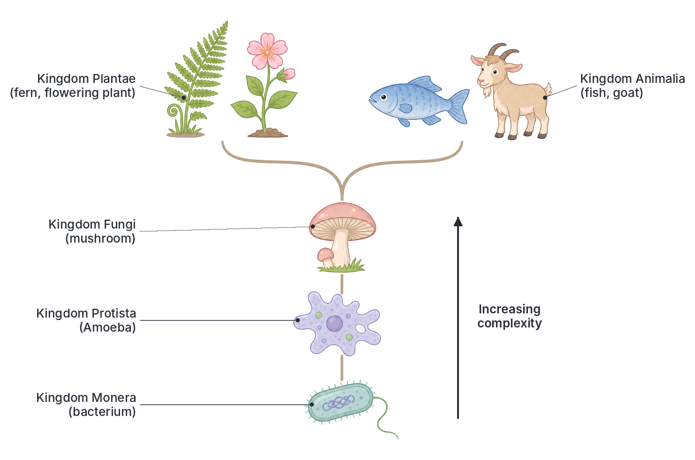

### Prokaryotes and eukaryotes

The first big step in the evolution of life was from **prokaryotic** to **eukaryotic** cells.

| Feature | Prokaryotic cell (Monera) | Eukaryotic cell (all other kingdoms) |
| --- | --- | --- |
| Nucleus | No true nucleus; DNA lies free in the cytoplasm (in a region called the **nucleoid**) | True nucleus, with DNA enclosed by a nuclear membrane |
| Chromosomes | One circular chromosome, plus small rings of DNA called **plasmids** | Several linear chromosomes |
| Membrane-bound organelles | Absent (no mitochondria, chloroplasts, ER or Golgi body) | Present |
| Ribosomes | Smaller | Larger |
| Size | Very small, about 1–10 micrometres | Usually larger, about 10–100 micrometres |
| Cell division | Binary fission | Mitosis and meiosis |
| Examples | Bacteria, blue-green algae | Protists, fungi, plants, animals |

## Kingdom Monera (prokaryotes)

**Objective i: analyse the external features and characteristics of the listed organisms.** This objective runs through the next three main sections. For each kingdom, you will find its general characteristics, then the structure and external features of each syllabus example, with tables comparing them.

**General characteristics of Monera:**

1. They are **prokaryotic**: they have no true nucleus and no membrane-bound organelles.
2. They are tiny and mostly **unicellular**, though some form chains, clusters, colonies or threads (filaments).
3. Most have a rigid **cell wall**, but it is not made of cellulose (in bacteria it is made of a substance called peptidoglycan, or murein).
4. They reproduce asexually, mainly by **binary fission**.
5. Their nutrition varies: most are heterotrophic (saprophytic or parasitic), but some are autotrophic (photosynthetic or chemosynthetic).
6. They are found almost everywhere: in soil, water, air, and inside other organisms.

### Bacteria

Bacteria (singular: bacterium) are the smallest cellular organisms. They can only be seen with a microscope; a typical bacterium is about 1 to 5 micrometres long. One gram of fertile soil can contain millions of bacteria.

#### Structure of a bacterial cell

| Part | Description | Function |
| --- | --- | --- |
| Capsule (slime layer) | A sticky outer layer, present in some bacteria | Protects the cell from drying out and from the host's white blood cells |
| Cell wall | A rigid layer of peptidoglycan (not cellulose) | Gives shape and protection |
| Cell membrane | Thin layer inside the wall | Controls what enters and leaves the cell |
| Cytoplasm | Jelly-like fluid with no membrane-bound organelles | Site of chemical reactions |
| Nucleoid (circular DNA) | A single coiled loop of DNA, not enclosed by a membrane | Controls the cell and carries genetic information |
| Plasmids | Small extra rings of DNA | Carry extra genes, e.g. for resistance to antibiotics |
| Ribosomes | Small granules | Make proteins |
| Flagellum (in some) | A long whip-like thread | Movement |
| Pili (in some) | Short hair-like threads | Attach to surfaces and to other bacteria |
| Food granules | Stores of glycogen and fat droplets | Food reserve |

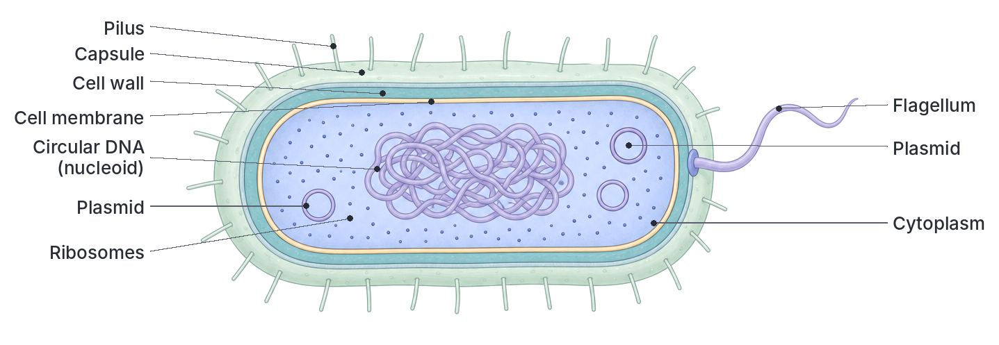

#### Shapes of bacteria

Bacteria are often named and identified by their shape:

| Shape | Name | Examples (and diseases) |
| --- | --- | --- |
| Round (spherical) | **Coccus** (plural: cocci) | In pairs: diplococci, e.g. *Neisseria gonorrhoeae* (gonorrhoea), *Streptococcus pneumoniae* (pneumonia). In chains: streptococci (sore throat). In clusters like grapes: staphylococci (boils, skin infections) |
| Rod-shaped | **Bacillus** (plural: bacilli) | *Salmonella typhi* (typhoid fever), *Mycobacterium tuberculosis* (tuberculosis), *Clostridium tetani* (tetanus), *Bacillus anthracis* (anthrax) |
| Spiral | **Spirillum** (plural: spirilla) | *Spirillum*; the corkscrew-shaped *Treponema pallidum* (syphilis) is a spirochaete |
| Comma-shaped | **Vibrio** (plural: vibrios) | *Vibrio cholerae* (cholera) |

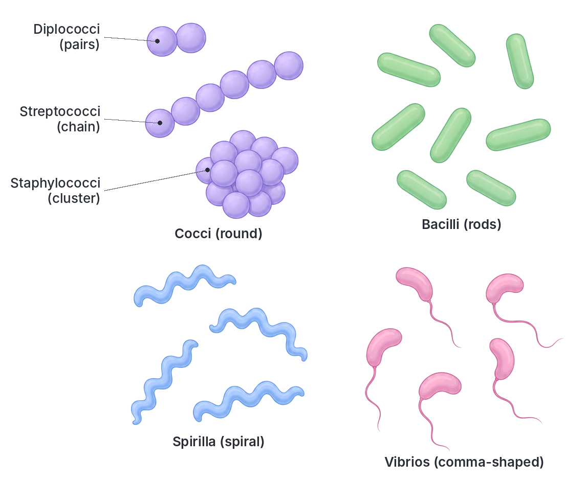

#### Nutrition in bacteria

- **Saprophytic bacteria** feed on dead organic matter, causing decay. They release minerals back into the soil.
- **Parasitic bacteria** live on or in living hosts and cause diseases such as cholera, typhoid, tuberculosis and tetanus.
- **Symbiotic (mutualistic) bacteria** live with another organism and both benefit, e.g. *Rhizobium* in the root nodules of legumes such as groundnut, cowpea and soya bean, which fixes nitrogen for the plant and gets food in return.
- **Autotrophic bacteria** make their own food. Some are photosynthetic; others are **chemosynthetic** and get energy from chemical reactions, e.g. the nitrifying bacteria *Nitrosomonas* and *Nitrobacter*.

#### Reproduction and life history of bacteria

Bacteria reproduce asexually by **binary fission**:

1. The bacterium takes in food and grows to its full size.
2. Its circular DNA copies itself (replicates), so there are two identical loops.
3. The two DNA copies move to opposite ends of the cell.
4. The cell membrane and cell wall grow inwards across the middle.
5. The cell splits into two identical daughter cells, each with one copy of the DNA.

Under ideal conditions (warmth, moisture and plenty of food), some bacteria can divide every **20 minutes**. That is why food left out in a warm kitchen goes bad quickly.

When conditions become bad (very dry, hot or short of food), some bacteria, such as *Clostridium* and *Bacillus*, form a tough, resistant **endospore** inside the cell. The endospore can survive boiling, drying and chemicals for years, and grows into a new bacterium when conditions improve. This is why tetanus spores in soil remain dangerous for a long time.

Some bacteria can also exchange genes by **conjugation**, in which DNA (often a plasmid) passes from one cell to another through a tube.

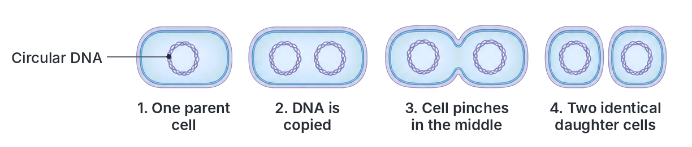

#### Economic importance of bacteria

| Useful bacteria | Harmful bacteria |
| --- | --- |
| **Decomposers** break down dead plants and animals and recycle nutrients | Cause human diseases: cholera, typhoid, tuberculosis, tetanus, gonorrhoea, pneumonia, diphtheria |
| **Nitrogen-fixing** bacteria (e.g. *Rhizobium* in legume root nodules) enrich the soil | Cause diseases of farm animals, e.g. anthrax in cattle |
| **Food production:** lactic acid bacteria (e.g. *Lactobacillus*) sour milk into yoghurt and nono, and help ferment cassava into garri and fufu, and maize into ogi (pap) | Cause plant diseases, e.g. bacterial blight of cassava |
| **Sewage treatment:** break down human waste | **Food spoilage:** make food go bad and can cause food poisoning |
| **Medicine and industry:** some (e.g. *Streptomyces*) produce antibiotics such as streptomycin; genetically modified bacteria make human insulin | **Denitrifying bacteria** convert nitrates in the soil back to nitrogen gas, reducing soil fertility |
| ***E. coli*** in the human large intestine makes vitamin K | Some bacteria contaminate water supplies |

### Blue-green algae (cyanobacteria)

Blue-green algae are prokaryotes that can **photosynthesise**. They are found in ponds, rice fields, damp soil, on wet walls and tree bark, and in hot springs. When water is rich in nutrients (e.g. from fertiliser run-off), they can grow so fast that they form a green scum on the surface, called an **algal bloom**.

**Textbook variation:** blue-green algae are now usually called **cyanobacteria**, because they are prokaryotes like bacteria and are not related to true algae (which are eukaryotes). Many West African textbooks still use the older name "blue-green algae", which is the name in the JAMB syllabus.

#### Features of blue-green algae

1. **Prokaryotic:** no true nucleus, no chloroplasts, no mitochondria.
2. **Pigments:** they contain chlorophyll *a* together with a blue pigment, **phycocyanin**, which gives them their blue-green colour (some also have a red pigment, phycoerythrin). The pigments sit on membranes spread through the cytoplasm, not inside chloroplasts.
3. **Body form:** they may be unicellular (e.g. *Chroococcus*), colonial, or filamentous (threads of cells, e.g. *Nostoc*, *Anabaena* and *Oscillatoria*).
4. **Mucilage:** most are covered by a slimy **mucilage sheath** that protects them from drying out.
5. **Food store:** they store food as **cyanophycean starch**, a glycogen-like carbohydrate.
6. **No flagella:** they have no flagella at any stage, but some (like *Oscillatoria*) can glide slowly.
7. **Nitrogen fixation:** some filamentous kinds, such as *Nostoc* and *Anabaena*, have large, thick-walled cells called **heterocysts**, where they fix nitrogen from the air.

#### *Nostoc*: a typical blue-green alga

*Nostoc* grows as jelly-like balls or sheets on damp soil and in ponds. Inside the jelly are many twisted, bead-like threads (filaments), each made of a chain of round cells. Here and there along the filament are larger, pale, thick-walled **heterocysts**, which fix nitrogen.

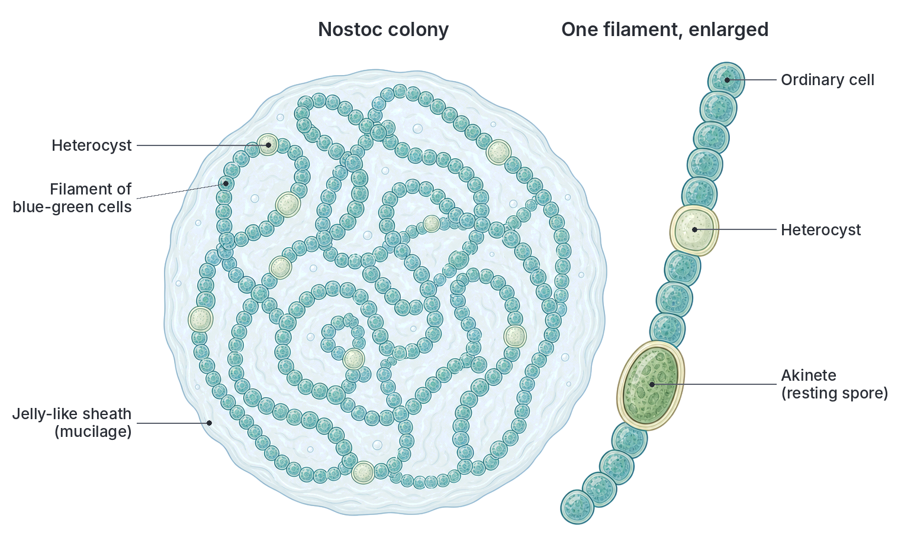

#### Reproduction in blue-green algae

Blue-green algae reproduce only **asexually**; there is no sexual reproduction.

- **Binary fission** in unicellular forms.
- **Fragmentation** in filamentous forms: the filament breaks into short pieces (called **hormogonia**), often at a heterocyst, and each piece grows into a new filament.
- **Akinetes** (resting spores): some cells become thick-walled and survive dry periods, then grow into new filaments when water returns.

#### Importance of blue-green algae

- They **fix nitrogen**, making the soil fertile. *Anabaena* living inside the water fern *Azolla* is used as a natural fertiliser in rice fields.
- They are **producers**: they photosynthesise and are food for small water animals at the base of food chains.
- They release **oxygen** into water and air. Scientists believe cyanobacteria were among the first organisms to release oxygen into the Earth's early atmosphere.
- **Harmful:** algal blooms block light and use up oxygen when they die and decay, which can kill fish; some produce toxins that poison drinking water.

### Bacteria and blue-green algae compared

| Feature | Bacteria | Blue-green algae |
| --- | --- | --- |
| Nucleus | No true nucleus | No true nucleus |
| Chlorophyll | Absent in most (a few photosynthetic bacteria have a different form, bacteriochlorophyll) | Present (chlorophyll *a*), with phycocyanin |
| Nutrition | Mostly heterotrophic | Autotrophic (photosynthetic) |
| Oxygen from photosynthesis | Not given off by photosynthetic bacteria | Given off |
| Flagella | Present in many | Absent |
| Body form | Unicellular, sometimes in chains or clusters | Unicellular, colonial or filamentous |
| Mucilage sheath | Capsule in some | Usually present |
| Reproduction | Binary fission; endospores | Binary fission, fragmentation, akinetes |

## Kingdom Protista

**General characteristics of Protista:**

1. They are **eukaryotic**: they have a true nucleus and membrane-bound organelles. This is a big evolutionary step up from Monera.
2. Most are **unicellular**; some form colonies.
3. They live in water or in moist places, including inside other organisms.
4. They move by **pseudopodia**, **cilia** or **flagella**.
5. Their nutrition may be autotrophic, heterotrophic, or both.
6. They reproduce asexually (binary fission or multiple fission), and some also reproduce sexually (e.g. conjugation).

The syllabus divides them into two groups:

| Feature | Protozoa ("first animals") | Protophyta ("first plants") |
| --- | --- | --- |
| Nutrition | Heterotrophic (holozoic, parasitic or saprophytic) | Autotrophic (photosynthesis) |
| Chlorophyll | Absent | Present, in chloroplasts |
| Cell wall | Absent; may have a pellicle | Usually present |
| Movement | Usually active (pseudopodia, cilia, flagella) | Some move by flagella; others float |
| Examples | *Amoeba*, *Paramecium*, *Plasmodium* (causes malaria), *Trypanosoma* (causes sleeping sickness) | Diatoms, *Euglena* (has chloroplasts but no cell wall), *Chlamydomonas* (in some textbooks) |

*Euglena* sits between the two groups, because it can feed both like a plant and like an animal.

### *Amoeba*

*Amoeba* (e.g. *Amoeba proteus*) is a tiny, single-celled protozoan that lives in the mud at the bottom of freshwater ponds and streams. It is about 0.25 mm across, just visible as a white speck. It has no fixed shape: it is always changing its shape.

#### External features and structure

| Part | Description | Function |
| --- | --- | --- |
| Plasma membrane (plasmalemma) | A thin, flexible membrane around the cell | Controls what enters and leaves; allows gas exchange and excretion by diffusion over the whole body surface |
| Ectoplasm | Clear, firm outer layer of cytoplasm | Helps form pseudopodia |
| Endoplasm | Granular, more fluid inner cytoplasm | Contains the organelles; flows to form pseudopodia |
| Pseudopodia ("false feet") | Finger-like extensions of the cytoplasm | Movement and capturing food |
| Nucleus | A single, disc-shaped nucleus | Controls all activities and reproduction |
| Food vacuoles | Bubbles containing food and enzymes | Digestion of food |
| Contractile vacuole | A clear vacuole that fills and empties | Removes excess water (osmoregulation) |

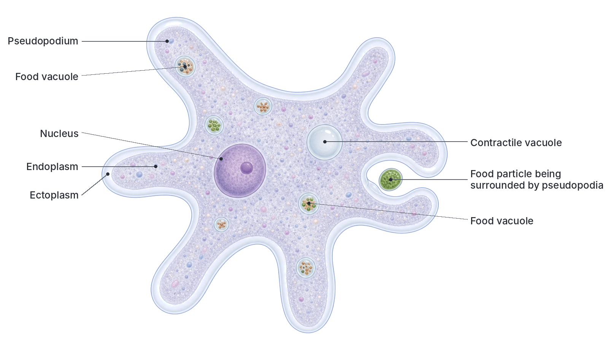

#### Life processes in *Amoeba*

- **Movement:** the endoplasm flows forward into a bulge of the cell, forming a **pseudopodium**. The rest of the cell follows. This is called **amoeboid movement**.
- **Feeding (holozoic):** when *Amoeba* meets a food particle (e.g. a bacterium or a tiny alga), two pseudopodia flow around it and trap it with a little water in a **food vacuole**. This engulfing is called **phagocytosis**. Enzymes digest the food, the soluble products are absorbed into the cytoplasm, and undigested remains are left behind as the *Amoeba* moves on (egestion can happen anywhere on its surface).
- **Respiration and excretion:** oxygen diffuses in and carbon dioxide and ammonia diffuse out through the whole cell membrane.
- **Osmoregulation:** water keeps entering by osmosis, because the cytoplasm is more concentrated than pond water. The **contractile vacuole** collects this water, moves to the surface and bursts, pushing it out. Without it, *Amoeba* would swell and burst.
- **Response:** it moves away from strong light, harmful chemicals and touch, and towards food.

#### Life history of *Amoeba*

*Amoeba* reproduces asexually; there is no sexual reproduction.

**1. Binary fission (in good conditions):**

1. *Amoeba* grows to full size, becomes round, and pulls in its pseudopodia.
2. The nucleus divides into two by mitosis.
3. The two nuclei move apart, and the cytoplasm pinches in at the middle.
4. The cell splits into two identical daughter amoebae.
5. Each daughter feeds, grows and repeats the process.

**2. Encystment and multiple fission (in bad conditions):** when the pond dries up or becomes too cold or foul, *Amoeba* rounds up and forms a tough protective wall around itself, called a **cyst**. Inside the cyst, it can stay alive without feeding. In some species the nucleus divides many times (multiple fission) inside the cyst to form many tiny amoebae. When conditions improve, the cyst bursts and the young amoebae are released. Cysts can also be blown by the wind to new ponds.

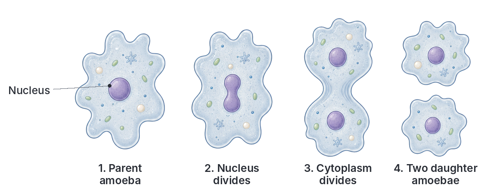

**Relative of note:** *Entamoeba histolytica*, a relative of *Amoeba*, is a parasite that causes **amoebic dysentery** when its cysts are swallowed in dirty water or food.

### *Euglena*

*Euglena* was described in Topic A1 (cell level). Here we look at its external features, nutrition and life history as a member of Protista.

#### External features

- Spindle-shaped (tapering at both ends), about 0.05 mm long, green in colour.
- Covered by a flexible **pellicle**, not a cellulose wall.
- A long **flagellum** comes out of a flask-shaped **gullet** (reservoir) at the front end.
- A red **eyespot** (stigma) near the gullet.
- Many oval **chloroplasts** in the cytoplasm.

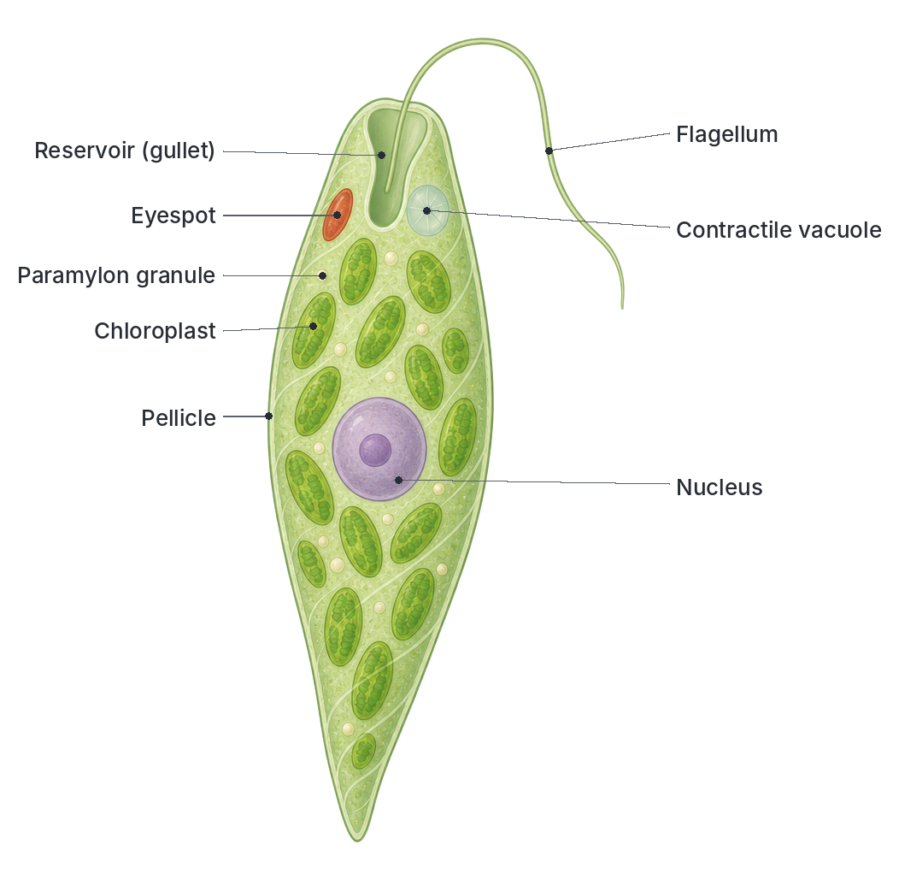

#### Characteristics shared with plants and animals

| Plant-like features | Animal-like features |
| --- | --- |
| Has chloroplasts with chlorophyll | No cellulose cell wall; has a pellicle |
| Makes its own food by photosynthesis in light | Can feed heterotrophically in darkness, absorbing dissolved organic food |
| Stores a starch-like carbohydrate (paramylon) | Moves actively with a flagellum |
| | Has a contractile vacuole and an eyespot, and responds quickly to light |

#### Life history of *Euglena*

**1. Longitudinal binary fission (in good conditions):**

1. The nucleus divides by mitosis.
2. The gullet, flagellum base and other organelles are copied.
3. The cell begins to split lengthwise from the front end backwards.
4. Two daughter euglenas separate; one keeps the old flagellum and the other grows a new one.

**2. Encystment (in bad conditions):** in drought or cold, *Euglena* loses its flagellum, rounds up and forms a thick-walled **cyst**. It can divide inside the cyst. When conditions improve, the cyst wall breaks and new euglenas are released.

No sexual reproduction has been confirmed in *Euglena*.

### *Paramecium*

*Paramecium* was also introduced in Topic A1. Here we focus on its external features and life history.

#### External features

- **Slipper-shaped**, about 0.2 to 0.3 mm long, with a blunt front end and a pointed back end.
- Covered by a firm **pellicle**, so its shape stays fixed.
- The whole body is covered with rows of short **cilia**.
- A shallow groove, the **oral groove**, runs along one side to the **cytostome** (cell mouth) and gullet.
- Two star-shaped **contractile vacuoles**, one at each end.

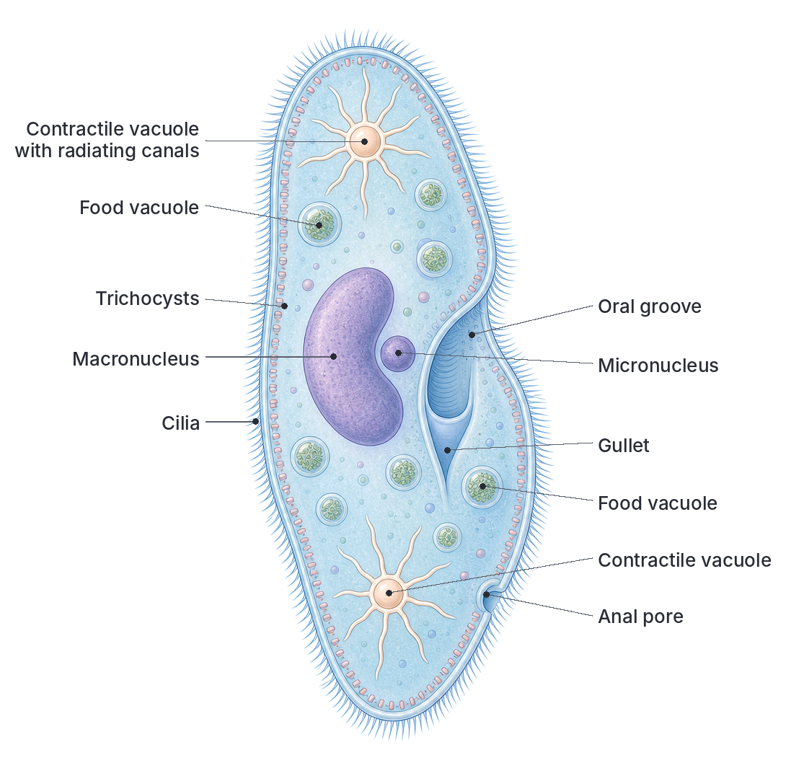

#### Characteristics

- **Nutrition:** holozoic. Cilia sweep bacteria and small particles down the oral groove into the gullet, where they form a food vacuole. The vacuole circulates in the cytoplasm (cyclosis) while enzymes digest the food. Waste is passed out at the **anal pore**.
- **Two nuclei:** the large **macronucleus** controls everyday metabolism; the small **micronucleus** controls reproduction.
- **Defence:** **trichocysts** fire sticky threads when the animal is disturbed.
- **Response:** if it bumps into an obstacle or a harmful chemical, it reverses its cilia, backs away, turns slightly and swims forward again (the "avoiding reaction").

#### Life history of *Paramecium*

**1. Transverse binary fission (asexual, in good conditions):**

1. The micronucleus divides by mitosis; the macronucleus stretches and splits into two.
2. A new oral groove and contractile vacuoles begin to form.
3. A furrow appears across the middle of the body.
4. The cell divides across into a front and a back daughter, each with a full set of structures.

This can happen two or three times a day when food is plentiful.

**2. Conjugation (sexual, often when conditions are unfavourable):**

1. Two paramecia of different mating types come together and join at their oral grooves.
2. In each, the macronucleus breaks down and disappears.
3. The micronucleus divides by meiosis to form four nuclei. Three of these break down.
4. The remaining nucleus divides into two: a **stationary** nucleus and a **migratory** nucleus.
5. The two partners swap their migratory nuclei across a bridge of cytoplasm.
6. In each partner, the incoming migratory nucleus fuses with the stationary nucleus to form a **zygote nucleus** (fertilisation).
7. The two partners separate (they are now called exconjugants).
8. In each exconjugant, the zygote nucleus divides several times and new macro- and micronuclei form. The cell then divides, finally producing **four** daughter paramecia from each exconjugant.

Conjugation does not increase numbers straight away, but it mixes genes, giving variation and making the offspring healthier and more able to survive.

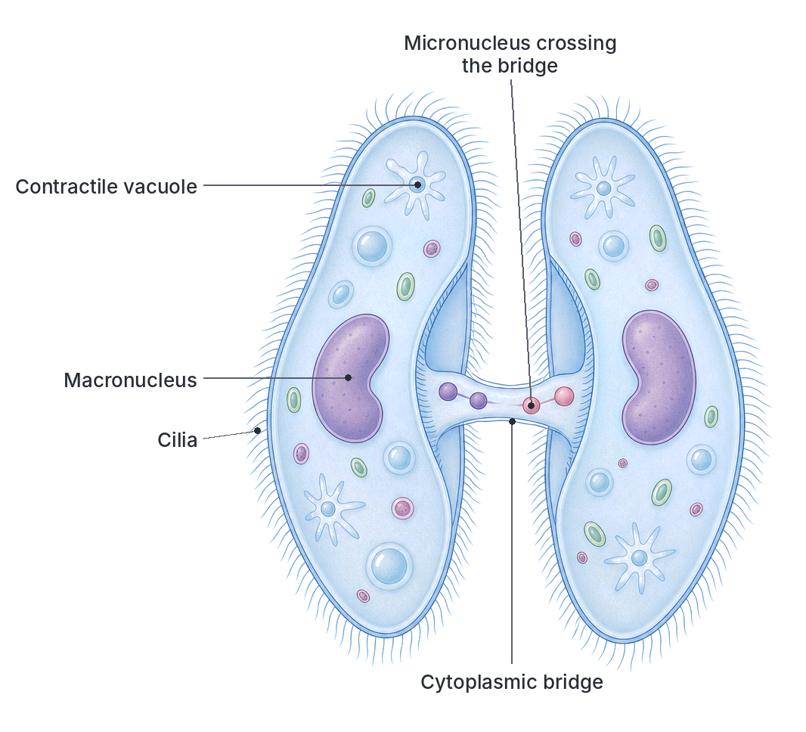

### Comparing *Amoeba*, *Euglena* and *Paramecium*

| Feature | *Amoeba* | *Euglena* | *Paramecium* |
| --- | --- | --- | --- |
| Shape | Irregular, always changing | Spindle-shaped, slightly flexible | Fixed slipper shape |
| Body covering | Thin plasma membrane | Flexible pellicle | Firm pellicle |
| Organ of movement | Pseudopodia | One long flagellum | Many cilia |
| Nutrition | Holozoic (phagocytosis) | Autotrophic in light; heterotrophic in darkness | Holozoic (through the oral groove) |
| Chloroplasts | Absent | Present | Absent |
| Eyespot | Absent | Present | Absent |
| Nuclei | One | One | Two (macronucleus and micronucleus) |
| Contractile vacuoles | One | One | Two |
| Fixed mouth | No; food taken in anywhere | Gullet (used mainly for the flagellum, not for feeding) | Yes: oral groove and cytostome |
| Fixed point for egestion | No | Not applicable | Yes: anal pore |
| Asexual reproduction | Binary fission; multiple fission in cysts | Longitudinal binary fission | Transverse binary fission |
| Sexual reproduction | None | None known | Conjugation |

## Kingdom Fungi

**General characteristics of fungi:**

1. They are **eukaryotic** and have **no chlorophyll**, so they cannot make their own food.
2. They are **heterotrophic**. They feed by **absorption**: they release digestive enzymes onto their food, then absorb the digested products. They may be:
   - **saprophytes**, feeding on dead organic matter (e.g. *Rhizopus*, mushroom);
   - **parasites**, feeding on living hosts (e.g. ringworm fungus);
   - **symbionts**, living in partnership with other organisms (e.g. lichens, mycorrhizae on plant roots).
3. Except for yeast (unicellular), the body is made of fine, branching threads called **hyphae** (singular: hypha). A mass of hyphae is called a **mycelium**.
4. Their cell walls are made of **chitin** (the same tough material as in insect skeletons), not cellulose.
5. They store food as **glycogen** and oil, not starch.
6. They reproduce by **spores**, both asexually and sexually.
7. They grow best in warm, damp, dark places.

### *Rhizopus* (bread mould)

*Rhizopus* (e.g. *Rhizopus stolonifer*) is the common **bread mould**. It is the white, fluffy growth with black dots that you see on stale, damp bread, rotting fruits such as tomatoes and oranges, and stored yams. It is a **saprophyte**.

#### Structure and external features

| Part | Description | Function |
| --- | --- | --- |
| Hyphae | White, thread-like, branched tubes; they are **coenocytic** (no cross walls, with many nuclei in a continuous cytoplasm) | Make up the body (mycelium); grow over and into the food |
| Stolons | Horizontal hyphae that arch over the surface | Spread the fungus to new areas |
| Rhizoids | Short, root-like, branched hyphae that grow down into the food where stolons touch it | Anchor the mould; secrete enzymes and absorb digested food |
| Sporangiophores | Upright hyphae that grow up in groups from the same point as the rhizoids | Hold up the sporangia, so spores can be blown away |
| Sporangium | A round, black knob at the tip of each sporangiophore | Produces and holds thousands of spores |
| Columella | A dome-shaped swelling inside the sporangium | Supports the sporangium |
| Spores | Tiny, light, dry cells in the sporangium | Dispersed by wind; each grows into a new mycelium |

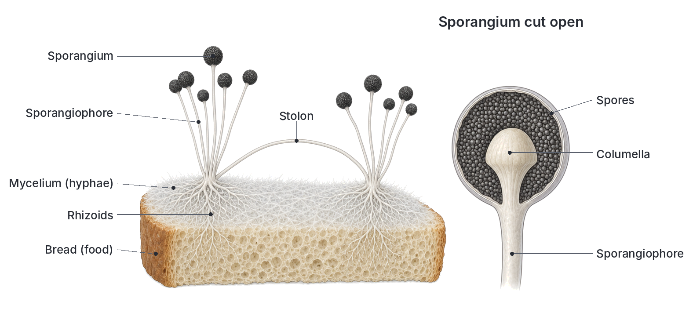

#### Nutrition in *Rhizopus*

1. The rhizoids and hyphae release enzymes (such as amylase and protease) onto the bread.
2. The enzymes digest starch and proteins outside the fungus into simple soluble sugars and amino acids.
3. The hyphae absorb the dissolved food.
4. The food is used for growth and respiration. This is **saprophytic** nutrition.

#### Life history of *Rhizopus*

**1. Asexual reproduction (by spores, in good conditions):**

1. Sporangiophores grow upwards from the mycelium.
2. The tip of each swells into a sporangium. Inside, the cytoplasm and nuclei divide to form many spores.
3. The sporangium turns black as the spores mature.
4. The sporangium wall dries and breaks, releasing the spores into the air.
5. The light spores are carried by wind to new food.
6. When a spore lands on damp food, it **germinates**, sending out a hypha that grows into a new mycelium.

**2. Sexual reproduction (by conjugation, often when food runs short):** *Rhizopus* has two mating strains that look the same, called **+ (plus)** and **– (minus)** strains.

1. Hyphae from a + strain and a – strain grow close together.
2. Each sends out a short side branch (a **progametangium**) towards the other, and they touch at their tips.
3. The tip of each branch is cut off by a cross wall, forming a **gametangium**, which contains many nuclei.
4. The walls between the two gametangia break down, and their contents mix. Nuclei from the + and – strains fuse in pairs.
5. The fused cell becomes a **zygospore**, which develops a thick, dark, warty wall. It can survive bad conditions (drought, cold, lack of food) for a long time.
6. When conditions improve, the zygospore germinates (meiosis takes place) and produces a short hypha with a sporangium at its tip, called a **germ sporangium**.
7. The germ sporangium releases spores, which grow into new mycelia of both + and – strains.

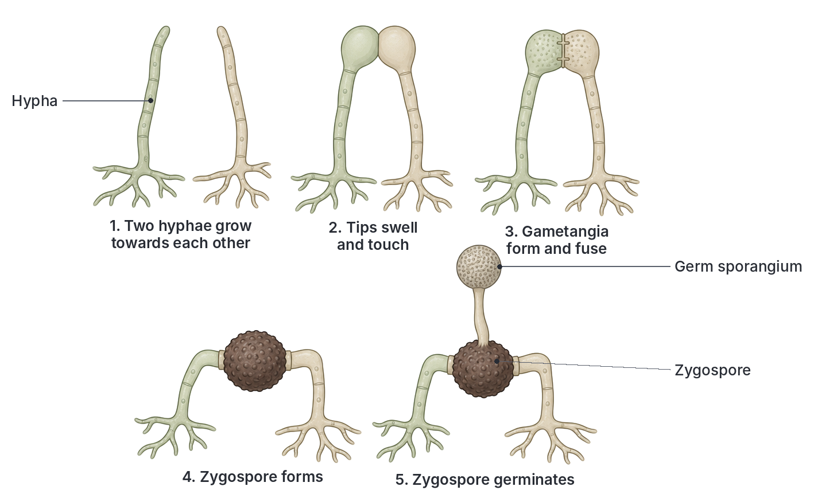

### Mushroom

A mushroom is the **fruiting body** of a fungus that mostly lives as a mycelium hidden in soil, decaying leaves, dung or rotting wood. Mushrooms appear after rain, especially in the rainy season, on lawns, farmland, termite hills and tree stumps. The common field mushroom is *Agaricus*. In Nigeria, edible mushrooms such as *Termitomyces* (which grows from termite mounds) and the oyster mushroom (*Pleurotus*, which is also cultivated) are collected and eaten.

#### Structure and external features

| Part | Description | Function |
| --- | --- | --- |
| Mycelium | A mass of hyphae in the soil, with cross walls (septate hyphae) | Absorbs food from the soil; produces new fruiting bodies |
| Stalk (stipe) | An upright stem | Raises the cap above the ground, so spores can be blown away |
| Ring (annulus) | A thin skirt of tissue around the stalk, present in some mushrooms | The remains of the veil that covered the gills of the young mushroom |
| Cap (pileus) | The umbrella-shaped top | Protects the gills from rain |
| Gills (lamellae) | Thin, radiating plates under the cap | Produce and release spores |
| Basidia | Club-shaped cells on the surface of the gills | Each produces four **basidiospores** |
| Volva (in some, e.g. *Amanita*) | A cup at the base of the stalk | Remains of a covering around the young mushroom |

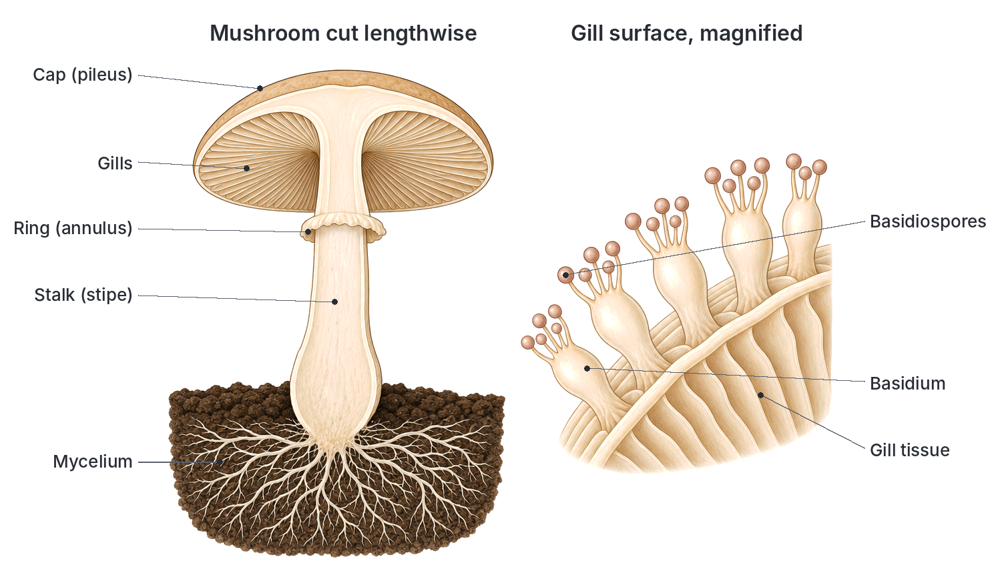

#### Life history of a mushroom

1. **Spore release:** millions of **basidiospores** fall from the gills and are blown away by wind.
2. **Germination:** a spore lands on damp soil or rotting material and germinates to form a **primary mycelium**. Its cells each contain one nucleus.
3. **Fusion of hyphae:** a hypha from one primary mycelium meets and fuses with a hypha from a compatible primary mycelium. Their cytoplasm joins, but the nuclei do not fuse yet. The result is a **secondary mycelium**, in which each cell contains **two** nuclei (one from each parent).
4. **Growth:** the secondary mycelium grows through the soil for a long time, absorbing food from dead organic matter.
5. **Button stage:** when conditions are right (warm and wet), the hyphae grow together into a tight knob just under the ground, called the **button**.
6. **Fruiting body:** the button absorbs water, swells, and quickly pushes up through the soil, opening into a mature mushroom with a stalk, cap and gills. The veil covering the gills breaks, leaving the ring.
7. **Spore formation:** on the gills, in each basidium, the two nuclei fuse (fertilisation). The fused nucleus then divides by meiosis into four nuclei, which pass into four **basidiospores** on short stalks at the tip of the basidium.
8. The basidiospores are shot off and blown away, and the cycle starts again.

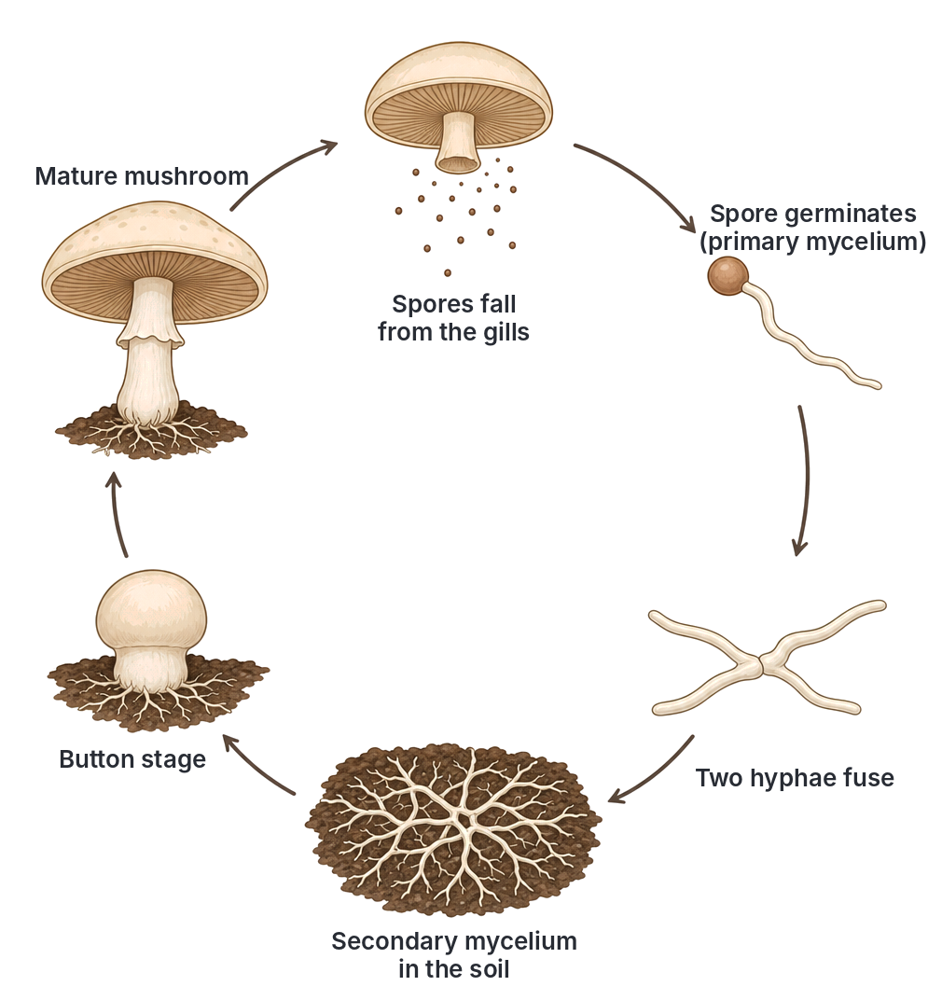

**Edible vs poisonous mushrooms:** many mushrooms are nutritious and rich in protein, but some, such as the death cap (*Amanita phalloides*), are deadly poisonous. Poisonous and edible species can look very alike, so wild mushrooms should only be eaten when identified by an expert.

### Comparing *Rhizopus* and mushroom

| Feature | *Rhizopus* | Mushroom |
| --- | --- | --- |
| Hyphae | No cross walls (coenocytic) | With cross walls (septate) |
| Fruiting body | None; only sporangia on sporangiophores | Large fruiting body with stalk, cap and gills |
| Where spores are made | In sporangia | On basidia on the gills |
| Asexual spores | Sporangiospores | Not usually formed |
| Sexual stage | Conjugation of + and – strains forms a zygospore | Fusion of hyphae, then nuclear fusion in basidia, forms basidiospores |
| Habitat | Bread, fruits, stored yam | Soil, dead wood, dung, termite mounds |
| Size | Microscopic threads, visible as fluffy mould | Large, easily visible |

### Economic importance of fungi

| Useful | Harmful |
| --- | --- |
| **Decomposers:** break down dead matter and recycle nutrients | **Food spoilage:** *Rhizopus* and other moulds spoil bread, fruits and stored yams |
| **Food:** edible mushrooms are rich in protein | **Poisoning:** some mushrooms are poisonous; *Aspergillus flavus* on badly stored groundnuts and maize makes **aflatoxin**, which damages the liver and can cause cancer |
| **Yeast** ferments sugar to alcohol and carbon dioxide; it is used in brewing beer, in the fermentation of palm wine and burukutu, and in making bread rise | **Human diseases:** ringworm and athlete's foot (skin), thrush (*Candida*) |
| **Antibiotics:** penicillin from the mould *Penicillium* | **Plant diseases:** rusts and smuts of cereals, and leaf spots of many crops |
| **Industry:** enzymes and citric acid from moulds | **Damage to materials:** moulds rot timber, leather and cloth in damp conditions |

**Textbook variation:** the black pod disease of cocoa, a very important disease in Nigeria, is caused by *Phytophthora*. Older textbooks call *Phytophthora* a fungus; modern biologists place it in a separate group (water moulds, or oomycetes), because its cell walls are made of cellulose, not chitin.

## Increase in structural complexity

**Objective ii: apply the knowledge of external features to demonstrate increase in structural complexity.**

When you compare Monera, Protista and Fungi, you can see living things becoming more complex step by step:

| Level of complexity | Group | Key advance |
| --- | --- | --- |
| 1. Simplest | Bacteria | Tiny single cells with no nucleus and no membrane-bound organelles |
| 2. | Blue-green algae | Still prokaryotic, but with chlorophyll for photosynthesis; some form filaments with specialised cells (heterocysts) |
| 3. | *Amoeba* | A true nucleus and organelles (eukaryotic), but no fixed shape and no special structures for feeding or movement apart from temporary pseudopodia |
| 4. | *Euglena* | Fixed organelles for special jobs: a flagellum for movement, an eyespot for sensing light, chloroplasts for making food |
| 5. | *Paramecium* | Many fixed organelles: cilia, an oral groove and gullet (fixed "mouth"), an anal pore, two contractile vacuoles, and two types of nucleus with different jobs. A single cell with clear division of labour |
| 6. | *Rhizopus* | Many-nucleate, multicellular-like body of hyphae, with parts specialised as stolons, rhizoids and sporangiophores; sexual reproduction with resistant zygospores |
| 7. Most complex here | Mushroom | Hyphae with cross walls, packed together to build a large, organised fruiting body with stalk, cap and gills |

**The main trends:**

1. **From prokaryotic to eukaryotic:** the nucleus and organelles become enclosed in membranes.
2. **From unicellular to multicellular:** single cells → colonies and filaments → large bodies made of many cells or hyphae.
3. **Increasing specialisation:** structures become fixed and specialised for particular jobs (division of labour).
4. **From asexual to sexual reproduction:** Monera reproduce only asexually; *Paramecium*, *Rhizopus* and mushroom also reproduce sexually, which brings variation.
5. **From water to land:** Monera and Protista live in water or very wet places, moving with flagella, cilia or pseudopodia; fungi live on land (on damp food, soil and wood) and use **wind-dispersed spores** instead of swimming cells. This begins the trend continued by plants in Part 2.

## Life histories at a glance

**Objective iii: trace the stages in the life histories of the listed organisms.**

| Organism | Asexual reproduction | Sexual reproduction | Resting/survival stage |
| --- | --- | --- | --- |
| Bacteria | Binary fission (as fast as every 20 minutes) | None (but genes can be exchanged by conjugation) | Endospore |
| Blue-green algae | Binary fission, fragmentation (hormogonia) | None | Akinete |
| *Amoeba* | Binary fission; multiple fission inside a cyst | None | Cyst |
| *Euglena* | Longitudinal binary fission | None known | Cyst |
| *Paramecium* | Transverse binary fission | Conjugation | None well known |
| *Rhizopus* | Spores from sporangia | Conjugation of + and – strains | Zygospore |
| Mushroom | (Rarely) | Fusion of hyphae, then nuclear fusion and meiosis in basidia | Underground mycelium |

## Key terms

| Term | Meaning |
| --- | --- |
| Evolution | The gradual change of living things over a long time, from simple to more complex forms |
| Classification | Sorting living things into groups based on shared features |
| Binomial nomenclature | Giving each organism a two-part scientific name (genus and species) |
| Prokaryote | An organism whose cells have no true nucleus or membrane-bound organelles, e.g. bacteria |
| Eukaryote | An organism whose cells have a true nucleus and membrane-bound organelles |
| Binary fission | Asexual reproduction in which one cell divides into two |
| Endospore | A tough resting structure formed inside some bacteria to survive bad conditions |
| Heterocyst | A thick-walled cell in some blue-green algae where nitrogen is fixed |
| Pseudopodium | A temporary "false foot" of cytoplasm used by *Amoeba* for movement and feeding |
| Conjugation | A sexual process in which two cells or hyphae join and exchange or fuse nuclei |
| Hypha | A single thread of a fungus |
| Mycelium | A mass of fungal hyphae |
| Saprophyte | An organism that feeds on dead organic matter by external digestion and absorption |
| Sporangium | A structure that produces spores |
| Zygospore | A thick-walled resting spore formed by conjugation in *Rhizopus* |
| Basidiospore | A spore produced on the basidium of a mushroom |

## Exam tips and common mistakes

- **Blue-green algae are prokaryotes:** they have chlorophyll but **no chloroplasts** and no true nucleus. Don't put them with true algae like *Spirogyra*.
- **Fungi are not plants:** they have no chlorophyll, their cell walls are made of chitin, and they store glycogen, not starch.
- ***Euglena* is "plant-like and animal-like":** expect questions asking which feature makes it plant-like (chloroplasts) or animal-like (no cell wall, flagellum, heterotrophic in darkness).
- **Binary fission directions:** *Euglena* splits **lengthwise** (longitudinal); *Paramecium* splits **across** (transverse).
- ***Paramecium* nuclei:** macronucleus = everyday activities; micronucleus = reproduction.
- **Contractile vacuoles** are for osmoregulation (removing excess water), not mainly for excretion.
- ***Rhizopus* parts:** rhizoids absorb food and anchor; stolons spread; sporangiophores carry sporangia.
- **Zygospore** = result of sexual reproduction in *Rhizopus* and its survival stage. **Basidiospores** = spores of the mushroom, made on the gills.
- **Shapes of bacteria:** coccus (round), bacillus (rod), spirillum (spiral), vibrio (comma). *Vibrio cholerae* causes cholera.

## Quick summary

1. Living things are classified into five kingdoms: Monera, Protista, Fungi, Plantae and Animalia, arranged from simple to complex.
2. Monera (bacteria and blue-green algae) are prokaryotes: no true nucleus and no membrane-bound organelles. They reproduce by binary fission.
3. Blue-green algae (cyanobacteria) photosynthesise using chlorophyll and phycocyanin, and some (e.g. *Nostoc*, *Anabaena*) fix nitrogen in heterocysts.
4. Protista are mostly single-celled eukaryotes: *Amoeba* (pseudopodia), *Euglena* (flagellum, chloroplasts) and *Paramecium* (cilia, two nuclei, conjugation).
5. Fungi lack chlorophyll, feed saprophytically by external digestion and absorption, have chitin cell walls, and are built of hyphae.
6. *Rhizopus* reproduces asexually by spores from sporangia, and sexually by conjugation of + and – strains to form a zygospore.
7. The mushroom is the fruiting body of a fungus; basidiospores form on basidia on its gills and grow into new mycelia.
8. Complexity increases from prokaryotic cells, to specialised single eukaryotic cells, to multicellular fungi with organised fruiting bodies.

## Practice questions

**1. Which of the following organisms is a prokaryote?**

- A. *Amoeba*
- B. *Nostoc*
- C. *Rhizopus*
- D. *Euglena*

**Answer: B.** *Nostoc* is a blue-green alga (cyanobacterium), which has no true nucleus. The others are eukaryotes.

**2. The feature that makes Euglena plant-like is the possession of**

- A. a flagellum
- B. a contractile vacuole
- C. chloroplasts
- D. a pellicle

**Answer: C.** Chloroplasts allow *Euglena* to photosynthesise like a plant. The flagellum and pellicle are animal-like features.

**3. In Rhizopus, the structures that anchor the mould and absorb digested food are the**

- A. sporangiophores
- B. stolons
- C. rhizoids
- D. sporangia

**Answer: C.** Rhizoids grow into the food, anchor the mould, secrete enzymes and absorb digested food.

**4. A comma-shaped bacterium is described as a**

- A. coccus
- B. bacillus
- C. spirillum
- D. vibrio

**Answer: D.** Vibrios are comma-shaped, e.g. *Vibrio cholerae*, which causes cholera.

**5. The main function of the contractile vacuole in Amoeba is to**

- A. digest food
- B. remove excess water
- C. store food
- D. produce new cells

**Answer: B.** Water enters *Amoeba* by osmosis; the contractile vacuole collects and pumps it out (osmoregulation).

**6. Conjugation in Paramecium is important because it**

- A. increases the number of individuals immediately
- B. produces spores
- C. brings about variation
- D. removes waste

**Answer: C.** Conjugation exchanges genetic material between two individuals, producing variation. It does not immediately increase numbers.

**7. The product of sexual reproduction in Rhizopus is the**

- A. sporangium
- B. zygospore
- C. basidiospore
- D. gametangium

**Answer: B.** Fusion of + and – gametangia produces a thick-walled zygospore, which can survive bad conditions.

**8. In a mushroom, spores are produced on the**

- A. stalk
- B. ring
- C. gills
- D. mycelium

**Answer: C.** Basidia on the gills under the cap produce the basidiospores.

**9. Which of the following shows increasing structural complexity?**

- A. Mushroom → *Paramecium* → bacterium
- B. Bacterium → *Amoeba* → *Paramecium*
- C. *Paramecium* → bacterium → *Amoeba*
- D. *Amoeba* → mushroom → bacterium

**Answer: B.** Bacteria are prokaryotes; *Amoeba* is a simple eukaryotic cell; *Paramecium* has many fixed, specialised organelles.

**10. Fungi differ from green plants because fungi**

- A. have cell walls
- B. reproduce by spores
- C. lack chlorophyll
- D. are multicellular

**Answer: C.** Fungi have no chlorophyll and cannot make their own food. Plants and fungi both have cell walls, and some plants (ferns, mosses) also reproduce by spores.
