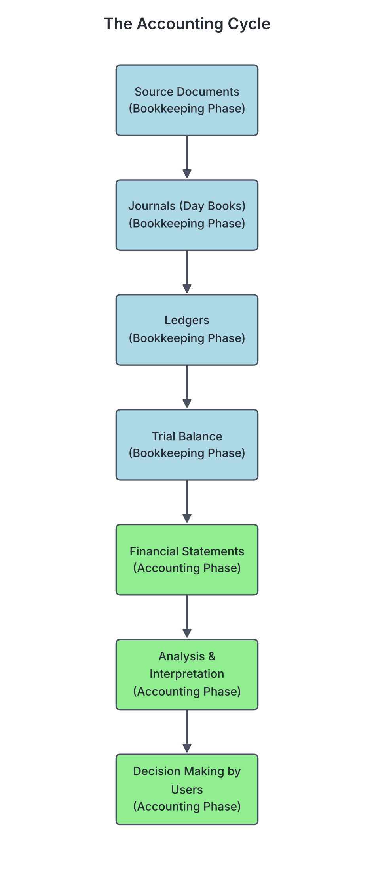
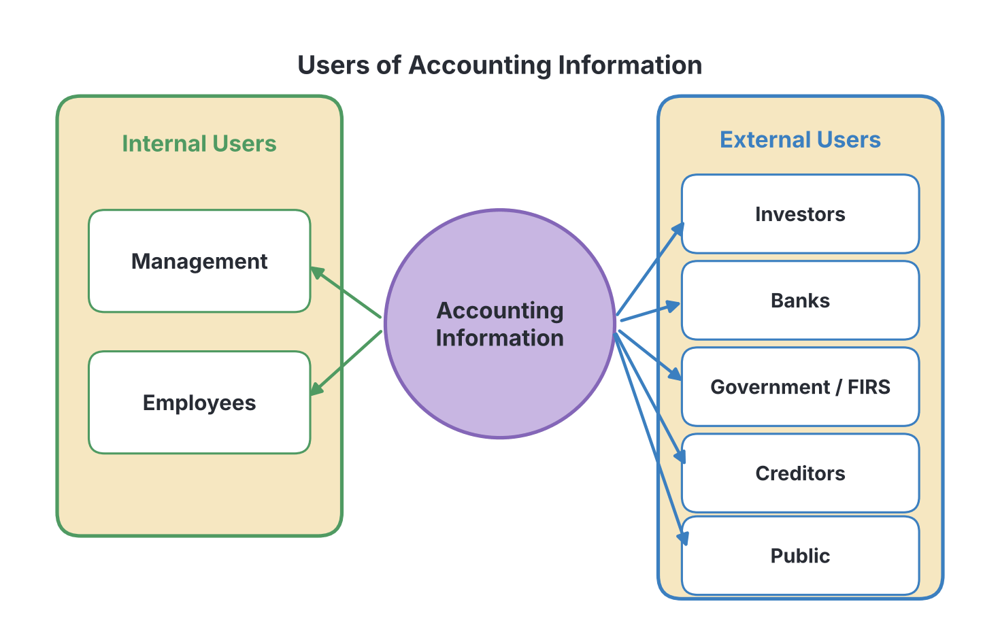

# JAMB Accounting Notes: Nature and Significance of Book keeping and Accounting

## What JAMB expects

This topic is Topic 1 of the JAMB Principles of Accounts syllabus: Nature and Significance of Book keeping and Accounting. It covers the foundation of accounting, its history, rules, and its real-world uses.

**The syllabus covers the following content items:**
* a. Development of Accounting (including branches of accounting)
* b. Objectives of Book Keeping and accounting
* c. Users and characteristics of Accounting information
* d. Principles, concepts and conventions of Accounting (nature, significance and application)
* e. Role of Accounting records and information
* f. Career opportunities in Book Keeping and Accounting

**By the end of these notes, you should be able to:**
1. differentiate between Book Keeping and Accounting;
2. understand the historical background of Book Keeping and Accounting;
3. apply the right principles, concepts and conventions to solving Accounting problems;
4. understand the role of Accounting information in decision making;
5. identify the types/branches of Accounting such as Cost Accounting, Management Accounting, Auditing, Financial Accounting, Forensic Accounting, Social and Environmental Accounting, Government Accounting and Taxation; and
6. identify the different career opportunities in Book Keeping and Accounting.

**Note on the syllabus wording:** JAMB uses the spelling "Book keeping" (two words) and capitalises "Accounting" throughout. The standard English spelling is usually "bookkeeping" (one word). In these notes, we use both interchangeably.

## Historical background of Book keeping and Accounting

**Objective ii: understand the historical background of Book Keeping and Accounting.**
**Content a (part 1): Development of Accounting.**

Accounting is often called the "language of business". Like any language, it has developed over thousands of years as human trade became more complex.

### The early history
In ancient times, before money was invented, people traded by exchanging goods directly (the **barter system**). As kingdoms grew in places like ancient Egypt, Mesopotamia (modern-day Iraq), and Rome, kings and wealthy merchants needed to track their wealth, taxes, and grains. They used simple records on clay tablets, papyrus, or stones. These early records were kept by **stewards** (people trusted to manage another person's wealth).

### Luca Pacioli and the Double-Entry System
The most important milestone in accounting history happened in Italy during the 15th century. Merchants in cities like Venice and Genoa were trading heavily and needed a better system to track their profits and debts. 

In **1494**, an Italian monk and mathematician named **Luca Pacioli** published a book titled *Summa de Arithmetica, Geometria, Proportioni et Proportionalita* (Everything About Arithmetic, Geometry, and Proportions). In this book, he described the **double-entry bookkeeping system** used by Venetian merchants. 
* He introduced the use of terms similar to **debit** (from Latin *debita*, meaning owed to) and **credit** (from Latin *credo*, meaning owed by).
* Because he was the first to publish these rules in detail, Luca Pacioli is globally known as the **"Father of Accounting"**.

### The Industrial Revolution
In the 18th and 19th centuries, the Industrial Revolution changed the world. Businesses grew from small family workshops into massive factories. This required large amounts of capital, leading to the creation of **joint-stock companies** where the owners (shareholders) were different from the people running the business (managers). 
* The owners needed independent reports to know if the managers were doing a good job. This gave birth to **Auditing**.
* Factories also needed to know exactly how much it cost to produce items to set prices, which led to the development of **Cost Accounting**.

### Development of Accounting in Nigeria
Before the colonial era, Nigerians kept track of trade (using cowries, manillas, and barter) through memory, notches on wood, or marks on walls. 

Modern accounting in Nigeria began during the colonial era, driven by British trading companies like the Royal Niger Company and the colonial government, which needed formal financial records. 
* **Mr. Akintola Williams** became the first Nigerian to qualify as a Chartered Accountant in 1949.
* In **1965**, the **Institute of Chartered Accountants of Nigeria (ICAN)** was established by an Act of Parliament to regulate the accounting profession.
* In **1979**, a second professional body, the **Association of National Accountants of Nigeria (ANAN)**, was established (and chartered in 1993).
Today, Nigeria has adopted global standards, guided by the **Financial Reporting Council of Nigeria (FRCN)**, and uses International Financial Reporting Standards (IFRS).

## Differentiating between Book keeping and Accounting

**Objective i: differentiate between Book Keeping and Accounting.**
**Content b: Objectives of Book Keeping and accounting.**

Students often think bookkeeping and accounting are the same thing. While they are closely related, bookkeeping is just the first step in the wider accounting process.

### What is Book keeping?
**Book keeping** is the routine, day-to-day recording of business transactions in a systematic manner. It is the foundation of accounting. Whenever a business buys or sells something, receives cash, or pays an expense, a bookkeeper records it in books like the Cash Book, Sales Journal, and Ledgers.

**Objectives of Book keeping:**
1. To keep a permanent and accurate record of all financial transactions.
2. To help prevent errors and fraud.
3. To provide the raw data needed to prepare financial statements.
4. To track who owes the business (debtors) and who the business owes (creditors).

### What is Accounting?
**Accounting** is a broader process. It is the art of recording, classifying, summarizing, analyzing, interpreting, and communicating financial information to users for decision-making. Where bookkeeping stops (recording), accounting takes over (summarizing and interpreting).

**Objectives of Accounting:**
1. To determine the profit or loss made by a business over a period.
2. To show the financial position of the business (what it owns and owes) at a specific date.
3. To provide useful information to management for planning and control.
4. To communicate financial health to external users (like banks and the government).

### Comparison: Book keeping vs Accounting

| Feature | Book keeping | Accounting |
| :--- | :--- | :--- |
| **Definition** | The routine recording of financial transactions. | The summarizing, analyzing, and interpreting of recorded data. |
| **Stage** | It is the primary (first) stage. | It is the secondary stage (it begins where bookkeeping ends). |
| **Objective** | To maintain systematic records of financial activities. | To determine the final result (profit/loss) and financial position. |
| **Skill Level** | Can be done by junior staff or clerks; does not require deep analytical skills. | Requires high-level analytical skills; done by qualified accountants. |
| **Output** | Ledgers and Trial Balance. | Financial statements (Statement of Profit or Loss, Statement of Financial Position). |
| **Decision Making** | Management cannot make big decisions based on bookkeeping alone. | Provides the full picture needed for management to make big decisions. |

## Types and Branches of Accounting

**Objective v: identify the types/branches of Accounting...**
**Content a (part 2): ...including branches of accounting.**

As businesses grew more complex, accounting split into different specialized branches to serve different needs.

1. **Financial Accounting:** This is the branch that records historical financial transactions to prepare financial statements (like the Income Statement and Balance Sheet) for **external users** (investors, banks, government). It focuses on the overall performance of the business.
2. **Cost Accounting:** This branch determines the cost of producing a product or providing a service. It is used in manufacturing (like a bakery in Kano) to track the cost of raw materials, factory labour, and electricity, helping management set the correct selling price.
3. **Management Accounting:** This branch takes both financial and cost accounting data and uses it to help **internal management** plan, control, and make daily decisions. It involves preparing budgets, forecasts, and variance analysis.
4. **Auditing:** This is the independent examination of the financial statements of an organization by an appointed auditor to express a professional opinion on whether the accounts show a **"true and fair view"** of the company's affairs.
5. **Taxation (Tax Accounting):** This branch focuses on calculating the exact amount of tax a business owes the government and ensuring compliance with tax laws (e.g., laws enforced by the Federal Inland Revenue Service, FIRS).
6. **Government / Public Sector Accounting:** This is the system used by government ministries, departments, and agencies (MDAs) to record the receipt and payment of public funds. It focuses on transparency, budgets, and public accountability rather than profit.
7. **Forensic Accounting:** This is the use of accounting skills combined with investigative techniques to detect financial crimes, fraud, and embezzlement. Forensic accountants often testify in court as expert witnesses (e.g., working with the EFCC in Nigeria).
8. **Social and Environmental Accounting:** This branch measures and reports the impact of a company's activities on society and the environment. For example, an oil company in the Niger Delta reporting its costs for cleaning up oil spills or building community schools.

## Users and characteristics of Accounting information

**Objective iv (part 1): understand the role of Accounting information...**
**Content c: Users and characteristics of Accounting information.**

Accounting information is useless if nobody reads it. Various groups of people rely on financial reports to make decisions. They are divided into **Internal Users** and **External Users**.

### Internal Users
These are people inside the business.
* **Owners / Management (Board of Directors, Managers):** They need the information to see if the business is profitable, to control expenses, and to plan for the future (e.g., deciding whether to open a new branch in Aba).
* **Employees:** They want to know if the company is financially stable enough to pay their salaries, offer bonuses, and provide job security.

### External Users
These are people or organizations outside the daily operations of the business.
* **Investors / Shareholders:** They want to know the profit made to decide if they will get a good dividend and whether they should buy more shares or sell the ones they have.
* **Creditors and Suppliers:** These are people who sell goods to the business on credit. They use the accounts to check **liquidity** (whether the business has enough cash to pay its debts on time).
* **Banks and Lenders:** Before granting a loan, banks check the financial statements to ensure the business can repay the principal and the interest.
* **Government and Tax Authorities (FIRS/LIRS):** They use the declared profits to calculate how much tax the business must pay.
* **Customers / The Public:** Customers want to know if a company will survive long-term (especially if they rely on it for spare parts or warranties). Researchers and journalists also analyze corporate data.

### Characteristics of good accounting information
For accounting information to be useful to these users, it must possess certain qualitative characteristics:
1. **Relevance:** The information must be useful for making decisions. It should help users predict the future or confirm past events.
2. **Reliability:** The information must be true, accurate, and free from bias or errors. Users must be able to trust it.
3. **Comparability:** Users must be able to compare the company's performance this year with its performance last year, or compare it with a competitor in the same industry. This is why consistent accounting rules are important.
4. **Understandability:** The reports must be presented clearly so that a user with a reasonable knowledge of business can understand them.
5. **Timeliness:** Information must be provided quickly enough to influence a decision. A report that is 100% accurate but delivered two years late is useless.
6. **Objectivity:** The accounts must be based on solid evidence (like receipts and invoices), not on the personal feelings or guesses of the accountant.

## The Role of Accounting Records in Decision Making

**Objective iv (part 2): understand the role of Accounting information in decision making.**
**Content e: Role of Accounting records and information.**

Why do we go through the stress of bookkeeping and accounting? 
1. **Planning:** Accounting records provide historical data that management uses to plan for the future (e.g., creating budgets for the next year).
2. **Control:** By comparing actual results (what happened) with the budget (what was planned), management can spot areas where expenses are too high and take corrective action.
3. **Investment Decisions:** It tells business owners whether they are making a profit or a loss. If a product line is constantly making a loss, management can decide to shut it down.
4. **Stewardship:** In large companies, managers manage the money on behalf of the owners. Accounting records prove that the managers have not stolen the funds and have used the resources efficiently.
5. **Legal Requirement:** The Companies and Allied Matters Act (CAMA) in Nigeria requires every registered company to keep proper accounting records. It is a legal obligation.

## Principles, Concepts, and Conventions of Accounting

**Objective iii: apply the right principles, concepts and conventions to solving Accounting problems.**
**Content d: Principles, concepts and conventions of Accounting (nature, significance and application).**

Accounting is governed by rules to ensure everyone prepares their accounts in a uniform way. These rules are known as concepts and conventions. 

* **Accounting Concepts** are the basic, fundamental assumptions on which financial statements are built.
* **Accounting Conventions** are the generally accepted customs and traditions that guide the accountant when preparing statements.
* **Accounting Principles** is a general term that covers both concepts and conventions. 

*Note: In practice and in exams, the terms "concept" and "convention" are often used interchangeably, but you must know the specific meaning of each rule below.*

### Major Accounting Concepts

#### 1. Entity Concept (Business Entity)
This concept states that a **business is completely separate and distinct from its owner(s)**. 
* *Application:* If Mr. Chinedu owns a supermarket and takes ₦10,000 from the cash register to pay his son's school fees, this is NOT a business expense. It must be recorded as **Drawings**, reducing his capital. The business's money is not the owner's personal pocket money.

#### 2. Going Concern Concept
This is the assumption that the **business will continue to operate indefinitely** into the foreseeable future. There is no intention to close it down or liquidate it.
* *Application:* Because we assume the business will survive for many years, we record non-current (fixed) assets at their original cost (minus depreciation) rather than what they could be sold for today in a fire sale.

#### 3. Money Measurement Concept
This states that accounting will only record items that **can be expressed in monetary terms** (e.g., Naira and Kobo).
* *Application:* If a business has highly motivated staff, a brilliant manager, or a great location, these are very valuable. However, because you cannot put an exact Naira value on "staff morale", it is not recorded in the accounting books.

#### 4. Historical Cost Concept
This states that an asset should be recorded in the books at its **actual purchase price** (cost), regardless of changes in its market value later.
* *Application:* If a company bought a piece of land in Ikeja for ₦5,000,000 in 2010, and today the land is worth ₦50,000,000, the land will still appear in the accounting books at its original cost of ₦5,000,000 (unless the company officially does a revaluation).

#### 5. Dual Aspect Concept
This is the foundation of double-entry bookkeeping. It states that **every transaction has two aspects: a giving and a receiving**, and both must be recorded.
* *Application:* It leads to the basic accounting equation: 
  $$Assets = Capital + Liabilities$$
  If a business borrows ₦100,000 from a bank, its Assets (cash) increase by ₦100,000, and its Liabilities (bank loan) also increase by ₦100,000. The equation always balances.

#### 6. Periodicity (Accounting Period) Concept
Because a business is assumed to live forever (Going Concern), we cannot wait until it dies to calculate profit. We must break its life into **equal time intervals** (usually one year) to measure performance.
* *Application:* Financial statements are prepared annually, e.g., "for the year ended 31st December 2023".

#### 7. Matching Concept (Accrual Concept)
This is heavily tested by JAMB. It states that the **revenues of a period must be matched against the expenses incurred to generate those revenues** in the *same* period, regardless of whether cash has actually been paid or received.
* *Application:* If you use electricity in December 2023 but the bill is paid in January 2024, the expense MUST be recorded in the 2023 accounts as an accrued expense. You match the expense to the year it was consumed.

#### 8. Realisation Concept
This states that revenue is recognized (recorded as earned) only when the goods or services have been passed to the customer and the customer incurs a legal liability to pay.
* *Application:* An order is not a sale. If a customer orders goods in November, but you deliver the goods in January, the revenue is realized in January, not November.

### Major Accounting Conventions

#### 1. Conservatism (Prudence)
This convention tells the accountant to "hope for the best but prepare for the worst". It states that the accountant should **not anticipate any future profit, but must provide for all possible future losses**.
* *Application:* This is the reason we create a **Provision for Doubtful Debts** (anticipating that some debtors will not pay). It is also the reason closing stock is valued at the **lower of cost and net realizable value**.

#### 2. Consistency
This convention states that once an accounting method is chosen, the business should **use the same method from year to year**. This ensures the accounts are comparable over time.
* *Application:* If a business uses the straight-line method to calculate depreciation this year, it should not suddenly switch to the reducing balance method next year just to make profits look better. 

#### 3. Materiality
This convention states that strict accounting rules do not need to be applied to items that are of **insignificant value (immaterial)**. What is material depends on the size of the business.
* *Application:* A stapler bought for ₦2,000 will be used for 5 years. Under strict rules, it is a fixed asset and should be depreciated over 5 years. However, because the amount is so small (immaterial), the accountant will just record the ₦2,000 as a stationery expense for that year to save time.

#### 4. Objectivity
Financial information must be supported by **independent evidence**, free from the personal bias of the accountant.
* *Application:* Every entry in the books must have a source document (like an invoice or a receipt) to back it up.

## Career Opportunities in Book Keeping and Accounting

**Objective vi: identify the different career opportunities in Book Keeping and Accounting.**
**Content f: Career opportunities in Book Keeping and Accounting.**

Accounting is a highly respected profession in Nigeria, offering diverse career paths:

1. **Financial Accountant:** Prepares the final financial statements for companies. They work in almost every industry, from banks to telecom companies.
2. **Auditor:** Works for an external audit firm (like KPMG, PwC, or local firms) to examine the accounts of other companies and ensure they show a true and fair view.
3. **Tax Consultant / Tax Practitioner:** Specializes in tax law. They help companies calculate their taxes legally and deal with government bodies like the FIRS.
4. **Management Accountant:** Works internally within a company to help management plan, prepare budgets, and control costs.
5. **Financial Controller / Chief Financial Officer (CFO):** A top-level management position responsible for the entire financial health and strategy of a large company.
6. **Forensic Accountant:** Works with law enforcement (like the EFCC or police) to investigate fraud, money laundering, and financial disputes.
7. **Bookkeeper / Accounts Clerk:** Handles the daily recording of transactions, payroll, and invoicing. This is usually the entry point for school leavers or those studying for professional exams.
8. **Academic / Lecturer:** Teaches accounting principles in universities, polytechnics, or secondary schools, and conducts research.

## Key terms

| Term | Meaning |
| :--- | :--- |
| **Book keeping** | The routine, daily recording of financial transactions. |
| **Accounting** | The process of recording, summarizing, analyzing, and interpreting financial data for decision-making. |
| **Double-entry** | A system of bookkeeping where every transaction has a debit and a credit entry. |
| **Auditing** | An independent examination of financial statements to ensure they show a true and fair view. |
| **Luca Pacioli** | An Italian monk widely known as the "Father of Accounting". |
| **Forensic accounting** | A branch of accounting used to investigate financial crimes and fraud. |
| **Accrual concept** | The rule that revenues and expenses are recognized when they occur, not when cash changes hands. |
| **Prudence (Conservatism)** | The rule to provide for all possible losses but not to anticipate any profits. |
| **Entity concept** | The rule that a business and its owner are separate legal and financial entities. |
| **Going concern** | The assumption that a business will continue to operate indefinitely. |

## Exam tips and common mistakes

* **Confusing Bookkeeping and Accounting:** Remember, bookkeeping is just the *recording* phase. If a JAMB question mentions "interpretation" or "summarization", it is Accounting, not Bookkeeping.
* **Confusing Entity Concept and Going Concern:** If the owner takes goods for personal use, it relates to the **Entity Concept** (because the owner is separate). If you record fixed assets at cost instead of selling price, it is the **Going Concern** concept.
* **Prudence vs Materiality:** The rule to value stock at the *lower* of cost or net realizable value is **Prudence** (Conservatism). Treating a cheap stapler as an expense instead of an asset is **Materiality**.
* **Matching Concept:** Also called the Accrual concept. This is the reason we adjust accounts for prepayments and accruals.
* **Father of Accounting:** Always remember Luca Pacioli, 1494.

## Quick summary

1. Book keeping is the day-to-day recording of transactions, while Accounting is the summarization, analysis, and interpretation of those records for decision-making.
2. Luca Pacioli introduced the principles of double-entry bookkeeping in 1494.
3. Accounting branches include Financial, Cost, Management, Auditing, Taxation, Government, Forensic, and Social/Environmental accounting.
4. Internal users (management, employees) and external users (investors, banks, FIRS) rely on accounting information if it is relevant, reliable, comparable, and timely.
5. The Entity concept treats the business and the owner as two separate people. The owner's withdrawals are recorded as drawings.
6. The Matching (Accrual) concept requires expenses and revenues to be recorded in the exact period they occur, regardless of cash movement.
7. The Prudence (Conservatism) convention requires accountants to anticipate no profit, but to provide for all possible losses.

## Practice questions

**1. The systematic recording of day-to-day business transactions is known as**
- A. auditing
- B. book keeping
- C. management accounting
- D. financial interpretation

**Answer: B.** Book keeping is the primary stage involving the routine, systematic recording of transactions. Accounting involves interpretation.

**2. Which of the following individuals is generally recognized as the Father of Accounting?**
- A. Adam Smith
- B. Akintola Williams
- C. Luca Pacioli
- D. Frank Wood

**Answer: C.** Luca Pacioli, an Italian monk, published the first detailed description of the double-entry bookkeeping system in 1494.

**3. When the owner of a business takes goods from the shop for his family's consumption, the accountant treats it as drawings. This is an application of the**
- A. going concern concept
- B. entity concept
- C. materiality concept
- D. matching concept

**Answer: B.** The entity concept states that a business is entirely separate from its owner. Therefore, personal expenses of the owner must not be mixed with business expenses.

**4. Which of the following branches of accounting is primarily concerned with the investigation of financial fraud and legal disputes?**
- A. Cost accounting
- B. Social accounting
- C. Auditing
- D. Forensic accounting

**Answer: D.** Forensic accounting combines accounting, auditing, and investigative skills to examine the finances of individuals or businesses, often for use in court regarding fraud.

**5. The rule that requires the accountant to anticipate no profit and provide for all possible losses is the convention of**
- A. consistency
- B. objectivity
- C. conservatism
- D. realization

**Answer: C.** Conservatism (also known as prudence) ensures that assets and income are not overstated, and liabilities and expenses are not understated.

**6. Which of the following is an external user of accounting information?**
- A. The General Manager
- B. The Board of Directors
- C. Suppliers (Creditors)
- D. Factory supervisors

**Answer: C.** Suppliers and creditors are external to the daily operations of the business. They use the information to determine if the business has the liquidity to pay its debts.

**7. A business buys a calculator for ₦2,500 and expects it to last for five years. Instead of depreciating it, the accountant charges the whole ₦2,500 as an expense in the first year. Which convention justifies this?**
- A. Materiality
- B. Matching
- C. Periodicity
- D. Objectivity

**Answer: A.** Materiality states that trivial (very small) items do not need to strictly follow accounting rules like depreciation, because the cost of tracking them over years is greater than the benefit.

**8. The fundamental objective of auditing is to**
- A. prepare the financial statements for management
- B. express an independent opinion on whether the accounts show a true and fair view
- C. calculate the exact tax to be paid to the government
- D. record all source documents into the ledger

**Answer: B.** Auditing is the independent examination of financial records to provide an opinion on their accuracy and fairness, not to prepare them.

**9. The assumption that a business will continue to exist indefinitely is known as the**
- A. dual aspect concept
- B. money measurement concept
- C. realization concept
- D. going concern concept

**Answer: D.** The going concern concept assumes the business will not close down in the foreseeable future, which allows assets to be recorded at cost rather than liquidation value.

**10. Accounting information is considered reliable only if it is**
- A. prepared every single day
- B. completely free from bias and material error
- C. showing a large amount of profit
- D. prepared by a tax consultant

**Answer: B.** Reliability means the information is accurate, true, and unbiased, supported by objective evidence so users can trust it.

<!-- COVERAGE
obj i | Differentiating between Book keeping and Accounting
obj ii | Historical background of Book keeping and Accounting
obj iii | Principles, Concepts, and Conventions of Accounting
obj iv | Users and characteristics of Accounting information
obj iv | The Role of Accounting Records in Decision Making
obj v | Types and Branches of Accounting
obj vi | Career Opportunities in Book Keeping and Accounting
item a | Historical background of Book keeping and Accounting
item a | Types and Branches of Accounting
item b | Differentiating between Book keeping and Accounting
item c | Users and characteristics of Accounting information
item d | Principles, Concepts, and Conventions of Accounting
item e | The Role of Accounting Records in Decision Making
item f | Career Opportunities in Book Keeping and Accounting
-->
