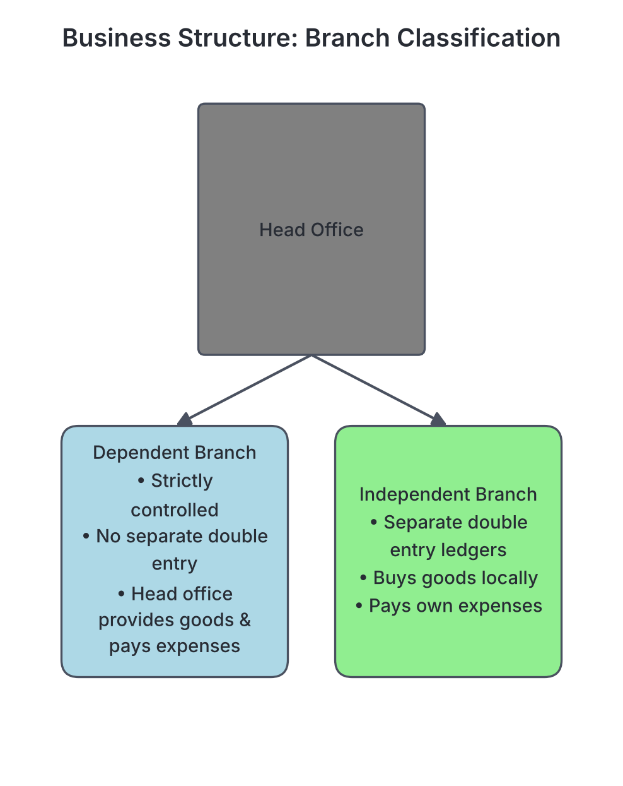
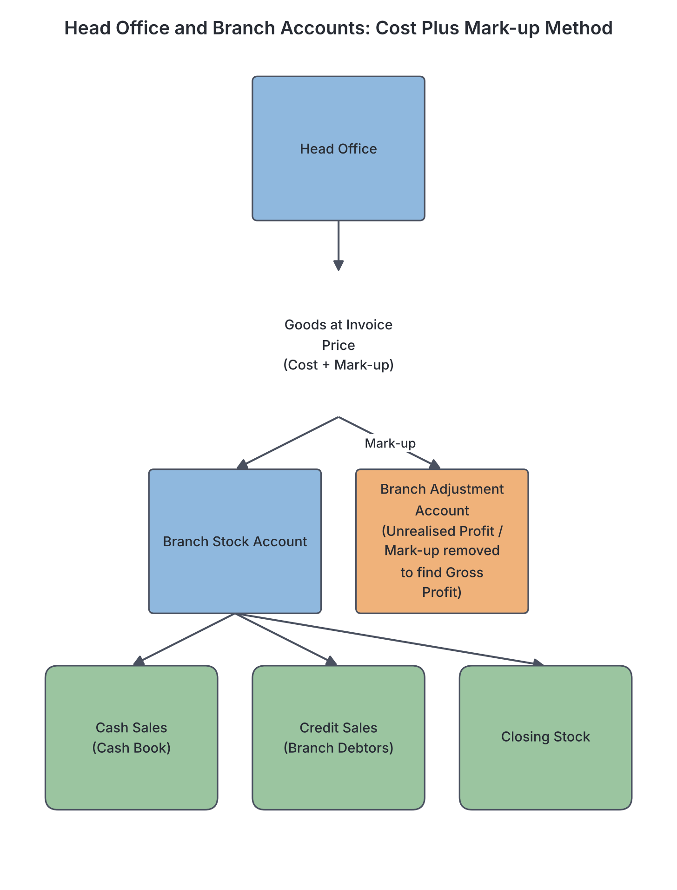
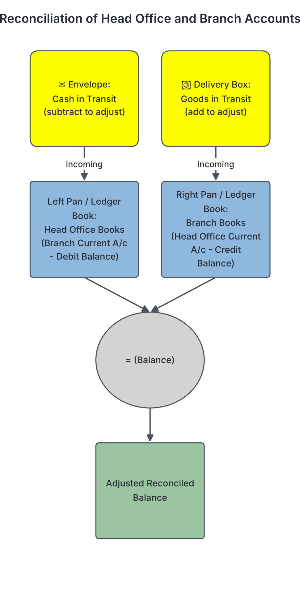

# JAMB Accounting Notes: Branch Accounts

## What JAMB expects

This topic is Section A, Topic 13 of the JAMB Principles of Accounts syllabus: Branch Accounts. It covers:

* **a.** Objectives
* **b.** Types of branches
* **c.** Pricing methods and accounts maintained by head office
* **d.** Account maintained by a branch
* **e.** Reconciliation of branch and head office books

By the end of these notes, you should be able to:

1. understand the reasons for preparing branch accounts;
2. differentiate between types of branches;
3. calculate profit or loss from branches; and
4. reconcile the difference between branch and head office accounts.

## Objectives of Branch Accounts

**Objective i: understand the reasons for preparing branch accounts.**
**Content item a: Objectives.**

A **branch** is a separate division, location, or geographical extension of a business operating away from its main headquarters (the head office). For example, a major supermarket might have its head office in Ikeja, Lagos, but open branches in Kano, Aba, and Port Harcourt to reach more customers and expand its market share. 

The head office must set up an accounting system to track the activities of these branches. Preparing branch accounts is essential for several reasons:

1. **To ascertain profit or loss:** The head office needs to know the exact profit or loss made by each specific branch. This helps management decide whether a branch is performing well, needs improvement, or should be closed down.
2. **To control stock (inventory):** Goods sent from the head office to the branch must be carefully tracked. Branch accounts help monitor physical quantities and values to prevent theft, loss, wastage, or unrecorded sales (shortages).
3. **To monitor branch expenses:** Keeping separate records helps the head office control the daily running costs and overheads of each branch.
4. **To assess branch managers:** The financial performance (profitability and cost control) revealed by the accounts helps evaluate the efficiency of the manager running the branch.
5. **To consolidate accounts:** At the end of the financial year, the results of all the individual branches must be combined with the head office's own accounts to prepare the overall final accounts (Statement of Profit or Loss and Statement of Financial Position) for the whole business.

## Types of Branches

**Objective ii: differentiate between types of branches.**
**Content item b: Types of branches.**

For accounting purposes, branches are divided into two main categories depending on the level of autonomy (independence) they have and the extent of the accounting records they keep.

| Feature | Dependent Branches | Independent Branches |
| --- | --- | --- |
| **Accounting Records** | Do not keep a complete double-entry system. They only keep simple subsidiary or memorandum books (like a petty cash book, debtors ledger, or stock book). | Keep a full, complete set of double-entry accounting records (Cash Book, Day Books, Ledgers, and Trial Balance). |
| **Purchasing Goods** | Cannot buy goods from outside suppliers. All goods to be sold are supplied by the head office. | Can purchase goods locally from outside suppliers as well as receive goods from the head office. |
| **Expenses** | Expenses are directly paid by the head office, or paid by the branch using an imprest system (petty cash) supplied by the head office. | Pays its own operating expenses out of the revenues it generates locally. |
| **Final Accounts** | The head office prepares the Trading and Profit & Loss Account for the branch. | The branch prepares its own Trading and Profit & Loss Account and sends a copy (along with a Trial Balance) to the head office. |
| **Management Control** | Strictly controlled by the head office. | Operates almost like a separate business entity, but with the head office acting as the owner. |

## Pricing Methods and Accounts Maintained by Head Office

**Content item c: Pricing methods and accounts maintained by head office.**

For a **dependent branch**, the head office does most of the accounting work and maintains the main ledger accounts for the branch. The way these ledger accounts are prepared depends entirely on the price at which the head office bills (invoices) the goods sent to the branch. 

There are three pricing methods used by the head office to charge goods to a branch:

### 1. Cost Price Method
Goods are sent to the branch at the exact price the head office paid for them (cost price). 
- **Advantage:** It is the simplest method. The head office prepares a Branch Stock Account (which acts like a Trading Account to find Gross Profit) and a Branch Profit & Loss Account to find Net Profit.
- **Disadvantage:** The branch manager knows the cost of the goods and therefore knows the exact profit the branch is making. Business owners often prefer to keep their profit margins secret from employees.

### 2. Cost Plus Mark-up Method (Invoice Price Method)
Goods are sent to the branch at cost plus a fixed percentage of expected profit (the mark-up). This combined figure is called the **invoice price**. For example, if a carton of provisions costs ₦10,000 and the head office adds a 20% mark-up, the goods are invoiced and sent to the branch at ₦12,000.
- **Advantage:** The branch manager does not know the true cost or the true profit. Furthermore, it makes stock control highly effective because the branch must account for every single naira of goods at that exact invoice price.
- **Accounts maintained under this method:** 
  - **Branch Stock Account:** Records the physical movement of goods at the invoice price. It is used to check for shortages or surpluses.
  - **Goods Sent to Branch Account:** Records the total value of goods transferred out of the head office's own purchases.
  - **Branch Adjustment Account:** This is the most crucial account. It holds the "unrealised profit" (the mark-up added by the head office) and is used to calculate the true Gross Profit.
  - **Branch Debtors Account:** Tracks credit sales made by the branch and cash collected from customers.
  - **Branch Profit & Loss Account:** Calculates the final net profit by subtracting branch expenses and shortages from the gross profit.

### 3. Selling Price Method (Retail Price Method)
Goods are sent to the branch at the exact price they must be sold to the public (the retail or selling price). This method is very similar to the Cost Plus Mark-up method, but it is much stricter because the branch manager has absolutely no power to change the selling price or give discounts without head office permission. Under this method, every unit sent must equal a unit sold or a unit in stock. Any balancing figure on the Branch Stock Account represents a physical loss (shortage) of goods.

## Account Maintained by a Branch

**Content item d: Account maintained by a branch.**

The accounts kept directly at the branch premises depend heavily on whether the branch is dependent or independent.

### 1. Dependent Branches
Dependent branches do not keep full double-entry ledgers. They keep simple **memorandum records** to track daily activities and send regular returns (reports) to the head office. The common books kept include:
- **Petty Cash Book:** Usually operated on the imprest system. The head office gives the branch manager a float (e.g., ₦20,000) to pay for minor daily expenses like cleaning or transport. When the money runs low, the manager sends the vouchers to the head office, which reimburses the exact amount spent.
- **Branch Debtors Ledger:** If the branch is allowed to sell goods on credit, it must maintain personal accounts for its customers to track who owes what.
- **Stock Book (Bin Cards):** Used to record the physical quantities of goods received from the head office and the quantities sold. This helps the manager know when to request more stock.
- **Cash Register / Sales Day Book:** A daily record of all cash sales and credit sales made. Cash collected is usually banked daily intact into the head office's bank account.

### 2. Independent Branches
Independent branches keep a complete set of accounting books (Cash Book, Purchases and Sales Day Books, and General Ledgers) just like an independent business. 

The most important account kept by an independent branch is the **Head Office Current Account**. 
- This account acts like a **Capital account**. The branch treats the head office as its owner. 
- **Credit entries:** Whatever the branch owes the head office is credited here. For example, when the branch receives goods or cash from the head office, it debits Purchases (or Cash) and credits the Head Office Current Account.
- **Debit entries:** When the branch sends cash or returns goods back to the head office, it debits the Head Office Current Account and credits Cash (or Returns).
- At the end of the year, the branch transfers its Net Profit to the credit side of the Head Office Current Account.

## Calculating Branch Profit or Loss

**Objective iii: calculate profit or loss from branches.**

JAMB heavily tests the **Cost Plus Mark-up Method** (Invoice Price Method). Because the Branch Stock Account is kept at fake "invoice prices," we cannot use it to find profit directly. We must separate the true cost of goods from the fake invoice price using the **Branch Adjustment Account**.

### The Margin vs. Mark-up Rule
To solve invoice price questions, you must master the relationship between mark-up (profit on cost) and margin (profit on selling/invoice price):
- **Mark-up** = $\frac{\text{Profit}}{\text{Cost}}$
- **Margin** = $\frac{\text{Profit}}{\text{Selling Price}}$
- **Conversion Rule:** If mark-up is $\frac{1}{x}$, then margin is $\frac{1}{x + 1}$. 
- For example, a mark-up of 25% ($\frac{25}{100}$ or $\frac{1}{4}$) on cost means the margin is $\frac{1}{4 + 1} = \frac{1}{5}$ (or 20%) on the invoice price. 
- You will apply this margin fraction ($\frac{1}{5}$) to any invoice price figure to instantly find the "unrealised profit" hidden inside it.

### Worked Example: Cost Plus Mark-up
A business in Lagos has a dependent branch in Aba. Goods are sent to the Aba branch at **Cost plus 25%**. During the year 2023, the following transactions occurred:
- Goods sent to Aba branch at cost: ₦400,000
- Cash sales at the branch: ₦250,000
- Credit sales at the branch: ₦220,000
- Goods returned by the branch to Head Office (at invoice price): ₦10,000
- Closing stock at the branch (at invoice price): ₦15,000
- Branch expenses paid by Head Office: ₦30,000

**Step 1: Convert Cost to Invoice Price and find the Margin fraction.**
- Mark-up is 25% on cost ($\frac{1}{4}$). The Margin (profit on invoice price) is $\frac{1}{5}$.
- Goods sent at cost = ₦400,000. 
- Invoice price = Cost + Mark-up = ₦400,000 + (25% of ₦400,000) = ₦500,000.

**Step 2: Prepare the Branch Stock Account (all entries at Invoice Price).**
This account checks if any goods are missing (a shortage). 
- **Debit side:** Goods sent to branch (₦500,000).
- **Credit side:** Cash Sales (₦250,000) + Credit Sales (₦220,000) = Total sales of ₦470,000.
- **Credit side:** Returns to Head Office (₦10,000).
- **Credit side:** Closing stock carried down (₦15,000).
- **Balancing:** Total Debit is ₦500,000. Total Credit is ₦495,000. The difference is a **shortage** (missing goods) of ₦5,000.

| Date | Details | ₦ | Date | Details | ₦ |
| :--- | :--- | :--- | :--- | :--- | :--- |
| 2023 | Goods Sent to Branch | 500,000 | 2023 | Cash/Bank (Cash Sales) | 250,000 |
| | | | | Branch Debtors (Credit Sales)| 220,000 |
| | | | | Goods Sent to Branch (Returns)| 10,000 |
| | | | | Balance c/d (Closing Stock) | 15,000 |
| | | | | **Stock Shortage (at invoice price)** | **5,000** |
| | **Total** | **500,000** | | **Total** | **500,000** |

**Step 3: Prepare the Branch Adjustment Account to find Gross Profit.**
This account extracts the $\frac{1}{5}$ unrealised profit from everything that passed through the Branch Stock Account.
- **Credit side:** Unrealised profit on goods sent ($\frac{1}{5}$ of ₦500,000 = ₦100,000). This is the profit the head office *hoped* to make.
- **Debit side:** Unrealised profit on returns ($\frac{1}{5}$ of ₦10,000 = ₦2,000). Profit cancelled because goods came back.
- **Debit side:** Unrealised profit on closing stock ($\frac{1}{5}$ of ₦15,000 = ₦3,000). Profit not yet earned because goods are unsold.
- **Debit side:** Unrealised profit on the shortage ($\frac{1}{5}$ of ₦5,000 = ₦1,000). Profit lost because goods are missing.
- **Balancing:** The balancing figure is the true **Gross Profit**.

| Details | ₦ | Details | ₦ |
| :--- | :--- | :--- | :--- |
| Goods Sent to Branch (Returns mark-up)| 2,000 | Goods Sent to Branch (Mark-up on goods sent) | 100,000 |
| Stock Reserve (Closing stock mark-up) | 3,000 | | |
| Branch Stock (Shortage mark-up) | 1,000 | | |
| **Gross Profit (to P&L)** | **94,000** | | |
| **Total** | **100,000**| **Total** | **100,000**|

**Step 4: Prepare the Branch Profit & Loss Account.**
- **Credit side:** Gross Profit brought down from the Adjustment Account (₦94,000).
- **Debit side:** True cost of the shortage. Since the invoice price of the shortage was ₦5,000, and ₦1,000 was removed as mark-up, the true cost is ₦4,000 (which is $\frac{4}{5}$ of ₦5,000). This is a real loss to the business.
- **Debit side:** Branch expenses (₦30,000).
- **Balancing:** The balancing figure is **Net Profit**.

| Details | ₦ | Details | ₦ |
| :--- | :--- | :--- | :--- |
| Cost of Shortage (True cost) | 4,000 | Gross Profit b/d | 94,000 |
| Branch Expenses | 30,000 | | |
| **Net Profit** | **60,000** | | |
| **Total** | **94,000**| **Total** | **94,000**|

**Common Mistakes Note:** Always remember that a stock shortage must be split into two parts! The mark-up portion (unrealised profit) is debited to the Branch Adjustment Account, and the true cost portion is debited to the Branch Profit & Loss Account as a business expense. Never debit the full invoice price of a shortage to the P&L account.

## Reconciliation of Branch and Head Office Books

**Objective iv: reconcile the difference between branch and head office accounts.**
**Content item e: Reconciliation of branch and head office books.**

This section applies to **independent branches**. As we discussed, the independent branch treats the head office as a creditor (keeping a "Head Office Current Account" with a Credit balance). At the exact same time, the head office treats the branch as a debtor (keeping a "Branch Current Account" with a Debit balance).

At the end of the financial year, the debit balance in the Head Office's books should perfectly match the credit balance in the Branch's books. However, they frequently disagree. We must reconcile them, just like we do in a bank reconciliation statement.

### Causes of Differences
The disagreement is almost always caused by **timing differences** (items in transit) or errors:
1. **Cash in transit:** Cash sent by the branch to the head office, but not yet received by the head office before the year ends. (The branch has deducted it, but the head office has not).
2. **Goods in transit:** Goods dispatched by the head office to the branch, but not yet received by the branch before the year ends. (The head office has added it, but the branch has not).
3. **Errors or Omissions:** For example, the head office charges the branch for management fees, but the branch has not yet received the notification and recorded it.

### How to Reconcile
The golden rule for reconciliation is: **Ask yourself, "Who has NOT recorded the transaction?"** The party that has not yet received the item or the notification must make the adjustment in its own books.

### Worked Example: Reconciliation
At 31 December, the Head Office books show a debit balance of ₦120,000 for the Kano Branch Current Account. The Kano Branch books show a credit balance of ₦95,000 for the Head Office Current Account. Investigations reveal the following:
- Cash of ₦10,000 sent by the Kano branch on 30 December was not received by the head office until 4 January of the next year.
- Goods invoiced at ₦15,000 sent by the head office were not received by the Kano branch until 3 January.

**Step 1: Adjust Head Office Books.**
- **Analysis:** The branch sent cash, so the branch has already recorded it (reducing what they owe). The head office has not received the cash, so they haven't recorded it.
- **Action:** Head office must record the cash. Debit Cash in Transit ₦10,000; Credit Branch Current Account ₦10,000.
- **Adjusted balance:** ₦120,000 (Dr) - ₦10,000 (Cr) = **₦110,000 (Debit)**.

**Step 2: Adjust Branch Books.**
- **Analysis:** The head office sent goods, so the head office has already recorded it (increasing what the branch owes). The branch has not received the goods, so they haven't recorded it.
- **Action:** Branch must record the goods. Debit Goods in Transit ₦15,000; Credit Head Office Current Account ₦15,000.
- **Adjusted balance:** ₦95,000 (Cr) + ₦15,000 (Cr) = **₦110,000 (Credit)**.

Both books now agree at an adjusted balance of ₦110,000. This is the figure that will be used when combining the accounts.

## Key terms

| Term | Meaning |
| --- | --- |
| **Branch** | A separate geographical location or division of a business operating away from the main head office. |
| **Dependent Branch** | A branch that does not maintain full accounting records and is entirely controlled by the head office. |
| **Independent Branch** | A branch that maintains its own full double-entry bookkeeping system and prepares its own trial balance. |
| **Invoice Price** | The price at which goods are charged to a branch (usually cost plus a predetermined mark-up). |
| **Mark-up** | The expected profit added to the cost price of goods by the head office (expressed as a fraction or percentage of cost). |
| **Margin** | Profit expressed as a fraction or percentage of the selling or invoice price. |
| **Branch Stock Account** | An account kept by the head office at invoice price to track physical goods at the branch and reveal any shortage or surplus. |
| **Branch Adjustment Account** | An account used to remove the unrealised profit (mark-up) from branch transactions in order to calculate the true Gross Profit. |
| **Goods in Transit** | Goods sent by the head office but not yet received by the branch at the end of the accounting period. |
| **Cash in Transit** | Money sent by the branch to the head office but not yet received before the accounts are closed. |

## Exam tips and common mistakes

- **Don't confuse Mark-up and Margin:** If mark-up is 25% (or $\frac{1}{4}$) on cost, the margin is $\frac{1}{5}$ (or 20%) on sales/invoice price. Always apply the margin fraction when adjusting invoice prices in the Branch Adjustment Account!
- **Branch Stock balance:** When goods are invoiced at selling/invoice price, the balancing figure on the Branch Stock Account represents closing stock. If the closing stock value is already given in the question, any difference on the account is a shortage (missing goods) or surplus.
- **Shortages belong in two places:** The mark-up part goes to the Branch Adjustment Account (Debit), and the true cost part goes to the Branch Profit & Loss Account (Debit).
- **Reconciliation golden rule:** Adjust the books of the party that has *not yet received* the item. If the branch sent cash, the branch has already recorded it. Therefore, adjust the head office books!

## Quick summary

1. Branch accounts are prepared to calculate the profit or loss of individual branches, control stock, monitor expenses, and assess branch managers.
2. Branches are either dependent (keeping only simple records like petty cash and stock books) or independent (keeping full double-entry ledgers).
3. The head office can invoice goods at Cost, Cost plus mark-up, or Selling price.
4. Under the Cost Plus Mark-up method, the Branch Adjustment Account is used to calculate the Gross Profit by stripping out the unrealised profit from goods sent, returns, stock, and shortages.
5. A stock shortage must be split: the mark-up is a reduction in expected profit, while the true cost is an operating expense to the branch.
6. Timing differences, such as Cash in Transit and Goods in Transit, cause disagreements between head office and branch current accounts, requiring a reconciliation adjustment at year-end.

## Practice questions

**1. The main reason a head office maintains a Branch Adjustment Account is to**
- A. record branch operating expenses.
- B. track goods in transit between the head office and the branch.
- C. ascertain the gross profit of the branch.
- D. calculate the cash sent to the branch.

**Answer: C.** The Branch Adjustment Account removes the unrealised profit (mark-up) from goods sent, returns, closing stock, and shortages. Its balancing figure represents the true Gross Profit of the branch.

**2. Which of the following is a feature of an independent branch?**
- A. It relies solely on the head office for all its goods.
- B. It keeps a full set of double-entry accounting records.
- C. Its Profit and Loss account is prepared exclusively by the head office.
- D. It does not maintain a cash book.

**Answer: B.** An independent branch acts almost like a separate business entity. It maintains full double-entry records and prepares its own Trial Balance and Final Accounts.

**3. Goods are invoiced to a branch at cost. During the year, goods sent to the branch amounted to ₦120,000. Branch sales were ₦90,000, and all goods are sold at cost plus 20%. What is the cost of the closing stock at the branch?**
- A. ₦30,000
- B. ₦45,000
- C. ₦75,000
- D. ₦120,000

**Answer: B.** 
- **Step 1:** Find the true cost of goods sold (COGS). The mark-up is 20% ($\frac{1}{5}$) on cost, meaning the margin is $\frac{1}{6}$ on sales.
- **Step 2:** Calculate Profit = $\frac{1}{6}$ of ₦90,000 = ₦15,000.
- **Step 3:** Calculate COGS = Sales - Profit = ₦90,000 - ₦15,000 = ₦75,000.
- **Step 4:** Calculate Closing Stock = Goods Sent - COGS = ₦120,000 - ₦75,000 = ₦45,000.

**4. If head office invoices goods to a branch at cost plus 25%, what fraction is used to calculate the unrealised profit on the invoice price?**
- A. $\frac{1}{3}$
- B. $\frac{1}{4}$
- C. $\frac{1}{5}$
- D. $\frac{1}{6}$

**Answer: C.** Mark-up is 25% or $\frac{1}{4}$ on cost. To find the margin (profit on the invoice or selling price), you add the numerator to the denominator: $\frac{1}{4 + 1} = \frac{1}{5}$.

**5. At year-end, the Kano branch books show a Head Office Current Account balance of ₦50,000 (Credit). The Head Office books show a Kano Branch Current Account balance of ₦70,000 (Debit). Cash of ₦15,000 sent by the branch is in transit. There are also goods in transit to the branch. What is the value of the goods in transit?**
- A. ₦5,000
- B. ₦15,000
- C. ₦20,000
- D. ₦35,000

**Answer: A.** 
- **Step 1:** Reconcile the Head Office books. The head office has not received the cash. ₦70,000 (Dr) - ₦15,000 (Cash in transit) = ₦55,000 Adjusted Balance.
- **Step 2:** Reconcile the Branch books. To match the ₦55,000 Adjusted Balance, the Branch books (currently at ₦50,000 Cr) must add the goods in transit.
- **Step 3:** Goods in transit = ₦55,000 - ₦50,000 = ₦5,000.

**6. When reconciling branch and head office accounts, goods in transit are recorded in the branch books by**
- A. debiting Goods in Transit and crediting Head Office Current Account.
- B. debiting Head Office Current Account and crediting Goods in Transit.
- C. debiting Branch Stock Account and crediting Cash.
- D. debiting Cash in Transit and crediting Head Office Current Account.

**Answer: A.** Since the goods were sent by the head office but not yet received, the branch must record the incoming asset (Debit Goods in Transit) and acknowledge the liability to the head office (Credit Head Office Current Account).

**7. Goods are invoiced to a branch at Cost plus 25%. During the year, goods sent at invoice price were ₦200,000. Returns to head office at invoice price were ₦10,000. Closing stock at invoice price was ₦30,000. There were no shortages. What is the Gross Profit for the branch?**
- A. ₦32,000
- B. ₦34,000
- C. ₦40,000
- D. ₦48,000

**Answer: A.** 
- **Step 1:** The margin is $\frac{1}{5}$ of the invoice price.
- **Step 2:** Unrealised profit on goods sent = $\frac{1}{5}$ of ₦200,000 = ₦40,000 (Credit Adjustment A/c).
- **Step 3:** Unrealised profit on returns = $\frac{1}{5}$ of ₦10,000 = ₦2,000 (Debit Adjustment A/c).
- **Step 4:** Unrealised profit on closing stock = $\frac{1}{5}$ of ₦30,000 = ₦6,000 (Debit Adjustment A/c).
- **Step 5:** Gross Profit = ₦40,000 - (₦2,000 + ₦6,000) = ₦32,000.

**8. Consider the following branch stock details at invoice price: Opening Stock ₦40,000; Goods Sent to Branch ₦250,000; Sales ₦260,000; Closing Stock ₦25,000. Calculate the stock shortage.**
- A. ₦5,000
- B. ₦10,000
- C. ₦15,000
- D. ₦20,000

**Answer: A.** 
- **Step 1:** Calculate Total Available (Debit side) = Opening Stock (₦40,000) + Goods Sent (₦250,000) = ₦290,000.
- **Step 2:** Calculate Total Accounted For (Credit side) = Sales (₦260,000) + Closing Stock (₦25,000) = ₦285,000.
- **Step 3:** Shortage = ₦290,000 - ₦285,000 = ₦5,000.

**9. In a dependent branch accounting system under the invoice price method, the true cost of a stock shortage is**
- A. credited to the Branch Stock Account.
- B. debited to the Branch Adjustment Account.
- C. debited to the Branch Profit and Loss Account.
- D. ignored entirely.

**Answer: C.** A shortage must be divided. The unrealised profit (mark-up) is debited to the Branch Adjustment Account, while the true cost of the missing goods is a real loss and must be debited to the Branch Profit & Loss Account as an operating expense.

**10. At year-end, a branch remits ₦25,000 cash to the head office, which is still in transit. The Head Office Current Account in the branch books is ₦150,000 (Credit). Assuming no other discrepancies, what is the balance of the Branch Current Account in the Head Office books before adjustment?**
- A. ₦125,000 (Debit)
- B. ₦150,000 (Debit)
- C. ₦175,000 (Debit)
- D. ₦175,000 (Credit)

**Answer: C.** 
- **Step 1:** The branch has already sent the cash and recorded it (Debit Head Office ₦25,000, Credit Cash ₦25,000), leaving a balance of ₦150,000 Cr.
- **Step 2:** This means *before* sending the cash, the branch owed ₦150,000 + ₦25,000 = ₦175,000.
- **Step 3:** Since the head office has not yet received the cash, it has not updated its books. Therefore, its books still show the original, unadjusted amount of ₦175,000 as a Debit (Asset).

<!-- COVERAGE
obj i | Objectives of Branch Accounts
obj ii | Types of Branches
obj iii | Calculating Branch Profit or Loss
obj iv | Reconciliation of Branch and Head Office Books
item a | Objectives of Branch Accounts
item b | Types of Branches
item c | Pricing Methods and Accounts Maintained by Head Office
item d | Account Maintained by a Branch
item e | Reconciliation of Branch and Head Office Books
-->
