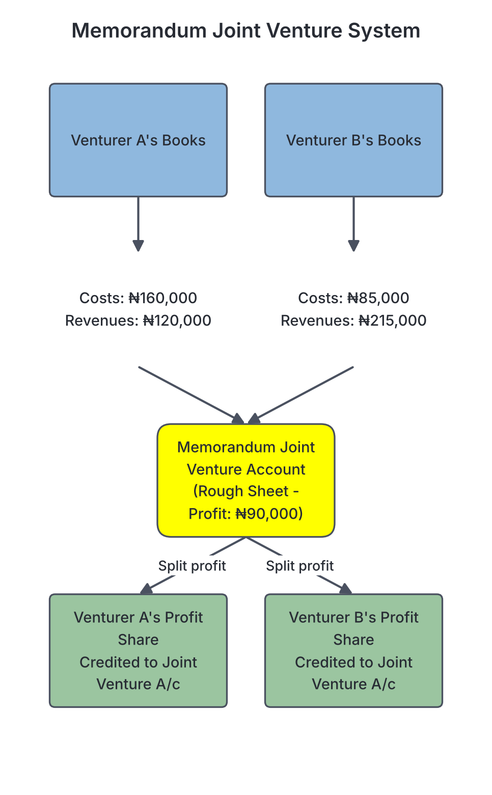

# JAMB Accounting Notes: Joint Venture Accounts

## What JAMB expects

This topic is Section A, Topic 14 of the JAMB Principles of Accounts syllabus. It covers the temporary partnerships formed by businesses or individuals for specific projects. The syllabus includes four main areas:

* a. Objectives and features
* b. Forms of joint ventures
* c. Accounting procedures
* d. Memorandum joint venture accounts

By the end of these notes, you should be able to:
1. Identify the objectives and features of joint venture;
2. Identify the forms of joint venture;
3. Identify the Accounting procedures of joint venture; and
4. Determine the profit or loss of joint venture.

## Objectives and features of joint ventures

**Objective i: identify the objectives and features of joint venture; Content a: Objectives and features**

### What is a Joint Venture?

A **joint venture** is a temporary partnership between two or more persons (called **co-venturers**) who agree to undertake a specific business project for profit. Once the project is completed, the joint venture comes to an end. 

For example, Tunde (a trader in Lagos) and Aminu (a livestock farmer in Kano) might agree to buy and transport rams from Kano to Lagos to sell during the Eid-el-Kabir festival. They agree to share the costs, the work, and the profits. Once all the rams are sold after the festival, their joint venture is over.

### Objectives of a Joint Venture

People and businesses form joint ventures for several reasons:
1. **To pool capital:** A single person may not have enough money to handle a large contract or buy goods in bulk. By coming together, they combine their funds.
2. **To combine skills and expertise:** One person might have technical knowledge (like building construction), while another might have marketing skills or local connections.
3. **To share risks:** Business ventures, especially short-term speculative ones, can be risky. Sharing the cost means sharing the potential loss if things go wrong.
4. **To seize a temporary opportunity:** It allows businesses to quickly take advantage of a seasonal event (like selling festive goods) without committing to a permanent partnership.

### Features of a Joint Venture

When JAMB asks you to identify a joint venture, look out for these defining characteristics:
* **Temporary nature:** It is formed for a specific purpose or a short time and dissolves once that objective is met.
* **No firm name:** Unlike a standard company or partnership, a joint venture usually does not trade under a registered firm name. The venturers use their own individual names.
* **Parties are called co-venturers:** The individuals involved are known as co-venturers, not partners.
* **Profit sharing:** Profits and losses are shared in an agreed ratio. If no ratio is stated in their agreement, profits and losses are shared **equally**.
* **Accounting records:** They may or may not open a separate set of books for the venture, depending on its size.

### Joint Venture vs. Partnership

Because a joint venture is essentially a short-term partnership, students often confuse the two. JAMB frequently tests the differences between them.

| Feature | Joint Venture | Partnership |
| --- | --- | --- |
| **Duration** | Temporary (ends when the specific project is completed). | Continuous (formed as a going concern to run indefinitely). |
| **Name** | Usually operates without a specific firm name. | Always operates under a specific, often registered, firm name. |
| **Members** | Members are called **co-venturers**. | Members are called **partners**. |
| **Accounting** | Often, no separate set of books is kept. | A separate set of books is always kept for the business. |
| **Scope** | Limited to a specific venture or single seasonal activity. | Covers all the trading activities of the firm. |

## Forms of joint ventures

**Objective ii: identify the forms of joint venture; Content b: Forms of joint ventures**

Joint ventures can take various forms depending on the nature of the business being undertaken. In Nigeria, common forms of joint ventures include:

1. **Trading or Consignment Joint Ventures:** This involves buying goods in one location where they are cheap and selling them in another where demand is high. For example, buying palm oil in the East and transporting it to the North to sell.
2. **Construction or Building Joint Ventures:** Two engineering companies might come together to construct a large government bridge or a housing estate. One might provide the heavy machinery, while the other provides the engineers and labour.
3. **Underwriting Joint Ventures:** When a company wants to issue new shares to the public, a group of stockbrokers or banks might form a joint venture to guarantee (underwrite) that all the shares will be bought. If the public does not buy them all, the underwriters must buy the remaining shares.
4. **Speculation or Real Estate Joint Ventures:** Individuals might pool money together to buy large plots of land (speculation) with the intention of dividing it and selling it for a profit when the price goes up.

## Accounting procedures of joint ventures

**Objective iii: identify the Accounting procedures of joint venture; Content c: Accounting procedures**

Because joint ventures differ in size, the way their accounts are kept also differs. There are two main accounting procedures used by co-venturers:

1. **Keeping a separate set of books.**
2. **Not keeping a separate set of books (using a Memorandum Joint Venture Account).**

### Procedure 1: Keeping a separate set of books

This method is used when the joint venture is large, involves a lot of money, and will last for a fairly long time (like a construction project). Because of the high volume of transactions, it is safer and cleaner to open an entirely new set of accounting books just for the venture.

Under this procedure, three main accounts are opened:
* **Joint Bank Account:** A new bank account is opened in the names of the co-venturers. All capital contributions are paid into this account (Debit), and all joint venture expenses and purchases are paid out of it (Credit). Revenue from sales is paid into it (Debit).
* **Joint Venture Account:** This acts like a Trading and Profit or Loss Account. It is debited with all costs (purchases, wages, expenses) and credited with all revenues (sales). The balancing figure is the final Profit or Loss.
* **Co-venturers' Capital Accounts:** A personal account is opened for each venturer to record their capital contribution, any goods they supplied from their own stock, their share of the profit, and final settlement cash.

#### Worked Example: Separate Set of Books

**Question:**
Mr X and Mr Y form a joint venture to buy and sell electronics, agreeing to share profits equally. They decide to keep a separate set of books.
* X pays ₦100,000 into a Joint Bank Account.
* Y pays ₦150,000 into the Joint Bank Account.
* Purchases of goods paid from the Joint Bank amount to ₦200,000.
* X supplies additional goods from his own store worth ₦20,000.
* Expenses paid from the Joint Bank amount to ₦15,000.
* Y pays for some advertising expenses from his own pocket amounting to ₦5,000.
* Sales received and paid into the Joint Bank amount to ₦300,000.
* Y takes over the unsold stock valued at ₦10,000 for his personal business.

Prepare the necessary accounts to close the venture.

**Step 1: Open the Joint Venture Account to determine the profit.**
* Debit all costs (Purchases, X's goods, Joint expenses, Y's expenses).
* Credit all incomes (Sales, Stock taken over by Y).
* Find the difference to get the profit and share it equally.

**Joint Venture Account**
| Dr (Costs) | ₦ | Cr (Revenues) | ₦ |
| --- | --- | --- | --- |
| Purchases (Joint Bank) | 200,000 | Sales (Joint Bank) | 300,000 |
| Goods supplied by X | 20,000 | Unsold stock taken by Y | 10,000 |
| Expenses (Joint Bank) | 15,000 | | |
| Expenses paid by Y | 5,000 | | |
| **Share of Profit:** | | | |
| X (Half of ₦70,000) | 35,000 | | |
| Y (Half of ₦70,000) | 35,000 | | |
| | **310,000** | | **310,000** |

**Step 2: Prepare the Co-venturers' Capital Accounts.**
* Credit them with what they put in (Capital, goods, expenses paid directly) and their share of the profit.
* Debit them with what they took out (like Y taking over stock).
* The balance is what the Joint Bank will pay them to close the venture.

**X's Capital Account**
| Dr | ₦ | Cr | ₦ |
| --- | --- | --- | --- |
| Bank (Final settlement) | 155,000 | Cash (Joint Bank) | 100,000 |
| | | Goods supplied | 20,000 |
| | | Share of Profit | 35,000 |
| | **155,000** | | **155,000** |

**Y's Capital Account**
| Dr | ₦ | Cr | ₦ |
| --- | --- | --- | --- |
| Stock taken over | 10,000 | Cash (Joint Bank) | 150,000 |
| Bank (Final settlement) | 180,000 | Expenses paid by him | 5,000 |
| | | Share of profit | 35,000 |
| | **190,000** | | **190,000** |

**Step 3: Prepare the Joint Bank Account to ensure everything balances.**
* Debit with cash received (Capital, Sales).
* Credit with cash paid out (Purchases, Expenses, Final settlements to X and Y).

**Joint Bank Account**
| Dr | ₦ | Cr | ₦ |
| --- | --- | --- | --- |
| Capital: X | 100,000 | Purchases | 200,000 |
| Capital: Y | 150,000 | Expenses | 15,000 |
| Sales | 300,000 | X's Capital (Settlement) | 155,000 |
| | | Y's Capital (Settlement) | 180,000 |
| | **550,000** | | **550,000** |
*(Notice how the bank account balances perfectly at ₦550,000, leaving a zero balance as the venture is now closed.)*

## Memorandum joint venture accounts

**Objective iv: determine the profit or loss of joint venture; Content d: Memorandum joint venture accounts**

### Procedure 2: Not keeping a separate set of books

For smaller, short-term ventures, it is a waste of time and money to open a new joint bank account and a fresh set of ledgers. Instead, **no separate set of books is kept**. Each venturer simply records the transactions *they personally handle* in their own existing business books.

In this method:
1. Venturer A opens an account in their ledger called **"Joint Venture with Venturer B Account"**.
2. Venturer B opens an account in their ledger called **"Joint Venture with Venturer A Account"**.

However, because Venturer A only records their own transactions, and Venturer B only records their own transactions, neither book contains the *full* picture of the business. Therefore, neither venturer can calculate the overall profit directly from their own ledger. 

To solve this, they prepare a **Memorandum Joint Venture Account**.

### What is a Memorandum Joint Venture Account?

The Memorandum Joint Venture Account is a rough statement prepared on a separate sheet of paper to determine the total profit or loss of the venture. 
* **It is NOT a part of the double-entry bookkeeping system.**
* It combines the information from both venturers.
* **Debit side:** All purchases and expenses incurred by **all** venturers.
* **Credit side:** All sales and unsold stock taken over by **all** venturers.
* The balancing figure is the Profit or Loss, which is then shared in the agreed ratio.

#### Worked Example: Memorandum Method

**Question:**
Emeka (in Aba) and Binta (in Kano) enter into a joint venture to trade in textiles, sharing profits in the ratio 3:2 respectively. No separate set of books is kept.
* Emeka buys goods for ₦150,000 and pays transport expenses of ₦10,000.
* Binta buys goods for ₦80,000 and pays storage expenses of ₦5,000.
* Emeka sells a portion of the goods in Aba for ₦120,000 and keeps the cash.
* Binta sells the remaining goods in Kano for ₦200,000 and keeps the cash.
* Binta takes over some slightly damaged, unsold stock valued at ₦15,000.

Determine the profit using a Memorandum Account, and show the ledger account in the books of both Emeka and Binta to determine who pays who to settle the venture.

**Step 1: Prepare the Memorandum Joint Venture Account to determine the profit.**
* List all costs on the Debit side.
* List all revenues and stock on the Credit side.
* Share the profit 3:2 (Emeka gets $3/5$, Binta gets $2/5$).

**Memorandum Joint Venture Account**
| Dr (Costs) | ₦ | Cr (Revenues) | ₦ |
| --- | --- | --- | --- |
| Purchases: Emeka | 150,000 | Sales: Emeka | 120,000 |
| Purchases: Binta | 80,000 | Sales: Binta | 200,000 |
| Expenses: Emeka | 10,000 | Stock taken over: Binta | 15,000 |
| Expenses: Binta | 5,000 | | |
| **Share of Profit:** | | | |
| Emeka ($3/5 \times 90,000$) | 54,000 | | |
| Binta ($2/5 \times 90,000$) | 36,000 | | |
| | **335,000** | | **335,000** |
*Total Revenue = ₦335,000. Total Costs = ₦245,000. Profit = ₦90,000.*

**Step 2: Prepare the account in Emeka's Books.**
* Name of account: "Joint Venture with Binta Account".
* Emeka debits what he put in (his purchases and expenses).
* Emeka debits his share of the profit.
* Emeka credits what he received (his sales).
* The balance shows the settlement.

**In Emeka's Books: Joint Venture with Binta Account**
| Dr | ₦ | Cr | ₦ |
| --- | --- | --- | --- |
| Bank (Purchases he made) | 150,000 | Bank (Sales he made) | 120,000 |
| Bank (Expenses he paid) | 10,000 | Cash from Binta (Settlement)| 94,000 |
| Profit and Loss a/c (His profit)| 54,000 | | |
| | **214,000** | | **214,000** |
*Explanation:* Emeka put in a total value of ₦214,000 (costs + his profit). However, he only collected ₦120,000 from his sales. Therefore, he is short of ₦94,000. The joint venture owes him this money, which means Binta must pay him ₦94,000.

**Step 3: Prepare the account in Binta's Books.**
* Name of account: "Joint Venture with Emeka Account".
* Binta debits her purchases, expenses, and her share of profit.
* Binta credits her sales and the stock she took over.
* The balance will perfectly mirror Emeka's book.

**In Binta's Books: Joint Venture with Emeka Account**
| Dr | ₦ | Cr | ₦ |
| --- | --- | --- | --- |
| Bank (Purchases she made) | 80,000 | Bank (Sales she made) | 200,000 |
| Bank (Expenses she paid) | 5,000 | Purchases (Stock she took)| 15,000 |
| Profit and Loss a/c (Her profit)| 36,000 | | |
| Cash paid to Emeka (Settlement)| 94,000 | | |
| | **215,000** | | **215,000** |
*Explanation:* Binta collected ₦200,000 in cash from sales and took ₦15,000 worth of stock, receiving a total value of ₦215,000. But her costs and profit only amount to ₦121,000 (80k + 5k + 36k). She holds ₦94,000 more than she is entitled to. Therefore, she must pay ₦94,000 to Emeka.

## Key terms

| Term | Meaning |
| --- | --- |
| **Joint Venture** | A temporary partnership formed between two or more persons for a specific business project. |
| **Co-venturer** | A person or entity participating in a joint venture. |
| **Memorandum Joint Venture Account** | A rough statement prepared outside the double-entry system to determine the overall profit or loss of a joint venture. |
| **Joint Bank Account** | A separate bank account opened in the names of all co-venturers to handle all cash transactions for the venture. |
| **Underwriting** | A form of joint venture where financial institutions guarantee to buy any unsold shares issued by a company to the public. |
| **Consignment venture** | A joint venture formed specifically to buy goods in one location and ship them to sell in another location. |

## Exam tips and common mistakes

* **Management fees or commission:** Sometimes, an exam question will state that one venturer receives a management fee or a 5% commission on sales. Treat this fee as an **expense** to the joint venture (Debit the Memorandum Account) and as an **income** to that specific venturer (Debit their Joint Venture Account).
* **Missing ratios:** If a question asks you to calculate profit shares but does not provide a profit-sharing ratio, do not panic. Always divide the profit **equally** among the venturers.
* **Double-entry trap:** Remember that the Memorandum Joint Venture Account is **not** part of the double-entry system. JAMB loves asking this. If asked which account forms part of the double entry when no separate books are kept, the answer is the "Joint Venture with [Venturer's Name] Account" in the individual ledgers.
* **Unsold stock:** If a venturer takes over unsold stock at the end of the venture, it must be **credited** to the Memorandum Account (as it acts like a sale to that venturer).
* **Careless subtractions during settlement:** When calculating who owes whom, always add up what a venturer spent PLUS their profit. If this total is greater than the cash they collected from sales, they are owed money. If they collected more cash than their (costs + profit), they must pay the difference to the other party.

## Quick summary

1. A joint venture is a temporary partnership formed to execute a specific project and make a profit.
2. Unlike normal partnerships, joint ventures are short-term, usually lack a firm name, and end automatically once the project is finished.
3. Common forms of joint ventures in Nigeria include trading/consignment, construction, underwriting, and real estate speculation.
4. Large joint ventures keep a separate set of books by opening a Joint Bank Account, a Joint Venture Account, and Capital Accounts for the venturers.
5. Small joint ventures do not keep a separate set of books; each venturer records their own transactions in a "Joint Venture with X Account".
6. When no separate books are kept, a Memorandum Joint Venture Account is prepared to combine all data and determine the final profit or loss.
7. The Memorandum Joint Venture Account is prepared on a rough sheet and is not part of the double-entry accounting system.

## Practice questions

**1. A temporary partnership formed to carry out a specific project is known as a:**

- A. syndicate
- B. joint venture
- C. private company
- D. cooperative society

**Answer: B.** A joint venture is by definition a temporary partnership formed for a specific short-term project or business activity.

**2. Which of the following is NOT a characteristic of a joint venture?**

- A. Co-venturers share profits and losses
- B. It is typically formed for a specific, short-term project
- C. It usually does not operate under a specific firm name
- D. It has a continuous existence as a going concern

**Answer: D.** A joint venture is temporary and dissolves once its specific purpose is achieved, whereas a standard partnership or company is formed as a continuous going concern.

**3. When no separate set of books is kept for a joint venture, the account prepared to determine the overall profit or loss is the:**

- A. Profit or Loss Account
- B. Joint Venture with Co-venturer Account
- C. Memorandum Joint Venture Account
- D. Joint Bank Account

**Answer: C.** The Memorandum Joint Venture Account combines all venturers' transactions outside the double-entry system to calculate the total profit or loss.

**4. In the absence of a joint venture agreement stating otherwise, profits and losses are shared:**

- A. in the ratio of the capital contributed
- B. based on the level of work each venturer performed
- C. strictly according to the Companies and Allied Matters Act ratios
- D. equally

**Answer: D.** Just like in a standard partnership, if no ratio is explicitly stated in the agreement, profits and losses are shared equally.

**5. Kalu and Tobi enter a joint venture. Kalu buys goods for ₦40,000. Tobi pays freight charges of ₦2,000. Kalu sells all the goods for ₦60,000. What is the profit on the venture?**

- A. ₦20,000
- B. ₦18,000
- C. ₦22,000
- D. ₦60,000

**Answer: B.** 
Step 1: Calculate total revenues (Sales) = ₦60,000.
Step 2: Calculate total costs = Purchases (₦40,000) + Freight (₦2,000) = ₦42,000.
Step 3: Profit = Revenue - Costs = ₦60,000 - ₦42,000 = ₦18,000. Option A is a mistake where the student forgets to deduct Tobi's freight expense.

**6. Using the information from Question 5, if Kalu and Tobi share profits equally, what amount must Kalu pay Tobi at the end of the venture to settle accounts?**

- A. ₦9,000
- B. ₦11,000
- C. ₦20,000
- D. ₦2,000

**Answer: B.** 
Step 1: Tobi's share of the profit is half of ₦18,000 = ₦9,000.
Step 2: Tobi's total claim = His expenses (₦2,000) + His profit (₦9,000) = ₦11,000.
Step 3: Since Tobi holds no cash from sales, Kalu (who holds all the ₦60,000 sales cash) must pay Tobi his full entitlement of ₦11,000. Option A is wrong because it only accounts for the profit and forgets to reimburse Tobi for his freight expense.

**7. When a separate set of books is kept for a joint venture, the capital contributed by the venturers is credited to their capital accounts and debited to the:**

- A. Joint Venture Account
- B. Memorandum Account
- C. Joint Bank Account
- D. Personal accounts of the venturers

**Answer: C.** Cash contributed by the co-venturers is deposited into the joint business, so the Joint Bank Account is debited to record the receipt of cash.

**8. A joint venture formed by a group of financial institutions to guarantee that a new issue of shares by a company is fully subscribed is known as:**

- A. a trading joint venture
- B. a consignment joint venture
- C. a construction joint venture
- D. an underwriting joint venture

**Answer: D.** An underwriting joint venture is formed to guarantee share issues. If the public does not buy the shares, the underwriters are forced to buy them.

**9. In a joint venture where no separate books are kept, if a venturer takes over unsold stock at the end of the venture for their personal use, this transaction is:**

- A. debited to the Memorandum Joint Venture Account
- B. credited to the Memorandum Joint Venture Account
- C. debited to the Sales Account
- D. ignored since the venture is over

**Answer: B.** Stock taken over by a venturer is treated as revenue for the venture. Therefore, it is credited to the Memorandum Joint Venture Account to increase the total profit.

**10. Venturer X and Venturer Y are in a joint venture. X receives a management fee of ₦5,000 for running the daily operations. Before accounting for this fee, the joint venture recorded revenues of ₦100,000 and total costs of ₦80,000. What is the final joint venture profit to be shared?**

- A. ₦20,000
- B. ₦15,000
- C. ₦25,000
- D. ₦10,000

**Answer: B.** 
Step 1: Management fees paid to a venturer are treated as an expense to the joint venture.
Step 2: Total revenues = ₦100,000.
Step 3: Revised total costs = Original costs (₦80,000) + Management fee (₦5,000) = ₦85,000.
Step 4: Final profit = ₦100,000 - ₦85,000 = ₦15,000. Option A is a mistake where the student fails to deduct the management fee from the profit.

<!-- COVERAGE
obj i | Objectives and features of joint ventures
obj ii | Forms of joint ventures
obj iii | Accounting procedures of joint ventures
obj iv | Memorandum joint venture accounts
item a | Objectives and features of joint ventures
item b | Forms of joint ventures
item c | Accounting procedures of joint ventures
item d | Memorandum joint venture accounts
-->
