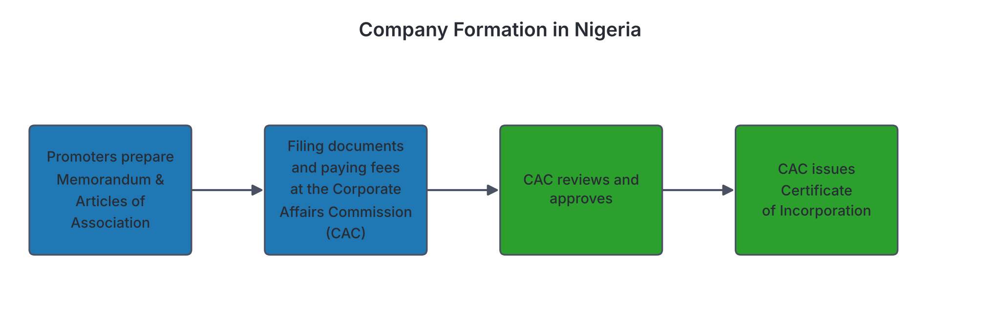
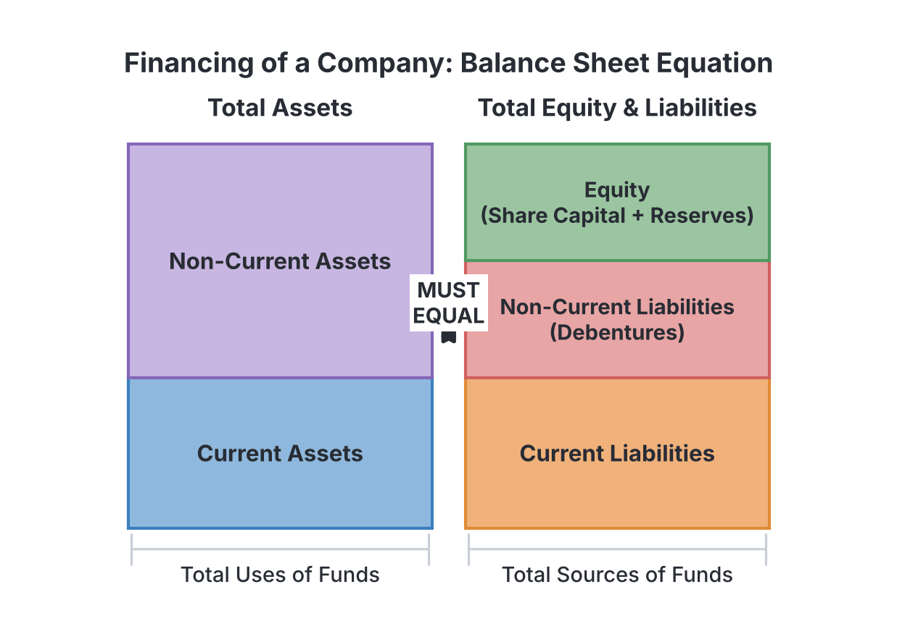
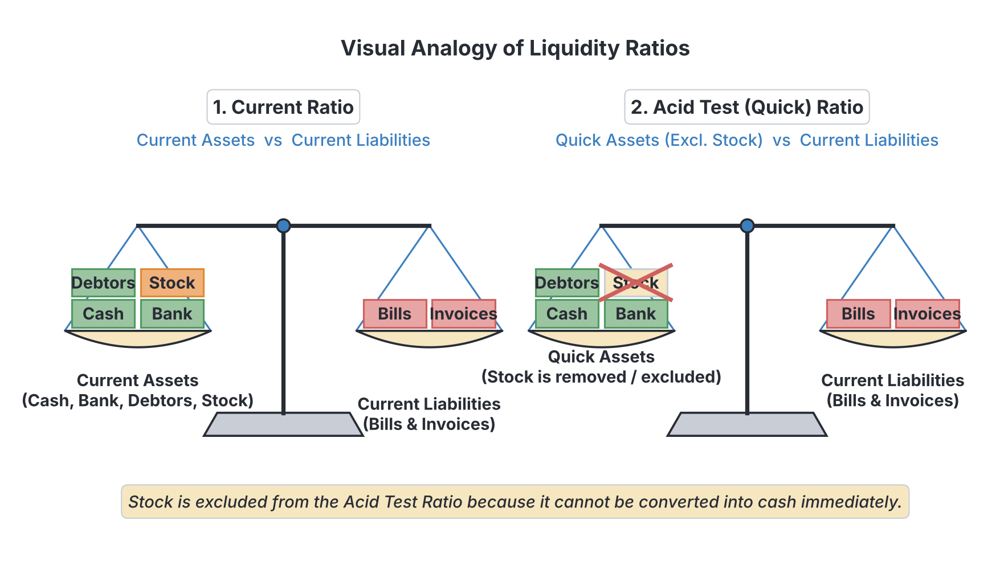

# JAMB Accounting Notes: Introduction to Company Accounts

## What JAMB expects

This topic is Topic 16 of the JAMB Principles of Accounts syllabus. It covers the foundation of how limited liability companies are formed, how they raise money, how their financial statements are prepared, and how we analyze their performance.

This file covers the following content items:
- **a.** Formation and classification of companies
- **b.** Issue of shares and debentures
- **c.** Final accounts of companies: (i) statement of profit or loss, (ii) statement of financial position
- **d.** Accounting ratios
- **e.** Distinction between capital and revenue reserves

By the end of these notes, you should be able to:
1. differentiate between types of companies; (Objective i)
2. identify the procedures of treating the issue of shares and debentures; (Objective ii)
3. compute the elements of final accounts of companies; (Objective iii) and
4. compute and interpret Accounting ratios such as current, acid test and stock turnover. (Objective iv)

> **Note on the syllabus wording:** Content item **e** (Distinction between capital and revenue reserves) has no specific matching objective in the syllabus, but it is a core concept and is fully explained here. Additionally, this file uses the modern international terminology (IFRS) required by the Financial Reporting Council of Nigeria (FRCN). For example, we use "Statement of Profit or Loss" instead of "Income Statement", "Statement of Financial Position" instead of "Balance Sheet", and "Stock" is also referred to as "Inventory". Both terms are used in these notes because older textbooks vary. Finally, Nigerian company law was updated by the Companies and Allied Matters Act (CAMA) 2020. We teach the current law but will point out older textbook rules (like authorized share capital limits) that might still appear in past questions.

---

## Formation and classification of companies

**This section covers content item (a).**

A **company** is an association of persons incorporated under the law to carry out business. Unlike a sole proprietorship or a partnership, an incorporated company is a **separate legal entity**. This means the business exists separately from its owners; it can own property, sue, and be sued in its own name.

In Nigeria, companies are regulated by the **Companies and Allied Matters Act (CAMA) 2020** and are registered by the **Corporate Affairs Commission (CAC)**.

### The formation process

To form a company, the promoters (the people starting it) must prepare and file specific documents with the CAC:
1. **Memorandum of Association:** This document governs the company's relationship with the outside world. It states the company's name, registered office address, the business it intends to do (objects), and the type of liability the members have.
2. **Articles of Association:** This governs the internal management of the company (e.g., rules for meetings, appointment of directors, and transfer of shares).
3. **Prospectus:** If it is a public company seeking to raise money from the general public, it issues a prospectus. This is a formal invitation outlining the company's financial state and offering shares or debentures for subscription.
4. **Certificate of Incorporation:** Once the CAC is satisfied with the documents and fees, it issues this certificate. This is the official "birth certificate" of the company, proving it legally exists.

---

### Differentiating between types of companies

**This section covers objective (i).**

Companies are classified by their **liability** and by their **ownership structure**. 

#### 1. Classification by Liability
- **Company Limited by Shares:** The liability of the owners (shareholders) is limited to the amount unpaid on the shares they hold. If the company goes bankrupt, their personal assets are safe. This is the most common type.
- **Company Limited by Guarantee:** Members guarantee to contribute a fixed amount to the company's assets if it is wound up (liquidated). These are usually formed for not-for-profit purposes (like clubs or charities).
- **Unlimited Company:** There is no limit to the liability of the members. If the company collapses, the members' personal assets can be seized to pay business debts. These are very rare.

#### 2. Classification by Ownership Structure (Private vs. Public)
Companies limited by shares are further divided into Private and Public companies.

| Feature | Private Limited Company (Ltd) | Public Limited Company (PLC) |
| :--- | :--- | :--- |
| **Name suffix** | Must end with "Limited" or "Ltd". | Must end with "Public Limited Company" or "PLC". |
| **Number of members** | 1 to 50 members (CAMA 2020 allows single-member companies). | Minimum of 2 members, with no maximum limit. |
| **Raising capital** | Cannot invite the general public to buy its shares. | Can issue a prospectus and invite the general public to subscribe to its shares. |
| **Transfer of shares** | Restricted. Shares cannot be sold without the agreement of other directors/members. | Freely transferable. Shares can be bought and sold on the Nigerian Exchange Group (NGX). |
| **Minimum share capital** | Minimum issued share capital of ₦100,000 (CAMA 2020). *(Older textbooks may say ₦10,000 authorized).* | Minimum issued share capital of ₦2,000,000 (CAMA 2020). *(Older textbooks may say ₦500,000 authorized).* |
| **Statutory meeting** | Not required to hold a statutory meeting. | Must hold a statutory meeting within six months of incorporation. |

---

## Issue of shares and debentures

**This section covers content item (b).**

To operate, a company needs capital. It raises this capital in two main ways: issuing **shares** (equity) and issuing **debentures** (debt).

### Shares
A share is a unit of ownership interest in a company. There are two main types of shares:
1. **Ordinary Shares (Equities):** These are the true owners of the business. They carry voting rights. Their dividend (share of profit) is not fixed and depends on how much profit the company makes. They bear the highest risk but reap the highest rewards if the company succeeds.
2. **Preference Shares:** These carry a fixed rate of dividend (e.g., 5% Preference Shares). Preference shareholders must be paid their dividend before ordinary shareholders get anything. However, they usually do not have voting rights and their reward is limited to the fixed percentage.

### Debentures
A debenture is a document acknowledging a long-term loan made to a company. It is a form of debt, not ownership. Debenture holders receive a fixed rate of **interest** (e.g., 10% Debentures). This interest must be paid whether the company makes a profit or a loss.

**Summary comparison: Shares vs. Debentures**

| Feature | Shares | Debentures |
| :--- | :--- | :--- |
| **Status** | Owners (Equity). | Creditors (Debt). |
| **Reward** | Dividend (paid out of profit). | Interest (treated as a business expense). |
| **Certainty of reward**| Paid only if the company makes a profit. | Paid regardless of profit or loss. |
| **Voting rights** | Ordinary shareholders have voting rights. | Debenture holders have no voting rights. |
| **Liquidation priority**| Paid last if the company winds up. | Paid before shareholders. |

---

### Procedures for treating the issue of shares and debentures

**This section covers objective (ii).**

When a company issues shares to the public, the money is usually not collected all at once. The payment is broken down into instalments:
1. **Application:** The public applies for shares and pays a deposit.
2. **Allotment:** The directors accept the applications and officially allocate (allot) the shares. Another instalment is paid here.
3. **Calls:** The remaining balance is demanded in one or more stages (e.g., First Call, Final Call).

Shares can be issued at:
- **Par:** Issued exactly at their face (nominal) value (e.g., a ₦1 share sold for ₦1).
- **Premium:** Issued at a price higher than their face value (e.g., a ₦1 share sold for ₦1.50). The extra ₦0.50 is the share premium.
- **Discount:** Issued below face value (very rare and usually restricted by law).

#### Worked Example: Issue of shares at a premium

**Step 1: Understand the scenario.**
Kano Bakeries PLC decides to issue 100,000 ordinary shares of ₦1 each to the public at a price of ₦1.50 per share (meaning there is a ₦0.50 premium per share).
The money is payable as follows:
- On Application: ₦0.50
- On Allotment: ₦0.60 (This includes the ₦0.50 share premium)
- On First and Final Call: ₦0.40
Total = ₦0.50 + ₦0.60 + ₦0.40 = ₦1.50.

Applications were received for exactly 100,000 shares, and all calls were made and paid in full.

**Step 2: Calculate the amounts involved.**
- Application money: 100,000 shares × ₦0.50 = ₦50,000.
- Allotment money: 100,000 shares × ₦0.60 = ₦60,000. (Out of this, Premium = 100,000 × ₦0.50 = ₦50,000. Therefore, Capital portion = ₦10,000).
- Call money: 100,000 shares × ₦0.40 = ₦40,000.

**Step 3: Prepare the Ledger Accounts.**

**Bank Account**
| Details | ₦ | Details | ₦ |
| :--- | :--- | :--- | :--- |
| Application | 50,000 | | |
| Allotment | 60,000 | | |
| First & Final Call | 40,000 | | |
| | | **Balance c/d** | **150,000** |
| **Total** | **150,000** | **Total** | **150,000** |

**Application Account**
| Details | ₦ | Details | ₦ |
| :--- | :--- | :--- | :--- |
| Ordinary Share Capital | 50,000 | Bank | 50,000 |

**Allotment Account**
| Details | ₦ | Details | ₦ |
| :--- | :--- | :--- | :--- |
| Ordinary Share Capital | 10,000 | Bank | 60,000 |
| Share Premium | 50,000 | | |
| **Total** | **60,000** | **Total** | **60,000** |

**First and Final Call Account**
| Details | ₦ | Details | ₦ |
| :--- | :--- | :--- | :--- |
| Ordinary Share Capital | 40,000 | Bank | 40,000 |

**Ordinary Share Capital Account**
| Details | ₦ | Details | ₦ |
| :--- | :--- | :--- | :--- |
| Balance c/d | 100,000 | Application | 50,000 |
| | | Allotment | 10,000 |
| | | First & Final Call | 40,000 |
| **Total** | **100,000** | **Total** | **100,000** |

**Share Premium Account**
| Details | ₦ | Details | ₦ |
| :--- | :--- | :--- | :--- |
| Balance c/d | 50,000 | Allotment | 50,000 |

*Double-entry summary for issue of shares:*
- When cash is received: **Debit** Bank, **Credit** the stage account (Application/Allotment/Call).
- When transferring to capital: **Debit** the stage account, **Credit** Share Capital (and Share Premium if applicable).

> **Common Mistake:** Students often mistakenly credit the Bank Account and debit the Share Capital Account. Remember, receiving money increases an asset (Debit Bank) and increases equity (Credit Share Capital).

---

## Final accounts of companies

**This section covers content item (c).**

At the end of the financial year, a company must prepare its final accounts for its shareholders. The complete set includes:
1. **Statement of Profit or Loss** (traditionally called the Trading, Profit and Loss Account).
2. **Statement of Changes in Equity** (traditionally called the Appropriation Account, showing how net profit is shared).
3. **Statement of Financial Position** (traditionally called the Balance Sheet).

### Computing elements of final accounts

**This section covers objective (iii).**

To compute the elements of a company's final accounts, you must know how to treat specific company items:
- **Directors' Fees and Salaries:** These are administration expenses deducted in the Statement of Profit or Loss.
- **Debenture Interest:** This is a finance cost (an expense) deducted in the Statement of Profit or Loss. **It is not an appropriation of profit.**
- **Corporate Tax:** Companies pay tax on their profits. A provision for tax is deducted from the Net Profit before tax.
- **Dividends:** This is the portion of profit distributed to shareholders. It is deducted in the Statement of Changes in Equity (Appropriation).

Let's look at a fully worked example for **Oluwa Traders PLC** for the year ended 31st December 2023.

**Step 1: Review the Trial Balance**

| Details | Dr (₦) | Cr (₦) |
| :--- | :--- | :--- |
| Ordinary Share Capital (₦1 shares) | | 100,000 |
| Share Premium | | 20,000 |
| Retained Earnings (1 Jan 2023) | | 30,000 |
| 10% Debentures | | 50,000 |
| Sales | | 500,000 |
| Purchases | 300,000 | |
| Opening Stock (Inventory) | 40,000 | |
| Salaries | 60,000 | |
| Rent | 20,000 | |
| Directors' Fees | 15,000 | |
| Debenture Interest | 5,000 | |
| Land and Building | 150,000 | |
| Equipment | 60,000 | |
| Debtors (Receivables) | 35,000 | |
| Bank | 25,000 | |
| Creditors (Payables) | | 10,000 |
| **Total** | **710,000** | **710,000** |

**Step 2: Note the Year-end Adjustments**
- Closing stock (inventory) as at 31 Dec 2023 is ₦50,000.
- Depreciate equipment by 10% on cost. (₦60,000 × 10% = ₦6,000).
- Rent accrued is ₦4,000. (Add to rent expense, show as current liability).
- Provide ₦10,000 for corporate tax.
- The directors proposed a dividend of ₦8,000.

**Step 3: Prepare the Statement of Profit or Loss**

**Oluwa Traders PLC**
**Statement of Profit or Loss for the year ended 31 December 2023**

| Details | ₦ | ₦ |
| :--- | :--- | :--- |
| **Sales** | | **500,000** |
| Less: Cost of Goods Sold | | |
| Opening Stock | 40,000 | |
| Add: Purchases | 300,000 | |
| Cost of Goods Available | 340,000 | |
| Less: Closing Stock | (50,000) | |
| Cost of Goods Sold | | (290,000) |
| **Gross Profit** | | **210,000** |
| | | |
| **Less Expenses:** | | |
| Salaries | 60,000 | |
| Rent (₦20,000 + ₦4,000 accrued) | 24,000 | |
| Directors' Fees | 15,000 | |
| Depreciation of Equipment | 6,000 | |
| Debenture Interest | 5,000 | |
| Total Expenses | | (110,000) |
| **Net Profit before Tax** | | **100,000** |
| Less: Corporate Tax Provision | | (10,000) |
| **Net Profit after Tax** | | **90,000** |

**Step 4: Prepare the Statement of Changes in Equity (Appropriation segment)**

| Details | ₦ |
| :--- | :--- |
| Retained Earnings brought forward (1 Jan 2023) | 30,000 |
| Add: Net Profit after Tax for the year | 90,000 |
| Total available for appropriation | 120,000 |
| Less: Proposed Dividend | (8,000) |
| **Retained Earnings carried forward (31 Dec 2023)** | **112,000** |

**Step 5: Prepare the Statement of Financial Position**

**Oluwa Traders PLC**
**Statement of Financial Position as at 31 December 2023**

| | Cost (₦) | Acc. Dep. (₦) | Net Book Value (₦) |
| :--- | :--- | :--- | :--- |
| **Non-Current Assets** | | | |
| Land and Building | 150,000 | - | 150,000 |
| Equipment | 60,000 | (6,000) | 54,000 |
| **Total Non-Current Assets** | | | **204,000** |
| | | | |
| **Current Assets** | | **₦** | **₦** |
| Closing Stock (Inventory) | | 50,000 | |
| Debtors (Receivables) | | 35,000 | |
| Bank | | 25,000 | |
| **Total Current Assets** | | | **110,000** |
| **Total Assets** | | | **314,000** |
| | | | |
| **Equity and Liabilities** | | | |
| **Equity** | | | |
| Ordinary Share Capital | | 100,000 | |
| Share Premium | | 20,000 | |
| Retained Earnings | | 112,000 | |
| **Total Equity** | | | **232,000** |
| | | | |
| **Non-Current Liabilities** | | | |
| 10% Debentures | | 50,000 | |
| | | | |
| **Current Liabilities** | | | |
| Creditors (Payables) | | 10,000 | |
| Accrued Rent | | 4,000 | |
| Corporate Tax Provision | | 10,000 | |
| Proposed Dividend | | 8,000 | |
| **Total Current Liabilities** | | | **32,000** |
| **Total Equity and Liabilities** | | | **314,000** |

> **Note on Proposed Dividend Treatment:** In strict modern accounting rules (IAS 10), dividends proposed *after* the reporting year-end are not shown as a current liability. However, JAMB past questions and older textbooks still teach the older method where a proposed dividend is treated as an appropriation of profit and recorded as a current liability. Always follow this textbook approach for your JAMB exam.

---

## Distinction between capital and revenue reserves

**This section covers content item (e).**

A reserve is a portion of a company's profits set aside for specific or general purposes, rather than being distributed as dividends. Reserves are broadly grouped into two categories: **Capital Reserves** and **Revenue Reserves**.

| Feature | Capital Reserves | Revenue Reserves |
| :--- | :--- | :--- |
| **Meaning** | Reserves created from non-trading activities (capital profits). | Reserves created out of normal, everyday trading profits. |
| **Availability for dividends** | Generally **cannot** be used to pay ordinary cash dividends to shareholders. | Are freely **available** to be distributed as cash dividends. |
| **Source** | Arises from events like issuing shares at a premium or revaluing fixed assets upwards. | Arises from the net profit made from selling goods and services. |
| **Examples** | Share Premium, Revaluation Reserve, Capital Redemption Reserve. | Retained Earnings (Profit and Loss account balance), General Reserve. |

---

## Accounting ratios

**This section covers content item (d).**

Financial statements contain lots of numbers. To make sense of them and evaluate how well a company is doing, accountants use **ratios**. Ratios compare one figure to another.

### Computing and interpreting accounting ratios

**This section covers objective (iv).**

The syllabus requires you to compute and interpret three main types of ratios:

#### 1. Profitability Ratios
These measure how much profit the company is making relative to its sales or capital.
- **Gross Profit Margin:** Measures the percentage of sales revenue left after deducting the cost of goods sold.
  $$ \text{Gross Profit Margin} = \frac{\text{Gross Profit}}{\text{Sales}} \times 100 $$

#### 2. Liquidity Ratios
These measure the ability of a business to pay its short-term debts as they fall due.
- **Current Ratio (Working Capital Ratio):**
  $$ \text{Current Ratio} = \frac{\text{Current Assets}}{\text{Current Liabilities}} $$
  *Interpretation:* A ratio of 2:1 is traditionally considered safe. It means the company has ₦2 in current assets for every ₦1 it owes in short-term debt.

- **Acid Test Ratio (Quick Ratio):**
  This is a stricter test of liquidity. Stock (inventory) is subtracted from current assets because stock might take too long to sell and convert to cash in an emergency.
  $$ \text{Acid Test Ratio} = \frac{\text{Current Assets} - \text{Stock}}{\text{Current Liabilities}} $$
  *Interpretation:* A ratio of 1:1 is considered ideal.

#### 3. Efficiency Ratios
These measure how well the business manages its assets.
- **Stock Turnover Ratio (Inventory Turnover):** Measures how many times in a year a business sells and replaces its stock.
  $$ \text{Stock Turnover} = \frac{\text{Cost of Goods Sold}}{\text{Average Stock}} $$
  *(Where Average Stock = (Opening Stock + Closing Stock) ÷ 2)*
  *Interpretation:* A higher number means stock is moving fast, which is generally good.

#### Worked Example: Calculating Ratios

Consider the following extract from a company's accounts:
- Sales: ₦400,000
- Cost of Goods Sold: ₦300,000
- Opening Stock: ₦20,000
- Closing Stock: ₦30,000
- Debtors: ₦40,000
- Bank (Cash): ₦10,000
- Creditors: ₦40,000

**Step 1: Calculate the Current Ratio**
* Current Assets = Closing Stock (₦30,000) + Debtors (₦40,000) + Bank (₦10,000) = ₦80,000.
* Current Liabilities = Creditors = ₦40,000.
* Current Ratio = ₦80,000 ÷ ₦40,000 = **2 : 1**.

**Step 2: Calculate the Acid Test Ratio**
* Quick Assets = Current Assets (₦80,000) - Closing Stock (₦30,000) = ₦50,000.
* Acid Test Ratio = ₦50,000 ÷ ₦40,000 = **1.25 : 1**.

**Step 3: Calculate the Stock Turnover Ratio**
* Average Stock = (₦20,000 + ₦30,000) ÷ 2 = ₦25,000.
* Stock Turnover = COGS (₦300,000) ÷ Average Stock (₦25,000) = **12 times**.

---

## Key terms

| Term | Meaning |
| :--- | :--- |
| **Share** | A unit of ownership in a company. |
| **Debenture** | A document acknowledging a long-term loan made to a company, bearing a fixed rate of interest. |
| **Share Premium** | The extra amount paid over the face (nominal) value of a share; it is a capital reserve. |
| **Dividends** | The portion of a company's profit distributed to its shareholders. |
| **Capital Reserve** | Profit from non-trading sources that cannot normally be distributed as cash dividends. |
| **Revenue Reserve** | Retained trading profit that can be distributed as cash dividends to shareholders. |
| **Current Ratio** | A liquidity ratio calculated as Current Assets divided by Current Liabilities. |
| **Acid Test Ratio** | A strict liquidity ratio calculated as (Current Assets - Stock) divided by Current Liabilities. |
| **Stock Turnover** | An efficiency ratio showing how many times a business sells and replaces its average stock in a year. |

---

## Exam tips and common mistakes

*   **Confusing Capital and Revenue Reserves:** Remember that **Share Premium** is a *Capital* Reserve. **Retained Earnings** (or Profit and Loss account balance) is a *Revenue* Reserve.
*   **Treatment of Debenture Interest:** Debenture interest is a business expense charged in the Statement of Profit or Loss. Do not treat it as an appropriation of profit (like dividends).
*   **Calculating Stock Turnover:** Always use *Average Stock* (Opening + Closing ÷ 2) as the denominator. A common mistake is using only Closing Stock.
*   **Acid Test Ratio slip-ups:** Remember that to find the quick assets, you subtract Stock (Inventory) from Total Current Assets. Do not subtract Debtors.
*   **Share Premium Entries:** The Share Premium account always carries a **Credit** balance. If shares are issued at a premium, you debit the stage account (like Allotment) and credit Share Premium.

---

## Quick summary

1.  A company is a separate legal entity. A Private Limited Company (Ltd) cannot sell shares to the public, while a Public Limited Company (PLC) can.
2.  A company raises capital by issuing shares (representing equity/ownership) and debentures (representing long-term debt).
3.  Shares can be issued in instalments: Application, Allotment, and Calls. They can be issued at par or at a premium.
4.  The final accounts of a company consist of the Statement of Profit or Loss, Statement of Changes in Equity (Appropriation), and Statement of Financial Position.
5.  Dividends are an appropriation (sharing) of profit, while debenture interest is a mandatory business expense.
6.  Capital reserves (like Share Premium) are non-trading profits not available for ordinary dividends. Revenue reserves (like Retained Earnings) are trading profits available for dividends.
7.  Accounting ratios help interpret financial statements. The Current Ratio measures general liquidity, the Acid Test measures strict short-term liquidity, and Stock Turnover measures inventory efficiency.

---

## Practice questions

**1. Which of the following documents is used by a public limited company to invite the general public to subscribe to its shares?**
- A. Articles of Association
- B. Memorandum of Association
- C. Prospectus
- D. Certificate of Incorporation

**Answer: C.** A prospectus is a formal legal document that provides details about an investment offering to the public, inviting them to buy shares or debentures.

**2. What is the minimum number of members required to form a Public Limited Company?**
- A. 1
- B. 2
- C. 7
- D. 50

**Answer: B.** Under Nigerian company law, a public limited company must have a minimum of 2 members. (Note: Historically, some jurisdictions required 7, but 2 is the correct current standard for Nigeria).

**3. A company issues 50,000 ordinary shares of ₦1 each at ₦1.30 per share. What amount is credited to the Share Premium account?**
- A. ₦15,000
- B. ₦20,000
- C. ₦50,000
- D. ₦65,000

**Answer: A.** 
Step 1: Calculate the premium per share. (₦1.30 issue price - ₦1.00 face value = ₦0.30 premium).
Step 2: Multiply by the number of shares. (50,000 shares × ₦0.30 = ₦15,000).
The mistake in D is calculating the total cash received (50,000 × ₦1.30), while C is the nominal share capital.

**4. Calculate the Current Ratio if Current Assets are ₦120,000, Stock is ₦40,000, and Current Liabilities are ₦60,000.**
- A. 1.33 : 1
- B. 2 : 1
- C. 2.66 : 1
- D. 3 : 1

**Answer: B.** 
Step 1: Identify Total Current Assets (₦120,000) and Total Current Liabilities (₦60,000).
Step 2: Divide Current Assets by Current Liabilities (120,000 ÷ 60,000 = 2). The ratio is 2:1. Option A is the acid test ratio, not the current ratio.

**5. Using the figures from Question 4 (Current Assets ₦120,000, Stock ₦40,000, Current Liabilities ₦60,000), calculate the Acid Test (Quick) Ratio.**
- A. 0.67 : 1
- B. 1.33 : 1
- C. 2 : 1
- D. 2.66 : 1

**Answer: B.** 
Step 1: Formula for Acid Test is (Current Assets - Stock) ÷ Current Liabilities.
Step 2: (120,000 - 40,000) ÷ 60,000.
Step 3: 80,000 ÷ 60,000 = 1.33. The ratio is 1.33:1. The mistake in C is forgetting to subtract stock.

**6. Which of the following is an example of a Capital Reserve?**
- A. General Reserve
- B. Retained Earnings
- C. Share Premium
- D. Proposed Dividend

**Answer: C.** Share Premium arises from a non-trading activity (issuing shares above par value) and is a capital reserve. Retained Earnings and General Reserves are revenue reserves.

**7. How is debenture interest treated in the final accounts of a company?**
- A. As an appropriation of profit
- B. As a current liability only
- C. As a capital reserve
- D. As an expense in the Statement of Profit or Loss

**Answer: D.** Debenture interest is a finance cost (a charge against profit) because it must be paid regardless of whether the company makes a profit or a loss. The mistake in A is confusing it with dividends, which are an appropriation.

**8. If a company's Cost of Goods Sold is ₦400,000, Opening Stock is ₦40,000, and Closing Stock is ₦60,000, what is the Stock Turnover ratio?**
- A. 4 times
- B. 6.67 times
- C. 8 times
- D. 10 times

**Answer: C.**
Step 1: Calculate Average Stock = (Opening Stock + Closing Stock) ÷ 2. (₦40,000 + ₦60,000 = ₦100,000 ÷ 2 = ₦50,000).
Step 2: Divide Cost of Goods Sold by Average Stock. (₦400,000 ÷ ₦50,000 = 8). 
The mistake in D comes from dividing by opening stock only (400/40), and B comes from using closing stock only (400/60).

**9. In the Statement of Financial Position, where is the Share Premium balance recorded?**
- A. Under Non-Current Assets
- B. Under Current Liabilities
- C. Under Equity (Reserves)
- D. Under Non-Current Liabilities

**Answer: C.** Share Premium belongs to the shareholders but is kept as a capital reserve, so it is recorded under the Equity section alongside Ordinary Share Capital and Retained Earnings.

**10. When cash is received from the public for the application of shares, the correct accounting entry is to:**
- A. Debit Bank Account, Credit Share Application Account
- B. Debit Share Application Account, Credit Bank Account
- C. Debit Bank Account, Credit Share Capital Account
- D. Debit Share Capital Account, Credit Bank Account

**Answer: A.** Receiving cash increases the bank balance (Debit Bank). This money is temporarily credited to the Share Application account until the shares are formally allotted. The mistake in C is skipping the application stage and crediting capital before allotment has actually taken place.

<!-- COVERAGE
obj i | Differentiating between types of companies
obj ii | Procedures for treating the issue of shares and debentures
obj iii | Computing elements of final accounts
obj iv | Computing and interpreting accounting ratios
item a | Formation and classification of companies
item b | Issue of shares and debentures
item c | Final accounts of companies
item d | Accounting ratios
item e | Distinction between capital and revenue reserves
-->
