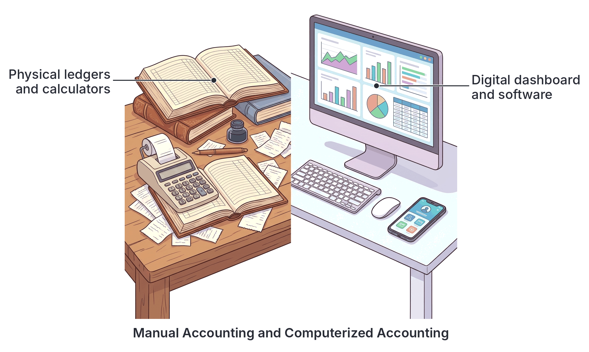
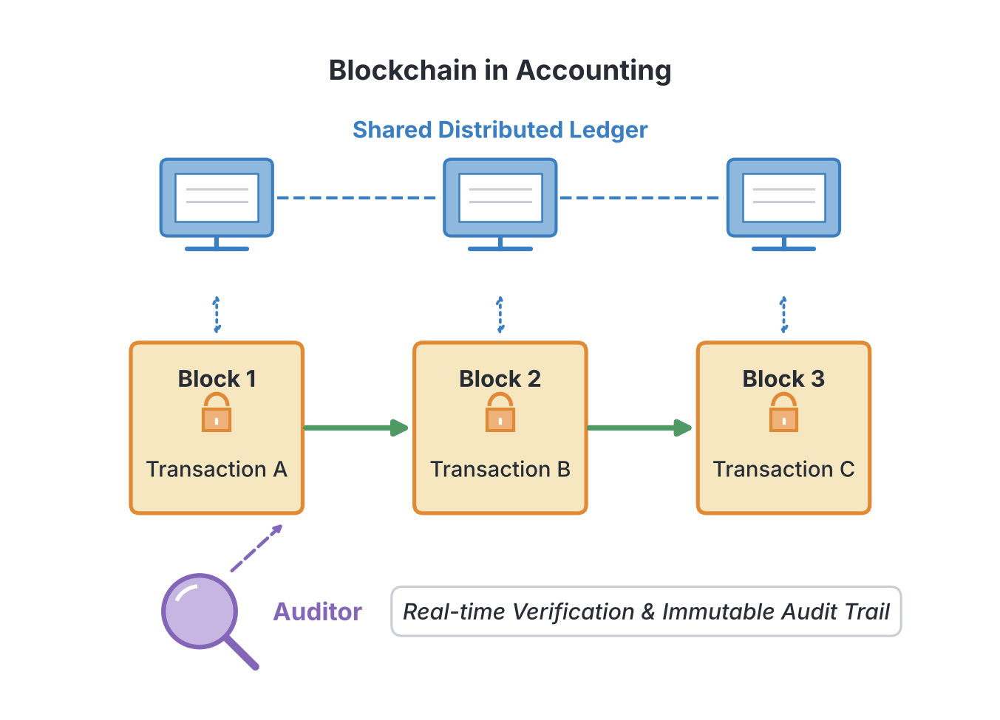

# JAMB Accounting Notes: Information Technology in Accounting

## What JAMB expects

This topic is Section A, Topic 18 of the JAMB Principles of Accounts syllabus: Information Technology in Accounting. It covers the modern tools and methods that have changed how accounting is done today. It covers the following content items:
- a. Manual and computerized Accounting processing system
- b. Procedures involved in data processing
- c. Digitization and digital technologies in Accounting (AI, data analytics, mobile accounting, special accounting software)
- d. Block chain technology in Accounting system
- e. Virtual Accounting

By the end of these notes, you should be able to:
1. Differentiate between manual and computerized Accounting processing system;
2. Identify the procedures involved in data processing;
3. Identify the digital technologies used in Accounting processing system;
4. Understand the benefits of block chain technology in Accounting system;
5. Identify the services provided by virtual accountants such as book keeping, payroll processing, tax preparation, bank, credit and loan accounts reconciliation, financial statement preparation etc.; and
6. Identify the advantages and disadvantages of computerized Accounting processing system.

**Note on the syllabus wording:** The syllabus asks for "the digital technologies use in Accounting processing system"; "use" is a typing error for "used". In Objective v, it lists "banks, credit and loan accounts reconciliation"; this refers to the reconciliation of bank, credit and loan accounts. 

## Manual and computerized accounting processing systems

Accounting can be done by hand or by using a computer. While both systems aim to record financial transactions and produce financial statements, the way they work is very different.

### Differentiating manual and computerized accounting systems

A **manual accounting processing system** is the traditional way of keeping records. The accountant uses physical paper, pens, physical ledger books, and a calculator. For example, a tailor in Aba might write down every payment she receives in a hardcover notebook and manually calculate her totals at the end of the month.

A **computerized accounting processing system** uses computer hardware and specialized accounting software to record and process financial information. Once the transaction is entered, the computer automatically updates all related accounts. For example, a large supermarket in Lagos uses Point of Sale (POS) terminals connected to software that automatically updates cash and inventory balances the moment a customer pays.

Here is a summary of the differences:

| Feature | Manual Accounting System | Computerized Accounting System |
| --- | --- | --- |
| **Tools used** | Pen, paper, physical ledger books, calculators | Computers, mobile devices, servers, and software |
| **Speed** | Slow; every transaction and calculation is done by hand | Very fast; data is processed and reports are updated instantly |
| **Accuracy** | Prone to human mathematical errors (e.g., adding wrongly) | Highly accurate; calculations are done automatically by the software |
| **Double entry** | Both the debit and credit entries must be written out separately | Entering a transaction once automatically updates both the debit and credit accounts |
| **Data storage** | Physical filing cabinets and shelves (takes up space, can be lost in a fire) | Digital storage on hard drives or the cloud (compact, easily backed up, and secure) |
| **Cost** | Low setup cost (just buying books and stationery) | High initial cost (buying computers, software licenses, and training staff) |

### Advantages and disadvantages of computerized accounting processing systems

**Advantages:**
1. **Speed and Efficiency:** Financial statements and reports can be generated at the click of a button. 
2. **Accuracy:** The computer does not make arithmetic mistakes. If the data entered is correct, the output will be perfectly calculated.
3. **Automatic document generation:** The system can automatically create and print invoices, receipts, and payroll slips.
4. **Better storage and security:** Digital data can be backed up on the internet (the cloud) and protected with passwords, preventing unauthorized access or physical loss.
5. **Accessibility:** Cloud-based systems allow business owners and accountants to access their financial data from anywhere in the world.

**Disadvantages:**
1. **High initial setup cost:** Buying computers, servers, internet routers, and software licenses is expensive.
2. **Training costs:** Staff must be trained to use the new software, which takes time and money.
3. **Dependence on power supply:** In places like Nigeria where the public power supply can be irregular, businesses must invest in generators or inverters, otherwise work stops when the power goes out.
4. **Risk of data loss:** If a system crashes and the data was not backed up, all financial records could be lost instantly.
5. **Cyber security threats:** Computerized systems connected to the internet can be attacked by hackers or computer viruses.

## Procedures involved in data processing

**Data processing** is the series of steps taken to convert raw facts and figures (data) into meaningful financial information (like reports). Whether done manually or by a computer, the data processing cycle follows these standard procedures:

1. **Data collection:** This is the gathering of raw financial data from source documents. Examples include collecting sales invoices, purchase receipts, and bank tellers.
2. **Data preparation (or Classification):** The collected data is sorted, categorized, and coded. For example, separating cash receipts from credit receipts, or assigning a specific account code to electricity bills.
3. **Data input:** The prepared data is entered into the accounting system. In a computerized system, this is done by typing on a keyboard, scanning a barcode, or uploading a file.
4. **Data processing:** The system acts on the input data. This involves calculating, sorting, summarizing, and applying the rules of double entry. For example, the software automatically subtracts an expense from the cash balance.
5. **Data output:** The results of the processing are presented as useful information. This could be viewing a Trial Balance on a screen, printing a Statement of Profit or Loss, or emailing an invoice to a customer.
6. **Data storage:** The processed data and the final reports are saved securely for future reference, audits, or legal reasons. This can be stored on computer hard drives or online cloud servers.

[IMAGE: A flowchart showing the data processing cycle in six steps connected by arrows in a continuous loop. 1. Data Collection (icons of paper receipts), 2. Data Preparation (icon of sorting folders), 3. Data Input (icon of a computer keyboard), 4. Processing (icon of a computer processor or gears), 5. Output (icon of a printed financial chart), 6. Storage (icon of a cloud database). Clean flat textbook style, white background.]

## Digitization and digital technologies in accounting

Digitization means converting paper-based information into digital formats. Modern accounting relies heavily on various digital technologies to make work faster and smarter.

### Machine learning and artificial intelligence (AI)
**Artificial Intelligence (AI)** allows software to mimic human intelligence, such as recognizing text or making decisions. **Machine learning** is a branch of AI where the system "learns" from past data without being explicitly programmed. 
- **How it is used in accounting:** If an accountant regularly records payments to "MTN Nigeria" as "Telephone Expenses," a machine learning tool will learn this pattern. The next time an MTN receipt is scanned, the AI will automatically suggest or categorize it as a Telephone Expense. AI is also highly effective at scanning millions of transactions to detect unusual activity and prevent fraud.

### Data analytics
**Data analytics** is the process of examining large amounts of financial data to uncover hidden patterns, market trends, and valuable insights. 
- **How it is used in accounting:** A business in Kano can use data analytics to analyze ten years of sales data. The analysis might reveal that sales of specific goods spike right before the rainy season. The accountant uses this insight to advise management on when to buy more inventory, leading to better business decisions.

### Mobile accounting
**Mobile accounting** involves using smartphone and tablet applications to access and manage accounting data on the go. 
- **How it is used in accounting:** A plumber in Port Harcourt does not need to return to an office to write an invoice. Immediately after fixing a pipe, he can open a mobile accounting app on his phone, generate a digital invoice, and email it directly to the customer. It allows small business owners to track expenses and revenues anytime, anywhere.

### Special accounting software
**Special accounting software** refers to ready-made computer programs designed specifically to handle accounting functions. 
- **How it is used in accounting:** Instead of using general programs like Microsoft Excel, businesses use dedicated software like **QuickBooks**, **Sage**, **Xero**, **Tally**, or **Peachtree**. These programs come with built-in charts of accounts, ledgers, cash books, and report generators. Once a user inputs a transaction, the software automatically posts it to the correct ledgers and updates the financial statements in real time.

## Blockchain technology in accounting systems

A **blockchain** is a type of digital, decentralized, and distributed ledger. Imagine a digital ledger book that is shared across thousands of computers worldwide. When a new transaction occurs, it is recorded in a "block" of data. Once that block is full, it is locked and securely linked (chained) to the previous block using advanced mathematics (cryptography). 

### Benefits of blockchain technology in accounting
1. **Immutability (Cannot be changed):** Once a transaction is recorded on a blockchain, it cannot be altered, erased, or tampered with by anyone. This makes it almost impossible for someone to commit accounting fraud by changing past figures.
2. **High Security:** Because the ledger is distributed across many computers and protected by cryptography, it is extremely difficult for hackers to attack the system.
3. **Transparency:** All authorized parties (such as the business, their suppliers, and their bank) can view the same ledger in real time. Everyone agrees on the truth, reducing arguments over missing payments.
4. **Faster and Easier Auditing:** Auditors spend a lot of time verifying paper trails to ensure numbers haven't been faked. With blockchain, the records are guaranteed to be accurate and untampered, so auditing can be done almost instantly.
5. **Smart Contracts:** These are computer programs stored on the blockchain that run automatically when certain conditions are met. For example, a smart contract can automatically release payment to a supplier the moment a delivery is digitally signed for at the warehouse, saving time and paperwork.

## Virtual accounting

In the past, a business had to hire a full-time accountant who sat at a desk in the company's office. **Virtual accounting** changes this. It is the provision of accounting services remotely over the internet by qualified accountants or accounting firms. The virtual accountant uses cloud-based software to access the company's financial data from anywhere in the world.

### Services provided by virtual accountants
A virtual accountant can do almost everything an in-house accountant can do. The syllabus highlights the following key services:
1. **Book keeping:** Recording the daily financial transactions of the business, such as daily sales, purchases, and petty cash expenses, ensuring the ledgers are always up to date.
2. **Payroll processing:** Calculating employee wages, deducting taxes (like PAYE) and pension contributions, and arranging the direct payment of salaries into staff bank accounts at the end of the month.
3. **Tax preparation:** Calculating taxes owed by the business (such as Value Added Tax or Company Income Tax) and ensuring tax returns are filed correctly and on time with authorities like the Federal Inland Revenue Service (FIRS).
4. **Bank, credit and loan accounts reconciliation:** Regularly comparing the business's internal cash book records with the statements provided by the bank or loan providers to find and correct any missing entries or errors.
5. **Financial statement preparation:** Preparing the final end-of-year reports, such as the Statement of Profit or Loss and the Statement of Financial Position, to show the business's overall performance.

## Key terms

| Term | Meaning |
| --- | --- |
| **Manual accounting** | A system of keeping financial records by hand using physical paper, pens, and ledger books. |
| **Computerized accounting** | A system that uses computer hardware and specialized software to record and process financial transactions automatically. |
| **Data processing** | The step-by-step conversion of raw data into meaningful and useful information. |
| **Artificial Intelligence (AI)** | Technology that enables computers to mimic human intelligence, such as recognizing patterns or making decisions. |
| **Machine learning** | A subset of AI where software learns from historical data to automatically categorize future transactions. |
| **Data analytics** | Examining large sets of data to find trends, patterns, and insights to help business decision-making. |
| **Mobile accounting** | The use of smartphone or tablet apps to manage business finances on the go. |
| **Blockchain** | A highly secure, decentralized digital ledger where transactions are recorded in blocks that cannot be altered. |
| **Immutability** | The quality of being unchangeable; in blockchain, it means past records cannot be edited or deleted. |
| **Smart contracts** | Automated computer programs on a blockchain that execute actions (like payments) when specific conditions are met. |
| **Virtual accounting** | The provision of accounting and bookkeeping services remotely over the internet. |

## Exam tips and common mistakes

- **Input vs. Processing:** Do not confuse data input with data processing. Input is the physical act of entering data (like typing on a keyboard). Processing is what the computer does internally (calculating, sorting, and applying double entry).
- **Computer accuracy:** Remember the phrase "Garbage in, garbage out". A computer is highly accurate at calculations, but if a human types the wrong number into the system, the computer will output the wrong result. The system does not automatically prevent humans from typing incorrect numbers.
- **Blockchain meaning:** Do not confuse "blockchain" with "cryptocurrency" (like Bitcoin). While cryptocurrencies use blockchain, in accounting, blockchain refers to the *secure, unchangeable digital ledger technology* itself.
- **Immutability:** A frequent exam question focuses on the main benefit of blockchain. Look for keywords like "immutability," "cannot be altered," or "tamper-proof."
- **AI vs. Analytics:** AI and Machine Learning automate tasks and learn from habits. Data Analytics focuses on studying large amounts of past data to find business trends and make future decisions.

## Quick summary

1. A computerized accounting system is fast, highly accurate, and updates all ledgers automatically, whereas a manual system is slower, prone to human calculation errors, and requires physical storage space.
2. A major disadvantage of computerized systems in Nigeria is their dependence on a stable power supply and the risk of cyber attacks or data loss if not backed up.
3. The data processing cycle involves six steps: Data collection, Data preparation, Data input, Data processing, Data output, and Data storage.
4. Digital technologies are transforming accounting: AI automates repetitive tasks, Data analytics uncovers business trends, Mobile accounting allows work on smartphones, and Special software (like QuickBooks or Sage) provides ready-made automated ledgers.
5. Blockchain technology is a decentralized digital ledger. Its major benefit is immutability—once a transaction is recorded, it cannot be tampered with, making auditing faster and preventing fraud.
6. Virtual accountants work remotely over the internet, providing businesses with services such as book keeping, payroll processing, tax preparation, bank reconciliation, and the preparation of financial statements.

## Practice questions

**1. Which of the following is a major advantage of a computerized accounting system over a manual system?**
- A. It requires no electricity to function.
- B. It is entirely free of setup costs.
- C. It processes data and updates accounts automatically.
- D. It prevents any incorrect data from being typed in by the user.

**Answer: C.** A computerized system automatically posts entries to all relevant ledgers and calculates totals. Option D is incorrect because of "garbage in, garbage out"—if a user types the wrong number, the computer will process that wrong number.

**2. The stage of the data processing cycle where a completed trial balance is generated for the manager to review is known as:**
- A. Data collection
- B. Data output
- C. Data storage
- D. Data input

**Answer: B.** Data output is the stage where the processed data is presented as meaningful information, such as reports or financial statements, for the user.

**3. A digital technology that allows accounting software to "learn" how to categorize expenses based on a user's past entries without being explicitly programmed is known as:**
- A. Blockchain
- B. Data analytics
- C. Mobile accounting
- D. Machine learning

**Answer: D.** Machine learning, a branch of Artificial Intelligence (AI), allows software to learn from historical data patterns to automate repetitive tasks.

**4. A major benefit of using blockchain technology in an accounting system is that:**
- A. it removes the need to pay taxes to the government.
- B. recorded transactions are immutable and cannot be secretly altered.
- C. it automatically converts all physical cash into cryptocurrency.
- D. it requires no internet connection to operate.

**Answer: B.** Immutability is the defining feature of a blockchain. Once a block of data is added to the chain, it cannot be changed or tampered with, which highly reduces fraud.

**5. Which of the following is a core service commonly provided by a virtual accountant?**
- A. Sweeping the physical office floor
- B. Repairing the company's computer hardware
- C. Bank, credit and loan accounts reconciliation
- D. Delivering physical goods to customers

**Answer: C.** Virtual accountants provide financial services remotely, including bookkeeping, payroll processing, tax preparation, and reconciling bank and loan accounts.

**6. In a modern business, which of the following is an example of special accounting software?**
- A. Microsoft Word
- B. QuickBooks
- C. WhatsApp
- D. Google Chrome

**Answer: B.** QuickBooks, along with Sage, Xero, and Tally, are examples of special accounting software designed specifically to handle financial records and reports.

**7. The practice of examining large sets of financial data to discover market trends, helping a business know what products to stock, is called:**
- A. Data analytics
- B. Data collection
- C. Virtual accounting
- D. Smart contracts

**Answer: A.** Data analytics involves analyzing raw data to uncover hidden patterns and insights, aiding management in making informed decisions.

**8. Which of the following represents a significant disadvantage of a computerized accounting processing system?**
- A. High speed of generating financial reports
- B. Dependence on a stable power supply and potential data loss
- C. Requiring less physical storage space than paper files
- D. Automatic extraction of a trial balance

**Answer: B.** While computerized systems are fast and save physical space (which are advantages), they rely heavily on electricity and are vulnerable to data loss if systems crash and backups are not maintained.

**9. The process of gathering source documents like receipts and invoices before they are entered into a computer is known as:**
- A. Data output
- B. Data collection
- C. Data processing
- D. Data storage

**Answer: B.** Data collection is the very first step in the data processing cycle, involving the gathering of raw facts and source documents.

**10. A business owner in Lagos uses an application on her smartphone to send digital invoices to customers while stuck in traffic. This is an example of:**
- A. Blockchain technology
- B. Data storage
- C. Manual accounting
- D. Mobile accounting

**Answer: D.** Mobile accounting refers to managing accounting tasks and accessing financial data through apps on mobile devices like smartphones and tablets.

<!-- COVERAGE
obj i | Differentiating manual and computerized accounting systems
obj ii | Procedures involved in data processing
obj iii | Digitization and digital technologies in accounting
obj iv | Blockchain technology in accounting systems
obj v | Virtual accounting
obj vi | Advantages and disadvantages of computerized accounting processing systems
item a | Differentiating manual and computerized accounting systems
item b | Procedures involved in data processing
item c | Digitization and digital technologies in accounting
item d | Blockchain technology in accounting systems
item e | Virtual accounting
-->
