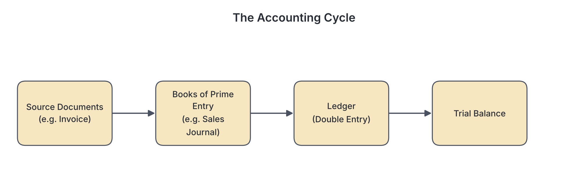
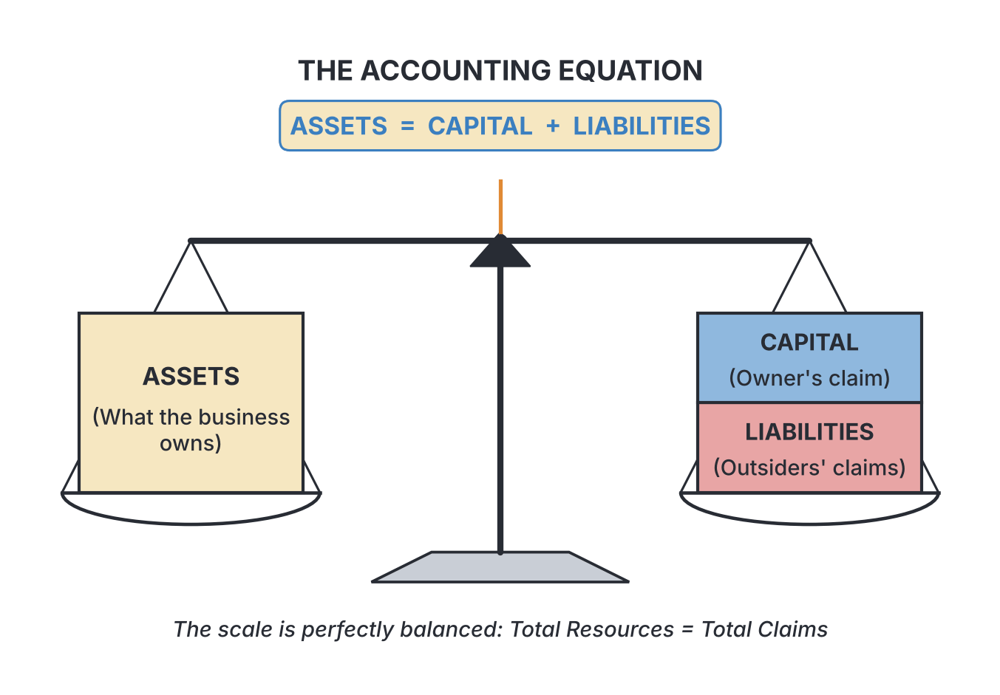

# JAMB Accounting Notes: Principles of Double Entry

## What JAMB expects

This topic is Section A, Topic 2 of the JAMB Principles of Accounts syllabus: Principles of Double Entry. It covers the foundation of how financial transactions are recorded, from the initial paperwork to the extraction of a trial balance, and how to correct mistakes along the way.

**Note on terminology:** Textbooks often use different words for the same accounting concepts. You may see "subsidiary books", "books of prime entry", or "books of original entry"—these all mean the same thing. Similarly, "stock" is the same as "inventory", "debtors" are "receivables", and "creditors" are "payables". We will use both names so you are prepared for whatever language the exam uses. 

By the end of these notes, you should be able to:
1. identify various source documents and their uses;
2. relate source documents to the various books of original entry;
3. determine the effect of changes in elements of Accounting equation;
4. understand the role of double entry principles in treating financial transactions;
5. extract a trial balance from ledger accounts;
6. identify various types of errors and their corrections; and
7. correct errors using suspense account.

## Source documents

**Content a: Source documents.**

A source document is the original written or printed record that proves a business transaction took place. In accounting, you never record a transaction from memory or spoken words; you must always have evidence. Source documents provide the details needed to enter a transaction into the accounting books, such as the date, amount, parties involved, and a description of the transaction.

### Uses of various source documents

**Objective i: identify various source documents and their uses.**

Here are the key source documents you must know, along with who issues them and what they are used for:

- **Invoice:** A document sent by a seller to a buyer demanding payment for goods sold on credit. It lists the quantity, price, and terms of sale. An incoming invoice is a purchase invoice, while an outgoing invoice is a sales invoice.
- **Receipt:** A written acknowledgement that cash or a cheque has been received. A business issues a receipt when a customer pays cash, and receives a receipt when paying for expenses or purchases in cash.
- **Credit Note:** A document sent by a seller to a buyer to reduce the amount the buyer owes. It is used when a customer returns faulty goods or is accidentally overcharged. (It "credits" the customer's account).
- **Debit Note:** A document sent by a seller to a buyer to increase the amount owed, usually because the buyer was undercharged on an invoice. It can also be sent by a buyer to a seller when returning goods, requesting a credit note.
- **Cheque Stubs / Counterfoils:** The part of a chequebook kept by the drawer (the person writing the cheque) after the cheque is torn out. It is used as evidence of payments made through the bank.
- **Payment Voucher:** An internal document prepared by a business to authorise a payment (such as paying wages or buying office tea), ensuring the expense is genuine before cash leaves the business.
- **Bank Statement:** A document sent by the bank showing the balance and all transactions (deposits, withdrawals, and charges) on a bank account over a period.
- **Petty Cash Voucher:** A small form used to claim reimbursement for minor daily expenses, like buying a broom or paying for transport.

## Books of original entry

**Content b: Books of original entry.**

Books of original entry (also called books of prime entry, subsidiary books, or journals) are the first books where transactions are recorded from the source documents. 

Instead of cluttering the main ledger with every single small transaction, businesses group similar transactions together in these books. For example, all credit sales are listed in one book, and their total is transferred to the ledger at the end of the month. 

### Relating source documents to books of original entry

**Objective ii: relate source documents to the various books of original entry.**

It is vital to know exactly which source document belongs in which book of original entry. Use this comparison table to memorize the relationships:

| Source Document | Book of Original Entry | Purpose of the Book |
| --- | --- | --- |
| **Sales Invoice** (Copy kept by the seller) | **Sales Day Book** (Sales Journal) | To record all credit sales of goods meant for resale. |
| **Purchases Invoice** (Original received from supplier) | **Purchases Day Book** (Purchases Journal) | To record all credit purchases of goods meant for resale. |
| **Credit Note** (Copy kept by the seller) | **Returns Inwards Book** (Sales Returns Journal) | To record goods returned to the business by customers. |
| **Credit Note** (Original received from supplier) | **Returns Outwards Book** (Purchases Returns Journal) | To record goods returned by the business to suppliers. |
| **Receipts, Cheque Stubs, Bank Tellers** | **Cash Book** | To record all cash and bank receipts and payments. |
| **Petty Cash Vouchers** | **Petty Cash Book** | To record small, frequent cash payments (petty cash). |
| **Memos, Correspondence, Invoices for Fixed Assets** | **General Journal** (Journal Proper) | To record transactions that do not fit in any other book (e.g., buying a motor van on credit, correcting errors, opening entries). |

**Common Mistake:** Never record the sale or purchase of a *fixed asset* (like machinery or a vehicle) on credit in the Sales or Purchases Day Books. Those books are strictly for goods the business trades in. Fixed assets bought on credit go in the **General Journal**.

## The accounting equation

**Content c: Accounting equation.**

The accounting equation is the foundation of double-entry bookkeeping. It states that everything a business owns (its assets) is funded either by the owner (capital) or by outside parties (liabilities). 

The formula is:
**$$Assets = Capital + Liabilities$$**

- **Assets:** What the business owns or is owed (e.g., cash, bank balance, motor vehicles, stock, debtors).
- **Liabilities:** What the business owes to outsiders (e.g., bank loans, creditors).
- **Capital:** What the business owes to the owner (the owner's investment, plus any profits, minus any drawings). Capital can also be rearranged as: **$$Capital = Assets - Liabilities$$**.

### Effects of changes in the accounting equation

**Objective iii: determine the effect of changes in elements of Accounting equation.**

Every transaction changes at least two elements of the accounting equation, but the equation will always remain balanced. Let us look at a worked example for a new business, Chinedu's Shoe Shop in Aba.

**Step 1: Starting the business**
Chinedu starts his business by putting ₦500,000 into the business bank account.
- **Effect:** The business now has an Asset (Bank) of ₦500,000. It also owes the owner a Capital of ₦500,000.
- **Equation:** Assets (₦500,000) = Capital (₦500,000) + Liabilities (₦0).

**Step 2: Buying goods on credit**
He buys shoes worth ₦200,000 on credit from Ngozi.
- **Effect:** The business gains a new Asset (Stock of shoes) worth ₦200,000. Because he has not paid, he creates a Liability (Creditor: Ngozi) of ₦200,000.
- **Equation:** Assets (Bank ₦500,000 + Stock ₦200,000 = ₦700,000). Capital (₦500,000) + Liabilities (₦200,000) = ₦700,000. The equation balances.

**Step 3: Selling goods for a profit**
He sells some shoes that cost him ₦50,000 for ₦80,000 in cash.
- **Effect:** The Asset (Stock) decreases by the cost price, ₦50,000. A new Asset (Cash) increases by the selling price, ₦80,000. The profit of ₦30,000 belongs to the owner, so Capital increases by ₦30,000.
- **Equation:** Assets (Bank ₦500,000 + Stock ₦150,000 + Cash ₦80,000 = ₦730,000). Capital (₦500,000 + ₦30,000 = ₦530,000) + Liabilities (₦200,000) = ₦730,000. The equation balances perfectly.

## The ledger and its classifications

**Content d: Ledger and its classifications.**

The **ledger** is the main book of accounts. Every item (like cash, rent, sales, or a specific customer) has its own separate "T-account" in the ledger. 

Because a business has many accounts, the ledger is often split into classifications to make it easier to manage:
1. **Personal Accounts:** These deal with individuals and other businesses.
   - **Debtors Ledger (Sales Ledger):** Contains the personal accounts of customers who owe the business money.
   - **Creditors Ledger (Purchases Ledger):** Contains the personal accounts of suppliers whom the business owes money.
2. **Impersonal Accounts:** These deal with things and abstract concepts, kept in the **General Ledger**.
   - **Real Accounts:** Tangible and intangible things the business owns (assets), such as Motor Vehicles, Cash, and Machinery.
   - **Nominal Accounts:** Accounts for income, expenses, profits, losses, and capital. Examples include Rent, Wages, Sales, Purchases, and Discount Allowed.

### The role of double entry principles

**Objective iv: understand the role of double entry principles in treating financial transactions.**

The principle of double entry states that for every financial transaction, there must be a **debit (Dr)** entry in one account and a corresponding **credit (Cr)** entry of equal value in another account. 

A simple rule to remember is: **"Debit the receiver, Credit the giver."** Alternatively, use the modern rules of double entry based on the accounting equation:
- **Assets and Expenses:** Increases are Debited; Decreases are Credited.
- **Capital, Income, and Liabilities:** Increases are Credited; Decreases are Debited.

**Worked Example of Double Entry:**
1. **Paid rent of ₦10,000 by cash.**
   - Rent (an expense) increases: **Debit** Rent account ₦10,000.
   - Cash (an asset) decreases: **Credit** Cash account ₦10,000.
2. **Bought a motor van for ₦300,000 by cheque.**
   - Motor Van (an asset) increases: **Debit** Motor Van account ₦300,000.
   - Bank (an asset) decreases: **Credit** Bank account ₦300,000.

## The trial balance

**Content e: Trial balance.**

A **trial balance** is a list of all the balances extracted from the ledger accounts on a specific date. Because every transaction has an equal debit and credit, the total of all debit balances in the ledger must equal the total of all credit balances.

The trial balance serves two main purposes:
1. To test the arithmetical accuracy of the double-entry bookkeeping.
2. To provide a consolidated list of balances used to prepare the final accounts (Statement of Profit or Loss, and Statement of Financial Position).

### Extracting a trial balance from ledger accounts

**Objective v: extract a trial balance from ledger accounts.**

To extract a trial balance, you must know whether a ledger account has a debit or a credit balance. Use this golden rule:
- **Debit side (ALL):** Assets, Losses, eXpenses, Drawings.
- **Credit side (CIL):** Capital, Income, Liabilities.

**Worked Example:**
Imagine we extracted the following balances from Musa's Provision Store: 
Capital ₦450,000; Drawings ₦20,000; Purchases ₦250,000; Sales ₦400,000; Rent ₦30,000; Wages ₦45,000; Fixtures and Fittings ₦150,000; Motor Vehicle ₦200,000; Debtors ₦60,000; Creditors ₦40,000; Bank ₦135,000.

Here is how you list them to extract the trial balance:

| S/N | Name of Account | Dr (₦) | Cr (₦) |
| :--- | :--- | :--- | :--- |
| 1 | Capital | | 450,000 |
| 2 | Drawings | 20,000 | |
| 3 | Purchases | 250,000 | |
| 4 | Sales | | 400,000 |
| 5 | Rent | 30,000 | |
| 6 | Wages | 45,000 | |
| 7 | Fixtures and Fittings | 150,000 | |
| 8 | Motor Vehicle | 200,000 | |
| 9 | Debtors (Receivables) | 60,000 | |
| 10 | Creditors (Payables) | | 40,000 |
| 11 | Bank | 135,000 | |
| | **Total** | **890,000** | **890,000** |

Because both columns total ₦890,000, the trial balance has "agreed".

## Types and correction of errors

**Content f: Types and correction of errors.**

Sometimes mistakes happen. When they do, accountants correct them using the General Journal. Errors are classified into two groups: those that do not affect the trial balance totals, and those that do.

### Identifying various types of errors and their corrections

**Objective vi: identify various types of errors and their corrections.**

**A. Errors that DO NOT affect the trial balance (The trial balance still agrees):**
Even if the debits and credits equal each other, a mistake might still exist. 

1. **Error of Omission:** A transaction is completely left out of the books. 
   - *Example:* A cash sale of ₦5,000 is neither entered in the cash book nor the sales account. 
   - *Correction:* Enter the transaction normally (Dr Cash ₦5,000, Cr Sales ₦5,000).
2. **Error of Commission:** The entry is placed in the correct class of account, but the wrong person's account. 
   - *Example:* Goods sold on credit to Ali for ₦4,000 were incorrectly debited to Aliyu's account. 
   - *Correction:* Credit Aliyu ₦4,000 (to remove the mistake) and Debit Ali ₦4,000.
3. **Error of Principle:** The entry is placed in the wrong class of account entirely. 
   - *Example:* A motor van bought for ₦400,000 was debited to the Motor Expenses account instead of the Motor Vehicles (asset) account. 
   - *Correction:* Credit Motor Expenses ₦400,000 (to remove it) and Debit Motor Vehicles ₦400,000.
4. **Error of Original Entry:** The correct accounts are used, but a wrong figure is entered into the subsidiary book right from the start, spreading to both ledgers. 
   - *Example:* An invoice for ₦54,000 was mistakenly written in the day book as ₦45,000.
   - *Correction:* Add the missing ₦9,000 to the correct accounts.
5. **Compensating Error:** Two unrelated mathematical errors randomly cancel each other out. 
   - *Example:* The Sales account is undercast by ₦1,000, and the Rent account is also undercast by ₦1,000. 
   - *Correction:* Dr Rent ₦1,000, Cr Sales ₦1,000.
6. **Complete Reversal of Entries:** The right amount and right accounts are used, but the debit and credit sides are swapped. 
   - *Example:* Cash received from a debtor, ₦2,000, was debited to the debtor and credited to cash.
   - *Correction:* Debit Cash ₦4,000 and Credit Debtor ₦4,000 (multiplying the amount by two: half to cancel the error, half to record the real transaction).

**B. Errors that DO affect the trial balance:**
If the trial balance does not agree, one of these errors occurred:
- Mathematical errors (incorrectly adding up a ledger account or subsidiary book).
- Entering a transaction on one side only (a debit without a credit).
- Entering two debits or two credits instead of one of each.
- Transposition errors on one side (writing ₦540 instead of ₦450).

## The suspense account

**Content g: Suspense Account.**

When a trial balance fails to agree and the accountant cannot immediately find the error, a **Suspense Account** is opened. This is a temporary account used to hold the difference so that final accounts can be prepared on time. The difference is placed on whichever side of the trial balance is smaller, forcing it to balance. 

### Correcting errors using a suspense account

**Objective vii: correct errors using suspense account.**

As errors are discovered, they are corrected using Journal entries. Because these errors caused the trial balance to fail in the first place, correcting them will always involve the Suspense Account. Once all errors are found, the Suspense Account balance will become zero.

**Worked Example:**
At year-end, the trial balance debit total was ₦890,000 and the credit total was ₦884,000. 
- **Step 1:** The credit side is short by ₦6,000. 
- **Step 2:** A Suspense Account is opened with a Credit balance of ₦6,000.

Later, two errors are discovered:
1. The Sales Day Book was undercast (added up too short) by ₦4,000. 
2. A discount received of ₦2,000 was entered in the Cash Book but totally omitted from the Discount Received account in the ledger.

**Step 3 & 4: Determine the corrections and pass journal entries:**

*Error 1:* The Sales account (which is a credit balance) is missing ₦4,000. We must Credit the Sales account. To maintain double entry, we Debit the Suspense account.

| Date | Details | Dr (₦) | Cr (₦) |
| :--- | :--- | :--- | :--- |
| | Suspense Account | 4,000 | |
| | Sales Account | | 4,000 |
| | *Being correction of undercast in Sales Day Book* | | |

*Error 2:* Discount received (an income, so a credit balance) is missing ₦2,000. We must Credit the Discount Received account. We therefore Debit the Suspense account.

| Date | Details | Dr (₦) | Cr (₦) |
| :--- | :--- | :--- | :--- |
| | Suspense Account | 2,000 | |
| | Discount Received Account | | 2,000 |
| | *Being correction of discount received omitted from ledger* | | |

**Step 5: Post to the Suspense Account:**

| Date | Details | Amount (₦) | Date | Details | Amount (₦) |
| :--- | :--- | :--- | :--- | :--- | :--- |
| | Sales account | 4,000 | | Difference per trial balance | 6,000 |
| | Discount received | 2,000 | | | |
| | **Total** | **6,000** | | **Total** | **6,000** |

The Suspense Account has been cleared, proving all one-sided errors have been found.

## Key terms

| Term | Meaning |
| --- | --- |
| Source Document | The original written proof that a transaction took place (e.g., invoice, receipt) |
| Book of Original Entry | The subsidiary book where transactions are first recorded before going to the ledger |
| Accounting Equation | Assets = Capital + Liabilities |
| Double Entry | The rule that every transaction requires a matching debit and credit entry |
| Ledger | The main book of accounts containing all personal and impersonal T-accounts |
| Nominal Account | An impersonal account that records revenues, expenses, capital, and drawings |
| Trial Balance | A list of all ledger balances used to test arithmetical accuracy |
| Error of Principle | Placing a transaction in the wrong class of account (e.g., treating an asset as an expense) |
| Suspense Account | A temporary account used to balance a trial balance while errors are investigated |

## Exam tips and common mistakes

- **Credit note vs Debit note:** A credit note reduces what a customer owes (used for returns inwards). A debit note increases it. If a supplier sends you a credit note, it goes in your Returns Outwards book.
- **Error of Commission vs Principle:** Commission is wrong *person* (both are personal accounts). Principle is wrong *class* (asset vs expense).
- **Correcting complete reversals:** If you post to the wrong sides (e.g., debited instead of credited), your correcting journal entry must use **double** the original amount to fix it.
- **Drawings effect:** Remember that drawings reduce capital. Always debit drawings and credit the asset (cash/bank) taken.
- **Suspense double-entry:** When fixing an error via a Suspense Account, always ask yourself: "Which account needs fixing?" Fix that account first (Dr or Cr), then do the opposite to the Suspense Account.

## Quick summary

1. Source documents (invoices, receipts, cheque stubs) are the essential starting points of all accounting records.
2. Transactions are grouped from source documents into Books of Original Entry (e.g., Sales Day Book, Cash Book, General Journal) before being posted to the ledger.
3. The Accounting Equation (Assets = Capital + Liabilities) ensures that a business is always in balance after every transaction.
4. The ledger is divided into personal accounts (debtors and creditors) and impersonal accounts (real and nominal).
5. The rule of double entry mandates that every debit has a corresponding credit of equal value.
6. A trial balance is extracted to check mathematical accuracy. Assets and expenses are debited; capital, liabilities, and income are credited.
7. Some errors (like omission, commission, and principle) do not stop the trial balance from agreeing. Errors that do affect the trial balance are temporarily placed in a Suspense Account until corrected.

## Practice questions

**1. Which of the following source documents is used to record entries in the Returns Outwards Journal?**
- A. Invoice sent to a customer
- B. Credit note received from a supplier
- C. Debit note sent to a supplier
- D. Credit note sent to a customer

**Answer: B.** Returns outwards are goods returned by the business to a supplier. The supplier sends a credit note acknowledging the return, which becomes the source document used to record the return.

**2. A business has a capital of ₦1,500,000 and total liabilities of ₦450,000. What is the value of its total assets?**
- A. ₦1,050,000
- B. ₦1,500,000
- C. ₦1,950,000
- D. ₦2,400,000

**Answer: C.** According to the accounting equation, Assets = Capital + Liabilities. 
Step 1: Identify Capital (₦1,500,000) and Liabilities (₦450,000). 
Step 2: Add them together (₦1,500,000 + ₦450,000 = ₦1,950,000). Option A is incorrect because it subtracts instead of adds.

**3. The purchase of a motor vehicle on credit from CFAO Motors should first be recorded in the**
- A. Purchases Day Book
- B. Cash Book
- C. General Journal
- D. Sales Day Book

**Answer: C.** A motor vehicle is a fixed asset, not goods intended for resale. The Purchases Day Book is strictly for credit purchases of trading goods. Fixed assets bought on credit must be recorded in the General Journal.

**4. If a business owner takes ₦10,000 cash from the business for personal use, the double entry is to**
- A. Debit Capital account, Credit Cash account
- B. Debit Cash account, Credit Drawings account
- C. Debit Drawings account, Credit Cash account
- D. Debit Cash account, Credit Capital account

**Answer: C.** When the owner takes cash for personal use, it is termed "Drawings". The business is giving out cash (credit the asset Cash) and the owner is receiving value (debit Drawings, which ultimately reduces Capital).

**5. Which of the following accounts is classified as a nominal account?**
- A. Bank account
- B. Motor vehicles account
- C. Adebayo (a debtor) account
- D. Rent account

**Answer: D.** Nominal accounts record expenses, income, losses, and gains. Rent is an expense, so it is a nominal account. Bank and motor vehicles are real accounts (assets), while Adebayo is a personal account.

**6. In a trial balance, which of the following items will normally have a debit balance?**
- A. Sales
- B. Bank overdraft
- C. Purchases returns
- D. Wages

**Answer: D.** Wages is an expense, and all expenses have debit balances. Sales, bank overdrafts (a liability), and purchases returns all fall on the credit side.

**7. A payment of ₦5,000 for electricity was debited to the rent account. This is an example of an error of**
- A. commission
- B. principle
- C. omission
- D. complete reversal

**Answer: A.** An error of commission occurs when a transaction is entered in the wrong account, but the account is of the correct class (both electricity and rent are expense/nominal accounts). If it were posted to a different class entirely (e.g., debited to machinery, an asset), it would be an error of principle.

**8. Which of the following errors will cause the trial balance totals to disagree?**
- A. Completely omitting a transaction from the books
- B. Overcasting the sales day book by ₦2,000
- C. Debiting a purchase of machinery to the purchases account
- D. Recording cash received from a debtor on the credit side of cash book and debit side of the debtor's account

**Answer: B.** Overcasting a subsidiary book means the total transferred to the ledger (the Sales account) will be incorrect, affecting only the credit side of the ledger. This single-sided error causes the trial balance to disagree. Options A, C, and D are errors that do not affect the trial balance.

**9. A trial balance showed a total debit of ₦500,000 and a total credit of ₦492,000. A suspense account was opened. It was discovered that a discount received of ₦8,000 was entered in the cash book but omitted from the discount received account. The journal entry to correct this is:**
- A. Debit Suspense account ₦8,000; Credit Discount Received account ₦8,000
- B. Debit Discount Received account ₦8,000; Credit Suspense account ₦8,000
- C. Debit Suspense account ₦8,000; Credit Creditors account ₦8,000
- D. Debit Creditors account ₦8,000; Credit Suspense account ₦8,000

**Answer: A.** 
Step 1: The credit side was short by ₦8,000, giving the suspense account an opening credit balance of ₦8,000. 
Step 2: Discount received is an income and should be credited. To correct its omission from the ledger, we must credit the Discount Received account with ₦8,000. 
Step 3: To complete the double entry, we debit the Suspense account with ₦8,000, which clears its credit balance.

**10. A supplier sent an invoice for ₦45,000, but it was recorded in the purchases day book as ₦54,000, and this figure was posted to the ledgers. This error is known as an error of**
- A. complete reversal
- B. original entry
- C. principle
- D. commission

**Answer: B.** An error of original entry occurs when the wrong figure is entered into a book of prime entry and then passed into the ledger. The double entry is maintained, but with the wrong amount, so the trial balance will still agree.

<!-- COVERAGE
obj i | Uses of various source documents
obj ii | Relating source documents to books of original entry
obj iii | Effects of changes in the accounting equation
obj iv | The role of double entry principles
obj v | Extracting a trial balance from ledger accounts
obj vi | Identifying various types of errors and their corrections
obj vii | Correcting errors using a suspense account
item a | Source documents
item b | Books of original entry
item c | The accounting equation
item d | The ledger and its classifications
item e | The trial balance
item f | Types and correction of errors
item g | The suspense account
-->
