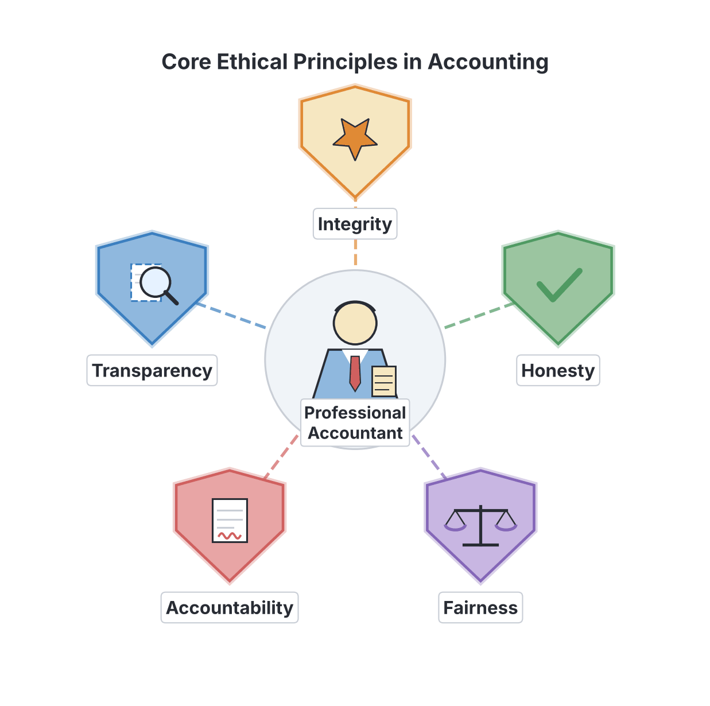
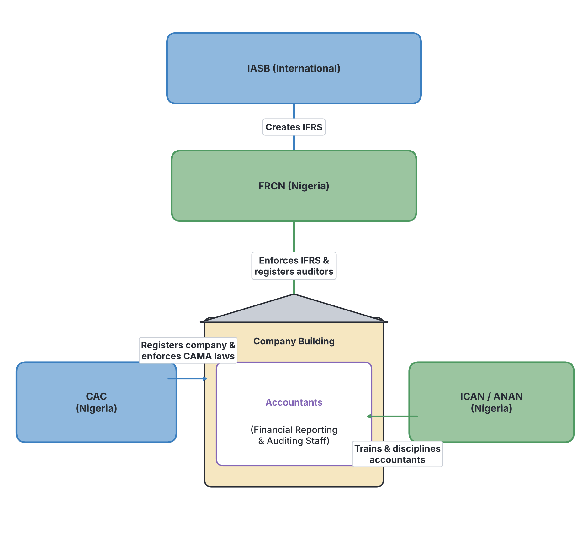

# JAMB Accounting Notes: Ethics, Professional and Regulatory Bodies in Accounting

## What JAMB expects

This topic is Section A, Topic 3 of the JAMB Principles of Accounts syllabus: Ethics, Professional and Regulatory Bodies in Accounting. It covers the following content items:

- **a.** Objectives
- **b.** Qualities of an Accountant
- **c.** Accounting professional bodies in Nigeria
- **d.** Accounting regulatory bodies

By the end of these notes, you should be able to:

1. understand the ethics required in preparing and presenting Accounting information;
2. understand qualities of an Accountant such as honesty, integrity, transparency, accountability and fairness;
3. understand the purpose and functions of Accounting professional bodies in Nigeria; and
4. understand the purpose and functions of Accounting regulatory bodies in Nigeria e.g. Financial Reporting Council of Nigeria (FRCN), Corporate Affairs Commission (CAC) and International Accounting Standard Board (IASB).

**Note on the syllabus wording:** JAMB Objective iv lists the International Accounting Standard Board (IASB) as an example of an accounting regulatory body "in Nigeria", and spells it without an "s" on "Standards". The IASB is actually an **international** independent standard-setting body based in London, not a Nigerian regulatory body. In Nigeria, the FRCN regulates accounting standards. We teach the IASB below because it is in the syllabus, but we include a note about its true international status. 

## Objectives and ethics in accounting

**Objective i: understand the ethics required in preparing and presenting Accounting information.** (This also covers Content **a. Objectives**).

Accounting is the language of business. People rely on accounting information—such as financial statements—to make important decisions. Investors use it to decide whether to buy shares, banks use it to grant loans, and the government (through the Federal Inland Revenue Service, FIRS) uses it to calculate taxes. 

Because so much depends on this information, the main **objective** of accounting ethics is to ensure that financial reports are accurate, reliable, and free from manipulation.

**Ethics** refers to the moral principles that guide a person's behaviour. In accounting, professional ethics are the strict rules of conduct that accountants must follow to maintain public trust. 

When preparing and presenting accounting information, an accountant must follow these fundamental ethical principles:

1. **Objectivity:** An accountant must not let bias, conflict of interest, or the influence of others override their professional judgement. For example, if an accountant's brother owns a business that supplies goods to the accountant's company, the accountant must remain neutral and not falsify records to favour their brother.
2. **Confidentiality:** Accountants have access to sensitive financial secrets. They must not disclose this information to outsiders without proper permission, unless there is a legal or professional right or duty to do so (for example, reporting a crime or fraud to the police).
3. **Professional Competence and Due Care:** An accountant must maintain their professional knowledge and skill at the level required to ensure that an employer or client receives competent service. They must act carefully, thoroughly, and on time.
4. **Professional Behaviour:** Accountants must comply with relevant laws and regulations and avoid any action that brings the profession into disrepute (shame).

If an accountant fails to follow these ethics, they can be disciplined, fined, or even banned from practicing by their professional body.

## Qualities of an Accountant

**Objective ii: understand qualities of an Accountant such as honesty, integrity, transparency, accountability and fairness.** (This also covers Content **b. Qualities of an Accountant**).

Beyond the formal rules of ethics, a good accountant must possess certain personal and professional qualities. JAMB specifically requires you to know the following five qualities:

### 1. Honesty
Honesty means telling the truth at all times. An honest accountant will not steal from their employer, record fake transactions, or alter figures to make a company look more profitable than it really is. If a business in Aba has made a loss of ₦500,000, an honest accountant will report exactly that loss, rather than covering it up.

### 2. Integrity
Integrity goes hand-in-hand with honesty but goes deeper. It means being straightforward, morally upright, and doing the right thing even when no one is watching. An accountant with integrity will refuse a bribe to alter financial records, even if their boss threatens to sack them.

### 3. Transparency
Transparency means openness and clarity. A transparent accountant ensures that financial statements are easy to understand and do not hide any important (material) facts. All necessary information must be disclosed so that users of the accounts get a clear and complete picture of the business's financial health.

### 4. Accountability
Accountability is the willingness to take responsibility for one's actions and work. An accountable accountant can explain and justify every entry in the ledger. If a mistake is made in the cash book, an accountable accountant will own up to it and correct it, rather than blaming the cashier or the software.

### 5. Fairness
Fairness means treating all parties equally and without bias. An accountant must present financial information that is fair to all stakeholders—including minority shareholders, employees, and the tax authorities. They must not twist figures to benefit the directors while cheating the investors.

## Accounting professional bodies in Nigeria

**Objective iii: understand the purpose and functions of Accounting professional bodies in Nigeria.** (This also covers Content **c. Accounting professional bodies in Nigeria**).

A professional body is an organisation made up of members of a specific profession. It exists to protect the public interest, train members, and regulate how the profession is practiced. 

In Nigeria, the accounting profession is primarily regulated by two major legally recognised professional bodies.

### 1. The Institute of Chartered Accountants of Nigeria (ICAN)
ICAN was established by an Act of Parliament in **1965**. It is the premier (oldest and largest) professional accounting body in Nigeria. 
- **Membership Titles:** A member who passes the exams and gains experience becomes an Associate (ACA). After years of practice, they can become a Fellow (FCA).
- **Purpose and Functions:**
  - **Setting Standards:** Establishing strict codes of conduct and ethical standards for chartered accountants.
  - **Examinations:** Conducting professional examinations for candidates who wish to become chartered accountants.
  - **Discipline:** Investigating and punishing members who engage in professional misconduct or fraud.
  - **Continuous Education:** Organising seminars and Mandatory Continuing Professional Education (MCPE) to keep members updated on new accounting rules.

### 2. The Association of National Accountants of Nigeria (ANAN)
ANAN was established in **1979** and formally chartered by law in **1993**. ANAN has a unique training model: members must be university or polytechnic graduates of accounting who then attend the **Nigerian College of Accountancy (NCA)** located in Jos, Plateau State, for professional training before taking their final exams.
- **Membership Titles:** Members become Certified National Accountants (CNA) and can later become Fellows (FCNA).
- **Purpose and Functions:**
  - **Education and Training:** Providing specialized postgraduate training through its college in Jos.
  - **Advancement of the Profession:** Promoting the science of accountancy and raising the status of the profession in Nigeria.
  - **Regulation:** Ensuring its members follow the highest ethical standards and disciplining erring members.

### Comparison: ICAN vs ANAN

While both are top-tier professional accounting bodies in Nigeria, their approaches differ slightly:

| Feature | ICAN | ANAN |
| :--- | :--- | :--- |
| **Year established** | 1965 | 1979 (Chartered in 1993) |
| **Membership designation** | ACA (Associate), FCA (Fellow) | CNA (Associate), FCNA (Fellow) |
| **Training style** | Open professional exams (candidates can self-study or attend any tutorial centre) | Candidates must attend the Nigerian College of Accountancy (NCA) in Jos |
| **Foundational requirement** | Accepts graduates of any discipline (non-accounting graduates take foundation exams) | Strictly for graduates of accounting or allied disciplines |

*(Note: Other specialized bodies exist, such as the Chartered Institute of Taxation of Nigeria (CITN), but ICAN and ANAN are the primary professional accounting bodies tested by JAMB).*

## Accounting regulatory bodies

**Objective iv: understand the purpose and functions of Accounting regulatory bodies in Nigeria e.g. Financial Reporting Council of Nigeria (FRCN), Corporate Affairs Commission (CAC) and International Accounting Standard Board (IASB).** (This also covers Content **d. Accounting regulatory bodies**).

While professional bodies regulate the *people* (accountants), regulatory bodies are government agencies or statutory boards that regulate the *environment*, *laws*, and *standards* for how companies must operate and report their finances.

### 1. Financial Reporting Council of Nigeria (FRCN)
The FRCN was established by the Financial Reporting Council of Nigeria Act in **2011**. It replaced the former Nigerian Accounting Standards Board (NASB). The FRCN is the apex body responsible for the regulation of accounting, auditing, and corporate governance in Nigeria.

**Functions of the FRCN:**
- **Developing Standards:** Setting and publishing accounting and financial reporting standards to be used in Nigeria.
- **Enforcing IFRS:** Ensuring that Nigerian companies (especially public companies and banks) comply with International Financial Reporting Standards (IFRS).
- **Registration of Professionals:** Registering professionals (like auditors and accountants) who prepare or audit the financial statements of public interest entities.
- **Corporate Governance:** Issuing and enforcing codes of corporate governance to ensure companies are run transparently.
- **Advising Government:** Advising the Federal Government on matters relating to accounting and financial reporting.

### 2. Corporate Affairs Commission (CAC)
The Corporate Affairs Commission was established in **1990** under the Companies and Allied Matters Act (CAMA). It is the government agency responsible for regulating the formation and management of companies in Nigeria.

**Functions of the CAC:**
- **Incorporation:** Registering new companies, business names (like a local tailor shop in Aba registering as "Chidi & Sons Fashion"), and incorporated trustees (like churches, mosques, and NGOs).
- **Keeping Records:** Maintaining the official register of companies. Anyone can search this register to verify if a business is legally registered.
- **Enforcing Returns:** Ensuring that all registered companies file their annual returns (a yearly statement showing that the company is still active and updating its directors and financial status).
- **Striking Off:** Removing the names of dead or defaulting companies from the register.
- **Regulating Management:** Ensuring companies hold their Annual General Meetings (AGMs) and comply with the rules of CAMA.

### 3. International Accounting Standards Board (IASB)

> **Note on syllabus accuracy:** The JAMB syllabus lists the IASB as a regulatory body "in Nigeria". **This is factually incorrect.** The IASB is an independent, international standard-setting body based in London, UK. It is not a Nigerian government agency. However, because its standards are heavily used in Nigeria, it is included here.

The IASB was formed in **2001** to replace the old International Accounting Standards Committee (IASC).

**Functions of the IASB:**
- **Developing IFRS:** Its primary purpose is to develop and publish a single set of high-quality, understandable, enforceable, and globally accepted accounting standards known as **International Financial Reporting Standards (IFRS)**.
- **Global Harmonization:** Bringing together accounting rules from different countries so that a financial statement prepared in Nigeria can be easily understood by an investor in Japan or the UK.
- **Issuing Guidance:** Providing interpretations and guidance to help accountants around the world apply the standards correctly.

Nigeria (through the FRCN) adopted the use of IFRS starting in 2012, which is why the work of the IASB deeply affects Nigerian accounting practice today.

### Differentiating Professional and Regulatory Bodies

To avoid confusion in exams, remember this key difference:
- **Professional bodies** (ICAN, ANAN) protect the profession, set exams, award titles (ACA, CNA), and discipline the accountants themselves.
- **Regulatory bodies** (FRCN, CAC) protect the economy and the public, create corporate laws, enforce reporting standards (IFRS), and discipline the companies or the directors.

## Key terms

| Term | Meaning |
| :--- | :--- |
| **Ethics** | Moral principles that govern a person's or profession's behaviour. |
| **Integrity** | Being straightforward, honest, and morally upright in all professional relationships. |
| **Objectivity** | Making decisions without bias, prejudice, or conflict of interest. |
| **Transparency** | Openness in financial reporting, ensuring no material facts are hidden from users. |
| **Accountability** | Taking responsibility for one's actions, decisions, and accounting entries. |
| **ICAN** | Institute of Chartered Accountants of Nigeria (established 1965), a primary professional body. |
| **ANAN** | Association of National Accountants of Nigeria (established 1979), a professional body that runs the Nigerian College of Accountancy. |
| **FRCN** | Financial Reporting Council of Nigeria; sets and enforces accounting standards in Nigeria. |
| **CAC** | Corporate Affairs Commission; registers and regulates companies under the Companies and Allied Matters Act. |
| **IASB** | International Accounting Standards Board; the global body that develops International Financial Reporting Standards (IFRS). |
| **IFRS** | International Financial Reporting Standards; global accounting rules set by the IASB. |

## Exam tips and common mistakes

- **Confusing FRCN and CAC:** The CAC registers the business and keeps corporate records. The FRCN sets the rules for how the business must prepare its financial statements. 
- **Confusing ICAN and ANAN:** Remember the dates and training styles. ICAN is older (1965) and uses open exams. ANAN is newer (1979) and requires attendance at the Nigerian College of Accountancy in Jos.
- **IASB is not Nigerian:** If an exam asks for an *international* body that sets standards, the answer is IASB. If it asks for the *Nigerian* body that enforces them, it is the FRCN.
- **Confusing Objectivity and Integrity:** Integrity is about general honesty and moral uprightness. Objectivity specifically means not letting your judgement be clouded by bias or family/friendship ties.
- **Confusing Confidentiality with Secrecy for fraud:** Confidentiality means keeping client data safe; it does *not* mean hiding a crime. If an accountant discovers fraud, professional duty and the law may require them to report it.

## Quick summary

1. Accounting ethics ensure that financial statements are accurate, reliable, and prepared without bias.
2. The core qualities of a good accountant include honesty, integrity, transparency, accountability, and fairness.
3. A professional body regulates the training, exams, and discipline of its members. The two main accounting professional bodies in Nigeria are ICAN (established 1965) and ANAN (established 1979).
4. ICAN members are awarded ACA or FCA, while ANAN members attend the college in Jos and are awarded CNA or FCNA.
5. Regulatory bodies enforce laws and standards upon companies. The CAC registers businesses and enforces the Companies and Allied Matters Act (CAMA).
6. The FRCN is the apex regulatory body in Nigeria for setting accounting standards and enforcing IFRS compliance.
7. The IASB is an international body based in London that creates the globally accepted International Financial Reporting Standards (IFRS).

## Practice questions

**1. Which of the following principles requires an accountant to be straightforward and honest in all professional and business relationships?**

- A. Objectivity
- B. Confidentiality
- C. Integrity
- D. Accountability

**Answer: C.** Integrity is the principle that requires an accountant to be morally upright, straightforward, and honest in all their dealings. Objectivity refers to being free from bias.

**2. An accountant discovers a mistake in a ledger account they prepared. Instead of hiding it, they admit the error and correct it. This demonstrates the quality of:**

- A. Confidentiality
- B. Accountability
- C. Objectivity
- D. Fairness

**Answer: B.** Accountability means taking responsibility for one's own actions and work. Admitting and correcting a mistake is a prime example of being accountable.

**3. The primary regulatory body responsible for the registration of companies and business names in Nigeria is the:**

- A. Institute of Chartered Accountants of Nigeria
- B. Corporate Affairs Commission
- C. Financial Reporting Council of Nigeria
- D. Federal Inland Revenue Service

**Answer: B.** The Corporate Affairs Commission (CAC) is established under the Companies and Allied Matters Act to register and regulate the formation and management of companies in Nigeria.

**4. The premier accounting professional body in Nigeria, established in 1965, is:**

- A. ANAN
- B. FRCN
- C. CITN
- D. ICAN

**Answer: D.** The Institute of Chartered Accountants of Nigeria (ICAN) was established by an Act of Parliament in 1965, making it the oldest (premier) professional accounting body in Nigeria.

**5. Which body issues the International Financial Reporting Standards (IFRS) used globally?**

- A. International Accounting Standards Board (IASB)
- B. Financial Reporting Council of Nigeria (FRCN)
- C. Corporate Affairs Commission (CAC)
- D. Association of National Accountants of Nigeria (ANAN)

**Answer: A.** The International Accounting Standards Board (IASB) is the independent international body responsible for developing and issuing IFRS. The FRCN enforces these standards in Nigeria.

**6. An accountant refuses to prepare financial statements that favour the directors at the expense of minority shareholders. This shows the accountant is applying the principle of:**

- A. Confidentiality
- B. Transparency
- C. Fairness
- D. Technical competence

**Answer: C.** Fairness requires that financial information is presented impartially, treating all stakeholders (like directors and minority shareholders) equally without bias.

**7. Which of the following is a function of the Financial Reporting Council of Nigeria (FRCN)?**

- A. Registering new limited liability companies
- B. Setting and enforcing accounting standards in Nigeria
- C. Issuing currency notes
- D. Training candidates at the Nigerian College of Accountancy

**Answer: B.** The FRCN is responsible for setting, publishing, and enforcing accounting and financial reporting standards in Nigeria. Registering companies is the duty of the CAC.

**8. Prospective members of the Association of National Accountants of Nigeria (ANAN) are strictly required to undergo training at the:**

- A. Nigerian College of Accountancy
- B. Institute of Chartered Accountants
- C. Corporate Affairs Commission
- D. Federal Ministry of Finance

**Answer: A.** A unique feature of ANAN is that its candidates must attend the Nigerian College of Accountancy (NCA), located in Jos, for their professional training.

**9. Keeping client financial information secret and not disclosing it to third parties without permission is known as:**

- A. Transparency
- B. Independence
- C. Confidentiality
- D. Integrity

**Answer: C.** Confidentiality is the ethical principle that prevents an accountant from disclosing sensitive client or employer information to unauthorized outsiders.

**10. Which of the following best differentiates a regulatory body from a professional body in accounting?**

- A. A regulatory body awards the ACA title, while a professional body registers companies.
- B. A regulatory body trains accountants, while a professional body collects taxes.
- C. A regulatory body enforces laws and reporting standards on companies, while a professional body regulates and disciplines individual accountants.
- D. A regulatory body operates internationally, while a professional body operates only locally.

**Answer: C.** Regulatory bodies (like FRCN and CAC) are government agencies that enforce corporate laws and standards on businesses. Professional bodies (like ICAN and ANAN) regulate the individuals who practice the accounting profession.

<!-- COVERAGE
obj i | Objectives and ethics in accounting
obj ii | Qualities of an Accountant
obj iii | Accounting professional bodies in Nigeria
obj iv | Accounting regulatory bodies
item a | Objectives and ethics in accounting
item b | Qualities of an Accountant
item c | Accounting professional bodies in Nigeria
item d | Accounting regulatory bodies
-->
