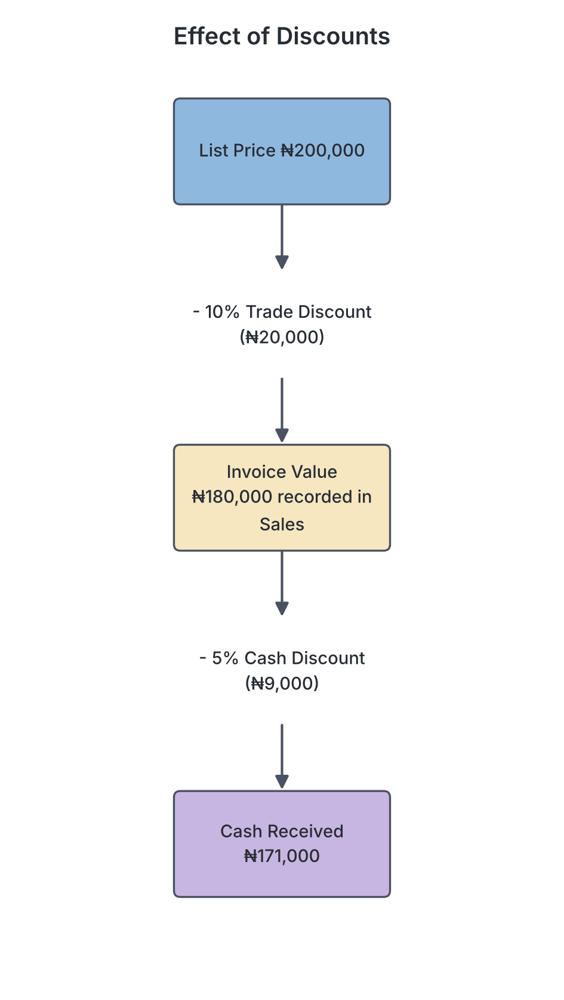
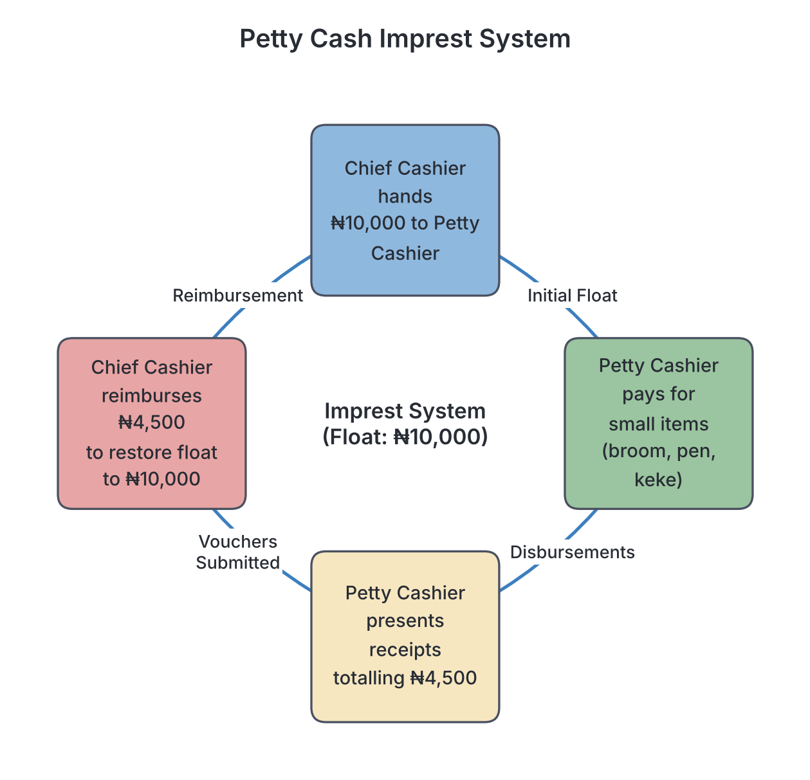

# JAMB Accounting Notes: Cash Book

## What JAMB expects

This topic is Section A, Topic 4 of the JAMB Principles of Accounts syllabus: Cash Book. It covers the following content areas:

- **a. Columnar Cash Books:**
  - (i) single column
  - (ii) double column
  - (iii) three column
- **b. Discounts**
- **c. Petty Cash Book and imprest system**

By the end of these notes, you should be able to:

1. determine the cash float;
2. differentiate between two and three columnar cash books and how transactions are recorded in them;
3. differentiate between trade and cash discounts;
4. examine the effects of trade and cash discounts in the books of accounts; and
5. identify various petty cash expenses.

**Note on the syllabus wording:** The syllabus content item `a(i)` explicitly lists the "single column" cash book. However, objective `ii` only asks you to differentiate between "two and three columnar cash books". We will fully cover the single-column cash book as well, because it is the fundamental building block for understanding the others and is required by the content list. 

## Columnar Cash Books

In accounting, the **cash book** is a unique and very important book. It serves two purposes at the same time:
1. It is a **book of original entry** (or prime entry) because cash and cheque transactions are recorded here first before going anywhere else.
2. It is a **principal ledger account** because it represents the cash account and the bank account in the general ledger. You do not need to open separate cash and bank accounts in the ledger if you maintain a cash book.

The cash book follows the basic double-entry rule for assets: 
- **Debit** what comes in (an increase in money is recorded on the left side).
- **Credit** what goes out (a decrease in money is recorded on the right side).

### Single Column Cash Book

A single-column cash book has only one money column on the debit side and one money column on the credit side. It is used by small businesses that only deal in physical cash and do not use a bank account for their daily transactions.

**How to record in it:**
- When physical cash is received, debit the cash book.
- When physical cash is paid, credit the cash book.

**Worked Example 1: Single Column Cash Book**
Aba Traders had the following cash transactions in January:
- Jan 1: Started the month with a cash balance of ₦100,000.
- Jan 2: Sold goods for cash ₦40,000.
- Jan 5: Paid shop rent ₦20,000 in cash.
- Jan 10: Paid wages to the sales boy ₦15,000 in cash.

| Date | Details | Folio | Dr Cash (₦) | Date | Details | Folio | Cr Cash (₦) |
| :--- | :--- | :--- | :--- | :--- | :--- | :--- | :--- |
| Jan 1 | Bal b/d | | 100,000 | Jan 5 | Rent | | 20,000 |
| Jan 2 | Sales | | 40,000 | Jan 10| Wages | | 15,000 |
| | | | | Jan 31| Bal c/d | | 105,000 |
| | **Totals** | | **140,000** | | **Totals** | | **140,000** |
| Feb 1 | Bal b/d | | 105,000 | | | | |

*Explanation:* Total cash received was ₦140,000. Total cash paid was ₦35,000. The balance carried down (c/d) to the next month is ₦140,000 - ₦35,000 = ₦105,000.

### Double Column Cash Book

As a business grows, it will open a bank account for safety. It now needs a cash book that can track physical cash in the office and money in the bank side by side. This is the **two-column (or double-column) cash book**. 

It has two money columns on the debit side (Cash and Bank) and two money columns on the credit side (Cash and Bank). 

**Contra Entries:**
When a business deposits its own physical office cash into its own bank account, or withdraws cash from the bank for office use, it affects both columns. This is called a **contra entry** (from the Latin word for opposite). Because the double entry is completed entirely within the cash book, no other ledger account is needed. We place the letter "**C**" or "**c**" in the folio column to show this.
- *Cash deposited to bank:* Debit the Bank column (receiver), Credit the Cash column (giver).
- *Cash withdrawn for office:* Debit the Cash column (receiver), Credit the Bank column (giver).

### Three Column Cash Book

A three-column cash book has three money columns on each side: **Discount**, **Cash**, and **Bank**. The cash and bank columns function exactly like a two-column cash book. The extra columns are used to record cash discounts (Discount Allowed on the debit side and Discount Received on the credit side). We will explore discounts fully in the next sections.

## Differentiating Between Two and Three Columnar Cash Books

**Objective ii: differentiate between two and three columnar cash books and how transactions are recorded in them.**

| Feature | Two Column Cash Book | Three Column Cash Book |
| :--- | :--- | :--- |
| **Number of money columns** | Two on each side (Cash and Bank). | Three on each side (Discount, Cash, Bank). |
| **Purpose** | To record cash and bank receipts and payments. | To record cash, bank, and cash discounts given or received. |
| **Status of columns** | Both Cash and Bank are full ledger accounts. | Cash and Bank are ledger accounts, but the Discount columns are just memorandum columns. |
| **Balancing at period end** | Both Cash and Bank columns are balanced to find the remaining money. | Cash and Bank columns are balanced. **Discount columns are never balanced**; they are only totalled. |

### How Transactions are Recorded in Columnar Cash Books

Let us see step-by-step how transactions are entered into a three-column cash book.

**Worked Example 2: Three Column Cash Book**
Amaka Enterprises in Enugu has the following transactions in May:
- May 1: Started with physical cash ₦20,000 and money in the bank ₦150,000.
- May 4: Received a cheque from a debtor (receivable), A. Okafor, for ₦95,000 in full settlement of his ₦100,000 debt. 
- May 10: Made cash sales of ₦40,000.
- May 15: Deposited ₦10,000 physical cash from the office into the bank.
- May 20: Paid a creditor (payable), B. Musa, by cheque ₦48,000 in full settlement of his ₦50,000 account.
- May 31: Paid wages by cash ₦5,000.

**Step-by-step reasoning:**
- **Step 1:** May 1 balances are brought down (Bal b/d) on the debit side.
- **Step 2:** May 4 is a receipt by cheque. The bank receives ₦95,000 (Dr Bank). The debt was ₦100,000, so Amaka allowed a discount of ₦5,000 (Dr Discount Allowed).
- **Step 3:** May 10 is a cash receipt. Debit the Cash column with ₦40,000.
- **Step 4:** May 15 is a **contra entry**. Cash goes out of the office (Cr Cash ₦10,000) and into the bank (Dr Bank ₦10,000). Place 'C' in the folio.
- **Step 5:** May 20 is a payment by cheque. The bank gives out ₦48,000 (Cr Bank). The debt was ₦50,000, so Amaka received a discount of ₦2,000 (Cr Discount Received).
- **Step 6:** May 31 is a cash payment. Credit the Cash column with ₦5,000.

**The Cash Book (Three Column):**

| Date | Details | F | Dr Disc. (₦) | Dr Cash (₦) | Dr Bank (₦) | Date | Details | F | Cr Disc. (₦) | Cr Cash (₦) | Cr Bank (₦) |
| :--- | :--- | :--- | :--- | :--- | :--- | :--- | :--- | :--- | :--- | :--- | :--- |
| May 1 | Bal b/d | | | 20,000 | 150,000 | May 15| Bank | C | | 10,000 | |
| May 4 | A. Okafor| | 5,000 | | 95,000 | May 20| B. Musa | | 2,000 | | 48,000 |
| May 10| Sales | | | 40,000 | | May 31| Wages | | | 5,000 | |
| May 15| Cash | C | | | 10,000 | May 31| Bal c/d| | | 45,000 | 207,000 |
| | **Totals** | | **5,000** | **60,000** | **255,000** | | **Totals** | | **2,000** | **60,000** | **255,000** |
| Jun 1 | Bal b/d | | | 45,000 | 207,000 | | | | | | |

*Notice:* The Cash and Bank columns are balanced. The Discount columns are merely totalled (₦5,000 and ₦2,000). The total of ₦5,000 will be posted to the debit side of the Discount Allowed account in the ledger, and the ₦2,000 to the credit side of the Discount Received account.

## Discounts in Accounting

A discount is a reduction or deduction in the price of goods or a debt. Businesses use discounts for two main reasons: to encourage customers to buy in large quantities, and to encourage debtors to pay their bills quickly. 

### Differentiating Between Trade and Cash Discounts

**Objective iii: differentiate between trade and cash discounts.**

| Feature | Trade Discount | Cash Discount |
| :--- | :--- | :--- |
| **Meaning** | A reduction from the catalogue (list) price of goods. | A reduction in the amount due to be paid by a debtor. |
| **Main Purpose** | To encourage bulk buying or loyalty from trade customers. | To encourage prompt payment (e.g., "pay within 7 days"). |
| **Point of deduction** | Deducted on the invoice before the sale is finalized. | Deducted at the time of payment. |
| **Recording in Books** | **Not recorded** in the double-entry ledger. | **Recorded** in the cash book and discount accounts. |
| **Relation to Cash** | Has nothing to do with cash payments. | Given only if payment is made within a specific time. |

### Effects of Trade and Cash Discounts in the Books of Accounts

**Objective iv: examine the effects of trade and cash discounts in the books of accounts.**

When a transaction has both a trade discount and a cash discount, you must calculate the trade discount first, deduct it, and then calculate the cash discount on the remaining balance.

**Worked Example 3: Effects in the Books**
A distributor sells goods with a catalogue list price of ₦200,000 to a retailer. The distributor offers a **10% trade discount** for bulk purchase and a **5% cash discount** if the invoice is paid immediately. The retailer pays immediately by cash.

Let us trace the calculations and the double-entry effects:

**Step 1: Treat the Trade Discount**
- Catalogue price = ₦200,000.
- Trade discount = 10% of ₦200,000 = ₦20,000.
- Net Invoice Value = ₦200,000 - ₦20,000 = **₦180,000**.
- **Effect in the books:** The ₦20,000 trade discount vanishes from the accounting records. The seller records Sales of ₦180,000. The buyer records Purchases of ₦180,000. 

**Step 2: Treat the Cash Discount**
- The debt to be paid is ₦180,000.
- Cash discount = 5% of ₦180,000 = ₦9,000.
- Amount of Cash Paid = ₦180,000 - ₦9,000 = **₦171,000**.
- **Effect in the seller's books:** Debit Cash Book ₦171,000 (money received). Debit Discount Allowed ₦9,000 (an expense). Credit the Debtor ₦180,000 (clearing the debt). 
- **Effect in the buyer's books:** Credit Cash Book ₦171,000 (money paid). Credit Discount Received ₦9,000 (an income). Debit the Creditor ₦180,000.

## The Petty Cash Book and Imprest System

In any business, there are numerous small daily payments—buying brooms, paying for keke (tricycle) transport, buying stamps, or offering tea to guests. It would waste space to record all these trivial items in the main cash book. Instead, a **Petty Cash Book** is used.

The Petty Cash Book is maintained by a junior staff member known as the **petty cashier**. 

### Identifying Various Petty Cash Expenses

**Objective v: identify various petty cash expenses.**

The petty cash book uses a columnar layout with **analysis columns** to sort the expenses into groups. Common petty cash expenses include:
- **Postage and Telegrams:** Buying postage stamps, courier fees, and parcel deliveries.
- **Stationery:** Purchasing pens, pencils, small notebooks, printer paper, and staples.
- **Travelling and Transport:** Staff bus fares, taxi fares, and keke drops for short office errands.
- **Cleaning and Sanitation:** Buying soap, brooms, detergent, or paying casual office cleaners.
- **Refreshments / Tea:** Buying bottled water, tea, milk, biscuits, or snacks for meetings.
- **Motor Expenses:** Minor expenses like vulcanizer fees or small fuel top-ups for a delivery motorcycle.

### Determining the Cash Float (Imprest System)

**Objective i: determine the cash float.**

To control small expenses, most businesses use the **Imprest System**. Under this system, the chief cashier gives the petty cashier a fixed sum of money at the beginning of the period. This fixed sum is called the **cash float** or **imprest amount**. 

**How the cash float is determined:**
1. The chief cashier estimates the total petty expenses likely to be incurred during the period (for example, historical records show the office spends about ₦8,000 a week on small items).
2. A small buffer is added for emergencies, setting the cash float at a round number, such as ₦10,000. 

At the end of the period, the petty cashier presents the payment vouchers (receipts) to the chief cashier. The chief cashier then gives the petty cashier cash exactly equal to the amount spent. This is called **reimbursement**. 

**The reimbursement rule:** The reimbursement must perfectly equal the total expenses, thereby restoring the cash float to its original amount.
$$ \text{Reimbursement} = \text{Total Expenses Incurred} $$
$$ \text{Restored Float} = \text{Balance Remaining} + \text{Reimbursement} $$

**Worked Example 4: The Petty Cash Book**
On June 1, a petty cashier was given a cash float of ₦10,000. During the week, the following were paid:
- June 3: Bus fare ₦2,000
- June 5: Pens and paper ₦1,500
- June 7: Stamps ₦1,000

| Receipts (₦) | Date | Details | Voucher | Total Paid (₦) | Transport (₦) | Stationery (₦) | Postages (₦) |
| :--- | :--- | :--- | :--- | :--- | :--- | :--- | :--- |
| 10,000 | June 1 | Bal b/d | | | | | |
| | June 3 | Bus fare | 01 | 2,000 | 2,000 | | |
| | June 5 | Pens | 02 | 1,500 | | 1,500 | |
| | June 7 | Stamps | 03 | 1,000 | | | 1,000 |
| | June 7 | **Totals** | | **4,500** | **2,000** | **1,500** | **1,000** |
| | June 7 | Bal c/d | | 5,500 | | | |
| **10,000** | | | | **10,000** | | | |
| 5,500 | June 8 | Bal b/d | | | | | |
| 4,500 | June 8 | Cash | | | | | |

*Explanation:* 
- Total spent = ₦4,500. 
- Balance remaining in the box = ₦10,000 - ₦4,500 = ₦5,500. 
- Reimbursement = ₦4,500. 
- The new float on June 8 is ₦5,500 + ₦4,500 = ₦10,000.

## Key terms

| Term | Meaning |
| :--- | :--- |
| **Cash Book** | The book of original entry and principal ledger account for recording cash and bank transactions. |
| **Contra Entry** | A transaction that involves depositing office cash into the bank, or withdrawing bank money for office use, recorded on both sides of the cash book. |
| **Trade Discount** | A deduction from the catalogue list price given to encourage bulk buying. It does not enter the ledger. |
| **Cash Discount** | A deduction from the invoice amount given to encourage prompt payment. |
| **Petty Cash Book** | A subsidiary book used to record small, repetitive cash payments to save space in the main cash book. |
| **Imprest System** | A system of controlling petty cash where a fixed sum (float) is advanced, and the exact amount spent is reimbursed at the end of the period. |
| **Cash Float** | The fixed initial sum of money given to the petty cashier. |
| **Discount Allowed** | An expense account representing the cash discounts a business gives to its debtors. |
| **Discount Received** | An income account representing the cash discounts a business receives from its creditors. |

## Exam tips and common mistakes

- **Mistake:** Trying to record trade discount in the double-entry system. **Tip:** Trade discount NEVER enters the ledger. Calculate it, subtract it, and only record the net invoice price.
- **Mistake:** Balancing the discount columns in a three-column cash book. **Tip:** The discount columns are memorandum columns. They must be TOTALLED, not balanced. 
- **Mistake:** Forgetting the folio mark for contra entries. **Tip:** Always put 'C' or 'c' in the folio column when moving cash to bank, or bank to cash. 
- **Mistake:** Confusing the reimbursement amount with the balance remaining. **Tip:** Under the imprest system, `Reimbursement = Total amount spent`. 
- **Tip:** When calculating discounts, always calculate the Trade Discount first, subtract it, and then calculate the Cash Discount on the *remaining* invoice amount.

## Quick summary

1. The cash book serves dual roles: it is a book of original entry and a principal ledger account for physical cash and bank balances.
2. A single-column cash book handles physical cash only; a two-column cash book handles cash and bank; a three-column cash book adds discount columns.
3. Contra entries occur when money is transferred between the business's own physical cash box and its own bank account, affecting both sides of the cash book.
4. Trade discount encourages bulk buying and is deducted before recording the sale. Cash discount encourages prompt payment and is recorded in the discount accounts in the ledger.
5. The petty cash book records minor daily expenses using analysis columns (e.g., stationery, transport, postage).
6. Under the imprest system, a fixed cash float is advanced, and at the end of the period, the chief cashier reimburses the exact amount spent to restore the original float.

## Practice questions

**1. Which of the following entries represents a contra entry in a two-column cash book?**
- A. Paying a supplier by cheque
- B. Withdrawing cash from the bank for the owner's personal use
- C. Withdrawing cash from the bank for office use
- D. Receiving cash from a debtor
**Answer: C.** Withdrawing cash for office use increases physical cash in the office (Debit Cash) and reduces money in the bank (Credit Bank). This affects both sides of the cash book. Option B is "drawings" and is not a contra entry.

**2. A business sells goods with a list price of ₦150,000, subject to a trade discount of 20%. How much will be recorded in the Sales Account?**
- A. ₦30,000
- B. ₦120,000
- C. ₦150,000
- D. ₦180,000
**Answer: B.** Step 1: Calculate the trade discount (20% of ₦150,000 = ₦30,000). Step 2: Deduct it from the list price (150,000 - 30,000 = ₦120,000). Since trade discount is not recorded in the ledger, only the net invoice amount of ₦120,000 is posted to the Sales Account.

**3. Which of the following is most likely to be recorded in the petty cash book?**
- A. Purchase of a delivery van
- B. Payment of monthly office rent
- C. Payment for office cleaning materials
- D. Repayment of a bank loan
**Answer: C.** The petty cash book is meant for small, repetitive, everyday running expenses like cleaning materials, stamps, and transport fares. Large payments are handled via the main cash book.

**4. In a three-column cash book, the discount columns are**
- A. balanced and the balance carried down to the next month
- B. totaled and the totals are posted to the respective discount accounts in the general ledger
- C. used to record trade discounts only
- D. treated as contra entries
**Answer: B.** The discount columns in the cash book are merely memorandum columns. At period end, they are totaled, and these totals are posted to the Discount Allowed and Discount Received accounts. They are never balanced against each other.

**5. The main purpose of a cash discount is to**
- A. encourage customers to buy goods in large quantities
- B. encourage customers to pay their accounts promptly
- C. increase the list price of goods
- D. compensate for damaged goods
**Answer: B.** A cash discount is offered as a financial incentive for a debtor to settle their invoice quickly (e.g., within 7 days). Option A describes the purpose of a trade discount.

**6. A petty cashier operates an imprest system with a float of ₦15,000. At the end of the week, the petty cash box contains ₦4,200. What is the reimbursement amount needed to restore the imprest?**
- A. ₦4,200
- B. ₦10,800
- C. ₦15,000
- D. ₦19,200
**Answer: B.** Step 1: Determine the amount spent. Amount spent = Float - Cash remaining = 15,000 - 4,200 = ₦10,800. Step 2: Under the imprest system, the reimbursement must exactly equal the amount spent to restore the original ₦15,000 float. Therefore, reimbursement is ₦10,800.

**7. A trader buys goods worth ₦50,000. He is allowed a 10% trade discount and a 5% cash discount. If he pays immediately, what is the exact amount of cash he will pay?**
- A. ₦42,500
- B. ₦42,750
- C. ₦45,000
- D. ₦47,500
**Answer: B.** Step 1: Calculate Trade Discount (10% of 50,000 = 5,000). Step 2: Net Invoice price = 50,000 - 5,000 = ₦45,000. Step 3: Calculate Cash Discount on the invoice price (5% of 45,000 = 2,250). Step 4: Cash paid = 45,000 - 2,250 = ₦42,750.

**8. When physical cash is deposited into the business bank account, what is the correct double entry in a two-column cash book?**
- A. Debit Cash column, Credit Bank column
- B. Debit Bank column, Credit Cash column
- C. Debit Bank column only
- D. Credit Cash column only
**Answer: B.** The bank is receiving the money (Debit the receiver: Bank column), and the physical cash box is giving out the money (Credit the giver: Cash column). This is a classic contra entry.

**9. Which of the following statements about trade discount is TRUE?**
- A. It appears as an expense in the statement of profit or loss
- B. It is recorded in the discount allowed account
- C. It is deducted on the invoice and does not appear in the double entry
- D. It is treated as a contra entry in the cash book
**Answer: C.** Trade discount is given at the point of sale for bulk purchases. It is deducted directly on the source document (invoice), and only the net amount enters the ledger. It never forms part of the double entry.

**10. At the beginning of the month, the petty cashier was given ₦5,000. During the month, he spent ₦1,200 on transport, ₦800 on stationery, and ₦1,500 on postage. If the imprest amount is to be increased to ₦7,000 for the next month, how much total cash will he receive from the chief cashier at the end of the month?**
- A. ₦3,500
- B. ₦5,000
- C. ₦5,500
- D. ₦7,000
**Answer: C.** Step 1: Total expenses = 1,200 + 800 + 1,500 = ₦3,500. Step 2: Balance remaining = 5,000 - 3,500 = ₦1,500. Step 3: The target float is now ₦7,000. Step 4: Amount to receive = Target Float - Balance remaining = 7,000 - 1,500 = ₦5,500. He receives a ₦3,500 reimbursement for what was spent, plus an extra ₦2,000 to increase the float size.

<!-- COVERAGE
obj i | ### Determining the Cash Float (Imprest System)
obj ii | ## Differentiating Between Two and Three Columnar Cash Books
obj iii | ### Differentiating Between Trade and Cash Discounts
obj iv | ### Effects of Trade and Cash Discounts in the Books of Accounts
obj v | ### Identifying Various Petty Cash Expenses
item a | ## Columnar Cash Books
item b | ## Discounts in Accounting
item c | ## The Petty Cash Book and Imprest System
-->
