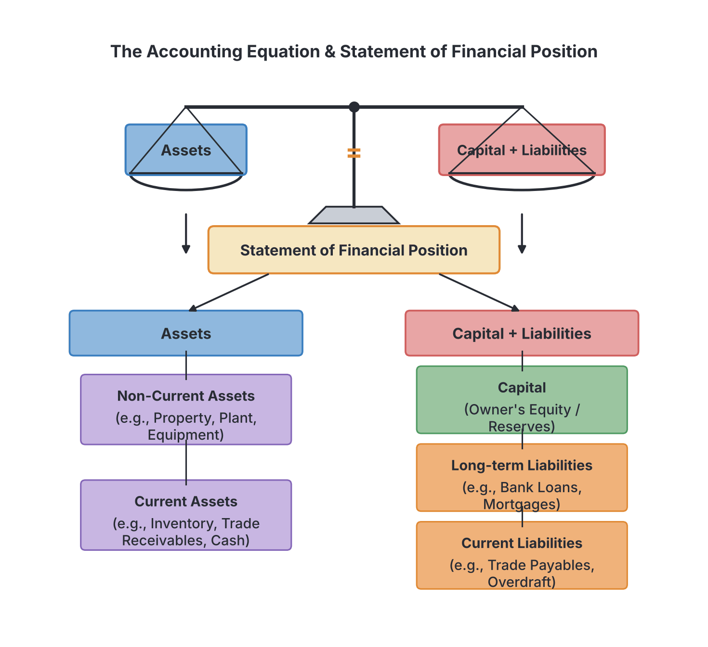
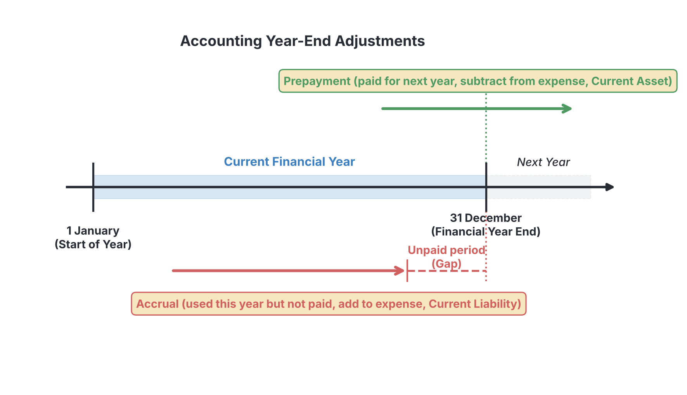

# JAMB Accounting Notes: Final Accounts of a Sole Trader/Proprietor

## What JAMB expects

This topic is Section A, Topic 6 of the JAMB Principles of Accounts syllabus: Final Accounts of a Sole Trader/Proprietor. It covers the preparation of financial statements and the adjustments needed at the end of the year to show a true and fair view of the business. 

The syllabus covers three main content areas:
* a. Statement of profit or loss/income statement
* b. Statement of financial position
* c. Adjustments (provision for bad and doubtful debt, provision for discounts, provision for depreciation, and accruals and prepayments)

By the end of these notes, you should be able to:
1. determine the cost of sales, gross profit and net profit of a sole trader;
2. identify non-current assets, current assets, long-term liabilities, current liabilities and proprietor’s capital;
3. compute adjustable items on the related expenditure and income in the statement of profit or loss; and
4. differentiate between bad debts and provision for bad and doubtful debts.

**Note on syllabus wording and terminology:** The JAMB syllabus refers to the "Statement of profit or loss/income statement" and the "Statement of financial position". In older textbooks and exam past questions, these are often called the **Trading and Profit & Loss Account** and the **Balance Sheet**. They mean exactly the same thing. You will also see "Stock" used for "Inventory", "Debtors" for "Receivables", and "Creditors" for "Payables". These notes use both terms so you are prepared for whatever JAMB prints on exam day. Note also that the syllabus contains a stray space in "long- term liabilities", which we have corrected to "long-term liabilities".

## Statement of profit or loss/income statement

**Objective i: determine the cost of sales, gross profit and net profit of a sole trader.**

The **Statement of profit or loss** (or Income Statement) is a financial statement prepared at the end of the accounting period to determine the profit or loss made by the business. For a sole trader (such as a provision store in Mushin or a tailor in Aba), it is divided into two parts:

1. **The Trading Account section:** This part calculates the **Gross Profit** (or Gross Loss) from buying and selling goods.
2. **The Profit or Loss Account section:** This part calculates the **Net Profit** (or Net Loss) after all running expenses have been deducted and any other income added.

### Determining Cost of Sales and Gross Profit

**Gross Profit** is the difference between the net sales revenue and the cost of the goods that were actually sold. It shows the profit made just from trading, before paying rent, salaries, or other overheads. 

To find Gross Profit, you need two main figures:
1. **Net Sales (Turnover):** This is total Sales minus any Returns Inwards (goods returned by customers).
   $$Net Sales = Sales - Returns Inwards$$
2. **Cost of Sales (Cost of Goods Sold):** This is the cost of buying or producing the goods that were actually sold during the year. 

**How to calculate Cost of Sales:**
* **Step 1:** Start with the **Opening Stock** (unsold goods from last year).
* **Step 2:** Add **Net Purchases**. This is your total Purchases for the year, minus Returns Outwards (goods returned to suppliers).
* **Step 3:** Add **Carriage Inwards** (transport costs to bring the goods into the shop). The result is the **Cost of Goods Available for Sale**.
* **Step 4:** Subtract the **Closing Stock** (unsold goods at the end of this year). We subtract it because these goods have not been sold yet, so their cost should not be matched against this year's sales.

The formula for Cost of Sales is:
$$Cost of Sales = Opening Stock + Purchases - Returns Outwards + Carriage Inwards - Closing Stock$$

The formula for Gross Profit is:
$$Gross Profit = Net Sales - Cost of Sales$$

### Determining Net Profit

**Net Profit** is the final profit the proprietor takes home. It is calculated by taking the Gross Profit, adding any **Other Income** (like rent received, discounts received, or decrease in provision for doubtful debts), and subtracting all **Operating Expenses** (like rent, salaries, electricity, motor expenses, and depreciation).

$$Net Profit = Gross Profit + Other Income - Total Expenses$$

### Worked Example 1: Simple Statement of Profit or Loss

Let us look at a simple example without year-end adjustments. Mama Nkechi runs a small boutique. For the year ended 31 December 2023, her balances are: Sales ₦150,000, Returns Inwards ₦5,000, Opening Stock ₦20,000, Purchases ₦80,000, Returns Outwards ₦3,000, Carriage Inwards ₦2,000, Closing Stock ₦25,000, Rent ₦12,000, Salaries ₦18,000, Discount Received ₦4,000.

**Step 1: Calculate Net Sales.**
₦150,000 (Sales) - ₦5,000 (Returns In) = ₦145,000.

**Step 2: Calculate Cost of Sales.**
Opening Stock (₦20,000) + Net Purchases (₦80,000 - ₦3,000 = ₦77,000) + Carriage Inwards (₦2,000) = Cost of Goods Available (₦99,000).
Subtract Closing Stock (₦25,000) = Cost of Sales ₦74,000.

**Step 3: Calculate Gross Profit.**
Net Sales (₦145,000) - Cost of Sales (₦74,000) = Gross Profit ₦71,000.

**Step 4: Calculate Net Profit.**
Gross Profit (₦71,000) + Discount Received (₦4,000) = Total Income ₦75,000.
Less Expenses: Rent (₦12,000) + Salaries (₦18,000) = Total Expenses ₦30,000.
Net Profit = ₦75,000 - ₦30,000 = ₦45,000.

**Layout in a standard table format:**

| Details | ₦ | ₦ |
| :--- | :--- | :--- |
| **Sales** | | 150,000 |
| Less Returns Inwards | | (5,000) |
| **Net Sales** | | **145,000** |
| | | |
| **Cost of Sales:** | | |
| Opening Stock | 20,000 | |
| Add Purchases | 80,000 | |
| Less Returns Outwards | (3,000) | |
| Net Purchases | 77,000 | |
| Add Carriage Inwards | 2,000 | |
| | 79,000 | |
| Cost of Goods Available | 99,000 | |
| Less Closing Stock | (25,000) | |
| **Cost of Sales** | | **(74,000)** |
| **Gross Profit** | | **71,000** |
| | | |
| Add Discount Received (Other Income) | | 4,000 |
| | | 75,000 |
| | | |
| **Less Expenses:** | | |
| Rent | 12,000 | |
| Salaries | 18,000 | |
| Total Expenses | | (30,000) |
| **Net Profit** | | **45,000** |

---

## Statement of financial position

**Objective ii: identify non-current assets, current assets, long-term liabilities, current liabilities and proprietor’s capital.**

The **Statement of financial position** (Balance Sheet) is a snapshot of the business's financial health on a specific date (usually the last day of the financial year). It proves the accounting equation: **Assets = Capital + Liabilities**.

To prepare it properly, you must classify items into five specific categories:

### 1. Non-Current Assets (Fixed Assets)
These are assets bought to be used in the business for a long time (more than one year), not to be resold in the normal course of trade.
* **Examples:** Land and buildings, motor vehicles, machinery, fixtures and fittings, office equipment. 
* They are usually shown at **Net Book Value** (Cost minus Accumulated Depreciation).

### 2. Current Assets
These are assets that are either already in the form of cash or are expected to be turned into cash, or used up, within one year. They are usually listed in order of increasing liquidity (how easily they convert to cash).
* **Examples:** Closing stock (inventory), Debtors (trade receivables), Prepayments (expenses paid in advance), Bank balance, Cash in hand.

### 3. Long-Term Liabilities (Non-Current Liabilities)
These are debts the business owes to outsiders that do not have to be fully repaid within the next year.
* **Examples:** Long-term bank loans, mortgages.

### 4. Current Liabilities
These are short-term debts the business must pay within one year.
* **Examples:** Creditors (trade payables), Bank overdraft, Accruals (expenses owed but not yet paid).

### 5. Proprietor’s Capital (Owner's Equity)
This is the owner's investment in the business. In the final accounts, the closing capital is adjusted for profits and withdrawals.
* **Formula:** $Closing Capital = Opening Capital + Net Profit - Drawings$
* (If there is a Net Loss, it is subtracted instead of added).

---

## Year-end adjustments

**Objective iii: compute adjustable items on the related expenditure and income in the statement of profit or loss.**

Most businesses prepare their accounts using the **Accrual Concept** (also called the Matching Concept). This rule says that revenue and expenses must be recorded in the period they occur, regardless of when cash changes hands. 

Because of this, the figures in the initial Trial Balance are rarely the final figures. At the end of the year, we must "adjust" them for:
1. Accruals and Prepayments
2. Bad debts and Provisions for doubtful debts
3. Provision for discounts
4. Provision for depreciation

Let us examine each adjustment carefully.

---

## Accruals and prepayments

### Accruals (Accrued Expenses)
An accrued expense is a service or good the business has consumed during the year, but has not yet paid for by the year-end. For example, your shop workers worked in December, but you will pay their December salary in January. 
* **Statement of profit or loss:** **ADD** the accrued amount to the expense paid. This gives the true cost for the year.
* **Statement of financial position:** Show the accrued amount as a **Current Liability** (because you owe it).

### Prepayments (Prepaid Expenses)
A prepaid expense is a payment made in advance for services that stretch into the next financial year. For example, paying rent for a full year in October means you have prepaid for the first nine months of the *next* year.
* **Statement of profit or loss:** **SUBTRACT** the prepaid amount from the expense paid. You only want to charge the portion used *this* year.
* **Statement of financial position:** Show the prepaid amount as a **Current Asset** (because someone owes you a service).

### Accrued Income and Prepaid Income
Sometimes it is the business that receives income (like rent from a tenant).
* **Accrued Income (Income in Arrears):** Income earned but not yet received. **ADD** it to income in the P&L, and treat it as a **Current Asset** (debtor).
* **Prepaid Income (Income in Advance):** Income received before it is earned. **SUBTRACT** it from income in the P&L, and treat it as a **Current Liability** (you owe the service).

**Example of an Accrual and Prepayment computation:**
A business paid ₦24,000 for rent during the year. However, ₦6,000 rent is still owing (accrued) for the current year. They also paid ₦15,000 for insurance, but ₦3,000 of this belongs to next year (prepaid).
* **Step 1 (Rent):** The total rent for the year should be ₦24,000 (paid) + ₦6,000 (accrued) = ₦30,000. Charge ₦30,000 as a P&L expense. Show ₦6,000 as a Current Liability.
* **Step 2 (Insurance):** The true insurance for the year is ₦15,000 (paid) - ₦3,000 (prepaid) = ₦12,000. Charge ₦12,000 as a P&L expense. Show ₦3,000 as a Current Asset.

---

## Bad debts and provision for bad and doubtful debts

### What is a Bad Debt?
A bad debt is a debt owed by a customer (debtor) that is considered completely irrecoverable. The customer might have gone bankrupt, disappeared, or died. Because we will never get the cash, we must **write it off**.
* **Accounting treatment:** Subtract it completely from Debtors in the Balance Sheet. Charge the exact amount as an expense in the Statement of profit or loss.

### What is a Provision for Bad and Doubtful Debts?
Even after writing off known bad debts, a prudent businessman suspects that some of the *remaining* debtors might also fail to pay in the future. Because of the **Prudence Concept**, we must anticipate this loss by creating a "provision" (an allowance). This is usually calculated as a percentage of the remaining debtors.

**Objective iv: differentiate between bad debts and provision for bad and doubtful debts.**

| Feature | Bad Debts | Provision for Bad & Doubtful Debts |
| :--- | :--- | :--- |
| **Certainty** | The loss is certain. It is definitely irrecoverable. | The loss is only an estimate or anticipation based on past experience. |
| **Effect on Debtors Account**| Directly reduces the individual debtor's personal account and the total Debtors figure. | Does not affect individual debtors' accounts. Maintained separately as a contra-asset account. |
| **Nature of Loss** | Actual loss incurred in the current year. | Anticipated future loss provided for out of current profits. |

### How to Compute the Provision

When adjusting provisions at year-end, we always compare the **New Provision required** with the **Old Provision** (the balance already sitting in the Trial Balance).

* **Step 1:** Deduct any *new* bad debts to be written off from the total Debtors.
* **Step 2:** Calculate the New Provision as a percentage of the *remaining* debtors.
* **Step 3:** Compare New Provision with the Old Provision from the trial balance.
  * If New > Old, the provision has **Increased**. The difference is an **Expense** in the P&L.
  * If New < Old, the provision has **Decreased**. The difference is an **Income** in the P&L.
* **Step 4:** In the Statement of financial position, subtract the *New Provision* from the remaining debtors under Current Assets.

**Example computation:**
Debtors in Trial Balance: ₦42,000. Bad debts to be written off at year-end: ₦2,000. Provision for doubtful debts in Trial Balance (Old): ₦1,500. The owner wants a new provision of 5%.
* **Step 1:** Remaining Debtors = ₦42,000 - ₦2,000 = ₦40,000.
* **Step 2:** New Provision = 5% of ₦40,000 = ₦2,000.
* **Step 3:** Compare: New is ₦2,000. Old was ₦1,500. There is an **increase** of ₦500. Charge ₦500 as an expense in P&L. Also, charge the ₦2,000 actual bad debt as an expense.
* **Step 4:** In Balance Sheet: Debtors = ₦40,000. Less Provision ₦2,000. Net Debtors = ₦38,000.

---

## Provision for discounts

Businesses sometimes offer cash discounts to customers who pay on time. A prudent business might create a **Provision for Discounts Allowed**, anticipating that some current debtors will claim discounts next year. 

**Rule for computation:** You must *always* calculate the provision for discounts strictly on the "good" debtors. This means you must deduct bad debts AND deduct the provision for doubtful debts before applying the discount percentage.

**Example computation:**
Debtors = ₦40,000 (after bad debts). Provision for doubtful debts = ₦2,000. Provision for discount allowed rate = 2%.
* **Step 1:** Debtors expected to pay = ₦40,000 - ₦2,000 = ₦38,000.
* **Step 2:** Provision for discount = 2% of ₦38,000 = ₦760.
* **Step 3:** Charge ₦760 as an expense in P&L, and deduct it from Debtors in the Balance Sheet.

*(Note: Provision for discounts received on creditors is calculated similarly on Creditors and treated as Income, though it violates strict prudence and is rarely tested).*

---

## Provision for depreciation

Non-current assets wear out, lose value, or become obsolete over time. **Depreciation** is the process of spreading the cost of a non-current asset over its useful life. It is an expense charged to the Statement of profit or loss, even though no physical cash leaves the business. 

The JAMB syllabus requires you to know two methods:

### 1. Straight-Line Method (Fixed Instalment Method)
This method charges the exact same amount of depreciation every year.
* **Formula:** $Depreciation = Cost \times Percentage Rate$ 
* Alternatively, if a scrap value and lifespan are given: $Depreciation = \frac{Cost - Scrap Value}{Useful Life in Years}$

**Example:** A machine costs ₦10,000. Depreciation is 10% on cost (straight-line).
* Year 1 depreciation = 10% of ₦10,000 = ₦1,000.
* Year 2 depreciation = 10% of ₦10,000 = ₦1,000.
* The charge is always ₦1,000 every year.

### 2. Reducing Balance Method (Diminishing Balance Method)
This method charges depreciation as a percentage of the **Net Book Value (NBV)** of the asset at the start of the year, not the original cost. Because the NBV drops every year, the depreciation charge is high in the first year and drops steadily over time.
* **Formula:** $Depreciation = Net Book Value \times Percentage Rate$
* Remember: $Net Book Value = Cost - Accumulated Depreciation$.

**Example:** A motor vehicle costs ₦50,000. Depreciation is 20% on the reducing balance.
* **Year 1:** 20% of ₦50,000 = **₦10,000**. NBV at end of year = ₦50,000 - ₦10,000 = ₦40,000.
* **Year 2:** 20% of the *new NBV* (₦40,000) = **₦8,000**. NBV at end of year = ₦40,000 - ₦8,000 = ₦32,000.
* **Year 3:** 20% of ₦32,000 = **₦6,400**. 

[IMAGE: A line graph comparing straight-line and reducing balance depreciation over 5 years. The X-axis represents 'Years' from 0 to 5. The Y-axis represents 'Net Book Value (₦)'. The straight-line method is shown as a steady straight downward-sloping line. The reducing balance method is shown as a curve that drops steeply at first and then flattens out, never quite reaching zero. Labels: 'Straight-line method', 'Reducing balance method'. Clean flat textbook style, white background.]

---

## Full Worked Example with Adjustments

Let us put all these principles into a complete JAMB-style practical scenario. 

**Trial Balance of Chukwudi Provision Store, Mushin as at 31 December 2023**

| Details | Dr (₦) | Cr (₦) |
| :--- | :--- | :--- |
| Capital | | 50,000 |
| Drawings | 5,000 | |
| Purchases and Sales | 71,000 | 100,000 |
| Opening Stock | 10,000 | |
| Returns (Inwards / Outwards) | 2,000 | 1,500 |
| Carriage Inwards | 1,000 | |
| Carriage Outwards | 800 | |
| Wages and Salaries | 12,000 | |
| Rent and Rates | 4,000 | |
| Insurance | 1,200 | |
| Motor Vehicles (Cost) | 20,000 | |
| Accumulated Depreciation - Motor Vehicles | | 4,000 |
| Fixtures and Fittings (Cost) | 10,000 | |
| Accumulated Depreciation - Fixtures | | 2,000 |
| Debtors and Creditors | 15,000 | 8,000 |
| Bank | 12,500 | |
| Cash in hand | 2,000 | |
| Provision for doubtful debts | | 1,000 |
| **Total** | **166,500** | **166,500** |

**Additional Information (Adjustments):**
1. Closing Stock (Inventory) on 31 December 2023 is valued at ₦12,000.
2. Wages and salaries accrued (owing) amount to ₦2,000.
3. Insurance paid in advance (prepaid) amounts to ₦300.
4. Bad debts of ₦500 are to be written off.
5. Provision for doubtful debts is to be adjusted to 5% of remaining debtors.
6. Provide for depreciation: Motor vehicles 20% using the reducing balance method. Fixtures 10% using the straight-line method.

### Step-by-Step Adjustment Working

* **Working 1 (Wages Accrued):** P&L charge = 12,000 + 2,000 = ₦14,000. Current Liability = ₦2,000.
* **Working 2 (Insurance Prepaid):** P&L charge = 1,200 - 300 = ₦900. Current Asset = ₦300.
* **Working 3 (Depreciation - Motor Vehicles):** Reducing balance. Cost ₦20,000 - Acc Dep ₦4,000 = NBV ₦16,000. P&L charge = 20% of 16,000 = ₦3,200. Total Acc Dep for Balance Sheet = 4,000 + 3,200 = ₦7,200.
* **Working 4 (Depreciation - Fixtures):** Straight-line. Cost ₦10,000. P&L charge = 10% of 10,000 = ₦1,000. Total Acc Dep for Balance Sheet = 2,000 + 1,000 = ₦3,000.
* **Working 5 (Bad Debt & Provision):** 
  * Bad debt written off = ₦500 (P&L expense). 
  * Remaining debtors = 15,000 - 500 = ₦14,500. 
  * New Provision = 5% of 14,500 = ₦725. 
  * Old provision was ₦1,000. The provision has *decreased* by ₦275 (1,000 - 725). This ₦275 decrease is treated as **Income** in the P&L.
  * In the Balance Sheet, Debtors = ₦14,500 - ₦725 = ₦13,775.

### Solution: Statement of Profit or Loss

**Chukwudi Provision Store, Mushin**  
**Statement of Profit or Loss for the year ended 31 December 2023**

| Details | ₦ | ₦ | ₦ |
| :--- | :--- | :--- | :--- |
| **Sales** | | | 100,000 |
| Less Returns Inwards | | | (2,000) |
| **Net Sales** | | | **98,000** |
| | | | |
| **Cost of Sales:** | | | |
| Opening Stock | | 10,000 | |
| Purchases | 71,000 | | |
| Less Returns Outwards | (1,500) | | |
| Net Purchases | 69,500 | | |
| Add Carriage Inwards | 1,000 | | |
| | | 70,500 | |
| Cost of Goods Available | | 80,500 | |
| Less Closing Stock | | (12,000) | |
| **Cost of Sales** | | | **(68,500)** |
| **Gross Profit** | | | **29,500** |
| | | | |
| **Other Income:** | | | |
| Decrease in Provision for Doubtful Debts | | | 275 |
| **Total Income** | | | **29,775** |
| | | | |
| **Expenses:** | | | |
| Wages and Salaries (12,000 + 2,000 accrued) | | 14,000 | |
| Rent and Rates | | 4,000 | |
| Insurance (1,200 - 300 prepaid) | | 900 | |
| Carriage Outwards | | 800 | |
| Bad Debts Written Off | | 500 | |
| Depreciation - Motor Vehicles | | 3,200 | |
| Depreciation - Fixtures | | 1,000 | |
| **Total Expenses** | | | **(24,400)** |
| **Net Profit** | | | **5,375** |

### Solution: Statement of Financial Position

**Chukwudi Provision Store, Mushin**  
**Statement of Financial Position as at 31 December 2023**

| Details | Cost (₦) | Acc. Dep (₦) | NBV (₦) |
| :--- | :--- | :--- | :--- |
| **Non-Current Assets** | | | |
| Motor Vehicles | 20,000 | 7,200 | 12,800 |
| Fixtures and Fittings | 10,000 | 3,000 | 7,000 |
| **Total Non-Current Assets** | 30,000 | 10,200 | **19,800** |
| | | | |
| **Current Assets** | | | |
| Stock (Inventory) | | 12,000 | |
| Debtors (15,000 - 500 bad debt) | 14,500 | | |
| Less Provision for Doubtful Debts | (725) | 13,775 | |
| Prepayments (Insurance) | | 300 | |
| Bank | | 12,500 | |
| Cash | | 2,000 | |
| **Total Current Assets** | | | **40,575** |
| **Total Assets** | | | **60,375** |
| | | | |
| **Capital and Liabilities** | | | |
| **Proprietor's Capital:** | | | |
| Opening Capital | | | 50,000 |
| Add Net Profit | | | 5,375 |
| | | | 55,375 |
| Less Drawings | | | (5,000) |
| **Closing Capital** | | | **50,375** |
| | | | |
| **Current Liabilities** | | | |
| Creditors (Payables) | | 8,000 | |
| Accruals (Wages and Salaries) | | 2,000 | |
| **Total Current Liabilities** | | | **10,000** |
| **Total Capital and Liabilities**| | | **60,375** |

---

## Key terms

| Term | Meaning |
| :--- | :--- |
| **Gross Profit** | Profit from trading before operating expenses are deducted (Net Sales - Cost of Sales). |
| **Net Profit** | The final profit of the business after adding all other income and deducting all expenses. |
| **Cost of Sales** | The direct cost of purchasing or producing the goods that were sold (Opening Stock + Net Purchases + Carriage Inwards - Closing Stock). |
| **Accrual** | An expense incurred but not yet paid (Current Liability), or income earned but not yet received (Current Asset). |
| **Prepayment** | An expense paid in advance for a future period (Current Asset), or income received before it is earned (Current Liability). |
| **Bad Debt** | A debt owed by a customer that is completely irrecoverable and is written off as an expense. |
| **Provision for Doubtful Debts** | An estimated allowance set aside out of profits to cover potential future bad debts (based on the Prudence Concept). |
| **Depreciation** | The allocation of the cost of a non-current asset over its useful life. |
| **Net Book Value (NBV)** | The original cost of a non-current asset minus its total accumulated depreciation. |
| **Non-Current Assets** | Long-term assets bought for use in the business, not for resale (e.g., machinery, motor vehicles). |
| **Current Assets** | Short-term assets that are cash or expected to become cash within one year (e.g., stock, debtors). |
| **Current Liabilities** | Short-term debts the business must pay within one year (e.g., creditors, accruals). |

## Exam tips and common mistakes

* **Carriage Inwards vs Outwards:** Common mistake! Carriage Inwards is part of Cost of Sales (Trading Account). Carriage Outwards is an operating expense (P&L Account). 
* **Returns:** "Returns Inwards" reduces Sales. "Returns Outwards" reduces Purchases.
* **Adding instead of subtracting Accruals/Prepayments:** Remember the rule: Add Accruals to expenses, Subtract Prepayments from expenses.
* **Calculating provision on the wrong base:** When calculating a new provision for doubtful debts, you *must* subtract the new bad debts from the trial balance debtors first.
* **Depreciation method mix-ups:** Read the question carefully. Straight-line applies the percentage to the original *Cost*. Reducing balance applies the percentage to the *Net Book Value*.
* **Capital Equation:** Closing Capital = Opening Capital + Net Profit - Drawings. If the business made a net loss, subtract it instead of adding.

## Quick summary

1. The final accounts of a sole trader include the Statement of profit or loss (Trading and P&L) and the Statement of financial position (Balance Sheet).
2. Gross profit is found by subtracting Cost of Sales from Net Sales. Cost of Sales is Opening Stock + Net Purchases + Carriage Inwards - Closing Stock.
3. Net profit is Gross Profit plus other income, minus all operating expenses.
4. Assets and liabilities must be properly classified into Non-Current Assets, Current Assets, Long-Term Liabilities, and Current Liabilities.
5. Accruals are expenses owed (add to P&L expense, show as current liability) and prepayments are expenses paid in advance (subtract from P&L expense, show as current asset).
6. Bad debts are actual uncollectable amounts written off. A provision for doubtful debts is an estimate of future losses to obey the Prudence Concept.
7. An increase in the provision for doubtful debts is treated as an expense; a decrease is treated as income. 
8. Depreciation spreads the cost of non-current assets over time using either the straight-line (cost-based) or reducing balance (NBV-based) method.

## Practice questions

**1. Given: Sales ₦150,000, Returns inwards ₦5,000, Opening stock ₦20,000, Purchases ₦90,000, Carriage inwards ₦2,000, Closing stock ₦25,000. Calculate the Gross Profit.**
- A. ₦48,000
- B. ₦58,000
- C. ₦60,000
- D. ₦68,000

**Answer: B.**
Step 1: Net Sales = 150,000 - 5,000 = ₦145,000. Step 2: Cost of Sales = 20,000 + 90,000 + 2,000 - 25,000 = ₦87,000. Step 3: Gross Profit = 145,000 - 87,000 = ₦58,000. Mistake behind option D is adding the returns inwards to sales (₦155,000 − ₦87,000 = ₦68,000) instead of subtracting them; forgetting to deduct them at all gives ₦63,000. 

**2. Which of the following is correctly classified as a long-term liability?**
- A. Bank overdraft
- B. Accrued electricity
- C. 10-year bank loan
- D. Provision for bad debts

**Answer: C.**
A 10-year bank loan is a long-term (non-current) liability because it does not have to be paid back within one year. Bank overdraft and accrued electricity are current liabilities. Provision for bad debts is a contra-asset.

**3. A motor vehicle was bought for ₦50,000. Depreciation is charged at 20% per annum using the reducing balance method. What is the depreciation charge for the second year?**
- A. ₦8,000
- B. ₦10,000
- C. ₦32,000
- D. ₦40,000

**Answer: A.**
Step 1: Year 1 depreciation = 20% of 50,000 = ₦10,000. Step 2: Net Book Value at start of Year 2 = 50,000 - 10,000 = ₦40,000. Step 3: Year 2 depreciation = 20% of 40,000 = ₦8,000. Mistake behind option B is using the straight-line method instead of reducing balance.

**4. A business paid ₦24,000 for rent during the year. At the end of the year, rent of ₦6,000 was still owing. The amount to be charged to the statement of profit or loss for rent is:**
- A. ₦6,000
- B. ₦18,000
- C. ₦24,000
- D. ₦30,000

**Answer: D.**
Under the accrual concept, the true expense for the year is the amount paid (₦24,000) plus the amount accrued or owing (₦6,000). Total = ₦30,000. Mistake behind option B is subtracting the accrual instead of adding it.

**5. A major difference between a bad debt and a provision for bad and doubtful debts is that:**
- A. bad debt is a current asset while provision is a liability
- B. bad debt is definitely irrecoverable while provision is an anticipated loss
- C. bad debt decreases capital while provision increases it
- D. bad debt is charged to the trading account while provision is charged to the profit or loss account

**Answer: B.**
Bad debts represent an actual incurred loss (the money is definitely gone), while a provision is an estimated allowance for potential future losses to comply with the Prudence Concept. Both are charged to the profit or loss account.

**6. A sole trader had a gross profit of ₦60,000, discount received of ₦3,000, salaries ₦15,000, rent ₦8,000, and depreciation ₦5,000. What is the net profit?**
- A. ₦29,000
- B. ₦35,000
- C. ₦37,000
- D. ₦40,000

**Answer: B.**
Step 1: Total Income = Gross Profit (₦60,000) + Discount Received (₦3,000) = ₦63,000. Step 2: Total Expenses = Salaries (₦15,000) + Rent (₦8,000) + Depreciation (₦5,000) = ₦28,000. Step 3: Net Profit = 63,000 - 28,000 = ₦35,000. Mistake behind option D is excluding the depreciation charge because it is a non-cash expense.

**7. Total debtors stand at ₦42,000. Additional bad debts of ₦2,000 are to be written off. A provision for doubtful debts is to be created at 5%. What is the value of the new provision?**
- A. ₦2,000
- B. ₦2,100
- C. ₦2,200
- D. ₦4,000

**Answer: A.**
Step 1: Always subtract the new bad debt first to find the remaining 'good' debtors (₦42,000 - ₦2,000 = ₦40,000). Step 2: Calculate the provision (5% of ₦40,000 = ₦2,000). Mistake behind option B is calculating 5% on the original ₦42,000 without deducting the bad debt.

**8. Using the data from the previous question (Debtors ₦42,000, Bad debts ₦2,000, Provision for doubtful debts 5%), calculate the provision for discount allowed if the rate is 2%.**
- A. ₦760
- B. ₦800
- C. ₦840
- D. ₦880

**Answer: A.**
Step 1: Remaining debtors after bad debts = ₦40,000. Step 2: Subtract the provision for doubtful debts (5% of 40,000 = ₦2,000). Net good debtors expected to pay = 40,000 - 2,000 = ₦38,000. Step 3: Provision for discount = 2% of ₦38,000 = ₦760. Mistake behind option B is deducting bad debts but failing to deduct the doubtful debts provision before calculating the discount.

**9. In the statement of financial position, prepaid insurance is treated as a:**
- A. non-current asset
- B. current liability
- C. current asset
- D. long-term liability

**Answer: C.**
Prepayments are expenses paid in advance. Since the business has paid for a service it will receive in the next year, it is owed that service, making it a short-term (current) asset.

**10. Which of the following correctly shows the formula for calculating Closing Capital?**
- A. Opening Capital - Net Profit + Drawings
- B. Opening Capital + Net Profit - Drawings
- C. Opening Capital - Net Profit - Drawings
- D. Opening Capital + Net Profit + Drawings

**Answer: B.**
The proprietor's equity grows when the business makes a Net Profit (so it is added) and shrinks when the owner takes out assets for personal use (Drawings, which are subtracted). Mistake behind option A is getting the signs inverted.
