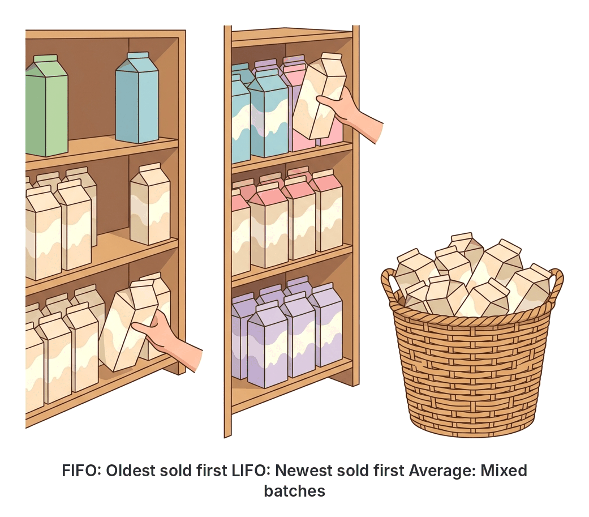

# JAMB Accounting Notes: Stock Valuation

## What JAMB expects

This topic is Section A, Topic 7 of the JAMB Principles of Accounts syllabus: Stock Valuation. It covers the following content items:
- **a. Meaning and purpose of stock valuation**
- **b. Methods of stock valuation e.g., FIFO, LIFO and simple average**
- **c. Advantages and disadvantages of the methods**

By the end of these notes, you should be able to:
1. determine the value of materials issued to production department using FIFO, LIFO and simple average;
2. calculate the closing stock of materials or finished goods using FIFO, LIFO and simple average;
3. compare the advantages and disadvantages of each method of stock valuation; and
4. determine the effects of stock valuation on elements of income statement.

> **Note on the syllabus wording:** The JAMB syllabus uses older terminology such as "stock" and "income statement". In modern accounting (and IFRS), these are called **inventory** and the **statement of profit or loss**. You should know both names as textbooks vary. 
> 
> Also, the syllabus requires you to learn the Last In, First Out (LIFO) method. You must know how to calculate it for your exam. However, at the time of writing, LIFO is **not permitted** under the International Accounting Standard 2 (IAS 2) because it leaves outdated values on the statement of financial position. 

## Meaning and purpose of stock valuation

**Stock** (or **inventory**) refers to the unsold goods, raw materials, or work-in-progress a business holds at the end of a financial period. 

Why do we need to place a monetary value on this physical stock?
1. **To determine true profit:** We must subtract the value of closing stock from the Cost of Goods Available for Sale to find the true Cost of Goods Sold (COGS). If we do not value the stock accurately, our Gross Profit will be wrong.
2. **To show an accurate financial position:** Closing stock is a current asset. It must be reported accurately on the Statement of Financial Position (Balance Sheet) to show what the business is worth.
3. **To comply with the prudence concept:** Accounting rules dictate that we do not anticipate profit. Therefore, stock must always be valued at the **lower of cost and net realisable value (NRV)**. If goods are damaged or out of fashion, they must be valued at what they can actually be sold for (NRV), not what they cost to buy.

## Methods of stock valuation

When a business buys batches of goods at different prices during the year, it becomes difficult to know exactly which batch a sold item came from. To solve this, accountants make assumptions about the flow of goods. 

The syllabus requires you to know three methods:
1. **First In, First Out (FIFO):** Assumes the first goods bought (the oldest) are the first ones issued or sold. Therefore, the stock left at the end of the period consists of the most recently purchased items.
2. **Last In, First Out (LIFO):** Assumes the last goods bought (the newest) are the first ones issued or sold. Therefore, the stock left at the end of the period consists of the oldest items.
3. **Simple Average:** Ignores the quantities in each batch and simply calculates the average of the purchase prices. Goods are issued at this average price.



---

To explain how to calculate issues and closing stock, we will use a single detailed example of a Nigerian business.

**Worked Example: The Mushin Provision Store**
A provision store in Mushin buys and issues cartons of milk. During January, the store's records showed:
- **Jan 1:** Opening balance of 10 cartons @ ₦5,000 each
- **Jan 10:** Purchased 20 cartons @ ₦6,000 each
- **Jan 15:** Issued (sold) 15 cartons
- **Jan 20:** Purchased 10 cartons @ ₦7,000 each
- **Jan 25:** Issued (sold) 15 cartons

First, let us summarize the physical units:
- **Total cartons available** = 10 (Jan 1) + 20 (Jan 10) + 10 (Jan 20) = **40 cartons**.
- **Total cartons issued** = 15 (Jan 15) + 15 (Jan 25) = **30 cartons**.
- **Closing stock quantity** = 40 available − 30 issued = **10 cartons remaining**.

## Determining the value of materials issued to production department

**Objective i: determine the value of materials issued to production department using FIFO, LIFO and simple average.**

When materials are sent to the factory (or goods are sold in a shop), we must assign a cost to them. This becomes our Cost of Goods Sold.

### 1. Value of issues using FIFO
Under FIFO, we always issue from the oldest available batch until it is empty, then move to the next oldest.

- **Jan 15 issue (15 cartons):** 
  Take the oldest 10 cartons from Jan 1 (@ ₦5,000). We need 5 more, so we take them from the Jan 10 batch (@ ₦6,000).
  Cost = (10 × ₦5,000) + (5 × ₦6,000) = ₦50,000 + ₦30,000 = **₦80,000**.
  *(The store now has 15 cartons left from the Jan 10 batch).*
- **Jan 25 issue (15 cartons):**
  The oldest available stock is the 15 cartons left from Jan 10 (@ ₦6,000).
  Cost = 15 × ₦6,000 = **₦90,000**.
  
**Total value of materials issued (FIFO) = ₦80,000 + ₦90,000 = ₦170,000.**

### 2. Value of issues using LIFO
Under LIFO, we issue from the most recent batch available on the date of the issue.

- **Jan 15 issue (15 cartons):** 
  The newest stock available on Jan 15 is the Jan 10 batch (@ ₦6,000). We take all 15 from there.
  Cost = 15 × ₦6,000 = **₦90,000**.
  *(The store now has 10 cartons from Jan 1 and 5 cartons from Jan 10).*
- **Jan 25 issue (15 cartons):**
  The newest stock available on Jan 25 is the Jan 20 batch (@ ₦7,000). We take all 10 from there. We need 5 more, so we take them from the next newest (the 5 remaining from Jan 10 @ ₦6,000).
  Cost = (10 × ₦7,000) + (5 × ₦6,000) = ₦70,000 + ₦30,000 = **₦100,000**.

**Total value of materials issued (LIFO) = ₦90,000 + ₦100,000 = ₦190,000.**

### 3. Value of issues using Simple Average (Periodic)
For JAMB, Simple Average is usually calculated periodically (at the end of the month). It simply averages the purchase prices and ignores quantities.

- **Step 1:** List the unit prices during the period: ₦5,000, ₦6,000, and ₦7,000.
- **Step 2:** Find the simple average: (₦5,000 + ₦6,000 + ₦7,000) ÷ 3 prices = ₦18,000 ÷ 3 = **₦6,000**.
- **Step 3:** Multiply the total units issued (30 cartons) by this average price.
  Cost = 30 × ₦6,000 = **₦180,000**.

**Total value of materials issued (Simple Average) = ₦180,000.**

## Calculating the closing stock of materials or finished goods

**Objective ii: calculate the closing stock of materials or finished goods using FIFO, LIFO and simple average.**

Closing stock is the 10 cartons left over at the end of January. How much are they worth?

### 1. Closing stock using FIFO
Because the oldest goods were sold first, the 10 cartons remaining must be the **most recently purchased** ones.
- The most recent purchase was on Jan 20 (10 cartons @ ₦7,000).
- **Value of closing stock (FIFO)** = 10 × ₦7,000 = **₦70,000**.

### 2. Closing stock using LIFO
Because the newest goods were sold first, the 10 cartons remaining must be the **oldest ones** the store had.
- The oldest stock was the Jan 1 opening balance (10 cartons @ ₦5,000).
- **Value of closing stock (LIFO)** = 10 × ₦5,000 = **₦50,000**.

> **Note on LIFO without dates:** If an exam question gives you total purchases and total issues, but does *not* give you the dates the issues happened, you calculate LIFO by assuming the closing stock is made entirely of the very first batch of the month (Periodic LIFO).

### 3. Closing stock using Simple Average (Periodic)
We take the remaining 10 cartons and multiply them by the simple average price we calculated earlier (₦6,000).
- **Value of closing stock (Simple Average)** = 10 × ₦6,000 = **₦60,000**.

*(Self-check: Notice that for all three methods, the Total Value of Issues + the Value of Closing Stock equals the Total Cost of Goods Available (₦240,000). For example, under FIFO: ₦170,000 + ₦70,000 = ₦240,000.)*

## Advantages and disadvantages of the methods

**Objective iii: compare the advantages and disadvantages of each method of stock valuation.**

| Method | Advantages | Disadvantages |
| :--- | :--- | :--- |
| **FIFO** | • Logical and matches the physical flow of most goods (especially perishables).<br>• Closing stock is valued at current market prices, making the balance sheet realistic.<br>• Accepted by International Accounting Standards (IAS 2). | • Cost of goods sold is based on older, outdated prices, which may not match current sales revenues.<br>• During inflation, it overstates profits, leading to higher tax bills. |
| **LIFO** | • Matches current revenues against current costs (cost of goods sold reflects recent prices).<br>• During inflation, it reports lower profits, which reduces tax liability (where legally permitted). | • Not permitted by IAS 2 / IFRS.<br>• Unrealistic physical flow for perishable goods (you don't sell fresh bread and keep the one-month-old bread).<br>• Closing stock is left at very old, unrealistic prices. |
| **Simple Average** | • Simple to understand and easy to calculate periodically.<br>• Smooths out price fluctuations, preventing extreme highs or lows. | • The issue price is not the actual price paid for any specific batch.<br>• It ignores the quantities purchased at each price, which can lead to inaccuracies. |

## Effects of stock valuation on elements of income statement

**Objective iv: determine the effects of stock valuation on elements of income statement.**

The method chosen to value stock directly changes the **Cost of Goods Sold (COGS)** and, consequently, the **Gross Profit** in the statement of profit or loss (income statement). 

The formula for Cost of Goods Sold is:
**COGS = Opening Stock + Purchases − Closing Stock**

Because Closing Stock is subtracted, **a higher Closing Stock results in a lower COGS, which leads to a higher Gross Profit.**

Let us see how inflation (rising prices) affects the income statement using our Mushin provision store example. Assume the store sold the 30 issued cartons for ₦10,000 each (Total Sales = ₦300,000). The prices of milk were rising from ₦5,000 to ₦7,000 during the month.

| Element of Income Statement | FIFO | LIFO | Simple Average |
| :--- | :--- | :--- | :--- |
| **Sales** | ₦300,000 | ₦300,000 | ₦300,000 |
| **Less COGS (Value of Issues)** | (₦170,000) | (₦190,000) | (₦180,000) |
| **Gross Profit** | **₦130,000** | **₦110,000** | **₦120,000** |

**Conclusion for periods of rising prices (inflation):**
- **FIFO** yields the highest closing stock, the lowest COGS, and the **highest profit**.
- **LIFO** yields the lowest closing stock, the highest COGS, and the **lowest profit**.
- **Simple Average** falls somewhere in between. 

*(In a period of falling prices/deflation, the exact opposite happens: LIFO would give the highest profit and FIFO the lowest).*

## Key terms

| Term | Meaning |
| :--- | :--- |
| **Stock (Inventory)** | Goods held for sale, raw materials, or work-in-progress at the end of a period. |
| **First In, First Out (FIFO)** | A valuation method assuming the oldest goods are issued first. |
| **Last In, First Out (LIFO)** | A valuation method assuming the newest goods are issued first. |
| **Simple Average** | A valuation method that uses the average of the unit purchase prices to value issues and closing stock. |
| **Cost of Goods Sold (COGS)** | The direct costs attributable to the production or purchase of the goods sold by a company. |
| **Net Realisable Value (NRV)** | The estimated selling price of goods in the ordinary course of business, minus the costs to sell them. |
| **Prudence Concept** | The accounting rule requiring stock to be valued at the lower of cost and net realisable value, preventing the overstatement of profits. |

## Exam tips and common mistakes

- **Learn the profit effect rule by heart:** In inflation, FIFO = Highest Profit; LIFO = Lowest Profit.
- **Pay attention to dates for LIFO:** If JAMB provides specific dates for issues (e.g. "Issued 40 units on May 15"), you must deduct the stock that was newest *on that specific date* (Perpetual LIFO). If no dates are given for issues, assume the closing stock consists entirely of the oldest opening batches (Periodic LIFO).
- **Simple Average is not Weighted Average:** To find the simple average, just add the prices together and divide by the number of prices. Do not multiply the prices by their quantities—that is the Weighted Average method, which JAMB generally does not ask for when they specify "simple average".
- **Inverse relationship:** Never forget that Closing Stock and Cost of Goods Sold have an inverse relationship. If you mistakenly overstate closing stock, you will understate COGS and overstate Gross Profit.

## Quick summary

1. Stock valuation is necessary to determine the true Cost of Goods Sold, calculate an accurate gross profit, and present realistic current assets on the statement of financial position.
2. The Prudence concept dictates that stock must be valued at the lower of cost and net realisable value.
3. FIFO (First In, First Out) assumes oldest items are sold first. Closing stock is valued at the most recent, newer prices.
4. LIFO (Last In, First Out) assumes newest items are sold first. Closing stock is valued at the oldest, historical prices. LIFO is not permitted under IAS 2.
5. The Simple Average method ignores batch quantities and values issues and closing stock using the average of the purchase prices.
6. During periods of inflation, FIFO reports the lowest Cost of Goods Sold and the highest Gross Profit, while LIFO reports the highest Cost of Goods Sold and the lowest Gross Profit.
7. FIFO is the most realistic method for businesses dealing with perishable goods.

## Practice questions

*Use the following data to answer Questions 3, 4, 5, and 6.*
A tailor in Aba has the following records for fabric purchases and issues in May:
- **May 1:** Opening stock 50 yards @ ₦100
- **May 10:** Purchases 100 yards @ ₦110
- **May 15:** Issued 120 yards to the sewing room
- **May 20:** Purchases 50 yards @ ₦150
- **May 25:** Issued 40 yards to the sewing room

**1. The primary purpose of valuing closing stock accurately is to**
- A. determine the cash balance at the end of the year
- B. calculate the true gross profit for the period
- C. ensure that the bank statement agrees with the cash book
- D. calculate the amount owed by debtors

**Answer: B.** Closing stock is subtracted from the cost of goods available for sale to find the cost of goods sold. Without an accurate cost of goods sold, the true gross profit cannot be calculated.

**2. Which of the following methods of stock valuation is NOT permitted by the International Accounting Standards (IAS 2)?**
- A. First In, First Out (FIFO)
- B. Weighted Average Cost
- C. Last In, First Out (LIFO)
- D. Specific Identification

**Answer: C.** LIFO is not permitted under IAS 2 because it values closing stock on the statement of financial position at very old, unrealistic historical prices.

**3. Using the FIFO method, what is the value of the closing stock for the Aba tailor?**
- A. ₦6,000
- B. ₦4,000
- C. ₦4,500
- D. ₦4,800

**Answer: A.** 
Step 1: Total yards available = 50 + 100 + 50 = 200 yards. Total issued = 120 + 40 = 160 yards. Closing stock = 40 yards.
Step 2: Under FIFO, the 40 yards left are the ones bought most recently. The most recent purchase was on May 20 (50 yards @ ₦150).
Step 3: Value = 40 yards × ₦150 = ₦6,000.

**4. Using the LIFO method, calculate the value of the closing stock.**
- A. ₦4,000
- B. ₦4,500
- C. ₦6,000
- D. ₦4,800

**Answer: B.** 
Step 1: May 15 issue (120 yds) takes 100 yds from May 10 (@ ₦110) and 20 yds from May 1 (@ ₦100). The balance left is 30 yds @ ₦100.
Step 2: May 20 receipt adds 50 yds @ ₦150.
Step 3: May 25 issue (40 yds) takes 40 yds from May 20 (@ ₦150).
Step 4: The final balance is 30 yds @ ₦100 and 10 yds @ ₦150. Value = (30 × ₦100) + (10 × ₦150) = ₦3,000 + ₦1,500 = ₦4,500. 
*(Option A is a common mistake for students who ignore the issue dates and assume all 40 units come from the very first batch).*

**5. What is the value of the closing stock using the periodic simple average method?**
- A. ₦4,500
- B. ₦4,700
- C. ₦4,800
- D. ₦6,000

**Answer: C.** 
Step 1: Find the simple average of the three purchase prices: (₦100 + ₦110 + ₦150) ÷ 3 = ₦360 ÷ 3 = ₦120.
Step 2: Multiply by closing stock quantity (40 yards). Value = 40 × ₦120 = ₦4,800.
*(Option B is the weighted average, calculated by dividing total cost by total units, which the question did not ask for).*

**6. Using the periodic simple average method, what is the total cost of fabrics issued to the sewing room?**
- A. ₦17,500
- B. ₦18,800
- C. ₦19,000
- D. ₦19,200

**Answer: D.** 
Step 1: The simple average price is ₦120.
Step 2: Total yards issued = 120 + 40 = 160 yards.
Step 3: Total issue value = 160 yards × ₦120 = ₦19,200.

**7. In a period of consistently rising prices (inflation), which method of stock valuation will report the highest gross profit?**
- A. FIFO
- B. LIFO
- C. Simple Average
- D. Weighted Average

**Answer: A.** Under FIFO, the oldest (and therefore cheapest) goods are treated as the ones sold. This gives the lowest Cost of Goods Sold, which results in the highest Gross Profit.

**8. The accounting principle that requires closing stock to be valued at the lower of cost and net realisable value is the**
- A. matching concept
- B. going concern concept
- C. prudence concept
- D. consistency concept

**Answer: C.** The prudence (or conservatism) concept states that a business should not anticipate profits but should account for all probable losses. Therefore, if stock is worth less than its cost, it must be written down.

**9. If closing stock is undervalued, what is the effect on the financial statements?**
- A. Cost of goods sold is understated and gross profit is overstated
- B. Cost of goods sold is overstated and gross profit is understated
- C. Net profit increases and current assets increase
- D. Cost of goods sold is unaffected

**Answer: B.** Closing stock is subtracted to find the Cost of Goods Sold. If you subtract a smaller number, the COGS becomes larger (overstated). A larger COGS leaves a smaller (understated) Gross Profit.

**10. Which stock valuation method assumes that the items remaining in inventory at the end of the period are the oldest ones purchased?**
- A. FIFO
- B. LIFO
- C. Simple Average
- D. Base Stock

**Answer: B.** Under Last In, First Out (LIFO), the most recently purchased items are issued first. This means the items left untouched in the closing stock are the ones from the oldest purchases.

<!-- COVERAGE
obj i | Determining the value of materials issued to production department
obj ii | Calculating the closing stock of materials or finished goods
obj iii | Advantages and disadvantages of the methods
obj iv | Effects of stock valuation on elements of income statement
item a | Meaning and purpose of stock valuation
item b | Methods of stock valuation
item c | Advantages and disadvantages of the methods
-->```
