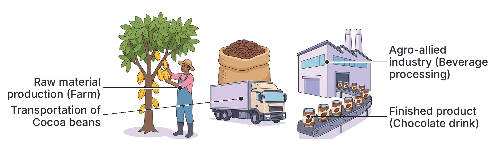
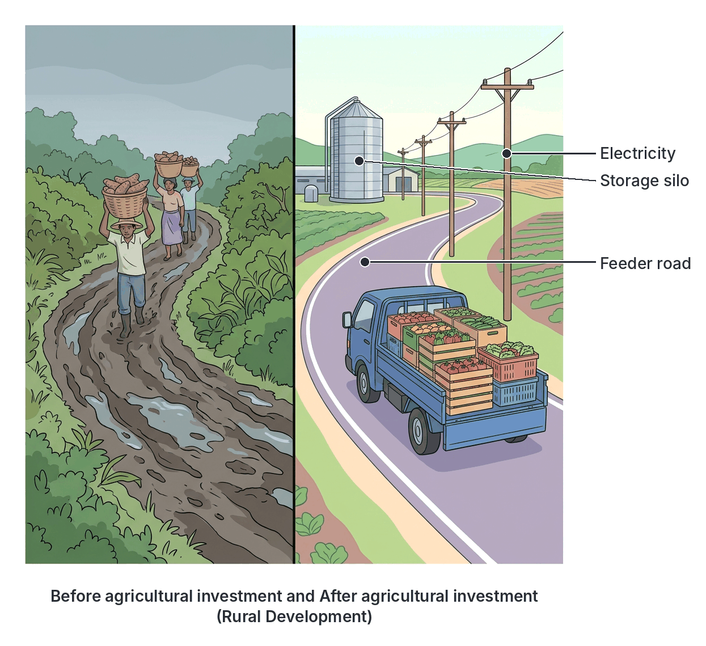

# JAMB Agricultural Science Notes: Importance of Agriculture

## What JAMB expects

This topic is Section A, Topic 2 of the JAMB Agricultural Science syllabus: Importance of Agriculture. It covers the following content items:
- i. Provision of raw materials for agro-allied industries
- ii. Provision of employment
- iii. Development of rural areas, etc.

By the end of these notes, you should be able to:
1. Relate agricultural benefits to individual farmers.
2. Relate agro-allied industries to their respective raw materials.
3. Relate the various contributions of Agriculture to economic development in West Africa.

Agriculture is the backbone of most West African economies. It goes far beyond simply growing food; it supports the livelihoods of individuals, supplies industries with essential materials, and drives the economic growth of nations.

## Benefits of agriculture to individual farmers

Before looking at how agriculture helps the whole country, we must understand how it helps the individual person who practises it. For the rural and urban farmer in West Africa, agriculture is a source of livelihood and survival. The major benefits to the individual farmer include:

### 1. Provision of food for the farmer and their family
The most immediate benefit of agriculture to a farmer is food security at the household level. A farmer who grows crops like yam, cassava, maize, and vegetables, or rears animals like poultry and goats, can feed their family directly from the farm's produce. This reduces the amount of money the family has to spend on buying food from the market. 

### 2. Source of income and livelihood
When a farmer produces more than the family can eat, the extra produce (called the **surplus**) is sold in local markets. The money earned from selling crops, eggs, milk, or live animals provides a steady income. This income allows the farmer to:
- Pay children's school fees.
- Pay for healthcare and hospital bills.
- Buy things the farm cannot produce, such as clothes, electronics, and building materials.
- Reinvest in the farm by buying better tools, fertilizers, or improved seeds.

### 3. Provision of shelter and clothing materials
Historically, and in many rural areas today, agriculture provides the direct materials used for building houses and making clothes. 
- **Shelter:** Farmers use materials like timber (wood), bamboo, palm fronds, and thatch grasses harvested from their land to build houses, yam barns, and animal pens. 
- **Clothing:** Farmers who grow cotton or raise sheep (for wool) produce the basic materials needed to make fabrics, even if the processing is done locally by weavers. Hides and skins from slaughtered farm animals are used to make leather for sandals, belts, and bags.

### 4. Direct self-employment
Agriculture makes the farmer an entrepreneur. It provides direct, reliable self-employment. A farmer does not need to wait for a government job or a factory job; by acquiring a piece of land and some seeds, they can create their own employment. As the farm grows, the farmer becomes an employer of labour, hiring other people in the community to help with clearing, planting, or harvesting.

## Provision of raw materials for agro-allied industries

An **agro-allied industry** (or agro-based industry) is any manufacturing industry that depends entirely on agriculture to supply its raw materials. These industries take raw, unprocessed agricultural produce and process them into finished or semi-finished goods. 

Without agricultural production, these manufacturing plants cannot exist. The farms act as the foundational supply chain for industrialization. In return, these industries provide a ready, large-scale market for the farmer's produce, preventing wastage and encouraging the farmer to produce in commercial quantities. 

## Agro-allied industries and their respective raw materials

JAMB frequently tests your ability to match a specific industry to the exact agricultural raw material it uses. The table below covers the most important agro-allied industries in West Africa and the agricultural materials they require.

| Agro-allied Industry | Finished Products | Agricultural Raw Materials Used |
| --- | --- | --- |
| **Textile industry** | Clothes, fabrics, threads, yarns | Cotton lint, silk, wool |
| **Beverage industry** | Chocolate drinks (e.g., Milo, Bournvita), coffee, tea | Cocoa beans, coffee berries, tea leaves |
| **Flour mill industry** | Baking flour, semolina, wheat offal | Wheat, maize, cassava, sorghum |
| **Feed mill industry** | Poultry feed (layers mash, broiler starter), livestock feed | Maize, soybean, groundnut cake, cassava, fish meal, bone meal |
| **Soap and cosmetics industry** | Bathing soaps, detergents, body creams, pomade | Palm oil, palm kernel oil, shea butter, coconut oil, cocoa butter |
| **Tyre and rubber industry** | Vehicle tyres, tubes, rubber boots, plastics | Natural rubber latex (from rubber trees, *Hevea brasiliensis*) |
| **Brewery industry** | Beer, malt drinks, stout | Sorghum (guinea corn), maize, barley, hops |
| **Fruit juice and canning industry** | Packaged fruit juices, tomato paste, canned fruits | Oranges, pineapples, mangoes, tomatoes |
| **Sugar manufacturing** | Granulated sugar, cube sugar, molasses | Sugarcane |
| **Tannery and leather industry** | Leather shoes, bags, belts, upholstery | Hides (from large animals like cattle) and skins (from sheep and goats) |
| **Pulp and paper industry** | Exercise books, printing paper, cardboard, tissue | Pulpwood (timber from trees like *Gmelina arborea* and pine) |
| **Sawmill and furniture industry** | Planks, plywood, chairs, tables, beds | Timber / Wood |
| **Tobacco industry** | Cigarettes, cigars, snuff | Tobacco leaves |
| **Meat and dairy processing** | Corned beef, sausages, pasteurized milk, yoghurt | Cattle, pigs, poultry, fresh milk |

**Note on mutual benefit (symbiosis):** The relationship goes both ways. While agriculture supports industry by providing the raw materials in the table above, the industrial sector supports agriculture by manufacturing the inputs the farmer needs, such as tractors, fertilizers, pesticides, and improved tools (produced by chemical and heavy engineering industries).

## Provision of employment

Agriculture has historically been the largest single employer of labour in West Africa, employing between 60% and 70% of the active working population. This massive provision of employment is categorized into two forms:

- **Direct employment:** People who work directly on the farm producing crops or raising animals. This includes crop farmers, livestock rearers (herdsmen), poultry attendants, farm managers, and fishermen.
- **Indirect employment:** People who do not work on the farm but whose jobs exist purely because of agriculture. This includes:
  - Factory workers in agro-allied industries (e.g., workers in a flour mill or textile factory).
  - Marketers, traders, and transporters who move produce from rural areas to cities.
  - Agricultural extension workers, researchers, and veterinary doctors.
  - Mechanics who repair farm tractors and machinery.

By keeping millions of people employed, agriculture plays a crucial role in reducing crime rates, extreme poverty, and social unrest in the country.

## Development of rural areas, etc.

Most agricultural activities take place in rural areas where land is abundant and affordable. Because the government and private investors want to transport agricultural produce out of these remote villages to the cities or export ports, they are forced to invest in the rural areas. 

Agriculture drives rural development in the following specific ways:
- **Infrastructure:** Construction of **feeder roads** (smaller rural roads linking villages to main highways) to transport farm produce easily.
- **Basic Amenities:** Provision of electricity, pipe-borne water, and modern storage silos in farming communities to support agricultural processing and keep farm workers comfortable.
- **Social Services:** Building of schools, markets, and health centres to cater to the families of farmers and farm workers.
- **Reduction of rural-urban migration:** When agriculture is profitable and rural areas are developed with good amenities, young people are more likely to stay in their villages to farm, rather than migrating to crowded cities to look for scarce white-collar jobs.

## Contributions of agriculture to economic development

Beyond the individual farmer and the rural village, agriculture is essential for the economic survival and development of West African countries like Nigeria, Ghana, Sierra Leone, and The Gambia. Economic development refers to the steady improvement in the standard of living, infrastructure, and overall financial wealth of a nation.

Agriculture contributes to national economic development in the following major ways:

### 1. Source of foreign exchange (Forex)
When a country sells its agricultural goods to other countries, it earns foreign currencies like US Dollars, Euros, or British Pounds. This money is called **foreign exchange**. A country needs foreign exchange to import heavy machinery, electronics, medical equipment, and other goods it cannot produce locally.

Before the discovery of crude oil in Nigeria, agriculture was the main source of foreign exchange. Today, it is still a vital earner across West Africa.
- **Nigeria** exports cocoa, rubber, sesame seeds, cashew nuts, and historically, groundnuts and palm produce.
- **Ghana** and **Côte d'Ivoire** rely heavily on cocoa exports for their foreign exchange.
- **The Gambia** relies heavily on groundnut exports.
- **Senegal** exports groundnuts and cotton.

Crops grown specifically to be sold (often for export) rather than eaten by the farmer are called **cash crops**.

### 2. Contribution to Gross Domestic Product (GDP)
**Gross Domestic Product (GDP)** is the total monetary value of all the finished goods and services produced within a country's borders in a specific time period (usually a year). It is the main measure of a country's economic size.

Agriculture contributes a massive percentage to the GDP of West African nations. Every tuber of yam sold, every cow slaughtered, and every bag of cocoa exported adds to the national wealth. Even with the presence of the oil and gas sector, agriculture remains one of the largest contributors to Nigeria's non-oil GDP.

### 3. Provision of food security for the nation
A nation that cannot feed its citizens is economically weak. By producing food locally, agriculture ensures that citizens have enough to eat at affordable prices. 
- It prevents starvation and malnutrition.
- It saves the country money because the government does not have to spend its scarce foreign exchange importing basic foods like rice, wheat, and meat. 
- A well-fed population is healthy, energetic, and highly productive in other sectors of the economy.

### 4. Provision of a market for industrial goods
Just as agriculture provides raw materials for industries, the agricultural sector is a huge customer (market) for the products of other industrial sectors. 
- Farmers buy **agrochemicals** (fertilizers, pesticides, herbicides) from chemical industries.
- Farmers buy **farm machinery** (tractors, ploughs, harvesters) from heavy engineering and manufacturing industries.
- Farmers buy **building materials** (cement, roofing sheets) to construct farmsteads and animal houses.
Therefore, the expansion of agriculture directly causes the expansion and profitability of these other industries.

### 5. Source of government revenue
The government earns money (revenue) from agricultural activities through:
- **Export duties and tariffs:** Taxes placed on agricultural goods being exported out of the country.
- **Income tax:** Taxes paid by commercial farmers, agro-allied companies, and their employees.
- **Sales tax / VAT:** Collected when processed agricultural goods are sold in supermarkets.
The government uses this revenue to build roads, fund schools, and pay civil servants.

### 6. Provision of facilities for recreation and tourism
Certain areas of agriculture, specifically **wildlife conservation and forestry**, provide recreational centers and boost tourism. National parks (e.g., Yankari Game Reserve in Bauchi State, Cross River National Park) protect plants and wild animals. Tourists from all over the world pay money to visit these places, generating revenue for the country and creating local jobs.

## Key terms

| Term | Meaning |
| --- | --- |
| **Agro-allied industry** | An industry that depends entirely on agriculture for its raw materials. |
| **Foreign exchange (Forex)** | Foreign currencies earned by a country through the export of goods and services, used to pay for imports. |
| **Gross Domestic Product (GDP)** | The total monetary value of all goods and services produced in a country over a specific period (usually a year). |
| **Cash crop** | A crop grown primarily for sale and export rather than for the farmer's own consumption (e.g., cocoa, rubber, cotton). |
| **Rural-urban migration** | The movement of people, usually the youth, from rural villages to cities in search of better jobs and amenities. |
| **Feeder road** | A small road built to connect rural farming areas to main roads or highways, making it easier to transport produce. |
| **Direct employment** | Jobs involving actual farm work (e.g., farmers, herdsmen). |
| **Indirect employment** | Jobs that exist because of agriculture but are not on the farm (e.g., tractor mechanics, factory workers in flour mills). |
| **Raw material** | An unprocessed natural product used in manufacturing to create finished goods. |

## Exam tips and common mistakes

- **Match the exact raw material to the industry:** Be careful not to mix them up. For example, the *beverage industry* uses cocoa, coffee, and tea; it does not use maize (maize is used in the *brewery* or *flour/feed mill* industries). 
- **Distinguish between Direct and Indirect employment:** If a question asks for a direct agricultural worker, look for the person working on the field or with the animals. A factory worker turning cotton into cloth is an *indirect* agricultural worker.
- **Understand the terminology:** When JAMB uses the term "foreign exchange", they are referring to the export of crops (selling to other countries to get dollars/pounds). When they mention "revenue", they usually mean money the government collects through taxes.
- **Recognize the mutual benefit:** Industries need agriculture for raw materials, but agriculture needs industry for agrochemicals (fertilizers) and machinery. 
- **Do not confuse latex with palm wine:** Both are tapped from trees and look white. However, latex from the rubber tree (*Hevea brasiliensis*) is for the tyre/plastics industry, while palm wine from the palm tree is a beverage.
- **Rural development vs. Individual benefit:** The construction of feeder roads is a benefit to rural development (economic development), whereas producing food or making an income is a benefit to the individual farmer. Do not confuse the two in objective questions.

## Quick summary

1. Agriculture provides direct benefits to the individual farmer, including food for the family, income for personal needs, materials for shelter and clothing, and self-employment.
2. Agro-allied industries rely entirely on agriculture for raw materials to manufacture finished goods.
3. Examples of agro-allied linkages include cocoa for beverages, cotton for textiles, rubber latex for tyres, hides and skins for tanneries, and timber for sawmills.
4. Agriculture contributes significantly to the Gross Domestic Product (GDP) and government revenue through taxes and export duties.
5. By exporting cash crops like cocoa, rubber, and groundnuts, West African countries earn valuable foreign exchange.
6. Agriculture is the largest employer of labour in West Africa, providing both direct jobs on the farm and indirect jobs in factories, processing, and transportation.
7. Agriculture promotes the development of rural areas by encouraging the construction of feeder roads, electricity, and water supplies, which actively helps to reduce rural-urban migration.

## Practice questions

**1. Which of the following agro-allied industries uses latex as its primary raw material?**

- A. Textile industry
- B. Soap industry
- C. Tyre and rubber industry
- D. Beverage industry

**Answer: C.** The tyre and rubber industry processes natural rubber latex, tapped from rubber trees, to make tyres, tubes, and plastics. Textiles use cotton, soap uses palm oil/kernel oil, and beverages use cocoa/coffee.

**2. Which of the following is a direct benefit of agriculture to an individual farmer?**

- A. Provision of foreign exchange for the country
- B. Provision of raw materials for heavy engineering
- C. Provision of food for the household
- D. Construction of a national highway

**Answer: C.** Provision of food is a direct, immediate benefit to the individual farmer's household. Foreign exchange and national highways are macro-economic benefits for the country. 

**3. An example of a worker who is indirectly employed by agriculture is a**

- A. crop farmer
- B. tractor mechanic
- C. cattle herdsman
- D. poultry attendant

**Answer: B.** A tractor mechanic does not work directly in producing crops or rearing animals, but their job exists because farmers need tractors repaired. The other options are direct farm workers.

**4. The money earned by a country from selling agricultural products to other countries is known as**

- A. Gross Domestic Product
- B. income tax
- C. foreign exchange
- D. working capital

**Answer: C.** Foreign exchange refers to the foreign currencies a country earns by exporting its goods, such as selling cocoa to Europe. GDP is the total value of goods produced within the country.

**5. Which of the following crops is the major raw material used in the brewery industry?**

- A. Sorghum
- B. Cotton
- C. Cocoa
- D. Rubber

**Answer: A.** Sorghum (guinea corn), along with maize and barley, is a major raw material fermented to produce beer and malt drinks in the brewery industry.

**6. Agriculture promotes rural development mainly through the**

- A. establishment of heavy engineering industries in villages
- B. provision of feeder roads and basic amenities
- C. relocation of the capital city to a rural area
- D. banning of imported food items

**Answer: B.** To transport farm produce to urban markets and factories, the government and investors build feeder roads, electricity, and water supplies in rural farming communities, thereby developing the area.

**7. In West Africa, the leather and tannery industry relies heavily on raw materials from**

- A. poultry and pigs
- B. cattle, sheep, and goats
- C. wildlife and fishes
- D. timber and bamboo

**Answer: B.** Tanneries process the hides of large animals (like cattle) and the skins of smaller animals (like sheep and goats) into leather.

**8. The total monetary value of all finished goods and services produced in a country within a year is called**

- A. Gross Margin
- B. Foreign Exchange
- C. Net Profit
- D. Gross Domestic Product

**Answer: D.** Gross Domestic Product (GDP) is the economic metric used to measure the total value of all goods and services, including agricultural produce, generated within a country in a year.

**9. The relationship between agriculture and industry is considered symbiotic because**

- A. agriculture provides all the capital needed by industries
- B. industries produce food for farmers
- C. agriculture supplies raw materials while industries supply farm inputs
- D. farmers are legally required to work in factories during the dry season

**Answer: C.** It is a two-way (symbiotic) benefit. Agriculture supplies raw materials (like cotton) to factories, and factories (like chemical or machinery plants) supply fertilizers, pesticides, and tractors back to the farmers.

**10. One major way agriculture helps to reduce rural-urban migration is by**

- A. forcing youths to stay in the village by law
- B. providing gainful employment and improving rural living standards
- C. destroying houses in the cities
- D. reducing the price of agricultural tools

**Answer: B.** When agriculture is profitable and leads to the provision of amenities (electricity, good roads) in rural areas, youths are motivated to stay and work in their communities rather than moving to the city for jobs.
