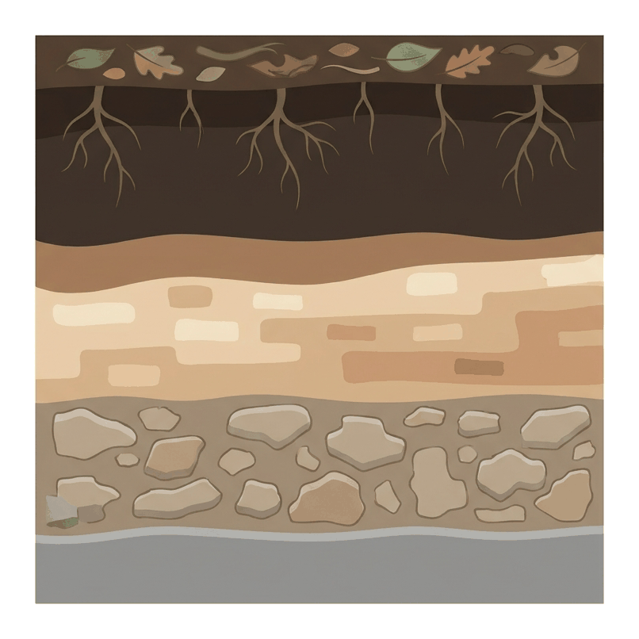
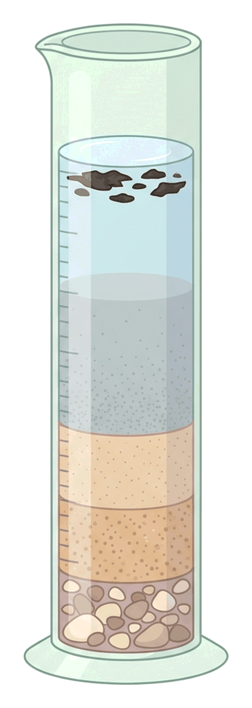
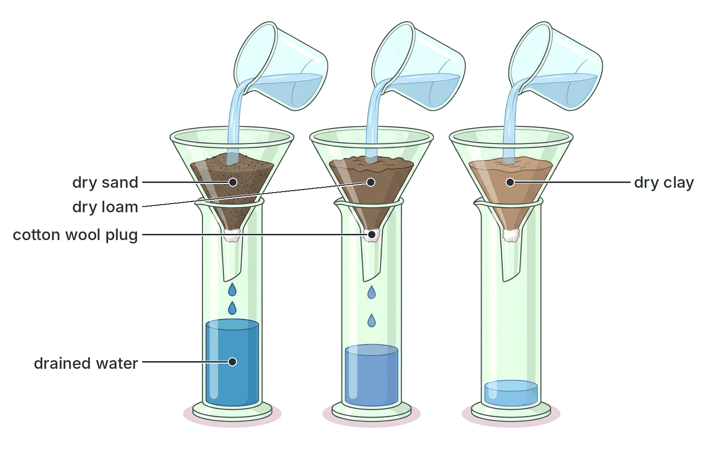

# JAMB Agricultural Science Notes: Rocks and Soil Formation

## What JAMB expects

This topic is Section B, Topic 1 of the JAMB Agricultural Science syllabus: Agronomy – Rocks and Soil formation. It covers the origin of soils and the physical and chemical properties that make them suitable for agriculture. 

The syllabus lists four main content items:
- **a.** Rock formation
- **b.** Factors affecting rock weathering and soil formation
- **c.** Physical properties of soil (Soil profile; Soil components, texture and structure)
- **d.** Chemical properties of soil (Soil acidity and alkalinity; Chemical components of soil e.g. silicate)

By the end of these notes, you should be able to:
1. Identify the major types of rocks and their formation.
2. Identify major types and properties of soils; factors and processes of soil formation.
3. Differentiate between the horizons in a soil profile.
4. i. Differentiate between the components of soil.
5. ii. Compute the proportion of soil components.
6. iii. Analyse soil into its component parts.
7. iv. Determine the water-holding capacity of soil.
8. Determine the soil pH.

**Note on the syllabus wording:** Objectives i to iv are listed in the syllabus exactly as numbered above, directly under the "differentiate between the horizons" objective. They refer to the practical experiments used to separate, compute, and analyse the physical components of the soil (water, organic matter, and mineral matter) and its water-holding capacity. These are taught in detail below.

## Rock formation

### Identify the major types of rocks

A **rock** is a hard, solid mass of mineral matter that makes up the Earth's crust. Rocks are the parent materials from which agricultural soils are formed. Based on their mode of formation, rocks are classified into three major types: igneous, sedimentary, and metamorphic.

| Rock Type | Mode of Formation | Characteristics | Examples |
| --- | --- | --- | --- |
| **Igneous** | Formed from the cooling and solidification of molten rock (magma or lava). Intrusive rocks cool slowly underground; extrusive rocks cool quickly on the surface. | Crystalline (contains crystals), very hard, non-stratified (no layers), contains no fossils. | Granite (intrusive), basalt, pumice, gabbro |
| **Sedimentary** | Formed from the accumulation, compaction, and cementation (lithification) of weathered rock sediments transported by wind or water. | Stratified (arranged in distinct horizontal layers or strata), non-crystalline, often contains fossils (remains of plants and animals). | Limestone, sandstone, shale, dolomite |
| **Metamorphic** | Formed from pre-existing igneous or sedimentary rocks that have been changed by intense **heat and pressure** deep within the Earth. | Often foliated (banded), highly hardened, altered mineral structure, rarely contains fossils. | Marble (from limestone), quartzite (from sandstone), slate (from shale), gneiss (from granite) |

## Factors affecting rock weathering and soil formation

### Identify major types and properties of soils

**Processes and factors of soil formation**

**Weathering** is the continuous breakdown of rocks into smaller particles to form soil. The processes of weathering are grouped into three categories:

1. **Physical (Mechanical) weathering:** Breakdown of rocks without chemical changes. 
   - **Temperature changes:** Alternating heating (expansion) and cooling (contraction) causes rocks to crack and peel in outer layers (exfoliation).
   - **Ice (Frost wedging):** Water enters rock crevices, freezes into ice, expands, and splits the rock.
   - **Wind and running water:** Carry abrasive sand particles that grind rocks down over time.
2. **Chemical weathering:** Breakdown of rocks through chemical reactions, often requiring water.
   - **Hydrolysis:** Chemical reaction of rock minerals with water to form new, weaker compounds.
   - **Hydration:** Absorption of water by minerals, causing them to swell and weaken.
   - **Carbonation:** Carbon (IV) oxide ($CO_2$) dissolves in rainwater to form weak carbonic acid, which dissolves limestone rocks.
   - **Oxidation:** Oxygen reacts with minerals (especially iron), causing them to "rust" and crumble.
3. **Biological weathering:** Breakdown caused by living organisms.
   - **Plant roots:** Penetrate cracks in rocks, growing thicker and forcing the rock apart.
   - **Animals:** Burrowing animals (earthworms, termites, rodents) and human activities (mining, tillage) break rocks into smaller pieces.

**Factors of soil formation:**

Soil formation (pedogenesis) is controlled by five interacting factors. You can remember them using the acronym **CROPT**:
1. **Climate:** Rainfall provides the water necessary for chemical weathering and leaching. Temperature determines the speed of chemical reactions and physical weathering.
2. **Relief (Topography):** The slope of the land. Steep slopes suffer from fast erosion and have thin, shallow soils. Flat valleys accumulate materials and have deep, fertile soils.
3. **Organisms (Biota):** Plants drop leaves to provide organic matter. Microorganisms decompose this matter into humus. Roots and burrowing animals mix and aerate the soil.
4. **Parent material:** The original rock determines the soil's initial mineral makeup, colour, and texture. For example, granite produces sandy soils, while basalt tends to produce clayey soils.
5. **Time:** Soil formation is an extremely slow process. It takes hundreds to thousands of years to weather rock into just a few centimetres of mature soil.

**Major types and properties of soils**

Depending on the weathering process and parent material, different types of soil are formed. They are classified based on the size of their mineral particles.

| Feature | Sandy soil | Clayey soil |
| --- | --- | --- |
| **Particle size** | Large and coarse ($0.02 \text{ mm}$ to $2.0 \text{ mm}$) | Fine and powdery (less than $0.002 \text{ mm}$) |
| **Pore spaces** | Large (macropores) | Small (micropores) but highly numerous |
| **Aeration** | Excellent (air flows easily) | Poor (spaces easily fill with water, causing waterlogging) |
| **Water-holding capacity**| Poor (drains very quickly, dries out fast) | High (retains water tightly against gravity) |
| **Nutrient content** | Low (nutrients are easily washed away or leached) | High (clay particles magnetically hold onto nutrient ions) |
| **Ease of tillage** | Light soil, easy to dig and cultivate | Heavy soil, sticky when wet, hard and cracked when dry |

- **Loamy soil:** A balanced mixture of sand, silt, and clay, typically rich in organic matter (humus). It has excellent water-holding capacity, good aeration, and is considered the best soil type for most agricultural crops.
- **Silty soil:** Intermediate particle size ($0.002 \text{ mm}$ to $0.02 \text{ mm}$), feels smooth and powdery like flour when dry.

## Physical properties of soil

### Differentiate between the horizons in a soil profile

A **soil profile** is a vertical cross-section of the soil showing distinct horizontal layers from the surface down to the underlying unweathered parent rock. These layers are called **horizons**.

A mature soil profile usually has the following horizons:
- **O horizon (Organic layer):** The topmost layer consisting of freshly fallen leaves, twigs, and partially decomposed organic matter.
- **A horizon (Topsoil):** Dark in colour due to a high organic matter content. It is rich in nutrients and has the highest biological activity (roots, worms, microbes). It is the zone of **eluviation**, meaning water washes (leaches) minerals out of this layer downward.
- **B horizon (Subsoil):** Lighter in colour with less organic matter. It is the zone of **illuviation**, where the minerals (like clay, iron, and aluminium oxides) leached from the A horizon accumulate. Only deep-rooted tree crops typically reach this layer.
- **C horizon (Weathered parent material):** Consists of partially broken-down rock fragments and gravel. It lacks organic matter and biological activity.
- **D or R horizon (Bedrock):** The solid, unweathered parent rock at the base of the profile. **Note:** Textbooks vary in naming this layer; some call it the D horizon, while others use the R (Rock) horizon.

### Soil texture and structure

**Soil texture** refers to the relative proportions of sand, silt, and clay particles in a soil. It is a permanent property that cannot be easily changed by farming practices. A soil texture triangle is used to classify soils based on these percentages.

**Soil structure** refers to the way individual soil particles group or bind together to form larger aggregates called peds. Unlike texture, structure can be improved by adding organic matter or destroyed by excessive tillage. Good soil structures (like the **crumb** or granular structure) allow for excellent root penetration, aeration, and drainage, making them ideal for agriculture. Other structures include blocky, platy, and prismatic.

### i. Differentiate between the components of soil

A standard, healthy agricultural soil is made up of four main components. Solid components make up half the volume, while the pore spaces make up the other half, shared equally between water and air under ideal conditions.

| Component | Proportion (Volume) | Source/Nature | Function in agriculture |
| --- | --- | --- | --- |
| **Mineral matter** | $45\%$ | Formed from weathered parent rocks (sand, silt, clay). | Provides the physical framework (anchorage) for roots and supplies mineral nutrients. |
| **Organic matter** | $5\%$ | Decomposing plant and animal remains (humus). | Improves soil structure, boosts water-holding capacity, and releases nutrients as it decays. |
| **Soil water** | $25\%$ | Enters soil from rain or irrigation; held in pore spaces. | Dissolves nutrients so roots can absorb them; essential for photosynthesis and plant turgidity. |
| **Soil air** | $25\%$ | Enters from the atmosphere into empty pore spaces. | Provides oxygen required for the respiration of plant roots and beneficial soil microorganisms. |

### ii. Compute the proportion of soil components

We can determine the percentage of water, organic matter, and mineral matter in a soil sample by mass using simple heating experiments in a laboratory.

**Worked Example 1: Percentage of soil water and organic matter**

**Formula:**
$\text{Percentage of component} = \frac{\text{Mass of component}}{\text{Mass of fresh soil}} \times 100\%$

**The Experiment:**
- **Step 1:** State the experimental masses obtained in the laboratory.
  - Mass of an empty crucible = $20 \text{ g}$
  - Mass of crucible + fresh soil = $60 \text{ g}$
  - Mass of crucible + oven-dried soil (heated at $105 \text{ °C}$ until mass is constant) = $52 \text{ g}$
  - Mass of crucible + strongly heated soil (ignited over a Bunsen burner) = $48 \text{ g}$
- **Step 2:** Compute the mass of the fresh soil.
  - $\text{Mass of fresh soil} = 60 \text{ g} - 20 \text{ g} = 40 \text{ g}$
- **Step 3:** Compute the mass of soil water. Water is lost entirely during the $105 \text{ °C}$ oven drying.
  - $\text{Mass of water} = 60 \text{ g} - 52 \text{ g} = 8 \text{ g}$
- **Step 4:** Calculate the percentage of water.
  - $\text{Percentage of water} = \frac{8 \text{ g}}{40 \text{ g}} \times 100\% = 20\%$
- **Step 5:** Compute the mass of organic matter. Organic matter burns off entirely as smoke during strong ignition over a Bunsen burner.
  - $\text{Mass of organic matter} = 52 \text{ g} - 48 \text{ g} = 4 \text{ g}$
- **Step 6:** Calculate the percentage of organic matter.
  - $\text{Percentage of organic matter} = \frac{4 \text{ g}}{40 \text{ g}} \times 100\% = 10\%$
- **Step 7:** Compute the mass and percentage of mineral matter. The completely burnt ash remaining in the crucible is the solid mineral matter.
  - $\text{Mass of mineral matter} = 48 \text{ g} - 20 \text{ g} = 28 \text{ g}$
  - $\text{Percentage of mineral matter} = \frac{28 \text{ g}}{40 \text{ g}} \times 100\% = 70\%$

**Answer:** The soil contains $20\%$ water, $10\%$ organic matter, and $70\%$ mineral matter.

### iii. Analyse soil into its component parts

To analyse the solid mineral components of a soil visually and roughly determine its texture, we use the **sedimentation method**.

1. Place a handful of the soil sample in a tall glass measuring cylinder.
2. Add water until the cylinder is almost full.
3. Add a deflocculating (dispersing) chemical like sodium hexametaphosphate (Calgon) to help separate sticky clay particles, cover the cylinder, and shake vigorously.
4. Leave it on a bench to settle for several hours or days.

**Observation:**
The soil particles settle out according to their sizes and weights. 
- The heaviest particles (**gravel and coarse sand**) drop out of suspension first and settle at the very bottom.
- Above the coarse sand settles the layer of **fine sand**.
- Above the sand settles the **silt**.
- The very fine **clay** particles stay suspended in the water the longest, eventually settling as a fine muddy layer on top of the silt.
- Dark pieces of **organic matter (humus)** are less dense than water and will float on the water's surface.

### iv. Determine the water-holding capacity of soil

**Water-holding capacity (WHC)** is the ability of a soil to retain water against the downward pull of gravity. Clay has the highest WHC because of its tiny micropores, while sand has the lowest.

**The Experiment:**
1. Take three identical glass funnels and plug their necks with equal amounts of cotton wool.
2. Place each funnel in a separate measuring cylinder.
3. Weigh equal masses (e.g., $50 \text{ g}$) of dry sandy, loamy, and clayey soils, and place one type in each funnel.
4. Pour an equal volume of water (e.g., $50 \text{ cm}^3$) slowly into each funnel.
5. Allow the water to drain completely into the measuring cylinders.
6. Record the volume of water drained (collected) for each soil.

**Worked Example 2: Calculating Water-Holding Capacity**

**Formula:**
$\text{WHC (\%)} = \frac{\text{Mass of water retained}}{\text{Mass of dry soil}} \times 100\%$

- **Step 1:** State the experimental values for the loamy soil.
  - Mass of dry soil = $50 \text{ g}$
  - Volume of water added = $50 \text{ cm}^3$
  - Volume of water drained into the cylinder = $20 \text{ cm}^3$
- **Step 2:** Calculate the volume of water retained in the soil by subtracting the drained volume from the added volume.
  - $\text{Volume retained} = 50 \text{ cm}^3 - 20 \text{ cm}^3 = 30 \text{ cm}^3$
- **Step 3:** Convert the volume of water to mass.
  - Since $1 \text{ cm}^3$ of water has a mass of $1 \text{ g}$, the mass of water retained is $30 \text{ g}$.
- **Step 4:** Calculate the percentage water-holding capacity.
  - $\text{WHC (\%)} = \frac{30 \text{ g}}{50 \text{ g}} \times 100\% = 60\%$

**Answer:** The water-holding capacity of the soil is $60\%$.

## Chemical properties of soil

### Determine the soil pH

**Soil pH** is a chemical property that measures the concentration of hydrogen ions ($H^+$) in the soil solution. The pH scale runs from 1 to 14.
- **pH 7** is neutral.
- **pH less than 7** is acidic (high $H^+$ concentration).
- **pH greater than 7** is alkaline or basic (low $H^+$ concentration).

Most agricultural crops thrive best in slightly acidic to neutral soils (pH 6.0 to 7.0).

**Causes of soil acidity:**
1. **Leaching:** Heavy rainfall washes away basic nutrient ions like calcium ($Ca^{2+}$) and magnesium ($Mg^{2+}$), replacing them with hydrogen ions. This is very common in the heavy rainfall zones of southern Nigeria.
2. **Fertilizers:** Continuous use of acid-forming inorganic fertilizers, such as ammonium sulphate.
3. **Plant roots:** Roots absorb basic cations and release hydrogen ions into the soil in exchange.
4. **Acid rain:** Caused by industrial pollution dissolving in rainwater.

**Effects of soil acidity:**
- Essential nutrients like phosphorus become locked up and unavailable to plants.
- Elements like aluminium and manganese become so highly soluble that they reach toxic levels, poisoning crops.
- Beneficial soil microorganisms (like nitrogen-fixing bacteria) cannot survive or function properly.

**Correcting soil acidity:**
Soil acidity is corrected by **liming**, which is the application of alkaline calcium or magnesium compounds to the soil. Common liming materials include:
- Quicklime (Calcium oxide)
- Slaked lime (Calcium hydroxide)
- Limestone (Calcium carbonate)
- Basic slag (a byproduct of steelmaking)
- Wood ash

**Determining the soil pH:**
Soil pH can be determined accurately using two main methods:

**Method 1: Using a soil testing kit (Colorimetric method)**
1. Place a small soil sample in a test tube.
2. Add **barium sulphate** powder. This acts as a flocculating agent, causing muddy clay particles to clump together and settle to the bottom quickly so the water above becomes totally clear.
3. Add distilled water and a few drops of **universal indicator** solution.
4. Cork the tube, shake thoroughly, and leave it to settle.
5. Observe the colour of the clear liquid and compare it with the standard pH colour chart provided in the kit (Red/orange indicates acidic; green is neutral; blue/purple is alkaline).

**Method 2: Using a pH meter**
1. Mix a sample of soil with distilled water (usually in a 1:2 ratio).
2. Stir thoroughly and allow it to settle.
3. Dip the sensitive glass electrode of a calibrated digital pH meter into the clear solution.
4. Read the exact pH value directly from the digital screen. This method is faster and more accurate than colorimetric kits.

### Chemical components of the soil

The mineral matter in soil is composed of various chemical compounds derived from the parent rock. These dictate the soil's fertility and its ability to hold nutrients.

- **Silicates:** These are the most abundant chemical components. Sand particles are mostly pure quartz (silicon dioxide, $SiO_2$), which is chemically inactive. Clay particles, however, are made of complex **aluminium silicates** (e.g., kaolinite). These silicate clay particles carry a negative electrical charge, which acts like a magnet to attract and hold onto positively charged nutrient ions (cations like $Ca^{2+}$, $K^+$), preventing them from being leached away.
- **Oxides of iron and aluminium:** These are very common in highly weathered, heavily leached tropical soils, such as **laterite**. They give these soils their characteristic red, brown, or yellowish colours.
- **Carbonates:** Soils formed from limestone rocks contain high amounts of calcium carbonate ($CaCO_3$) and magnesium carbonate. These soils are naturally alkaline.
- **Soluble salts:** These are the essential chemical elements dissolved in soil water (like nitrates, phosphates, and sulphates) that plant roots absorb for growth.

## Key terms

| Term | Meaning |
| --- | --- |
| Igneous rock | Rock formed from the cooling and solidification of magma or lava |
| Sedimentary rock | Rock formed from compacted and cemented sediments, often in layers |
| Metamorphic rock | Pre-existing rock altered by intense heat and pressure |
| Weathering | The physical, chemical, and biological breakdown of rocks to form soil |
| Soil profile | A vertical section of soil showing distinct horizontal layers (horizons) |
| Eluviation | The downward washing (leaching) of minerals out of the A horizon |
| Illuviation | The accumulation of leached minerals in the B horizon |
| Soil texture | The relative proportions of sand, silt, and clay particles in a soil |
| Soil structure | The arrangement of soil particles into aggregates or peds |
| Humus | Dark, completely decomposed organic matter in the soil |
| Water-holding capacity | The ability of a soil to retain water against the pull of gravity |
| Soil pH | A measure of the acidity or alkalinity of the soil solution |
| Liming | The application of calcium/magnesium compounds to correct soil acidity |

## Exam tips and common mistakes

- **Texture vs Structure:** Students frequently confuse these. Texture is about particle *size* (sand, silt, clay) and cannot be easily changed. Structure is how particles *clump together* (crumb, blocky) and can be improved by adding organic matter.
- **Calculating percentages:** When computing the percentage of water or organic matter from an experiment, always divide the mass of the lost component by the mass of the **fresh** soil, not the dried or ignited soil.
- **Eluviation vs Illuviation:** Remember that **E**luviation (A horizon) means materials **E**xit the layer, while **I**lluviation (B horizon) means materials move **I**nto the layer.
- **Water-holding capacity:** To calculate the volume of water retained, you must subtract the water that drained through the funnel from the total water added. Do not use the drained volume as the retained volume.
- **Barium sulphate in pH tests:** It does not change the pH; it is only added to clear the muddy water (flocculation) so you can accurately see the colour of the indicator.
- **Igneous vs Metamorphic:** Marble is metamorphic (from limestone). Granite is igneous, but when altered by heat and pressure, it becomes the metamorphic rock gneiss.

## Quick summary

1. Rocks are the parent materials for soils. They are classified into igneous (cooled magma), sedimentary (compacted sediments), and metamorphic (altered by heat and pressure).
2. Soil formation relies on the physical, chemical, and biological weathering of rocks over time, influenced heavily by climate, topography, organisms, and the original parent material.
3. A soil profile consists of distinct horizons: O (organic), A (topsoil/eluviation), B (subsoil/illuviation), C (weathered rock), and D/R (bedrock).
4. An ideal agricultural soil contains $45\%$ mineral matter, $5\%$ organic matter, $25\%$ water, and $25\%$ air. These proportions can be determined by drying and igniting fresh soil.
5. Soil texture (proportions of sand, silt, and clay) can be analysed visually using the sedimentation method, where heavier particles settle at the bottom. Loam is the best texture for farming.
6. Water-holding capacity is highest in clay and lowest in sand. It is calculated as the percentage of water retained relative to the mass of dry soil.
7. Soil pH measures acidity ($< 7$) or alkalinity ($> 7$). Acidity is often caused by heavy rainfall leaching basic nutrients and is corrected by liming.
8. Soil's chemical components include structural silicates (which hold positively charged nutrients), oxides (which give tropical soils red colours), and soluble nutrient salts.

## Practice questions

**1. Which of the following is a metamorphic rock formed from limestone?**
- A. Slate
- B. Quartzite
- C. Marble
- D. Gneiss

**Answer: C.** Marble is formed when the sedimentary rock limestone is subjected to intense heat and pressure. Slate is from shale, quartzite from sandstone, and gneiss from granite.

**2. The zone of illuviation in a standard soil profile refers to the**
- A. O horizon
- B. A horizon
- C. B horizon
- D. C horizon

**Answer: C.** The B horizon (subsoil) is the zone of illuviation, where minerals leached from the upper layers accumulate. The A horizon is the zone of eluviation.

**3. A student heated $50 \text{ g}$ of fresh soil in an oven at $105 \text{ °C}$ until a constant mass of $40 \text{ g}$ was obtained. What is the percentage of water in the soil?**
- A. $10\%$
- B. $20\%$
- C. $25\%$
- D. $80\%$

**Answer: B.** 
Formula: $\text{Percentage of water} = \frac{\text{Mass of water}}{\text{Mass of fresh soil}} \times 100\%$
**Step 1:** Calculate the mass of water lost during drying. $50 \text{ g} - 40 \text{ g} = 10 \text{ g}$.
**Step 2:** Calculate the percentage by dividing by the fresh mass. $\frac{10 \text{ g}}{50 \text{ g}} \times 100\% = 20\%$.
The soil contains $20\%$ water. Option C ($25\%$) comes from the common mistake of dividing the mass of water by the mass of the dry soil ($40 \text{ g}$) instead of the fresh soil ($50 \text{ g}$).

**4. Which soil component is primarily responsible for holding positively charged nutrient ions?**
- A. Silicon dioxide (sand)
- B. Soil air
- C. Aluminium silicates (clay)
- D. Calcium carbonate

**Answer: C.** Complex aluminium silicates, which make up clay particles, carry negative electrical charges that attract and hold onto positively charged nutrient ions (cations), preventing them from leaching.

**5. In an experiment to determine the water-holding capacity of a soil, $60 \text{ cm}^3$ of water was poured into $100 \text{ g}$ of dry soil. If $40 \text{ cm}^3$ of water drained through, the water-holding capacity is**
- A. $20\%$
- B. $40\%$
- C. $60\%$
- D. $100\%$

**Answer: A.** 
Formula: $\text{WHC (\%)} = \frac{\text{Mass of water retained}}{\text{Mass of dry soil}} \times 100\%$
**Step 1:** Calculate the volume of water retained by subtracting the drained volume from the added volume. $60 \text{ cm}^3 - 40 \text{ cm}^3 = 20 \text{ cm}^3$.
**Step 2:** Convert the volume to mass ($1 \text{ cm}^3 = 1 \text{ g}$). Mass of water retained = $20 \text{ g}$.
**Step 3:** Calculate the percentage water-holding capacity. $\frac{20 \text{ g}}{100 \text{ g}} \times 100\% = 20\%$.
The water-holding capacity is $20\%$. Option B ($40\%$) comes from the common mistake of using the volume of water that drained through ($40 \text{ cm}^3$), rather than the water retained.

**6. In a sedimentation experiment to analyse soil components, which layer settles at the very bottom of the cylinder?**
- A. Clay
- B. Silt
- C. Gravel and coarse sand
- D. Organic matter

**Answer: C.** The heaviest and largest particles, which are gravel and coarse sand, drop out of suspension first and settle at the very bottom of the cylinder.

**7. Which of the following is an example of biological weathering?**
- A. Exfoliation of rocks by temperature changes
- B. Dissolving of limestone by carbonated water
- C. Breaking of rocks by plant roots
- D. Freezing of water in rock crevices

**Answer: C.** Plant roots belong to living organisms (biota), making their action a form of biological weathering. Options A and D are physical weathering, and B is chemical weathering.

**8. Soil acidity is frequently corrected by the application of**
- A. ammonium sulphate
- B. quicklime
- C. urea
- D. sodium chloride

**Answer: B.** Quicklime (calcium oxide) is an alkaline liming material used to correct soil acidity. Ammonium sulphate is an acid-forming fertilizer that would make the soil more acidic.

**9. A soil with very fine particles, high water-holding capacity, and poor aeration is best described as**
- A. sandy soil
- B. loamy soil
- C. silty soil
- D. clayey soil

**Answer: D.** Clayey soils have microscopic pore spaces that trap water tightly, giving them high water-holding capacity but poor drainage and poor aeration (they easily become waterlogged).

**10. The chemical used in a soil testing kit to clear the liquid by settling clay particles during pH determination is**
- A. calcium hydroxide
- B. universal indicator
- C. barium sulphate
- D. sodium chloride

**Answer: C.** Barium sulphate is used as a flocculating agent to clump and settle the suspended muddy clay particles, making the liquid clear so the colour of the universal indicator can be seen accurately.
