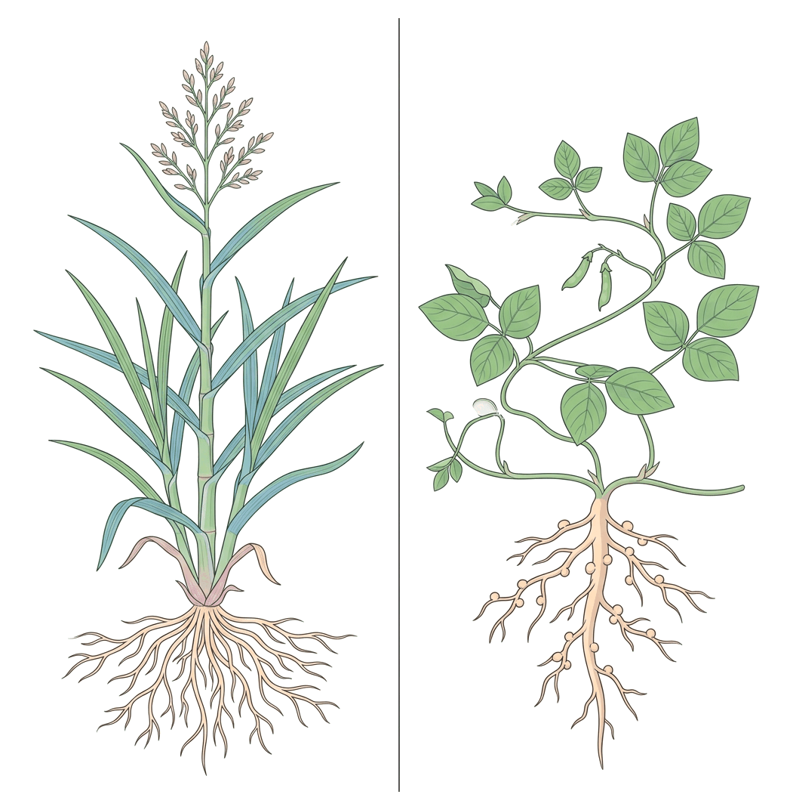
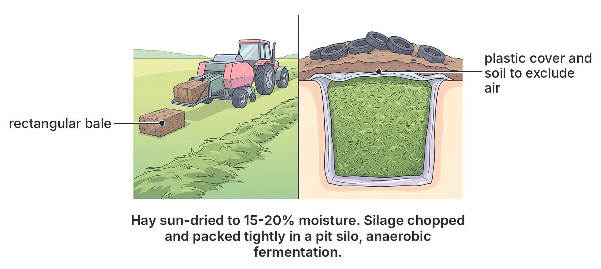

# JAMB Agricultural Science Notes: Pasture and Forage Crops

## What JAMB expects

This topic is Section B, Topic 10 of the JAMB Agricultural Science syllabus: Pasture and Forage Crops. 

It covers the following content items:
- **a.** Study of gross morphology, methods of propagation and husbandry of common pasture grasses and legumes. Establishment, maintenance, conservation and uses of pastures and forage crops.
- **b.** Study of natural grasslands and their distribution in West Africa.
- **c.** Range management.

By the end of these notes, you should be able to:
1. classify common grasses and legumes used as pastures and forage.
2. differentiate between pasture and forage crops by their common and scientific names.
3. distinguish between the various methods of conserving pastures e.g. hay- and silage-making.
4. relate different vegetational zones to their dominant pasture species.
5. determine range types and utilization of range resources in Nigeria.

**Note on the syllabus wording:** The last two objectives are listed in the syllabus without roman numerals (such as iv and v). They are treated as separate objectives in these notes and each has its own dedicated section so you are completely prepared.

## Differentiating between pasture and forage crops

**Objective ii: differentiate between pasture and forage crops by their common and scientific names.**

The terms "pasture" and "forage" are related but refer to slightly different concepts in livestock farming. Understanding the distinction is fundamental for JAMB.

- **Forage crops:** These are specific plant materials (mainly grasses and legumes) cultivated or growing naturally to be used as livestock feed. Forage refers strictly to the *plants themselves*. These plants can be eaten directly by animals in a field, or they can be cut, transported, and fed to animals in their pens (a system called **zero grazing** or cut-and-carry). Forage can also be conserved for the dry season.
- **Pasture:** This refers to a specific piece of land or an area covered with forage crops where animals are allowed to roam and **graze directly** (*in situ*). While a pasture contains forage, the term emphasizes the land and the feeding system. 

| Feature | Pasture | Forage |
| --- | --- | --- |
| **Meaning** | A fenced or open area of land covered with grasses and legumes for animals to graze. | The actual plant material (leaves, stems) intended to be eaten by livestock. |
| **Feeding method** | Animals feed directly on the field (*in situ*). | Can be grazed directly, cut-and-carried to pens, or conserved as hay/silage. |
| **Scope** | Refers to the physical land and the entire ecosystem of plants growing on it. | Refers strictly to the vegetative crop or plant material itself. |

### Common and scientific names of pasture and forage crops

JAMB frequently tests your ability to match the common names of forage crops with their scientific (botanical) names. You must memorise these important West African examples.

**Common Forage Grasses:**
- Elephant grass: *Pennisetum purpureum*
- Guinea grass: *Panicum maximum*
- Giant star grass: *Cynodon plectostachyus*
- Gamba grass: *Andropogon gayanus*
- Spear grass: *Imperata cylindrica*
- Carpet grass: *Axonopus compressus*
- Bahama grass (Bermuda grass): *Cynodon dactylon*
- Northern grass / Feather pennisetum: *Pennisetum pedicellatum*

**Common Forage Legumes:**
- Centrosema (Centro): *Centrosema pubescens*
- Calopo: *Calopogonium mucunoides*
- Mucuna (Velvet bean): *Mucuna pruriens*
- Stylo: *Stylosanthes gracilis* (also *Stylosanthes guianensis*)
- Tropical Kudzu: *Pueraria phaseoloides*
- Sunn hemp: *Crotalaria juncea*

## Classifying common grasses and legumes

**Objective i: classify common grasses and legumes used as pastures and forage.**

Forage crops are generally classified into two major botanical groups: **Grasses** and **Legumes**. In a good pasture, both are grown together (a mixed pasture) because they offer different, complementary benefits to the livestock and the soil.

### 1. Forage Grasses
Grasses belong to the family **Poaceae** (formerly Gramineae). They are monocotyledonous plants and form the bulk of a grazing animal's diet. Their main nutritional role is providing **carbohydrates** (energy) and bulk (fibre) for proper rumen digestion.
- **Tall grasses:** These grow very high (sometimes up to $3\text{ m}$) and are highly productive. They are best suited for cut-and-carry systems or for making silage. Examples include Elephant grass and Guinea grass.
- **Short grasses:** These are low-growing, often creeping grasses. They quickly cover the soil surface and can survive heavy trampling by animal hooves. They are ideal for direct grazing. Examples include Carpet grass, Bahama grass, and Giant star grass.

### 2. Forage Legumes
Legumes belong to the family **Fabaceae** (formerly Leguminosae). They are dicotyledonous plants. Legumes are highly valued in agriculture because their leaves are rich in **protein**, calcium, and phosphorus. Furthermore, their roots contain swellings called **root nodules** that house symbiotic *Rhizobium* bacteria. These bacteria fix atmospheric nitrogen gas into the soil, naturally fertilizing the companion grasses.

| Feature | Forage Grasses (Poaceae) | Forage Legumes (Fabaceae) |
| --- | --- | --- |
| **Plant classification** | Monocotyledons | Dicotyledons |
| **Leaf structure** | Long, narrow blades with parallel veins | Broad, net-veined, often compound leaves |
| **Root system** | Fibrous root system | Taproot system with root nodules |
| **Nutritional value** | High in carbohydrates (energy) and fibre | High in protein and essential minerals |
| **Effect on soil** | Depletes soil nitrogen over time if not fertilized | Improves soil fertility via nitrogen fixation |
| **Examples** | *Panicum maximum*, *Pennisetum purpureum* | *Centrosema pubescens*, *Mucuna pruriens* |

## Gross morphology, propagation and husbandry

**Content a: Study of gross morphology, methods of propagation and husbandry of common pasture grasses and legumes. Establishment, maintenance, conservation and uses of pastures and forage crops.**

### Gross morphology of pasture crops

Morphology refers to the physical structure and form of the plants.

**Morphology of Grasses:**
- **Roots:** Grasses possess a shallow, highly branched **fibrous root system** that binds the topsoil firmly, helping to prevent erosion.
- **Stems:** The main stem of a grass is called a **culm**. It is usually cylindrical and often hollow in the centre, except at solid, swollen joints called **nodes**. The spaces between the nodes are called **internodes**. Many grasses also spread via creeping stems along the ground surface (**stolons**) or underground (**rhizomes**).
- **Leaves:** Leaves emerge from the nodes. Each leaf consists of a lower **leaf sheath** that closely wraps around the stem, and an upper flat **leaf blade** with parallel veins. A small membranous structure called a ligule is often found where the sheath meets the blade.
- **Inflorescence (Flowers):** Grass flowers are small, wind-pollinated, and grouped into structures such as **panicles** (e.g., Guinea grass) or **spikes** (e.g., Elephant grass).

**Morphology of Legumes:**
- **Roots:** Legumes have a deep, penetrating **taproot system** that helps them survive droughts. The lateral roots have small, bead-like swellings called **root nodules** where nitrogen-fixing bacteria live.
- **Stems:** Depending on the species, stems can be trailing (creeping over the ground like Calopo), climbing (twining around taller grasses like Centrosema), or erect woody shrubs.
- **Leaves:** Leaves are broad, possess network venation (net-veined), and are usually **compound**. For instance, Centrosema has trifoliate leaves (three leaflets per stalk).
- **Flowers and Fruits:** The flowers are often brightly coloured (pink, purple, or yellow) to attract insect pollinators. The resulting fruit is a **pod** that splits open along two seams to release seeds.

### Methods of propagation

Pasture crops are propagated either sexually (using seeds) or asexually (using vegetative plant parts).

1. **Sexual propagation (Seeds):** 
   - Most forage legumes (e.g., Centrosema, Calopo, Mucuna) and certain grasses (e.g., Guinea grass, Gamba grass) are established from seeds. 
   - Legume seeds often possess very hard, impermeable seed coats that prevent water entry and delay germination. To solve this, the seeds must undergo **scarification**. Scarification methods include mechanically scratching the seed coat with sandpaper, soaking the seeds in hot water for a short time, or treating them briefly with dilute acid.
2. **Asexual (Vegetative) propagation:**
   - Many pasture grasses produce few viable seeds or establish much faster vegetatively.
   - **Stem cuttings:** Tall grasses like Elephant grass are usually planted using stem cuttings. A cutting must have at least two or three nodes.
   - **Stolons and Rhizomes:** Creeping grasses like Giant star grass, Carpet grass, and Bahama grass are quickly propagated by planting split root stocks, stolons, or rhizomes (underground horizontal stems).

### Husbandry: Establishment and maintenance

Setting up a high-quality pasture requires systematic agricultural practices. A mixed pasture is highly recommended because the legumes supply necessary protein to the livestock and enrich the soil with nitrogen, which the grasses then use to grow vigorously.

**Steps in Pasture Establishment:**
1. **Site selection:** Choose well-drained soil with adequate sunlight. Extremely waterlogged soils or heavily shaded areas under dense forests are unsuitable for most pasture species.
2. **Land clearing:** Slash existing vegetation, remove trees, and uproot stumps. This eliminates competition, exposes the soil to sunlight, and clears the way for farm machinery.
3. **Seedbed preparation:** Use a tractor to plough and then harrow the soil. Because pasture seeds (like Guinea grass or Centrosema) are extremely small, the soil must be broken down into a fine, smooth tilth to ensure good seed-to-soil contact.
4. **Planting:** 
   - Planting is best done early in the rainy season when moisture is fully available.
   - For a mixed pasture, plant grasses and legumes in optimal proportions (frequently a seed ratio of about 3 parts grass to 1 part legume).
   - Ensure appropriate spacing. For example, Elephant grass cuttings are frequently planted at a spacing of $1\text{ m} \times 0.5\text{ m}$ ($1\text{ m}$ between rows, $0.5\text{ m}$ between individual stands).
   - Seeds may be broadcast (scattered evenly) or drilled in shallow rows.

**Maintenance of Pastures:**
1. **Weed control:** The pasture must be kept free of unpalatable weeds and toxic plants. This is done by regular slashing, rogueing (manual uprooting of weeds), or the careful application of selective herbicides.
2. **Fertilizer application:** Proper nutrition sustains pasture yields. Apply phosphatic fertilizers (such as Single Super Phosphate) to boost legume root development and nodulation. Nitrogen fertilizers (such as Urea or NPK) are generally applied only to pure grass pastures to maximize leaf production.
3. **Irrigation:** In regions with prolonged dry seasons, supplemental irrigation ensures continuous forage availability.
4. **Pest and disease control:** Monitor the pasture for pests like armyworms, locusts, or grasshoppers that can devastate the foliage. Safe insecticides should be applied if an outbreak occurs, ensuring a safe withdrawal period before animals are allowed back to graze.

### Uses of pastures and forage crops

- **Livestock feed:** This is the primary use. Pastures provide cheap, bulky, and nutritious food required by ruminants (cattle, sheep, goats) for growth, milk, and meat production.
- **Soil conservation:** The dense, fibrous roots of grasses tightly bind soil particles together, acting as a powerful biological control against wind and water erosion.
- **Soil fertility enhancement:** Legumes naturally fix atmospheric nitrogen, significantly improving soil fertility. Forages can also be intentionally grown and ploughed back into the soil while still green; this is known as **green manure**.
- **Cover cropping:** Creeping legumes (like Calopo and Mucuna) rapidly cover the bare soil surface, suppressing weed growth, reducing soil temperature, and conserving soil moisture.
- **Thatching and bedding:** Mature, dried stems of tall grasses are traditionally used for roofing rural huts (thatching) and as soft, absorbent bedding material for livestock in pens.

## Conserving pastures: Hay and Silage

**Objective iii: distinguish between the various methods of conserving pastures e.g. hay- and silage-making.**

In West Africa, pasture growth is highly seasonal. During the rainy season, grasses grow rapidly and there is a surplus of forage. However, during the dry season, grasses dry up, become woody, and lose their nutritional value. To ensure that animals have high-quality feed year-round, farmers must conserve the surplus forage from the rainy season. The two principal methods of forage conservation are **hay-making** and **silage-making**.

### 1. Hay-making
**Hay** is forage that has been cut and dried to a very low moisture content (usually around $15\%$ to $20\%$) to preserve it for future use. It is typically made from fine-stemmed grasses and legumes.

**Step-by-step hay-making process:**
1. **Cutting:** Cut the forage just before it reaches the full flowering stage (early bloom stage). At this stage, the plant has its maximum protein content and lowest lignin (tough fibre) content, making it highly digestible.
2. **Curing (Drying):** Spread the cut forage out in the sun to dry. In mechanised farming, a machine called a tedder turns the grass to ensure even drying. The objective is to reduce the moisture content to $15\%$ - $20\%$ as quickly as possible. This low moisture prevents rotting bacteria and moulds from growing.
3. **Baling:** Once adequately dried, a baling machine gathers the hay and compresses it into dense rectangular blocks or round rolls called bales.
4. **Storage:** The finished bales must be stored in a dry, well-ventilated barn (hayloft) or shed to protect them from rain, preventing spoilage.

### 2. Silage-making
**Silage** is a high-moisture forage preserved through the acidic environment created by anaerobic (oxygen-free) fermentation. The overall process is called **ensiling**, and the structure or container used is called a **silo** (which can be a pit, a trench, or a tall tower).

**Step-by-step silage-making process:**
1. **Cutting and chopping:** Cut the forage (often thick-stemmed crops like Elephant grass, Guinea grass, or whole maize plants) while it is still green and nutritious. Chop it into small pieces (about $2\text{ cm}$ to $3\text{ cm}$ long) using a forage harvester. Chopping makes it easier to pack tightly.
2. **Wilting:** Allow the chopped forage to wilt briefly in the sun. This brings the moisture content down from about $80\%$ to a target of $60\%$ to $70\%$.
3. **Filling the silo:** Transfer the chopped forage into the silo.
4. **Compacting (Excluding oxygen):** As the material is loaded into the pit, heavy tractors are driven back and forth over it to squeeze out all the trapped air. **Anaerobic conditions are absolutely mandatory** for successful silage making. If oxygen remains, the forage will rot and turn into compost.
5. **Adding additives (optional):** Sugary additives like molasses may be sprayed on the forage. This provides extra fast-acting carbohydrates for the fermenting bacteria.
6. **Sealing:** Cover the compacted forage tightly with thick, durable plastic sheeting. Weigh the plastic down with soil, sandbags, or old tires to completely block air and rain from entering.
7. **Fermentation:** Beneficial lactic acid bacteria (naturally present on the plant leaves) rapidly ferment the plant sugars into **lactic acid**. This acid drops the pH of the silage, creating an acidic environment that inhibits any spoilage bacteria. The fermentation process is generally complete in about 3 to 4 weeks, yielding a moist, pale yellow-green feed with a characteristic sweet-sour smell.

| Feature | Hay | Silage |
| --- | --- | --- |
| **Moisture content** | Low (about $15\%$ to $20\%$) | High (about $60\%$ to $70\%$) |
| **Method of preservation** | Dehydration (drying out the moisture using the sun) | Anaerobic fermentation (production of lactic acid) |
| **Crucial environmental condition** | Dry, sunny weather is strictly required | Anaerobic (oxygen-free) condition is strictly required |
| **Storage facility** | Barns or dry sheds | Silos (pits, trenches, or towers) |
| **Physical appearance and smell** | Dry, brittle, brownish-green plant material with a dusty smell | Moist, soft, pale yellow-green material with a sweet-sour fermented smell |

## Natural grasslands and their distribution in West Africa

**Content b: Study of natural grasslands and their distribution in West Africa.**

Natural grasslands (frequently referred to as rangelands or savannas) are expansive areas of land where the dominant natural vegetation consists of grasses, interspersed with drought-resistant shrubs and scattered trees. 

In West Africa, the climate transitions from very wet in the coastal south to extremely dry in the northern interior. This rainfall gradient creates distinct vegetational zones (ecological zones). Natural grasslands become progressively more extensive, open, and dominant as you move from the wet south to the arid north.

## Relating vegetational zones to dominant pasture species

**Objective: relate different vegetational zones to their dominant pasture species.**

The amount of annual rainfall strictly dictates the type, height, and density of grass species that naturally dominate a particular vegetational zone.

1. **Mangrove Swamp and Tropical Rainforest Zones**
   - **Location:** The southernmost coastal areas of West Africa (e.g., the Niger Delta, southern states of Nigeria).
   - **Climate:** Very high annual rainfall (over $2000\text{ mm}$) and dense, continuous tree canopies.
   - **Pasture status:** True natural grasslands do not exist here because tall trees block the sunlight. Natural grasses are extremely sparse and shade-tolerant. 
   - **Dominant pasture species:** Pastures here are almost entirely artificial (sown by farmers after clearing forests). Species like **Giant star grass** (*Cynodon plectostachyus*) and **Guinea grass** (*Panicum maximum*) can be found in open, disturbed patches.

2. **Derived Savanna**
   - **Location:** The transition zone immediately north of the rainforest (e.g., parts of Oyo, Osun, and Enugu states in Nigeria).
   - **Climate:** Moderate rainfall. This area was originally rainforest, but intense human activities (such as continuous farming, logging, and annual bush burning) have permanently opened up the tree canopy, allowing grasses to invade and dominate.
   - **Dominant pasture species:** Tall, vigorous, moisture-loving grasses heavily dominate. Examples include **Elephant grass** (*Pennisetum purpureum*) and **Guinea grass** (*Panicum maximum*).

3. **Guinea Savanna**
   - **Location:** The largest ecological zone in Nigeria, spanning the Middle Belt (e.g., Kwara, Kogi, Benue, and Niger states).
   - **Climate:** Moderate rainfall ($1000\text{ mm}$ to $1500\text{ mm}$) with distinct wet and dry seasons. This zone is excellent for livestock rearing because it has abundant forage and a lower incidence of tsetse flies compared to the rainforest.
   - **Dominant pasture species:** Broad-leaved, tall grasses that can grow up to $3\text{ m}$ high in the rainy season. **Gamba grass** (*Andropogon gayanus*), Guinea grass, and *Hyparrhenia* species are the dominant natural pastures.

4. **Sudan Savanna**
   - **Location:** North of the Guinea Savanna (e.g., Kano, Sokoto, Katsina, and Jigawa states).
   - **Climate:** Lower rainfall ($600\text{ mm}$ to $1000\text{ mm}$) and a prolonged dry season lasting up to 7 months.
   - **Dominant pasture species:** The grasses here are shorter, finer, and more drought-resistant. Common species include **Feather pennisetum** (*Pennisetum pedicellatum*), *Aristida* species, and *Cenchrus biflorus*.

5. **Sahel Savanna**
   - **Location:** The extreme northeastern fringes of Nigeria (e.g., parts of Borno and Yobe states) extending further north into Niger and Chad.
   - **Climate:** Very low and erratic rainfall (less than $600\text{ mm}$) with severe, prolonged droughts.
   - **Dominant pasture species:** Very short, sparse grasses that grow rapidly to complete their life cycle during the brief rainy season. They grow alongside highly drought-resistant, thorny trees like *Acacia*. *Aristida* species and drought-tolerant scrub grasses dominate the sparse pasture layer.

## Range management

**Content c: Range management.**

A **rangeland** is an extensive, uncultivated area of land covered with natural or semi-natural vegetation (grasses, legumes, forbs, and shrubs) that is utilized for grazing domestic livestock and wildlife. Effective range management involves applying scientific principles to maximize livestock production while preserving the rangeland ecosystem from degradation.

## Determining range types and utilization

**Objective: determine range types and utilization of range resources in Nigeria.**

### Range Types
To manage resources properly, a farmer must first determine the type of range being utilized. Rangelands are primarily grouped into two types:
1. **Natural Rangeland (Natural Pasture):** Vast expanses of grasslands that grow naturally without any intentional planting by humans. Examples are the sweeping savannas of Northern Nigeria. They are very cheap to maintain but typically have low productivity, poor-quality dry season forage, and a low carrying capacity.
2. **Artificial (Sown) Pasture:** Land that has been intentionally cleared, ploughed, and planted with selected, high-yielding, nutritious forage grasses and legumes by a farmer. They are expensive to establish and maintain but offer exceptionally high productivity and carrying capacity.

### Utilization of Range Resources

To sustainably utilize a rangeland without destroying it, a farm manager must calculate and balance two critical concepts:

1. **Carrying Capacity:** This refers to the **maximum number of animals** that a specific area of pasture can support over a defined period **without degrading** the pasture or causing soil erosion. It is an inherent property of the land.
2. **Stocking Rate:** This refers to the **actual number of animals** a farmer places on a specific area of rangeland at a given time. It is a management decision.

Proper utilization occurs when the Stocking Rate equals the Carrying Capacity (optimal stocking). If the Stocking Rate is greater than the Carrying Capacity, the land suffers from **overgrazing**, which destroys the forage roots, compacts the soil, and leads to severe erosion. If the Stocking Rate is lower, it is understocking, which wastes available forage.

**Worked Example:**
Suppose a farm manager determines that a natural rangeland has a carrying capacity of $4\text{ cattle per ha}$. The total area of the rangeland is $40\text{ ha}$. Calculate the maximum number of cattle the farm can safely support to avoid overgrazing.

**Step 1:** State the formula for determining the maximum number of animals based on carrying capacity.
$\text{Maximum cattle supported} = \text{Carrying Capacity} \times \text{Area}$
Where Carrying Capacity is given in animals per hectare, and Area is given in hectares.

**Step 2:** Substitute the provided values into the formula.
$\text{Maximum cattle supported} = 4\text{ cattle per ha} \times 40\text{ ha}$

**Step 3:** Calculate the final value.
$\text{Maximum cattle supported} = 160\text{ cattle}$
The maximum number of cattle the rangeland can safely support is $160\text{ cattle}$.

### Range Management Practices

Good management ensures the rangeland remains highly productive year after year. Key practices include:

1. **Rotational Grazing:** The rangeland is divided into smaller enclosed sections called paddocks. Livestock are allowed to graze in one paddock for a short period and are then moved to the next. This critical practice gives the grazed grass sufficient time to rest, recover, and regrow before the animals return.
2. **Reseeding:** Sowing new, high-quality grass and legume seeds into an overgrazed or deteriorating rangeland. This improves the plant population and boosts the nutritional value of the range.
3. **Controlled Burning:** This involves intentionally setting fire to the rangeland at the end of the dry season under strict supervision. It destroys tough, unpalatable, mature woody grasses and kills pests (like ticks). When the rains begin, it encourages the rapid sprouting of fresh, tender, and highly nutritious green shoots. 
4. **Weed Control:** Eradicating unpalatable and toxic plants by uprooting or targeted herbicide spraying so they do not outcompete the valuable forage species.
5. **Fertilizer Application:** Broadcasting fertilizers (or allowing animal droppings to act as organic manure) to replenish soil nutrients removed by grazing animals.
6. **Provision of Water and Salt Licks:** Constructing water troughs or small dams, and providing mineral blocks (salt licks) on the range. This ensures animals stay hydrated and receive essential minerals (like sodium and calcium) that may be lacking in the natural grass.

## Key terms

| Term | Meaning |
| --- | --- |
| **Forage** | Plant material (grasses, legumes, shrubs) grown or gathered specifically to be eaten by livestock. |
| **Pasture** | An area of land covered with forage crops where livestock are allowed to roam and graze directly. |
| **Hay** | Forage cut and dried in the sun to a low moisture content ($15\%$-$20\%$) for preservation. |
| **Silage** | Fermented forage stored under anaerobic (airless) conditions with high moisture ($60\%$-$70\%$). |
| **Ensiling** | The entire process of making silage. |
| **Silo** | A pit, trench, or tower used for processing and storing silage. |
| **Root nodules** | Small swellings on legume roots containing nitrogen-fixing bacteria (*Rhizobium*). |
| **Culm** | The main cylindrical, jointed stem of a grass plant. |
| **Rangeland** | Extensive land with natural or semi-natural vegetation used for grazing domestic livestock and wildlife. |
| **Carrying capacity** | The maximum number of animals a pasture can support over time without degrading the land. |
| **Stocking rate** | The actual number of animals placed on a pasture by a farmer at a given time. |
| **Rotational grazing** | Moving livestock systematically between different paddocks to allow rested pasture to regrow. |
| **Zero grazing** | Cutting forage and carrying it to animals kept in pens; the animals do not graze the field. |

## Exam tips and common mistakes

- **Scientific names are a JAMB favourite:** You must memorise that *Panicum maximum* is Guinea grass, *Pennisetum purpureum* is Elephant grass, and *Centrosema pubescens* is a legume.
- **Hay vs. Silage confusion:** Remember that **hay is dry** (sun-cured to $15\%$-$20\%$ moisture) and **silage is wet** (fermented at $60\%$-$70\%$ moisture).
- **Oxygen in silage:** A very common exam trap asks what condition is absolutely necessary for silage making. The answer is **anaerobic condition** (total absence of oxygen). If air enters the silo, the forage will rot instead of fermenting.
- **Carrying capacity vs. Stocking rate:** Carrying capacity is the inherent *potential* of the land; stocking rate is the *actual* management decision. Overgrazing happens when the Stocking rate strictly exceeds the Carrying capacity.
- **Grass vs. Legume roles:** Grasses primarily provide energy (carbohydrates) and fibre. Legumes primarily provide protein and improve the soil by fixing nitrogen.
- **Guinea Savanna dominance:** Know that the Guinea Savanna is the best ecological zone for natural cattle rearing in Nigeria because of its abundant tall grasses and a significantly lower incidence of tsetse flies compared to the rainforest zone.

## Quick summary

1. Forage refers strictly to the plant material eaten by livestock, while pasture refers to the land area where animals graze directly on that forage (*in situ*).
2. Forage grasses (monocots with fibrous roots) provide necessary carbohydrates and bulk, while forage legumes (dicots with taproots and nodules) provide vital protein and fix atmospheric nitrogen in the soil.
3. Common grasses include Elephant grass (*Pennisetum purpureum*) and Guinea grass (*Panicum maximum*). Common legumes include Centrosema (*Centrosema pubescens*) and Mucuna.
4. Pasture crops are propagated either by seeds (most legumes and some grasses) or vegetatively using stem cuttings, stolons, or rhizomes (many grasses like Elephant grass and Giant star grass).
5. Pastures are conserved for dry season feeding by making hay (cut and sun-dried to $15\%$-$20\%$ moisture) or silage (chopped, compacted, and fermented in air-tight silos at $60\%$-$70\%$ moisture).
6. Natural grasslands transition from the tall, moisture-loving grasses of the Derived and Guinea savannas to the short, sparse, drought-resistant grasses of the arid Sahel savanna.
7. Rangeland carrying capacity is the maximum number of animals the land can support without damage. Effective range management includes rotational grazing, reseeding, controlled burning, weed control, and providing water.

## Practice questions

**1. The primary purpose of including legumes in a mixed pasture is to**
- A. provide a high-energy carbohydrate diet for livestock
- B. increase the protein content of the feed and fix soil nitrogen
- C. deeply shade and suppress the growth of pasture grasses
- D. prevent viral diseases in livestock

**Answer: B.** Legumes are rich in protein and contain root nodules housing *Rhizobium* bacteria that fix atmospheric nitrogen, naturally improving soil fertility. Grasses are the ones that provide high-energy carbohydrates.

**2. Which of the following is the correct botanical name for Elephant grass?**
- A. *Panicum maximum*
- B. *Imperata cylindrica*
- C. *Pennisetum purpureum*
- D. *Andropogon gayanus*

**Answer: C.** *Pennisetum purpureum* is Elephant grass. *Panicum maximum* is Guinea grass, *Imperata cylindrica* is spear grass, and *Andropogon gayanus* is Gamba grass.

**3. The most critical condition strictly required for the successful preparation of silage is**
- A. an anaerobic environment
- B. extremely high temperature drying
- C. aerobic fermentation
- D. very low moisture content

**Answer: A.** Silage making strictly requires an anaerobic (oxygen-free) environment for lactic acid bacteria to properly ferment the plant sugars. If air is present, aerobic rotting organisms will destroy the forage.

**4. A farm manager has a rangeland measuring $40\text{ ha}$. If the carrying capacity of the rangeland is $4\text{ cattle per ha}$, what is the maximum stocking rate the farmer can use to avoid overgrazing?**
- A. $10\text{ cattle}$
- B. $44\text{ cattle}$
- C. $160\text{ cattle}$
- D. $1600\text{ cattle}$

**Answer: C.** 
**Step 1:** State the formula.
$\text{Maximum cattle} = \text{Carrying capacity} \times \text{Area}$
**Step 2:** Substitute the values given.
$\text{Maximum cattle} = 4\text{ cattle per ha} \times 40\text{ ha}$
**Step 3:** Calculate the total.
$\text{Maximum cattle} = 160\text{ cattle}$
The maximum stocking rate to avoid overgrazing is $160\text{ cattle}$. Option A is a mistake from dividing the area by the carrying capacity ($40 \div 4$). Option B is a mistake from adding the values ($40 + 4$). Option D is a mistake from multiplying by an extra factor of 10.

**5. Which of the following vegetational zones is characterized by very short, sparse grasses and drought-resistant thorny shrubs?**
- A. Derived savanna
- B. Guinea savanna
- C. Mangrove swamp
- D. Sahel savanna

**Answer: D.** The Sahel savanna experiences very low, erratic rainfall and prolonged droughts, supporting only short, fast-growing grasses and drought-resistant thorny trees like *Acacia*.

**6. Hay-making involves cutting forage and**
- A. packing it tightly into an airtight trench
- B. drying it in the sun to a moisture content of about $15\%$-$20\%$
- C. fermenting it with added molasses
- D. feeding it directly to animals kept in a pen

**Answer: B.** Hay is preserved by sun-drying the forage to remove moisture (dehydration), stopping spoilage organisms. Options A and C describe silage-making. Option D describes zero grazing.

**7. Which of the following pasture grasses is most commonly propagated vegetatively using stem cuttings?**
- A. Centrosema
- B. Giant star grass
- C. Elephant grass
- D. Guinea grass

**Answer: C.** Elephant grass (*Pennisetum purpureum*) is a very tall, thick-stemmed grass successfully and commonly propagated using stem cuttings containing two or three nodes.

**8. The management practice of dividing a rangeland into sections and moving livestock systematically from one section to another is known as**
- A. zero grazing
- B. continuous grazing
- C. rotational grazing
- D. mixed farming

**Answer: C.** Rotational grazing involves moving livestock between enclosed paddocks, allowing recently grazed sections sufficient time to rest, recover, and regrow. Zero grazing (Option A) is cutting and carrying feed to pens.

**9. In rangeland management, controlled burning is usually carried out to**
- A. quickly increase the organic matter of the topsoil
- B. destroy dry, unpalatable woody grasses and encourage the growth of fresh green shoots
- C. kill all soil microorganisms to sterilize the soil
- D. permanently clear the land for arable crop farming

**Answer: B.** Controlled burning at the end of the dry season removes tough, woody mature grasses and destroys pests like ticks, stimulating the rapid sprouting of highly nutritious new green shoots when the rains start.

**10. Which of the following accurately differentiates a pasture from a forage crop?**
- A. Pasture is grazed *in situ*, while forage is the cut plant material itself
- B. Pasture contains only legumes, while forage contains only grasses
- C. Pasture is used solely for poultry, while forage is solely for ruminants
- D. Pasture is strictly naturally grown, while forage is strictly artificially planted

**Answer: A.** Pasture refers to the area of land where animals graze directly on the growing plants (*in situ*). Forage refers to the plant material itself, which can be grazed, cut-and-carried, or conserved. Both pasture and forage involve grasses and legumes (making B wrong), are mainly for ruminants (making C wrong), and can be natural or sown (making D wrong).
