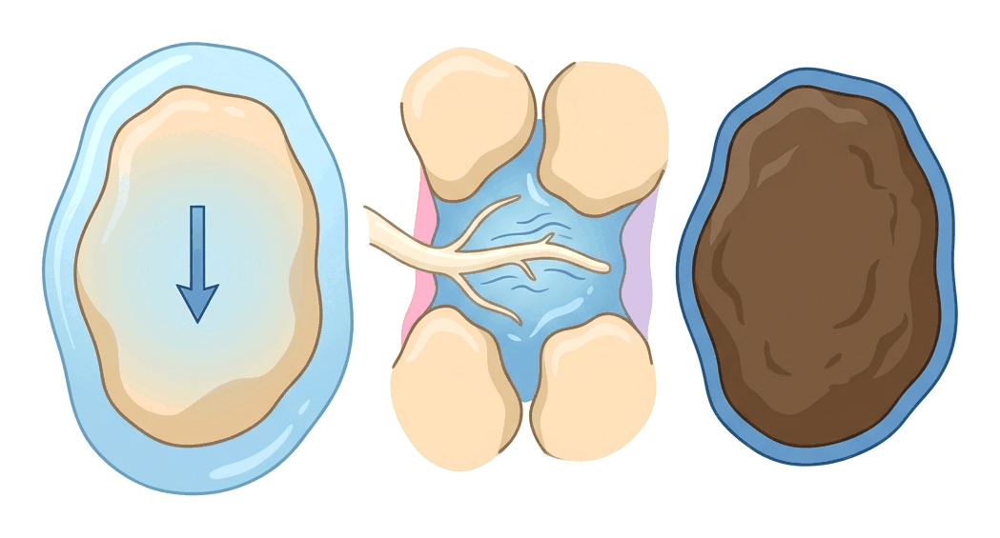
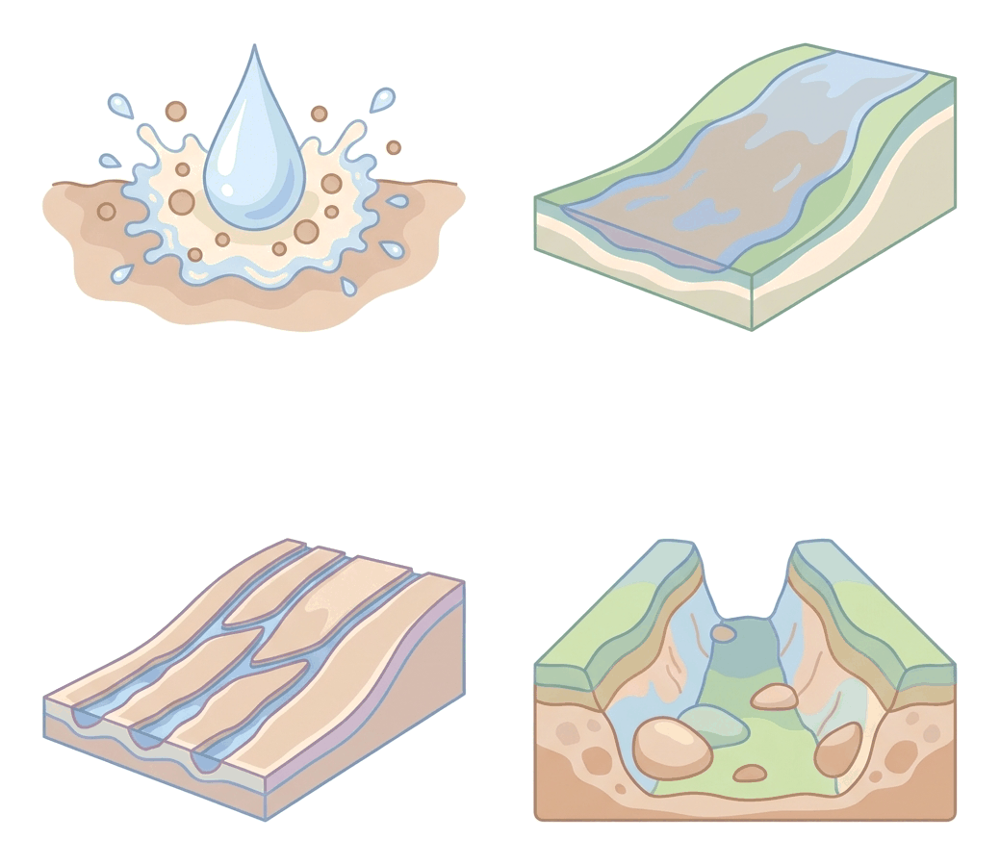
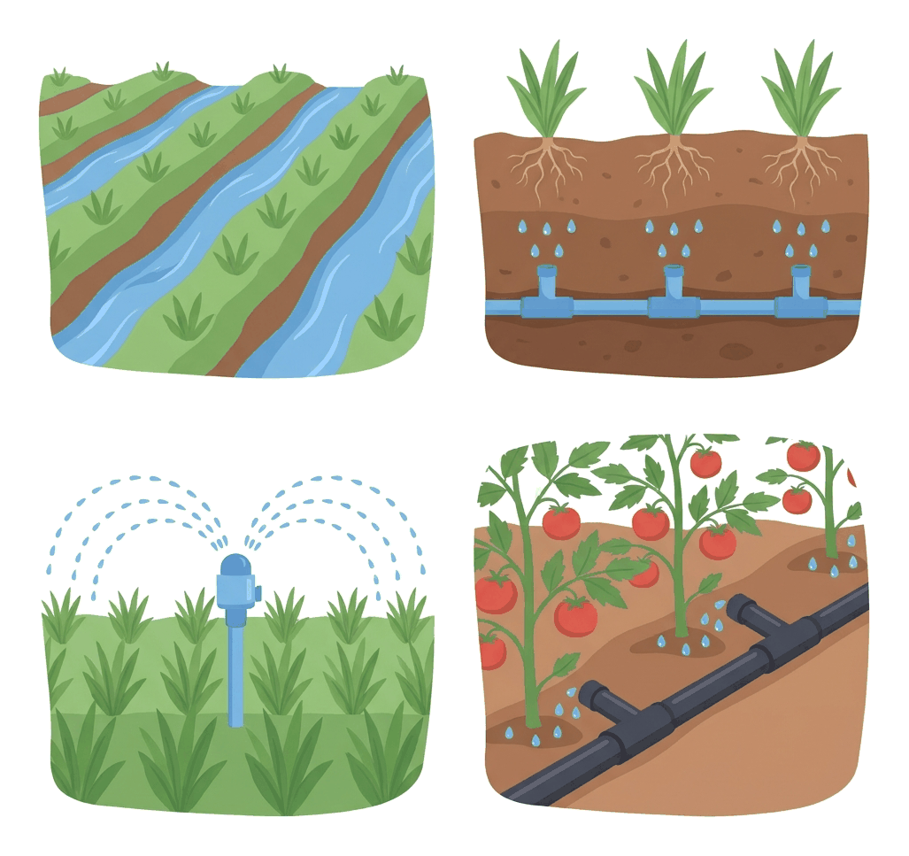

# JAMB Agricultural Science Notes: Soil Water and Soil Conservation

## What JAMB expects

This topic is Section B, Topic 2 of the JAMB Agricultural Science syllabus: Agronomy – Soil Water and Soil Conservation. It covers three main content items:

- **a.** Soil water: its importance, sources, movement, management and conservation.
- **b.** Soil conservation: meaning and importance, causes, effects, prevention and control of leaching, erosion, continuous cropping, burning and oxidation of organic matter.
- **c.** Irrigation and drainage methods.

By the end of these notes, you should be able to:
1. compare capillary, gravitational and hygroscopic water.
2. determine water-holding capacity, wilting points and plant available/unavailable water.
3. Identify the methods of soil water management and conservation.
4. identify the causes of erosion and leaching.
5. determine control methods.
6. classify irrigation and drainage systems.
7. examine the importance and challenges of irrigation and drainage.

*(Note on the syllabus wording: The JAMB syllabus restarts the objective numbering (i, ii, etc.) for each main section. These notes group the objectives logically under their respective content sections.)*

## Content a: Soil water

Water is one of the most critical components of the soil. In a typical loam soil, water occupies about 25% of the total soil volume (filling half of the pore spaces, while air fills the other half). 

### Importance and sources of soil water

**Importance of soil water:**
- **Solvent for nutrients:** Plants cannot "eat" solid fertilizers. Nutrients must dissolve in soil water to be absorbed by plant roots.
- **Photosynthesis:** Water is a raw material for producing glucose in the leaves.
- **Turgidity:** Water pressure inside plant cells (turgor pressure) keeps stems upright and leaves spread out. Without it, the plant wilts.
- **Cooling:** Transpiration (evaporation of water from leaves) cools the plant, much like sweating cools humans.
- **Microbial activity:** Soil organisms like earthworms and nitrogen-fixing bacteria need a moist environment to survive and break down organic matter.
- **Soil formation:** Water causes the chemical and physical weathering of rocks to form soil.

**Sources of soil water:**
1. **Precipitation:** Rainfall is the primary natural source of soil water in West Africa.
2. **Irrigation:** The artificial application of water to soil, especially during the dry season (e.g., Fadama farming).
3. **Groundwater (Capillary rise):** Water from deep within the earth (the water table) can move upward through tiny soil pores to reach the root zone.

### Objective i: Compare capillary, gravitational and hygroscopic water

When it rains, water enters the soil and behaves in different ways depending on the size of the soil pores and the forces acting on it. JAMB expects you to distinguish between three main types of soil water.

| Feature | Gravitational Water | Capillary Water | Hygroscopic Water |
| :--- | :--- | :--- | :--- |
| **Meaning** | Water that moves downwards through large soil pores (macropores) under the force of gravity. | Water held in tiny soil pores (micropores) against the pull of gravity by surface tension. | A very thin, tight film of water physically bound to the surface of soil particles. |
| **Availability to plants** | **Superfluous (mostly unavailable):** It drains away too fast. Roots can only grab a little bit before it sinks too deep. | **Available:** This is the only type of water that plant roots can easily absorb. | **Unavailable:** It is held so tightly by soil particles that plant roots cannot pull it away. |
| **Effect on soil** | Causes leaching of nutrients and waterlogging (if drainage is poor). | Keeps the soil moist and supplies plants with dissolved nutrients. | Prevents the soil from being completely dry (even oven-dried soil has some hygroscopic water), but does not help plants. |
| **Removal** | Drains naturally within 24 to 48 hours after heavy rain. | Used up by plant roots or lost slowly through evaporation. | Can only be removed by heating the soil in an oven at $105 \text{ °C}$. |

### Objective ii: Determine water-holding capacity, wilting points and plant available/unavailable water

To manage irrigation and crop growth, we must measure how much water a soil can hold and how much of that water plants can actually use. 

#### Key Terms and Concepts

1. **Field Capacity (FC):** 
   After heavy rain, gravitational water drains away over 1 to 2 days. The water left behind (mostly capillary water) represents the soil's field capacity. This is the maximum useful water the soil can hold.
2. **Permanent Wilting Point (PWP):** 
   As plants use up capillary water, the soil dries out. Eventually, only hygroscopic water (which plants cannot extract) is left. The plant wilts and will not recover even if placed in a humid room, unless water is added to the soil. The moisture content at this stage is the permanent wilting point.
3. **Available Water (AW):** 
   This is the water between Field Capacity and the Permanent Wilting Point. It is the water plants can actually use. 
4. **Unavailable Water:**
   This is the moisture held at or below the permanent wilting point, consisting largely of hygroscopic water. Plants cannot access it.
5. **Water-Holding Capacity (WHC):** 
   This is the maximum amount of water a soil can retain against gravity (essentially synonymous with Field Capacity in standard contexts). It is generally expressed as a percentage of the dry weight of the soil. Clay has the highest WHC, while sand has the lowest.

#### Calculations for JAMB

You must know how to calculate these values from laboratory data. Let us look at a standard experimental calculation step-by-step.

**Worked Example:**
A soil sample weighs $150 \text{ g}$ when completely dry. After soaking it and allowing excess water to drain freely, it is weighed again and has a mass of $210 \text{ g}$. Plants are grown in this soil until they permanently wilt; at this wilting point, the soil weighs $165 \text{ g}$. Calculate:
1. The water-holding capacity (Field Capacity) as a percentage.
2. The permanent wilting point as a percentage.
3. The percentage of plant-available water.

**Formulae needed:**
- $WHC = \left( \frac{W_h}{M_d} \right) \times 100\%$
  Where $WHC$ is Water-Holding Capacity, $W_h$ is the mass of water held, and $M_d$ is the mass of dry soil.
- $PWP = \left( \frac{W_u}{M_d} \right) \times 100\%$
  Where $PWP$ is Permanent Wilting Point, and $W_u$ is the mass of unavailable water left at wilting.
- $AW = WHC - PWP$
  Where $AW$ is Available Water.

**Step 1: Calculate the mass of water held at field capacity.**
Subtract the dry soil mass from the wet soil mass to find how much water it holds against gravity.
$W_h = 210 \text{ g} - 150 \text{ g} = 60 \text{ g}$.

**Step 2: Calculate the Water-Holding Capacity percentage.**
Divide the mass of water held by the dry soil mass, then multiply by 100.
$WHC = \left( \frac{60 \text{ g}}{150 \text{ g}} \right) \times 100\% = 40\%$.

**Step 3: Calculate the mass of unavailable water at wilting point.**
Subtract the dry soil mass from the soil mass at the wilting point.
$W_u = 165 \text{ g} - 150 \text{ g} = 15 \text{ g}$.

**Step 4: Calculate the Permanent Wilting Point percentage.**
Divide the mass of unavailable water by the dry soil mass, then multiply by 100.
$PWP = \left( \frac{15 \text{ g}}{150 \text{ g}} \right) \times 100\% = 10\%$.

**Step 5: Calculate the plant-available water.**
Subtract the permanent wilting point percentage from the field capacity percentage.
$AW = 40\% - 10\% = 30\%$.

The water-holding capacity is $40\%$, the permanent wilting point is $10\%$, and the plant-available water is $30\%$.

> **Common Mistake:** Students often divide the mass of water by the mass of the *wet* soil. Always divide by the mass of the **dry soil**.

### Objective iii: Identify methods of soil water management and conservation

In West Africa, where dry seasons are long, retaining water in the soil is critical for agriculture. The following methods conserve soil moisture:

1. **Mulching:** Covering the soil surface with dry grass, leaves, or plastic sheets. This drastically reduces water loss by evaporation and keeps the soil cool.
2. **Adding Organic Matter:** Incorporating compost or farmyard manure acts like a sponge, improving the water-holding capacity of sandy soils.
3. **Cover Cropping:** Planting fast-growing creeping plants (like melon, sweet potato, or *Centrosema* and *Calopogonium*) covers the soil surface, preventing direct heating by the sun and reducing evaporation.
4. **Weed Control:** Weeds compete fiercely with crops for soil water. Removing them conserves water for the main crop.
5. **Minimum or Zero Tillage:** Ploughing turns the soil over and exposes moisture to the hot sun, causing it to dry out. Planting directly with minimal soil disturbance conserves moisture.
6. **Contour Bunding and Terracing:** Building ridges or steps across a slope catches rainwater, allowing it time to soak into the soil rather than running off.

## Content b: Soil conservation

Soil conservation is the practice of protecting the soil from degradation (loss of fertility, structure, or volume) to ensure continuous, sustainable agricultural production. It is important because soil takes thousands of years to form, but can be destroyed or washed away in a few seasons if poorly managed.

### Objective i: Identify the causes of erosion and leaching

#### 1. Soil Erosion
Erosion is the physical removal and transportation of the topsoil by agents such as water and wind. It strips the farm of its most fertile layer.

**Types of Water Erosion:**
- **Splash erosion:** Raindrops hit bare soil like tiny bombs, breaking soil aggregates and splashing particles into the air.
- **Sheet erosion:** The uniform, gradual removal of a thin layer of topsoil over a large area. It is hard to notice but causes severe fertility loss.
- **Rill erosion:** Runoff water gathers into small, shallow finger-like channels (rills) across the field.
- **Gully erosion:** Rills deepen and widen into massive, deep ravines (gullies) that can swallow tractors and destroy farms. The Agulu-Nanka gullies in Anambra State are famous Nigerian examples.

**Types of Wind Erosion (Common in the Sudan/Sahel Savanna):**
- **Suspension:** Fine dust is lifted high into the air and blown far away.
- **Saltation:** Medium-sized particles bounce and skip along the ground.
- **Creep:** Heavy sand particles roll along the soil surface.

**Causes of Erosion:**
- **Deforestation:** Removing trees leaves the soil bare and exposed to rain and wind.
- **Overgrazing:** Keeping too many cattle on a small pasture eats the grass down to the roots, leaving the soil unprotected.
- **Steep topography:** Farming on steep slopes without terracing encourages rapid runoff.
- **Heavy rainfall and high wind speeds:** Intense tropical storms wash soil away, while strong Harmattan winds blow dry soil away.
- **Clean clearing:** Removing all stumps and plant residues before planting exposes the soil.

#### 2. Leaching
Leaching is the washing down of dissolved plant nutrients (like nitrates and sulfates) beyond the reach of plant roots into the deeper subsoil.

**Causes of Leaching:**
- **Excessive rainfall:** Continuous heavy rain (common in the Rainforest and Mangrove zones) washes dissolved nutrients downward.
- **Sandy soil texture:** Sandy soils have large macropores and low water-holding capacity, so water drains through them rapidly, carrying nutrients away.
- **Lack of organic matter:** Humus binds nutrients and water; soils lacking it leach easily.

### Objective ii: Determine control methods

To maintain fertility, erosion and leaching must be carefully controlled.

**Controlling Erosion:**
1. **Cover cropping:** Creeping legumes protect the soil from rain splash.
2. **Contour ploughing:** Making ridges across the slope (rather than up and down) acts as a physical barrier to runoff.
3. **Terracing:** Cutting steep hills into flat steps (like a staircase) stops water from rushing downwards.
4. **Windbreaks (Shelterbelts):** Planting tall trees (like Neem or Eucalyptus) in rows at the edges of farms, especially in northern Nigeria, reduces wind speed and stops wind erosion.
5. **Mulching:** Protects the soil surface from the impact of raindrops.
6. **Afforestation / Reforestation:** Planting trees to anchor the soil with their deep roots.

**Controlling Leaching:**
1. **Addition of organic manure:** Compost and manure act like sponges, holding onto water and trapping nutrients so they do not wash away easily.
2. **Split application of fertilizers:** Instead of applying $100 \text{ kg}$ of fertilizer at once (which might be washed away by the next rain), apply $50 \text{ kg}$ at planting and $50 \text{ kg}$ weeks later.
3. **Planting deep-rooted crops:** Deep-rooted crops (like yam or tree crops) can absorb nutrients that have leached deep into the subsoil.
4. **Growing cover crops:** Their roots hold the soil structure together and absorb nutrients before they are lost.

### Effects and control of continuous cropping, burning and oxidation of organic matter

The syllabus specifically requires you to know how continuous cropping, burning, and organic matter oxidation degrade the soil.

#### 1. Continuous Cropping
Growing the same type of crop on the same piece of land year after year without a rest period (fallowing).
- **Effects:** It exhausts specific soil nutrients rapidly, destroys the soil structure, and leads to a build-up of specific crop pests and diseases.
- **Prevention/Control:** 
  - **Crop rotation:** Alternating shallow-rooted crops with deep-rooted crops, and legumes with non-legumes.
  - **Fallowing:** Leaving the land unplanted for a few years to recover.
  - **Fertilizer application:** Adding chemical or organic fertilizers to replenish lost nutrients.

#### 2. Burning (Bush Burning)
Setting fire to vegetation to clear land quickly for farming or hunting.
- **Effects:**
  - It kills beneficial soil microorganisms (like nitrogen-fixing bacteria and earthworms).
  - It destroys humus (organic matter), leaving the soil with poor structure and low water-holding capacity.
  - It causes the volatilization (loss as gas) of essential nutrients like Nitrogen and Sulfur.
  - It exposes the bare ash-covered soil to severe wind and water erosion.
- **Prevention/Control:**
  - **Slash-and-mulch:** Cut the vegetation mechanically and leave it on the surface to rot and form humus.
  - **Enact environmental laws:** Create community laws to ban indiscriminate bush burning.
  - **Public education:** Teach farmers about the long-term dangers of burning.

#### 3. Oxidation of Organic Matter
In the hot tropics, high soil temperatures cause microbes to rapidly break down (oxidize) organic matter into carbon (IV) oxide and water.
- **Effects:** The soil loses its humus very quickly. A soil without humus has poor structure, poor nutrient retention, and cannot hold water well.
- **Prevention/Control:**
  - **Shading the soil:** Using cover crops or mulches keeps the soil temperature cool, slowing down microbial oxidation.
  - **Regular addition of manure:** Continually adding compost or farmyard manure replaces what is lost.
  - **Zero tillage:** Minimizing ploughing keeps the organic matter buried and less exposed to the hot sun and air.

## Content c: Irrigation and drainage methods

Irrigation is the artificial application of water to the soil to supplement insufficient rainfall, while drainage is the artificial removal of excess water from the soil to prevent waterlogging.

### Objective i: Classify irrigation and drainage systems

#### Classification of Irrigation Systems
Irrigation systems are classified by how water is applied to the crops.

1. **Surface Irrigation:** 
   Water is allowed to flow over the surface of the land by gravity. It requires the land to be relatively flat.
   - *Types:* 
     - **Flooding:** Water covers the whole field (used heavily in lowland rice farming).
     - **Basin:** Flat areas of land surrounded by low earth banks (bunds) are filled with water.
     - **Furrow:** Water flows down small trenches (furrows) between crop ridges.
   - *Pros/Cons:* Cheap and easy, but wastes a lot of water through evaporation and can cause waterlogging.

2. **Sub-surface Irrigation:** 
   Water is applied beneath the soil surface through underground perforated pipes. Water moves upwards to the roots by capillary action.
   - *Pros/Cons:* Highly efficient with very low evaporation, but very expensive to install and maintain.

3. **Overhead (Sprinkler) Irrigation:** 
   Water is pumped under pressure through pipes and sprayed into the air through rotating nozzles, falling like natural rain.
   - *Pros/Cons:* Excellent for uneven or sloping land where surface irrigation would cause erosion. However, it requires expensive pumps, fuel, and clean water (so nozzles don't block). Winds can blow the spray away.

4. **Drip (Trickle) Irrigation:** 
   Water is delivered drop-by-drop directly to the base of individual plants through small plastic pipes equipped with emitters.
   - *Pros/Cons:* The most efficient method (almost zero water waste) and reduces weed growth between rows. However, it is very costly and requires skilled management.

#### Classification of Drainage Systems
When farms in heavy rainfall areas (like the Niger Delta) or clay soils become waterlogged, drainage is required.

1. **Surface Drainage:** 
   Creating physical channels on the soil surface to carry away excess water.
   - *Types:* Open ditches, cambered beds (raised beds sloping to the sides).
   - *Pros/Cons:* Cheap and easy to dig. However, open ditches take up valuable farming space, hinder the movement of tractors, and can easily get blocked by weeds.

2. **Sub-surface Drainage:** 
   Installing perforated pipes or tiles deep under the ground to collect excess water and channel it away.
   - *Pros/Cons:* It does not take up farm space and allows tractors to move freely. However, it is highly expensive to install and requires professional engineering.

### Objective ii: Examine the importance and challenges of irrigation and drainage

#### Irrigation
**Importance:**
- **Dry season farming:** Enables farmers to produce crops all year round (e.g., tomatoes and onions in northern Nigeria).
- **Crop insurance:** Protects farmers against unexpected droughts or irregular rainfall.
- **Improves crop yield:** Ensures plants never suffer water stress.
- **Assists tillage:** Softens hard dry soil, making it easier to plough.
- **Dissolves fertilizers:** Makes nutrients available to roots.

**Challenges:**
- **High capital cost:** Buying pumps, pipes, and fuel is too expensive for many peasant farmers.
- **Salinization (Salt build-up):** In hot areas, continuous irrigation causes water to evaporate rapidly, leaving behind toxic salts on the soil surface.
- **Disease spread:** Stagnant surface irrigation water breeds mosquitoes (malaria) and snails (schistosomiasis/bilharzia).
- **Waterlogging:** Poorly managed surface irrigation can flood the soil, killing roots.

#### Drainage
**Importance:**
- **Improves soil aeration:** Removing excess water allows oxygen back into the soil pores, which is essential for root respiration.
- **Raises soil temperature:** Wet soils are cold; draining them warms the soil up, speeding up seed germination.
- **Promotes microbial activity:** Aerobic bacteria (like nitrogen fixers) need oxygen to survive and decompose organic matter.
- **Prevents root rot:** Standing water encourages fungal diseases that rot plant roots.
- **Reduces soil salinity:** Drainage helps flush out excess salts from the root zone.

**Challenges:**
- **Cost:** Installing underground drainage tiles is extremely expensive.
- **Maintenance:** Open ditches require constant clearing of weeds and silt.
- **Nutrient loss:** Soluble nutrients (like nitrates) are often washed away with the drained water, requiring farmers to buy more fertilizer.

## Key terms

| Term | Meaning |
| :--- | :--- |
| **Gravitational water** | Water that drains downwards through large pores due to gravity; unavailable to plants. |
| **Capillary water** | Water held in small pores by surface tension; the main source of water for plants. |
| **Hygroscopic water** | Water tightly bound to soil particles; unavailable to plants. |
| **Field Capacity (FC)** | The maximum amount of water a soil can hold after excess gravitational water has drained. |
| **Permanent Wilting Point (PWP)** | The moisture level at which plants wilt because they can no longer extract water from the soil. |
| **Available Water** | The water held between field capacity and permanent wilting point. |
| **Leaching** | The washing down of dissolved soil nutrients beyond the root zone. |
| **Continuous cropping** | Growing crops on the same land every year without a fallow period. |
| **Salinization** | The accumulation of harmful salts in the topsoil, often caused by poor irrigation. |
| **Drip irrigation** | Applying water drop-by-drop directly to the base of plants. |

## Exam tips and common mistakes

- **Learn the Available Water formula:** Available Water = Field Capacity - Permanent Wilting Point.
- **Mistaking erosion for leaching:** Erosion washes away the physical topsoil on the *surface*. Leaching washes dissolved nutrients *downwards* into the deep soil.
- **Remember the "best" irrigation:** Drip (trickle) irrigation is always the answer for the most water-efficient method. Sprinkler irrigation is the best method for undulating (uneven) land.
- **Hygroscopic vs Capillary:** Only **capillary** water is available to plants. Plants *cannot* use hygroscopic water.
- **Bush burning effects:** Remember that bush burning destroys humus and volatilizes nitrogen; it does *not* add nitrogen to the soil (though it adds some potassium and calcium through ash).
- **Calculation units:** When calculating Water Holding Capacity percentage, ensure you divide by the mass of the **dry soil**, not the wet soil.

## Quick summary

1. Soil water is vital for nutrient transport, turgidity, photosynthesis, and microbial activity.
2. Gravitational water drains away, hygroscopic water is too tightly bound, but capillary water is held in micropores and is readily available to plants.
3. Available water is calculated by subtracting the Permanent Wilting Point from the Field Capacity.
4. Soil water is conserved by mulching, cover cropping, adding organic matter, and minimum tillage.
5. Erosion (removal of topsoil) and leaching (downward washing of nutrients) deplete soil fertility; both are controlled by cover cropping, terracing, and organic manuring.
6. Bush burning and continuous cropping degrade soil structure and deplete organic matter and nutrients.
7. Irrigation adds water to dry soils (enabling all-year farming), while drainage removes excess water to improve aeration and raise soil temperature.
8. Irrigation methods include surface, sub-surface, overhead (sprinkler), and drip systems, with drip being the most efficient.

## Practice questions

**1. The type of soil water that is held very tightly to soil particles and is completely unavailable to plants is**

- A. Capillary water
- B. Gravitational water
- C. Hygroscopic water
- D. Superfluous water

**Answer: C.** Hygroscopic water forms a thin, tight film around soil particles that root hairs cannot extract. Capillary water is readily available to plants.

**2. A student adds $50 \text{ cm}^3$ of water to $100 \text{ g}$ of completely dry soil in a funnel. After allowing it to drain, $20 \text{ cm}^3$ of water is collected in a beaker below. Assuming $1 \text{ cm}^3$ of water weighs $1 \text{ g}$, what is the water-holding capacity of the soil?**

- A. 70%
- B. 50%
- C. 30%
- D. 20%

**Answer: C.** 
Formula: $WHC = \left( \frac{\text{Mass of water retained}}{\text{Mass of dry soil}} \right) \times 100\%$
- $WHC$ is Water-Holding Capacity.
- Mass of water retained is the water added minus water drained.
- Mass of dry soil is the original soil mass.
Step 1: Calculate the volume of water retained. Retained = Added - Drained = $50 \text{ cm}^3 - 20 \text{ cm}^3 = 30 \text{ cm}^3$.
Step 2: Convert volume to mass. Since $1 \text{ cm}^3$ of water weighs $1 \text{ g}$, mass of water retained = $30 \text{ g}$.
Step 3: Calculate the WHC. $WHC = \left( \frac{30 \text{ g}}{100 \text{ g}} \right) \times 100\% = 30\%$.
The water-holding capacity is $30\%$. Option A mistakenly adds the drained water to the added water. Option B mistakenly uses the total added water. Option D is the common mistake of using the drained water instead of the retained water.

**3. A soil has a field capacity of 42% and a permanent wilting point of 18%. Calculate the percentage of plant-available water.**

- A. 60%
- B. 42%
- C. 24%
- D. 18%

**Answer: C.** 
Formula: $AW = FC - PWP$
- $AW$ is Available Water.
- $FC$ is Field Capacity.
- $PWP$ is Permanent Wilting Point.
Step 1: Identify the given values. $FC = 42\%$, $PWP = 18\%$.
Step 2: Subtract PWP from FC. $AW = 42\% - 18\% = 24\%$.
The plant-available water is $24\%$. Option A incorrectly adds the two values together. Option B is just the field capacity, and Option D is just the permanent wilting point.

**4. Which of the following farming practices leads to the rapid loss of nitrogen and sulfur as gases?**

- A. Cover cropping
- B. Bush burning
- C. Crop rotation
- D. Application of organic manure

**Answer: B.** The high heat from bush burning causes the volatilization (turning to gas) of essential nutrients like nitrogen and sulfur, removing them entirely from the soil.

**5. The most effective method of checking wind erosion in the Sahel savanna is the**

- A. planting of windbreaks
- B. construction of terraces
- C. practice of minimum tillage
- D. planting of cover crops

**Answer: A.** Windbreaks (or shelterbelts) made of tall trees are the best physical barrier to reduce wind speed in flat, dry regions like the Sahel, stopping wind from sweeping the topsoil away.

**6. Which irrigation system is most suitable for an undulating (uneven) farmland?**

- A. Furrow irrigation
- B. Drip irrigation
- C. Basin irrigation
- D. Sprinkler irrigation

**Answer: D.** Sprinkler (overhead) irrigation acts like rain and falls gently onto the field, so it does not require land to be leveled. Surface methods like basin or furrow would cause uneven pooling or severe runoff and erosion on uneven land.

**7. A major disadvantage of surface drainage systems is that they**

- A. are extremely expensive to install underground
- B. occupy valuable land space and hinder farm machinery
- C. improve soil aeration too quickly
- D. reduce the temperature of the soil

**Answer: B.** Surface drainage requires digging open ditches which reduce the physical area available for planting and block tractors from moving smoothly. Option A describes sub-surface drainage, while C and D are incorrect facts.

**8. The washing away of dissolved soil nutrients beyond the reach of plant roots is termed**

- A. leaching
- B. sheet erosion
- C. weathering
- D. infiltration

**Answer: A.** Leaching is the downward movement of dissolved nutrients deeper into the subsoil. Sheet erosion is the physical washing away of the topsoil.

**9. Continuous cropping degrades the soil primarily by**

- A. increasing the activity of earthworms
- B. exhausting specific soil nutrients rapidly
- C. preventing the buildup of pests and diseases
- D. increasing the water-holding capacity

**Answer: B.** Planting the same crop repeatedly on the same land rapidly depletes the specific nutrients that crop demands. It also destroys soil structure and increases pests and diseases.

**10. Which of the following is NOT a reason for providing drainage on a farm?**

- A. To raise soil temperature
- B. To improve soil aeration
- C. To promote the activities of aerobic microbes
- D. To increase the accumulation of toxic salts

**Answer: D.** Drainage actually *reduces* or flushes out toxic salts. Salinization (accumulation of salts) is a problem caused by poor irrigation and a lack of proper drainage. Options A, B, and C are all true benefits of removing excess water.

<!-- COVERAGE
item a | Content a: Soil water
item b | Content b: Soil conservation
item c | Content c: Irrigation and drainage methods
obj i | Objective i: Compare capillary, gravitational and hygroscopic water
obj ii | Objective ii: Determine water-holding capacity, wilting points and plant available/unavailable water
obj iii | Objective iii: Identify methods of soil water management and conservation
obj i | Objective i: Identify the causes of erosion and leaching
obj ii | Objective ii: Determine control methods
obj i | Objective i: Classify irrigation and drainage systems
obj ii | Objective ii: Examine the importance and challenges of irrigation and drainage
-->
