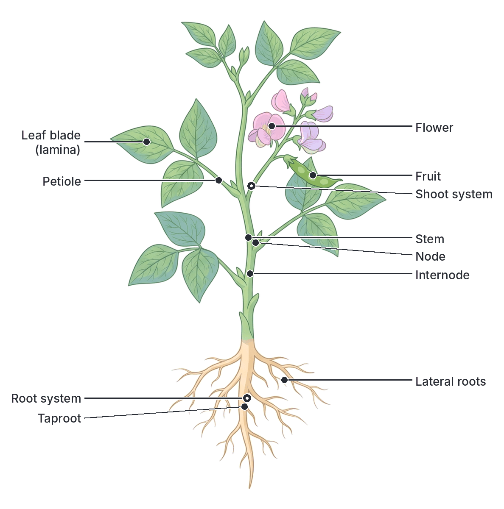
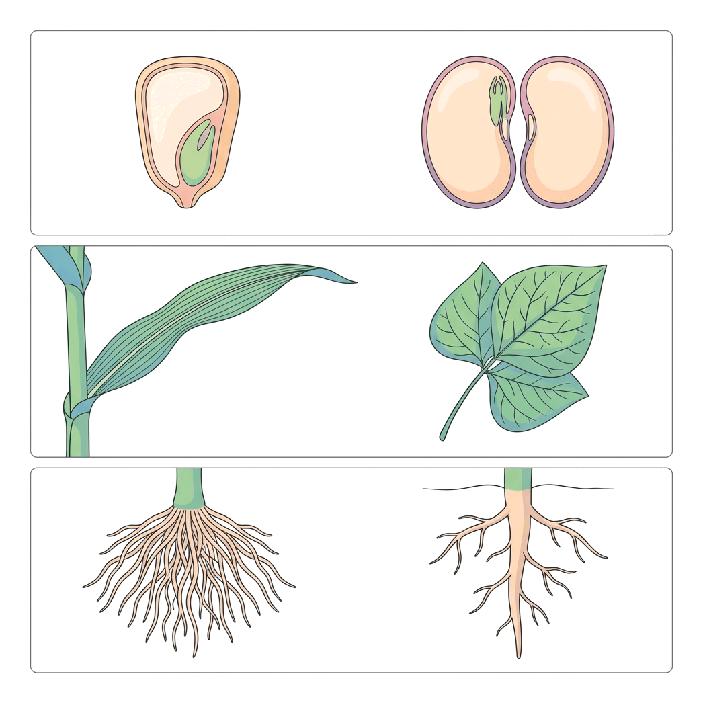
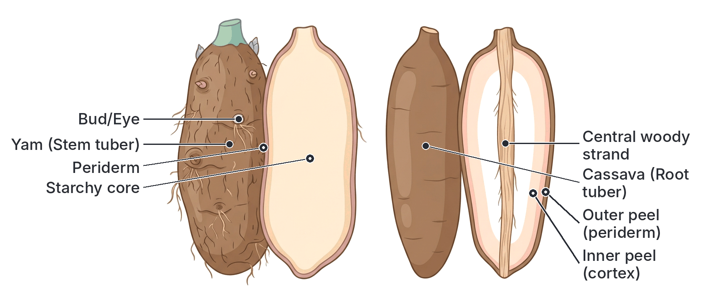
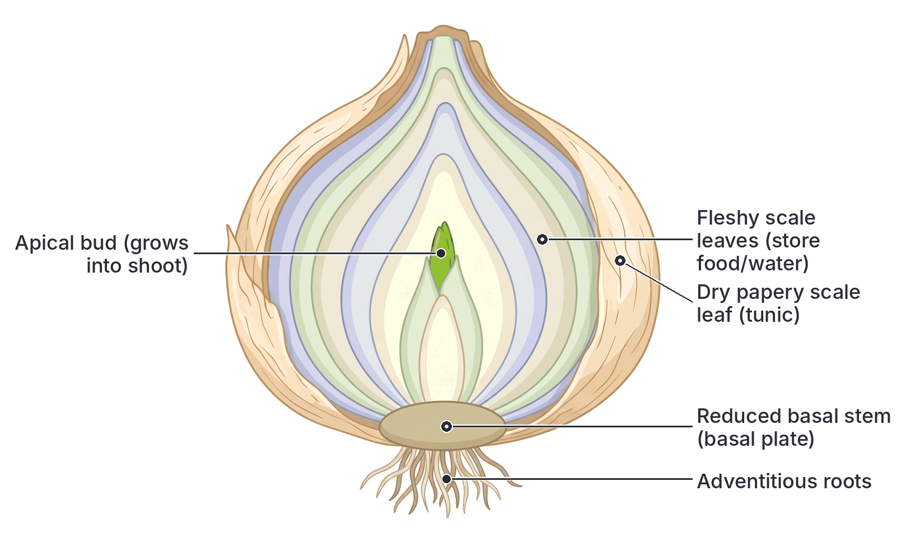

# JAMB Agricultural Science Notes: Plant Forms and Functions

## What JAMB expects

This topic is Section B, Topic 5 of the JAMB Agricultural Science syllabus: Plant Forms and Functions. 

It covers two main content items:
- **a. Parts of monocot and dicot crop plants and their functions**
- **b. The anatomy and morphology of the storage organs of common crop plants**

By the end of these notes, you should be able to:
1. Identify crop plant parts and their functions.
2. Distinguish between monocot and dicot crop plants.
3. Identify various storage organs of crop plants.

## Parts of crop plants and their functions

**Objective i: identify crop plant parts and their functions.**
**Content a: Parts of monocot and dicot crop plants and their functions (Part 1).**

A typical crop plant, whether it is a monocot (like maize) or a dicot (like cowpea), is divided into two main systems: the **root system** (usually underground) and the **shoot system** (usually above the ground). 

### 1. The Root System
The root system is the part of the plant that grows downwards into the soil. 

**Main functions:**
- **Anchorage:** Roots hold the plant firmly in the soil so it is not easily blown over by the wind.
- **Absorption:** Tiny root hairs absorb water and dissolved mineral salts from the soil, which are transported to the rest of the plant.
- **Storage:** In some crops (like cassava and sweet potato), the roots become swollen and act as storage organs for food (starch).
- **Vegetative propagation:** Some roots can be used to grow new plants (e.g., sweet potato roots, breadfruit).

### 2. The Stem
The stem is the main axis of the shoot system. It bears branches, leaves, flowers, and fruits. Stems are divided into **nodes** (the points where leaves and buds attach) and **internodes** (the spaces between nodes).

**Main functions:**
- **Support:** It holds leaves in the best position to catch sunlight, and holds flowers up to attract pollinators.
- **Transport:** It contains vascular tissues. The **xylem** transports water and minerals from the roots up to the leaves. The **phloem** transports manufactured food from the leaves down to the roots and storage organs.
- **Storage:** Some crops have modified stems (like yam and sugarcane) that store large amounts of food or water.
- **Vegetative propagation:** Stem cuttings of crops like cassava, sugarcane, and sweet potato are used for planting.

### 3. The Leaves
The leaf is usually a flat, green structure attached to the stem. A typical dicot leaf has a broad flat part called the **lamina (leaf blade)**, a stalk called the **petiole**, and a network of **veins**. 

**Main functions:**
- **Photosynthesis:** The green pigment (chlorophyll) in leaves captures sunlight to manufacture food from carbon (IV) oxide and water. Leaves are the primary "food factories" of the crop.
- **Transpiration:** Leaves lose excess water vapour through tiny pores called **stomata**. This pulling force (transpiration pull) helps draw more water up from the roots and cools the plant.
- **Gaseous exchange:** The stomata allow carbon (IV) oxide to enter for photosynthesis and oxygen to exit.
- **Food storage:** In some plants, like the onion bulb, modified leaves store food.

### 4. The Flowers
The flower is the reproductive structure of a plant. A complete flower has four main parts, arranged in rings (whorls):
1. **Sepals (Calyx):** Green, leaf-like structures that protect the flower when it is still a bud.
2. **Petals (Corolla):** Often brightly coloured and scented to attract insects (like bees) for pollination.
3. **Stamens (Androecium):** The male parts. Each stamen has a stalk (filament) and an **anther**, which produces pollen grains containing the male sex cells.
4. **Carpels/Pistil (Gynoecium):** The female parts. Each carpel has a **stigma** (to catch pollen), a **style** (a tube), and an **ovary** at the base containing **ovules** (each ovule contains a female sex cell, the egg).

**Main functions:**
- **Sexual reproduction:** Flowers facilitate pollination (transfer of pollen) and fertilization (joining of male and female sex cells).
- **Fruit and seed formation:** After fertilization, the ovary develops into a **fruit**, and the ovules develop into **seeds**.

### 5. Fruits and Seeds
- **Fruit:** The ripened ovary. Its main function is to protect the developing seeds and help in their dispersal (scattering).
- **Seed:** The ripened ovule. It contains the **embryo** (the baby plant) and stored food (in the cotyledons or endosperm) to nourish the embryo when it germinates.

## Distinguishing between monocot and dicot crop plants

**Objective ii: distinguish between monocot and dicot crop plants.**
**Content a: Parts of monocot and dicot crop plants and their functions (Part 2).**

Flowering crop plants (Angiosperms) are divided into two major groups: **Monocotyledons (Monocots)** and **Dicotyledons (Dicots)**. They are distinguished by their external morphology (shape and structure) and internal anatomy.

- **Monocots** include cereals (maize, rice, sorghum, millet), grasses, oil palm, coconut, sugarcane, plantain, and onion.
- **Dicots** include legumes (cowpea, groundnut, soybean), root/tuber crops (cassava, sweet potato), vegetables (tomato, pepper, fluted pumpkin/ugu), and tree crops (cocoa, rubber, citrus).

**Note:** Yam (*Dioscorea* spp.) is a monocot, even though its leaves have net-like veins—an exception to the general rule.

### Comparison Table: Monocots vs. Dicots

| Feature | Monocotyledonous crops | Dicotyledonous crops |
| :--- | :--- | :--- |
| **Seeds (Cotyledons)** | Have **one** seed leaf (cotyledon) in the embryo. (e.g., a maize grain cannot be split into two equal halves). | Have **two** seed leaves (cotyledons) in the embryo. (e.g., a cowpea or groundnut seed easily splits into two halves). |
| **Root System** | Possess a **fibrous root system**. Many roots of similar size grow directly from the base of the stem. No main taproot. | Possess a **taproot system**. One main root (taproot) grows deep down, with smaller lateral roots branching off it. |
| **Leaves** | Leaves are usually long and narrow. The veins run parallel to each other (**parallel venation**). | Leaves are usually broad. The veins form a branching network (**net-veined or reticulate venation**). |
| **Stem (Anatomy)** | Vascular bundles (xylem and phloem) are **scattered** throughout the stem tissue. Do not usually undergo secondary thickening (do not form hard wood). | Vascular bundles are arranged in a distinct **ring**. Undergo secondary thickening (can grow very thick and form hard wood). |
| **Flowers** | Floral parts (petals, sepals) are usually in multiples of **three** (3, 6, 9). | Floral parts are usually in multiples of **four or five** (4, 5, 8, 10). |
| **Examples in Nigeria** | Maize, rice, guinea corn (sorghum), sugarcane, oil palm, plantain, onion. | Cassava, cowpea, groundnut, tomato, cocoa, rubber, mango. |

## Anatomy and morphology of storage organs

**Objective iii: identify various storage organs of crop plants.**
**Content b: The anatomy and morphology of the storage organs of common crop plants.**

A **storage organ** is a part of a plant that is specially modified to store large amounts of manufactured food (mostly carbohydrates, like starch) or water. 

**Why do plants have storage organs?**
1. To survive unfavourable conditions (like the dry season) when photosynthesis is difficult. The stored food is used to resume growth when the rains return (perennation).
2. For vegetative propagation. Farmers use these organs to plant the next crop.
3. For humans, these storage organs are often the most valuable part of the crop, serving as staple foods.

Storage organs can be modified stems, roots, or leaves.

### 1. Stem Tubers (e.g., Yam, Irish Potato)
A stem tuber is a swollen, fleshy underground stem.

- **Morphology (External features):**
  Because it is a stem, it has features of a stem. It has **nodes**, which are seen as "eyes" (buds) on an Irish potato or the hairy rootlets and buds on a yam tuber. From these buds or eyes, new shoots can grow. It lacks a regular shape and is usually covered by a corky skin.
- **Anatomy (Internal structure):**
  If you cut a yam tuber across, you will see three main zones:
  1. **Periderm (Peel/Skin):** The outer protective corky layer.
  2. **Cortex:** A narrow layer just inside the peel.
  3. **Ground parenchyma (Core):** The large central fleshy part where starch grains are heavily deposited in the cells. It also contains scattered vascular bundles (a trait showing yam is a monocot).

### 2. Root Tubers (e.g., Cassava, Sweet Potato, Carrot)
A root tuber is a swollen, fleshy underground root. In cassava and sweet potato, these are swollen adventitious roots. In carrot, it is a swollen taproot.

- **Morphology:**
  Because they are roots, they **do not** have nodes, internodes, or scale leaves. They do not have "eyes" or buds (except at the very top where the stem base attaches, called the crown). Therefore, you cannot plant a piece of cassava tuber to grow a new plant; you must use the stem.
- **Anatomy:**
  A cross-section of a cassava root tuber reveals:
  1. **Periderm (Outer peel):** A thin, rough, brown outer layer.
  2. **Cortex (Inner peel):** A thicker, usually whitish or pinkish layer beneath the periderm. Both peels are removed during garri processing.
  3. **Fleshy parenchyma:** The massive white or yellow central region packed with starch.
  4. **Central vascular strand:** A tough, woody string running exactly down the middle of the root.

### 3. Bulbs (e.g., Onion, Garlic)
A bulb is an underground storage organ made of a very short stem surrounded by thick, fleshy, modified leaves. 

- **Morphology:**
  The actual stem is reduced to a flat, disc-like structure at the bottom called the **basal plate**. Roots grow downwards from this plate. The bulky part we eat consists of overlapping swollen leaves (scales).
- **Anatomy:**
  If you cut an onion bulb in half from top to bottom, you will see:
  1. **Dry scaly leaves:** The outer brown papery skin that protects the bulb.
  2. **Fleshy scale leaves:** The thick, juicy inner layers that store food (mostly sugars, not starch) and water.
  3. **Terminal bud / Apical bud:** Found at the very centre; it will grow upwards into the green shoot.
  4. **Axillary buds:** Found between the scale leaves; they can grow into new daughter bulbs (bulblets).
  5. **Basal stem (Plate):** The tough disc at the bottom from which adventitious roots emerge.

### 4. Rhizomes (e.g., Ginger, Turmeric)
A rhizome is an underground stem that grows horizontally just below the soil surface.

- **Morphology and Anatomy:**
  Being a stem, it has distinct **nodes** and **internodes**. The nodes are covered by small, dry scale leaves. **Axillary buds** are found at the nodes and can grow upwards into green aerial shoots. Adventitious roots grow downwards from the nodes. It stores food (starch and aromatic oils) in its fleshy interior.

### 5. Corms (e.g., Cocoyam / *Colocasia*)
A corm is a swollen, short, upright underground stem.

- **Morphology and Anatomy:**
  It is much more solid than a bulb. The bulk of a corm is made of solid stem tissue storing starch, not fleshy leaves. It has circular rings around it, which are the **nodes**. Thin, dry scale leaves attach at these nodes, covering the corm. **Buds** grow at the top (apical bud) and on the sides, which can develop into small daughter corms (cormels). If you cut a corm, the inside is mostly solid white/pink starchy pith with scattered vascular bundles.

### Summary of Storage Organs

| Type of Organ | Plant Part Modified | Common Crop Examples | Key identifying feature |
| :--- | :--- | :--- | :--- |
| **Stem tuber** | Underground stem | Yam, Irish potato | Has nodes, internodes, and buds ("eyes"). |
| **Root tuber** | Root (Tap or Adventitious) | Cassava, sweet potato, carrot | No nodes, no internodes, no buds on the body. Prominent central vascular strand. |
| **Bulb** | Stem and Leaves | Onion, garlic | Short basal stem plate; bulk of storage is in fleshy overlapping leaves. |
| **Rhizome** | Underground stem | Ginger, turmeric | Grows horizontally; has distinct nodes and scale leaves. |
| **Corm** | Underground stem | Cocoyam (Taro) | Swollen upright stem base covered in dry, papery scale leaves. |

## Key terms

| Term | Meaning |
| --- | --- |
| Root system | The usually underground part of a plant responsible for anchorage and absorption. |
| Shoot system | The usually above-ground part of a plant, consisting of stems, leaves, flowers, and fruits. |
| Stomata | Tiny pores on leaves used for gaseous exchange and transpiration. |
| Cotyledon | The seed leaf within the embryo of a seed. Monocots have one; dicots have two. |
| Fibrous roots | A root system made of many similar-sized roots branching from the stem base (common in monocots). |
| Taproot | A root system with one thick, deep main root and smaller lateral roots (common in dicots). |
| Venation | The arrangement of veins in a leaf (parallel in monocots, net-like in dicots). |
| Storage organ | A plant part (stem, root, or leaf) modified to store food or water. |
| Tuber | A swollen, fleshy underground stem or root used for storage. |
| Bulb | A storage organ made of a short stem surrounded by fleshy, overlapping leaves (e.g., onion). |
| Rhizome | A horizontal underground stem that stores food (e.g., ginger). |
| Corm | A short, upright, swollen underground stem covered with dry scale leaves (e.g., cocoyam). |

## Exam tips and common mistakes

- **Common mistake:** Thinking yam is a root crop. Yam is a **stem tuber**. A quick way to remember: stems have buds/nodes (yam has them, allowing shoots to grow directly from the tuber). Roots do not have buds (cassava tubers do not have them; you must plant cassava stems).
- **Common mistake:** Thinking onion stores food in its stem. The edible, food-storing part of an onion bulb consists of **fleshy leaves**. The stem is just the tiny flat plate at the bottom.
- **Identify monocots and dicots correctly:** Remember the major Nigerian crops. Maize, rice, and grasses are monocots. Legumes (cowpea, groundnut) and most vegetables are dicots.
- **Vascular bundles:** In exams, if you see scattered vascular bundles in a stem cross-section, it is a monocot. If they are in a neat ring, it is a dicot.
- **Venation matters:** Parallel veins = monocot. Net-like veins = dicot. Yam is a notable exception (it is a monocot but has net veins).

## Quick summary

1. A typical crop plant consists of a root system (for anchorage and absorption) and a shoot system (for support, photosynthesis, and reproduction).
2. Within the shoot, stems transport water and food, leaves manufacture food via photosynthesis, and flowers facilitate sexual reproduction to form fruits and seeds.
3. Monocots (e.g., maize, rice, grasses) possess one seed leaf, fibrous roots, parallel leaf veins, floral parts in threes, and scattered stem vascular bundles.
4. Dicots (e.g., cowpea, cassava, cocoa) have two seed leaves, a taproot system, net-veined leaves, floral parts in fours or fives, and stem vascular bundles arranged in a ring.
5. Storage organs help plants survive dry seasons and are used for vegetative propagation; stem tubers (like yam) have nodes and buds, unlike root tubers (like cassava) which lack them.
6. Other modified storage organs include bulbs (e.g., onion, with fleshy leaves on a basal stem), rhizomes (e.g., ginger, with horizontal stems), and corms (e.g., cocoyam, with upright stems).

## Practice questions

**1. Which of the following crop plant parts is primarily responsible for the manufacture of food?**
- A. The root
- B. The stem
- C. The leaf
- D. The flower

**Answer: C.** The leaf contains chlorophyll and captures sunlight to manufacture food through the process of photosynthesis. 

**2. A plant is observed to have a fibrous root system and leaves with parallel veins. This plant is most likely a**
- A. dicotyledon
- B. monocotyledon
- C. legume
- D. root tuber

**Answer: B.** Monocotyledonous plants are characterized by fibrous root systems, parallel leaf venation, and one cotyledon in their seeds. Examples include maize and grasses.

**3. Which of the following is a key anatomical difference between a yam tuber and a cassava tuber?**
- A. Yam tubers lack a periderm, while cassava tubers have one.
- B. Yam tubers have nodes and buds, while cassava root tubers do not.
- C. Cassava tubers are stems, while yam tubers are roots.
- D. Cassava tubers store water, while yam tubers store proteins.

**Answer: B.** Yam is a stem tuber, so it possesses stem features like nodes and buds ("eyes"). Cassava is a root tuber and therefore lacks nodes and buds on its fleshy storage body.

**4. The storage organ of an onion plant is a**
- A. corm
- B. rhizome
- C. stem tuber
- D. bulb

**Answer: D.** An onion is a bulb. It consists of a very short basal stem surrounded by thick, fleshy modified leaves that store food and water.

**5. In a dicotyledonous plant, the arrangement of vascular bundles in the stem is**
- A. scattered throughout the stem tissue
- B. concentrated only in the center
- C. arranged in a distinct ring
- D. absent completely

**Answer: C.** In dicots, vascular bundles (xylem and phloem) are arranged in a regular ring, allowing for secondary growth (wood formation). In monocots, they are scattered.

**6. Which of the following crops is a dicotyledon?**
- A. Rice
- B. Maize
- C. Oil palm
- D. Cowpea

**Answer: D.** Cowpea is a legume, which is a dicotyledon. Its seeds have two cotyledons and its leaves have net-like veins. Rice, maize, and oil palm are monocots.

**7. The part of a flower that produces pollen grains is the**
- A. stigma
- B. anther
- C. ovary
- D. sepal

**Answer: B.** The anther is the male part of the flower (part of the stamen) that produces and releases pollen grains. The stigma receives pollen, and the ovary contains ovules.

**8. Ginger propagates vegetatively through its underground storage organ known as a**
- A. root tuber
- B. corm
- C. rhizome
- D. bulb

**Answer: C.** Ginger is a rhizome—a horizontal underground stem with distinct nodes, internodes, and scale leaves, which stores food and aids in vegetative propagation.

**9. Cocoyam (*Colocasia* spp.) stores its food primarily in a**
- A. bulb
- B. taproot
- C. corm
- D. runner

**Answer: C.** Cocoyam is a corm, which is a short, swollen, solid, upright underground stem covered with dry scale leaves.

**10. A student studying a plant observes that its seed easily splits into two equal halves. What other feature is this plant likely to have?**
- A. Floral parts in multiples of three
- B. A taproot system
- C. Leaves with parallel veins
- D. Scattered vascular bundles in the stem

**Answer: B.** A seed that splits into two halves has two cotyledons, meaning it is a dicot. Dicots are characterized by a taproot system, net-veined leaves, floral parts in fours or fives, and vascular bundles in a ring.

<!-- COVERAGE
obj i | Parts of crop plants and their functions
obj ii | Distinguishing between monocot and dicot crop plants
obj iii | Anatomy and morphology of storage organs
item a | Parts of monocot and dicot crop plants and their functions
item a | Distinguishing between monocot and dicot crop plants
item b | Anatomy and morphology of storage organs
-->
