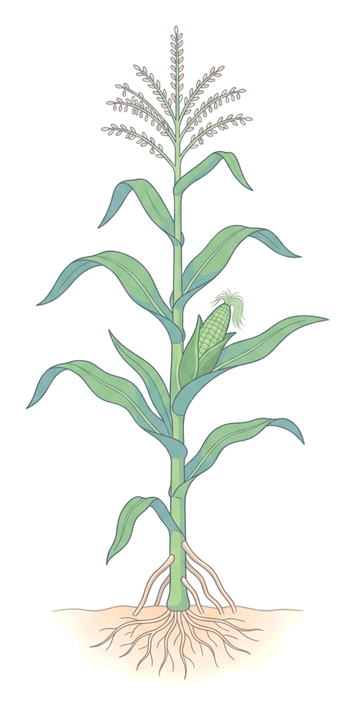
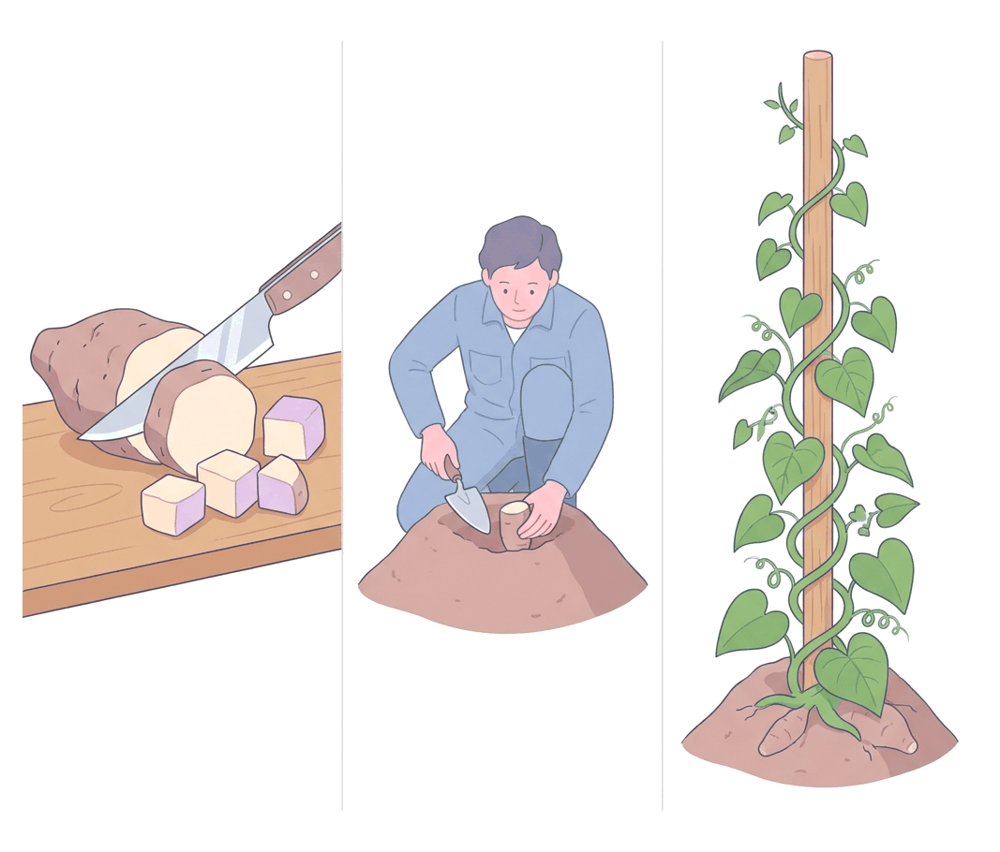
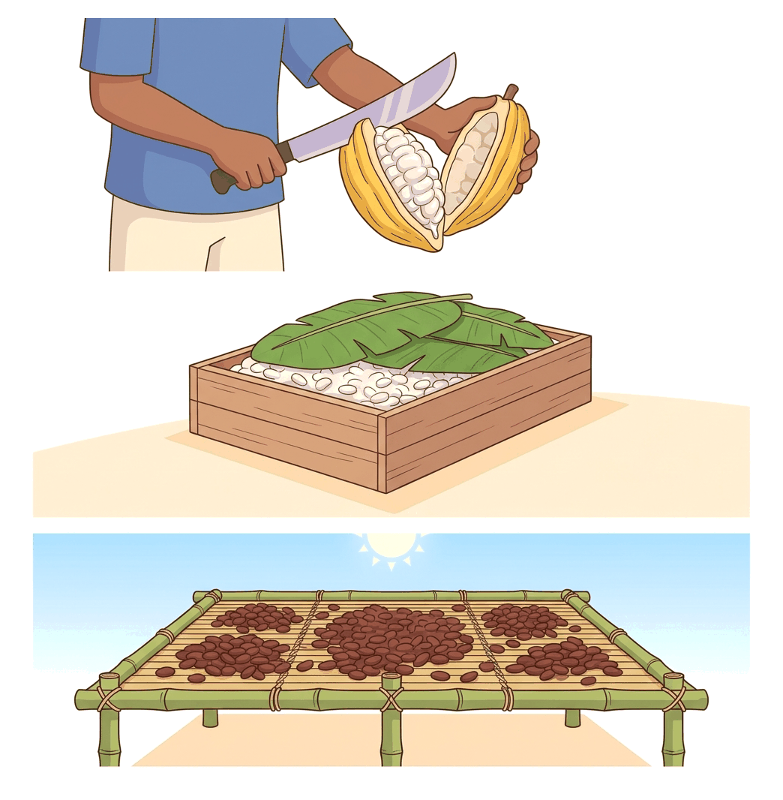

# JAMB Agricultural Science Notes: Crop Husbandry

## What JAMB expects

This topic is Section B, Topic 9 of the JAMB Agricultural Science syllabus: Crop Husbandry. It covers the general practices of crop production and details ten specific groups of crops.

By the end of these notes, you should be able to:
1. Apply the different methods of crop propagation, husbandry, harvesting, processing and storage for each crop.
2. Identify common diseases and pests and their effects on crop yield.
3. Determine the economic importance of each of the crops.
4. Relate their importance to national economic development.

This file provides a comprehensive guide to the ten major crop groups: Cereals, Legumes, Tubers, Vegetables and Spices, Fruits, Beverages, Oils, Latex, Fibres, and Sugars. 

---

## Methods of propagation, husbandry, processing and storage

**Objective i: apply the different methods of crop propagation, husbandry, harvesting, processing and storage for each crop.**

Crop husbandry involves all the practical activities a farmer performs from planting to harvesting.

- **Propagation:** Crops are grown either sexually (using seeds, as in maize, cowpea, and cotton) or asexually/vegetatively (using parts of the parent plant, such as stem cuttings for cassava, vine cuttings for sweet potato, or budding for citrus). 
- **Husbandry practices:** These are the operations carried out while the crop is growing. They include land preparation (clearing, stumping, making ridges or mounds), planting at the correct spacing, applying fertilizers (such as NPK or organic manure), weeding (manually or with herbicides), and supplying water (irrigation).
- **Harvesting:** Gathering the mature crop from the field. This can be done manually (plucking, digging, cutting) or mechanically (using combine harvesters).
- **Processing and storage:** Changing the harvested crop into a usable or storable form. Processing stops spoilage and adds value. Storage methods depend on the crop (e.g., silos for dry grains, barns for yams, or cribs for maize on the cob).

## Common diseases and pests and their effects on yield

**Objective ii: identify common diseases and pests and their effects on crop yield.**

- **Pests** are living organisms (insects, birds, rodents, nematodes) that cause damage to crops. They reduce yield by eating leaves, boring into stems and fruits, or destroying stored grains. Biting and chewing insects (e.g., grasshoppers, caterpillars) destroy plant tissues, while piercing and sucking insects (e.g., aphids, cotton stainers) suck plant sap and often transmit viral diseases.
- **Diseases** are abnormalities caused by pathogens (fungi, bacteria, viruses). They lead to symptoms like rotting, spots, wilting, or stunted growth. 
- **Effects on yield:** Pests and diseases lower both the quantity (fewer bags harvested) and the quality (lower market value) of the crop, and in severe cases, they cause the death of the whole plant.

## Economic importance of crop production

**Objective iii: determine the economic importance of each of the crops.**

For the farmer and local communities, crops are essential for:
- **Food and nutrition:** Providing carbohydrates, proteins, vitamins, and oils for daily survival.
- **Income:** Selling farm produce is the primary source of wealth for millions of rural families.
- **Livestock feed:** Crop residues (like maize stovers or groundnut haulms) and processed by-products (like palm kernel cake) feed farm animals.
- **Materials:** Providing building materials, fuel, and medicinal plants.

## Role of crops in national economic development

**Objective iv: relate their importance to national economic development.**

On a national scale, crop production drives the economy of Nigeria and other West African nations by:
1. **Gross Domestic Product (GDP):** Agriculture contributes a large percentage to the national income.
2. **Foreign exchange earnings:** Export crops (like cocoa, rubber, sesame, and cashew) bring in foreign currency.
3. **Industrial raw materials:** Agro-allied industries rely entirely on crops (e.g., cotton for textiles, sugarcane for sugar and ethanol, rubber for tyres, and cocoa for chocolate and beverages).
4. **Employment:** Crop production and processing provide jobs for millions of citizens.
5. **Food security:** Producing enough staple crops reduces the need for expensive food imports, saving the country money.

---

## Group 1: Cereals

Cereals are grasses (family Poaceae) grown for their edible grains. 
**Anatomy of the storage organ:** The storage organ is the grain (a type of fruit called a **caryopsis** where the seed coat and fruit wall are fused). Food (primarily starch) is stored in the **endosperm** of the seed.

### Maize (*Zea mays*)

- **Gross morphology:** A tall, annual, monocotyledonous grass with a fibrous root system. It develops adventitious **prop roots** from the lower stem nodes for extra support. Leaves are long with parallel veins. Maize is **monoecious** (male and female flowers are on the same plant). The male inflorescence is the tassel at the top; the female inflorescence is the ear (cob) in the leaf axil.
- **Propagation:** By seeds.
- **Husbandry:** Planted on ridges or flats. Spacing is typically 75 cm by 25 cm (one seed per stand) or 90 cm by 30 cm. Seed rate is about 25–30 kg per hectare. Weeding must be done early. NPK fertilizer (e.g., 15:15:15) is applied a few weeks after planting, often top-dressed later with a nitrogen fertilizer like Urea. 
- **Harvesting:** Harvested 90 to 120 days after planting. Cobs are plucked by hand or by mechanical combine harvesters.
- **Processing and storage:** De-husking (removing the leafy bracts) and shelling (removing grains from the cob). Dried to about 10–12% moisture content. Stored on the cob in ventilated **cribs**, or as shelled grains in airtight **silos** or traditional rhumbus.
- **Diseases:** 
  - **Maize smut:** Caused by the fungus *Ustilago maydis*. Produces large, black, powdery galls on cobs and tassels, destroying the grain.
  - **Maize streak virus:** Transmitted by leafhoppers. Causes yellow longitudinal streaks on leaves and stunted growth.
- **Pests:** 
  - **Stem borers:** Larvae bore into the stem, weakening it and causing the plant to fall over (lodging).
  - **Maize weevil (*Sitophilus zeamais*):** A major storage pest that bores holes into dry grains, turning them to powder and drastically reducing market value.
- **Economic importance:** Major staple food (pap/ogi, tuwo, roasted/boiled maize); principal carbohydrate source in poultry and livestock feeds; industrial raw material for corn starch, corn oil, and breweries.

### Rice (*Oryza sativa*)

- **Gross morphology:** An annual grass that produces multiple stems (tillering). Leaves have a characteristic ligule and auricle at the base of the blade. The inflorescence is a **panicle** bearing the grains.
- **Propagation:** By seeds. Can be grown in flooded fields (swamp rice) or dry land (upland rice).
- **Husbandry:** Swamp rice is usually raised in a nursery and transplanted to flooded fields at a spacing of 20 cm by 20 cm. Flooding helps control weeds. Upland rice is sown directly. Rice requires high nitrogen.
- **Harvesting:** Stems are cut with a sickle or harvested by a combine harvester when the panicles turn yellow.
- **Processing steps:** 
  1. **Threshing:** Beating the harvested stems to detach the grains (paddy).
  2. **Winnowing:** Blowing air through the grains to remove empty husks and chaff.
  3. **Parboiling:** Soaking paddy in hot water and steaming it. **Reason:** This hardens the grain to prevent breakage during milling and drives B-vitamins from the outer bran into the starchy endosperm, making it more nutritious.
  4. **Milling (Hulling):** Removing the outer husk to produce brown rice.
  5. **Polishing:** Removing the bran layer to produce white rice.
- **Diseases:** Rice blast (caused by a fungus, causes lesions on leaves and empty panicles); Brown leaf spot.
- **Pests:** **Birds** (especially Weaver birds and Quelea birds) are the most destructive, capable of eating entire fields of grain. Stem borers and rice weevils also attack it.
- **Economic importance:** A vital staple food across West Africa. Local production reduces reliance on expensive imported rice, heavily impacting national food security and foreign exchange.

### Guinea Corn / Sorghum (*Sorghum bicolor*)

- **Gross morphology:** Similar to maize but taller and more drought-resistant. The grains are borne on a terminal panicle at the top of the plant.
- **Husbandry:** Planted by seeds in the savanna regions (Northern Nigeria). Spacing is wider than maize. Tolerates low rainfall.
- **Pests and Diseases:** Attacked by the parasitic weed *Striga* (witchweed), stem borers, weaver birds, and Sorghum smut.
- **Economic importance:** Staple food in dry regions, used for brewing local drinks (burukutu) and industrial malt extract. 

---

## Group 2: Legumes

Legumes (family Fabaceae) are broad-leaved plants that bear their seeds in pods. They form a symbiotic relationship with nitrogen-fixing *Rhizobium* bacteria in their root nodules.
**Anatomy of the storage organ:** The storage organ is the seed, with food (mainly proteins and carbohydrates) stored in the two large **cotyledons**.

### Cowpea (*Vigna unguiculata*)

- **Gross morphology:** A dicotyledonous annual plant with a tap root system bearing small root nodules. It has trifoliate leaves (three leaflets per leaf). Flowers are often white or purple.
- **Propagation:** By seeds.
- **Husbandry:** Planted on ridges or flats. Spacing is typically 60 cm by 30 cm (approx 55,555 stands/ha). Requires phosphorus fertilizer to encourage root nodulation; nitrogen fertilizer is rarely needed because it fixes its own nitrogen.
- **Harvesting:** Mature, dry pods are hand-picked.
- **Processing and storage:** Dried, threshed to extract seeds, and winnowed. Stored in hermetic bags or silos with fumigants.
- **Diseases:** Cowpea mosaic virus (transmitted by beetles or aphids, causes mottled leaves); Root-knot nematodes (cause galls on roots).
- **Pests:** 
  - **Pod borers (*Maruca*):** Caterpillars that eat into green pods in the field.
  - **Bean weevil (*Callosobruchus maculatus*):** A highly destructive storage pest. Females lay eggs on seeds; larvae bore inside and eat the cotyledons, leaving characteristic round exit holes. Can cause 100% loss in storage if untreated.
- **Economic importance:** A cheap and major source of plant protein in the diet (cooked beans, akara, moin-moin). The plant residue (haulms) is excellent livestock feed.

### Groundnut / Peanut (*Arachis hypogaea*)

- **Gross morphology:** A low-growing dicot. It exhibits **geocarpy**: after fertilization, the flower stalk elongates into a "peg" that pushes into the soil, where the pod and seeds develop underground.
- **Husbandry:** Planted by seeds on ridges (spacing about 60 cm by 15 cm) in sandy-loam soils to allow the pegs to penetrate easily. 
- **Harvesting:** The whole plant is pulled or dug out of the ground. Placed in the sun to dry.
- **Processing:** Decortication (shelling the pods) and crushing the seeds to extract oil.
- **Diseases:** 
  - **Groundnut rosette disease:** A viral disease transmitted by aphids. Causes severe stunting, yellowing, and bunching of leaves.
  - **Tikka disease (Cercospora leaf spot):** Fungal disease causing dark spots on leaves, leading to defoliation.
- **Pests:** Rodents (rats, squirrels) dig up the planted seeds and developing pods. Aphids (suck sap and transmit virus).
- **Economic importance:** Provides edible groundnut oil, roasted nuts, and peanut butter. The residue (groundnut cake) is a high-protein ingredient in animal feed. Historically, it was a massive export earner for Nigeria (the famous groundnut pyramids of Kano).

### Soyabean (*Glycine max*)

- An upright bushy legume. Extremely rich in both protein (about 40%) and oil (about 20%).
- **Economic importance:** Used to make soy milk, infant weaning foods, and vegetable oil. Soya bean meal is the most important protein source in commercial poultry feeds worldwide.

---

## Group 3: Tubers

Root and stem tubers are starchy crops that store food underground.
**Anatomy of the storage organ:** 
- **Yam:** The tuber is a swollen underground **stem** (modified stem). 
- **Cassava and Sweet Potato:** The tuber is a swollen **root** (modified adventitious root).
In both, food is stored as starch in the parenchyma cells.

### Yam (*Dioscorea* spp.)

Examples include White yam (*Dioscorea rotundata*) and Water yam (*Dioscorea alata*).
- **Gross morphology:** A climbing vine with heart-shaped leaves. The underground storage organ is a stem tuber.
- **Propagation:** Vegetatively using **seed yams** (small whole tubers) or **yam setts** (cut pieces of a large tuber). The **minisett technique** uses very small setts (about 25 g) treated with wood ash or fungicides to rapidly multiply seed yams.
- **Husbandry:** Planted on large mounds or high ridges. Spacing is usually 1 m by 1 m (giving a plant density of 10,000 stands per hectare). **Staking** is essential: poles or sticks are provided for the vines to climb, exposing the leaves to maximum sunlight for photosynthesis. Weeding is critical.
- **Harvesting:** Carefully dug out with a cutlass or wooden digger to avoid bruising, which causes rotting.
- **Storage:** Stored in a well-ventilated **yam barn**, where tubers are tied individually to live stakes under shade.
- **Diseases:** Yam mosaic virus; Dry rot (caused by fungi and nematodes).
- **Pests:** Yam beetle (adults bore deep holes into the growing tubers in the soil, reducing market value); Rodents.
- **Economic importance:** Major cultural and staple carbohydrate food (pounded yam, boiled yam, yam flour/elubo).

### Cassava (*Manihot esculenta*)

- **Gross morphology:** A hardy, woody shrub reaching up to 2–3 metres. Leaves are deeply lobed (palmate). It has tuberous adventitious roots.
- **Propagation:** Vegetatively using **stem cuttings**. Stems are cut into 20–25 cm lengths and planted at a 45° angle or horizontally on ridges.
- **Husbandry:** Spacing is usually 1 m by 1 m (10,000 stands per hectare). Cassava is very drought-resistant and tolerates poor soils, making it a reliable "famine reserve" crop.
- **Harvesting:** The stem is cut back, and the roots are pulled or dug from the ground, 9 to 18 months after planting.
- **Processing:** Raw cassava roots contain cyanogenic glycosides, which can release poisonous hydrogen cyanide. Processing makes it safe:
  1. Peeling and washing.
  2. Grating into a mash.
  3. **Fermentation and pressing:** The mash is placed in a sack and pressed with heavy stones or a jack for 2 to 4 days. Microbes ferment it, breaking down the toxins, and the cyanide escapes as gas or drains with the water.
  4. Sieving to remove fibres.
  5. Frying (roasting or garrifying) in a wide pan to cook the starch and drive off remaining moisture and cyanide, producing **garri**.
- **Diseases:** 
  - **Cassava mosaic disease:** A virus transmitted by the whitefly (*Bemisia tabaci*). Causes yellow mottling and distortion of leaves, severely stunting yield.
  - **Cassava bacterial blight:** Causes wilting and dieback of stems.
- **Pests:** Cassava mealybug and Green spider mite (both suck sap and cause defoliation).
- **Economic importance:** The most widely consumed staple in Nigeria (garri, fufu, lafun). Used industrially for making cassava flour, adhesives, starch, and biofuel (ethanol). 

### Sweet Potato (*Ipomoea batatas*)

- **Gross morphology:** A creeping vine that forms root tubers.
- **Propagation:** By vine cuttings.
- **Pests:** The Sweet potato weevil bores into the tubers in the field.
- **Economic importance:** Boiled or fried for food; high in carbohydrates and vitamins (especially orange-fleshed varieties).

---

## Group 4: Vegetables and Spices

These are crops grown mostly for their leaves, fruits, or roots, providing essential vitamins and minerals.
**Anatomy of storage organs:** Varies widely. Tomatoes and peppers store food in fleshy fruits; onions store food in underground fleshy leaf bases (a bulb).

### Tomato (*Solanum lycopersicum*) and Pepper (*Capsicum* spp.)

- **Gross morphology:** Bushy annuals bearing fleshy berries (fruits).
- **Propagation:** By seeds.
- **Husbandry:** Seeds are first sown in a **nursery**. After 4 to 6 weeks, vigorous seedlings are transplanted to the main field. Staking is often required for tomatoes to keep fruits off the damp soil.
- **Harvesting:** Fruits are hand-picked when ripe (red) or mature green. Highly perishable.
- **Diseases:** 
  - **Root-knot nematodes:** Microscopic worms that cause swellings (galls) on roots, blocking water uptake and wilting the plant.
  - **Blossom-end rot:** A physiological disease caused by calcium deficiency, leading to a black, rotting patch at the bottom of the fruit.
- **Pests:** Fruit borers (caterpillars that eat into the fruit).
- **Economic importance:** Rich in vitamins A and C. Sold daily for income; raw material for tomato paste industries.

### Onion (*Allium cepa*)

- **Gross morphology:** Short herbaceous plant. The storage organ is a **bulb**, which consists of a short underground stem surrounded by swollen, fleshy, concentric leaf bases.
- **Husbandry:** Grown mainly in the drier savanna regions, often under irrigation. Propagated by seeds in a nursery, then transplanted.
- **Pests:** Onion thrips (suck sap from leaves).
- **Economic importance:** Essential culinary spice; contains antioxidants.

### Okra (*Abelmoschus esculentus*)

- Propagated by seeds sown directly into the field.
- **Pests:** Flea beetles (chew small holes in leaves) and cotton stainers.
- **Economic importance:** Mucilaginous fruit used for soups.

---

## Group 5: Fruits

Tree crops grown for their fleshy, sweet fruits.
**Anatomy of the storage organ:** The fleshy fruit wall (pericarp, specifically the mesocarp and endocarp) stores sugars and water.

### Citrus (e.g., Sweet Orange - *Citrus sinensis*)

- **Gross morphology:** Small to medium evergreen trees. Fruit is a specialized berry called a hesperidium, with a leathery rind and juicy interior segments.
- **Propagation:** By seeds (to grow a hardy rootstock) and then **budding**. A bud (scion) from a high-quality sweet orange tree is grafted onto the rootstock.
- **Husbandry:** Planted at a wide spacing (e.g., 7 m by 7 m).
- **Harvesting:** Hand-plucked or cut with a clipper when ripe.
- **Diseases:** 
  - **Gummosis:** A fungal disease causing sap/gum to ooze from cracks in the bark.
  - **Tristeza virus:** Transmitted by aphids, causes decline and death of the tree.
- **Pests:** Scale insects (attach to stems and suck sap), fruit flies (lay eggs in fruit, causing maggots and rot).
- **Economic importance:** Major source of vitamin C. Raw material for the fruit juice industry.

### Pineapple (*Ananas comosus*) and Pawpaw (*Carica papaya*)

- **Pineapple:** Propagated vegetatively using suckers, slips, or the crown (the leafy top of the fruit). Produces a multiple fruit.
- **Pawpaw:** Propagated sexually by seeds. Fast-growing, unbranched soft-wood tree. Yields the enzyme papain, used as a meat tenderizer.

---

## Group 6: Beverages

Crops whose seeds or leaves are processed to make stimulating drinks.
**Anatomy of the storage organ:** The seed (beans/berries).

### Cocoa (*Theobroma cacao*)

- **Gross morphology:** A small tree exhibiting **cauliflory** (flowers and fruits grow directly on the main trunk and heavy branches, rather than on new twigs). The fruit is a large pod containing 30 to 40 seeds (beans) surrounded by sweet mucilage.
- **Propagation:** By seeds.
- **Husbandry:** Raised in polybags in a nursery. Transplanted to the field at a spacing of about 3 m by 3 m (approx 1,111 plants/ha). Young cocoa needs shade, so banana or plantain is often planted alongside it.
- **Harvesting:** Mature yellow/orange pods are carefully cut from the trunk using a sharp cocoa knife on a long pole.
- **Processing steps:** 
  1. **Pod breaking:** Opening the pods with a wooden club to extract the wet beans.
  2. **Fermentation:** Beans are placed in wooden sweat boxes or heaped under banana leaves for 4 to 7 days. **Reason:** The heat kills the embryo, drains the mucilage, and causes chemical changes inside the bean that develop the characteristic chocolate colour and flavour.
  3. **Drying:** Spread on raised mats in the sun to reduce moisture to about 7% to prevent mould during storage.
- **Diseases:** 
  - **Black pod disease:** Caused by the fungus *Phytophthora palmivora*. The pods turn black and rot. Controlled by spraying copper fungicides and frequent harvesting.
  - **Swollen shoot disease:** A virus transmitted by mealybugs. Causes swelling of stems and shoots and kills the tree.
- **Pests:** **Capsid bugs (Mirids):** They pierce the pods and stems to suck sap, injecting toxic saliva that causes black lesions and dieback of branches.
- **Economic importance:** Nigeria is one of the world's top exporters of cocoa. It is a massive source of foreign exchange and the primary raw material for chocolate and beverage industries (e.g., Milo, Bournvita).

### Kola (*Cola nitida*, *Cola acuminata*) and Coffee (*Coffea* spp.)

- **Kola:** Tree crop. Seeds (kola nuts) contain caffeine and are chewed as a stimulant. Very important in Nigerian cultural and traditional ceremonies.
- **Coffee:** Berries are harvested, pulped, fermented, dried, and roasted to produce coffee beans.

---

## Group 7: Oils

Crops grown primarily for the extraction of vegetable oil.
**Anatomy of the storage organ:** In the oil palm, oil is stored in the fleshy **mesocarp** (palm oil) and the solid **endosperm** (palm kernel oil).

### Oil Palm (*Elaeis guineensis*)

- **Gross morphology:** A tall, unbranched tree with a crown of pinnate fronds (leaves). It is monoecious (separate male and female flower bunches on the same tree). The fruit is a drupe.
- **Propagation:** By seeds. The seeds have a hard shell and strong dormancy; they must be heated in germinators for weeks to sprout.
- **Husbandry:** Sprouted seeds go to a pre-nursery (small polybags), then a main nursery (large polybags) for about a year. Transplanted to the field in a **triangular spacing of 9 m by 9 m** (which gives an optimal plant population of about 143 palms per hectare). Young seedlings are fitted with wire collars to protect against rodents.
- **Harvesting:** Ripe bunches (reddish-orange fruits) are cut using a harvesting sickle tied to a long bamboo pole.
- **Processing steps (for Palm Oil):**
  1. **Sterilization:** Bunches are boiled in steam. **Reason:** This loosens the fruits from the bunch, softens the pulp, and most importantly, deactivates the enzyme *lipase*, preventing the oil from breaking down into free fatty acids (which would make it rancid).
  2. **Stripping:** Removing the individual fruits from the bunch.
  3. **Digestion:** Mashing the fruits at high temperatures to rupture the oil-bearing cells in the mesocarp.
  4. **Extraction:** Pressing the mashed pulp to squeeze out the crude palm oil.
  5. **Clarification:** Boiling the crude oil with water and skimming the pure palm oil off the top, leaving impurities behind.
  *(The nuts left behind are dried and cracked to extract the kernel for Palm Kernel Oil).*
- **Diseases:** Blast and Anthracnose (fungal diseases in the nursery).
- **Pests:** Rhinoceros beetle (adults bore into the growing crown of the tree, sometimes killing it). Rodents (grasscutters) eat young seedlings.
- **Economic importance:** Provides edible cooking oil and industrial oil for soap and cosmetics. Palm kernel cake is an important livestock feed. A major employer of labour and source of rural wealth.

### Coconut (*Cocos nucifera*) and Shea Butter (*Vitellaria paradoxa*)

- **Coconut:** Thrives in coastal sandy areas. The dried endosperm is called **copra**, which is pressed for coconut oil.
- **Shea Butter:** A savanna tree. The nuts are collected and processed into shea butter, used in cooking, cosmetics, and skin care.

---

## Group 8: Latex

Plants whose bark produces a milky white sap (latex) used for rubber and adhesives.
**Anatomy of the storage organ:** Latex is found in specialized tubes (latex vessels) in the **phloem** (inner bark) of the trunk.

### Para Rubber (*Hevea brasiliensis*)

- **Gross morphology:** A tall forest tree with trifoliate leaves.
- **Propagation:** By seeds or budding (grafting a high-yielding scion onto a strong rootstock).
- **Husbandry:** Spacing is usually 6 m by 6 m.
- **Harvesting (Tapping):** Harvesting is done by tapping. A special gouge knife is used to cut a sloping groove halfway around the trunk at an angle of 25° to 30°. The cut goes deep enough to sever the latex vessels in the bark but must not damage the cambium layer (which would ruin bark regeneration). The white latex drips into a collection cup.
- **Processing steps:**
  1. **Coagulation:** The liquid latex is mixed with a weak acid (dilute acetic or formic acid), causing it to coagulate (clot) into a soft, spongy solid.
  2. **Milling:** The coagulum is passed through rollers to squeeze out water and press it into thin ribbed sheets.
  3. **Smoking:** The sheets are hung in a smokehouse to dry and preserve them, producing Ribbed Smoked Sheets (RSS).
- **Diseases:** White root rot; Black thread (fungus attacking the tapping panel).
- **Pests:** Termites can attack the roots and trunk.
- **Economic importance:** The major raw material for the tyre and plastics industry. Exporting rubber sheets earns foreign exchange for national economic development.

### Gum Arabic (*Senegalia senegal*)

- A drought-resistant tree of the Sahel savanna. It exudes a hard resin (gum arabic) from its bark. Used industrially as a stabilizer in soft drinks, food, and adhesives. 

---

## Group 9: Fibres

Plants grown for their tough structural tissues used in textiles, ropes, and sacks.
**Anatomy of the storage organ:** 
- Cotton: Epidermal hairs (lint) attached to the seed coat.
- Jute: Bast (phloem) fibres in the stem.
- Sisal: Fibres running through the thick leaves.

### Cotton (*Gossypium* spp.)

- **Gross morphology:** A woody shrub with palmate leaves and large, attractive flowers. The fruit is a capsule called a **boll**, which splits open when ripe to reveal white, fluffy seeds.
- **Husbandry:** Propagated by seeds in the savanna zones (needs a dry period for bolls to open without rotting).
- **Harvesting:** Bolls are picked manually.
- **Processing:** **Ginning** is the mechanical process of separating the white lint (fibres) from the cotton seeds.
- **Diseases:** Bacterial blight; Leaf curl virus.
- **Pests:** 
  - **Cotton stainer (*Dysdercus* spp.):** A bug that pierces the bolls to suck sap and introduces a fungus that stains the white lint yellow or brown, reducing its commercial value.
  - **Bollworms:** Caterpillars that eat the developing bolls.
- **Economic importance:** The lint is the raw material for the textile and clothing industry. The seeds are crushed for cooking oil, and the residue (cotton seed cake) is high-protein cattle feed.

### Jute (*Corchorus* spp.) and Sisal hemp (*Agave sisalana*)

- **Jute:** Grown for stem fibres. Extracted by **retting** (submerging the cut stems in water for several days so bacteria rot away the soft tissues, leaving only the tough fibres). Used for making cocoa sacks and ropes.
- **Sisal:** Grown for leaf fibres. Extracted mechanically by a process called **decortication** (scraping away the fleshy green tissue of the leaf to leave the fibres).

---

## Group 10: Sugars

Crops grown for their high concentration of sucrose.
**Anatomy of the storage organ:** Sugarcane stores sugar in the pith (parenchyma cells) of the **stem**. Sugar beet stores it in a swollen **tap root**.

### Sugarcane (*Saccharum officinarum*)

- **Gross morphology:** A very tall, thick perennial grass. The stem is solid, jointed, and rich in sweet juice.
- **Propagation:** Vegetatively using stem cuttings called **setts**. Each sett must have at least one or two buds (nodes).
- **Husbandry:** Planted in furrows or trenches. Requires heavy watering (often grown in swampy fadama areas or under irrigation) and heavy nitrogen fertilizer.
- **Harvesting:** The thick stems are cut down with machetes just before the plant flowers (flowering reduces the sugar content in the stem).
- **Processing:** The stems are crushed between heavy steel rollers to extract the juice. The juice is boiled to evaporate water, purified, and allowed to crystallize. It is then spun in a centrifuge to separate the white sugar crystals from the dark, sticky syrup called **molasses**.
- **Diseases:** Red rot (fungal disease causing the inside of the stem to turn red and sour); Sugarcane smut.
- **Pests:** Stem borers; Termites.
- **Economic importance:** Provides table sugar for domestic use, replacing imports. Molasses is used to produce alcohol (ethanol) and rum. The crushed, dry stem residue (bagasse) is used as fuel for factory boilers or for making paper.

---

## Key terms

| Term | Meaning |
| --- | --- |
| **Caryopsis** | A type of fruit typical of grasses/cereals where the seed coat is completely fused to the fruit wall |
| **Endosperm** | The tissue inside a seed that stores starchy food for the developing embryo (e.g., in maize or rice) |
| **Geocarpy** | A rare plant behaviour where the developing fruit is pushed underground to mature (e.g., groundnut) |
| **Sett** | A cut piece of a tuber (yam) or stem (sugarcane) used for vegetative propagation |
| **Tiller** | A side shoot that grows from the base of a grass plant (common in rice) |
| **Parboiling** | Soaking and steaming rice paddy before milling to harden it and retain vitamins |
| **Sterilization (Oil Palm)** | Boiling oil palm bunches to loosen fruits and deactivate the lipase enzyme |
| **Tapping** | Carefully cutting the bark of a rubber tree to extract latex without damaging the cambium |
| **Ginning** | The mechanical separation of cotton fibres (lint) from the seeds |
| **Retting** | Soaking plant stems (like jute) in water to rot away soft tissues and free the fibres |

## Exam tips and common mistakes

- **Do not confuse parboiling with milling:** Parboiling is soaking and steaming rice *before* the husk is removed, to harden the grain and push vitamins into the centre. Milling is the actual removal of the husk.
- **Fermentation purposes differ:** In cassava, fermentation removes poisonous cyanide. In cocoa, fermentation develops the chocolate flavour and colour.
- **Understand sterilization in oil palm:** It is not done to kill bacteria for hygiene; it is done to deactivate the enzyme *lipase*, which would otherwise turn the oil rancid.
- **Storage organs vary:** Know that the yam is a stem tuber, cassava is a root tuber, and the onion bulb is made of fleshy leaf bases.
- **Identify disease vectors correctly:** Whiteflies transmit Cassava mosaic virus; Aphids transmit Groundnut rosette virus; Mealybugs transmit Cocoa swollen shoot virus.
- **Plant density calculations:** If asked to calculate plant population per hectare, remember 1 hectare = 10,000 m². Divide 10,000 m² by the area of one stand (row spacing × column spacing in metres), then multiply by the number of seeds per stand.

## Quick summary

1. Crop husbandry involves propagation, field practices, harvesting, processing, and storage, applied specifically to the biology of each crop.
2. Cereals (maize, rice, sorghum) are grasses storing starch in the endosperm. Maize is grown by seed, spaced at 75x25 cm, and stored in cribs or silos. Rice is parboiled before milling to retain vitamins.
3. Legumes (cowpea, groundnut) fix nitrogen and store protein in cotyledons. The bean weevil is a devastating storage pest of cowpea. Groundnut exhibits geocarpy (fruits develop underground).
4. Tubers store starch underground. Yam is a stem tuber propagated by setts; cassava is a root tuber propagated by stem cuttings and must be fermented to remove cyanide.
5. Tree crops require wide spacing. Cocoa is fermented to develop flavour. Oil palm bunches are sterilized to deactivate lipase. Rubber is tapped carefully to extract latex without cutting the cambium.
6. Pests (insects, birds) and diseases (fungi, viruses) reduce both the yield and quality of crops. Vectors like whiteflies, aphids, and capsids spread viral and fungal diseases.
7. Crop production drives national economic development by providing food security, raw materials for industries, employment, and foreign exchange from exports.

## Practice questions

**1. A farmer plants cowpea at a spacing of 100 cm by 50 cm. If one seed is planted per hole, calculate the plant population per hectare.**
- A. 10,000 plants
- B. 20,000 plants
- C. 50,000 plants
- D. 200,000 plants

**Answer: B.**
Step 1: Convert spacing to metres: 100 cm = 1 m; 50 cm = 0.5 m.
Step 2: Calculate the area occupied by one stand: 1 m × 0.5 m = 0.5 m².
Step 3: State the total area of one hectare: 10,000 m².
Step 4: Divide total area by the area per stand: 10,000 m² ÷ 0.5 m² = 20,000 stands.
Step 5: Multiply by the number of seeds per stand (1) = 20,000 plants. 
(A common mistake is failing to convert centimetres to metres or dividing incorrectly).

**2. Which of the processing steps in oil palm production stops the action of the enzyme lipase?**
- A. Clarification
- B. Digestion
- C. Sterilization
- D. Extraction

**Answer: C.** Sterilization (boiling the bunches) deactivates lipase, preventing the oil from breaking down into free fatty acids and becoming rancid.

**3. The organism responsible for transmitting cassava mosaic disease is the**
- A. mealybug
- B. whitefly
- C. aphid
- D. stem borer

**Answer: B.** The whitefly (*Bemisia tabaci*) transmits the cassava mosaic virus. Mealybugs transmit cocoa swollen shoot virus, and aphids transmit groundnut rosette virus.

**4. The most destructive storage pest of cowpea is the**
- A. pod borer
- B. cotton stainer
- C. bean weevil
- D. capsid bug

**Answer: C.** The bean weevil (*Callosobruchus maculatus*) attacks dry cowpeas in storage. Pod borers attack them in the field.

**5. The storage organ of the onion plant is chemically and structurally made up of**
- A. swollen adventitious roots
- B. fleshy leaf bases
- C. modified underground stems
- D. specialized tap roots

**Answer: B.** The onion bulb consists of fleshy, concentric leaf bases surrounding a very short underground stem.

**6. Which of the following crops exhibits geocarpy?**
- A. Groundnut
- B. Sweet potato
- C. Yam
- D. Cocoa

**Answer: A.** Groundnut exhibits geocarpy, a process where the flower stalk elongates after fertilization and pushes the developing pod into the soil.

**7. The process of extracting fibres from the stems of jute plants by soaking them in water is known as**
- A. decortication
- B. ginning
- C. retting
- D. winnowing

**Answer: C.** Retting relies on bacteria in the water to rot away the soft tissues of the stem, leaving the tough bast fibres intact.

**8. Black pod disease of cocoa is caused by a**
- A. virus
- B. bacterium
- C. nematode
- D. fungus

**Answer: D.** Black pod disease is caused by the fungus *Phytophthora palmivora*, which rots the pods. It is controlled by applying copper fungicides.

**9. Rice is parboiled before milling mainly to**
- A. make the hull easier to burn
- B. harden the grain and retain vitamins
- C. kill rice weevils in the paddy
- D. bleach the grain to a white colour

**Answer: B.** Parboiling pushes B-vitamins from the bran into the endosperm and hardens the starch, which reduces the number of broken grains during milling.

**10. Which of the following best describes the economic importance of gum arabic to Nigeria's national development?**
- A. It is a major staple carbohydrate food.
- B. It is processed into edible vegetable oil.
- C. It is used to manufacture automobile tyres.
- D. It is exported as an industrial raw material and stabilizer.

**Answer: D.** Gum arabic is an exudate from the *Senegalia senegal* tree used industrially as a stabilizer in foods, soft drinks, and adhesives, earning foreign exchange. Rubber is used for tyres.

<!-- COVERAGE
obj i | Methods of propagation, husbandry, processing and storage
obj ii | Common diseases and pests and their effects on yield
obj iii | Economic importance of crop production
obj iv | Role of crops in national economic development
Group 1 | Group 1: Cereals
Group 2 | Group 2: Legumes
Group 3 | Group 3: Tubers
Group 4 | Group 4: Vegetables and Spices
Group 5 | Group 5: Fruits
Group 6 | Group 6: Beverages
Group 7 | Group 7: Oils
Group 8 | Group 8: Latex
Group 9 | Group 9: Fibres
Group 10 | Group 10: Sugars
-->
