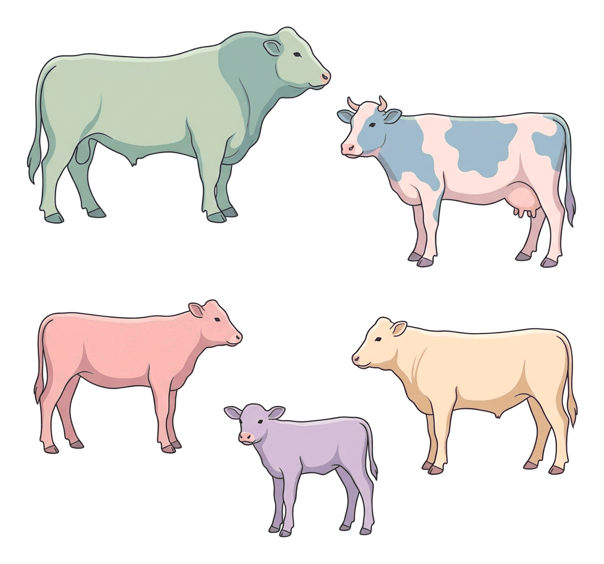
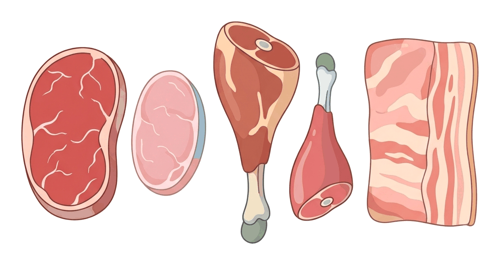

# JAMB Agricultural Science Notes: General Terminologies in Animal Production

## What JAMB expects

This topic is Section C, Topic 2 of the JAMB Agricultural Science syllabus: General Terminologies in Animal Production. It has one main content area:

- **Common terms used in animal husbandry**, e.g., *calving, kidding, castrate, tupping, veal, mutton*, etc.

By the end of these notes, you should be able to:

1. Distinguish between the various terms in animal husbandry.

## Common terms used in animal husbandry

Animal husbandry is the branch of agriculture concerned with the breeding, feeding, care, and management of farm animals. Over time, farmers and scientists have developed specific words (terminologies) to describe animals based on their species, age, sex, reproductive status, and the products we get from them. 

Instead of just saying "a male sheep" or "baby pig", we use specific words like **ram** and **piglet**. Knowing these terms is very important for proper farm record keeping, communication among farmers, and passing your JAMB exams. 

Before we look at the specific animals, let us define some general terms that apply across many types of livestock:

- **Sire:** The male parent of an animal.
- **Dam:** The female parent of an animal.
- **Offspring:** The young one produced by the parents.
- **Castration:** The process of removing the testicles of a male animal (or the ovaries of a female, though this is rare in farm animals) to stop it from reproducing. A male animal that has undergone this process is called a **castrate**. This makes the animal more docile (calmer) and improves meat quality.
- **Parturition:** The general term for the act of giving birth in animals.
- **Gestation:** The period of pregnancy, from fertilization to birth.
- **Lactation:** The period when a female animal produces milk to feed her young.
- **Mating / Copulation:** The physical act of sexual reproduction between a male and a female.
- **Weaning:** The process of separating a young animal from its mother so it stops drinking her milk and starts eating solid feed.
- **Culling:** Removing sick, old, or unproductive animals from the herd or flock.

## Distinguishing between the various terms in animal husbandry

**Objective: distinguish between the various terms in animal husbandry.**

To properly distinguish between these terminologies, we will group them by the species of the farm animal. We will look at cattle, sheep, goats, pigs, poultry, rabbits, and horses. 

### 1. Cattle (Bovines)
Cattle are large ruminant animals kept for meat, milk, and draught power (work). Common breeds in Nigeria include the White Fulani and Sokoto Gudali.

| Category | Term | Meaning |
| :--- | :--- | :--- |
| **Adult Male** | Bull | An adult male cattle that has not been castrated. |
| **Adult Female** | Cow | A mature female cattle that has given birth to at least one calf. |
| **Young Female** | Heifer | A young female cattle that has not yet given birth. |
| **Young Animal** | Calf | A young baby cattle (male or female). |
| **Castrated Male** | Steer / Bullock | A male cattle castrated when young (Steer) or when older/used for work (Bullock). |
| **Act of Mating** | Serving | The act of a bull mating with a cow or heifer. |
| **Act of Giving Birth**| Calving | The act of giving birth in cattle. |
| **Meat (Adult)** | Beef | Meat from an adult cattle. |
| **Meat (Young)** | Veal | Meat from a young calf. |
| **Group Name** | Herd | A group of cattle. |

### 2. Sheep (Ovines)
Sheep are small ruminants mostly kept for meat, wool, and sometimes milk. A common Nigerian breed is the Yankasa or Balami.

| Category | Term | Meaning |
| :--- | :--- | :--- |
| **Adult Male** | Ram | An adult male sheep that has not been castrated. |
| **Adult Female** | Ewe | A mature female sheep. |
| **Young Animal** | Lamb | A young baby sheep (under one year old). |
| **Castrated Male** | Wether | A male sheep castrated when young. |
| **Act of Mating** | Tupping | The act of mating in sheep. |
| **Act of Giving Birth**| Lambing | The act of giving birth in sheep. |
| **Meat (Adult)** | Mutton | Meat from a mature sheep. |
| **Meat (Young)** | Lamb | Meat from a young sheep. |
| **Group Name** | Flock | A group of sheep. |

### 3. Goats (Caprines)
Goats are hardy small ruminants very common in Nigeria (such as the West African Dwarf and the Red Sokoto).

| Category | Term | Meaning |
| :--- | :--- | :--- |
| **Adult Male** | Buck (or Billy) | An adult male goat that has not been castrated. |
| **Adult Female** | Doe (or Nanny) | A mature female goat. |
| **Young Animal** | Kid | A young baby goat. |
| **Castrated Male** | Wether | A male goat castrated when young. (Same term as in sheep). |
| **Act of Mating** | Serving / Mating | The act of mating in goats. |
| **Act of Giving Birth**| Kidding | The act of giving birth in goats. |
| **Meat** | Chevon | Meat from a goat. (Sometimes generally called "goat meat" in Nigeria). |
| **Group Name** | Herd / Flock | A group of goats. |

### 4. Pigs (Swine / Porcines)
Pigs are non-ruminant animals raised primarily for meat. 

| Category | Term | Meaning |
| :--- | :--- | :--- |
| **Adult Male** | Boar | An uncastrated adult male pig. |
| **Adult Female** | Sow | A mature female pig that has given birth (farrowed). |
| **Young Female** | Gilt | A young female pig that has not yet given birth. |
| **Young Animal** | Piglet | A young baby pig. |
| **Castrated Male** | Barrow / Hog | A male pig castrated before maturity (Barrow) or an older pig (Hog). |
| **Act of Mating** | Mating | The act of mating in pigs. |
| **Act of Giving Birth**| Farrowing | The act of giving birth in pigs. |
| **Meat** | Pork / Bacon / Ham| Pork is fresh pig meat. Bacon is cured meat from the back/sides. Ham is from the thigh. |
| **Group Name** | Drove / Herd | A group of pigs. |

### 5. Poultry (Fowls / Avians)
Poultry refers to domesticated birds kept for eggs or meat, especially chickens.

| Category | Term | Meaning |
| :--- | :--- | :--- |
| **Adult Male** | Cock (or Rooster)| A mature male chicken. |
| **Adult Female** | Hen | A mature female chicken that is laying eggs. |
| **Young Male** | Cockerel | A young male chicken. |
| **Young Female** | Pullet | A young female chicken that has not yet started laying eggs. |
| **Young Animal** | Chick | A newly hatched or very young chicken. |
| **Castrated Male** | Capon | A male chicken castrated to make it grow fatter for meat. |
| **Act of Mating** | Treading | The act of a cock mating with a hen. |
| **Act of Giving Birth**| Hatching | The process of a chick coming out of the egg. (Birds do not give live birth). |
| **Meat** | Chicken | Meat from a fowl. |
| **Group Name** | Flock | A group of birds. |

### 6. Rabbits
Rabbits are small non-ruminants kept for their highly nutritious white meat and sometimes fur.

| Category | Term | Meaning |
| :--- | :--- | :--- |
| **Adult Male** | Buck | A mature male rabbit. (Same term as for goats). |
| **Adult Female** | Doe | A mature female rabbit. (Same term as for goats). |
| **Young Animal** | Kit (or Kitten) | A baby rabbit. |
| **Act of Mating** | Mating | The act of mating in rabbits. |
| **Act of Giving Birth**| Kindling | The act of giving birth in rabbits. |
| **Meat** | Rabbit meat | Meat from a rabbit. |
| **Group Name** | Colony / Warren | A group of rabbits. |

### 7. Horses (Equines)
Horses are kept mainly for transportation, work, and sports. 

| Category | Term | Meaning |
| :--- | :--- | :--- |
| **Adult Male** | Stallion | An uncastrated adult male horse. |
| **Adult Female** | Mare | A mature female horse. |
| **Young Male** | Colt | A young male horse. |
| **Young Female** | Filly | A young female horse. |
| **Young Animal** | Foal | A baby horse of either sex. |
| **Castrated Male** | Gelding | A castrated male horse. |
| **Act of Mating** | Covering / Serving| The act of mating in horses. |
| **Act of Giving Birth**| Foaling | The act of giving birth in horses. |

### Summary Comparison Table for Easy Memorization

Here is a quick reference table comparing the most important terms across the main farm animals. Examiners love to test you on the differences in these names.

| Animal | Male | Female | Young | Castrate | Parturition (Birth)| Meat |
| :--- | :--- | :--- | :--- | :--- | :--- | :--- |
| **Cattle** | Bull | Cow | Calf | Steer | Calving | Beef / Veal |
| **Sheep** | Ram | Ewe | Lamb | Wether | Lambing | Mutton / Lamb |
| **Goat** | Buck | Doe | Kid | Wether | Kidding | Chevon |
| **Pig** | Boar | Sow | Piglet | Barrow | Farrowing | Pork / Bacon |
| **Poultry**| Cock | Hen | Chick | Capon | Hatching | Chicken |
| **Rabbit** | Buck | Doe | Kit | - | Kindling | Rabbit |
| **Horse** | Stallion| Mare | Foal | Gelding | Foaling | Horse meat |

## Key terms

| Term | Meaning |
| --- | --- |
| Animal husbandry | The breeding, feeding, and management of farm animals. |
| Sire | The male parent of an animal. |
| Dam | The female parent of an animal. |
| Castrate | A male animal whose testicles have been removed to prevent reproduction. |
| Tupping | The act of mating in sheep. |
| Veal | Meat from a young calf (young cattle). |
| Mutton | Meat from a mature adult sheep. |
| Chevon | Meat from a goat. |
| Heifer | A young female cattle that has not yet given birth to a calf. |
| Gilt | A young female pig that has not yet given birth to a piglet. |
| Pullet | A young female chicken that has not yet started laying eggs. |
| Farrowing | The act of giving birth in pigs. |
| Kindling | The act of giving birth in rabbits. |
| Capon | A castrated male fowl (chicken). |

## Exam tips and common mistakes

- **Do not confuse "Tupping" and "Treading":** Tupping is mating in **sheep**. Treading is mating in **poultry**.
- **Know your castrates:** A castrated cattle is a **Steer**, a castrated pig is a **Barrow**, a castrated sheep or goat is a **Wether**, and a castrated chicken is a **Capon**. This is a very common exam question.
- **Differentiate young females:** A **Heifer** is for cattle, a **Gilt** is for pigs, and a **Pullet** is for chickens. They all mean a female that has not yet reproduced or laid eggs.
- **Chevon vs Mutton:** Chevon is **goat meat**. Mutton is adult **sheep meat**. Do not mix them up just because both are small ruminants.
- **Veal vs Beef:** Both come from cattle, but veal is from a **calf** (young) and beef is from an **adult**.
- **Rabbit and Goat share terms:** Both adult males are called **Bucks**, and both adult females are called **Does**. Read the exam question carefully to know which animal is being asked about based on other clues.

## Quick summary

1. Animal husbandry uses specific terminologies to identify animals by their species, sex, age, and reproductive status.
2. In cattle, a male is a bull, a female is a cow, a young female is a heifer, birth is calving, and meat is beef (adult) or veal (calf).
3. In sheep, a male is a ram, a female is a ewe, a castrated male is a wether, mating is tupping, and meat is mutton.
4. In goats, a male is a buck, a female is a doe, a young one is a kid, birth is kidding, and meat is chevon.
5. In pigs, a male is a boar, a female is a sow, a young female is a gilt, a castrate is a barrow, birth is farrowing, and meat is pork.
6. In poultry, a young female is a pullet, a castrated male is a capon, and mating is treading.
7. In rabbits, a young one is a kit, and giving birth is called kindling.

## Practice questions

**1. A castrated male fowl is referred to as a**
- A. wether
- B. capon
- C. steer
- D. barrow

**Answer: B.** A capon is a castrated male chicken. A wether is for sheep/goats, a steer is for cattle, and a barrow is for pigs.

**2. The meat obtained from an adult sheep is known as**
- A. beef
- B. veal
- C. chevon
- D. mutton

**Answer: D.** Mutton is the meat of a mature sheep. Beef is adult cattle, veal is young cattle, and chevon is goat meat.

**3. The act of giving birth in pigs is called**
- A. farrowing
- B. kindling
- C. calving
- D. kidding

**Answer: A.** Farrowing is giving birth in pigs. Kindling is for rabbits, calving is for cattle, and kidding is for goats.

**4. The term "tupping" refers to the act of mating in**
- A. cattle
- B. pigs
- C. sheep
- D. poultry

**Answer: C.** Tupping is the specific term used for the act of mating in sheep. Mating in poultry is treading, and in cattle, it is serving.

**5. A young female cattle that has not yet given birth is called a**
- A. pullet
- B. gilt
- C. ewe
- D. heifer

**Answer: D.** A heifer is a young female cattle before her first calving. A pullet is for chickens, a gilt is for pigs, and an ewe is an adult female sheep.

**6. Which of the following correctly pairs an animal with its castrated male term?**
- A. Pig - Steer
- B. Sheep - Wether
- C. Goat - Barrow
- D. Cattle - Capon

**Answer: B.** A castrated male sheep (or goat) is a wether. A castrated pig is a barrow, a castrated cattle is a steer, and a castrated poultry bird is a capon.

**7. The meat of a young calf is known as**
- A. veal
- B. pork
- C. chevon
- D. mutton

**Answer: A.** Veal is the meat from a young calf (cattle). This is distinct from beef, which comes from an adult cattle.

**8. The general term used to describe the act of giving birth in rabbits is**
- A. farrowing
- B. lambing
- C. hatching
- D. kindling

**Answer: D.** Kindling is the term for giving birth in rabbits. The young baby rabbit is called a kit or kitten.

**9. An uncastrated adult male goat is known as a**
- A. ram
- B. boar
- C. buck
- D. stallion

**Answer: C.** An intact (uncastrated) adult male goat is a buck. A ram is for sheep, a boar is for pigs, and a stallion is for horses.

**10. What is the general term for a female animal that has produced offspring?**
- A. Sire
- B. Dam
- C. Gilt
- D. Heifer

**Answer: B.** The female parent of an animal is generally referred to as the dam, while the male parent is the sire. Gilts and heifers have not yet given birth.
