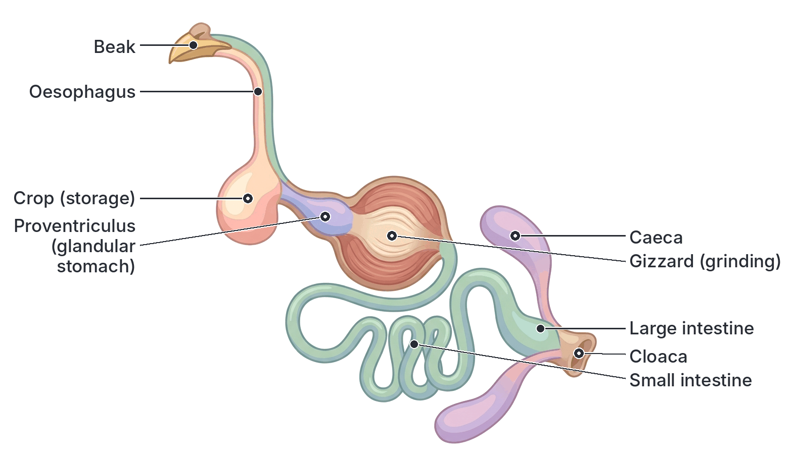
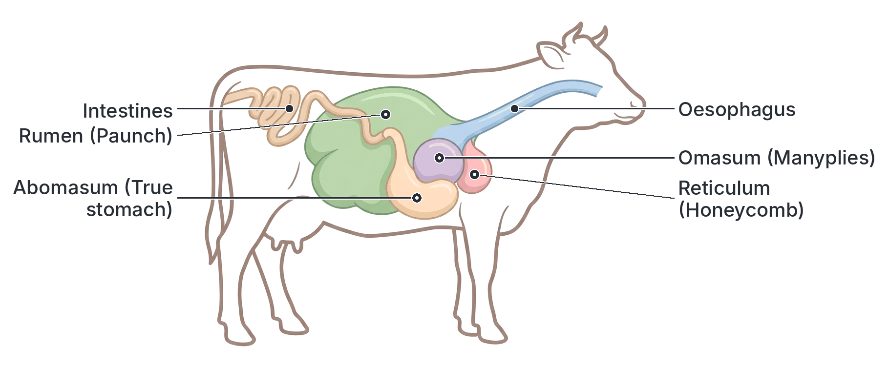

# JAMB Agricultural Science Notes: Anatomy and Physiology of Farm Animals

## What JAMB expects

This topic is Section C, Topic 3 of the JAMB Agricultural Science syllabus: Anatomy and physiology of farm animals. It covers the following content items:

- **a.** Functions of tissues and organs of farm animals
- **b.** Animal body systems e.g. digestive (ruminants and non-ruminants), reproductive, respiratory, urinary (excretory) and nervous systems.
- **c.** Effect of environmental changes on physiological development of farm animals e.g. climate change (temperature, relative humidity, light, e.t.c.)

By the end of these notes, you should be able to:

1. Distinguish between various functions of tissues and organs.
2. Compare different body systems in farm animals.
3. Determine the effects of climate change on farm animals.

**Note on the syllabus wording:**
The syllabus lists temperature, relative humidity and light as examples of "climate change". Strictly speaking, these are *elements of climate* (daily weather conditions), while *climate change* refers to long-term shifts in these elements over decades. JAMB expects you to understand how the daily elements of climate affect farm animals, as well as the broad impact of long-term climate change. Also, "e.t.c." is a typographical error in the syllabus for "etc.". While the reproductive system is mentioned here, it is covered in much greater detail in `C4-reproduction-in-farm-animals.md`.

## Functions of tissues and organs of farm animals

Anatomy is the study of the **structure** of the body (how it is built), while physiology is the study of how those structures **function** (how they work). The animal body is organised in levels, from the simplest to the most complex: **Cells $\rightarrow$ Tissues $\rightarrow$ Organs $\rightarrow$ Systems $\rightarrow$ Organism**. 

A **tissue** is a group of similar cells working together to perform a specific function. An **organ** is a structure made up of two or more different tissues working together to perform a more complex function. 

### Distinguishing between various functions of tissues and organs

To understand how an animal's body works, you must be able to distinguish between the roles of its basic building blocks: tissues and organs.

#### Tissues in farm animals and their functions
The animal body has four primary types of tissue, which can be distinguished by their distinct roles:

| Type of Tissue | Identifying Function | Examples in the Farm Animal |
| --- | --- | --- |
| **Epithelial tissue** | **Covers** the outside of the body and **lines** internal organs. It protects against injury and infection, secretes juices, and absorbs nutrients. | Skin surface, lining of the stomach and intestines. |
| **Connective tissue** | **Connects, supports, and binds** other tissues or organs together. It also transports substances and stores energy. | Bone, cartilage, blood (liquid connective tissue), adipose (fat) tissue, tendons, ligaments. |
| **Muscular tissue** | **Contracts** to cause movement of the body or internal organs. | Skeletal muscle (the meat we eat), smooth muscle (in the walls of intestines), cardiac muscle (in the heart). |
| **Nervous tissue** | **Detects stimuli** and **transmits electrical signals** (impulses) to coordinate body actions. | Brain tissue, spinal cord, peripheral nerves. |

#### Major organs of farm animals and their functions
You must be able to distinguish the distinct physiological roles of different organs:

- **Heart:** A muscular pump that pushes blood throughout the body to supply cells with oxygen and nutrients, and remove carbon (IV) oxide and wastes.
- **Lungs:** The primary organs of respiration where gas exchange takes place (oxygen from the air enters the blood, and carbon (IV) oxide leaves the blood).
- **Liver:** The largest internal organ, acting as a chemical factory. It produces bile (for fat digestion), detoxifies poisons, stores glycogen (energy), iron, and vitamins, and produces metabolic heat.
- **Kidneys:** The body's filters. They remove waste products (like urea) from the blood to form urine and help maintain the body's water and salt balance (osmoregulation).
- **Stomach and Intestines:** Tubular organs that break down food physically and chemically, and absorb the resulting nutrients into the bloodstream.
- **Brain:** The main control centre. It processes sensory information and coordinates all voluntary and involuntary body activities.
- **Skin:** The largest organ overall. It protects internal structures, prevents dehydration, and plays a major role in regulating body temperature (e.g., through sweating in cattle and horses).

## Animal body systems

A **system** is a group of organs that work together sequentially or cooperatively to perform a major bodily function.

### The Digestive System

The digestive system breaks down complex food substances into simple, soluble forms that can be absorbed into the blood. Farm animals are broadly classified into two groups based on their digestive systems: **ruminants** (polygastric) and **non-ruminants** (monogastric).

#### Non-ruminant (Monogastric) Digestive System
Non-ruminants have a simple stomach with only **one compartment**. Examples include pigs, rabbits, and humans. Poultry (birds) are also non-ruminants but have a highly modified digestive tract because they have no teeth.

**Step-by-step digestion in the pig (a typical monogastric):**
1. **Mouth:** Food is chewed by teeth to break it down physically. Saliva mixes with the food, adding the enzyme ptyalin (amylase), which begins the chemical breakdown of starch.
2. **Oesophagus:** A muscular tube that pushes food to the stomach by wave-like contractions called peristalsis.
3. **Stomach:** Secretes gastric juice containing hydrochloric acid (HCl) and enzymes (pepsin and rennin). The acid kills bacteria and provides the right pH for protein digestion to begin.
4. **Small intestine:** The main site of digestion and absorption. It receives bile from the liver (which emulsifies or breaks down fats into tiny droplets) and pancreatic juice from the pancreas (containing enzymes for carbohydrates, proteins, and fats). Nutrients are absorbed into the blood through tiny finger-like projections called **villi**.
5. **Large intestine:** Absorbs water from the remaining indigestible food to form solid faeces (dung), which pass out through the anus.

**Step-by-step digestion in poultry (avian system):**
1. **Beak and Mouth:** Birds peck their food. Since they have no teeth, they swallow food whole.
2. **Crop:** A swollen sac in the neck that stores the swallowed food, moistens it, and softens it.
3. **Proventriculus (True stomach):** The glandular stomach where digestive enzymes and acids are secreted to mix with the food.
4. **Gizzard (Ventriculus):** A thick, highly muscular organ containing small stones (grit) that the bird has swallowed. Since birds cannot chew, the strong muscles of the gizzard grind the food against the stones to crush it mechanically.
5. **Small Intestine:** Digestion is completed here, and nutrients are absorbed.
6. **Caeca (plural of caecum):** Two blind pouches at the junction of the small and large intestines. Here, bacteria ferment a small amount of fibre.
7. **Cloaca:** A common exit chamber for digestive, urinary, and reproductive tracts. Faeces and urine (uric acid) are mixed and excreted together as droppings.

#### Ruminant (Polygastric) Digestive System
Ruminants are animals that "chew the cud". They have a complex stomach divided into **four compartments**, allowing them to digest large amounts of fibrous plant materials (grasses) using microorganisms. Examples include cattle (e.g., White Fulani, Sokoto Gudali), sheep, and goats (e.g., West African Dwarf, Red Sokoto).

**The Four Compartments of the Ruminant Stomach:**
1. **Rumen (Paunch):** The largest compartment. It acts as a massive fermentation vat. It contains billions of bacteria, protozoa, and fungi that ferment cellulose (plant fibre) into volatile fatty acids, which the animal absorbs for energy. 
2. **Reticulum (Honeycomb):** Has a honeycomb-like lining. It traps foreign objects (like nails, stones, or wire) swallowed by the animal (hence it is sometimes called the "hardware stomach"). It works with the rumen to form small balls of food called **cud**.
3. **Omasum (Manyplies):** Contains many leaf-like folds of tissue. Its main function is to squeeze out and absorb water from the fermented feed.
4. **Abomasum (True stomach):** This is the only compartment with glands. It functions exactly like the stomach of a monogastric animal, secreting hydrochloric acid and enzymes to digest proteins. (The microbes that wash out of the rumen are digested here, providing the cow with a massive source of high-quality protein).

**Step-by-step process of Rumination (Chewing the cud):**
1. The animal grazes quickly, swallowing grass with very little chewing.
2. The grass enters the **rumen** where microbes begin fermentation.
3. Later, when resting, the animal regurgitates (brings up) the partly digested grass from the rumen/reticulum back into its mouth. This is the **cud**.
4. The animal chews the cud thoroughly for a long time to physically break down the tough plant fibres.
5. The finely chewed cud is re-swallowed, allowing the microbes in the rumen to break it down more efficiently.

### The Circulatory System
The circulatory system acts as the body's transport network. It carries oxygen, digested nutrients, and hormones to all cells, and takes away carbon (IV) oxide and metabolic wastes. It consists of the **heart**, **blood vessels** (arteries carrying blood away from the heart, veins carrying blood back, and tiny capillaries where exchange occurs), and the **blood** itself.

### The Respiratory System
This system handles gas exchange. 
- Air enters the **nostrils (nares)** $\rightarrow$ **pharynx** (throat) $\rightarrow$ **larynx** (voice box) $\rightarrow$ **trachea** (windpipe).
- The trachea splits into two **bronchi**, which enter the **lungs** and branch into tiny tubes ending in air sacs called **alveoli**.
- Oxygen diffuses across the thin walls of the alveoli into the blood, while carbon (IV) oxide diffuses out of the blood into the lungs to be exhaled. 

### The Urinary (Excretory) System
The urinary system removes toxic metabolic waste from the body. 
- **Kidneys:** Two bean-shaped organs that filter the blood. They remove urea, excess salts, and water to form urine.
- **Ureters:** Tubes that carry urine from the kidneys to the bladder.
- **Urinary Bladder:** A sac that temporarily stores urine (note: birds do not have a bladder).
- **Urethra:** A tube through which urine leaves the body. 

**Avian difference:** Poultry do not produce liquid urine. Birds excrete nitrogenous waste mainly as a thick, white paste called **uric acid** to conserve water. This goes straight into the cloaca and coats the faeces.

### The Nervous System
The nervous system detects changes in the environment and coordinates the animal's responses. 
- **Central Nervous System (CNS):** The **brain** and the **spinal cord**. It processes information and makes decisions.
- **Peripheral Nervous System (PNS):** The **nerves** connecting the CNS to the rest of the body. Sensory nerves bring information in, and motor nerves send commands out to muscles.

### The Reproductive System
This system ensures the continuation of the species. 
- In males, the **testes** produce sperm cells and the hormone testosterone. 
- In females, the **ovaries** produce egg cells (ova) and hormones like oestrogen. 

### Comparing different body systems in farm animals

To fully grasp animal physiology, you must be able to compare what each system is fundamentally responsible for, and how the digestive systems differ between animals. They do not work in isolation but have distinct core tasks.

**Comparing the main physiological functions of the body systems:**

| Body System | Main Organs Involved | Primary Function in the Animal |
| --- | --- | --- |
| **Digestive** | Stomach, intestines, liver, pancreas | Breaks down feed into soluble nutrients and absorbs them. |
| **Respiratory** | Trachea, lungs, diaphragm | Exchanges gases (brings in oxygen, removes carbon (IV) oxide). |
| **Circulatory** | Heart, arteries, veins, blood | Transports nutrients, gases, hormones, and wastes around the body. |
| **Urinary** | Kidneys, bladder, ureters | Filters blood to remove metabolic wastes and regulates water balance. |
| **Nervous** | Brain, spinal cord, nerves | Controls and coordinates rapid body responses via electrical impulses. |
| **Reproductive** | Testes, ovaries, uterus | Produces gametes (sperm and eggs) and supports the developing embryo. |

**Comparing Ruminant and Non-Ruminant Digestive Systems:**

| Feature | Ruminants (Cattle, Sheep, Goats) | Non-ruminants (Pigs, Poultry) |
| --- | --- | --- |
| **Stomach compartments** | Four (Rumen, Reticulum, Omasum, Abomasum) | One simple stomach (Monogastric) |
| **Rumination (cud-chewing)** | Present | Absent |
| **Digestion of cellulose** | High ability (due to rumen microbes) | Low ability (cannot properly digest roughage, except slightly in the caecum/large intestine) |
| **Saliva production** | Very large quantities (to buffer rumen acids) | Smaller quantities |
| **Microbial fermentation** | Occurs *before* the true stomach (foregut fermentation) | Minimal; occurs *after* the true stomach (hindgut fermentation) |

## Effect of environmental changes on physiological development of farm animals

Farm animals are highly sensitive to their environment. They perform best within a "comfort zone" of weather conditions. When environmental conditions change rapidly or drastically, their normal physiological processes (growth, reproduction, digestion) are disrupted.

### Elements of Climate and their Effects
While the syllabus uses the term "climate change", it lists temperature, relative humidity, and light. These are actually **elements of climate** (the components that make up daily weather and long-term climate). 

**1. Temperature**
- **High temperatures (Heat Stress):** When it is extremely hot, animals eat less feed to prevent producing metabolic heat from digestion. They drink much more water. To cool down, poultry and dogs pant rapidly, while cattle and horses sweat. High temperatures slow down growth, reduce milk yield, and cause hens to lay fewer eggs with thinner shells. Extreme heat can lead to death.
- **Low temperatures (Cold Stress):** When it is cold, animals eat more feed just to generate body heat. This is inefficient for the farmer because the feed is burned for warmth rather than being converted to meat or milk. Piglets and chicks are very susceptible to cold and can easily die without artificial heating (brooding).

**2. Relative Humidity**
- Relative humidity is the amount of moisture in the air. 
- **High humidity combined with high temperature** is extremely dangerous. Animals rely on evaporating water from their lungs (panting) or skin (sweating) to cool down. If the air is already saturated with moisture (high humidity), sweat cannot evaporate, and the animal can suffer heatstroke. 
- High humidity also encourages the rapid multiplication of disease-causing fungi (mould in feed), bacteria, and parasites (like ticks and worms).

**3. Light**
- Light determines the **photoperiod** (day length), which directly triggers hormonal changes in animals.
- **Poultry:** Light stimulates the pituitary gland in hens to release hormones required for ovulation and egg formation. Commercial layers need about 14 to 16 hours of continuous light per day for maximum egg production. If daylight drops, egg production drops drastically.
- **Sheep and Goats:** In temperate regions, changes in daylight length trigger the breeding season.

**4. Wind and Rainfall**
- Moderate wind helps to cool animals in hot weather. However, cold, strong winds cause "wind chill", leading to respiratory diseases like pneumonia.
- Rainfall determines pasture availability. Good rains mean lush grass for ruminants. However, heavy rains create muddy conditions that cause foot rot in cattle and sheep, and provide breeding grounds for mosquitoes and tsetse flies.

### Determine the effects of climate change on farm animals

True **climate change** refers to the long-term, global shift in these weather patterns over decades. When determining its effect on farm animals, especially in West Africa, the impacts are severe and long-lasting:

1. **Drought and Desertification:** Reduced annual rainfall in areas like the Sahel savanna dries up water sources and kills pasture. This forces nomadic herdsmen to migrate southwards in search of fodder, often leading to severe farmer-herder conflicts and weight loss in livestock.
2. **Heatwaves:** More frequent days of extreme heat push animals beyond their physiological limits, permanently lowering the overall productivity (meat, milk, and egg yields) of the national herd.
3. **Shift in Disease Patterns:** Warmer average temperatures allow disease vectors like ticks, mosquitoes, and tsetse flies to survive in new geographical areas where they previously could not live, exposing naive livestock populations to new diseases (like trypanosomiasis).
4. **Flooding:** Extreme, sudden rainfall events wash away livestock, destroy farm buildings, and contaminate drinking water supplies with sewage, leading to outbreaks of waterborne diseases.

## Key terms

| Term | Meaning |
| --- | --- |
| Anatomy | The study of the structure of body parts and their relationships to one another. |
| Physiology | The study of the normal functions of living organisms and their organs. |
| Monogastric | An animal with a simple, single-chambered stomach (e.g., pigs, poultry). |
| Ruminant | A hoofed animal with a four-compartment stomach that chews the cud (e.g., cattle, sheep). |
| Rumination | The process of regurgitating, re-chewing, and re-swallowing partly digested food. |
| Villi | Tiny, finger-like projections in the small intestine that increase surface area for nutrient absorption. |
| Proventriculus | The glandular (true) stomach of a bird, where digestive juices are secreted. |
| Gizzard | The thick, muscular organ in birds used for grinding up food with swallowed stones. |
| Photoperiod | The duration of an organism's daily exposure to light, affecting physiological functions like laying eggs. |
| Heat stress | A physiological condition where an animal is unable to cool itself adequately, reducing its productivity and threatening its life. |

## Exam tips and common mistakes

- **Rumen vs. Abomasum:** A very common mistake is mixing up the ruminant stomach compartments. Remember: the **rumen** is the fermentation vat (contains microbes); the **abomasum** is the true, glandular stomach (produces acids and enzymes like a human stomach).
- **Hardware stomach:** The **reticulum** is called the hardware stomach because heavy objects like nails or stones drop into it.
- **Poultry digestion sequence:** Birds do not chew in their mouth. Remember the exact sequence: Crop (stores/softens) $\rightarrow$ Proventriculus (enzymes/acids) $\rightarrow$ Gizzard (grinds).
- **Excretion in birds:** Birds excrete a mixture of faeces and urine (uric acid) through the **cloaca**. Do not choose options that say birds have a bladder or produce liquid urine.
- **Climate elements vs. Climate change:** Temperature, light, and humidity are *elements of climate*. *Climate change* is the long-term shift causing droughts, floods, and disease spread. JAMB tests both concepts under this topic.
- **Veins vs. Arteries:** Arteries carry blood *away* from the heart. Veins carry blood *to* the heart. The common mistake is thinking all arteries carry oxygenated blood; remember the pulmonary artery carries deoxygenated blood to the lungs.

## Quick summary

1. The animal body consists of four basic tissues (epithelial, connective, muscular, and nervous) that form organs (like the heart, liver, and lungs), which group into functional body systems.
2. The digestive system of non-ruminants (pigs) has a single stomach. Poultry use a modified system: crop for storage, proventriculus for enzymes, and gizzard for grinding.
3. Ruminants (cattle, sheep, goats) have a four-chambered stomach (rumen, reticulum, omasum, abomasum). They chew the cud and use microbes in the rumen to ferment plant fibre.
4. Each body system has a distinct role: the circulatory system transports, the respiratory system exchanges gases, the urinary system filters waste, and the nervous system coordinates responses.
5. Mammals excrete liquid urine (containing urea) from the kidneys via the bladder. Birds excrete semi-solid uric acid directly into the cloaca to conserve water.
6. Daily climate elements directly affect physiology. High temperatures cause heat stress, reducing feed intake and productivity. Light duration strictly controls egg production in poultry.
7. Long-term climate change leads to severe droughts, heatwaves, and flooding, which destroy pasture, reduce water availability, and spread disease vectors to new areas.

## Practice questions

**1. The tissue responsible for transmitting electrical impulses to coordinate the body's actions is the**
- A. epithelial tissue
- B. nervous tissue
- C. muscular tissue
- D. connective tissue

**Answer: B.** Nervous tissue (found in the brain, spinal cord, and nerves) detects stimuli and transmits electrical signals. Epithelial tissue covers, muscular tissue contracts, and connective tissue binds organs.

**2. Which of the following organs is correctly matched with its primary physiological function?**
- A. Liver – pumps blood around the body
- B. Kidney – filters metabolic waste to form urine
- C. Heart – detoxifies poisonous substances
- D. Lungs – chemically digests protein

**Answer: B.** The kidney filters the blood to excrete waste like urea. The liver detoxifies poisons, the heart pumps blood, and the lungs exchange gases.

**3. In the digestive system of poultry, the organ responsible for the mechanical grinding of food is the**
- A. crop
- B. proventriculus
- C. gizzard
- D. caecum

**Answer: C.** The gizzard (ventriculus) is highly muscular and uses swallowed stones/grit to mechanically grind food, compensating for the bird's lack of teeth. 

**4. The true, glandular stomach of a ruminant animal is the**
- A. rumen
- B. reticulum
- C. omasum
- D. abomasum

**Answer: D.** The abomasum is the true stomach because it secretes digestive juices (hydrochloric acid and enzymes), just like the stomach of a monogastric animal. The rumen is for microbial fermentation.

**5. Which of the following best describes the process of rumination in cattle?**
- A. Swallowing food quickly without chewing it at all
- B. Passing food directly from the mouth to the abomasum
- C. Regurgitating partly digested feed to re-chew it thoroughly
- D. Fermenting food in the large intestine

**Answer: C.** Rumination, or "chewing the cud", is the process where a ruminant brings partly digested grass back up from the rumen to chew it thoroughly, breaking down tough fibres.

**6. An adult laying hen requires about 14 to 16 hours of daily light primarily because light**
- A. keeps the bird warm during cold nights
- B. helps the bird to digest its feed
- C. prevents the bird from being attacked by predators
- D. stimulates hormonal release necessary for egg production

**Answer: D.** Photoperiod (day length) directly affects the pituitary gland, triggering the release of hormones that control ovulation and egg production in poultry.

**7. How do high environmental temperatures generally affect the feeding habits of farm animals?**
- A. They increase feed intake to produce more body heat.
- B. They reduce feed intake to minimize metabolic heat production.
- C. They decrease water intake to prevent sweating.
- D. They cause animals to seek out roughage to chew.

**Answer: B.** During heat stress, animals reduce their feed intake because digesting food generates internal metabolic heat, which they want to avoid when the environment is already too hot.

**8. Which system is responsible for taking in oxygen and expelling carbon (IV) oxide?**
- A. Circulatory system
- B. Respiratory system
- C. Excretory system
- D. Nervous system

**Answer: B.** The respiratory system (lungs, trachea) handles gas exchange. The circulatory system transports these gases in the blood, while the excretory system removes liquid metabolic waste.

**9. The excretory product of the avian (poultry) kidney is**
- A. liquid urea stored in the bladder
- B. uric acid passed out through the cloaca
- C. ammonia secreted through the skin
- D. sweat excreted through pores

**Answer: B.** Birds conserve water by converting nitrogenous waste into a semi-solid white paste called uric acid, which empties into the cloaca. Birds do not possess a urinary bladder.

**10. A major effect of long-term climate change in the savanna zones of West Africa is**
- A. improved rumination in cattle due to hotter weather
- B. an increase in the thickness of eggshells in poultry
- C. prolonged droughts leading to scarcity of pasture and water
- D. eradication of disease-carrying insects

**Answer: C.** Climate change in the savanna primarily causes reduced rainfall and prolonged droughts, which dry up drinking water and kill grazing pasture, leading to starvation and farmer-herder conflicts. Warmer weather actually increases disease-carrying insects and causes thinner eggshells due to heat stress.
