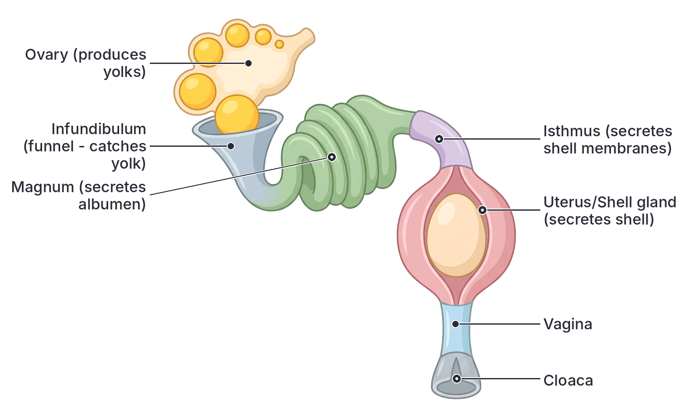

# JAMB Agricultural Science Notes: Reproduction in Farm Animals

## What JAMB expects

This topic is part of Section C, Topic 4 of the JAMB Agricultural Science syllabus: Reproduction in farm animals.

The syllabus covers three main content areas:
- **a.** Gametogenesis, oestrus cycle, signs of heat and heat periods, secondary sexual characters, gestation periods, parturition and the role of hormones in reproduction.
- **b.** Development, nourishment and birth of the young. Mammary glands and lactation in farm animals.
- **c.** Egg formation, incubation and hatching in poultry.

By the end of these notes, you should be able to:
1. give an account of the process of reproduction in farm animals.
2. determine the role of hormones in reproduction.
3. trace the development in farm animals from fertilization to birth and care of the young.
4. trace the process of egg formation and incubation in poultry.

**Note on the syllabus wording:** The syllabus lists four objectives, but the last two lack Roman numerals in the official document. In addition, the exact wording provided by JAMB for the objectives in some reference documents cuts off parts of the sentence (e.g., stopping at "birth" instead of "birth and care of the young"). They are all treated as distinct objectives here and covered fully in their own clearly headed sections.

## Process of reproduction in farm animals

**Objective i: give an account of the process of reproduction in farm animals.**

Reproduction is the biological process by which mature animals produce new offspring to ensure the continuation of their species. Without reproduction, a herd or flock would eventually die out, and the farmer would have no animals to replace them or sell.

In farm animals, reproduction is **sexual**, meaning it requires the mating of a male and a female. The male provides the sperm (male sex cell) and the female provides the egg or ovum (female sex cell). When these two cells fuse together, they form a single cell called a zygote, which eventually grows and develops into a new animal. The overall process of reproduction involves several stages: the production of sex cells, mating (or artificial insemination), fertilization, pregnancy (gestation), birth (parturition), and the care and nourishment of the newborn.

### Gametogenesis, oestrus cycle and secondary sexual characters

**Content a: Gametogenesis, oestrus cycle, signs of heat and heat periods, secondary sexual characters, gestation periods, parturition and the role of hormones in reproduction.**

*(Note: Gestation periods and parturition are closely linked to fetal development and birth, so they are explained in detail in the section on development from fertilization to birth below. Hormones are covered in their own dedicated section.)*

#### 1. Gametogenesis
**Gametogenesis** is the process by which specialized sex cells (called **gametes**) are formed in the reproductive organs (gonads) of the parents. This involves a type of cell division called **meiosis**, which halves the number of chromosomes. Thus, when the male and female gametes fuse during fertilization, the normal chromosome number for the species is restored.

There are two types of gametogenesis:
*   **Spermatogenesis:** This is the production of male sperm cells (spermatozoa) in the **testes**. Inside the testes are thousands of tiny, coiled tubes called seminiferous tubules where sperm is continuously produced after the male reaches puberty.
*   **Oogenesis:** This is the production of female egg cells (ova) in the **ovaries**. The eggs develop inside tiny sac-like structures called follicles.

#### 2. Secondary sexual characters
As farm animals grow and reach puberty, chemical messengers (hormones) trigger physical and behavioural changes. The physical features and behaviours that distinguish a mature male from a mature female of the same species are known as **secondary sexual characters**.

| Feature | Mature Male (e.g., Bull, Ram, Buck, Boar) | Mature Female (e.g., Cow, Ewe, Doe, Sow) |
| --- | --- | --- |
| **Body Size and Build** | Generally larger, heavier, and more muscular. Broader head and thicker neck. | Smaller, lighter, and less muscular. Narrower head and smaller neck. |
| **Specific Physical Traits** | In Nigerian Zebu cattle (e.g., White Fulani, Sokoto Gudali), the male has a much larger, prominent hump. Male goats (bucks) often have prominent beards. | The hump in Zebu cows is much smaller. Female goats (does) have less prominent or no beards. |
| **Reproductive Organs** | Visible scrotum (containing testes) and penis. | Visible vulva and a well-developed **udder** (mammary glands). |
| **Voice and Odour** | Deeper voice (bellowing or bleating) and stronger body odour (especially noticeable in bucks/male goats). | Softer voice and a much less intense body odour. |
| **Temperament** | Often aggressive, restless, and territorial. | Generally docile (calm) and exhibits maternal (mothering) instincts. |

#### 3. The Oestrus Cycle, Heat Periods, and Signs of Heat
Unlike human beings, female farm animals do not accept the male for mating at just any time. They only allow mating during a very specific period called **heat** (or oestrus). 

**The Oestrus Cycle:**
The **oestrus cycle** is the time interval between the beginning of one heat period and the beginning of the next. It is controlled by hormones. If a female animal is not pregnant, this cycle repeats continuously throughout her reproductive life.
*   In most farm animals (such as the cow, sow, and doe), the oestrus cycle takes about **21 days**.
*   In sheep (ewe), it is slightly shorter, taking about **17 days**.

**The Heat Period (Oestrus):**
The **heat period** is the specific duration during the oestrus cycle when the female is sexually receptive and will stand to be mated by the male. During this time, **ovulation** (the release of a mature egg from the ovary) occurs.
The duration of the heat period varies depending on the species:
*   **Cow:** 12 to 24 hours
*   **Ewe (Sheep):** 24 to 36 hours
*   **Doe (Goat):** 24 to 48 hours
*   **Sow (Pig):** 2 to 3 days (48 to 72 hours)

**Signs of Heat:**
A livestock farmer must observe their animals closely to detect when a female is in heat. This is especially critical if the farm uses Artificial Insemination (AI), where the semen must be introduced at exactly the right time. The common signs of heat include:
*   **Mounting and standing:** She may mount other animals. Crucially, she exhibits the "standing heat" reflex, meaning she **stands perfectly still** when mounted by other females or a male. This is the most reliable sign of heat.
*   **Vulva changes:** The vulva becomes red, swollen, and secretes a clear, sticky, stringy mucus that often hangs down.
*   **Restlessness:** The animal paces frequently, separates herself from the herd, and makes a lot of noise (bellowing, bleating, or grunting).
*   **Tail wagging:** Frequent twitching or wagging of the tail.
*   **Drop in milk yield:** In lactating females, daily milk production usually drops temporarily.
*   **Loss of appetite:** She may eat less feed than usual because she is distracted.

## Role of hormones in reproduction

**Objective ii: determine the role of hormones in reproduction.**

Reproduction in farm animals is entirely controlled by chemical messengers called **hormones**. These are secreted directly into the bloodstream by ductless glands known as endocrine glands. The major glands involved in reproduction are the **anterior pituitary gland** (located at the base of the brain), the **posterior pituitary gland**, the **testes** (in males), the **ovaries** (in females), and the **placenta** (during pregnancy).

Understanding these hormones is highly tested in JAMB because they dictate everything from sperm production and heat signs to pregnancy maintenance and milk let-down.

| Hormone | Gland / Source | Primary Role in Reproduction |
| --- | --- | --- |
| **Testosterone** | Testes (specifically the Leydig or interstitial cells) | Stimulates spermatogenesis (sperm production). Develops male secondary sexual characters and mating behaviour (libido or sex drive). |
| **Oestrogen** | Ovary (specifically the growing Graafian follicle) | Develops female secondary sexual characters. Brings the female into **heat** (causes the physical and behavioural signs of oestrus). Prepares the uterus to receive a fertilized egg. |
| **Progesterone** | Ovary (Corpus luteum) & Placenta | **Maintains pregnancy.** It stops the oestrus cycle and prevents further ovulation while the animal is pregnant. It also helps develop the mammary glands for milk production. |
| **Follicle Stimulating Hormone (FSH)** | Anterior Pituitary | In females: stimulates the growth and maturation of the egg follicle in the ovary. In males: stimulates sperm production in the testes. |
| **Luteinizing Hormone (LH)** | Anterior Pituitary | In females: triggers **ovulation** (the bursting of the follicle to release the egg) and the formation of the corpus luteum. In males: stimulates the testes to produce testosterone. |
| **Oxytocin** | Posterior Pituitary | Causes the **let-down of milk** (squeezing milk out of the udder) when the young suckles. It also causes strong uterine contractions during birth (parturition). |
| **Prolactin** | Anterior Pituitary | Stimulates the **production and secretion of milk** in the mammary glands after birth. In poultry, it stimulates broodiness (the desire to sit on eggs). |
| **Relaxin** | Ovary & Placenta | Relaxes the pelvic ligaments and widens the cervix at the end of gestation to make birth (parturition) easier. |

## Development in farm animals from fertilization to birth

**Objective: trace the development in farm animals from fertilization to birth and care of the young.**

The journey from a single fertilized cell to a fully developed newborn animal involves several distinct stages that occur inside the female reproductive tract.

#### 1. Fertilization and Implantation
*   **Fertilization:** If a female is mated naturally by a male or artificially inseminated during her heat period, sperm travels up her reproductive tract. Fertilization—the fusion of the male sperm and the female egg—takes place in the **Fallopian tube (oviduct)**. 
*   **Implantation:** The newly fertilized egg (now called a zygote) begins to divide rapidly and moves down into the **uterus (womb)**. After a few days, it attaches itself firmly to the wall of the uterus. This attachment process is called **implantation**. Once implanted, the zygote develops into an embryo, and later, as its organs form, it is called a foetus.

[IMAGE: Diagram of the female reproductive tract of a cow. It shows a Y-shaped structure. The two top branches are the uterine horns leading to thin, winding Fallopian tubes which end in funnel-like structures (infundibulum) wrapping around oval ovaries. The uterine horns join into a common uterine body, followed by a thick muscular cervix, then a wider vagina ending at the vulva. Labels to add: "Ovary (produces eggs)", "Fallopian tube (site of fertilization)", "Uterine horn (where embryo implants in livestock)", "Cervix", "Vagina", "Vulva". Clean flat textbook style, white background.]

#### 2. Gestation Periods
**Gestation** is the period of pregnancy—the time from fertilization until birth. It varies widely among different species of farm animals. You must memorize these approximate textbook values, as they are frequently tested:

| Farm Animal | Approximate Gestation Period | Easy Memory Rule |
| --- | --- | --- |
| **Rabbit (Doe)** | 31 days | ~1 month |
| **Dog (Bitch)** | 63 days | ~2 months |
| **Pig (Sow)** | 114 days | 3 months, 3 weeks, 3 days |
| **Sheep (Ewe)** | 150 days | 5 months |
| **Goat (Doe)** | 150 days | 5 months |
| **Cattle (Cow)** | 283 days | Just over 9 months |
| **Horse (Mare)** | 336 - 340 days | About 11 months |
| **Donkey (Jenny)** | 365 days | exactly 1 year |

*(Note: These figures are averages. A few days earlier or later is completely normal and depends on the breed and litter size).*

#### 3. Parturition (Birth)
**Parturition** is the biological act of giving birth in farm animals. When the gestation period is complete, the hormone progesterone drops, while oxytocin and relaxin levels rise. These hormones initiate strong uterine contractions and open the cervix. The water sac bursts (lubricating the birth canal), and the young animal is pushed out. Shortly after the young is born, the placenta (afterbirth) is expelled.

Each farm animal has a specific term for the act of parturition:
*   **Cattle:** Calving
*   **Sheep:** Lambing
*   **Goats:** Kidding
*   **Pigs:** Farrowing
*   **Rabbits:** Kindling
*   **Horses:** Foaling

**Signs of approaching parturition:** The udder becomes significantly enlarged and filled with milk; the vulva swells and discharges thick mucus; the pelvic ligaments relax (causing a sunken appearance around the tailhead); the animal isolates herself from the rest of the herd; and animals like pigs and rabbits will gather materials to build a nest.

### Nourishment, birth and lactation

**Content b: Development, nourishment and birth of the young. Mammary glands and lactation in farm animals.**

#### 1. Nourishment of the Foetus (During Pregnancy)
While developing in the uterus, the young foetus is enclosed in a water sac filled with **amniotic fluid**. This fluid acts as a crucial shock absorber, protecting the delicate foetus from physical bumps and injuries if the mother moves suddenly.

The foetus is attached to the mother's uterus by the **umbilical cord**, which connects to a highly vascular organ called the **placenta**.
*   **The Placenta:** This is the exchange site where the mother's blood capillaries and the foetus's blood capillaries come very close together (though their blood does not actually mix).
*   **Nourishment and Respiration:** Dissolved nutrients (like glucose and amino acids) and oxygen diffuse from the mother's blood, across the placenta, through the umbilical vein, and into the foetus.
*   **Excretion:** Waste products (like carbon (IV) oxide and urea) pass from the foetus through the umbilical arteries to the mother's blood, where they are removed by the mother's kidneys and lungs.

#### 2. Mammary Glands and Lactation
**Lactation** is the secretion and yielding of milk from the **mammary glands (udder)** of female mammals.
*   **Colostrum:** The very first milk produced by the mother immediately after birth is called colostrum. It is thicker and more yellowish than normal milk. It is absolutely vital for the newborn to consume colostrum within the first few hours of life. Colostrum is exceptionally rich in nutrients and contains **antibodies** that give the newborn temporary, natural immunity against local diseases. It also acts as a natural laxative to help clear the newborn's digestive tract of meconium (waste accumulated during pregnancy).
*   **Milk production and let-down:** The hormone **prolactin** keeps the mammary glands producing milk. When the young animal nudges and suckles the teat, nerve impulses are sent to the mother's brain, releasing **oxytocin**. Oxytocin causes the muscle cells around the milk alveoli to contract, forcing the milk down into the teat canals (a process known as **milk let-down**).

#### 3. Care of the Young
A good farmer must ensure the survival of the newborn by following these steps:
1.  Clear the mucus from the newborn's nose and mouth immediately after birth to help it breathe properly.
2.  Cut the navel (umbilical) cord and dip the stump in iodine to prevent bacterial infection.
3.  Ensure the young suckles the mother's colostrum within the first 12 to 24 hours of life.
4.  Keep the young warm (e.g., using heat lamps or creep areas for piglets) and in a clean, hygienic environment to prevent chilling and disease.
5.  Provide supplementary highly nutritious feed (called **creep feed**) as the young animal grows. This helps their digestive system adapt to solid food before they are fully **weaned** (stopped from drinking their mother's milk).

## Process of egg formation and incubation in poultry

**Objective: trace the process of egg formation and incubation in poultry.**

In birds, the reproductive process is vastly different from that of mammals. The young develop entirely outside the mother's body inside a hard-shelled egg. 

#### The Female Poultry Reproductive System
A female bird (hen) only has one functional ovary and one functional oviduct. Although two ovaries are present when the bird is an embryo, **only the left ovary and left oviduct fully develop** and function in the mature bird. The right side degenerates. This is a unique evolutionary adaptation to make the bird lighter for flight.

### Egg formation, incubation and hatching

**Content c: Egg formation, incubation and hatching in poultry.**

#### 1. The Process of Egg Formation
The formation of a single egg takes roughly **24 to 26 hours**. It acts like a biological assembly line, passing step-by-step through the oviduct. 

**Step 1: Ovary (Release of the yolk)**
The ovary produces the yellow yolk (ovum). When a yolk is mature, it bursts from its follicle (ovulation) and falls into the opening of the oviduct.

**Step 2: Infundibulum (Funnel)**
*   **What happens:** The funnel catches the yolk. If the hen was mated by a rooster, **fertilization takes place here**. (Note: a hen will form and lay an egg even if there is no rooster, but that egg will be unfertilized and cannot hatch). The chalazae (the twisted white protein strands that hold the yolk in the center of the egg) also begin to form here.
*   **Time spent:** 15 to 30 minutes.

**Step 3: Magnum**
*   **What happens:** This is the longest and most glandular part of the oviduct. It secretes the thick **albumen** (egg white) around the yolk.
*   **Time spent:** About 3 hours.

**Step 4: Isthmus**
*   **What happens:** The two **shell membranes** (inner and outer) are added. These loosely enclose the yolk and albumen.
*   **Time spent:** About 1 hour 15 minutes (1.25 hours).

**Step 5: Uterus (Shell Gland)**
*   **What happens:** The egg spends the vast majority of its time here. Water and salts are pumped into the albumen to plump it up. Most importantly, a hard **calcium carbonate shell** is secreted over the shell membranes. Any shell pigment (colour, like brown or speckles) is also added in this section.
*   **Time spent:** 20 to 21 hours.

**Step 6: Vagina and Cloaca (Vent)**
*   **What happens:** The completed egg passes quickly through the vagina, receiving a thin protective mucous coating called the **bloom (or cuticle)**. This seals the pores of the shell to prevent bacteria from entering. The egg is then pushed out through the cloaca in a process called **oviposition** (laying).
*   **Time spent:** About 1 minute.

#### 2. Incubation
**Incubation** is the provision of optimum environmental conditions to a fertilized egg so that the embryo inside can grow and develop into a chick. 

The **incubation period** (the time from setting the egg to hatching) for a domestic chicken is **21 days**. (For comparison, turkeys and ducks take 28 days).

There are two methods of incubation:
1.  **Natural Incubation:** A "broody" hen sits on a clutch of fertilized eggs to keep them warm with her body heat. She turns them regularly with her beak. A hen can usually cover about 10 to 15 eggs effectively.
2.  **Artificial Incubation:** Fertilized eggs are collected and placed in a machine called an **incubator**, which can hold hundreds or thousands of eggs.

**Conditions required in an incubator:**
*   **Temperature:** Must be kept steady at around **37.5°C to 39°C**. If it is too high, it kills the embryo; if it is too low, development stops.
*   **Relative Humidity:** Maintained around **60% to 70%**. If the air is too dry, the egg loses water, and the chick gets stuck to the dry shell membranes. Trays of water are placed in the incubator to provide moisture.
*   **Ventilation:** Good air circulation is required to supply oxygen for the growing embryo and remove carbon (IV) oxide.
*   **Turning:** Eggs must be turned regularly (e.g., 3 to 4 times a day) for the first 18 days. This **prevents the developing embryo from sticking to the shell membranes**. Turning is stopped 3 days before hatching to allow the chick to position itself correctly.

#### 3. Hatching
On the 21st day, the fully developed chick breaks through the inner shell membrane and takes its first breath of air from the air space at the blunt end of the egg. It then uses a hard, sharp temporary structure on its beak called an **egg tooth** to crack the hard outer shell (this initial cracking is called "pipping"). The chick slowly pushes itself out, rests from the exhaustion, and allows its wet feathers to dry.

## Key terms

| Term | Meaning |
| --- | --- |
| **Gametogenesis** | The process of forming specialized sex cells (gametes) in the gonads through meiosis. |
| **Oestrus cycle** | The reproductive cycle in female mammals between the start of one heat period and the next. |
| **Heat (Oestrus)** | The specific time a female mammal is sexually receptive to the male and allows mating. |
| **Ovulation** | The release of a mature egg from the ovary. |
| **Gestation** | The period of pregnancy from fertilization to birth. |
| **Parturition** | The biological act of giving birth in farm animals. |
| **Colostrum** | The very first milk produced after birth, exceptionally rich in antibodies and nutrients. |
| **Implantation** | The attachment of a fertilized egg to the inner wall of the uterus. |
| **Placenta** | An organ that connects the foetus to the mother's uterus for nourishment, respiration, and waste removal. |
| **Incubation** | Providing heat and optimal conditions to a fertilized poultry egg to allow the embryo to develop. |
| **Albumen** | The egg white, secreted in the magnum of the poultry oviduct. |

## Exam tips and common mistakes

*   **Site of Fertilization:** In both mammals and poultry, fertilization takes place early in the tract (the Fallopian tube in mammals; the Infundibulum in poultry). It does *not* happen in the uterus.
*   **Poultry egg timings:** JAMB frequently tests the time spent in each part of the oviduct. Remember the big two: **Magnum** = 3 hours (albumen), **Uterus** = 20-21 hours (shell).
*   **Progesterone vs Oestrogen:** Oestrogen brings the animal into heat; Progesterone maintains pregnancy and stops the heat cycle. Do not mix them up!
*   **Prolactin vs Oxytocin:** Prolactin *makes* the milk inside the udder; Oxytocin *lets it down* (squeezes it out) during suckling.
*   **Gestation periods:** Memorize the values, especially the pig (114 days) and sheep/goat (150 days). They are very common exam questions.
*   **Left ovary only:** Remember that female birds only have a functional left ovary and left oviduct. The right side degenerates.

## Quick summary

1.  Gametogenesis is the production of gametes by meiosis (spermatogenesis in males, oogenesis in females).
2.  The oestrus cycle governs a female's readiness to mate. During the "heat" period, females show signs like restlessness, mounting, and a swollen vulva.
3.  Hormones tightly control reproduction: testosterone (male traits), oestrogen (heat signs), progesterone (pregnancy), FSH/LH (follicle and ovulation), oxytocin (milk let-down), and prolactin (milk production).
4.  After fertilization in the Fallopian tube, the mammalian embryo develops in the uterus, receiving nourishment from the mother via the placenta and umbilical cord.
5.  Gestation periods vary by species (e.g., a cow is 283 days, a sow is 114 days). Giving birth is called parturition (e.g., calving, farrowing).
6.  Colostrum is the essential first milk, containing antibodies that protect the newborn from disease.
7.  In poultry, only the left ovary functions. The egg is formed step-by-step: Infundibulum (fertilization), Magnum (albumen), Isthmus (membranes), and Uterus (shell).
8.  The incubation period for a chicken egg is 21 days, requiring proper temperature, humidity, ventilation, and regular turning to prevent the embryo from sticking.

## Practice questions

**1. The hormone responsible for the maintenance of pregnancy in farm animals is**
- A. oestrogen
- B. progesterone
- C. oxytocin
- D. relaxin

**Answer: B.** Progesterone maintains pregnancy and prevents the female from coming into heat while she is pregnant. Oestrogen causes heat, while oxytocin causes milk let-down and uterine contractions.

**2. Which of the following is a reliable sign that a cow is in heat?**
- A. She refuses to allow the bull to mount her
- B. She becomes unusually calm and sleeps often
- C. She secretes a clear mucus from a swollen vulva
- D. Her milk production rapidly increases

**Answer: C.** During heat, the vulva swells and discharges mucus. She becomes restless (not calm), milk yield drops (does not increase), and she *allows* other animals to mount her (standing heat).

**3. In a laying hen, the eggshell is formed in the**
- A. infundibulum
- B. isthmus
- C. magnum
- D. uterus

**Answer: D.** The hard calcium carbonate shell is secreted in the uterus (shell gland) over a period of 20 to 21 hours. The magnum secretes albumen, and the isthmus secretes the shell membranes.

**4. The gestation period of a sow is approximately**
- A. 31 days
- B. 114 days
- C. 150 days
- D. 283 days

**Answer: B.** The gestation period of a pig (sow) is about 114 days (or 3 months, 3 weeks, and 3 days). 31 days is for a rabbit, 150 for sheep/goats, and 283 for a cow.

**5. Fertilization of the egg in a cow takes place in the**
- A. ovary
- B. fallopian tube
- C. cervix
- D. uterus

**Answer: B.** The male sperm and the female egg meet and fuse in the Fallopian tube (oviduct). The fertilized egg then travels down to the uterus for implantation.

**6. Why is it important for a newly born calf to consume colostrum?**
- A. It provides hormones that stimulate early growth
- B. It gives the calf antibodies for natural disease immunity
- C. It prevents the calf from becoming dehydrated in the first week
- D. It helps the calf to establish a stable body temperature

**Answer: B.** Colostrum is rich in antibodies, which are essential for providing the newborn calf with temporary, natural immunity against local infections until its own immune system develops.

**7. Which of the following conditions is required for the successful artificial incubation of poultry eggs?**
- A. Regular turning to prevent the embryo from sticking to the shell
- B. Extremely low humidity to ensure the shell dries properly
- C. Sealing the incubator completely to prevent air movement
- D. Keeping the temperature constantly below 30°C

**Answer: A.** Eggs must be turned regularly (for the first 18 days) so the developing embryo does not stick to the shell membranes. Humidity must be kept around 60-70% (not extremely low), ventilation is strictly needed for oxygen, and the temperature must be about 37.5°C (not below 30°C).

**8. The hormone that triggers milk let-down in lactating farm animals is**
- A. prolactin
- B. luteinizing hormone
- C. progesterone
- D. oxytocin

**Answer: D.** Oxytocin causes the contraction of the udder tissues, forcing the milk out (milk let-down) when the young suckles. Prolactin stimulates the actual *production* of the milk.

**9. The process of giving birth in rabbits is known as**
- A. farrowing
- B. kindling
- C. kidding
- D. calving

**Answer: B.** A rabbit giving birth is called kindling. Farrowing is for pigs, kidding is for goats, and calving is for cattle.

**10. How long does the yolk spend in the magnum of a hen's oviduct to acquire albumen?**
- A. 15 minutes
- B. 1.25 hours
- C. 3 hours
- D. 21 hours

**Answer: C.** The developing egg spends about 3 hours in the magnum where the thick albumen (egg white) is secreted. 15 mins is spent in the infundibulum, 1.25 hours in the isthmus, and 20-21 hours in the uterus.
