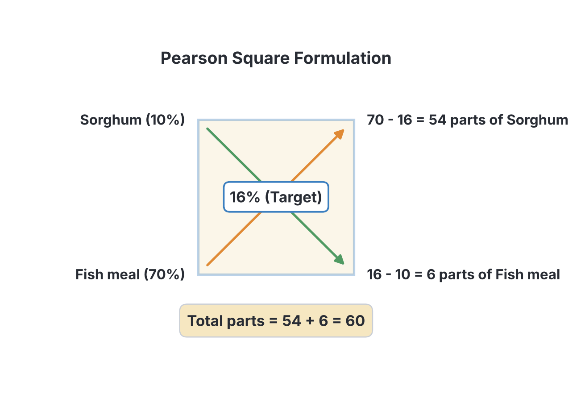
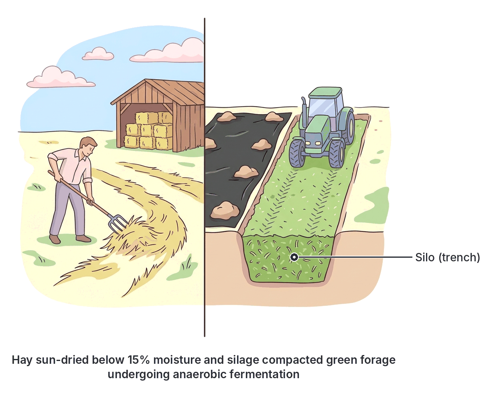

# JAMB Agricultural Science Notes: Animal Nutrition

## What JAMB expects

This topic is Section C, Topic 5 of the JAMB Agricultural Science syllabus: Animal Nutrition. It covers the following content items:
* **a.** Feed nutrients and functions.
* **b.** Feeds and feeding: Simple ration formulation – balanced ration, common pasture/forage crops e.g. guinea grass, elephant grass, giant star grass. *Andropogon sp, Calopogonium sp*. Hay and silage preparation, different types of rations, namely maintenance ration and production ration.
* **c.** Nutrient deficiencies: Causes and symptoms of malnutrition and their correction in farm animals.

By the end of these notes, you should be able to:
1. Identify the various feed nutrients, their sources and functions.
2. Differentiate between the types of animal feeds and their formulation. 
3. Relate the various types of rations to different classes of livestock.
4. Trace symptoms to nutrient deficiencies in farm animals. 
5. Apply appropriate corrective measures to nutrient deficiencies in farm animals. 

**Note on the syllabus wording:** The syllabus lists "*Andropogon sp, Calopogonium sp*". In biological writing, "sp" is shorthand for a single unidentified species, while "spp." is used for multiple species. These are commonly known as Gamba grass and Calopo. Additionally, the syllabus numbers the objectives as "i" and "ii" twice (once for feeding, once for deficiencies). We have given each objective its own section to cover it fully.

## Feed nutrients and functions

Farm animals require specific nutrients to grow, reproduce, stay healthy, and yield products like meat, milk, and eggs. The food given to farm animals is called **feed**.

### Identify the various feed nutrients, their sources and functions

Animal feeds contain six major classes of nutrients. Identifying these nutrients and knowing their sources and functions is a core JAMB requirement.

**1. Carbohydrates**
Carbohydrates are energy-giving foods made of carbon, hydrogen, and oxygen. They make up the bulk of most livestock diets.
* **Sources:** Cereal grains (maize, sorghum or guinea corn, millet, rice), root crops (cassava, yam), and pasture grasses. 
* **Functions:** They provide the main source of energy for movement, growth, and maintaining body temperature. Any excess carbohydrates in the diet are converted and stored as fat.

**2. Proteins**
Proteins are complex molecules composed of amino acids, which contain nitrogen, carbon, hydrogen, oxygen, and sometimes sulphur. 
* **Sources:** 
  * *Plant sources:* Soya bean meal, groundnut cake, palm kernel cake, cowpea.
  * *Animal sources:* Fish meal, blood meal, meat and bone meal, feather meal.
* **Functions:** They are essential for building and repairing body tissues, producing hormones and enzymes, and producing milk, eggs, and wool.

**3. Fats and Oils (Lipids)**
Fats (usually solid at room temperature) and oils (liquid) provide about two and a quarter times ($2.25$) more energy than carbohydrates. 
* **Sources:** Palm oil, groundnut oil, tallow (animal fat), and cotton seed cake.
* **Functions:** They provide highly concentrated energy, help the body absorb fat-soluble vitamins (A, D, E, K), insulate the body against cold, and cushion vital internal organs.

**4. Vitamins**
Vitamins are organic compounds required by the body in very small amounts. They are divided into **fat-soluble vitamins** (Vitamins A, D, E, K) and **water-soluble vitamins** (B-complex vitamins and Vitamin C).
* **Sources:** Green pastures and fresh forages, fish liver oil, yeast, sunlight (for Vitamin D synthesis in the skin), and synthetic vitamin premixes added to commercial feeds.
* **Functions:** They regulate body processes, boost the immune system, maintain healthy vision, skin, and bones, and assist in blood clotting.

**5. Minerals**
Minerals are inorganic elements needed in small quantities. They are divided into **macrominerals** (calcium, phosphorus, sodium, potassium) needed in larger amounts, and **microminerals or trace minerals** (iron, iodine, copper, manganese, zinc) needed in tiny amounts.
* **Sources:** Bone meal, oyster shell, limestone, common salt (sodium chloride), and mineral licks.
* **Functions:** Calcium and phosphorus build strong bones and eggshells. Iron is needed to form haemoglobin in red blood cells. Iodine is essential for the proper functioning of the thyroid gland.

**6. Water**
Water is often considered the most critical nutrient because animals will die from water deprivation much faster than from starvation.
* **Sources:** Direct drinking water, moisture present in the feed (especially in succulent forages and silage), and metabolic water (produced internally when food is broken down).
* **Functions:** It regulates body temperature, aids in the digestion and absorption of food, transports nutrients in the blood, and helps excrete waste as urine.

## Feeds and feeding

To feed livestock successfully, a farmer must understand the different feed ingredients available (like pastures and grains), how to preserve them for the dry season, and how to mix them into a balanced diet.

### Types of animal feeds and their formulation

Animal feeds are classified into different types based on their nutrient composition, moisture content, and crude fibre levels. Formulating a feed means mixing these types together in the right proportions.

**The main types of animal feeds:**

| Type of Feed | Description | Examples |
| --- | --- | --- |
| **Basal or Energy feeds** | Feeds high in carbohydrates (energy), low in protein (less than $20\%$) and low in crude fibre (less than $18\%$). They form the bulk of poultry and pig diets. | Maize, sorghum, cassava tuber, rice bran. |
| **Protein supplements** | Feeds high in protein (greater than $20\%$). They are added to basal feeds to balance the diet. | Fish meal, blood meal, groundnut cake, soya bean meal. |
| **Roughages** | Bulky feeds high in crude fibre (greater than $18\%$) and low in digestible energy. Mainly fed to ruminants (cattle, sheep, goats) because their rumen microbes can digest fibre. | Pasture grasses, legumes, hay, straw, silage. |
| **Concentrates** | Feeds that have high amounts of specific nutrients (energy or protein) and low crude fibre (less than $18\%$). They are highly digestible. | A mixture of maize and fish meal; commercial poultry feed. |
| **Feed additives** | Non-nutritive or highly specific substances added in tiny amounts to improve growth, health, or feed preservation. | Antibiotics, hormones, mould inhibitors, flavourings. |

**Simple ration formulation using the Pearson Square Method**
A **balanced ration** is a feed mixture containing all essential nutrients in the correct proportions to meet an animal's daily needs. The **Pearson Square** is a simple mathematical tool used to calculate the proportions of two feed ingredients needed to meet a target percentage of a specific nutrient (usually Crude Protein, CP).

**Rules for using the Pearson Square:**
1. The target protein percentage goes in the centre of the square.
2. The protein percentage of Feed 1 goes at the top left corner, and Feed 2 at the bottom left corner. *(The target must be a number between the values of the two feeds).*
3. Subtract diagonally across the square. Always subtract the smaller number from the larger number to find the absolute difference (ignore negative signs).
4. The result at the top right is the "parts" of Feed 1. The result at the bottom right is the "parts" of Feed 2.
5. Add the parts together to get the total parts, then convert them to percentages or kilograms.

**Worked Example:**
Formulate $100\text{ kg}$ of a pig ration containing $16\%$ Crude Protein (CP) using Sorghum ($10\%$ CP) and Fish meal ($70\%$ CP).

* **Step 1:** Set up the square with the target ($16$) in the middle.
* **Step 2:** Place Sorghum ($10$) at the top left, and Fish meal ($70$) at the bottom left.
* **Step 3:** Subtract diagonally to find the parts. 
  * Top right (Sorghum parts) = $|70 - 16| = 54\text{ parts}$.
  * Bottom right (Fish meal parts) = $|10 - 16| = 6\text{ parts}$.
* **Step 4:** Find the total parts.
  * $54\text{ parts} + 6\text{ parts} = 60\text{ total parts}$.
* **Step 5:** Convert to kilograms (since the total feed needed is $100\text{ kg}$).
  * Proportion of Sorghum = $\frac{54}{60} \times 100\text{ kg} = 90\text{ kg}$.
  * Proportion of Fish meal = $\frac{6}{60} \times 100\text{ kg} = 10\text{ kg}$.

**Answer:** Mix $90\text{ kg}$ of Sorghum with $10\text{ kg}$ of Fish meal to get $100\text{ kg}$ of feed with $16\%$ CP.

### Common pasture and forage crops

A **pasture** is an area of land covered with forage crops where animals graze. **Forage** refers to the vegetative parts of plants (leaves, stems) eaten by livestock. Pastures usually consist of grasses and legumes. Legumes are highly valued because they are richer in protein than grasses and help fix atmospheric nitrogen into the soil.

**Important Pasture Grasses named by JAMB:**
1. **Guinea grass** (*Panicum maximum*): A common, tall, tufted perennial grass in Nigeria, highly palatable to cattle.
2. **Elephant grass** (*Pennisetum purpureum*): A very tall grass resembling sugarcane. It yields high amounts of forage but becomes woody and less digestible if left to grow too old.
3. **Giant star grass** (*Cynodon plectostachyus*): A creeping grass that spreads rapidly across the ground, making it excellent for erosion control and grazing.
4. **Gamba grass** (*Andropogon* sp.): Common in the savanna zones of West Africa; it is very resilient to drought and bush burning.

**Important Pasture Legumes named by JAMB:**
1. **Calopo** (*Calopogonium* sp.): A creeping legume with hairy stems, used to improve soil fertility and provide protein-rich forage.
2. Other common examples include **Centro** (*Centrosema pubescens*) and **Mucuna** (*Mucuna pruriens*).

### Hay and silage preparation

During the dry season in West Africa, fresh pasture dries up and loses its nutritional value. To ensure animals have enough roughage year-round, forage must be conserved. The two primary methods are making hay and making silage.

**Hay preparation**
**Hay** is forage that has been cut and dried to a low moisture content (usually below $15\%$) so it can be stored without rotting. 
1. **Cutting:** The grass or legume is cut just before it flowers (early bloom stage) because this is when its nutrient content is highest.
2. **Curing (Drying):** The cut forage is spread in the sun to dry. It is turned regularly to ensure even drying and prevent fungal moulds.
3. **Baling:** Once moisture drops below $15\%$, the dry forage is compressed and tied into compact bales.
4. **Storage:** The bales are stored in a dry barn to protect them from rain and direct sunlight (which can destroy vitamins).

**Silage preparation (Ensilage)**
**Silage** is succulent (moist), fermented forage. It is preserved by lactic acid produced by bacteria breaking down plant sugars without oxygen (anaerobic fermentation). 
1. **Cutting and chopping:** Forage is harvested green before flowering and chopped into small pieces (about $2\text{ cm}$ to $3\text{ cm}$) to make packing easier.
2. **Filling the silo:** The chopped material is placed into a trench, pit, or tower called a **silo**. 
3. **Compacting:** The material is compressed tightly (often by driving a tractor over it in a trench silo) to squeeze out all the air. *The complete absence of oxygen is critical; otherwise, the forage will rot.*
4. **Sealing:** The silo is covered with heavy plastic sheets and soil to make it airtight and watertight.
5. **Fermentation:** Inside the sealed silo, lactic acid bacteria convert plant sugars into lactic acid. This lowers the pH (making it acidic), which preserves the silage. It is ready in a few weeks and can last for years if sealed.

### Relating types of rations to different classes of livestock

**Diet** refers to the general types of food an animal consumes over time. 
**Ration** is the exact *allowance or amount* of feed given to an animal in a 24-hour period. Rations are divided into two main categories based on what the animal is currently doing (its physiological state).

**1. Maintenance ration**
A maintenance ration is the amount of feed needed just to keep the animal alive, healthy, and at a constant body weight. 
* **What it does:** It supplies energy for vital functions like breathing, heartbeat, digestion, and maintaining body temperature. It does **not** support any form of production (no weight gain, no milk, no eggs, no foetal growth).
* **Classes of livestock that need it:** Adult animals that are resting and not reproducing (e.g., a non-pregnant, non-lactating cow), or draught animals (e.g., work oxen) during the dry season when they are not working.

**2. Production ration**
A production ration is the extra feed given *over and above* the maintenance ration to support a specific productive purpose.
* **Lactation ration:** Fed to milking animals (e.g., dairy cows, lactating sows) to produce milk. It is high in protein, water, and calcium.
* **Pregnancy / Gestation ration:** Fed to pregnant animals (e.g., pregnant ewes or sows) to support the rapid growth of the foetus. 
* **Fattening ration:** Fed to beef cattle, pigs, or broiler chickens to encourage rapid muscle and fat growth for meat. It is very high in carbohydrates and proteins.
* **Laying ration (Layer diet):** Fed to laying hens. It must be very rich in calcium (for strong eggshells) and protein.
* **Weaning ration / Creep feed:** Fed to young, growing animals just separated from their mothers. It is highly digestible and rich in protein for rapid growth.

## Causes and symptoms of malnutrition

**Malnutrition** occurs when an animal does not get a balanced diet. It can mean under-nutrition (starvation), over-nutrition (obesity), or a deficiency of one or more specific nutrients.

**Common causes of malnutrition:**
1. **Poor feed formulation:** Using the wrong proportions of ingredients so that certain nutrients are lacking.
2. **Underfeeding:** Not providing enough of the daily ration to meet the animal's needs.
3. **Poor quality feed:** Feeding overly mature, woody grasses or mouldy grains that have lost their nutrient value.
4. **Diseases and parasites:** Endoparasites like tapeworms and roundworms can steal nutrients from the animal's gut, causing malnutrition even if the animal is eating a good diet.

### Tracing symptoms to nutrient deficiencies in farm animals

When a specific nutrient is missing from the diet, the animal will display specific physical signs or diseases. JAMB frequently tests your ability to link a symptom directly to the missing nutrient.

| Symptom / Disease Condition | Deficient Nutrient |
| --- | --- |
| Stunted growth, poor feathering in poultry, drop in egg/milk production. | **Protein** |
| Emaciation (severe thinness), severe weakness, lethargy. | **Carbohydrates (Energy)** |
| **Night blindness**, poor vision, retarded growth, rough coat. | **Vitamin A** |
| **Curled-toe paralysis** in chicks (birds walk on their hocks with toes curling inward). | **Vitamin B2 (Riboflavin)** |
| **Rickets** in young animals (soft, bowed legs), **osteomalacia** in adults (brittle bones), soft-shelled eggs. | **Vitamin D**, **Calcium**, or **Phosphorus** |
| **Crazy chick disease** (encephalomalacia - chicks fall backward and spasm), sterility in adult animals. | **Vitamin E** |
| **Poor blood clotting** (prolonged bleeding from slight injuries). | **Vitamin K** |
| **Piglet anaemia** (pale gums and eyes, weakness, laboured breathing in piglets kept indoors). | **Iron** (and sometimes Copper) |
| **Goitre** (swelling of the thyroid gland in the neck), birth of hairless or dead young. | **Iodine** |
| **Perosis (slipped tendon)** in poultry (the Achilles tendon slips out of place, crippling the bird). | **Manganese** |

### Applying corrective measures to nutrient deficiencies

Once a deficiency symptom is traced to a specific missing nutrient, the farmer must apply the correct measure to fix the diet and cure the animal.

| Deficient Nutrient | Corrective Measure (Cure) |
| --- | --- |
| **Protein** | Add high-quality protein supplements (e.g., fish meal, soya bean meal, blood meal) to the ration. |
| **Carbohydrates (Energy)** | Increase basal/energy feeds (e.g., maize, sorghum, cassava) in the diet. |
| **Vitamin A** | Feed fresh green forage, yellow maize, or add a synthetic Vitamin A premix to the water or feed. |
| **Vitamin B2 (Riboflavin)** | Supply yeast, milk by-products, green feeds, or a specific Vitamin B-complex supplement. |
| **Vitamin D / Calcium / Phosphorus** | For Vitamin D: Expose animals to direct sunlight or feed fish liver oil. For minerals: Add bone meal, oyster shell, or limestone to the feed. For sudden calcium crashes (Milk fever in dairy cows), give an intravenous calcium injection. |
| **Vitamin E** | Feed fresh green forage or wheat germ oil. |
| **Vitamin K** | Feed green leafy forage or synthetic Vitamin K supplements. |
| **Iron** | Give an **iron dextran injection** to newborn piglets kept on concrete floors, or let them root in clean, iron-rich soil. |
| **Iodine** | Provide iodized salt (mineral licks) in the diet. |
| **Manganese** | Add a trace mineral premix containing manganese to the feed. |

## Key terms

| Term | Meaning |
| --- | --- |
| Diet | The general type of feed an animal regularly consumes over time. |
| Ration | The exact amount (allowance) of feed provided to an animal in a 24-hour period. |
| Maintenance ration | Feed given to keep an animal alive and maintain body weight without any production. |
| Production ration | Extra feed given to support growth, milk, meat, egg production, or pregnancy. |
| Concentrates | Feeds high in energy or protein and low in crude fibre (less than $18\%$). |
| Roughages | Bulky feeds high in crude fibre (greater than $18\%$) and low in digestible energy, like grasses. |
| Hay | Cut and sun-dried forage (below $15\%$ moisture) used to feed livestock during the dry season. |
| Silage | Fermented, succulent forage preserved by lactic acid bacteria in an airtight silo. |
| Malnutrition | A condition resulting from an unbalanced diet, underfeeding, or nutrient malabsorption. |
| Pearson Square | A mathematical method used to formulate a target nutrient percentage from two feed ingredients. |

## Exam tips and common mistakes

* **Hay vs. Silage:** Do not confuse them. Hay is dried by the sun; silage is preserved wet by bacterial fermentation without oxygen.
* **Diet vs. Ration:** "Diet" is what the animal eats generally. "Ration" is the specific 24-hour allowance. A ration can be balanced or unbalanced.
* **Concentrates vs. Roughages:** Concentrates have *low* fibre. Roughages have *high* fibre. If an option asks for a concentrate, look for grains or meals (e.g., maize, fish meal), not grasses.
* **Rickets and Soft-shelled eggs:** This can be caused by a deficiency in Calcium, Phosphorus, OR Vitamin D. They work together closely in the body.
* **Curled-toe paralysis:** Always link this specifically to Vitamin B2 (Riboflavin).
* **Piglet anaemia:** Piglets born indoors on concrete floors lack Iron because sow's milk is poor in iron and they cannot root in soil. They need an iron injection.
* **Pearson Square calculations:** Remember to find the absolute difference diagonally, add the two parts together to get the *total parts*, and then divide the specific ingredient's part by the total to find its percentage or weight. Do not forget to convert parts to kilograms if the question asks for weight!

## Quick summary

1. Animal feeds contain six major nutrient classes: carbohydrates (energy), proteins (growth and repair), fats (concentrated energy), vitamins, minerals, and water.
2. Feeds are classified into energy feeds, protein supplements, roughages (high fibre, e.g., grasses), concentrates (low fibre, high nutrient density), and feed additives.
3. Important pasture crops include grasses (Guinea grass, Elephant grass, Gamba grass) and legumes (Calopo) which add protein and fix nitrogen.
4. Forage is conserved for the dry season as hay (cut and sun-dried) or silage (chopped, compacted, and fermented anaerobically in an airtight silo).
5. A maintenance ration keeps an animal alive with no weight change. A production ration supports milk, eggs, meat, or pregnancy.
6. A balanced ration supplies all nutrients in correct proportions; it can be formulated using the Pearson Square method.
7. Malnutrition causes specific diseases: Vitamin A deficiency causes night blindness, Vitamin B2 causes curled-toe paralysis, Vitamin D/Calcium lack causes rickets and soft-shelled eggs, and Iron deficiency causes piglet anaemia. They are corrected by supplying the missing nutrient.

## Practice questions

**1. The primary purpose of formulating a balanced ration for livestock is to**
- A. make the feed taste better for the animals
- B. provide all required nutrients in the correct proportions for optimum production
- C. increase the fibre content of the animal's diet
- D. cure animals that have infectious diseases

**Answer: B.** A balanced ration is specifically formulated to supply every essential nutrient (carbohydrates, proteins, fats, vitamins, minerals) in the exact amounts needed for the animal's maintenance and production goals.

**2. Which of the following is a common pasture grass?**
- A. *Calopogonium* sp.
- B. *Mucuna pruriens*
- C. *Centrosema pubescens*
- D. *Panicum maximum*

**Answer: D.** *Panicum maximum* is Guinea grass. The other three options (*Calopogonium*, *Mucuna*, and *Centrosema*) are all pasture legumes, not grasses.

**3. The amount of feed given to an animal to keep it alive without any increase or decrease in body weight is called a**
- A. production ration
- B. gestation ration
- C. maintenance ration
- D. balanced diet

**Answer: C.** A maintenance ration merely supports vital functions like breathing and heartbeat, keeping the animal at a constant weight without supporting extra production.

**4. Formulate $100\text{ kg}$ of a poultry feed containing $16\%$ crude protein using Sorghum ($10\%$ CP) and Fish meal ($70\%$ CP). What quantity of Sorghum is required?**
- A. $54\text{ kg}$
- B. $90\text{ kg}$
- C. $10\text{ kg}$
- D. $84\text{ kg}$

**Answer: B.** Using the Pearson square: Target is $16\%$. Sorghum parts = $|70 - 16| = 54\text{ parts}$. Fish meal parts = $|10 - 16| = 6\text{ parts}$. Total parts = $54\text{ parts} + 6\text{ parts} = 60\text{ parts}$. Quantity of Sorghum = $\frac{54}{60} \times 100\text{ kg} = 90\text{ kg}$. Option A is wrong because it stops at parts ($54$) and forgets to convert out of the total $60$ parts into a weight.

**5. Anaemia in piglets kept indoors on concrete floors is primarily caused by a deficiency of**
- A. calcium
- B. iron
- C. iodine
- D. manganese

**Answer: B.** Piglet anaemia occurs because sow's milk is low in iron and piglets on concrete cannot get iron naturally from rooting in the soil. It is corrected with an iron dextran injection.

**6. A farmer noticed that his chicks were walking on their hocks with their toes curling inwards. This condition is known as curled-toe paralysis and is caused by a deficiency of**
- A. Vitamin E
- B. Vitamin K
- C. Vitamin B2 (Riboflavin)
- D. Vitamin D

**Answer: C.** Curled-toe paralysis is the classic symptom of Vitamin B2 (Riboflavin) deficiency in poultry. A common mistake is choosing Vitamin E, which causes crazy chick disease.

**7. In silage making, the most important condition required for proper fermentation is**
- A. turning the forage daily to expose it to the sun
- B. adding large amounts of water to the silo
- C. maintaining a completely anaerobic (air-free) environment
- D. using fully matured, dry grasses

**Answer: C.** Silage relies on lactic acid bacteria which ferment the sugars in the complete absence of oxygen. If air is present, the forage will rot and spoil instead of fermenting.

**8. Which of the following feedstuffs is classified as a roughage?**
- A. Maize grains
- B. Fish meal
- C. Elephant grass
- D. Groundnut cake

**Answer: C.** Elephant grass is a roughage because it is bulky and high in crude fibre (greater than $18\%$). Maize, fish meal, and groundnut cake are all concentrates.

**9. Soft-shelled eggs in a flock of laying birds indicate a deficiency in**
- A. carbohydrates and fats
- B. calcium and Vitamin D
- C. iron and copper
- D. Vitamin A and Vitamin K

**Answer: B.** Calcium is the main mineral that forms eggshells, and Vitamin D is strictly necessary for the bird's body to absorb and use calcium properly.

**10. A key difference between a diet and a ration is that a ration**
- A. refers only to the feed given to sick animals
- B. is the exact allowance of feed given to an animal in a 24-hour period
- C. contains only roughages and no concentrates
- D. is the general type of food the animal is accustomed to eating

**Answer: B.** A diet is simply what the animal usually eats (e.g., a "vegetarian diet"), whereas a ration refers to the precise quantity (allowance) of feed supplied over a 24-hour period.
