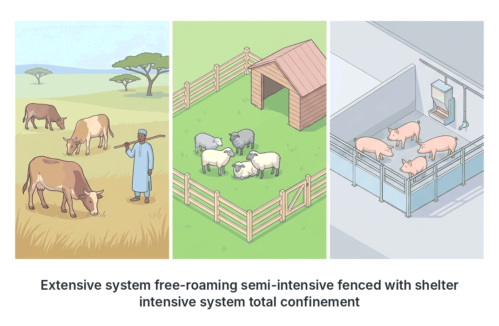
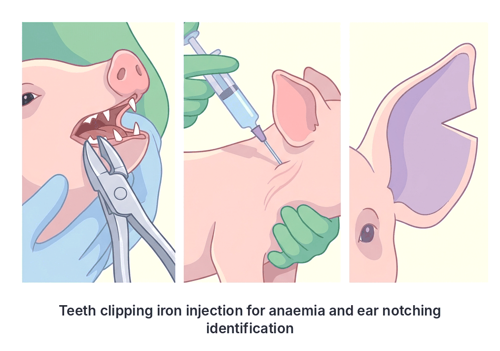
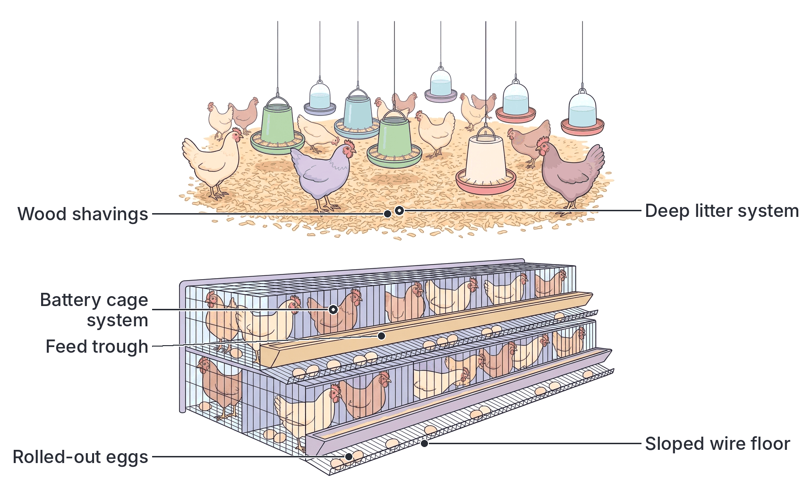

# JAMB Agricultural Science Notes: Livestock Management

## What JAMB expects

This topic covers Section C, Topic 6 of the JAMB Agricultural Science syllabus: Livestock Management. 

The syllabus includes the following content items:
- **Housing, feeding, sanitation and veterinary care** of ruminants, pigs, rabbits and poultry under intensive, semi-intensive and extensive systems of management from birth to slaughter.

By the end of these notes, you should be able to:
1. Apply the different management practices for farm animals.

## Apply the different management practices for farm animals

Livestock management refers to the daily and long-term care of farm animals from the day they are born (or hatched) until they are slaughtered. Good management ensures that animals grow quickly, remain healthy, and produce high yields of meat, milk, or eggs, generating profit for the farmer.

### Housing, feeding, sanitation and veterinary care
For every type of farm animal, management revolves around four main pillars:
1. **Housing:** Providing a safe physical environment that protects animals from harsh weather (rain, intense sun), predators, and thieves.
2. **Feeding:** Providing the right quantity and quality of feed (and clean water) to meet the animals' needs for growth, maintenance, and reproduction.
3. **Sanitation:** Keeping the environment clean (sweeping pens, washing troughs, disposing of waste) to stop diseases from building up.
4. **Veterinary care:** Preventing and treating diseases. This includes strict biosecurity, routine vaccinations, deworming, and using antibiotics or acaricides when necessary.

## Systems of livestock management

Farmers raise animals under three main systems, depending on the level of confinement, capital, and control.

| Feature | Extensive System | Semi-intensive System | Intensive System |
| --- | --- | --- | --- |
| **Confinement** | Animals roam freely over large areas. | Animals are housed at night but let out into fenced paddocks to graze during the day. | Animals are strictly confined indoors all the time. |
| **Feeding** | Animals scavenge for their own food and water. | Animals scavenge, but the farmer supplements their diet with feed and water. | The farmer provides 100% of the required feed and water inside the pens. |
| **Capital & Cost** | Very low cost (no buildings or expensive feed). | Medium cost. | Very high capital cost (expensive buildings, equipment, and commercial feed). |
| **Disease Control** | Poor. Animals easily mix with infected wild or stray animals, and parasite burdens are high. | Moderate. | Excellent. Strict biosecurity keeps diseases out, and monitoring is easy. |
| **Breeding** | Uncontrolled (random mating, high risk of inbreeding). | Somewhat controlled. | Highly controlled. Farmers select specific sires or use Artificial Insemination (AI). |
| **Productivity** | Low. High energy is wasted walking long distances. | Medium. | High. Energy is conserved for growth and production. |
| **Examples** | Nomadic herding by Fulani pastoralists; free-range village chickens. | Fold/ark units for chickens; fenced grazing for sheep. | Battery cages for layers; indoor concrete pens for pigs. |

---

## Management of Ruminants (Cattle, Sheep and Goats)

Ruminants are animals with a complex four-chambered stomach that chew the cud. Common Nigerian examples include the White Fulani and Sokoto Gudali (cattle), Yankasa and Balami (sheep), and the West African Dwarf and Red Sokoto (goats).

### Housing
- **Extensive:** Animals are kept in simple open enclosures made of thorny bushes or wooden poles (kraals) at night to prevent theft.
- **Semi-intensive:** Animals have a roofed shed for night shelter and are released to graze in fenced pastures during the day.
- **Intensive (Zero-grazing):** Animals are kept in permanent stalls with concrete floors. Cut grasses and feed are brought directly to them.

### Feeding
Ruminants are herbivores. Their diet is mostly **roughages** (pasture grasses like Guinea grass and legumes like Centrosema). 
- In the dry season, pasture is supplemented with conserved forage (**hay** or **silage**).
- For high production (e.g., dairy cows or fattening bulls), **concentrates** (rich in protein and energy) and **salt licks** (mineral blocks) must be provided. Clean drinking water is essential.

### Sanitation and veterinary care
- **Cleaning:** Dung must be removed regularly to prevent hoof diseases.
- **Deworming (Drenching):** Liquid anthelmintic drugs are poured down the animal's throat to kill internal parasites (endoparasites) like roundworms, tapeworms, and liver flukes.
- **Dipping / Spraying:** Animals are passed through a bath (dip) or sprayed with acaricides to kill external parasites (ectoparasites) like ticks and lice.
- **Vaccination:** Routine injections protect against deadly viral and bacterial diseases like Rinderpest, Anthrax, Foot-and-Mouth Disease, Contagious Bovine Pleuropneumonia (CBPP), and Peste des Petits Ruminants (PPR) in goats.

### Routine management from birth to slaughter
1. **Birth:** Giving birth is called **calving** (cattle), **lambing** (sheep), or **kidding** (goats). 
2. **Colostrum feeding:** Within the first 24 hours of life, the young must suckle **colostrum**, the thick, yellowish first milk produced by the mother. Colostrum is rich in nutrients and antibodies that provide **passive immunity** against diseases.
3. **Identification:** Animals are marked for record-keeping using ear tags, ear notching, branding (burning a mark on the skin), or tattooing.
4. **Dehorning / Disbudding:** The horn buds of young calves are destroyed using a hot iron or caustic chemicals. This prevents the adult animals from injuring each other or the farmer.
5. **Castration:** The testicles of male animals not needed for breeding are crushed (using a bloodless **Burdizzo** or a rubber ring called an elastrator) or surgically removed. Castration stops uncontrolled breeding, makes males docile, and improves meat quality.
6. **Weaning:** Separating the young from the mother so they stop suckling milk and rely entirely on solid pasture and concentrates.
7. **Slaughter:** Animals are fasted (to empty the gut), stunned, and bled out completely. The carcass is then skinned (flayed) and the internal organs are removed (evisceration).

---

## Management of Pigs (Swine)

Pigs are non-ruminants (monogastrics) raised primarily for pork, bacon, and sausages. Popular breeds in Nigeria include the Large White, Landrace, and Duroc.

### Housing
Pigs lack functional sweat glands and have a thick layer of fat, making them highly susceptible to heat stress. 
- **Intensive systems** are highly recommended. 
- Pens should have concrete floors (for easy washing) and strong walls. Dwarf walls are used to allow plenty of ventilation. 
- A **wallow** (a shallow pool of water) or overhead sprinklers must be provided to help pigs cool down. 
- **Farrowing crates** or guard rails are built into maternity pens to prevent the heavy mother (sow) from accidentally lying on and crushing her piglets.

### Feeding
Pigs are fed formulated mash or pellets.
- **Creep feed:** A highly nutritious, high-protein feed given to piglets from 1 to 2 weeks of age.
- **Weaner diet:** Given after piglets are separated from the sow.
- **Grower and Finisher diets:** Given to fatten pigs for market.
- **Breeder diets:** Specially formulated for pregnant and lactating sows, and active boars.

### Sanitation and veterinary care
- Pens must be swept and hosed down with water daily. 
- **Biosecurity is critical.** For example, **African Swine Fever (ASF)** is a devastating viral disease of pigs that has **no vaccine**. The only way to prevent it is strict sanitation, using footbaths, and preventing visitors from entering the piggery.
- Pigs must be routinely dewormed to control roundworms (Ascaris) and treated for mange mites.

### Routine management from birth to slaughter
1. **Farrowing:** The act of giving birth (gestation takes exactly 114 days: 3 months, 3 weeks, and 3 days). Mucus is cleared from the piglets' noses so they can breathe.
2. **Teeth clipping:** Piglets are born with 8 sharp needle teeth. These are clipped off with pliers within 24 hours to prevent them from injuring the sow's udder or biting each other.
3. **Iron dextran injection:** Sow's milk is naturally deficient in iron. Piglets raised on concrete floors cannot root in the soil to get iron, so they must be given an iron injection in the neck muscle at 3-4 days old to prevent **piglet anaemia**.
4. **Tail docking:** Cutting off a portion of the tail to prevent piglets from biting each other's tails (cannibalism), which can lead to severe infections.
5. **Identification:** Ear notching (cutting small V-shapes into the edges of the ear) is the standard method for pigs.
6. **Castration:** Done on males meant for meat to prevent "boar taint," a strong, unpleasant smell in the meat of uncastrated adult males.
7. **Weaning:** Piglets are removed from the sow at 6-8 weeks of age.
8. **Slaughter:** Pigs are stunned, bled, and then **scalded** (dipped in hot water) to loosen the hair so it can be scraped off before evisceration.

---

## Management of Rabbits

Rabbits are small, non-ruminant herbivores raised for meat and fur (pelts). They are highly prolific (reproduce rapidly).

### Housing
Rabbits are kept in cages called **hutches**. 
- Hutches are usually made of wood and wire mesh and are raised on legs above the ground to protect the rabbits from dampness, snakes, soldier ants, and dogs. 
- The floor must be made of wire mesh so that faeces and urine drop through. This breaks the life cycle of parasites. 
- A **nest box** is placed in the hutch when a female is about to give birth.

### Feeding
Rabbits eat roughages (like *Tridax*, sweet potato vines, and *Centrosema*) and pelleted concentrates. 
- **Coprophagy:** Rabbits practice coprophagy, which means they naturally eat their own soft, sticky night droppings directly from the anus. This is a vital biological habit; it allows them to absorb B-vitamins and recover proteins synthesized by bacteria in their caecum (part of the large intestine). 

### Sanitation and veterinary care
- The area under the hutch must be cleaned daily. A buildup of urine produces strong ammonia gas, which causes respiratory diseases in rabbits (snuffles).
- **Coccidiosis** is a deadly protozoan disease in rabbits. It is controlled by using wire-mesh floors (so they don't step in their droppings) and adding coccidiostats to their drinking water.
- Ear canker (mange) caused by mites is common and is treated by applying acaricide drops in the ears.

### Routine management from birth to slaughter
1. **Mating:** The female rabbit (doe) is highly territorial. To mate them, **always take the doe to the buck's (male's) hutch**. If you take the buck to the doe's hutch, she will fiercely attack and may kill him.
2. **Kindling:** The act of giving birth (gestation is about 31 days). A few days before kindling, the doe will pull fur from her own belly to line the nest box and keep the blind, hairless newborn kits (bunnies) warm.
3. **Handling:** To lift a rabbit, grasp the loose skin at the back of its neck (the scruff) with one hand, and support its heavy rump (backside) with your other hand. **Never lift a rabbit by its ears!** This damages their ear cartilage and blood vessels.
4. **Weaning and Sexing:** Kits are weaned at 4-6 weeks. Males and females must be sexed and separated to prevent early inbreeding.
5. **Slaughter:** Rabbits are killed humanely by striking the back of the neck (stunning) or dislocating the neck, before bleeding and skinning.

[IMAGE: Proper rabbit handling and housing. Left: A person correctly holding a rabbit by grasping the scruff of its neck with one hand and supporting its rump with the other hand. Right: A wooden rabbit hutch raised on sturdy legs with a sloping roof, a wire-mesh front, and a wooden nest box inside. Labels: "Correct handling: hold scruff and support rump", "Never hold by ears", "Raised hutch", "Wire mesh floor", "Nest box". Clean flat textbook style, white background.]

---

## Management of Poultry

Poultry refers to domesticated birds, mainly chickens (broilers for meat, layers for eggs), turkeys, ducks, and guinea fowls.

### Housing
While some rural farmers use the extensive system (free-range), commercial poultry is managed intensively using two main housing systems:

| Feature | Deep Litter System | Battery Cage System |
| --- | --- | --- |
| **Housing Style** | Birds move freely on a floor covered with litter material. | Birds are confined in small, tiered wire cages. |
| **Best suited for** | Broilers, breeder flocks, and rearing young chicks. | Laying birds (commercial egg production). |
| **Litter Material** | Floor is covered with 10–15 cm of **wood shavings**. *(Note: Never use sawdust, as birds may eat it and choke, causing crop impaction).* | No litter is used. |
| **Disease risk** | Higher risk of soil-borne diseases and **coccidiosis** because birds are in direct contact with their droppings. | Lower risk. Droppings fall through the wire mesh floor, away from the birds. |
| **Egg collection** | Eggs may be laid on the floor, getting dirty or eaten by the birds. | The wire floor slopes slightly so eggs roll out into a tray, remaining clean and safe. |
| **Vices** | Higher risk of bullying, feather pecking, and cannibalism. | Lower risk, as birds are physically separated in small groups. |

### Feeding
Poultry are monogastrics that require easily digestible, high-quality formulated mash or pellets:
- **Broilers:** Fed **Broiler starter** (high in protein for rapid muscle growth) from 0-4 weeks, and **Broiler finisher** (high in energy for fat deposition) from 4-8 weeks.
- **Layers:** Fed **Chick mash** (0-8 weeks), **Grower mash** (8-16 weeks), and **Layer mash** (from 16 weeks onwards). Layer mash contains extra calcium (from oyster shells or bone meal) to ensure strong eggshells.

### Sanitation and veterinary care
- **Biosecurity:** A foot dip containing disinfectant must be placed at the entrance of the poultry house to disinfect the shoes of workers.
- **Vaccination Schedule:** Chicks must follow a strict vaccination schedule to prevent fatal viral diseases. 
  - Day 1: Marek's disease.
  - Weeks 1 & 3: **Newcastle disease** vaccine (usually administered via eye drops or drinking water; Newcastle disease causes twisting of the neck and high mortality).
  - Weeks 2 & 4: Gumboro disease (Infectious Bursal Disease).
  - Week 6: Fowl pox.
- Coccidiostats are added to feed or water to prevent coccidiosis.

### Routine management from birth to slaughter
1. **Brooding (0-4 weeks):** Day-old chicks cannot control their body temperature. They are kept in a confined space and provided with artificial heat (using hovers, heat lamps, or coal pots). 
   - *Observation:* If chicks huddle directly under the heat source, they are too cold. If they pant and push against the far walls, they are too hot. If they are evenly spread out, the temperature is perfect.
2. **Debeaking (Beak Trimming):** Using a hot blade to cut off the sharp tip of the upper and lower beak. This is a crucial routine practice to prevent feather pecking, cannibalism, and egg-eating.
3. **Culling:** Identifying and removing sick, injured, unproductive, or overly aggressive birds from the flock. Culling saves feed and stops the spread of diseases.
4. **Candling:** Shining a bright light through an egg in a dark room. It is done during incubation to check if the egg is fertile (has a developing embryo) or in table eggs to check for blood spots or cracks.
5. **Egg Collection:** In layer farms, eggs are collected 2 to 3 times daily to prevent breakages and preserve quality.
6. **Slaughter:** Broilers are ready for slaughter at 6 to 8 weeks. They are fasted, stunned, bled, **scalded** in hot water to loosen feathers, plucked (defeathered), and eviscerated.

---

## Key terms

| Term | Meaning |
| --- | --- |
| **Intensive system** | A management system where animals are fully confined indoors and the farmer provides all feed and water. |
| **Colostrum** | The first milk produced by a mother after giving birth, rich in antibodies for passive immunity. |
| **Castration** | The removal or destruction of the testicles in male animals to prevent breeding and improve meat quality. |
| **Farrowing crate** | A specialized pen structure that prevents a heavy sow from crushing her piglets. |
| **Coprophagy** | The habit of rabbits eating their own soft night-time faeces to recover vitamins and proteins. |
| **Deep litter system** | A poultry housing system where birds are kept on a floor covered with absorbent material (e.g., wood shavings). |
| **Battery cage system** | A poultry housing system where birds are kept in tiered wire cages, allowing droppings to fall through. |
| **Debeaking** | Trimming the tip of a bird's beak to prevent cannibalism and egg-eating. |
| **Culling** | The removal of sick, unproductive, or undesirable animals from a flock or herd. |
| **Candling** | Shining light through an egg to check its internal quality or fertility. |

## Exam tips and common mistakes

- **Wood shavings vs. Sawdust:** Always remember that **wood shavings** are the correct material for deep litter. Sawdust is a trap answer in exams; chicks will eat it, block their crops, and die.
- **Rabbit mating:** The doe is highly territorial. You must take the **doe to the buck's hutch**, not the other way around. 
- **Handling rabbits:** Never lift a rabbit by its ears. Hold the scruff of the neck and support the rump.
- **Piglet anaemia:** Piglets raised indoors must receive an **iron injection** shortly after birth because sow's milk lacks iron.
- **Newcastle disease:** If an exam question mentions a viral poultry disease that twists the neck and is prevented by drops in the drinking water, the answer is Newcastle disease.
- **Cannibalism control:** Debeaking is the specific routine operation done to prevent cannibalism in poultry.
- **Culling vs. Castration:** Do not confuse these. Castration removes testicles (stops breeding); culling removes whole animals from the flock entirely.

## Quick summary

1. Livestock management ensures farm animals are properly housed, fed, kept clean, and protected from diseases from birth to slaughter.
2. The intensive system keeps animals fully confined with provided feed, offering the highest productivity and disease control but requiring high capital.
3. Ruminants require colostrum at birth, and routine practices include dehorning, castration, deworming, and dipping to remove ticks. 
4. Pigs lack sweat glands and need cool housing. Piglets require teeth clipping, tail docking, and an iron injection to prevent anaemia.
5. Rabbits practice coprophagy to absorb nutrients. They are kept in hutches with wire floors, and mating requires taking the doe to the buck's hutch.
6. Commercial poultry is housed in deep litter (using wood shavings) or battery cages (best for layers to prevent egg-eating and disease).
7. Routine poultry practices include brooding (providing heat to chicks), debeaking (to prevent cannibalism), culling (removing bad birds), and candling (inspecting eggs).

## Practice questions

**1. Which of the following poultry management systems is most effective for preventing coccidiosis?**
- A. Deep litter system
- B. Battery cage system
- C. Fold unit system
- D. Free-range system

**Answer: B.** Battery cage system. Coccidiosis is spread through contact with infected droppings. In a battery cage, droppings fall through the wire floor, keeping birds entirely away from them. Option A is incorrect because birds on deep litter mix directly with their droppings, increasing the risk.

**2. The primary reason for giving iron dextran injections to piglets raised indoors is to**
- A. stimulate rapid muscle growth
- B. prevent rickets and bone deformities
- C. prevent piglet anaemia
- D. protect against African swine fever

**Answer: C.** prevent piglet anaemia. Sow's milk is naturally very low in iron, and piglets raised indoors on concrete floors cannot get iron from rooting in the soil, leading to severe anaemia if not injected. Option B is incorrect because rickets is related to a lack of calcium and vitamin D, not iron.

**3. In rabbit management, it is strongly recommended that the doe is taken to the buck's hutch for mating because**
- A. the buck needs a familiar environment to perform
- B. the doe is territorial and may attack the buck in her hutch
- C. the buck's hutch is usually larger and more comfortable
- D. moving the doe stimulates ovulation

**Answer: B.** the doe is territorial and may attack the buck in her hutch. Does are highly defensive of their own space and may seriously injure or kill the buck if he is introduced to her home. Option A is a common misconception, but the true reason is the doe's aggression.

**4. The thick, yellowish first milk produced by a female mammal immediately after giving birth is called**
- A. colostrum
- B. creep feed
- C. whey
- D. homogenised milk

**Answer: A.** colostrum. It is vital for newborn survival because it is rich in antibodies that give the young animal passive immunity against diseases. Option B is a highly nutritious solid feed given to young animals, not milk.

**5. Which of the following is a routine management practice done specifically to prevent cannibalism and egg-eating in poultry?**
- A. Culling
- B. Candling
- C. Debeaking
- D. Deworming

**Answer: C.** Debeaking. Trimming the sharp tip of the beak makes it blunt, preventing birds from injuring each other (cannibalism) or pecking open their own eggs. Option A (culling) removes bad birds but does not prevent the vice from spreading among the remaining flock.

**6. The practice of coprophagy (eating soft night faeces) is a normal and essential nutritional habit in**
- A. poultry
- B. sheep
- C. pigs
- D. rabbits

**Answer: D.** rabbits. Rabbits eat their soft night droppings directly from the anus to recover B-vitamins and proteins produced by bacteria in their caecum. Option C (pigs) may occasionally eat faeces in very poor conditions, but it is not a normal biological requirement for them.

**7. A major disadvantage of the extensive system of livestock management is the**
- A. high cost of providing housing and equipment
- B. difficulty in controlling diseases and breeding
- C. high cost of formulated feeds
- D. requirement for highly skilled farm labour

**Answer: B.** difficulty in controlling diseases and breeding. Because animals roam freely, they easily come into contact with diseases from wild or stray animals and mate randomly without the farmer's control. Options A, C, and D are characteristics of the intensive system.

**8. The correct and safe method of lifting a rabbit is by grasping the**
- A. ears firmly with both hands
- B. hind legs and holding it upside down
- C. loose skin at the back of the neck and supporting the rump
- D. tail and the forelegs

**Answer: C.** loose skin at the back of the neck (scruff) and supporting the heavy rump. This prevents the rabbit from kicking out and breaking its own spine. Option A is a dangerous mistake; lifting a rabbit by the ears destroys its ear cartilage and blood vessels.

**9. Which of the following materials is highly recommended for use as litter in a deep litter poultry house?**
- A. Wood shavings
- B. Sawdust
- C. Sharp sand
- D. Polythene sheets

**Answer: A.** Wood shavings. They absorb moisture well, insulate the floor, and are too large for chicks to accidentally swallow. Option B (sawdust) is a common mistake; it should never be used because young chicks may mistake the fine dust for feed, eat it, and die of crop impaction.

**10. In pig management, needle teeth are clipped shortly after birth primarily to**
- A. prevent the piglets from eating solid feed too early
- B. stop the piglets from biting their tails
- C. prevent injury to the sow's udder during suckling
- D. improve the shape of the pig's snout

**Answer: C.** prevent injury to the sow's udder during suckling. Piglets are born with 8 sharp needle teeth that can cut the mother's teats, causing her pain and making her refuse to let them nurse. Option B is incorrect; tail biting is prevented by tail docking, not teeth clipping.
