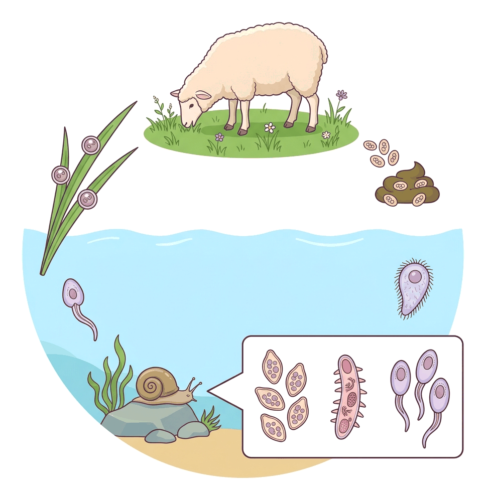
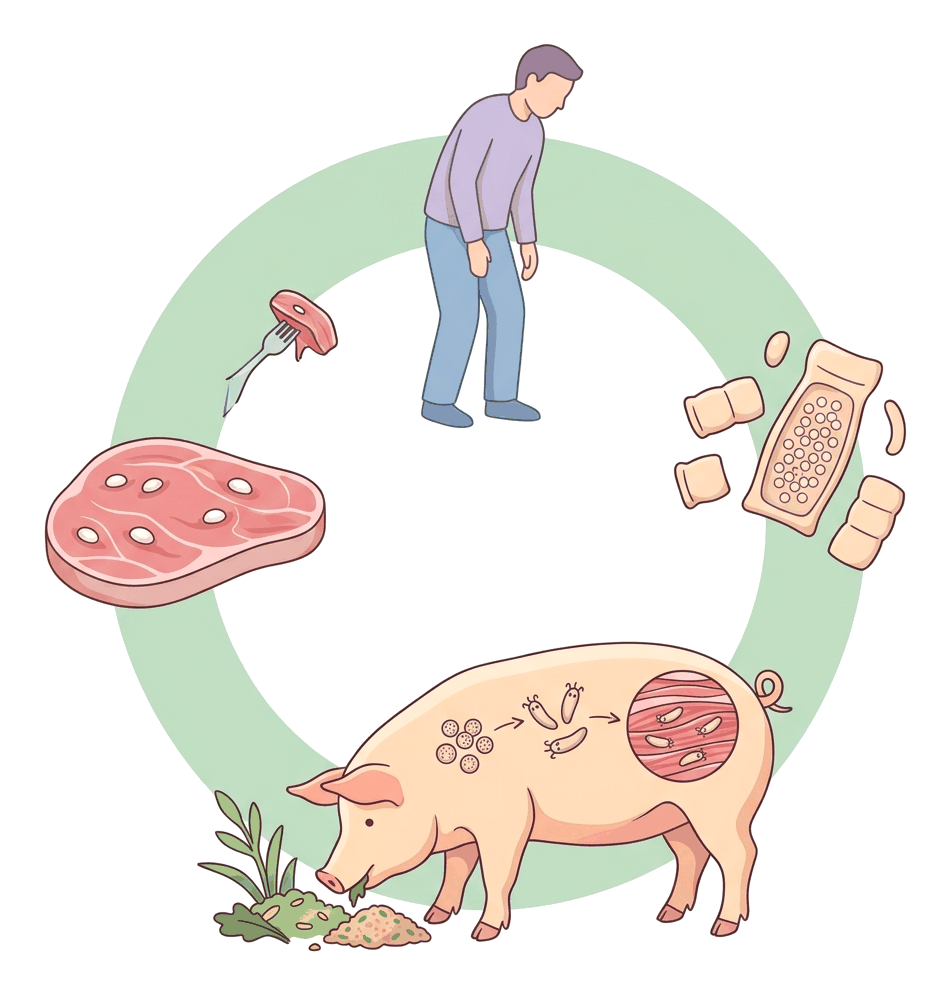

# JAMB Agricultural Science Notes: Animal Health: Pathology and Parasitology

## What JAMB expects

This topic covers Section C (Animal Production), Topic 7 of the JAMB Agricultural Science syllabus: Animal Health. It is divided into two main parts: Pathology (animal diseases) and Parasitology (livestock parasites). 

It covers the following content items:
- **a. Animal diseases (pathology)**
  - i. Environmental factors predisposing animals to diseases; causal organisms, symptoms, transmission and effects.
  - ii. Preventive and curative methods for diseases caused by viruses, bacteria, fungi and protozoa.
- **b. Parasites (parasitology)**
  - i. Life cycles and economic importance of livestock parasites e.g. endoparasites, ectoparasites and disease vectors.
  - ii. Prevention and control (dipping, spraying, deworming, sanitation).

By the end of these notes, you should be able to:
1. Identify diseases of farm animals and causative agents.
2. Classify livestock diseases based on symptoms and mode of transmission.
3. Apply appropriate preventive and curative measures against diseases caused by these pathogens.
4. Classify livestock parasites.
5. Determine their role in disease transmission.
6. Trace life cycles of parasites from egg to adult stage.
7. Apply appropriate prevention and control methods against livestock parasites.

---

## Animal diseases (pathology)

A **disease** is any change from the normal state of health of an animal that prevents its body organs from functioning properly. **Pathology** is the scientific study of these diseases, their causes, and their effects on the body. 

In livestock farming, diseases cause massive economic losses through the death of animals, reduced meat, milk, and egg production, and the high cost of veterinary treatments. For diseases to break out, three things must interact: a susceptible host (the animal), the pathogen (the disease-causing organism), and a favourable environment. 

### Environmental factors predisposing animals to diseases

Before an infectious disease breaks out, certain environmental factors (called **predisposing factors**) usually weaken the animal's immunity or make it easier for pathogens to spread. These factors do not cause the disease directly, but they make the animal highly susceptible to infections.

Important predisposing factors include:
- **Poor sanitation and hygiene:** Dirty pens, wet beddings, accumulation of faeces, and uncleaned feeding troughs encourage the rapid multiplication of pathogens and parasites.
- **Overcrowding:** Keeping too many animals in a small space leads to stress, poor ventilation, and the rapid spread of airborne or contact diseases.
- **Poor nutrition (malnutrition):** Feeding animals with poorly balanced diets weakens their immune systems, making it difficult for their bodies to fight off infections.
- **Extreme environmental conditions:** Excessive heat, extreme cold, heavy rainfall, or high humidity can cause severe stress and favour the breeding of disease vectors (like tsetse flies and mosquitoes).
- **Poor management practices:** Rough handling, improper castration, or failure to carry out routine vaccinations and deworming expose animals to opportunistic infections.

---

## Identifying farm animal diseases and causative agents

Diseases are primarily caused by four groups of pathogenic microorganisms: **Viruses, Bacteria, Fungi,** and **Protozoa**. Identifying the exact disease requires observing the symptoms, knowing the animals affected, and identifying the causal organism.

### 1. Bacterial Diseases
Bacteria are microscopic, single-celled organisms. Bacterial infections can often be treated effectively with antibiotics if caught early.

| Disease | Causal Organism | Animals Affected | Mode of Transmission | Symptoms and Effects |
| --- | --- | --- | --- | --- |
| **Anthrax** | *Bacillus anthracis* (spore-forming) | Cattle, sheep, pigs, goats (and Humans - Zoonotic) | Ingestion of spores in contaminated soil/pasture; infected wounds. | Sudden death. Oozing of tarry (dark, uncoagulated) blood from natural openings (nose, mouth, anus). **Never open the carcass** of a suspected anthrax case, as oxygen turns the bacteria into resistant spores! |
| **Contagious Bovine Pleuropneumonia (CBPP)** | *Mycoplasma mycoides* | Cattle | Airborne (inhalation of droplets from coughing infected animals). | Chronic cough, nasal discharge, difficulty breathing, fever, emaciation. It causes severe damage to the lungs. |
| **Brucellosis (Contagious Abortion)** | *Brucella abortus* (cattle), *B. suis* (pigs) | Cattle, pigs, sheep, goats | Contact with aborted foetuses, infected vaginal discharge, or contaminated feed/water. | Premature birth (abortion) usually in the late stages of pregnancy, infertility, retention of afterbirth. It causes **undulant fever** in humans. |
| **Mastitis** | *Streptococcus* and *Staphylococcus* species | Dairy cattle, sheep, goats, pigs | Poor milking hygiene; physical injuries to the udder; unsterilised milking machines. | Swollen, hard, and painful udder. Milk becomes watery, clotted, or blood-stained. Reduced milk yield. |

### 2. Viral Diseases
Viruses are the smallest pathogens. They live and multiply strictly inside host cells. Viral diseases cannot be cured with antibiotics, making them highly dangerous.

| Disease | Causal Organism | Animals Affected | Mode of Transmission | Symptoms and Effects |
| --- | --- | --- | --- | --- |
| **Foot and Mouth Disease (FMD)** | Virus | Cattle, sheep, goats, pigs (cloven-hoofed animals) | Highly contagious. Direct contact, contaminated feed, and airborne droplets. | Blisters (vesicles) on the mouth, tongue, and between the hooves. Profuse salivation (drooling), lameness, loss of appetite, and reduced milk yield. |
| **Rinderpest (Cattle Plague)** | Virus | Cattle, sheep, goats | Direct contact with infected animals, contaminated feed/water. | High fever, blood-stained diarrhoea, severe weakness, ulceration of the mouth. **Note:** Rinderpest has been globally eradicated, but it remains a classic syllabus example. |
| **Newcastle Disease** | Virus | Poultry (Chickens, turkeys) | Airborne droplets, contaminated feed/water, and infected droppings. | Respiratory distress (coughing, gasping), nervous signs (twisting of the neck or **torticollis**, paralysis of wings/legs), greenish-yellow diarrhoea, sudden drop in egg production. |
| **Fowl Pox** | Virus | Poultry | Contact with infected birds, or transmitted by mosquitoes (mechanical vector). | Wart-like nodules (scabs) on the unfeathered parts of the head (comb, wattles), difficulty eating, drop in egg production. |

### 3. Fungal Diseases
Fungi usually cause skin or respiratory diseases.

| Disease | Causal Organism | Animals Affected | Mode of Transmission | Symptoms and Effects |
| --- | --- | --- | --- | --- |
| **Ringworm** | Fungi (*Trichophyton* or *Microsporum* species) | Cattle, pigs, sheep, goats, poultry | Direct contact with infected animals or contaminated rubbing posts (fomites). | Circular, crusty, greyish patches on the skin, loss of hair (alopecia) around the infected area, intense itching. |
| **Aspergillosis (Brooder Pneumonia)** | *Aspergillus fumigatus* (spores) | Poultry (especially young chicks) | Inhalation of fungal spores from mouldy feed or damp, contaminated litter. | Difficulty breathing (gasping for air), loss of appetite, sleepiness, high mortality in young chicks. |

### 4. Protozoan Diseases
Protozoa are single-celled animals. They often destroy blood cells or intestinal linings.

| Disease | Causal Organism | Animals Affected | Mode of Transmission | Symptoms and Effects |
| --- | --- | --- | --- | --- |
| **Trypanosomiasis (Nagana)** | *Trypanosoma* species | Cattle, sheep, goats, pigs | Vector-borne: transmitted by the bite of the **Tsetse fly** (*Glossina* spp.). | High fever, severe anaemia, progressive weakness, emaciation (weight loss), nervous signs, and eventually death. |
| **Coccidiosis** | *Eimeria* species | Poultry, rabbits, calves | Ingestion of sporulated oocysts in faeces-contaminated feed, water, or wet litter. | **Blood-stained diarrhoea**, ruffled feathers, huddling together, severe weakness, drop in production, and high mortality. |
| **Babesiosis (Red Water Fever)** | *Babesia* species | Cattle, sheep, pigs | Vector-borne: transmitted by the bite of **Ticks**. | Red or dark-coloured urine (due to the breakdown of red blood cells), high fever, anaemia, jaundice, and loss of appetite. |

---

## Classifying livestock diseases based on symptoms and mode of transmission

To quickly identify and control farm animal diseases, farmers and veterinarians classify them in two major ways: by how they are transmitted from one animal to another, and by the primary symptoms they show based on the body system affected.

### 1. Classification based on mode of transmission
- **Airborne diseases:** Transmitted through the air via droplets from coughing or sneezing. The pathogens enter the respiratory tract. Examples include Newcastle disease and Contagious Bovine Pleuropneumonia.
- **Water-borne and food-borne diseases:** Transmitted when animals consume contaminated water or feed containing pathogens or spores. Examples include Anthrax and Coccidiosis.
- **Contact diseases:** Transmitted through direct physical contact with an infected animal or indirect contact with contaminated equipment (fomites) like buckets, rubbing posts, and brushes. Examples include Ringworm and Foot and Mouth Disease.
- **Vector-borne diseases:** Transmitted by living organisms (vectors) such as ticks, flies, or mosquitoes that carry the pathogen from one animal to another. Examples include Trypanosomiasis (transmitted by the tsetse fly) and Babesiosis (transmitted by ticks).

### 2. Classification based on symptoms (Affected body systems)
- **Respiratory diseases:** Target the lungs and airways. Show symptoms like coughing, sneezing, nasal discharge, and difficulty breathing. Examples include Contagious Bovine Pleuropneumonia and Aspergillosis.
- **Digestive (gastrointestinal) diseases:** Target the stomach and intestines. Show symptoms like diarrhoea, blood in faeces, vomiting, and severe loss of appetite. Examples include Coccidiosis and Rinderpest.
- **Nervous system diseases:** Target the brain and nerves. Show symptoms like twitching, paralysis, walking in circles, or twisting of the neck. An example is Newcastle disease.
- **Reproductive diseases:** Target the reproductive organs. Show symptoms like abortion (miscarriage), stillbirth, retention of the placenta, and infertility. An example is Brucellosis.

---

## Applying appropriate preventive and curative measures against diseases

When managing animal health, a farmer must apply specific preventive and curative measures based on the type of pathogen causing the disease. 

### Preventive Measures (Prophylaxis)
Prevention is always cheaper and better than cure, especially for viral diseases which have no cure.
1. **Vaccination (Immunisation):** The most effective way to prevent viral and some bacterial diseases. Animals are injected with weakened pathogens to build immunity (e.g., Newcastle disease vaccine in poultry, anti-rabies vaccine in dogs).
2. **Quarantine and Isolation:** Newly bought animals must be kept separate (quarantined) for a few weeks to ensure they are disease-free before mixing them with the main flock. Sick animals must be immediately isolated from healthy ones.
3. **Good Hygiene and Sanitation:** Regular cleaning and disinfecting of pens, feeding troughs, and waterers. Using footbaths containing disinfectants at farm entrances prevents bringing in pathogens.
4. **Vector Control:** Spraying insecticides to kill tsetse flies, using acaricides against ticks, and clearing bushes around the farmstead.
5. **Proper Nutrition:** Feeding well-balanced rations formulated for the specific age and type of animal to boost natural immunity.
6. **Routine Medication:** Adding preventative drugs like coccidiostats to poultry feed to prevent coccidiosis before it starts.

### Curative Measures (Treatment)
When animals fall sick, specific treatments must be applied depending on the causal agent:
- **Bacterial diseases:** Treated using **antibiotics** (e.g., penicillin, streptomycin, oxytetracycline) administered via injection or drinking water.
- **Protozoan diseases:** Treated using specific anti-protozoan drugs. Coccidiosis is treated using **sulpha drugs** (sulphonamides) or amprolium. Trypanosomiasis is treated with trypanocidal drugs (e.g., diminazene aceturate).
- **Fungal diseases:** Ringworm is treated by scraping the crusts and applying topical **antifungal** creams or iodine solutions. Aspergillosis is managed by removing mouldy litter and using fungicides.
- **Viral diseases:** Viral diseases **cannot be cured** with antibiotics. Management involves providing supportive care (vitamins, good feed) and using antibiotics to prevent secondary bacterial infections while the animal's immune system fights the virus.

---

## Parasites (parasitology)

A **parasite** is an organism that lives in or on another living organism (the **host**), obtaining its food from the host and usually causing harm to it in the process. The study of parasites is called **Parasitology**. 

Parasites are a major concern in Nigerian agriculture because the warm, humid climate allows them to breed rapidly year-round. Their economic importance includes:
- **Loss of production:** They cause reduced growth rates, poor weight gain, drop in egg production, and lower milk yield.
- **Disease transmission:** Ectoparasites act as vectors for deadly diseases.
- **Physical damage:** Ectoparasites damage hides and skins, reducing their market value. Endoparasites damage internal organs (liver, lungs, intestines).
- **Blood loss:** Blood-sucking parasites cause severe anaemia.
- **Death:** Severe infestations can lead to the death of the animal, causing huge financial loss to the farmer.

---

## Classifying livestock parasites

Livestock parasites are broadly classified into two groups based on where they live on the host:

| Feature | Ectoparasites (External Parasites) | Endoparasites (Internal Parasites) |
| --- | --- | --- |
| **Meaning** | Parasites that live on the outside of the host's body (skin, hair, feathers). | Parasites that live inside the host's body (intestines, liver, lungs, blood). |
| **Examples** | Ticks, lice, mites, fleas, tsetse flies. | Tapeworms, liver flukes, roundworms (*Ascaris*), blood flukes. |
| **Damage Caused** | Skin irritation, wool/hair damage, sucking blood (anaemia), transmitting diseases. | Internal bleeding, blockages of the intestines or bile ducts, organ damage, absorption of digested food. |

---

## Role of parasites in disease transmission

Many parasites (especially ectoparasites) do more than just bite or suck blood; they act as **disease vectors**. A vector is an organism that carries a pathogen from an infected animal to a healthy one. They play a critical role in the rapid spread of epidemics on farms.

Parasites act as vectors in two main ways:
1. **Mechanical vectors:** They simply carry the pathogen on their body parts (like feet or mouthparts) without the pathogen developing or multiplying inside them. Example: Houseflies transmitting bacteria from dung to animal feed.
2. **Biological vectors:** The pathogen must complete a crucial part of its life cycle or multiply extensively inside the vector before it can be transmitted to a new host.
   - **Tsetse fly:** A biological vector that transmits the protozoan *Trypanosoma*, which causes Trypanosomiasis (Nagana) in cattle.
   - **Ticks:** Biological vectors that transmit the protozoa and bacteria causing Babesiosis (Red water fever), Heartwater disease, and Anaplasmosis.

---

## Tracing life cycles of parasites from egg to adult stage

Parasites have distinct life cycles. A life cycle involves the stages of development from the egg to the adult. Some parasites require only one host (**direct life cycle**), while others require an intermediate (secondary) host to complete their development (**indirect life cycle**).

### 1. Life Cycle of the Liver Fluke (*Fasciola hepatica*)
The liver fluke is a leaf-shaped endoparasite that lives in the liver and bile ducts of cattle, sheep, and goats (primary hosts). It has an indirect life cycle, requiring a **water snail** (*Lymnaea truncatula*) as its secondary host.

**Step-by-step life cycle:**
1. Adult flukes in the liver of a sheep lay eggs, which pass through the bile duct into the intestine and are excreted in the animal's **faeces**.
2. If the eggs fall into water or wet pasture, they hatch into tiny, ciliated swimming larvae called **miracidia** (singular: miracidium).
3. The miracidium swims and penetrates the body of a specific **water snail** (the secondary host).
4. Inside the snail, the miracidium changes into a **sporocyst**, which reproduces asexually to form **rediae**.
5. The rediae develop into tadpole-like larvae called **cercariae**.
6. The cercariae leave the snail, swim to blades of grass, lose their tails, and encyst themselves to become **metacercariae** (infective stage).
7. A sheep or cow grazes on the grass and swallows the metacercariae.
8. In the animal's intestine, the cyst dissolves. The young fluke burrows through the intestine wall to the liver, where it matures into an adult.

### 2. Life Cycle of the Tapeworm (*Taenia solium* and *Taenia saginata*)
Tapeworms are long, flat, ribbon-like endoparasites found in the small intestine. *Taenia solium* (pork tapeworm) uses humans as the primary host and **pigs** as the secondary host. *Taenia saginata* (beef tapeworm) uses **cattle** as the secondary host.

**Step-by-step life cycle (using the pig tapeworm):**
1. The adult tapeworm in the human intestine produces mature segments (proglottids) full of fertilised eggs. These detach and pass out with human **faeces**.
2. A pig (secondary host) accidentally eats the eggs while foraging in contaminated soil.
3. In the pig's intestine, the eggs hatch into six-hooked embryos (**hexacanth embryos**).
4. The embryos burrow through the intestine wall into the pig's bloodstream and are carried to the muscle tissues.
5. In the muscle, they develop into cysts containing an inverted tapeworm head. This is called a **bladder worm** or *Cysticercus*. (Pork infected with this is called "measly pork").
6. If a human eats undercooked, infected pork, the cyst wall dissolves in the human stomach.
7. The tapeworm's head (scolex) attaches to the wall of the human's small intestine and grows into a long adult tapeworm, completing the cycle.

### 3. Life Cycle of the Roundworm (*Ascaris lumbricoides* / *Ascaris suum*)
Roundworms are long, unsegmented endoparasites. They have a **direct life cycle** (no intermediate host).

**Step-by-step life cycle:**
1. Adult worms in the small intestine of the host (e.g., pig or human) lay thousands of eggs daily, passed out in faeces.
2. The eggs develop infective larvae inside them after a few weeks in warm, moist soil.
3. The host swallows the infective eggs via contaminated food or water.
4. In the intestine, the eggs hatch into larvae.
5. The larvae burrow into the gut wall and enter the bloodstream, migrating to the **liver**, then the **heart**, and then the **lungs**.
6. In the lungs, they break into the air sacs (alveoli), crawl up the windpipe (trachea), and cause the host to cough.
7. The larvae are coughed up into the throat and **swallowed again**.
8. They return to the small intestine where they mature into adult roundworms.

### 4. Life Cycle of the Tick (Ectoparasite)
Ticks are blood-sucking arachnids. Most have a four-stage life cycle.

**Step-by-step life cycle:**
1. **Egg:** The adult female tick drops off the host and lays thousands of eggs in the soil/pasture, then dies.
2. **Larva:** The eggs hatch into larvae, which have **six legs**. The larva climbs onto grass, attaches to a passing host, and feeds on blood.
3. **Nymph:** The engorged larva moults (sheds its skin) into a nymph, which has **eight legs** but is sexually immature. It feeds on blood again.
4. **Adult:** The nymph moults into an adult tick (**eight legs**). Adults mate, feed on blood, and the female drops off to lay eggs.

*(Note: Depending on the species, ticks can be one-host ticks, two-host ticks, or three-host ticks, depending on how many times they drop to the ground to moult).*

### 5. Life Cycle of the Tsetse Fly (Ectoparasite)
Unlike most insects, the female tsetse fly does not lay eggs in the environment.

**Step-by-step life cycle:**
1. The egg hatches **inside** the female's uterus. She nourishes the growing larva internally with special milk glands.
2. The female gives birth to a single, fully developed **larva** in loose, shaded soil.
3. The larva immediately burrows into the soil and turns into a hard, barrel-shaped **pupa**.
4. After a few weeks, an **adult tsetse fly** emerges from the pupa, flies off, and searches for a blood meal to survive and reproduce.

---

## Applying appropriate prevention and control methods against livestock parasites

Parasite control is critical for profitable livestock farming. Farmers must apply appropriate prevention and control methods to break the life cycles of parasites and protect their herds. The method chosen depends on whether the target is an ectoparasite or an endoparasite.

### 1. Dipping
This is used strictly for **ectoparasites** (ticks, lice, mites) on large farms. Animals are made to swim or walk through a long, deep concrete trench called a **dipping vat**, which is filled with water mixed with an **acaricide** (tick-killing chemical).
- **Advantage:** Ensures complete coverage of the animal's body.
- **Precautions:** Animals should be watered before dipping so they do not drink the toxic dip wash out of thirst. Do not dip during heavy rain (which washes off the chemical) or intense sunshine.

### 2. Spraying
Also used for **ectoparasites**. Animals are sprayed with acaricides or insecticides using knapsack sprayers or mechanical spray races. 
- **Advantage:** Safer for pregnant animals that might be injured in a plunging dipping vat. It uses less chemical than dipping.
- **Disadvantage:** Coverage may not be as thorough as dipping (e.g., inside the ears or under the tail might be missed).

### 3. Deworming (Drenching)
This is used for **endoparasites** (roundworms, tapeworms, liver flukes). Animals are given oral drugs called **anthelmintics** (e.g., albendazole, levamisole, piperazine). 
- The drug is usually administered as a liquid down the animal's throat using a drenching gun, or mixed into their feed and water.
- **Routine deworming** should be scheduled regularly (e.g., every 3 to 6 months) depending on the farm's veterinary plan.

### 4. Sanitation and Management Practices
Good hygiene and management passively disrupt the life cycles of parasites:
- **Rotational grazing:** Moving animals between different paddocks. By the time animals return to a paddock, many tick larvae or worm eggs will have died of starvation.
- **Clearing bushes and trees:** Destroys the shaded resting places of tsetse flies and ticks.
- **Eliminating secondary hosts:** Draining swampy areas or using chemical molluscicides to kill the water snails that transmit liver flukes.
- **Proper waste disposal:** Regular removal of faeces/manure from pens prevents the build-up of roundworm eggs and coccidia oocysts.
- **Meat inspection:** Ensuring all pork and beef is inspected at the abattoir, and cooking meat thoroughly destroys tapeworm cysts before human consumption.

---

## Key terms

| Term | Meaning |
| --- | --- |
| **Pathogen** | A disease-causing microorganism (virus, bacterium, fungus, or protozoan). |
| **Zoonotic disease** | A disease that can be transmitted from animals to humans (e.g., Anthrax, Brucellosis). |
| **Ectoparasite** | A parasite that lives on the external surface of the host's body (e.g., tick, louse). |
| **Endoparasite** | A parasite that lives inside the host's body (e.g., roundworm, liver fluke). |
| **Vector** | An organism (usually an insect or tick) that transmits a disease from one animal to another. |
| **Acaricide** | A chemical substance used specifically to kill ticks and mites. |
| **Anthelmintic** | A drug used to kill and expel internal worms (endoparasites) from an animal. |
| **Proglottid** | A segment of a tapeworm that contains reproductive organs and eggs. |
| **Miracidium** | The first larval stage of the liver fluke that hatches from the egg and enters a water snail. |
| **Cercaria** | The free-swimming larval stage of a liver fluke that leaves the snail and encysts on grass. |
| **Cysticercus** | The bladder worm stage of a tapeworm found enclosed in a cyst in the muscle of the secondary host. |
| **Torticollis** | A condition where the neck is twisted; a classic symptom of Newcastle disease in poultry. |

---

## Exam tips and common mistakes

- **Newcastle disease = Twisting of the neck (torticollis) and green diarrhoea.** If an exam question mentions poultry looking at the sky or having a twisted neck, choose Newcastle disease.
- **Coccidiosis = Blood-stained faeces.** It is caused by a protozoan (*Eimeria*) and affects the intestines of poultry and young animals.
- **Liver fluke's secondary host = Water snail.** Know the exact order of the life cycle: Egg → Miracidium → Sporocyst → Redia → Cercaria → Metacercaria.
- **Tapeworm's secondary hosts:** *Taenia solium* = Pig. *Taenia saginata* = Cattle. Humans are the primary host. The tapeworm larva in the muscle is called a **bladder worm** (Cysticercus).
- **Viruses cannot be cured with antibiotics.** Viral diseases (like Newcastle, Rinderpest, and FMD) are controlled primarily by vaccination. Bacteria (like Anthrax and Brucellosis) are treated with antibiotics.
- **Anthrax warning:** Never cut open the carcass of an animal that died of Anthrax; exposure to air causes the bacteria to form highly resistant spores that can infect humans and contaminate soil for decades.
- **Tsetse fly transmits Trypanosomiasis.** Ticks transmit Babesiosis (Red water). Do not mix up these vectors.

---

## Quick summary

1. Animal diseases are caused by viruses, bacteria, fungi, and protozoa, and are worsened by predisposing factors like poor nutrition, overcrowding, and dirty environments.
2. Diseases can be classified by transmission (airborne, water-borne, contact, vector-borne) or by symptoms (respiratory, digestive, nervous, reproductive).
3. Bacterial diseases include Anthrax, Brucellosis, and Mastitis; viral diseases include Newcastle, FMD, and Rinderpest; protozoan diseases include Trypanosomiasis and Coccidiosis.
4. Viral diseases are prevented by vaccination. Bacterial diseases are treated with antibiotics. Protozoan diseases require specific drugs like sulpha drugs or trypanocides.
5. Parasites are divided into ectoparasites (live outside: ticks, lice, tsetse flies) and endoparasites (live inside: tapeworms, roundworms, liver flukes).
6. Parasites cause economic losses by sucking blood, damaging organs, ruining hides, reducing yields, and acting as vectors for deadly diseases.
7. Liver flukes require a water snail as a secondary host, while tapeworms require a pig or cattle as a secondary host. Roundworms have a direct life cycle with no secondary host.
8. Parasite control methods include dipping and spraying (for ectoparasites), deworming/drenching (for endoparasites), and good sanitation (rotational grazing, clearing bushes).

---

## Practice questions

**1. A disease that causes twisting of the neck, paralysis, and greenish diarrhoea in poultry is**
- A. fowl pox
- B. coccidiosis
- C. newcastle disease
- D. aspergillosis

**Answer: C.** Newcastle disease is a viral disease of poultry characterised by nervous symptoms like torticollis (twisting of the neck) and greenish-yellow diarrhoea.

**2. The intermediate host of the liver fluke (*Fasciola hepatica*) is the**
- A. tsetse fly
- B. pig
- C. water snail
- D. tick

**Answer: C.** The water snail (*Lymnaea truncatula*) is the secondary (intermediate) host where the liver fluke develops from a miracidium into a cercaria.

**3. Which of the following diseases is NOT caused by a bacterium?**
- A. Contagious Bovine Pleuropneumonia
- B. Trypanosomiasis
- C. Anthrax
- D. Mastitis

**Answer: B.** Trypanosomiasis is caused by a protozoan (*Trypanosoma* spp.), not a bacterium. The others are bacterial diseases.

**4. The most effective method of controlling viral diseases in farm animals is by**
- A. administering antibiotics
- B. vaccination
- C. deworming the animals
- D. regular dipping

**Answer: B.** Viral diseases have no cure, so vaccination (immunisation) is the most effective way to prevent them. Antibiotics are for bacterial infections.

**5. A farmer notices blood-stained faeces, ruffled feathers, and high mortality among young chicks. The most likely disease is**
- A. coccidiosis
- B. fowl pox
- C. ringworm
- D. brucellosis

**Answer: A.** Coccidiosis is a protozoan disease that destroys the intestinal lining of poultry, leading to characteristic bloody diarrhoea.

**6. The chemical compounds used in dipping vats specifically to destroy ticks and mites are called**
- A. anthelmintics
- B. antibiotics
- C. acaricides
- D. vaccines

**Answer: C.** Acaricides are pesticides specifically designed to kill members of the arachnid subclass Acari, which includes ticks and mites. Anthelmintics are for internal worms.

**7. In the life cycle of the tapeworm, the larval stage found encysted in the muscle of the secondary host is the**
- A. miracidium
- B. bladder worm
- C. redia
- D. caterpillar

**Answer: B.** The bladder worm (Cysticercus) is the encysted larval stage of the tapeworm found in the muscle tissues of pigs or cattle.

**8. Which of the following is an example of an endoparasite with a direct life cycle (no intermediate host)?**
- A. Liver fluke
- B. Beef tapeworm
- C. Tsetse fly
- D. Roundworm (*Ascaris*)

**Answer: D.** The roundworm (*Ascaris*) does not require a secondary host; its eggs are passed in faeces and directly ingested by the same species of host. 

**9. Trypanosomiasis is transmitted from an infected animal to a healthy one by the**
- A. housefly
- B. mosquito
- C. tsetse fly
- D. tick

**Answer: C.** The tsetse fly is the biological vector that transmits the *Trypanosoma* protozoan, causing Trypanosomiasis (Nagana) in livestock.

**10. A zoonotic disease is one that**
- A. only affects zoo animals
- B. can be transmitted between humans and animals
- C. is caused by poor nutrition
- D. is transmitted by ticks

**Answer: B.** Zoonotic diseases, like Anthrax and Brucellosis, are infections that can spread naturally from animals to humans.
