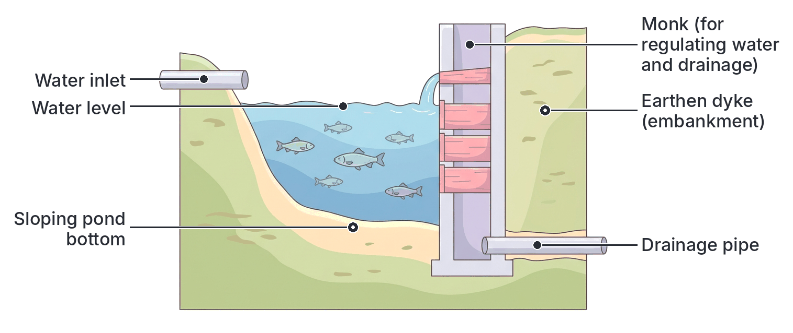
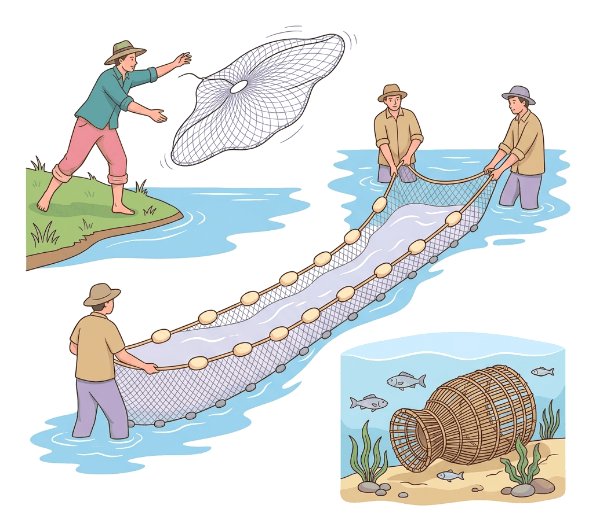

# JAMB Agricultural Science Notes: Fisheries and Wildlife Management

## What JAMB expects

This topic is Section C, Topic 8 of the JAMB Agricultural Science syllabus: Fisheries and Wildlife. It covers:

*   **a.** Fish culture systems; Common types of fishes e.g. *Tilapia, Catfish*, etc.
    *   i. Extensive systems: inland and deep sea fishing, lakes and rivers.
    *   ii. Semi-intensive systems: dams
    *   iii. Intensive systems: fish ponds – Factors to consider in ponds establishment and pond management e.g. pond fertilization, liming and desilting.
*   **b.** Fish harvesting and processing methods
    *   i. Use of drag nets, hook and line, etc.
    *   ii. Curing, sun-drying and smoking.
    *   iii. Fishery regulations
*   **c.** Wildlife management
    *   Habitat conservation, feeding, domestication, harvesting, processing and wildlife regulations.

By the end of these notes, you should be able to:
1. Identify the common types of fishes in West Africa.
2. Differentiate between various systems of fish farming in West Africa.
3. Determine the factors to be considered in intensive fish farming.
4. Assess the advantages and disadvantages of different fish harvesting and processing methods.
5. Determine the appropriate methods of catching fish.
6. Identify the various methods of fish preservation.
7. Identify the various fishery regulations in Nigeria.
8. Identify animals found in West African game reserves.
9. Give reasons for the establishment of game reserves.
10. Identify the common wildlife regulations.

> **Note on the syllabus wording:** The syllabus classifies "inland and deep sea fishing, lakes and rivers" under *extensive systems* of fish culture, and "dams" under *semi-intensive systems*. In most modern textbooks, capturing fish from the wild (oceans, rivers) is called **capture fisheries**, which is completely separate from **fish culture** (aquaculture/fish farming). However, because JAMB classifies them this way in the syllabus, these notes strictly follow the JAMB classification for exam purposes, while reminding you of the difference in reality. Also, one objective is listed in the syllabus without a roman numeral ("identify the various fishery regulations in Nigeria").

## Fish Culture Systems and Common Types of Fishes

Fish culture (aquaculture) is the rearing of aquatic organisms, mainly fish, under controlled or semi-controlled conditions. 

### Common Types of Fishes in West Africa

Fishes are cold-blooded aquatic vertebrates that breathe through gills and move using fins. In West Africa, fish are broadly classified by their skeletal structure (bony or cartilaginous) and their habitat (freshwater or saltwater). 

**Classification by skeletal structure:**
1. **Bony fishes (Osteichthyes):** Their skeletons are made of true bone. Most common edible fishes fall into this group.
2. **Cartilaginous fishes (Chondrichthyes):** Their skeletons are made of cartilage (a tough, flexible tissue). Examples include sharks, rays, and skates.

**Common West African Fishes:**
*   **Tilapia (*Oreochromis niloticus*):** A very common freshwater bony fish. It has scales, reproduces very rapidly, and feeds mostly on aquatic plants and plankton. It is widely farmed in earthen and concrete ponds across Nigeria.
*   **African Catfish (*Clarias gariepinus* and *Heterobranchus* species):** A highly valued freshwater bony fish without scales. It has whisker-like barbels around its mouth to help it find food in muddy water. It can survive in poorly oxygenated water because it has a special accessory breathing organ.
*   **Mackerel (Titus):** A marine (saltwater) pelagic fish very common in Nigerian markets, usually sold frozen or smoked.
*   **Croaker:** A marine fish found in coastal waters and estuaries, highly valued for its taste.
*   **Carp:** A large, scaly freshwater fish introduced to ponds and rivers.
*   **Nile Perch:** A very large predatory freshwater fish found in major rivers (like the River Niger) and Lake Chad.
*   **Mudfish / Lungfish:** Freshwater fish adapted to survive in muddy, dry conditions by burying themselves in the mud during the dry season.

### Differentiating Systems of Fish Farming

Following the exact JAMB classification, fish farming systems are divided into three types based on the level of management and the environment.

| Feature | Extensive Systems | Semi-intensive Systems | Intensive Systems |
| :--- | :--- | :--- | :--- |
| **Locations/Water Body** | Inland and deep sea fishing, large natural lakes (e.g., Lake Chad), and rivers (e.g., River Niger). | Dams, small reservoirs, and community lakes. | Purpose-built fish ponds (earthen, concrete, or tarpaulin tanks). |
| **Control of Environment** | None. The fish are wild and completely dependent on nature. | Partial. The farmer confines the fish but control over water quality is limited. | Total/Strict. Water quality, oxygen, and pH are carefully controlled. |
| **Feeding** | 100% natural food (plankton, small insects, other fish) found in the water. | Natural food supplemented occasionally with agricultural by-products (maize bran, kitchen waste). | 100% highly nutritious formulated artificial feeds (pellets) provided by the farmer. |
| **Stocking Density** | Very low (spread over vast oceans or rivers). | Moderate. | Very high (many fish packed into a small space). |
| **Capital & Management** | Low input (except for large commercial trawlers); mainly involves hunting/catching. | Moderate input. | Very high capital input (pond construction, expensive feeds, skilled labour). |

### Factors to Consider in Intensive Fish Farming

To succeed in intensive fish farming (using ponds), specific factors must be considered during the **establishment** of the pond and the day-to-day **management** of the pond.

**Factors in Pond Establishment (Construction):**
1. **Topography (Land surface):** The ideal land should have a gentle slope. This allows water to flow into the pond by gravity and, crucially, allows the pond to be drained completely by gravity during harvesting.
2. **Soil Type:** The soil must be able to hold water. **Clay or clay-loam soil** is the best because it is relatively impermeable (water does not seep away easily). Sandy soil is unsuitable because it drains water too fast.
3. **Water Supply:** There must be a reliable, continuous, and clean source of water year-round (streams, springs, boreholes). The water must be free from chemical pollution.
4. **Vegetation:** The site should not have too many large trees. Large roots make digging difficult and can crack the pond walls (dykes), while too much shade blocks sunlight, preventing algae from photosynthesizing.

**Factors in Pond Management:**
1. **Pond Preparation and Desilting:** Before stocking a pond, it is drained. Over time, mud, fish waste, and uneaten feed accumulate at the bottom as silt. **Desilting** is the removal of this accumulated mud from the pond bottom. If not removed, rotting silt produces toxic gases (like ammonia and hydrogen sulphide) that kill the fish.
2. **Liming:** Liming is the addition of calcium compounds—such as agricultural limestone (CaCO₃) or quicklime (CaO)—to the pond bottom or water. Liming corrects soil acidity (raises pH to a slightly alkaline level, e.g., 6.5 to 8.5), kills parasites, clears muddy water, and improves nutrient availability.
3. **Pond Fertilization:** After liming, fertilizers (poultry droppings or NPK) are added to the pond water to stimulate the growth of **phytoplankton** (microscopic plants) and **zooplankton** (microscopic animals). This natural food makes the water turn slightly greenish.
4. **Stocking:** Introducing baby fish (**fry** or **fingerlings**) into the pond. It is usually done early in the morning or late evening when the water is cool, to reduce stress.
5. **Feeding:** Fish must be fed high-protein formulated pellets daily. Uneaten feed must be avoided as it rots and pollutes the water.

## Fish Harvesting and Processing

Harvesting is catching the mature fish, while processing and preservation involve preparing the harvested fish so they do not spoil before reaching the consumer. 

### Appropriate Methods of Catching Fish

Different tools and methods are appropriate for catching fish depending on the culture system and the depth of the water.

1. **Drag Nets (Seine Nets):** A very long net with weights at the bottom edge and floats at the top edge. It is pulled by two people (or boats) from opposite ends to encircle and drag the fish toward the shore. Appropriate for ponds, shallow lakes, and rivers.
2. **Cast Nets:** A circular net with weights around its edge. A fisherman throws it over the water so it opens like a parachute, sinks over the fish, and traps them. Appropriate for shallow waters, rivers, and partial harvesting in ponds.
3. **Hook and Line:** A traditional method using a hook baited with earthworms or insects, attached to a line and a rod. Appropriate for small-scale subsistence fishing or sampling fish size in ponds.
4. **Traps (Basket/Gura Traps):** Woven cane or wire mesh baskets with a funnel-shaped entrance. Fish swim in easily to get the bait but cannot find their way out. Appropriate for rivers, streams, and swamps.
5. **Scoop Nets / Hand Nets:** A small net on a frame with a handle. Appropriate for scooping fingerlings or harvesting small quantities in concrete tanks.
6. **Total Pond Draining:** In earthen ponds, the drainage pipe (monk) is opened, completely emptying the pond so all the fish collect at the bottom. Appropriate for final harvesting in intensive aquaculture.

### Methods of Fish Preservation

Fish have high moisture and protein content, making them highly perishable. Preservation slows down or completely stops bacterial action and spoilage enzymes.

1. **Sun-drying:** Fish are gutted (intestines removed), split open, and spread on mats or racks under the hot sun until the moisture evaporates. Mostly used for small fishes.
2. **Smoking:** Fish are placed on racks over a fire. The heat dries out the moisture, while the smoke chemicals (phenols) act as a preservative and add a distinct flavour. Modern farms use smoking kilns (e.g., the Chorkor oven).
3. **Curing (Salting):** Fish are rubbed with dry salt or soaked in strong brine (salt water). The salt draws water out of the fish cells and bacteria by osmosis, effectively killing the bacteria.
4. **Chilling and Freezing:** Keeping fish in ice blocks (chilling) or deep freezers (freezing). This drastically slows down or stops bacterial growth.
5. **Canning:** Fish are sealed in airtight tins and heated under pressure to kill all microorganisms. Often done with oil or tomato sauce (e.g., canned sardines).

### Advantages and Disadvantages of Harvesting and Processing Methods

You must be able to assess the pros and cons of the methods discussed above.

**Assessing Catching (Harvesting) Methods:**

| Method | Advantages | Disadvantages |
| :--- | :--- | :--- |
| **Drag Nets (Seine)** | Catches a large number of fish at once; highly efficient for commercial ponds. | Requires at least two people; fish can escape if the pond bottom has stumps or snags. |
| **Cast Nets** | Easy for one person to use; excellent for partial harvesting. | Only catches a few fish at a time; requires skill to throw correctly; tangles easily. |
| **Hook and Line** | Very cheap; easy to set up; does not disturb the whole water body. | Extremely slow; highly inefficient for commercial harvesting. |
| **Total Draining** | Ensures 100% of the fish are harvested; allows for pond cleaning (desilting) and liming afterwards. | All fish must be sold or processed immediately; wastes a lot of water. |

**Assessing Preservation (Processing) Methods:**

| Preservation Method | Advantages | Disadvantages |
| :--- | :--- | :--- |
| **Sun-drying** | Very cheap; requires no fuel or electricity; fish become light and easy to transport. | Takes a long time; depends entirely on sunny weather; fish can be attacked by flies and maggots if not covered. |
| **Smoking** | Gives a pleasant, highly demanded flavour; extends shelf life significantly; can be done in any weather. | Exposes workers to harmful smoke; uses firewood (contributing to deforestation); fish can burn and lose nutritional value. |
| **Curing (Salting)** | Very cheap; highly effective at stopping bacterial growth without electricity. | High salt content may cause health issues (hypertension) for consumers; alters the natural taste of the fish. |
| **Freezing** | Retains the fresh taste, texture, and original nutritional value of the fish perfectly. | Very expensive; requires constant electricity (difficult in rural areas) and expensive equipment. |
| **Canning** | Longest shelf life (years); extremely convenient for consumers; easy to store and transport. | Requires highly sophisticated industrial machinery; very expensive to set up; cannot be done on small farms. |

### Fishery Regulations in Nigeria

Fishery regulations are laws made by the government to protect aquatic resources, prevent overfishing, and ensure that fish reproduce faster than they are caught.

1. **Ban on the use of poisonous chemicals:** Catching fish using toxic chemicals (such as Gammalin 20 or plant poisons) is strictly forbidden. This method kills fish of all sizes, including eggs, and poisons the water for human consumption.
2. **Ban on the use of explosives (Dynamite):** Using explosives to kill fish is prohibited. It destroys the entire habitat, shatters the fish making them unmarketable, and kills non-target aquatic organisms.
3. **Mesh size regulations:** Fishing nets must have a minimum mesh size (hole size). This ensures that only large, mature fish are caught, allowing young fish (fingerlings) to escape, grow, and reproduce.
4. **Close seasons:** The government may ban fishing in certain water bodies during specific months of the year. This period usually coincides with the breeding season of the fishes, allowing them to lay eggs safely.
5. **Catch quotas:** Restricting the total quantity (tonnage) of fish that commercial trawlers are allowed to catch in a year to prevent the depletion of fish stocks.
6. **Territorial water limits:** Foreign fishing vessels are banned from fishing within Nigeria’s territorial waters (Exclusive Economic Zone) without a license. 

## Wildlife Management

**Wildlife** refers to all free-living wild animals and uncultivated plants in their natural environment. **Wildlife management** is the scientific application of principles to preserve, conserve, and utilize wild animals for human benefit while ensuring they do not go extinct.

Key components of wildlife management include:
*   **Habitat conservation:** Protecting the natural forests, savannas, and wetlands where wild animals live from destruction by farming or urbanization.
*   **Feeding:** While wild animals feed themselves, management may involve providing supplementary feeding in reserves during harsh dry seasons.
*   **Domestication:** Taming wild animals and breeding them in captivity for meat (e.g., farming grasscutters, snails, or quails).
*   **Harvesting (Culling):** Carefully hunting a controlled number of animals to prevent overpopulation, which can lead to animals destroying their own habitat by overgrazing.
*   **Processing:** Preparing harvested game meat (bushmeat) for consumption, often by smoking.
*   **Wildlife regulations:** Enforcing laws that dictate when, where, and how wildlife can be interacted with.

### Animals Found in West African Game Reserves

A **game reserve** (or national park) is a large area of land set aside by the government where wild animals and plants are protected by law from hunting, poaching, and habitat destruction.

Animals commonly conserved in West African game reserves include:
*   **Mammals:** Elephants, lions, leopards, buffaloes, giraffes, hippopotamuses, antelopes (like the kob and gazelle), chimpanzees, gorillas, and monkeys.
*   **Reptiles:** Crocodiles, pythons, monitor lizards.
*   **Birds:** Ostriches, guinea fowls, eagles, hawks.

*Notable Nigerian Game Reserves and National Parks include:*
*   **Yankari Game Reserve** (Bauchi State)
*   **Kainji Lake National Park / Borgu Game Reserve** (Niger/Kwara States)
*   **Cross River National Park** (Cross River State - famous for protecting gorillas)
*   **Okomu National Park** (Edo State)

### Reasons for the Establishment of Game Reserves

1. **Conservation of Biodiversity:** To prevent rare and endangered species of animals and plants from going extinct due to uncontrolled hunting (poaching).
2. **Tourism and Recreation:** Game reserves attract both local and international tourists, generating revenue and foreign exchange for the country.
3. **Research and Education:** They provide natural laboratories for scientists, zoologists, and students to study animal behavior, ecology, and veterinary medicine.
4. **Employment:** They create jobs for game wardens, tour guides, conservationists, and the local communities surrounding the reserve.
5. **Preservation of natural heritage:** To ensure future generations can see indigenous animals alive in their natural habitats.

### Common Wildlife Regulations

Similar to fishery laws, wildlife laws prevent the over-exploitation of terrestrial animals.

1. **Ban on hunting endangered species:** It is absolutely illegal to hunt, capture, or kill animals that are near extinction (e.g., elephants, gorillas, leopards).
2. **Hunting licenses:** Hunters must apply for and pay for a government license before they are allowed to hunt in designated areas. This helps the government track and control hunting activities.
3. **Close seasons for hunting:** A specific period of the year (usually the mating/breeding season) when hunting of certain animals is completely banned to allow populations to recover.
4. **Ban on bush burning:** Setting fire to forests or savannas to force out animals for hunting is prohibited because it destroys the habitat and kills young or nesting animals.
5. **Restriction on firearms/weapons:** The use of certain high-calibre military weapons, poison arrows, or cruel traps for hunting is banned.
6. **Ban on the export of wildlife products:** It is illegal to trade internationally in parts of protected animals, such as elephant tusks (ivory), rhinoceros horns, or leopard skins.

## Key terms

| Term | Meaning |
| :--- | :--- |
| **Aquaculture** | The rearing of aquatic organisms (fish, shrimps) under controlled conditions. |
| **Extensive System** | Rearing or catching fish in natural water bodies with little to no control or feeding. |
| **Intensive System** | Rearing fish in ponds or tanks with total control over feeding, water quality, and stocking. |
| **Desilting** | The removal of accumulated mud, waste, and silt from the bottom of a fish pond. |
| **Liming** | Applying calcium compounds to a pond to correct soil acidity and kill parasites. |
| **Plankton** | Microscopic organisms (phytoplankton = plants; zooplankton = animals) that serve as natural fish food. |
| **Fingerlings** | Young fish, older than fry but not yet adults, usually the size used for stocking ponds. |
| **Seine Net (Drag Net)** | A long net with floats and weights used to encircle and drag fish to shore. |
| **Mesh Size** | The size of the holes in a fishing net; regulated to prevent catching immature fish. |
| **Game Reserve** | An area of land set aside to protect wildlife and their habitat from hunting and destruction. |
| **Close Season** | A legally enforced period when hunting or fishing is banned, allowing animals to breed. |
| **Poaching** | The illegal hunting, capturing, or killing of wild animals. |

## Exam tips and common mistakes

*   **Confusing capture and culture:** Remember that JAMB groups "inland and deep sea fishing" as **extensive fish culture systems**, even though they technically don't involve "farming" the fish. Choose this answer in UTME if asked.
*   **Liming vs. Fertilization:** Liming corrects soil pH and clears the water. Fertilization is strictly to promote the growth of plankton (natural food). They serve entirely different purposes.
*   **Desilting importance:** Know that desilting prevents the build-up of toxic gases (like ammonia and hydrogen sulphide) from rotting mud and waste at the bottom of the pond.
*   **Mesh size purpose:** Small mesh sizes are bad because they catch baby fish (fingerlings). Regulated (larger) mesh sizes are required because they only catch mature fish.
*   **Pond soil:** The best soil for earthen ponds is **clay**, because it holds water effectively. Never choose sandy soil.
*   **Game reserves:** Memorize Yankari (Bauchi State) and Kainji (Niger State) as the primary examples of Nigerian game reserves.

## Quick summary

1. Fish culture systems range from extensive (natural waters) and semi-intensive (dams) to intensive (ponds). Common fishes include Tilapia and Catfish (freshwater), and Mackerel (marine).
2. Setting up intensive fish farming requires careful pond establishment (clay soil, reliable water) and management practices such as desilting, liming, and fertilization to ensure high yields.
3. Fish are harvested using various methods like drag nets, cast nets, and total draining, each having unique advantages depending on the water body.
4. Because fish are highly perishable, they are preserved using methods like sun-drying, smoking, salting, chilling, and canning, which extend shelf life but vary in cost and impact on taste.
5. Fishery regulations protect aquatic ecosystems by banning toxic chemicals (Gammalin 20), explosives, and small-mesh nets, and by enforcing close seasons.
6. Wildlife management involves habitat conservation, domestication, and controlled harvesting. Game reserves like Yankari protect animals, prevent extinction, and promote tourism.
7. Wildlife regulations prohibit bush burning, restrict hunting of endangered species, and require hunting licenses to prevent the over-exploitation of natural resources.

## Practice questions

**1. Which of the following fishes is a cartilaginous fish?**
- A. Shark
- B. Tilapia
- C. Catfish
- D. Croaker

**Answer: A.** Sharks have skeletons made of cartilage. The most tempting wrong options are Tilapia and Catfish, but these are bony fishes commonly farmed in West Africa.

**2. According to the syllabus classification, capturing fish from lakes and rivers without providing artificial feed is an example of a/an**
- A. intensive system
- B. extensive system
- C. semi-intensive system
- D. mechanized system

**Answer: B.** Extensive systems rely completely on natural environments (oceans, rivers, lakes) with zero control over feeding or breeding. A common mistake is confusing this with semi-intensive systems, but semi-intensive involves some level of confinement (like dams) and supplementary feeding.

**3. The primary reason for adding agricultural limestone to a newly constructed fish pond is to**
- A. increase the water temperature
- B. provide calcium for fish bones
- C. correct soil and water acidity
- D. encourage the growth of aquatic weeds

**Answer: C.** Liming neutralizes the acidity of the pond soil and water, raising the pH to an optimal level and helping to kill parasites. Option B is a typical misunderstanding; while lime contains calcium, its primary purpose in pond management is pH correction, not feeding the fish.

**4. The removal of accumulated mud, faeces, and uneaten feed from the bottom of an earthen fish pond is known as**
- A. draining
- B. weeding
- C. liming
- D. desilting

**Answer: D.** Desilting is the process of removing silt (mud and organic waste) to prevent the release of toxic gases that can kill fish. Option A (draining) is a tempting wrong option, but draining is just the removal of water, whereas desilting is the specific removal of the muddy waste left behind.

**5. Which of the following is a disadvantage of using a hook and line for fish harvesting?**
- A. It destroys the pond embankment
- B. It catches only small fish
- C. It is highly inefficient for commercial harvesting
- D. It requires very expensive machinery

**Answer: C.** Hook and line is extremely slow and catches only one fish at a time, making it unsuitable for harvesting a large pond commercially. It is very cheap, meaning option D is incorrect.

**6. A major advantage of smoking as a method of fish preservation is that it**
- A. retains the exact fresh taste of the fish
- B. requires no heat or fuel
- C. adds a chemical preservative and desirable flavour
- D. keeps the fish alive longer

**Answer: C.** The smoke contains phenols and other chemicals that act as preservatives, and the drying heat extends shelf life while giving the fish a flavour many consumers want. Option A is incorrect because smoking completely changes the fresh taste and texture.

**7. Fishery regulations prohibit the use of small-mesh nets in order to**
- A. reduce the cost of making nets
- B. prevent the catching of young and immature fish
- C. ensure that fish breathe properly in the net
- D. stop foreign trawlers from entering territorial waters

**Answer: B.** Regulated (larger) mesh sizes allow baby fish (fingerlings/fry) to escape and grow, ensuring the fish population is not wiped out. A typical misunderstanding is thinking mesh sizes are related to the cost of the net (Option A).

**8. Which of the following chemicals is illegally used by some fishermen to catch fish in Nigeria, leading to severe water pollution?**
- A. NPK fertilizer
- B. Gammalin 20
- C. Agricultural lime
- D. Sodium chloride

**Answer: B.** Gammalin 20 is a highly toxic pesticide illegally used as a fish poison. It kills all aquatic life and poisons the water for humans. NPK (Option A) and agricultural lime (Option C) are legally and beneficially used in pond management.

**9. Yankari Game Reserve is located in which state in Nigeria?**
- A. Cross River
- B. Edo
- C. Bauchi
- D. Niger

**Answer: C.** Yankari Game Reserve is famously located in Bauchi State. A common mistake is choosing Niger (Option D), which is where Kainji Lake National Park is located.

**10. A period set aside by wildlife regulations during which hunting is totally prohibited is referred to as the**
- A. close season
- B. mating season
- C. open season
- D. holiday season

**Answer: A.** The close season is a legally enforced period, usually coinciding with the animals' breeding (mating) season, when no hunting is allowed, giving animal populations time to recover. Option B is a distractor; while the close season happens *during* the mating season, the legal term for the ban period is the close season.
