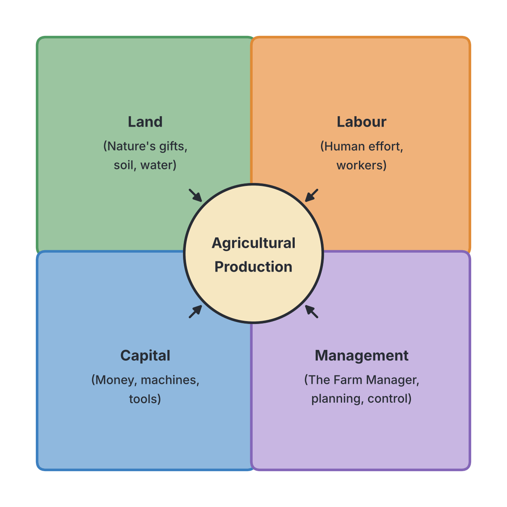
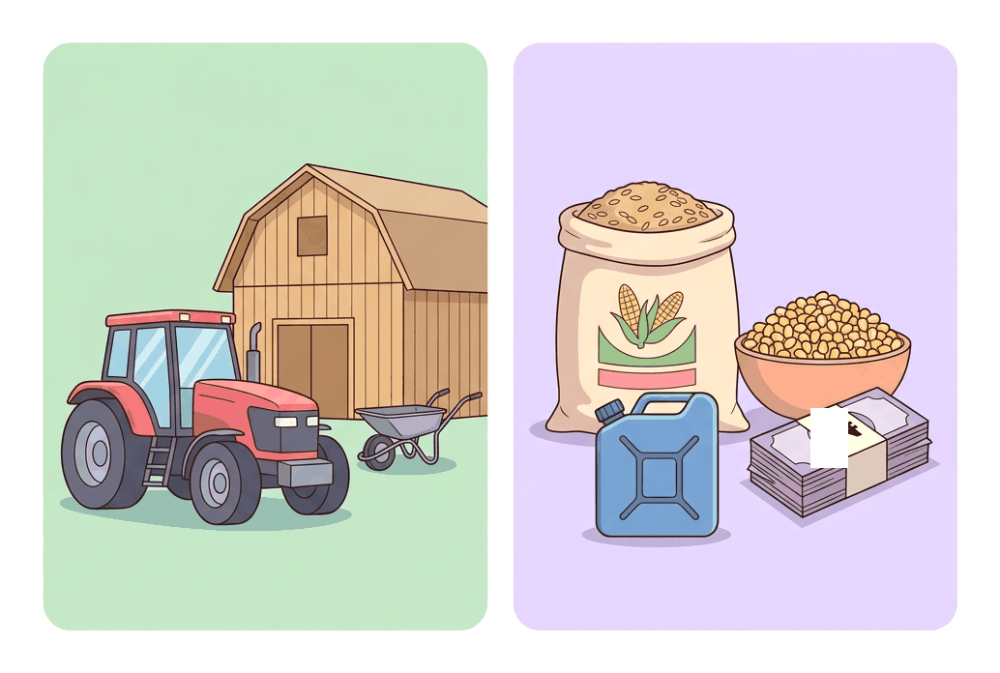

# JAMB Agricultural Science Notes: Factors of Agricultural Production

## What JAMB expects

This topic is Section D, Topic 1 of the JAMB Agricultural Science syllabus: Factors of Agricultural Production. It covers the four economic resources needed to produce agricultural goods and services.

**Note on the syllabus wording:** In the JAMB syllabus, the heading for Section D is printed in some places as "Agriculture Economics and Extension" but is correctly known as "Agricultural Economics and Extension". Additionally, some objectives are printed with truncated text in JAMB's internal systems (for instance, omitting "and their effects on agricultural production" from the labour objective). These notes cover the full scope of the required knowledge.

This file covers the following content items:
- a. Land
- b. Labour
- c. Capital
- d. Management

By the end of these notes, you should be able to:
1. understand the meaning of land and state its uses.
2. identify the various forms of land ownership.
3. examine the effects of land ownership on agriculture.
4. differentiate between the various features of land and their effects on land use.
5. differentiate between the types and sources of labour (and their effects on agricultural production).
6. compare the sources of capital and associated problems.
7. determine the functions of a farm manager in an agricultural enterprise.

Production in agriculture is impossible without combining resources. These resources are known as the **factors of production**, and they are grouped into four categories: **Land**, **Labour**, **Capital**, and **Management** (or Entrepreneurship). 

---

## Land

**Content a: Land**

Land is the most fundamental factor of production. Without it, agricultural activities cannot even begin. While in ordinary language land just means the ground we walk on, in agricultural economics its meaning is much broader.

### Meaning of Land and Its Uses

**Objective i: understand the meaning of land and state its uses.**

**Meaning of Land:**
In agriculture and economics, **land** is defined as the free gift of nature. It includes not just the solid earth surface and the topsoil, but also the minerals in the ground, water bodies (rivers, lakes, oceans), forests, wildlife, and even the atmosphere and climate above it. 

**Uses of Land:**
Land is highly versatile and is competed for by many sectors of the economy. Its uses are broadly divided into agricultural and non-agricultural uses.

**Agricultural uses of land:**
1. **Crop production:** The primary use of land is growing food crops (like maize, cassava, and rice) and cash crops (like cocoa, oil palm, and cotton).
2. **Livestock production:** Providing pastures for grazing ruminants (cattle, sheep, and goats) and physical space for building housing for poultry and pigs.
3. **Forestry:** Growing trees for timber, firewood, medicinal plants, and establishing reserves for wildlife conservation.
4. **Fishery:** Providing natural water bodies (rivers, lakes) and space for artificial ponds to rear fish (such as tilapia and catfish).

**Non-agricultural uses of land:**
1. **Construction:** Building residential houses, schools, hospitals, and factories.
2. **Transportation:** Constructing roads, railways, and airports.
3. **Mining:** Extracting minerals like crude oil, coal, tin, and limestone from beneath the earth's surface. 
4. **Recreation:** Creating parks, stadiums, and tourist centres.
5. **Cemeteries:** Providing space for burying the dead.

### Identifying the Various Forms of Land Ownership

**Objective ii: identify the various forms of land ownership.**

The system through which individuals or communities acquire, own, use, and transfer land is called the **Land Tenure System**. In West Africa, farmers can acquire land through several forms of land tenure:

1. **Communal Land Tenure:** Land belongs to the entire community, village, or extended family. It is held in trust by the community head (such as an Oba, Emir, or Eze), who allocates portions to community members for farming. No single individual owns the land permanently.
2. **Individual / Freehold Land Tenure:** This is a modern system where an individual has absolute, permanent ownership of a piece of land. The owner has the right to use it, sell it, lease it, or use it as collateral for a bank loan. 
3. **Inheritance Land Tenure:** Land is acquired through birthright and custom. When a landowner dies, their land is shared among their children or next of kin according to the local traditional laws.
4. **Leasehold Land Tenure:** A farmer (the lessee) pays a landowner (the lessor) for the right to use a piece of land for a specific, usually long, period (e.g., 10, 25, or 99 years). A legal agreement binds both parties.
5. **Rent / Tenancy Land Tenure:** A farmer rents a piece of land for a short period (usually one or two farming seasons) and pays the owner either in cash or with a share of the crop harvest (a practice known as sharecropping).
6. **Pledge Land Tenure:** Land is used as a security for a loan. The landowner (debtor) gives the land to the creditor to farm until the loan is fully repaid. 
7. **Gift Land Tenure:** Land is given voluntarily by the absolute owner to another person as a present, often as a reward for loyalty or good service.

### Effects of Land Ownership on Agriculture

**Objective iii: examine the effects of land ownership on agriculture.**

The type of land tenure heavily influences a farmer's ability to produce food, expand operations, or secure financial assistance. 

| Form of Ownership | Positive Effects (Advantages) | Negative Effects (Disadvantages) |
| --- | --- | --- |
| **Communal** | Ensures every community member gets land to farm, preventing landlessness. Encourages cooperative farming efforts. | The land cannot be used as collateral for bank loans (no individual ownership document). Discourages permanent investments like planting tree crops, as the land can be revoked. |
| **Freehold (Individual)** | The farmer can use the land as collateral for loans. It encourages long-term planning and the planting of permanent tree crops (like cocoa or rubber). | Land may be too expensive for a poor peasant farmer to buy. Wealthy individuals might buy up all available land, leaving peasants landless. |
| **Inheritance** | It is an easy and cost-free way for the next generation to acquire land. | Leads heavily to **land fragmentation** (land divided into tiny, scattered plots too small for tractors). Causes severe family disputes over boundaries. |
| **Leasehold** | Ensures security of tenure for the lease period, allowing the farmer to plan, invest, and use idle land effectively. | The farmer cannot sell the land. If the lease period is too short, they will avoid planting slow-growing tree crops. |
| **Rent / Tenancy** | Good for landless farmers who need to grow short-term food crops quickly. | Landlords can increase rents arbitrarily. Tenants often over-farm the land and do not apply long-term fertilizers, leading to severe soil degradation. |
| **Pledge** | Allows a desperate farmer to raise emergency cash. | The creditor might exploit and ruin the land's fertility before the loan is repaid. The original owner loses their farming livelihood while in debt. |

> **Note on the Land Use Act (1978):** To solve the problems of land fragmentation and the difficulty of acquiring land for large-scale agriculture in Nigeria, the Federal Government enacted the Land Use Act of 1978. This Act vests all land in a state in the hands of the **State Governor**, who holds it in trust for the people. Individuals are granted a **Statutory Right of Occupancy** for up to 99 years. For agricultural purposes, an individual or company can be granted up to 500 hectares for crop farming or 5,000 hectares for grazing.

### Features of Land and Their Effects on Land Use

**Objective iv: differentiate between the various features of land and their effects on land use.**

Land has unique economic and physical characteristics that differentiate it from Labour or Capital. JAMB expects you to understand these features and explain how they dictate agricultural practices.

| Feature of Land | Meaning / Differentiation | Effect on Land Use / Agriculture |
| --- | --- | --- |
| **Immobility** | Land is physically fixed; it cannot be moved from one place to another. A fertile plot in Benue cannot be transported to Lagos. | Farmers must travel to where the land is located. Crops and livestock must be carefully chosen to match the specific local climate and soil type. |
| **Limited in Supply** | The total surface area of the earth is fixed (perfectly inelastic in supply). You cannot manufacture more land. | As human population grows, land becomes scarce and expensive. Farmers are forced to adopt intensive farming (using fertilizers and high-yield seeds to get more produce from a small area). |
| **Heterogeneity (Variability)** | No two pieces of land are exactly the same in fertility, topography, or texture. | A farmer must test the soil and select crops based on the specific land (e.g., planting rice in swampy lowlands and millet in dry savanna). |
| **Subject to Diminishing Returns** | If a farmer keeps adding more labour and capital (e.g., fertilizer) to a fixed piece of land, the extra yield produced will eventually start to decline. | Farmers must practice crop rotation, allow land to fallow, or eventually acquire more land to maintain high output levels. |
| **Physically Indestructible** | The geographical space and location of land cannot be destroyed, even though its topsoil fertility can be lost to erosion. | Because the asset itself will always exist, freehold land serves as excellent and reliable collateral for securing agricultural loans. |
| **Free Gift of Nature** | It was not created by human effort and has no cost of production. | Its value is determined purely by its location, its natural fertility, and the demand for it, not by manufacturing costs. |

---

## Labour

**Content b: Labour**

**Labour** refers to the physical and mental human effort utilized in the production of agricultural goods and services. While land is a passive factor, labour is active—without it, land cannot be cleared and capital (like tractors) cannot be operated. The standard unit for measuring agricultural labour is the **man-day** or **man-hour** (the amount of work done by one adult man in one day or one hour).

### Types and Sources of Labour

**Objective: differentiate between the types and sources of labour and their effects on agricultural production.**

Agricultural labour is broadly classified by the level of skill involved (Types of Labour), and farmers obtain this workforce from various places (Sources of Labour). 

**1. Differentiating the Types of Labour:**
Labour is divided into three categories based on the level of education, technical skill, and training required.

| Feature | Skilled Labour | Semi-skilled Labour | Unskilled Labour |
| --- | --- | --- | --- |
| **Meaning** | Highly educated, specially trained professionals who provide the mental effort, planning, and technical expertise. | Workers with basic training, secondary education, or practical experience in specific farm tasks, but without advanced university degrees. | Workers with little or no formal education or special training. They provide mostly raw physical energy. |
| **Examples** | Farm managers, veterinary doctors, agricultural engineers, agronomists. | Tractor drivers, farm mechanics, experienced livestock attendants, clerical staff. | Casual labourers hired for manual land clearing, weeding, harvesting, or carrying farm produce. |
| **Remuneration (Pay)** | Paid regular, high salaries based on formal contracts. | Paid moderate wages or salaries. | Paid low daily wages or piece-rate (paid per specific task completed). |
| **Effect on Production** | High efficiency. They make the crucial decisions that determine the farm's overall profit or loss. | They operate machinery safely and handle routine operations, increasing the speed of work and reducing machinery breakdown. | They get heavy, manual work done quickly, but their low efficiency and need for constant supervision can limit large-scale production. |

**2. Differentiating the Sources of Labour:**
Farmers get their workforce from three main sources. The source used often dictates whether a farm remains small-scale or expands into commercial production.

| Source of Labour | Characteristics and Details | Effects on Agricultural Production |
| --- | --- | --- |
| **Personal and Family Labour** | The farmer, their spouse(s), and children do the work. This is the most common source in **peasant (subsistence) farming** across West Africa. | **Positive:** It is cheap (no cash wages are paid). Workers are dedicated because they share the final harvest. **Negative:** It strictly limits the size of the farm. Children going to school significantly reduces the available workforce. |
| **Communal Labour** | Members of a community, age grade, or cooperative group help one another in turns. Known locally in Nigeria as *Aro* or *Awe* (Yoruba) or *Gayya* (Hausa). | **Positive:** Gets heavy tasks (like land clearing or harvesting) done very quickly at low cost (often just the cost of providing food and drinks). **Negative:** It is only available at specific times and cannot be relied upon for daily farm maintenance. |
| **Hired (Paid) Labour** | People are paid money to work on the farm. They can be **casual** (paid daily/weekly for temporary tasks) or **permanent** (salaried staff). | **Positive:** Essential for commercial farming. Allows the farm to expand to any size. High efficiency as workers can be fired if unproductive. **Negative:** Highly expensive. High cost of hired labour reduces the farmer's profit margin. Strikes or labour shortages can ruin harvests. |

---

## Capital

**Content c: Capital**

**Capital** is defined as all man-made wealth or assets used to produce more wealth. It represents the financial resources (money) and the physical equipment a farmer uses. 

Capital is generally divided into two types:
1. **Fixed Capital:** Assets that are not used up in one production cycle and last for a long time. Examples include farm buildings, tractors, incubators, farm tools, and breeding stock. (Note: In general economics, land is a separate factor, but in farm accounting, purchased land is often treated as a fixed asset).
2. **Working (Operating) Capital:** Assets that are used up completely during a single production season. Examples include cash in hand, seeds, fertilizers, livestock feeds, fuel, and agrochemicals (pesticides).

### Sources of Capital and Associated Problems

**Objective: compare the sources of capital and associated problems.**

Agricultural capital requires funding. Farmers source money from different places, but each source carries unique challenges that limit agricultural development.

| Source of Capital | Description | Associated Problems |
| --- | --- | --- |
| **Personal Savings** | Money saved by the farmer from previous harvests or other businesses. The most common source for peasant farmers. | Usually too small to fund large-scale or commercial farming. It heavily limits farm expansion. |
| **Commercial Banks** | Financial institutions (e.g., First Bank, UBA) that lend money to farmers for profit. | They demand strict **collateral** (like a certificate of occupancy on land), which poor farmers lack. Interest rates are very high. They prefer short-term loans, which do not suit long-term tree crops. |
| **Government Agencies & Agricultural Banks** | Specialized institutions, such as the **Bank of Agriculture (BOA)** in Nigeria, set up to provide low-interest loans to farmers. | Funds are often limited and hijacked by politicians or non-farmers. The process involves too much bureaucracy and delay, meaning money often arrives after the planting season is over. |
| **Cooperative Societies** | A group of farmers who pool their resources together and lend out to members at low interest rates. | The total pool of funds is usually small because members themselves are poor. Poor management or embezzlement by leaders can destroy the cooperative. |
| **Money Lenders** | Wealthy individuals in the community who lend out cash quickly to farmers in urgent need. | They charge excessively high (exorbitant) interest rates. They may seize the farmer's land or entire harvest if the loan is not paid back on time. |
| **Non-Governmental Organizations (NGOs)** | Organizations that provide grants, micro-credit, or farm inputs (like seeds and fertilizer) to rural farmers to alleviate poverty. | Grants are highly competitive and reach only a few farmers. Funding relies on foreign donors and may dry up unexpectedly. |

---

## Management

**Content d: Management**

**Management** (or Entrepreneurship) is the factor of production that coordinates, organizes, and controls the other three factors (Land, Labour, and Capital) to achieve a specific goal—which is usually maximum profit and farm efficiency. 

The person who performs this role is the **Farm Manager**. In a small family farm, the peasant farmer themselves acts as the manager. In a large commercial farm, it is a highly skilled professional employed by the farm owner. 

### Functions of a Farm Manager

**Objective: determine the functions of a farm manager in an agricultural enterprise.**

The functions of a farm manager are grouped into five major categories:

**1. Planning and Decision-making:**
This is the most critical function of the manager. The manager must decide:
- What to produce (e.g., whether to raise poultry or grow maize).
- How to produce (e.g., using tractors versus manual labour).
- How much to produce (determining the scale of operation).
- Where to locate the farm enterprises.
- Drawing up the farm budget and calendar of activities.

**2. Organizing:**
- Procuring the necessary land, labour, and capital.
- Allocating land to different crops based on soil suitability.
- Determining the number of workers needed and assigning them specific daily duties.
- Acquiring the correct seeds, livestock feed, and fertilizers at the right time.

**3. Directing and Supervision (Administration):**
- Overseeing the daily activities on the farm to ensure work is done efficiently.
- Motivating workers and settling disputes among staff.
- Organizing training for unskilled and semi-skilled workers.
- Ensuring that safety precautions are strictly followed when workers use machinery or hazardous agrochemicals.

**4. Production:**
- Ensuring the health of crops and livestock (arranging for timely weeding, vaccination, and pest control).
- Ensuring that harvesting is done at the right stage of maturity to prevent post-harvest losses.

**5. Marketing and Evaluation (Control):**
- Deciding when, where, and at what price to sell the farm produce to make maximum profit.
- Keeping accurate farm records (production records, financial records, and inventory).
- Evaluating the performance of the farm at the end of the year to determine the net profit or loss.
- Using past records to identify mistakes and make better plans for the next season.

---

## Key terms

| Term | Meaning |
| --- | --- |
| Factors of Production | The essential resources combined to produce goods and services: Land, Labour, Capital, and Management. |
| Land | The free gift of nature used for production; includes soil, minerals, water, and forests. |
| Land Tenure System | The customary or legal system of acquiring, owning, and transferring land in a society. |
| Land Fragmentation | The breaking up of a large piece of land into small, scattered plots, usually due to inheritance customs. |
| Labour | Human physical and mental effort used in production, measured in man-hours or man-days. |
| Capital | Man-made wealth (money, machines, farm inputs) used to produce more wealth. |
| Fixed Capital | Farm assets that are not used up in one production season (e.g., tractors, buildings, incubators). |
| Working Capital | Farm assets used up completely during one production season (e.g., fertilizer, seeds, feed, cash). |
| Farm Manager | The person responsible for coordinating land, labour, and capital to achieve farm goals. |
| Collateral | An asset (like land ownership documents) pledged to a bank to secure a loan. |

## Exam tips and common mistakes

- **Land is NOT just soil:** In economics and agricultural science, remember that "land" includes the rivers, forests, wildlife, and minerals.
- **Land vs Capital:** Students often confuse these. Remember, land is a *free gift of nature*, whereas capital is *man-made*. Land cannot be moved; capital (like a tractor or money) can be.
- **Inheritance causes fragmentation:** If a question asks about the major disadvantage of the inheritance land tenure system, the answer is usually "land fragmentation".
- **Collateral problems:** Both communal and rent/leasehold tenure systems make it impossible to use land as collateral, because the farmer does not have permanent ownership documents. Freehold (individual) tenure solves this.
- **Fixed vs Working Capital:** This is a common trap. Seeds, cash, feed, and fertilizer are *working capital* because you use them up. A tractor, barn, or wheelbarrow is *fixed capital* because it lasts multiple seasons. 
- **The Land Use Act of 1978:** Remember that it vests land in the *State Governor*, not the President or the Local Government Chairman.
- **Labour unit:** Remember that the standard unit of measuring agricultural labour is the *man-day* or *man-hour*.

## Quick summary

1. The four factors of agricultural production are Land, Labour, Capital, and Management (Entrepreneurship).
2. Land is a free gift of nature, immobile, limited in supply, subject to diminishing returns, and cannot be destroyed.
3. Land ownership in West Africa includes communal, individual (freehold), inheritance, leasehold, and rent. Inheritance causes fragmentation, while communal tenure limits the use of land as collateral.
4. The Nigerian Land Use Act of 1978 vests all state land in the Governor and allows a maximum of 500 hectares for crops and 5,000 hectares for livestock grazing.
5. Agricultural labour can be skilled, semi-skilled, or unskilled. Peasant farmers rely heavily on family labour, while commercial farmers use paid (hired) labour.
6. Capital is man-made wealth, divided into fixed capital (tractors, buildings) and working capital (seeds, fertilizers, cash).
7. Sourcing capital is difficult: commercial banks demand collateral and charge high interest, while government loans are plagued by bureaucracy and delays.
8. The Farm Manager plans, organizes, directs, supervises, and evaluates the farm to ensure maximum profit.

## Practice questions

**1. In agricultural economics, which of the following is NOT considered a feature of land?**
- A. It is immobile
- B. It is a free gift of nature
- C. Its supply is unlimited
- D. It is subject to diminishing returns

**Answer: C.** The supply of land is fixed and limited. You cannot create more land, which is why it becomes more expensive as the human population grows. 

**2. The most common source of labour for peasant farmers in West Africa is**
- A. communal labour
- B. hired labour
- C. migrant labour
- D. family labour

**Answer: D.** Peasant (subsistence) farmers rely heavily on the physical effort of themselves, their spouses, and their children because they cannot afford to hire permanent workers.

**3. Which of the following is a major disadvantage of the inheritance land tenure system?**
- A. It prevents family members from acquiring land
- B. It leads to the fragmentation of land into small plots
- C. It allows foreigners to easily buy up community land
- D. The land is held in trust by the state governor

**Answer: B.** As land is passed down and divided among many children over generations, the plots become too small for commercial farming or the effective use of tractors.

**4. Under the Nigerian Land Use Act of 1978, the maximum area of land that can be granted to an individual for crop production is**
- A. 500 hectares
- B. 5,000 hectares
- C. 1,000 hectares
- D. 99 hectares

**Answer: A.** The Act allows up to 500 hectares for crop production and up to 5,000 hectares for grazing (livestock) purposes.

**5. Which of the following items is an example of fixed capital?**
- A. Cassava cuttings
- B. NPK fertilizer
- C. Cash at hand
- D. Farm tractor

**Answer: D.** A farm tractor is a fixed asset because it lasts for many years and is not entirely used up in one production season. Options A, B, and C are working (operating) capital.

**6. A farmer is unable to secure a bank loan because the land they farm on belongs to the whole village. This highlights a major problem associated with**
- A. leasehold tenure
- B. freehold tenure
- C. communal tenure
- D. gift tenure

**Answer: C.** In communal land tenure, no individual has permanent ownership (a Certificate of Occupancy), meaning banks will not accept the land as collateral. Freehold tenure solves this problem.

**7. Which of the following is the most critical function of a farm manager?**
- A. Weeding the crops
- B. Planning and decision making
- C. Driving the farm machinery
- D. Feeding the livestock

**Answer: B.** While a manager might occasionally do manual work on a small farm, their most critical, defining function is planning and making the decisions (what to produce, how, and when) that ensure profitability. Manual tasks are usually delegated to unskilled or semi-skilled labour.

**8. Agricultural capital sourced from commercial banks is usually associated with the problem of**
- A. lack of collateral requirements
- B. extremely low interest rates
- C. high interest rates and strict collateral demands
- D. funds being hijacked by politicians

**Answer: C.** Commercial banks operate for profit, so they charge high interest rates and demand strict collateral (like land documents), making it hard for poor farmers to access loans. Government agencies (like BOA) are the ones usually delayed by bureaucracy and politics.

**9. The reward for labour as a factor of production is**
- A. rent
- B. interest
- C. wages or salaries
- D. profit

**Answer: C.** Workers provide labour in exchange for wages (if daily/casual) or salaries (if permanent). Note that rent is the reward for land, interest is the reward for capital, and profit is the reward for management.

**10. A tractor operator on a large commercial farm is classified as**
- A. highly skilled labour
- B. semi-skilled labour
- C. unskilled labour
- D. management

**Answer: B.** A tractor operator requires specific practical training to handle machinery safely, making them semi-skilled. They do not typically have the advanced degrees required for skilled labour (like an agronomist), nor are they completely untrained manual workers (unskilled).
