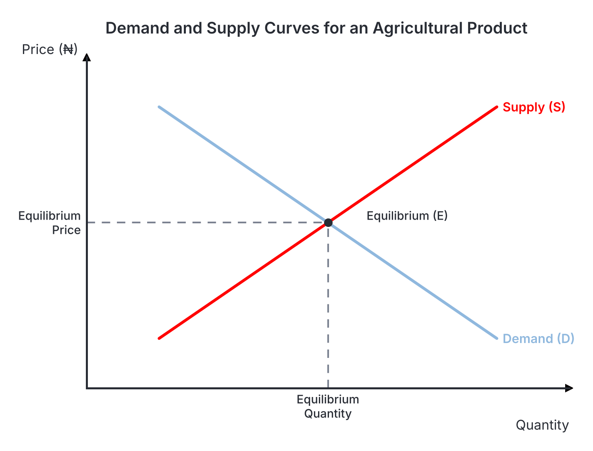

# JAMB Agricultural Science Notes: Basic Economic Principles

## What JAMB expects

This topic is Section D, Topic 2 of the JAMB Agricultural Science syllabus: Basic Economic Principles. It has three main content items:

- **a. Demand and supply**
- **b. Production function:** Input/input, Output/output, Input/output relationships; stages of production, concepts of diminishing returns, scale of preference and choice.
- **c. Characteristic Features of Agricultural Production:** Smallness of farm holdings, biological limits of farm production and susceptibility of farm production to climate, seasonality of farm productions, price elasticity in demand and supply of agricultural produce.

By the end of these notes, you should be able to:

1. Relate demand to supply in agricultural production.
2. Interpret graphical representation of demand and supply.
3. Relate input to output.
4. Deduce economic concepts from graphic representation.
5. Distinguish between the common features of agricultural production and produce.
6. Compute elasticity of demand and supply.

## Demand and supply

**Content a: Demand and supply.**

### Relating demand to supply in agricultural production

**Objective i: relate demand to supply in agricultural production.**

**Demand** is the quantity of an agricultural commodity that consumers are willing and able to buy at a given price and at a specific period.
- **The Law of Demand** states that, all other things being equal, the lower the price of a commodity, the higher the quantity demanded, and the higher the price, the lower the quantity demanded. If the price of rice drops, more families can afford it, so quantity demanded increases.

**Factors affecting the demand for agricultural produce:**
1. **Price of the produce:** A high price reduces quantity demanded; a low price increases it.
2. **Income of consumers:** When people earn more money, they demand more agricultural goods, especially higher-quality foods like meat and eggs.
3. **Price of close substitutes:** If the price of yam becomes too high, consumers will switch to a cheaper substitute like cassava, reducing the quantity demanded of yam and increasing the demand for cassava.
4. **Population size:** A larger population needs more food, raising overall demand.
5. **Taste and preference:** Cultural background or personal liking affects what people buy.
6. **Festivals and seasons:** Demand for chicken and rice always surges during Christmas and Sallah.

**Supply** is the quantity of an agricultural commodity that producers (farmers) are willing and able to offer for sale at a given price and at a specific time.
- **The Law of Supply** states that, all other things being equal, the higher the price of a commodity, the higher the quantity supplied, and the lower the price, the lower the quantity supplied. Farmers want to make maximum profit, so high market prices encourage them to produce and sell more.

**Factors affecting the supply of agricultural produce:**
1. **Price of the produce:** Higher prices motivate farmers to harvest and sell more.
2. **Cost of production:** If the cost of inputs (like fertilizer, tractor hire, or farm labour) increases, it becomes more expensive to farm, causing supply to fall.
3. **Weather and climate:** Good rainfall and sunshine lead to bumper harvests (high supply), while drought or floods destroy crops (low supply).
4. **Technology:** The use of tractors, improved seeds, and agrochemicals greatly increases output and supply compared to using basic cutlasses and hoes.
5. **Government policies:** Subsidies on fertilizer or bans on imported food can increase local supply.
6. **Pests and diseases:** Outbreaks (like bird flu in poultry or locusts on crops) drastically reduce supply.

**Relating Demand to Supply (Market Equilibrium):**
In any market, consumers want the lowest prices (demand) while farmers want the highest prices (supply). The price at which the quantity that consumers want to buy exactly equals the quantity that farmers want to sell is called the **equilibrium price**. At this point, the market clears—there is no scarcity and no excess (glut).

### Interpreting graphical representations of demand and supply

**Objective ii: interpret graphical representation of demand and supply.**

Graphs are used in economics to visually represent the laws of demand and supply. In these graphs, **Price** is always placed on the vertical axis (y-axis) and **Quantity** is placed on the horizontal axis (x-axis).

- **The Demand Curve:** Because high prices mean low quantity demanded, and low prices mean high quantity demanded, the demand curve slopes **downwards** from left to right.
- **The Supply Curve:** Because high prices encourage high quantity supplied, and low prices mean low quantity supplied, the supply curve slopes **upwards** from left to right.
- **Equilibrium:** When you draw both curves on the same graph, the point where they cross (intersect) is the **equilibrium point**. 

**Movements vs. Shifts:**
- **Movement along the curve:** If only the price of the produce changes, the quantity moves along the existing line.
- **Shift of the curve:** If any factor *other than price* changes (like a sudden drought reducing supply, or a population boom increasing demand), the entire curve shifts left or right. A shift to the right means an increase, while a shift to the left means a decrease.

## The production function and scale of preference

**Content b: Production function: Input/input, Output/output, Input/output relationships; stages of production, concepts of diminishing returns, scale of preference and choice.**

### Scale of preference and choice

Economics exists because human wants are unlimited, but the resources to satisfy them are scarce. A farmer faces this problem daily.

1. **Wants:** These are the desires of a farmer, such as a new tractor, hybrid seeds, more land, or fertilizer.
2. **Scarcity:** The farmer has limited money and resources to get all these wants.
3. **Scale of Preference:** Because of scarcity, the farmer must rank their wants in order of importance. A scale of preference is a list of unsatisfied wants arranged in descending order of priority, with the most pressing need at the top.
4. **Choice:** The farmer selects the item at the top of the scale of preference, leaving the others for later.
5. **Opportunity Cost:** When a choice is made, something else must be given up. Opportunity cost is the true cost of making a choice; it is the value of the **next best alternative** that was given up (forgone). If a farmer has ₦50,000 and can either buy fertilizer or a knapsack sprayer, and chooses the fertilizer, the opportunity cost of that decision is the knapsack sprayer.

### Relating input to output

**Objective i: relate input to output.**

A **production function** is the mathematical and technical relationship between the physical inputs used in a farm (like land, labour, seeds, and fertilizer) and the physical output produced (like bags of maize). 
It is written as $Y = f(X_1, X_2, \dots, X_n)$, meaning Output ($Y$) depends on the Inputs ($X$).

There are two types of inputs:
- **Fixed inputs:** Resources that do not change with the level of production in the short run (e.g., land, farm buildings, tractors).
- **Variable inputs:** Resources that change directly with the level of production (e.g., labour, seeds, fertilizer, animal feed).

**Input/Output Relationship:**
When a farmer keeps adding a variable input to a fixed input, we measure three types of output:
1. **Total Product (TP):** The total amount of crop or livestock produced.
2. **Average Product (AP):** The Total Product divided by the number of units of the variable input. It shows output per unit of input (e.g., yield per bag of fertilizer).
3. **Marginal Product (MP):** The additional (extra) output gained by adding one more unit of the variable input. 

**The Law of Diminishing Returns:**
This is a critical economic principle in agriculture. It states that as successive units of a variable input (e.g., labour or fertilizer) are added to a fixed input (e.g., one hectare of land), the marginal product (the extra yield from each new unit of input) will eventually decline. 
At first, adding more labourers to a field speeds up work. But eventually, the field becomes crowded, workers get in each other's way, and the extra crop produced by the newest worker is smaller than the extra crop produced by the previous worker.

### Deducing economic concepts from graphic representation

**Objective ii: deduce economic concepts from graphic representation.**

When we graph Total Product (TP), Average Product (AP), and Marginal Product (MP) against the variable input, we can deduce three **stages of production**. A farm manager uses these stages to decide the most profitable amount of input to use.

[IMAGE: A two-panel graph showing the stages of agricultural production. The y-axis shows 'Product (Output)' and the horizontal x-axis shows 'Variable Input (e.g., Labour)'. The top curve is the Total Product (TP), which rises steeply, curves to a peak, and then falls. Below it are the Average Product (AP) and Marginal Product (MP) curves. The MP curve rises rapidly to a peak, then falls, crossing the AP curve at the AP's highest point, and eventually crosses the x-axis to become negative. Vertical dashed lines divide the graph into three sections: 'Stage I' (from origin to where MP crosses AP), 'Stage II' (from the MP-AP intersection to where MP hits zero and TP is at its peak), and 'Stage III' (where MP is negative and TP is falling). Labels to add later: 'Total Product (TP)', 'Average Product (AP)', 'Marginal Product (MP)', 'Stage I', 'Stage II (Rational Zone)', 'Stage III', 'Point of maximum AP', 'Point of maximum TP (MP=0)'. Clean flat textbook style, white background.]

**Stage I (Increasing Returns):**
- Starts from zero and ends exactly where the Average Product (AP) reaches its maximum.
- Here, the Marginal Product (MP) rises to a peak and then starts falling, but it remains higher than the AP.
- Total Product (TP) increases rapidly.
- **Economic deduction:** This is an *irrational zone*. A farmer should not stop adding inputs here because every additional input greatly increases efficiency and output. The fixed resource (land) is being under-utilized.

**Stage II (Decreasing Returns - The Rational Zone):**
- Starts where AP is at its maximum (and where MP = AP) and ends exactly where MP reaches zero.
- In this stage, MP is falling and is lower than AP, but it is still positive. 
- Total Product (TP) continues to increase, but at a decreasing rate, until it reaches its highest peak at the end of the stage.
- **Economic deduction:** This is the *rational zone*. A wise farmer will operate somewhere in this stage. Although the extra yield per input is falling, the overall total yield is still growing. Maximum profit is achieved here.

**Stage III (Negative Returns):**
- Starts after TP has peaked and MP has fallen below zero (becomes negative).
- Total Product (TP) actually begins to fall.
- **Economic deduction:** This is an *irrational zone*. Adding more inputs here actually destroys total output (for example, applying so much fertilizer that it burns the crops and reduces yield). A farmer must never operate in this stage.

**Other essential relationships in the production function:**

1. **Input/Input Relationship (Factor Substitution):**
   - This concept explores how a farmer can substitute one variable input for another (e.g., replacing manual labour with a tractor) while maintaining the exact same level of output.
   - Graphically, this is represented by an **Isoquant curve** (meaning "equal quantity"). It slopes downwards, showing that as you use more of one input, you must use less of the other to keep output constant.

2. **Output/Output Relationship (Product Combination):**
   - This concept explores what combination of different enterprises (e.g., growing maize vs. keeping poultry) a farmer should choose to maximise profit, given a fixed amount of resources (land and capital).
   - Graphically, this is represented by a **Production Possibility Curve (PPC)**. It shows all the possible combinations of two products that a farm can produce when all resources are fully utilized.

## Characteristic features of agricultural production and elasticity

**Content c: Characteristic Features of Agricultural Production; Smallness of farm holdings: biological limits of farm production and susceptibility of farm production to climate, seasonality of farm productions, price elasticity in demand and supply of agricultural produce.**

### Distinguishing features of agricultural production and produce

**Objective i: distinguish between the common features of agricultural production and produce.**

Agriculture is unique compared to manufacturing industries. The JAMB syllabus requires you to understand these unique features and to distinguish between agricultural **production** (the process of farming) and agricultural **produce** (the harvested output).

**Features of Agricultural Production (The Process):**
1. **Smallness of farm holdings:** The vast majority of agriculture in West Africa is carried out by peasant farmers managing small plots of land (often less than 2 hectares). This limits the adoption of heavy mechanization and modern technology.
2. **Biological limits of farm production:** Agriculture deals with living organisms. You cannot rush a cow's gestation period (which is fixed by nature at about 283 days), nor can you force a yam to mature in one month just by adding more capital. Factories can run 24 hours a day to double output instantly; farms cannot.
3. **Susceptibility to climate and environment:** Farm production is heavily dependent on unpredictable natural factors. Rainfall, drought, sunlight, temperature, pests, and diseases can easily destroy an entire season's effort.
4. **Seasonality of farm production:** Because farming depends on natural weather cycles, most crops are planted and harvested at specific times of the year.

**Distinguishing Production from Produce:**
Students often confuse the features of the farming process with the features of the harvested product. The table below compares them clearly.

| Feature | Agricultural Production (The Process) | Agricultural Produce (The Output) |
| --- | --- | --- |
| **Meaning** | The act and process of cultivating crops and rearing animals | The harvested crops or processed animal products ready for sale |
| **Pace / Timing** | Very slow due to **biological limits** (gestation and maturity periods cannot be rushed) | Exists only *after* harvest or slaughter; subject to gluts in harvest seasons |
| **Location** | It is **land-based** and stationary (farms cannot be moved) | It is **mobile** and must be transported from rural farms to urban markets |
| **Vulnerability** | Highly susceptible to weather changes (drought, floods), pests, and diseases *during growth* | Highly **perishable** (rots quickly) and easily damaged *after harvest* if not stored properly |
| **Physical nature** | Requires vast areas of land to operate effectively | Generally very **bulky** (heavy and large compared to its monetary value), making transport difficult |
| **Economic Elasticity** | Features **inelastic supply**; farmers cannot quickly produce more crops overnight if prices rise | Features **inelastic demand**; food is a necessity, so consumers will not buy infinitely more just because prices fall |

### Computing elasticity of demand and supply

**Objective ii: compute elasticity of demand and supply.**

**Elasticity** measures how responsive the quantity (demanded or supplied) is to a change in price. Because agricultural goods are necessities (food) and have biological limits, they typically have **inelastic** demand and supply—meaning large price changes cause only small quantity changes.

#### 1. Price Elasticity of Demand (PED)

PED measures how much the quantity demanded of an agricultural product changes when its price changes.

**Formula:**
$$PED = \frac{\% \text{ change in quantity demanded}}{\% \text{ change in price}}$$

Where:
- $\% \text{ change in quantity demanded} = \frac{\text{New Quantity} - \text{Old Quantity}}{\text{Old Quantity}} \times 100$
- $\% \text{ change in price} = \frac{\text{New Price} - \text{Old Price}}{\text{Old Price}} \times 100$

**Worked Example 1: Calculating PED**
If the price of a bag of maize increases from ₦20,000 to ₦25,000, and the quantity demanded falls from 100 bags to 80 bags, calculate the price elasticity of demand.

**Step 1:** Calculate the percentage change in price.
- Old Price = ₦20,000
- New Price = ₦25,000
- Change in price = 25,000 - 20,000 = ₦5,000
- $\% \text{ change in price} = \frac{5,000}{20,000} \times 100 = 25\%$

**Step 2:** Calculate the percentage change in quantity demanded.
- Old Quantity = 100 bags
- New Quantity = 80 bags
- Change in quantity = 80 - 100 = -20 bags
- $\% \text{ change in quantity demanded} = \frac{-20}{100} \times 100 = -20\%$

**Step 3:** Apply the PED formula.
- $PED = \frac{-20\%}{25\%} = -0.8$

*Note:* Economists usually ignore the negative sign for PED and take the absolute value (which is 0.8). 

**Interpreting the result:**
- If Elasticity is **greater than 1**, it is **Elastic** (a small price change causes a large quantity change).
- If Elasticity is **less than 1**, it is **Inelastic** (a large price change causes only a small quantity change).
- If Elasticity is **exactly 1**, it is **Unitary**.
- Since our absolute result is 0.8 (which is less than 1), the demand for maize here is **inelastic**.

#### 2. Price Elasticity of Supply (PES)

PES measures how much the quantity supplied of a product changes when its price changes.

**Formula:**
$$PES = \frac{\% \text{ change in quantity supplied}}{\% \text{ change in price}}$$

**Worked Example 2: Calculating PES**
If the price of a yam tuber rises from ₦1,000 to ₦1,500, causing farmers to increase the quantity supplied from 500 tubers to 600 tubers, calculate the price elasticity of supply.

**Step 1:** Calculate the percentage change in price.
- Old Price = ₦1,000
- New Price = ₦1,500
- Change in price = 1,500 - 1,000 = ₦500
- $\% \text{ change in price} = \frac{500}{1,000} \times 100 = 50\%$

**Step 2:** Calculate the percentage change in quantity supplied.
- Old Quantity = 500 tubers
- New Quantity = 600 tubers
- Change in quantity = 600 - 500 = 100 tubers
- $\% \text{ change in quantity supplied} = \frac{100}{500} \times 100 = 20\%$

**Step 3:** Apply the PES formula.
- $PES = \frac{20\%}{50\%} = 0.4$

Since 0.4 is less than 1, the supply of yam is **inelastic**. This is very typical in agriculture because crops have biological limits and take a long time to grow, so farmers cannot quickly double their supply just because the market price suddenly jumped by 50%.

## Key terms

| Term | Meaning |
| --- | --- |
| **Demand** | The quantity of goods consumers are willing and able to buy at a given price and time. |
| **Supply** | The quantity of goods producers are willing and able to sell at a given price and time. |
| **Equilibrium price** | The price at which quantity demanded exactly equals quantity supplied. |
| **Opportunity cost** | The value of the next best alternative forgone when a choice is made. |
| **Production function** | The mathematical relationship between physical inputs and physical outputs. |
| **Total Product (TP)** | The overall total quantity of output produced. |
| **Marginal Product (MP)** | The extra output produced by adding one more unit of a variable input. |
| **Law of diminishing returns** | As more variable inputs are added to a fixed input, the marginal product eventually declines. |
| **Isoquant curve** | A graph showing different combinations of two inputs that produce the exact same level of output. |
| **Price elasticity** | The measure of how responsive quantity demanded or supplied is to a change in price. |

## Exam tips and common mistakes

- **Do not confuse production and produce:** "Agricultural production" refers to the land-based, climate-dependent process of farming. "Agricultural produce" refers to the harvested, bulky, and perishable goods.
- **Stage II is the rational zone:** Remember that Stage I is irrational because efficiency is still growing, and Stage III is irrational because total output is actively dropping. A wise farmer only operates in Stage II.
- **Where does Stage II end?** It ends exactly at the point where Marginal Product (MP) is zero, which is also the exact point where Total Product (TP) is at its absolute maximum.
- **Calculating Elasticity:** Always calculate percentage changes based on the **old (original)** values, not the new ones. The formula is always Quantity percentage on top, divided by Price percentage at the bottom ($E = \%Q \div \%P$). A very common mistake is dividing price by quantity.
- **Inelastic nature of agriculture:** Remember that both the demand and supply of agricultural goods are generally inelastic (less than 1). Demand is inelastic because food is a necessity. Supply is inelastic due to biological limits—you can't speed up crop growth overnight.

## Quick summary

1. The Law of Demand states that lower prices increase the quantity demanded, while the Law of Supply states that higher prices increase the quantity supplied.
2. The equilibrium point is where the demand curve (downward sloping) intersects the supply curve (upward sloping), clearing the market.
3. Due to scarcity of resources, a farmer must use a scale of preference to make a choice, and the forgone alternative is the opportunity cost.
4. The Law of Diminishing Returns shows that adding more variable inputs to fixed inputs eventually yields smaller extra outputs (marginal product falls).
5. The production function has three stages: Stage II (decreasing returns) is the rational zone of maximum profit, ending where Marginal Product is zero and Total Product is highest.
6. Agricultural production is uniquely limited by biology, small farm sizes, seasonality, and climate, whereas agricultural produce is uniquely bulky and perishable.
7. Elasticity measures responsiveness to price changes. It is calculated as the percentage change in quantity divided by the percentage change in price.

## Practice questions

**1. A farmer who has ₦20,000 needs both improved maize seeds and a wheelbarrow, each costing ₦20,000. He decides to buy the improved maize seeds. The wheelbarrow he could not buy is referred to as his**
- A. scale of preference
- B. sunk cost
- C. opportunity cost
- D. marginal cost

**Answer: C.** Opportunity cost is defined as the value of the next best alternative that is given up or forgone when a choice is made due to scarce resources. 

**2. In agricultural production, the rational stage (Stage II) of the production function ends exactly at the point where the**
- A. average product is at its highest point
- B. marginal product is equal to the average product
- C. total product begins to increase at an increasing rate
- D. marginal product becomes zero and total product is at a maximum

**Answer: D.** Stage II ends exactly where Marginal Product (MP) falls to zero, meaning no additional output is gained by adding another input. At this exact point, the Total Product (TP) reaches its absolute maximum peak.

**3. Which of the following is a characteristic feature of agricultural produce rather than the process of agricultural production?**
- A. Susceptibility to environmental changes
- B. Long biological gestation periods
- C. High bulkiness and perishability
- D. Requires large expanses of land

**Answer: C.** Bulkiness and perishability are physical attributes of the harvested output (the produce). Susceptibility to environment, biological limits, and land requirements are features of the cultivation process (the production).

**4. The graphical curve that shows all the possible combinations of two inputs (like labour and capital) that yield the exact same level of output is called**
- A. an indifference curve
- B. a production possibility curve
- C. a supply curve
- D. an isoquant curve

**Answer: D.** An isoquant ("equal quantity") curve represents the input-input relationship, showing how one input can be substituted for another without changing the total output.

**5. Why is the supply of most agricultural crops generally inelastic in the short term?**
- A. Because food is a basic necessity for consumers
- B. Because biological growth processes require a fixed amount of time
- C. Because most farms in West Africa are highly mechanised
- D. Because harvested crops are bulky and perishable

**Answer: B.** Agricultural supply is inelastic because of biological limits. Even if market prices suddenly double, farmers cannot instantly supply more crops because seeds take months to germinate, grow, and mature.

**6. If the price of an agricultural substitute like imported rice increases significantly, what will happen to the demand curve for locally produced yam?**
- A. It will shift to the right
- B. It will shift to the left
- C. There will be a downward movement along the same demand curve
- D. The demand curve will become completely flat

**Answer: A.** An increase in the price of a close substitute (rice) causes consumers to switch to the cheaper alternative (yam). This increases the demand for yam at every price level, causing the entire demand curve for yam to shift outward to the right.

**7. According to the law of diminishing returns, as successive units of fertilizer are applied to a fixed hectare of land, the**
- A. total product will decline from the very beginning
- B. fixed cost of production will increase continuously
- C. extra yield from each new bag of fertilizer will eventually decline
- D. marginal product will always remain higher than the average product

**Answer: C.** The law states that as a variable input (fertilizer) is added to a fixed input (land), the marginal product (the extra yield) will eventually start to decrease as the land reaches its maximum capacity.

**8. The point at which the demand curve and the supply curve for cocoa intersect on a graph indicates the**
- A. point of maximum farm profit
- B. point of diminishing returns
- C. equilibrium price and equilibrium quantity
- D. elasticity of demand

**Answer: C.** The intersection of the demand and supply curves represents market equilibrium, where the quantity consumers wish to buy is exactly equal to the quantity producers are willing to sell.

**9. When the price of palm oil increases from ₦10,000 to ₦12,000 per keg, farmers increase the quantity supplied from 200 kegs to 260 kegs. Calculate the price elasticity of supply.**
- A. 0.03
- B. 0.67
- C. 1.38
- D. 1.50

**Answer: D.** 
**Step 1:** Calculate % change in price: $\frac{12,000 - 10,000}{10,000} \times 100 = \frac{2,000}{10,000} \times 100 = 20\%$
**Step 2:** Calculate % change in quantity: $\frac{260 - 200}{200} \times 100 = \frac{60}{200} \times 100 = 30\%$
**Step 3:** Apply formula ($PES = \frac{\% \text{ change in quantity}}{\% \text{ change in price}}$): $PES = \frac{30}{20} = 1.50$.
*Distractor analysis:* Option B is incorrect because the student inverted the formula ($\% \text{ price} \div \% \text{ quantity}$).

**10. The price of a tray of eggs falls from ₦2,500 to ₦2,000. As a result, the quantity demanded by consumers increases from 150 trays to 200 trays. What is the price elasticity of demand?**
- A. 0.60
- B. 1.00
- C. 1.25
- D. 1.67

**Answer: D.**
**Step 1:** Calculate % change in price: $\frac{2,000 - 2,500}{2,500} \times 100 = \frac{-500}{2,500} \times 100 = -20\%$
**Step 2:** Calculate % change in quantity: $\frac{200 - 150}{150} \times 100 = \frac{50}{150} \times 100 = 33.33\%$
**Step 3:** Apply formula ($PED = \frac{\% \text{ change in quantity}}{\% \text{ change in price}}$): $PED = \frac{33.33}{-20} = -1.67$. (Absolute value is 1.67).
*Distractor analysis:* Option A is incorrect because the formula was inverted. Option B is incorrect because the student divided the differences by the *new* values (2000 and 200) instead of the old original values.

<!-- COVERAGE
obj i | Relating demand to supply in agricultural production
obj ii | Interpreting graphical representations of demand and supply
obj i | Relating input to output
obj ii | Deducing economic concepts from graphic representation
obj i | Distinguishing features of agricultural production and produce
obj ii | Computing elasticity of demand and supply
item a | Demand and supply
item b | The production function and scale of preference
item c | Characteristic features of agricultural production and elasticity
-->
