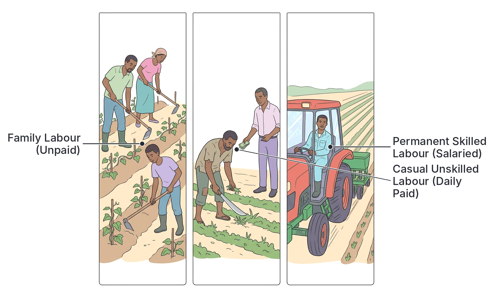
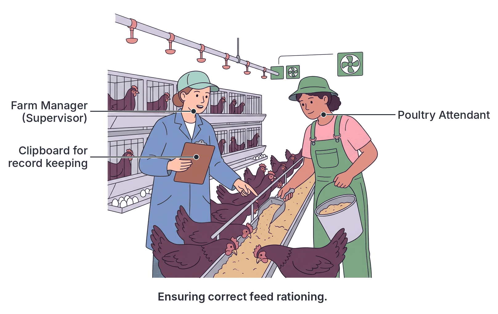

# JAMB Agricultural Science Notes: Labour Management

## What JAMB expects

This topic is Section D, Topic 3 of the JAMB Agricultural Science syllabus: Agricultural Economics and Extension – Labour Management. It covers the human element of agricultural production and how farm workers are sourced, managed, and regulated.

This file covers the following content items:
- **a. Labour relations: Supervision, etc.**
- **b. Types of labour: Permanent labour etc.**
- **c. National labour laws and regulations.**

By the end of these notes, you should be able to:
1. Identify the various ways of achieving labour efficiency.
2. Differentiate between the various types and sources of labour.
3. Apply national labour laws and regulations.

**Note on the syllabus wording:** The objectives for this topic are printed in the JAMB syllabus without Roman numerals (unlike most other topics), so they are treated as unnumbered objectives here. The syllabus also uses "etc." in the content items, meaning you are expected to know the standard categories of labour and aspects of labour relations beyond the named examples.

---

## Types of labour: Permanent labour etc.

In agricultural economics, **labour** is the physical and mental effort exerted by human beings in the production of agricultural goods and services. It is an active factor of production because it coordinates all the other factors (land, capital, and entrepreneurship) to yield produce. 

In Nigerian agriculture, labour is grouped into different categories based on the source of the workers, the duration of their employment, and the level of skill they possess.

### Sources of farm labour

1. **Family Labour:** This is the labour provided by the farmer, their spouse(s), children, and extended relatives. It is the most common source of labour in **peasant (subsistence or small-scale) farming** in West Africa. It is usually unpaid in cash, though the family shares in the farm's food produce and profits.
2. **Personal Labour:** This refers to the physical and mental effort provided solely by the farm owner (the entrepreneur).
3. **Communal Labour:** This involves members of a community or a group of farmers coming together to work on each other's farms in turns. In Nigeria, this traditional cooperative system is known by local names such as *aro* or *owe* in Yoruba, and *gandu* in Hausa. It is commonly used for heavy tasks like land clearing, ridging, or harvesting. The workers are typically unpaid in cash but are provided with abundant food, drinks (like palm wine or local brews), and entertainment while they work.
4. **Hired (Paid) Labour:** This is labour employed from outside the family or community to work on the farm in exchange for a wage or salary. It is highly essential in **commercial (large-scale) agriculture**.

### Classification based on duration of employment

When farmers employ hired labour, it is further classified based on how long the worker is expected to stay on the farm.

- **Permanent Labour:** These workers are employed on a full-time, year-round basis. They receive regular monthly salaries, allowances, and other benefits like housing and medical care. Examples include farm managers, resident tractor drivers, and permanent livestock attendants on commercial farms.
- **Seasonal Labour:** These workers are hired only during specific seasons when there is a heavy workload on the farm. For example, a farmer might hire extra hands only during the planting season (to plant maize or yams) or the harvesting season (to harvest cotton or cocoa). Once the season ends, their employment is terminated.
- **Casual (Daily-paid) Labour:** These are workers hired on a day-to-day basis to perform specific, short-term tasks. They are paid at the end of each day's work based on the hours worked or the exact task completed (piece-rate). For example, hiring a group of young men for one day to weed a tomato plot or pack harvested cassava tubers.

### Classification based on skill level

- **Skilled Labour:** These are workers who have received formal education and specialized training in agriculture or related fields. They use their mental effort and technical know-how more than raw physical strength. Examples include veterinary doctors, agricultural engineers, farm managers, and trained machine operators.
- **Semi-skilled Labour:** These workers may not have high-level formal education, but they have acquired specific on-the-job training and experience. Examples include experienced milker attendants, grafters in a tree nursery, and knapsack sprayer operators.
- **Unskilled Labour:** These workers lack formal education or specialized training. They rely entirely on physical strength to perform manual, routine tasks. Examples include labourers hired to clear bushes with cutlasses, fetch water, or clean animal pens.

## Differentiating Types and Sources of Labour

To fully understand farm labour for your exam, you must be able to compare and contrast the different types and sources. 

### Comparing Sources of Labour

| Feature | Family Labour | Communal Labour | Hired (Paid) Labour |
| --- | --- | --- | --- |
| **Payment structure** | Not paid a formal wage; shares in the farm's food and overall profits. | Not paid wages; rewarded with food, drinks, and reciprocal help. | Paid agreed wages (hourly, daily, or monthly). |
| **Scale of farming** | Dominant in peasant/subsistence farming. | Common in traditional, small-to-medium-scale farming. | Dominant in commercial/large-scale farming. |
| **Availability** | Depends on the size, age, and health of the family members. | Depends on community cooperation; usually available only on specific agreed days. | Readily available as long as the farmer has the money (capital) to pay. |
| **Managerial Control** | Easy to direct, but difficult to sanction or fire severely. | The farmer has limited strict control over the speed and quality of work. | Easy to control, supervise, and sanction or fire if inefficient. |

### Comparing Permanent, Seasonal, and Casual Labour

| Feature | Permanent Labour | Seasonal Labour | Casual Labour |
| --- | --- | --- | --- |
| **Duration of employment** | Year-round, continuous employment. | Only during specific farming seasons (e.g., harvest time). | Day-to-day or task-to-task. |
| **Method of payment** | Monthly salary, plus benefits (leave, pensions, housing). | Negotiated contract pay for the season. | Daily wage or piece-rate (payment per task done). |
| **Job Security** | High job security. | Low job security; ends with the season. | No job security; ends the same day. |
| **Typical Skill level** | Often skilled or semi-skilled (managers, mechanics). | Usually semi-skilled or unskilled (harvesters). | Usually unskilled (manual weeders, load carriers). |

## Labour relations: Supervision, etc.

**Labour relations** refers to the interaction, management, and relationship between the farm employer (or manager) and the farm employees (workers). Good labour relations are essential because workers who are unhappy, poorly treated, or confused about their duties will not produce good results, no matter how fertile the land is.

Key aspects of labour relations include:

1. **Motivation and Welfare:** This involves giving workers reasons to work hard. It includes paying salaries on time, providing housing on the farmstead, offering medical care, giving bonuses during harvest, and treating workers with respect.
2. **Communication:** Giving clear instructions and listening to workers' complaints. A worker cannot do a good job if they do not clearly understand what the manager wants.
3. **Conflict Resolution:** Settling disputes peacefully, whether between two workers or between the workers and the management. 
4. **Supervision:** This is the most frequently tested aspect of labour relations in agriculture.

### Supervision

**Supervision** is the act of directing, guiding, and closely watching over workers to ensure they perform their assigned tasks correctly, safely, and efficiently. 

**Why supervision is important on a farm:**
- **Ensures quality control:** A supervisor ensures that seeds are planted at the correct spacing (e.g., $75\text{ cm} \times 25\text{ cm}$ for maize), fertilizer is applied at the right rate, and weeds are uprooted properly without damaging the crops.
- **Prevents time-wasting (loitering):** Without supervision, hired labourers (especially casual daily-paid workers) may loiter, take excessively long breaks, or work too slowly.
- **Prevents theft and waste:** Supervision reduces the chances of workers stealing farm inputs (like agrochemicals and animal feed) or farm produce (like eggs and harvested yams).
- **Ensures safety:** The supervisor ensures workers are using tools correctly and wearing protective gear (like boots, gloves, and masks) when handling dangerous chemicals or operating machinery.

**Qualities of a good farm supervisor:**
A good supervisor must possess technical knowledge (know how the job is done), fairness (not showing favouritism), good communication skills, and patience.

## Ways to Achieve Labour Efficiency

**Labour efficiency** refers to the amount of output (agricultural produce or work done) a worker can generate in a given period of time. A highly efficient labourer does more work of better quality in less time. 

Mathematically, labour efficiency is a measure of output per unit of labour:
$$ \text{Labour Efficiency} = \frac{\text{Total Output}}{\text{Total Labour Input (man-hours or man-days)}} $$

If a farm wants to maximize its profit, it must find ways to increase the efficiency of its workers. Note that simply hiring more workers increases total production, but it does *not* necessarily improve labour efficiency. Efficiency improves only when *each individual worker* becomes more productive.

### Methods of achieving labour efficiency

1. **Adequate Remuneration (Good Pay):** Paying workers well and offering performance bonuses motivates them to work harder and faster. A poorly paid worker will likely be sluggish and uninterested in the farm's success.
2. **Proper Supervision:** As discussed earlier, closely monitoring workers ensures they do not waste time and that tasks are done to the required standard on the first try, preventing the need to repeat work.
3. **Provision of Good and Modern Tools (Mechanization):** A worker using a blunt cutlass will clear a small area of land in a day and get easily tired. Giving that same worker a mechanized slasher or a tractor makes their work much faster and increases their output per hour massively.
4. **Training and Education:** Sending workers to workshops or teaching them the correct techniques (e.g., the proper way to handle a milking machine or how to prune cocoa trees) reduces errors and speeds up work.
5. **Improved Working Conditions and Welfare:** Providing clean drinking water, adequate break times, protective clothing, and access to medical care keeps workers healthy. Sick or exhausted workers have very low efficiency.
6. **Division of Labour and Specialization:** Assigning workers to specific tasks they are naturally good at or trained for. For example, instead of having one person try to drive the tractor, apply fertilizer, and fix the generator, the farm hires a dedicated driver, a field worker, and a mechanic. When workers specialize, they become faster and make fewer mistakes.
7. **Target Setting (Piece-Rate System):** Giving workers specific daily targets. For example, paying a casual worker ₦5,000 only if they successfully weed a designated area. This encourages them to work efficiently to finish the target.

## National labour laws and regulations

Labour laws are rules and regulations established by the government to guide the relationship between employers and employees. They are designed to protect the rights, health, and welfare of workers, while also protecting employers from unfair practices. 

In Nigeria, several labour laws affect how commercial agriculture is practised. Small family farms often bypass these traditionally, but any registered agricultural enterprise must obey them strictly.

### Key Nigerian labour laws and concepts affecting agriculture

1. **The Labour Act:** This is the primary law governing employment in Nigeria. It sets the rules for contracts of employment, working hours, leave, and the protection of wages.
2. **National Minimum Wage Act:** This law sets the lowest legal salary an employer can pay a full-time worker. An agricultural enterprise cannot legally pay its permanent staff below this national benchmark.
3. **Working Hours and Overtime:** Standard Nigerian labour practice generally sets normal working hours at 8 hours a day (or 40 hours a week). If a farm worker is asked to stay late (e.g., to help with an emergency harvest or to attend to a sick cow at night), the law requires the employer to pay them extra money, known as **overtime pay**.
4. **Leave and Rest Days:** Workers are legally entitled to off-days (usually weekends or a specific day of the week), public holidays, annual leave (vacation with pay), and sick leave. Female workers are entitled to maternity leave.
5. **Employee's Compensation Act (formerly Workmen's Compensation Act):** This law states that if a worker is injured, disabled, or dies while doing their job on the farm (e.g., a worker loses a finger in a processing machine, or is bitten by a snake while clearing land), the employer must pay compensation and cover medical bills.
6. **Child Labour Laws (Child Rights Act):** The law prohibits the employment of children (usually defined as those under 18) for heavy, hazardous, or exploitative manual labour. While children can help out lightly on family farms, a commercial farm manager cannot legally hire a child as an unskilled labourer for heavy land preparation.
7. **Trade Union Act:** This allows workers to join unions (like the Agricultural and Allied Employees' Union of Nigeria) to collectively negotiate for better pay and conditions without fear of being unfairly fired.

## Application of National Labour Laws

JAMB expects you to know how a farm manager practically applies these laws in daily farm operations. Here is how these laws are applied in real-life agricultural scenarios:

- **Scenario 1: Hiring permanent staff.**
  *Application:* The farm manager must issue a written contract of employment within three months of hiring. The manager must also ensure that the basic monthly salary offered is not less than the current National Minimum Wage (e.g., if the national minimum wage is ₦70,000, paying a full-time permanent farm guard ₦40,000 is illegal).
  
- **Scenario 2: Accidents on the farmstead.**
  *Application:* If an unskilled casual worker is spraying herbicide and accidentally splashes it in their eye due to a sudden wind, the farm management must apply the **Employee's Compensation Act**. They are legally required to rush the worker to the hospital and pay the medical bill. They cannot just fire the worker for being careless without providing medical care.

- **Scenario 3: Harvesting deadlines and long hours.**
  *Application:* Heavy rains are predicted, and tomatoes will rot if not harvested immediately. The manager asks the workers to work from 8:00 AM to 8:00 PM (12 hours) instead of finishing at 4:00 PM. The manager must apply labour regulations by calculating the extra 4 hours and paying the workers **overtime wages** at a rate higher than their normal hourly pay.

- **Scenario 4: Employing minors.**
  *Application:* A 13-year-old boy comes to a commercial poultry farm asking to be hired to pack heavy 25 kg bags of feed for a daily wage. The manager must apply **child labour laws** and refuse to employ the boy, as it is hazardous, heavy labour meant for adults.

- **Scenario 5: Worker illness and pregnancy.**
  *Application:* A female permanent worker is heavily pregnant. The manager applies the law by granting her **maternity leave** (with pay) and ensuring she returns to her job afterward. If a worker gets malaria, the manager must grant them paid **sick leave**, provided they show a valid medical report.

---

## Key terms

| Term | Meaning |
| --- | --- |
| **Labour** | The physical and mental effort exerted by human beings in production. |
| **Family labour** | Unpaid farm work provided by the farmer, their spouse(s), and children. |
| **Communal labour** | Work done collectively by community members on each other's farms in turns. |
| **Permanent labour** | Workers employed on a long-term, full-time basis with regular salaries and benefits. |
| **Casual labour** | Workers hired on a day-to-day or task basis with no job security. |
| **Labour efficiency** | The amount of farm output produced by a worker in a given period (output per man-hour). |
| **Supervision** | Directing and closely watching over workers to ensure tasks are done correctly and safely. |
| **Division of labour** | Breaking farm work into specific tasks and assigning them to different specialized workers. |
| **Overtime** | Extra hours worked beyond the standard working day, which legally requires extra pay. |
| **Employee's compensation** | Legal requirement for an employer to pay medical costs or damages if a worker is injured on the job. |

---

## Exam tips and common mistakes

- **Confusing casual and seasonal labour:** Remember that casual workers are hired *by the day* or for a specific short task. Seasonal workers are hired for a *whole season* (like the 3-month planting or harvest period).
- **Misunderstanding labour efficiency:** A common mistake is thinking that simply "hiring more workers" increases labour efficiency. It increases *total output*, but *efficiency* is about how much output *one worker* produces. Efficiency is increased by training, motivation, and mechanization, not just by hiring a crowd.
- **Forgetting the main benefit of family labour:** It is cheap and easy to source in peasant farming because no direct cash wages are paid.
- **Applying labour laws to family farms:** Note that strict labour laws (like minimum wage and official working hours) are strongly enforced in commercial, registered agribusinesses, but are rarely applied to traditional family or communal labour.
- **Role of supervision:** JAMB often asks for the main reason for supervising farm workers. The best answer usually revolves around "ensuring jobs are done properly" or "preventing time-wasting."

---

## Quick summary

1. Labour is the physical and mental effort used in agricultural production, and it coordinates all other factors of production.
2. The primary sources of farm labour include family, personal, communal, and hired labour. Family labour is the most common in West African peasant farming.
3. Hired labour can be classified by duration (permanent, seasonal, casual) and by skill level (skilled, semi-skilled, unskilled).
4. Good labour relations require fair motivation, effective communication, and careful conflict resolution.
5. Supervision is vital on the farm to ensure quality work, prevent loitering, and ensure the safety of workers and farm assets.
6. Labour efficiency (output per worker) can be improved through good pay, training, providing modern tools (mechanization), division of labour, and good supervision.
7. National labour laws protect workers' rights and set standards for working conditions, wages, and compensation in commercial agriculture.
8. Farm managers apply these laws by adhering to the minimum wage, paying overtime, providing leave, avoiding child labour, and paying medical compensation for on-the-job injuries.

---

## Practice questions

**1. The output per man-hour of a worker on a farm is a measure of their:**
- A. labour relations
- B. labour efficiency
- C. labour duration
- D. labour management

**Answer: B.** Labour efficiency is defined as the amount of output or work generated by a single worker in a specific period of time (e.g., output per man-hour). 

**2. A commercial farmer hires a group of people to weed his farm and pays them at the end of the day based on the area cleared. This type of labour is strictly referred to as:**
- A. communal labour
- B. seasonal labour
- C. casual labour
- D. permanent labour

**Answer: C.** Casual labour involves workers hired on a day-to-day basis or paid specifically per task (piece-rate) with no long-term job security.

**3. Which of the following is the most common source of labour for peasant agriculture in West Africa?**
- A. Skilled hired labour
- B. Family labour
- C. Expatriate labour
- D. Permanent labour

**Answer: B.** Peasant or subsistence farming operates on a small scale with little capital, relying heavily on the unpaid labour of the farmer, their spouse(s), and children.

**4. A major reason for supervising farm workers closely is to:**
- A. increase the cost of production
- B. force them to work beyond standard hours without pay
- C. ensure that farm operations are carried out correctly and efficiently
- D. prevent them from joining trade unions

**Answer: C.** Supervision involves directing and watching over workers to ensure they do not waste time, make mistakes, or damage crops/tools, thereby ensuring tasks are done correctly.

**5. Which of the following will NOT improve labour efficiency on a farm?**
- A. Providing regular training for the workers
- B. Replacing old, blunt hand tools with mechanized equipment
- C. Delaying the payment of workers' salaries for several months
- D. Dividing the labour into specialized tasks

**Answer: C.** Delaying salaries demotivates workers, which drastically reduces their output and efficiency. The other options all actively increase efficiency.

**6. If a farm worker gets his hand crushed in a palm oil processing machine while working, which national labour regulation mandates the farm owner to pay his medical bills?**
- A. Minimum Wage Act
- B. Employee's Compensation Act
- C. Trade Union Act
- D. Child Labour Act

**Answer: B.** The Employee's Compensation Act (formerly Workmen's Compensation Act) ensures that workers injured or disabled in the course of their duties are compensated by their employers.

**7. A skilled agricultural labourer is best described as one who:**
- A. relies entirely on physical strength to work
- B. is hired only during the harvesting season
- C. has acquired formal education and specialized technical training
- D. works alongside family members on a subsistence farm

**Answer: C.** Skilled labour involves mental effort and technical know-how gained from formal education and specialized training (e.g., a veterinary doctor or farm manager).

**8. To legally apply national labour laws regarding working hours, a farm manager must:**
- A. ensure workers work 12 hours a day for a basic salary
- B. pay overtime wages for hours worked beyond the standard 8-hour workday
- C. deny workers annual leave during the dry season
- D. hire casual labourers to replace permanent staff on weekends

**Answer: B.** Standard labour laws stipulate an 8-hour workday (or 40 hours a week). Any time worked beyond this requires the application of overtime pay.

**9. In a traditional community, a farmer invites twenty neighbours to help clear his land, providing them with food and palm wine in return. This arrangement is known as:**
- A. family labour
- B. casual labour
- C. communal labour
- D. semi-skilled labour

**Answer: C.** Communal labour involves members of a community helping each other in turns, usually without cash payment but with the provision of food and drinks.

**10. Division of labour increases farm efficiency primarily because:**
- A. it requires more workers to be hired
- B. it allows workers to specialize and become faster at specific tasks
- C. it reduces the total wages paid to the workers
- D. it eliminates the need for farm supervisors

**Answer: B.** When labour is divided, workers specialize in one specific task. This repetition makes them highly skilled, faster, and less prone to errors in that task, thereby boosting overall efficiency.
