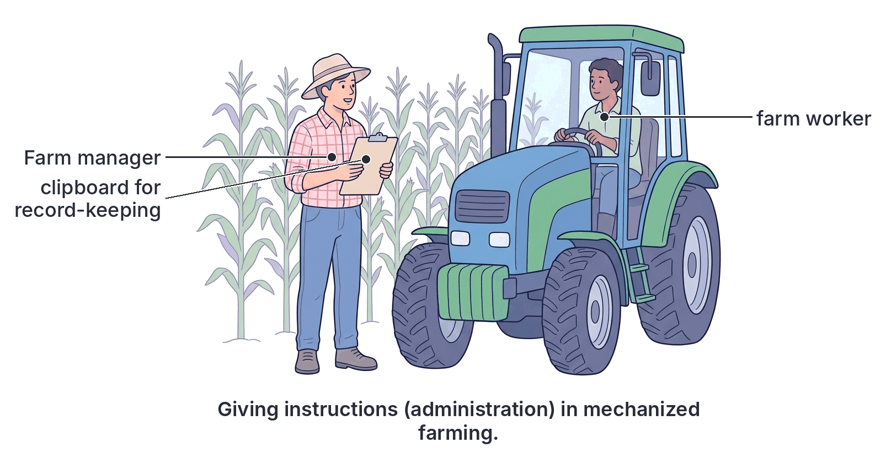

# JAMB Agricultural Science Notes: Farm Management, Accounting and Finance

## What JAMB expects

This topic is Section D, Topic 4 of the JAMB Agricultural Science syllabus: Farm Management. It has the following content items:

*   **a. Qualities, functions and problems of a farm manager.**
*   **b. Records and record-keeping:** Types and importance of record-keeping – livestock records, profit and loss account book.
*   **c. Stock evaluation:**
    *   i. gross and net profits in farm management.
    *   ii. Appreciation, depreciation and savage value.
*   **d. Agricultural insurance:**
    *   i. Meaning, importance and types of agricultural insurance.
    *   ii. Problems of agricultural insurance.
*   **e. Agricultural financing:**
    *   i. meaning, importance and types of agricultural financing.
    *   ii. Problems of agricultural finance.

By the end of these notes, you should be able to:
1.  Identify the qualities, functions and problems of a farm manager.
2.  i. Differentiate between the types of farm records.
    ii. Give reasons for keeping farm records.
3.  Determine gross and net margins, appreciation, depreciation and salvage value.
4.  i. Examine the relevance of agricultural insurance.
    ii. Determine the appropriate agricultural insurance scheme.
5.  Determine the problems associated with agricultural insurance.
6.  i. Identify the relevance of agricultural finance.
    ii. Determine the problems of agricultural finance.

> **Note on the syllabus wording:**
> *   **"Savage value":** The syllabus prints "savage value" in the content section, but this is a typing error for **salvage value**, which is spelled correctly in the objectives. We use "salvage value" in these notes.
> *   **"Profits" vs "Margins":** The syllabus asks for "gross and net profits" in the content and "gross and net margins" in the objectives. In agricultural economics, margin and profit are closely related but technically different. The notes explain both to ensure you are fully prepared.

## The Farm Manager

A farm manager is a professional responsible for the daily administration, planning and decision-making on a farm to ensure it achieves its goals, which usually include maximizing profit.

### The Farm Manager Role

The overarching role of a farm manager is to combine land, labour, capital, and entrepreneurship efficiently. A manager must evaluate market trends, supervise staff, and maintain profitability. 

### The Farm Manager's Role

In large commercial farms, the manager's role is separated from the farm owner's role. The owner provides the capital, while the manager provides the technical expertise and day-to-day supervision to ensure the farm succeeds.

### Qualities of a Farm Manager

To successfully run a commercial farm, a farm manager must possess certain personal and professional traits:
*   **Knowledgeable and skilled:** Must have technical knowledge in agricultural science (crop and animal husbandry) and business administration.
*   **Hardworking and energetic:** Farming is physically and mentally demanding; the manager must be willing to work long hours.
*   **Good decision-maker:** Must be able to think critically and make quick, sound decisions regarding planting seasons, sales and crisis management.
*   **Approachable and good communicator:** Must interact well with farm workers, extension agents, buyers and suppliers.
*   **Honesty and integrity:** Must handle the farm's finances truthfully without diverting funds.
*   **Visionary and adaptable:** Must be open to new farming techniques and able to adapt to changing weather or market conditions.

### Functions and Problems of a Farm Manager

The duties of a farm manager cover every aspect of the farm's operations, while the problems they face are the external and internal challenges that make these duties difficult.

### Functions of a Farm Manager

The specific functions are grouped into five major categories:
1.  **Planning and Organizing:** Deciding what to produce, how much to produce, and when to produce it. This includes securing land, designing the farm layout, and budgeting.
2.  **Administration (Directing):** Assigning tasks to workers, supervising farm labour, and ensuring rules and schedules are followed.
3.  **Production (Implementation):** Overseeing the practical aspects of farming, such as planting, application of fertilizer, feeding of livestock, harvesting, and pest control.
4.  **Marketing:** Identifying the best markets, negotiating prices, and selling farm produce at a profit.
5.  **Evaluation and Record-keeping:** Keeping accurate daily records of farm activities, assessing the success or failure of farm enterprises, and calculating profit or loss.

**Problems of a Farm Manager:**
Farm managers in Nigeria and West Africa face several challenges that hinder maximum productivity:
*   **Inadequate finance:** Lack of capital or difficulty in securing bank loans to expand the farm or buy modern equipment.
*   **Poor infrastructure:** Bad roads, lack of electricity and inadequate storage facilities make it difficult to preserve and transport produce to markets.
*   **Unpredictable weather and natural disasters:** Droughts, floods or unpredictable rainfall patterns can destroy crops.
*   **Pests and diseases outbreaks:** Sudden outbreaks (e.g., Newcastle disease in poultry, armyworms in maize) can cause massive losses.
*   **Unstable government policies:** Frequent changes in agricultural policies, import/export bans and subsidy removals make long-term planning difficult.
*   **Inadequate information:** Lack of accurate data on market prices, weather forecasts, or soil quality.
*   **Labour problems:** High cost of labour, unskilled farm workers, and high worker turnover.

## Farm Records and Record-keeping

Farm records are written documents showing the daily activities, inputs, outputs, and financial transactions of a farm. 

### Types of Farm Records

The syllabus requires you to differentiate between the various records.

| Type of Farm Record | Description and Uses | Examples of details recorded |
| :--- | :--- | :--- |
| **Inventory Record** | A complete list of all assets (property) and liabilities (debts) of the farm at a specific time (usually at the start and end of the year). | Land, buildings, tractors, number of animals, feeds in store, cash at hand, loans owed. |
| **Production / Yield Record** | Shows the physical output or yield of the various enterprises on the farm. | Baskets of tomatoes harvested, litres of milk collected, trays of eggs collected per day. |
| **Input / Consumption Record** | Documents all the items, materials, and consumables used up in the production process. | Bags of fertilizer applied, kilograms of feed eaten by poultry, litres of fuel used. |
| **Livestock Record** | Specific records kept for farm animals tracking their physical performance, health, and numbers. | Births, deaths, mating dates, vaccination dates, culling (removal) records. |
| **Labour Record** | Keeps track of human labour employed on the farm. Used for paying wages. | Names of workers, days worked, tasks performed, wages paid. |
| **Sales and Purchase Record** | A financial record documenting all money received from selling produce and all money spent on buying inputs. | Date of sale, item sold, quantity, price, buyer's name. |
| **Profit and Loss Account** | A financial statement prepared at the end of the accounting period summarizing all revenues and expenses to determine the net profit or loss. | Total revenue from sales, total cost of inputs, depreciation, net margin. |

### Reasons for Keeping Farm Records

Keeping accurate records is crucial for the following reasons:
*   **To determine profit or loss:** Financial records show whether the farm business is making money or losing it.
*   **To secure loans:** Banks and financial institutions demand up-to-date farm records before granting credit (loans).
*   **For farm planning and budgeting:** Past records help the manager plan for the next season and prepare accurate budgets.
*   **To determine accurate tax payable:** Government uses income and profit records to assess the correct tax a farmer should pay, preventing over-taxation.
*   **To detect fraudulent practices:** Proper records help expose theft, missing items, or financial mismanagement by farm workers.
*   **To monitor farm progress:** Records allow the manager to track the performance of crops, livestock, or machinery over time and make management decisions (like culling unproductive animals).

## Stock Evaluation and Farm Accounting

Farm accounting requires calculating how much the farm has gained or lost. We do this by evaluating the margins and the changing value of the farm's assets over time.

### Stock Evaluation Margins

To understand margins and profits, you first need to know the types of costs:
1.  **Variable Costs:** Costs that change directly with the level of production. Examples: cost of seeds, fertilizer, animal feed, fuel, casual labour, and veterinary drugs. If you stop producing, variable costs drop to zero.
2.  **Fixed Costs:** Costs that do not change with the level of production in the short run. You pay them even if you produce nothing. Examples: rent on land, salaries of permanent staff, insurance premiums, and **depreciation** of machinery.

### Stock Evaluation Margins Note

Evaluating these margins helps the manager decide whether an enterprise (like keeping poultry) is worth continuing or if it should be shut down.

### Gross and Net Margins

**1. Gross Margin:**
The gross margin is the difference between total revenue (sales) and total variable costs. It measures how much an enterprise contributes to covering fixed costs.
$$Gross\ Margin = Total\ Revenue - Total\ Variable\ Costs$$

**2. Net Margin (Net Profit):**
Net margin (or net profit) is the gross margin minus total fixed costs. It is the true profit of the farm after all possible expenses (both variable and fixed) are deducted.
$$Net\ Margin = Total\ Revenue - Total\ Costs$$
*(Where Total Costs = Total Variable Costs + Total Fixed Costs)*

**Worked Example:**
A poultry farmer sold eggs and birds for a total revenue of ₦500,000. He spent ₦150,000 on poultry feed, ₦30,000 on vaccines, and ₦20,000 on casual labour. He also paid ₦50,000 for cage depreciation and ₦50,000 for rent. Calculate the farm's gross margin and net margin.

*Step 1: Identify Total Revenue.*
Total Revenue = ₦500,000.

*Step 2: Calculate Total Variable Costs.*
Variable Costs = Feed + Vaccines + Casual labour
Total Variable Costs = $\text{₦}150,000 + \text{₦}30,000 + \text{₦}20,000 = \text{₦}200,000$.

*Step 3: Calculate Gross Margin.*
$Gross\ Margin = Total\ Revenue - Total\ Variable\ Costs$
$Gross\ Margin = \text{₦}500,000 - \text{₦}200,000 = \text{₦}300,000$.

*Step 4: Calculate Total Fixed Costs.*
Fixed Costs = Depreciation + Rent
Total Fixed Costs = $\text{₦}50,000 + \text{₦}50,000 = \text{₦}100,000$.

*Step 5: Calculate Net Margin.*
$Net\ Margin = Gross\ Margin - Total\ Fixed\ Costs$
$Net\ Margin = \text{₦}300,000 - \text{₦}100,000 = \text{₦}200,000$.

The Gross Margin is ₦300,000 and the Net Margin is ₦200,000.

### Appreciation, Depreciation and Salvage Value

Assets on a farm change in value over time.

**Appreciation:**
Appreciation is the **increase in the value** or worth of an asset over time. On a farm, appreciation usually happens with growing assets (like a calf growing into a mature cow) or with land, which typically increases in price as years go by.

**Depreciation:**
Depreciation is the **steady decrease in the value** of a fixed asset over time due to wear and tear, age, exposure to weather, or becoming outdated (obsolescence). Examples of assets that depreciate are tractors, farm buildings, incubators, and cutlasses. Land does not depreciate.

**Salvage Value:**
The salvage value (also called scrap value or residual value) is the estimated amount an asset can be sold for at the end of its useful life, when it can no longer be used for its main purpose.

**Calculating Depreciation (Straight-Line Method):**
The simplest and most common method to calculate annual depreciation is the straight-line method. It assumes the asset loses an equal amount of value every year.

The formula is:
$$Annual\ Depreciation = \frac{Cost - Salvage\ Value}{Useful\ Life}$$

**Worked Example:**
A farm manager bought a tractor for ₦5,000,000. It is expected to last for 10 years on the farm, after which it can be sold as scrap for ₦500,000. Calculate the annual depreciation.

*Step 1: Identify the variables.*
Cost = ₦5,000,000
Salvage Value = ₦500,000
Useful Life = 10 years

*Step 2: State the formula.*
$$Annual\ Depreciation = \frac{Cost - Salvage\ Value}{Useful\ Life}$$

*Step 3: Subtract salvage value from cost.*
$\text{₦}5,000,000 - \text{₦}500,000 = \text{₦}4,500,000$

*Step 4: Divide by the useful life.*
$\text{₦}4,500,000 \div 10 = \text{₦}450,000$

The annual depreciation is ₦450,000 per year.

## Agricultural Insurance

Farming is a very risky business. Crops can fail due to drought, and animals can die from diseases. **Agricultural insurance** is an arrangement where a farmer pays a small regular amount of money (called a **premium**) to an insurance company. In return, the company promises to pay the farmer a large sum of money (compensation or **indemnity**) if a specified disaster destroys the farm. In Nigeria, the Nigerian Agricultural Insurance Corporation (NAIC) is the major government body handling this.

### Relevance of Agricultural Insurance

1.  **Compensation for losses:** It provides financial support to farmers when their crops or animals are destroyed by disasters (fire, flood, diseases).
2.  **Security for agricultural loans:** Banks are more willing to lend money to farmers whose farms are insured because the bank knows the money is safe even if a disaster happens.
3.  **Encourages adoption of new technologies:** Farmers are more willing to try new, improved seeds or expensive machinery when they know their investment is protected.
4.  **Stabilization of farm income:** It ensures that a farmer's income does not suddenly drop to zero because of a bad harvest.
5.  **Reduces anxiety:** It gives the farmer peace of mind to focus on production rather than worrying about unforeseen risks.

### Appropriate Agricultural Insurance Scheme

A farm manager must determine which insurance scheme is appropriate for the farm's specific enterprises. Different farm assets face different risks, so there are different policies to match them:

*   **Crop Insurance Scheme:** Covers crops in the field against risks like fire, flood, severe drought, and uncontrollable pests. *Appropriate for: A rice, cassava, or cocoa farmer protecting against floods or widespread pest invasions.*
*   **Livestock Insurance Scheme:** Covers farm animals against death caused by accidents, lightning, and uncontrollable epidemic diseases (like Avian Influenza or African Swine Fever). *Appropriate for: Poultry, pig, or cattle farmers.*
*   **Farm Machinery and Equipment Insurance:** Covers tractors, harvesters, and processing equipment against theft, fire, or severe accidental damage. *Appropriate for: Highly mechanized commercial farms.*
*   **Farm Building / Property Insurance:** Covers silos, barns, and poultry houses against natural disasters or fire. *Appropriate for: Farms with massive infrastructure investments.*
*   **Life Assurance (for farmers/workers):** Compensates the family or workers in case the farmer or farm worker dies or suffers a permanent injury while working on the farm. *Appropriate for: Any farm operation looking out for worker welfare.*

### Problems of Agricultural Insurance

Despite its benefits, agricultural insurance faces many problems in West Africa.

### Challenges of Agricultural Insurance

1.  **Farmers' ignorance and illiteracy:** Many farmers do not know that agricultural insurance exists, or they do not understand how it works.
2.  **High cost of premiums:** Small-scale farmers often find the regular premium payments too expensive to afford.
3.  **Delay in settlement of claims:** When disasters occur, insurance companies often take too long to investigate and pay out the compensation, causing farmers to lose trust in them.
4.  **Difficulty in assessing true value of losses:** It is hard to accurately calculate the exact financial value of destroyed crops or livestock to pay fair compensation.
5.  **Unpredictable nature of agriculture:** Widespread natural disasters (like a massive flood covering several states) can cause so many farmers to claim compensation at once that it bankrupts the insurance company.
6.  **Fraud and corruption:** Some farmers make false claims (e.g., claiming animals died of a disease when they were actually sold), while some insurance officials extort farmers.

## Agricultural Financing

**Agricultural financing** (or farm credit) is the process of providing capital (money) to farmers to start, run, or expand their agricultural business.

### Relevance of Agricultural Finance

*   **Farm expansion:** It enables farmers to increase the size of their operations (e.g., buying more land).
*   **Procurement of modern inputs:** Money is needed to buy improved seeds, agrochemicals, and balanced feed.
*   **Adoption of mechanization:** Tractors and harvesters are very expensive; financing makes it possible to purchase or hire them.
*   **Meeting emergencies:** Loans help farmers manage sudden unexpected expenses, like repairing a broken tractor during the planting season.
*   **Smoothing cash flow:** In farming, you spend money at planting but only get income at harvest. Financing bridges this gap, allowing the farmer to pay workers before the crop is sold.

Credit is sourced from **Commercial Banks** (e.g., First Bank, UBA), **Agricultural Banks** (e.g., the Bank of Agriculture (BOA) in Nigeria), **Cooperative Societies**, **Government Interventions** (like the Anchor Borrowers' Programme), and informal sources like money lenders.

### Problems of Agricultural Finance

Acquiring loans is a major headache for farmers due to these problems:
1.  **Demand for collateral security:** Banks require valuable property (like a house with a Certificate of Occupancy) to secure a loan. Most rural farmers do not have such assets.
2.  **High interest rates:** Commercial banks often charge high interest rates, making it difficult for farmers to repay and still make a profit.
3.  **Poor record-keeping by farmers:** Most farmers do not keep good financial records, making it impossible for banks to trust them or evaluate their profit potential.
4.  **Diversion of loans:** Some farmers use the agricultural loan to marry new wives, build personal houses, or throw parties, leading to failure to repay.
5.  **High default rate (Bad debts):** Because farming is risky, crops can fail, causing honest farmers to default (fail to pay back) the loan. This makes banks afraid to lend to agriculture.
6.  **Complex bureaucratic procedures:** The paperwork, delays, and long approval processes discourage farmers from seeking bank loans.

## Key terms

| Term | Meaning |
| :--- | :--- |
| **Gross margin** | Total revenue minus total variable costs. |
| **Net margin** | Total revenue minus total costs (both variable and fixed costs). |
| **Variable costs** | Costs that change based on the level of production (e.g., feed, seeds). |
| **Fixed costs** | Costs that remain the same regardless of the level of production (e.g., rent, depreciation). |
| **Appreciation** | The increase in the value of an asset over time (e.g., land, growing calves). |
| **Depreciation** | The loss in value of an asset over time due to wear and tear or age (e.g., tractors). |
| **Salvage value** | The estimated selling value of an asset at the end of its useful life on the farm. |
| **Premium** | The regular payment a farmer makes to an insurance company to keep a policy active. |
| **Indemnity** | The compensation paid by an insurance company to a farmer for a covered loss. |
| **Collateral** | A valuable asset pledged by a borrower to secure a loan from a bank. |

## Exam tips and common mistakes

*   **Gross vs Net Profit/Margin:** A very common JAMB trick is to ask for net margin but give you an option that is the gross margin. Always remember to subtract **fixed costs** from the gross margin to get the net margin.
*   **Appreciation vs Depreciation:** Do not confuse these. Growing animals and land *appreciate*. Machinery and buildings *depreciate*.
*   **Formula for Straight-Line Depreciation:** You must memorize $Annual\ Depreciation = \frac{Cost - Salvage\ Value}{Useful\ Life}$. Always remember to subtract the salvage value *before* you divide by the years!
*   **Insurance vs Finance:** Do not confuse the problems of insurance (delays in claims, assessing losses) with the problems of finance (high interest rates, collateral).
*   **Types of Records:** If a question asks which record is needed to check the number of dead birds in a poultry farm, the answer is the *Livestock record* or *Mortality record*. If it asks for the financial position of the farm at a point in time, it is the *Inventory record*.

## Quick summary

1.  A farm manager plans, organizes, directs, and evaluates the farm, facing challenges like poor finance and unpredictable weather.
2.  Farm records are essential for determining profit or loss, securing loans, and accurate tax assessment.
3.  Inventory records list assets and liabilities, while profit and loss accounts summarize financial performance over time.
4.  Gross margin is total revenue minus variable costs; net margin is gross margin minus fixed costs.
5.  Depreciation is the loss of value of an asset, calculated as the difference between its cost and salvage value, divided by its useful life.
6.  Agricultural insurance protects farmers against catastrophic losses, stabilizes income, and serves as security for securing bank loans.
7.  Problems of agricultural insurance include difficulty in assessing losses, high premiums, and delays in claim settlement.
8.  Agricultural finance provides capital for farm expansion and mechanization but is hindered by collateral demands, high interest rates, and loan diversion by farmers.

## Practice questions

**1. A farm manager's ability to relate well with workers and extension agents is a test of their**

- A. physical strength
- B. communication skills
- C. honesty and integrity
- D. technical knowledge

**Answer: B.** Good communication and approachability are essential interpersonal skills that allow the manager to successfully interact with staff, buyers, and extension agents.

**2. Which of the following farm records provides a complete list of all assets and liabilities of a farm at a specific time?**

- A. Profit and loss account
- B. Production record
- C. Inventory record
- D. Sales and purchase record

**Answer: C.** An inventory record is a snapshot of all the physical property (assets) and debts (liabilities) the farm possesses at a particular point in time.

**3. A farmer sold maize for ₦600,000. He spent ₦120,000 on seeds, ₦80,000 on fertilizer, and paid ₦50,000 as rent for the land. What is the gross margin of the enterprise?**

- A. ₦400,000
- B. ₦350,000
- C. ₦480,000
- D. ₦600,000

**Answer: A.**
*   Step 1: Identify variable costs (seeds and fertilizer) = $\text{₦}120,000 + \text{₦}80,000 = \text{₦}200,000$.
*   Step 2: Note that rent (₦50,000) is a fixed cost and is NOT used for gross margin.
*   Step 3: State the formula: $Gross\ Margin = Total\ Revenue - Total\ Variable\ Costs$.
*   Step 4: Subtract variable costs from revenue: $\text{₦}600,000 - \text{₦}200,000 = \text{₦}400,000$.
*   *Mistake in Option B: Subtracting both variable and fixed costs gives the net margin (₦350,000), not the gross margin.*

**4. A tractor was purchased for ₦8,000,000. It has a useful life of 8 years, after which it can be sold as scrap for ₦800,000. Calculate its annual depreciation.**

- A. ₦1,000,000
- B. ₦100,000
- C. ₦800,000
- D. ₦900,000

**Answer: D.** 
*   Step 1: Formula for straight-line depreciation = $\frac{Cost - Salvage\ Value}{Useful\ Life}$.
*   Step 2: Subtract salvage value from cost = $\text{₦}8,000,000 - \text{₦}800,000 = \text{₦}7,200,000$.
*   Step 3: Divide by useful life = $\text{₦}7,200,000 \div 8 = \text{₦}900,000$.
*   *Mistake in Option A: Forgetting to subtract the salvage value before dividing (8,000,000 ÷ 8 = 1,000,000).*

**5. The residual value of a piece of farm machinery at the end of its useful life is known as its**

- A. appreciation value
- B. net margin
- C. salvage value
- D. total variable cost

**Answer: C.** The salvage value (or scrap value) is the estimated amount the asset can be sold for when it is no longer useful for its main purpose on the farm.

**6. Which of the following is a major problem of agricultural finance in West Africa?**

- A. Unpredictable weather conditions
- B. Delay in settlement of claims
- C. Demand for collateral security
- D. Difficulty in assessing true value of loss

**Answer: C.** The demand for collateral security (like land titles) is a major problem of agricultural finance (securing loans). Options B and D are problems of agricultural *insurance*, while A is a general agricultural problem.

**7. A major reason why commercial banks are reluctant to grant loans to farmers is the**

- A. high rate of loan diversion and default by farmers
- B. availability of cooperative societies
- C. lack of agricultural extension agents
- D. payment of insurance premiums

**Answer: A.** Many farmers divert loans to personal uses (like ceremonies) or fail to pay back due to crop failure. This high default rate makes commercial banks view agriculture as too risky to finance.

**8. An outbreak of African Swine Fever wiped out a farmer's piggery. Which of the following insurance schemes is most appropriate for compensating this loss?**

- A. Crop insurance scheme
- B. Livestock insurance scheme
- C. Life assurance scheme
- D. Farm property insurance scheme

**Answer: B.** The livestock insurance scheme is specifically designed to cover the loss of farm animals against accidental death and uncontrollable disease outbreaks.

**9. The regular amount of money paid by a farmer to an insurance company to keep a policy active is called a**

- A. dividend
- B. premium
- C. indemnity
- D. collateral

**Answer: B.** The premium is the regular payment made by the insured (the farmer) to the insurer (the company). Indemnity is the compensation paid out if a disaster happens.

**10. Which of the following farm assets will normally appreciate in value over time?**

- A. A growing flock of sheep
- B. A newly purchased incubator
- C. A motorized knapsack sprayer
- D. A farm storage silo

**Answer: A.** Appreciation is the increase in value over time. Living, growing assets (like sheep) and land usually appreciate, whereas machinery (incubators, sprayers) and buildings (silos) depreciate due to wear and tear.
