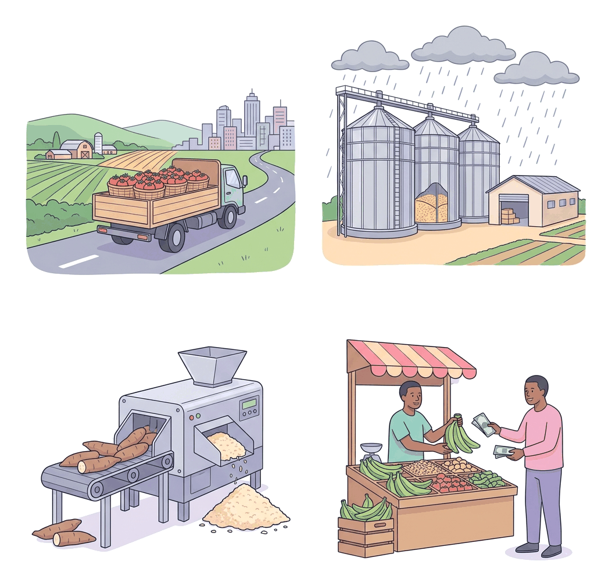

# JAMB Agricultural Science Notes: Marketing of Agricultural Produce

## What JAMB expects

This topic is Section D, Topic 5 of the JAMB Agricultural Science syllabus: Marketing of Agricultural Produce. It explores how farm products move from the rural farm to the final consumer, the people involved in this movement, and the unique nature of agricultural goods.

It covers the following content items:
- **a.** Importance of Marketing.
- **b.** Marketing channels.
- **c.** Characteristics of agricultural products affecting their marketing.

By the end of these notes, you should be able to:
1. evaluate the importance of agricultural marketing.
2. classify marketing agents and their functions (Objective i).
3. determine the various ways in which marketing channels pose problems in agricultural production (Objective ii).
4. determine the characteristics of agricultural products affecting their marketing.

---

## Importance of Marketing

**Content a: Importance of Marketing.**

**Agricultural marketing** is not just the act of selling yams or maize in the local market. It encompasses all the activities and processes involved in moving agricultural produce from the farm (where it is produced) to the final consumer (who eats or uses it). This includes assembling, sorting, grading, processing, packaging, storage, transportation, distribution, and pricing.

The importance of agricultural marketing to the farmer, the consumer, and the economy cannot be overstated:

1. **Provision of income and profit to farmers:** Marketing is the mechanism that allows farmers to sell their crops and livestock. Without marketing, farmers cannot recover their production costs or make a profit to support their families.
2. **Link between producers and consumers:** Most farmers are located in rural villages, while a massive portion of consumers live in urban cities. Marketing bridges this geographical gap, ensuring that food gets to where it is needed.
3. **Creation of employment:** Agricultural marketing provides jobs for millions of Nigerians. Transporters, market traders, silo operators, processors (e.g., rice millers, garri fryers), and packaging suppliers all earn their living through the marketing chain.
4. **Prevention of post-harvest losses:** Through marketing functions like storage (in silos or cold rooms) and processing (drying, canning, or milling), excess produce harvested during the peak season is preserved for use during the off-season, preventing waste.
5. **Generation of foreign exchange:** The marketing of export cash crops (such as cocoa, cashew nuts, rubber, and sesame seeds) generates vital foreign exchange revenue for the government and export companies.
6. **Provision of raw materials to industries:** Marketing ensures that raw materials from the farm (like cotton, palm oil, and hides) are successfully assembled and transported to agro-allied industries for manufacturing into clothes, soap, and shoes.
7. **Price stabilization:** An efficient marketing system moves produce from areas of surplus (where prices are extremely low) to areas of scarcity (where prices are too high), helping to stabilize and balance prices across the country.

## Evaluate the importance of agricultural marketing

**Objective: evaluate the importance of agricultural marketing**

To **evaluate** the importance of agricultural marketing, we must assess the actual value it adds to the agricultural sector. We evaluate this value by looking at the four types of **utilities** (usefulness or value) that marketing creates. Without these utilities, agricultural production would be practically useless.

Marketing is evaluated positively because it creates:

1. **Place utility:** A basket of tomatoes has very little value if it is rotting on a farm in a remote village in Kano State because there is nobody there to eat it. Marketing (specifically the function of **transportation**) moves it to Lagos, where consumers are waiting and willing to pay a premium for it. By moving the product to a better location, marketing creates place utility.
2. **Time utility:** Crops like maize and sorghum are harvested at specific times of the year (e.g., October), but consumers need to eat them all year round. Marketing (specifically the function of **storage**) holds the product safely in silos until the consumer needs it in May or June, adding time utility.
3. **Form utility:** Fresh cassava tubers are highly perishable, bulky, and contain toxic compounds if eaten raw. Marketing (specifically the function of **processing**) transforms them into garri or cassava flour—a safe, durable, and ready-to-eat product. Changing the product into a more useful form creates form utility.
4. **Possession utility:** When a consumer buys a carton of eggs, the ownership transfers from the farmer (or trader) to the consumer. The marketing system (through **pricing and exchange**) ensures the farmer gets their money and the consumer gets their food, creating possession utility.

**Evaluation Conclusion:** If we evaluate agricultural marketing, we see that it dictates what the farmer will produce. If a specific crop commands a high price and has a good marketing system, farmers are motivated to grow more of it. If the marketing system fails, farmers will abandon farming. Therefore, agricultural marketing is evaluated to be just as critical as the physical planting and harvesting of crops.

## Marketing channels

**Content b: Marketing channels.**

A **marketing channel** is the path, route, or chain of intermediaries (middlemen) through which agricultural produce moves from the primary producer (the farmer) to the final consumer. 

Depending on the type of produce, the distance to the market, and the level of processing required, agricultural goods can follow several different paths:

1. **Direct channel (Zero-level channel):** 
   **Producer $\rightarrow$ Consumer**
   The farmer sells directly to the buyer, such as selling fresh vegetables to neighbours, selling eggs at the farm gate, or selling along the roadside. This channel is very short, meaning the farmer gets 100% of the profit margin, and the consumer gets the freshest produce.
2. **Retail channel (One-level channel):** 
   **Producer $\rightarrow$ Retailer $\rightarrow$ Consumer**
   A farmer sells their harvest to a local shopkeeper or supermarket, who then sells it to households.
3. **Wholesale channel (Two-level channel):** 
   **Producer $\rightarrow$ Wholesaler $\rightarrow$ Retailer $\rightarrow$ Consumer**
   This is the most common marketing channel for staple foods in Nigeria, such as tubers (yam, cassava) and grains (rice, cowpea). Wholesalers buy in massive bulk from rural areas, transport them to urban centres, and sell them to smaller retailers.
4. **Industrial/Processing channel:** 
   **Producer $\rightarrow$ Commission Agent $\rightarrow$ Processing Industry $\rightarrow$ Wholesaler $\rightarrow$ Retailer $\rightarrow$ Consumer**
   This long channel is used for crops that require heavy industrial processing before consumption, such as cotton (for textiles), sugar cane (for sugar), or cocoa (for chocolate). 

## Classify marketing agents and their functions

**Objective i: classify marketing agents and their functions.**

The individuals, groups, or organizations that operate within the marketing channel are called **marketing agents** or **middlemen**. They can be classified into several groups based on the functions they perform:

### 1. Local Assemblers (Itinerant buyers)
These are mobile buyers who travel from village to village or farm to farm to buy produce in small quantities directly from rural farmers. 
* **Functions:** They assemble small bits of produce from multiple scattered farms into larger volumes. They then transport this bulk to bigger rural or urban markets to sell to wholesalers.

### 2. Wholesalers
Wholesalers are large-scale, wealthy traders who buy farm produce in massive quantities (bulk), such as entire truckloads of yams or grains. 
* **Functions:** 
  - They provide large-scale **storage** (e.g., grain warehouses).
  - They arrange bulk **transportation**.
  - They perform **bulk-breaking**, meaning they divide massive quantities into smaller batches to sell to retailers.
  - They **finance** agriculture by sometimes giving advance payments or loans to trusted farmers and retailers.
  - They bear the **risk** of price changes, theft, or spoilage while holding the goods. 
  - *Crucially, wholesalers take ownership (title) of the goods they buy.*

### 3. Retailers
Retailers are small-scale traders who buy from wholesalers and sell directly to the final consumer. 
* **Functions:** 
  - They sell in single units or very small, affordable quantities (e.g., a single tuber of yam, a "mudu" of rice).
  - They make goods easily accessible to consumers in their local neighbourhoods.
  - They provide immediate feedback from consumers back up the chain to the wholesalers.

### 4. Commission Agents and Brokers
These agents are unique because they **do not take ownership (title)** of the goods. They act solely as middlemen linking buyers and sellers.
* **Functions:** A broker arranges the sale between a farmer and a major buyer (like an agro-allied factory) and takes a percentage-based commission or a flat fee for the service. They provide vital market information and negotiate contracts.

### 5. Cooperative Societies
These are formal groups of farmers who voluntarily pool their resources and produce together to sell collectively.
* **Functions:** By marketing as a group, they bypass exploitative middlemen. They negotiate better prices because they sell in bulk, they share transportation and storage costs, and they distribute the profits equally among their members. 

### 6. Marketing Boards
Marketing boards are government-established agencies set up to purchase specific crops, primarily export cash crops. 
* **Functions:** They buy crops from farmers at guaranteed, fixed prices. This protects farmers from unpredictable price fluctuations in the global market. They also maintain strict quality standards for export, organize large-scale storage, and handle the physical export of the produce to foreign countries.

> **Note on the Nigerian context:** Most Agricultural Marketing Boards in Nigeria (such as the Cocoa Marketing Board, Groundnut Marketing Board, and Palm Produce Marketing Board) were officially abolished in 1986 during the Structural Adjustment Programme (SAP) to allow for a free market. However, JAMB still expects you to know their classification and their historical functions, as they frequently appear in exam questions.

## Determine the various ways in which marketing channels pose problems in agricultural production

**Objective ii: determine the various ways in which marketing channels pose problems in agricultural production.**

While middlemen perform essential services, the existing marketing channels in West Africa pose severe problems that hinder agricultural production and hurt consumers:

1. **Reduction of the farmer's profit (Exploitation):** 
   When a marketing channel has too many middlemen (a very long chain), each intermediary adds their own profit margin. By the time the produce reaches the consumer, the price is extremely high. For example, a consumer might pay ₦3,000 for a yam tuber, but the rural farmer who did the hard work might have received only ₦600 from the local assembler. This low farm-gate price discourages farmers from expanding their production.
2. **Artificial scarcity and hoarding:** 
   Unscrupulous wholesalers often hoard (hide and refuse to sell) non-perishable goods like maize, rice, or cowpea in massive warehouses. This deliberate withholding of goods creates an **artificial scarcity** in the market. The scarcity drives prices up violently, allowing the wholesalers to make excessive profits while causing severe hardship for consumers.
3. **Spoilage and post-harvest losses:** 
   The marketing channel is heavily dependent on transportation infrastructure. Because of bad, unpaved rural roads and a total lack of refrigerated transport trucks, highly perishable goods (like tomatoes, fruits, and leafy vegetables) frequently rot on the road before they ever reach urban retail markets. 
4. **Lack of standard weights and measures:** 
   In local Nigerian markets, intermediaries often use arbitrary and unstandardized measures (like differently sized bowls, "mudus", "congos", or bundles) instead of standard weighing scales measured in kilograms (kg). Middlemen often use manipulated bowls to cheat farmers when buying, and cheat consumers when selling.
5. **Price instability:** 
   Because intermediaries control the flow of goods into the market, supply can be erratic. This leads to wild, unpredictable price fluctuations. When prices crash suddenly, farmers lose money, making farming an incredibly risky business.
6. **Poor market information (Information Asymmetry):** 
   Middlemen usually have a monopoly on market information—they know exactly where demand and prices are highest in the cities. Rural farmers lack this information. Local assemblers use this ignorance to convince farmers to sell their harvests at unfairly low prices.

## Characteristics of agricultural products affecting their marketing

**Content c: Characteristics of agricultural products affecting their marketing.**

Agricultural produce has unique natural and economic properties that make its marketing much more difficult than the marketing of factory-manufactured goods like shoes or electronics. These characteristics dictate how goods must be priced, packed, transported, and stored:

### 1. Perishability
Most agricultural products contain a very high percentage of water (e.g., fresh tomatoes, meat, fish, milk, leafy vegetables, fresh fruits). Because they are biological, they spoil, rot, or decay very quickly after harvest if they are not properly preserved. 
* **Effect on marketing:** They must be sold urgently (often at give-away prices to avoid a total loss), transported rapidly, or processed and stored using expensive methods like refrigeration, canning, or drying. 

### 2. Bulkiness (High Volume-to-Weight Ratio)
Agricultural products, especially crops like yam tubers, cassava, plantains, and grains, are very bulky. They take up a massive amount of physical space and are very heavy relative to their actual monetary value. 
* **Effect on marketing:** This makes their transportation and storage physically difficult and very expensive. A lorry load of cassava tubers might only be worth ₦500,000, but the cost to fuel the lorry and transport that heavy load across the country might be ₦300,000, eating heavily into the profit margin. 

### 3. Seasonality
Crops have specific growing seasons dictated by rainfall and climate. They are usually harvested in massive quantities at a specific time of the year, rather than being produced continuously year-round. 
* **Effect on marketing:** During the harvest season, there is a massive oversupply in the market known as a **glut**, which causes prices to crash. During the off-season, the produce becomes scarce, and prices skyrocket. Marketers must invest heavily in storage (like silos for grains) to balance out this supply over the year.

### 4. Variation in Quality (Lack of Uniformity)
In a factory, every bottle of a soft drink is exactly the same. On a farm, nature dictates that products are not uniform. Eggs come in different sizes; yams vary in shape and weight; fruits have different levels of ripeness and varying numbers of blemishes.
* **Effect on marketing:** Agricultural products cannot be sold uniformly without human effort. Marketers must spend time and money sorting and **grading** the produce into uniform batches (e.g., separating large, clean eggs from small, dirty ones) before they can be priced and sold effectively.

### 5. Inelastic Demand
The demand for basic food items is relatively inelastic. This means that consumer demand does not change drastically in response to a change in price. If the price of a staple food (like garri or rice) drops massively, people will not suddenly eat ten times as much; they only eat until their stomachs are full. Conversely, if the price rises steeply, people still have to buy food to survive.
* **Effect on marketing:** Because consumer demand cannot easily expand to absorb extra supply, even a small surplus in harvest (a glut) can cause a drastic drop in prices, financially ruining the farmer. 

## Determine the characteristics of agricultural products affecting their marketing

**Objective: determine the characteristics of agricultural products affecting their marketing.**

Marketers, processors, and farmers cannot just guess these characteristics; they must actively **determine** and measure them to make profitable business decisions. Here is how these characteristics are practically determined in the field:

1. **Determining perishability:** 
   Marketers determine how quickly a product will spoil primarily by measuring its **moisture content**. For example, grain buyers use a scientific tool called a moisture meter. If they determine that a batch of maize has a moisture content above 14%, they know it is highly susceptible to fungal rot (highly perishable) and must be dried before it can be stored in a silo. 
2. **Determining bulkiness:** 
   This is determined by calculating the product’s **volume-to-weight ratio** and comparing it to its market value. Marketers assess how many tonnes of a product can fit into a standard truck. By determining that 10 tonnes of un-ginned cotton takes up the same physical space as 30 tonnes of grain, transporters can determine the exact type of specialized, high-capacity vehicles required, and adjust their freight pricing accordingly.
3. **Determining seasonality:** 
   Agribusinesses determine seasonality by analyzing **agricultural calendars and historical market price data**. By studying market trends over the past five years, marketers can determine the exact months when a harvest glut will occur (when prices drop) and determine the exact timing to release their stored produce to maximize profit.
4. **Determining uniformity:** 
   The lack of uniformity is determined and resolved through physical **sorting and grading systems**. Produce is passed over sizing screens, weighed on scales, or visually inspected to determine its grade (e.g., Grade A cocoa beans versus Grade B). Determining the grade is what allows for standardized pricing in local and international markets.
5. **Determining demand elasticity:** 
   Marketers determine the elasticity of demand through **market surveys and historical sales volume tracking**. By observing that a 50% drop in the price of yam only leads to a 5% increase in sales volume, they determine that the market has an inelastic demand. This metric warns them against over-supplying the market.

## Key terms

| Term | Meaning |
| :--- | :--- |
| **Agricultural marketing** | All activities involved in moving farm produce from the producer to the final consumer, creating place, time, form, and possession utility. |
| **Marketing channel** | The route or chain of intermediaries through which agricultural goods pass to reach the consumer. |
| **Middleman / Intermediary** | An individual or firm that operates between the producer and consumer, facilitating trade (e.g., wholesalers, retailers). |
| **Wholesaler** | A middleman who buys goods in bulk from producers and sells in smaller quantities to retailers, bearing market risks and taking ownership of the goods. |
| **Retailer** | A middleman who buys from wholesalers and sells in small or single units directly to the final consumer. |
| **Broker / Commission Agent** | An agent who does not take ownership of goods but connects buyers and sellers for a fee or commission. |
| **Marketing Board** | A government agency that buys specific crops (usually for export) at guaranteed prices to stabilize farmer income. |
| **Perishability** | The tendency of agricultural goods to spoil, rot, or decay quickly after harvest due to high moisture content. |
| **Bulkiness** | The physical property of taking up a lot of space and weight relative to actual monetary value, making transport expensive. |
| **Glut** | A situation where the supply of a farm product in the market far exceeds the demand, causing prices to crash heavily. |
| **Grading** | Sorting agricultural products into uniform lots according to quality, size, or shape. |
| **Hoarding** | The deliberate hiding or withholding of goods by middlemen to create artificial scarcity and drive up prices. |

## Exam tips and common mistakes

- **Do not confuse Brokers with Wholesalers:** Remember that wholesalers buy goods with their own money and take ownership (title). Brokers and commission agents NEVER take ownership of the goods; they only arrange the deal.
- **Understand "Bulkiness":** Students often confuse bulkiness with abundance. Bulkiness refers strictly to the heavy weight and large physical volume of a product compared to its low monetary value (like yam or cassava), making logistics difficult.
- **Remember the historical role of Marketing Boards:** Even though they are largely defunct in Nigeria today, exams will ask about their primary function, which was to stabilize prices for farmers growing export crops (like cocoa and groundnut).
- **Distinguish between Seasonality and Perishability:** Seasonality causes price gluts at harvest time; perishability causes the goods to rot if not processed, dried, or kept in cold storage fast.
- **Artificial scarcity vs Natural scarcity:** Hoarding by middlemen causes *artificial* scarcity. An off-season drought causes *natural* scarcity.
- **Utilities are highly testable:** Know the difference between place utility (transport) and time utility (storage).

## Quick summary

1. Agricultural marketing is vital because it provides income for farmers, food for consumers, raw materials for industries, and creates place, time, form, and possession utility.
2. A marketing channel is the path a product takes from the farm to the consumer. Common channels involve local assemblers, wholesalers, and retailers.
3. Middlemen perform useful functions like bulk-breaking, transport, and financing, but very long chains inflate consumer prices and drastically reduce the farmer's profit margin.
4. Middlemen pose problems by creating artificial scarcity through hoarding and often using unstandardized measures (like mudus) to cheat farmers.
5. Farm products are bulky (high volume/weight to value), making transportation costly.
6. Farm products are highly perishable, demanding urgent sale, cold storage, or rapid processing to prevent total loss.
7. Farm products are seasonal, causing prices to fluctuate violently between harvest gluts and off-season scarcity.
8. Because farm products lack uniformity naturally, their characteristics must be determined through manual sorting and grading for the market.

## Practice questions

**1. Which of the following marketing agents does not take title to the agricultural produce they handle?**
- A. Wholesaler
- B. Retailer
- C. Commission agent
- D. Local assembler

**Answer: C.** A commission agent (or broker) only connects the buyer and seller and earns a fee or commission. They do not take ownership (title) of the goods, unlike wholesalers or retailers who buy the goods with their own money.

**2. A major problem caused by having a very long chain of middlemen in the agricultural marketing channel is that:**
- A. it improves the quality of the fresh produce
- B. it reduces the final price of the goods for consumers
- C. it drastically decreases the profit margin that goes to the farmer
- D. it guarantees standard weights and measures

**Answer: C.** A long chain of middlemen means every single person in the chain adds their own profit. This pushes the final consumer price very high, while the farmer at the start of the chain receives a very small fraction of the money.

**3. The situation in which there is a massive over-supply of an agricultural product in the market during the harvest season is called a:**
- A. scarcity
- B. glut
- C. monopoly
- D. hoarding

**Answer: B.** A glut occurs when the market is over-supplied with seasonal produce during harvest time, causing the price to crash. 

**4. The characteristic of agricultural produce that makes its transportation very difficult and expensive relative to its value is its:**
- A. variation in quality
- B. inelastic demand
- C. bulkiness
- D. perishability

**Answer: C.** Bulkiness refers to the large physical size and heavy weight of products (like tubers and grains) compared to their relatively low monetary value, which means transport trucks fill up quickly with low-value cargo.

**5. One major historical function of the agricultural Marketing Boards in Nigeria was to:**
- A. cultivate cash crops on behalf of rural farmers
- B. stabilize the prices of export crops for farmers
- C. sell imported foods directly to urban consumers
- D. provide free tractors to young farmers

**Answer: B.** Marketing boards were established by the government to buy specific cash/export crops at guaranteed fixed prices. This protected farmers from unpredictable price fluctuations in the global market.

**6. Which of the following is an example of an agricultural marketing problem primarily caused by poor infrastructure?**
- A. High yield of crops during the rainy season
- B. Spoilage of fresh tomatoes on bad rural roads
- C. Over-reliance on rainfall for irrigation
- D. Hoarding of grains by wholesalers

**Answer: B.** Poor infrastructure, specifically bad, unpaved rural roads, delays transport and causes highly perishable goods like tomatoes to rot in transit before reaching the market.

**7. Grading and sorting of agricultural produce is necessary mainly because farm products naturally:**
- A. have inelastic demand
- B. are produced seasonally
- C. lack uniformity in quality and size
- D. are consumed locally

**Answer: C.** Because agricultural products are biological, they vary in size, shape, and quality. They must be sorted and graded so buyers know exactly what quality they are paying for.

**8. To prevent the artificial scarcity of non-perishable grains in the market, the government should actively discourage:**
- A. processing
- B. hoarding
- C. exporting
- D. grading

**Answer: B.** Hoarding is the deliberate hiding or withholding of goods in warehouses by middlemen to create an artificial scarcity, forcing prices to rise so they can make higher profits.

**9. The most common marketing channel for staple food crops in West Africa is:**
- A. Farmer $\rightarrow$ Consumer
- B. Farmer $\rightarrow$ Retailer $\rightarrow$ Consumer
- C. Farmer $\rightarrow$ Wholesaler $\rightarrow$ Retailer $\rightarrow$ Consumer
- D. Farmer $\rightarrow$ Marketing Board $\rightarrow$ Consumer

**Answer: C.** Most staple foods are produced in rural areas, bought in massive bulk by wholesalers, broken down by retailers in urban centres, and then sold to final consumers. 

**10. Processing fresh cassava tubers into dry garri flakes adds value to the agricultural product primarily by creating:**
- A. place utility
- B. form utility
- C. time utility
- D. possession utility

**Answer: B.** Form utility is created when a raw product is processed into a more useful, durable, or consumable form. Processing toxic, perishable cassava into garri perfectly demonstrates this.
