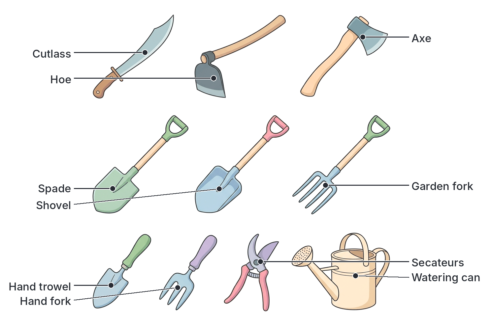
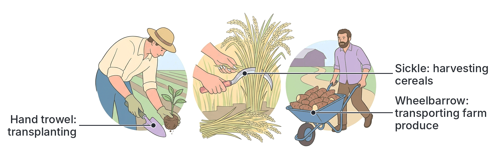

# JAMB Agricultural Science Notes: Simple Farm Tools

## What JAMB expects

This topic is Topic 2 of Section E: Agricultural Technology in the JAMB syllabus.

**Note on the syllabus wording:** The syllabus does not list specific content items for this topic, but it provides three clear objectives. By the end of these notes, you should be able to:

1. Identify simple farm tools.
2. Use and maintain farm tools.
3. Compare the advantages and disadvantages of simple farm tools.

Because simple farm tools are widely used by small-scale farmers across West Africa, JAMB frequently tests your ability to identify tools from descriptions, know their specific uses, and understand how to care for them to prevent rust and damage. 

Heavy farm machinery and implements (like tractors, ploughs, and harrows) are covered separately in `E3-farm-machinery-and-implements.md`.

## Identifying simple farm tools

**Objective i: identify simple farm tools.**

**Simple farm tools** are hand-held tools operated entirely by human muscle power. They do not have engines and are not pulled by animals or tractors. They are the most common tools used by peasant and small-scale farmers in Nigeria and West Africa for daily farm operations.

Farm tools can be classified based on the type of work they do:

### 1. Tools for clearing, slashing and cutting
*   **Cutlass (Machete):** This is one of the most common farm tools in West Africa. It consists of a flat, sharp metal blade attached to a short wooden or plastic handle.
*   **Axe:** Consists of a heavy, thick wedge-shaped iron blade securely fitted to a long wooden handle. 
*   **Sickle:** Has a deeply curved, semicircular metal blade with a sharp inner edge, attached to a short wooden handle.
*   **Secateurs (Hand pruner):** A small, scissor-like tool with one curved sharp blade and one flat blade, operated with one hand. Includes a spring to open the blades.
*   **Shears:** Look like large scissors with long blades and long wooden or metal handles. Operated with two hands.

### 2. Tools for digging and soil preparation
*   **Hoe:** A very common tool with a curved metal blade attached to a wooden handle at an acute angle. The West African traditional hoe comes in different sizes (small ones for weeding, large heavier ones for making yam mounds).
*   **Spade:** Has a flat, rectangular metal blade and a relatively long wooden or metal handle, often ending in a "D" or "T" shape for grip.
*   **Shovel:** Similar to a spade, but the metal blade is broader, curved (scoop-shaped), and usually has raised edges.
*   **Garden Fork (Digging fork):** Has a handle similar to a spade but ends in four or five strong, pointed metal prongs (tines) instead of a solid blade.
*   **Pickaxe (Mattock):** Consists of a heavy metal head with two ends (one pointed and one flattened like a chisel) mounted on a stout wooden handle.
*   **Hand Trowel:** A small hand tool with a metal, scoop-shaped blade and a short wooden or plastic handle.
*   **Hand Fork:** A small hand tool with three or four short metal prongs and a short handle.

### 3. Tools for gathering, carrying and watering
*   **Rake:** Consists of a long wooden handle attached to a metal crossbar that has several short, strong teeth (prongs) resembling a comb.
*   **Wheelbarrow:** A small hand-driven vehicle with a deep metal tray, a single wheel at the front, and two handles and legs at the back.
*   **Headpan:** A broad, shallow metal bowl used for carrying items on the head.
*   **Watering Can:** A metal or plastic container with a handle, a spout, and a detachable perforated nozzle called a **"rose"**. 

## Use and maintenance of farm tools

**Objective ii: use and maintain farm tools.**

To answer JAMB questions correctly, you must know the specific agricultural operations each tool is used for, how it is operated, and the general rules for keeping all metal and wooden tools in good condition.

### Uses of simple farm tools

| Tool | Specific Agricultural Uses and Operation |
| :--- | :--- |
| **Cutlass** | Used for clearing bushes, cutting down small trees and branches, weeding, planting seeds/cuttings (e.g., yam setts, cassava stems), and harvesting crops like cocoa pods, plantain, and sugarcane. Operated by swinging with one hand. |
| **Hoe** | Used for making ridges, mounds, and heaps; weeding; incorporating manure into the soil; and harvesting root and tuber crops like yam and cassava. Operated by bending and striking the soil. |
| **Spade** | Used for digging the soil, leveling the ground, cutting roots, and mixing cement/sand on the farm. Because the blade is flat, it easily slices into the earth when pushed with the foot. |
| **Shovel** | Used for lifting and transferring (scooping) loose soil, sand, organic manure, and fertilizers from one place to another. Not designed for hard digging. |
| **Sickle** | Used specifically for harvesting cereal crops (like rice, wheat, and sorghum/guinea corn) and cutting forage grasses for livestock. The farmer grabs a bunch of stalks with one hand and pulls the sickle towards themselves with the other. |
| **Axe** | Used for felling large trees, stumping (removing roots of felled trees from the soil), and splitting firewood. Swung with two hands for heavy impact. |
| **Secateurs** | Used for pruning (cutting off) small branches and diseased twigs, and for harvesting fruits (like citrus, mangoes) or flowers. Operated with one hand. |
| **Shears** | Used for trimming and shaping hedges, ornamental shrubs, and sometimes for cutting grass. Operated with two hands. |
| **Garden Fork** | Used for loosening hard soil, turning compost and manure, and harvesting root crops without damaging them (the prongs lift the crop out). |
| **Hand Trowel** | The primary tool for **transplanting** seedlings from nursery boxes to the field. Also used for applying small amounts of fertilizer and light weeding in nursery beds. |
| **Hand Fork** | Used for light loosening of surface soil (especially in nurseries), working manure into the soil, and removing weeds around delicate plants. |
| **Rake** | Used for gathering cleared weeds, dry leaves, and stones; leveling the soil surface in nursery beds; and breaking large soil clods. |
| **Watering Can** | Used to apply water gently to seedlings in nursery beds or potted plants. The "rose" breaks the water into a gentle shower so small plants are not washed away. |
| **Wheelbarrow** | Used for transporting farm inputs (seeds, fertilizers, manure) and outputs (harvested crops) over short distances on the farm. |

### Maintenance of farm tools

Proper maintenance ensures that tools last longer, work efficiently, and remain safe for the farmer to use. The most common cause of tool deterioration is rust (oxidation of iron) and rotting of wooden handles.

**General maintenance practices:**

1.  **Cleaning and Washing:** Tools must be washed and cleaned to remove soil, sap, and plant parts immediately after each day's work. Leaving damp soil on metal causes it to rust.
2.  **Drying:** After washing, tools should be dried thoroughly in the sun or wiped with a dry cloth before storage.
3.  **Sharpening:** Cutting tools (like the cutlass, hoe, axe, and sickle) should be sharpened regularly using a file or sharpening stone. A sharp tool requires less energy to use and prevents accidents.
4.  **Oiling and Greasing:** Metal parts, especially moving parts (like the spring and pivot of secateurs or the wheel of a wheelbarrow) and bare blades, should be rubbed with oil or grease before long-term storage. The oil prevents oxygen and moisture in the air from reaching the metal, thereby **preventing rust**.
5.  **Proper Storage:** Tools should be stored in a cool, dry place, such as a tool shed. They should be hung on walls or kept off the bare floor to avoid dampness and prevent accidents. They should not be left exposed to rain and sun in the field.
6.  **Repair and Replacement:** Worn-out, cracked, or broken handles should be replaced immediately. Loose nuts and bolts on tools like the wheelbarrow or shears must be tightened. 
7.  **Care for Wooden Parts:** The wooden handles of tools should be kept smooth. They can be varnished or painted to protect the wood from termite attack and rotting, though the gripping area is often left unpainted to prevent slipping. (Note: **Never** paint the metal blade of a digging or cutting tool, as this will just rub off in the soil; use oil instead).

### Farm safety rules

*   Carry sharp tools pointing downwards.
*   Do not leave tools lying hidden in the grass or with sharp edges pointing upwards (e.g., never leave a rake with the teeth pointing up).
*   Wear protective clothing, such as thick boots and gloves, when handling sharp tools or heavy loads.

## Compare the advantages and disadvantages of simple farm tools

**Objective iii: compare the advantages and disadvantages of simple farm tools.**

In Nigeria, traditional agriculture relies heavily on simple tools. While modern agriculture attempts to replace them with machinery (mechanization), hand tools remain very important.

### Advantages of simple farm tools

1.  **Cheap and affordable:** Hand tools cost very little to buy compared to heavy machinery like tractors and ploughs. This makes them accessible to peasant farmers with low capital.
2.  **Easy to maintain:** They do not require expensive spare parts, fuel, or specialized mechanics. Maintenance involves simple routines like sharpening and oiling.
3.  **No special skills required:** They are simple to operate. Anyone can learn to use a hoe or cutlass with minimal instruction.
4.  **Readily available:** They are manufactured locally by blacksmiths or mass-produced and sold in local markets everywhere.
5.  **Suitable for small and fragmented land:** In West Africa, the land tenure system often leaves farmers with small, scattered plots of land where tractors cannot easily maneuver. Hand tools are perfectly suited for these small farms.
6.  **Useful in difficult terrain:** Tools like the hoe and cutlass can be used on steep slopes, rocky areas, and heavily forested lands where heavy machinery would get stuck or tip over.
7.  **Do not degrade soil heavily:** They do not cause heavy soil compaction (unlike the heavy tires of a tractor) and produce less exhaust pollution.

### Disadvantages of simple farm tools

1.  **Drudgery and physical exhaustion:** Using human muscle power is very tiring. It leads to backaches, fatigue, and poor health over time.
2.  **Time-consuming:** Farm operations carried out with hand tools are very slow.
3.  **Low productivity:** Because the work is slow and tiring, a farmer can only cultivate a very small area of land (typically 1 to 2 hectares maximum), leading to low agricultural output and subsistence farming.
4.  **Labour intensive:** Using simple tools requires many workers to get the job done, which can be expensive or unavailable.
5.  **Prone to wear and tear:** Tools like cutlasses and hoes wear down quickly with constant use and handles break frequently.
6.  **High risk of injury:** Because the tools require swinging sharp blades close to the body, minor cuts and injuries are common.

### Comparison: Simple Farm Tools vs. Heavy Farm Machinery

| Feature | Simple Farm Tools (e.g., Hoe, Cutlass) | Heavy Machinery (e.g., Tractor, Plough) |
| :--- | :--- | :--- |
| **Power source** | Human muscle power | Fossil fuels (diesel/petrol) and engines |
| **Cost** | Very low (cheap) | Very high (expensive) |
| **Speed of operation** | Very slow | Very fast |
| **Area cultivated** | Small (subsistence scale, 1-2 ha) | Large (commercial scale, hundreds of ha) |
| **Operator skill** | Low (no formal training needed) | High (requires trained drivers and mechanics) |
| **Maintenance** | Simple (sharpening, washing, oiling) | Complex (servicing engines, buying parts) |
| **Physical effort** | High (leads to drudgery) | Low (machine does the heavy work) |

## Key terms

| Term | Meaning |
| :--- | :--- |
| **Simple farm tools** | Hand-operated tools powered by human muscles, used for basic farm operations. |
| **Drudgery** | Hard, menial, and exhausting physical labour, commonly associated with using hand tools. |
| **Pruning** | The practice of cutting away dead or overgrown branches or stems to encourage healthy plant growth. |
| **Transplanting** | Moving a young plant (seedling) from a nursery bed and planting it in its permanent field position. |
| **Rose** | The detachable, perforated nozzle fitted to the spout of a watering can to sprinkle water gently. |
| **Tines** | The sharp, pointed metal prongs of a fork or rake. |
| **Stumping** | The removal of tree stumps and roots from the soil after felling. |

## Exam tips and common mistakes

*   **Spade vs. Shovel:** A common exam mistake is confusing these two. A **spade** has a flat blade and is for *digging/cutting* the soil. A **shovel** is broad, scooped, and has raised edges; it is for *moving/lifting* loose materials like sand or fertilizer.
*   **Hand trowel vs. Hand fork:** A **hand trowel** is scoop-shaped and is the primary tool for *transplanting seedlings*. A **hand fork** has prongs and is used for *loosening surface soil*. If a JAMB question asks for the best tool for transplanting, choose the hand trowel.
*   **Secateurs vs. Shears:** Both are cutting tools. **Secateurs** are operated with one hand and are used for pruning small twigs or harvesting fruit. **Shears** have long handles, are operated with two hands, and are used for trimming hedges.
*   **Why oil metal tools?** JAMB frequently asks why tools are oiled or greased. The answer is always **to prevent rusting**. Oiling acts as a barrier, stopping moisture and oxygen from reacting with the iron in the tool.
*   **Harvesting cereals:** The specific tool for harvesting rice, millet, and guinea corn (cereals) is the **sickle**.
*   **Meaning of drudgery:** Understand that drudgery is the primary disadvantage of simple farm tools; it limits the size of land a farmer can cultivate.

## Quick summary

1. Simple farm tools are cheap, hand-held instruments powered by human energy, used predominantly by peasant farmers in West Africa.
2. Cutting tools include the cutlass (clearing/harvesting), axe (felling trees), sickle (harvesting cereals), secateurs (pruning), and shears (trimming hedges).
3. Digging tools include the hoe (making ridges/weeding), spade (digging/slicing earth), shovel (moving soil), and garden fork (turning manure/harvesting tubers).
4. Tools used in the nursery include the hand trowel (for transplanting), hand fork (for light loosening), and watering can (for gentle irrigation).
5. Proper maintenance includes washing tools after use, sharpening cutting edges, tightening loose bolts, and replacing broken handles.
6. The most critical maintenance for metal blades before storage is oiling or greasing, which prevents rusting by blocking moisture and oxygen.
7. Simple tools are advantageous because they are cheap, easy to use, and suit small or difficult lands, but their main disadvantages are drudgery, slow operation, and low productivity.

## Practice questions

**1. Which of the following simple farm tools is specifically designed for harvesting cereal crops like rice and wheat?**
- A. Cutlass
- B. Sickle
- C. Secateurs
- D. Hand trowel

**Answer: B.** The sickle has a curved blade uniquely suited for hooking around bundles of cereal stalks and slicing them close to the ground.

**2. The primary reason for rubbing oil or grease on the metal parts of farm tools before storage is to**
- A. make them look shiny and new
- B. reduce the friction when digging
- C. prevent the tools from rusting
- D. make sharpening the blade easier

**Answer: C.** Oil and grease form a protective barrier that prevents moisture and oxygen from reaching the metal surface, thereby preventing rust (oxidation).

**3. A farmer wants to carefully move tomato seedlings from the nursery box to the main field. The most appropriate tool to use is the**
- A. hand fork
- B. spade
- C. hand trowel
- D. garden fork

**Answer: C.** The hand trowel is a small, scoop-shaped tool designed exactly for lifting small seedlings with the surrounding soil (a ball of earth) without damaging the delicate roots during transplanting.

**4. Which of the following distinguishes a shovel from a spade?**
- A. A shovel has a flat blade, while a spade has a curved blade
- B. A shovel is used for digging hard soil, while a spade is for lifting
- C. A shovel has a broad, scooped blade for moving materials, while a spade has a flat blade for digging
- D. A shovel is used for pruning, while a spade is used for weeding

**Answer: C.** A spade is flat and meant to slice into the soil to dig. A shovel is scooped (concave) with raised edges, making it ideal for lifting and moving loose materials like sand or fertilizer.

**5. A major disadvantage of using simple farm tools in agricultural production is that it**
- A. is very expensive to purchase the tools
- B. leads to drudgery and low productivity
- C. requires highly specialized training
- D. causes heavy soil compaction

**Answer: B.** Simple tools rely entirely on human muscle power. This causes severe physical exhaustion (drudgery) and limits the amount of land a farmer can work, leading to low productivity. Heavy machinery causes compaction, not simple tools.

**6. Which of the following tools is operated using two hands and is used mainly for trimming hedges and ornamental shrubs?**
- A. Secateurs
- B. Sickle
- C. Shears
- D. Pickaxe

**Answer: C.** Shears have long handles and long blades, operated with both hands like large scissors, specifically for trimming hedges. Secateurs are operated with one hand for small twigs.

**7. A tool used primarily for leveling the soil surface in a nursery bed and gathering dry leaves or cleared weeds is the**
- A. garden fork
- B. rake
- C. hand fork
- D. hoe

**Answer: B.** The rake consists of a crossbar with teeth. It is dragged across the soil to level it and to gather debris like weeds, dry leaves, and stones.

**8. Which of the following is NOT a good maintenance practice for simple farm tools?**
- A. Painting the metal blades of digging tools
- B. Sharpening the blunt edges of cutlasses
- C. Washing and drying tools after use
- D. Storing tools in a dry tool shed

**Answer: A.** Painting the metal blades of digging or cutting tools is not a good practice because the paint will quickly rub off in the soil. Instead, bare metal blades should be oiled or greased. Wooden handles, however, can be painted.

**9. The most versatile tool used by peasant farmers in West Africa for clearing bushes, felling small trees, planting, and harvesting is the**
- A. axe
- B. pickaxe
- C. shovel
- D. cutlass

**Answer: D.** The cutlass (machete) is the most multi-purpose tool on a West African farm. It is used for clearing vegetation, planting crops (like yam setts), and harvesting (like cocoa and cassava).

**10. When watering very young and delicate seedlings, a farmer uses a watering can fitted with a rose because**
- A. the rose increases the water pressure
- B. it breaks the water into a fine shower to prevent washing away the seeds
- C. it filters impurities from the water
- D. it directs a strong jet of water to the roots

**Answer: B.** The perforated nozzle (rose) breaks the stream of water into tiny droplets. This gentle shower ensures that small seeds or delicate seedlings are not uprooted or washed away by the force of the water.

<!-- COVERAGE
obj i | Identifying simple farm tools
obj ii | Use and maintenance of farm tools
obj iii | Compare the advantages and disadvantages of simple farm tools
-->
