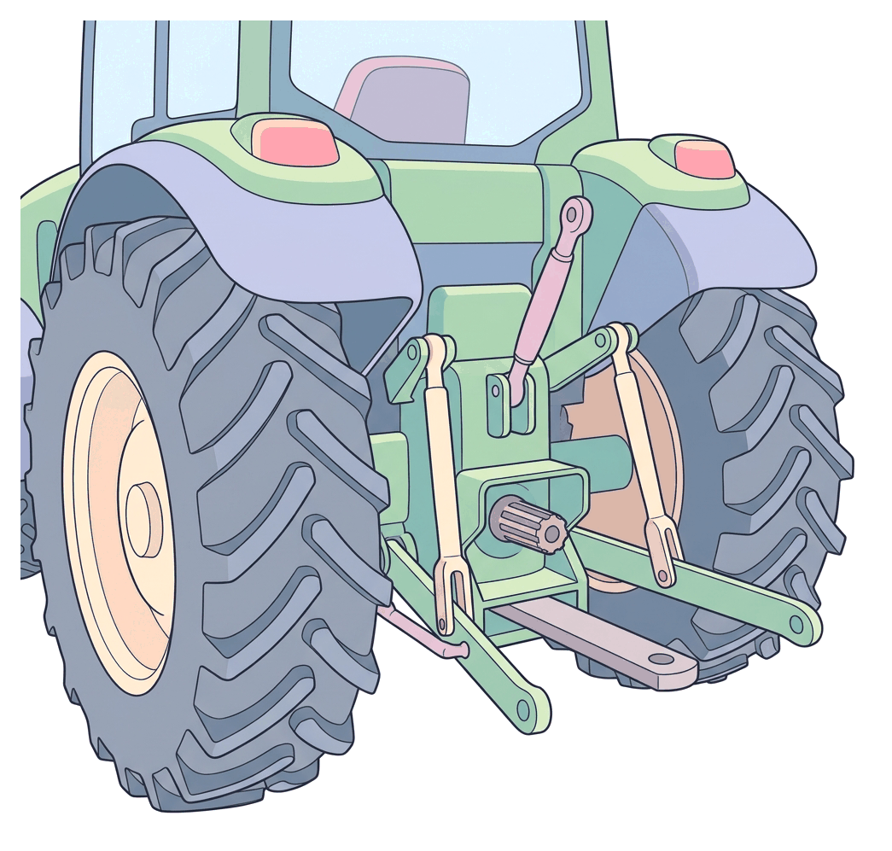

# JAMB Agricultural Science Notes: Farm Machinery and Implements

## What JAMB expects

This topic is Section E, Topic 3 of the JAMB Agricultural Science syllabus: Agricultural Technology – Farm Machinery and Implements.

It covers the following content items:
- **a. Types**
  - i. Machinery e.g. tractor, milking machine etc.
  - ii. Implements
- **b. Uses and maintenance of farm machinery and implements**

By the end of these notes, you should be able to:
1. identify common farm machinery and implements.
2. i. classify farm machinery according to their uses.
3. ii. Operate farm machines and implements.
4. apply appropriate maintenance routines on farm machines and implements.

**Note:** Simple hand-held farm tools (like the cutlass and hoe) are covered separately in `E2-simple-farm-tools.md`, and general mechanization principles and sources of farm power are covered in `E4-mechanization-and-sources-of-farm-power.md`.

## Types of farm machinery and implements

As farming expands from small-scale subsistence to large-scale commercial agriculture, farmers replace simple hand tools with mechanical devices to save time, reduce human drudgery, and perform heavier work more efficiently. We divide these mechanical devices into two main groups: **machinery** and **implements**.

| Feature | Farm Machinery | Farm Implements |
| --- | --- | --- |
| **Power source** | Usually have their own internal motor or engine (self-propelled). | Usually do not have an engine; they rely on a tractor or draft animals to pull, push, or rotate them. |
| **Function** | Provide the power to move or operate other equipment, or perform complex combined tasks directly. | Perform specific field tasks (such as cutting soil, planting seeds, or making ridges). |
| **Examples** | Tractor, combine harvester, milking machine, incubator. | Plough, harrow, ridger, planter, boom sprayer. |

## Identify common farm machinery and implements

To succeed in your exam, you must be able to visually identify and describe the features of the most common farm machinery and their corresponding implements. 

**1. The Tractor:** 
The tractor is the most important and versatile piece of farm machinery. It is a powerful motor vehicle with large, heavily treaded rear wheels (for grip in soft or muddy soil) and smaller front wheels for steering. It is the primary source of mobile power on the farm. 

A tractor delivers power to implements in three ways:
- **The Drawbar:** A heavy metal bar at the back used to pull trailed implements (like heavy trailers or trailed harrows).
- **The Three-Point Linkage (Hydraulic system):** Three metal arms at the back (one upper, two lower) that attach to implements (like a mounted plough) and use hydraulic power to lift and lower them.
- **The Power Take-Off (PTO) shaft:** A rotating splined metal shaft at the back. When connected to a matching shaft on an implement (like a mower, slasher, or fertilizer broadcaster), it provides rotary engine power to make the parts of the implement spin. Standard PTO speeds are usually 540 rpm or 1000 rpm.

**2. Milking Machine:** 
A specialized machine used on commercial dairy farms to extract milk from the udders of dairy cows (such as White Fulani or Friesian crosses). It uses an electric vacuum pump and rubber teat cups that gently squeeze and release the teats, imitating a calf sucking. It pipes the milk directly into sterile cooling tanks, which maintains high hygiene standards.

**3. Combine Harvester:** 
A large, self-propelled machine that performs three harvesting operations in a single pass over the field: **reaping** (cutting the crop), **threshing** (separating the grain from the stalk), and **winnowing** (cleaning the grain from the chaff). It is heavily used for grain crops like rice, maize, wheat, and sorghum.

**4. Incubator:** 
A machine used in poultry production to artificially hatch fertile eggs. It acts like a mother hen by carefully controlling temperature, humidity, and ventilation, and by automatically turning the eggs at regular intervals.

**5. Farm Implements (Ploughs, Harrows, and Ridgers):**
Implements are attachments operated by a tractor. Based on how they connect, they can be:
- **Mounted implements:** Fully supported and lifted by the tractor's three-point linkage (e.g., mounted ploughs, boom sprayers).
- **Trailed implements:** Pulled behind the tractor using the drawbar; they have their own wheels to support their weight in the field (e.g., heavy disc harrows, trailers).
- **PTO-driven implements:** Draw rotational power from the PTO shaft (e.g., mowers, slashers, forage harvesters).

## Uses and maintenance of farm machinery and implements

To maximize the benefits of agricultural mechanization, farm machinery and implements must be used correctly for their specific purposes, operated safely by trained personnel, and maintained diligently to prevent expensive breakdowns.

## Classify farm machinery according to their uses

We classify implements and machines based on the agricultural operation they are designed to perform:

### 1. Tillage Implements (Soil Preparation)
Tillage is the mechanical manipulation of soil to provide a favourable environment for crop growth. It is divided into primary and secondary tillage.

**Primary Tillage Implements**
These are heavy implements used for the first deep opening of the soil. They cut, shatter, and turn over the soil, burying weeds and crop residues. The two main types are the **disc plough** and the **mouldboard plough**.

| Feature | Disc Plough | Mouldboard Plough |
| --- | --- | --- |
| **Working parts** | Heavy, concave (saucer-shaped) steel discs. | A pointed share, a curved mouldboard, and a straight landside. |
| **How it works** | The discs roll as they cut, slicing and throwing the soil to one side. | The share cuts a slice of soil; the curved mouldboard completely turns it upside down. |
| **Best soil type** | Tough, hard, dry, heavy clay, or sticky soils. | Clean, light, stone-free, temperate, or previously cultivated soils. |
| **Obstacles (stones/stumps)** | **Rolls over** obstacles without breaking. Excellent for newly cleared land in tropical regions like Nigeria. | Likely to **break or get stuck** if it hits heavy roots or stones. |
| **Weed burial** | Buries weeds partially (rough finish). | Inverts the soil totally, giving excellent and complete weed burial. |

**Secondary Tillage Implements**
After primary tillage, the soil consists of large rough clods. Secondary implements break these clods down into a fine, smooth seedbed and shape the land for planting.

- **Harrow:** Breaks up soil clods, levels the surface, and destroys young weeds. 
  - *Disc harrow:* Has gangs (groups) of smaller, closely spaced discs. 
  - *Spring-tine harrow:* Has flexible metal teeth that drag through the soil, good for bringing weed roots to the surface.
- **Ridger:** Used to form ridges and furrows. It gathers loose soil into raised beds. This is vital in Nigeria for root and tuber crops like yam and cassava, as it prevents waterlogging and gives roots room to expand. A mouldboard ridger looks like a double-sided mouldboard plough (throwing soil both left and right).

[IMAGE: Side-by-side comparison of a disc plough and a mouldboard plough. Left: A disc plough showing three heavy saucer-shaped steel discs mounted on a heavy tubular frame, with a heavy rear furrow wheel. Right: A mouldboard plough showing a sharp horizontal share at the bottom, curving up into a twisted steel mouldboard plate, and a straight metal landside piece sliding behind it. Labels to add: "Concave disc", "Heavy frame", "Share (cuts)", "Mouldboard (turns soil)", "Landside". Clean flat textbook illustration, white background.]

### 2. Planting Implements
These implements place seeds or plant parts into the soil at the correct depth and spacing, ensuring uniform crop emergence.
- **Planter:** Used for row crops like maize, cowpea, and cotton. 
  *How a planter works:* A hopper holds the seeds. A **seed metering device** measures out the exact number of seeds. A **furrow opener** makes a small trench. A seed tube drops the seed in. Finally, a **covering device** (like a press wheel) covers the seed with soil and firms it down.
- **Seed Drill:** Places seeds closely together in continuous rows (used for cereals like wheat and rice).
- **Broadcaster:** Scatters seeds randomly over the soil surface (often used for pasture grasses).

### 3. Fertilizer and Agrochemical Applicators
- **Fertilizer Broadcaster:** A hopper with a spinning disc at the bottom (driven by the PTO) that throws granular fertilizer evenly across the field.
- **Sprayers:** Used to apply liquid herbicides, insecticides, or fungicides. They range from hand-operated **knapsack sprayers** (carried on a farmer's back, typically 15 to 20 litres) to large **tractor-mounted boom sprayers** which have long arms with many nozzles to spray wide rows of crops at once.

### 4. Harvesting Machinery and Implements
- **Mower:** A PTO-driven implement that cuts standing vegetation. Used for harvesting pasture for hay or for weed control (slashers).
- **Forage Harvester:** Cuts green plants (like maize stalks), chops them into small pieces, and blows them into a trailer to make silage for livestock.
- **Combine Harvester:** As described earlier, reaps, threshes, and winnows grain crops in one go.
- **Mechanical Harvesters:** Specialized machines like cotton pickers, potato lifters, or groundnut lifters.

### 5. Processing Machinery
- **Sheller:** Removes grains from the cob or pod (e.g., maize sheller, cowpea sheller).
- **Dryer:** Uses heated air and fans to reduce the moisture content of harvested grains so they can be stored safely without going mouldy.
- **Grinding/Milling Machine:** Crushes grains (like maize or sorghum) into flour or animal feed.

## Operate farm machines and implements

Operating farm machinery requires skill, proper training, and strict adherence to safety rules to prevent accidents and damage to the machines. A tractor is not driven like a standard car; it requires careful coupling and awareness of the implements behind it.

### Step-by-Step Operation of a Tractor and Implement
1. **Pre-operational check:** The operator must inspect the tractor before starting the engine. Check the engine oil, radiator coolant, fuel level, battery terminals, and tyre pressure.
2. **Coupling (Hitching):** Reverse the tractor slowly to the implement. For a mounted implement, attach the left lower link, then the right lower link (which has an adjustable leveling box), and finally the top link (which controls the forward/backward tilt of the implement). Secure all attachments with safety lynchpins.
3. **Engaging the PTO (if required):** If coupling a slasher or fertilizer broadcaster, attach the PTO shaft from the implement to the tractor's PTO stub and ensure the safety shield is securely in place.
4. **Operation:** Start the tractor. Engage the hydraulic system to lift the implement off the ground for transport to the field. Once in the field, lower the implement to the desired working depth, select the correct gear, and drive at a steady speed. For PTO implements, run the engine at the specific speed required (e.g., 540 rpm) so the implement works efficiently.
5. **Unhitching:** After use, return to a level storage area, lower the implement fully to the ground, disconnect the PTO, remove the top link, and then remove the lower links.

### General Safety Precautions During Operation
- **No riders:** Do not allow passengers on a tractor unless there is a designated passenger seat.
- **Use ROPS:** Always use a tractor fitted with a Roll-Over Protective Structure (ROPS) and wear a seatbelt. Because tractors have a high centre of gravity, they can easily flip over. If this happens, the ROPS prevents the tractor from crushing the driver.
- **Guards and Shields:** Never operate a machine with missing PTO shields or exposed belts. Moving parts can quickly catch loose clothing or hair.
- **Speed:** Drive slowly on rough terrain, tight corners, and steep slopes to avoid overturning.
- **Trained personnel only:** Only certified operators should drive tractors and operate heavy machinery.

## Apply appropriate maintenance routines

Farm machinery is very expensive. Proper maintenance prolongs the lifespan of the machine, prevents costly breakdowns during critical farming seasons, ensures operational efficiency, and improves operator safety. Maintenance routines are usually divided into daily, periodic, and off-season storage routines.

### 1. Daily or Routine Maintenance (Pre-start Checks)
These are simple checks done every morning before the engine is started. You can remember them using the acronym **POWER**:
- **P**etrol/Fuel: Check the fuel gauge and ensure there is enough diesel or petrol for the day's work.
- **O**il: Pull out the dipstick, wipe it clean, re-insert it, and check that the engine oil is between the 'Min' and 'Max' marks.
- **W**ater: Check the coolant level in the radiator and the distilled water (electrolyte) level in the battery.
- **E**arth/Electrical: Check that headlights, indicators, dashboard gauges, and battery connections are secure and functional.
- **R**ubber/Tyres: Check tyre pressure using a gauge and inspect for deep cuts or wear.
- **Additional:** Tighten any loose nuts and bolts, and clean the air filter to remove trapped dust.

### 2. Periodic Maintenance
These are tasks done after a certain number of working hours (e.g., every 50, 100, or 500 hours) as specified in the manufacturer's operator manual.
- **Changing fluids:** Drain and replace old engine oil, transmission fluid, and hydraulic fluid, as old oil loses its lubricating properties over time.
- **Replacing filters:** Replace dirty oil filters, fuel filters, and air filters to keep the engine running smoothly.
- **Greasing (Lubrication):** Apply grease to moving joints, wheel bearings, and grease nipples using a grease gun. This reduces friction and wear between metal parts.
- **Belt tension:** Adjust or replace worn fan belts and alternator belts.

### 3. Off-season Storage Maintenance
In Nigeria, machines often sit idle during the long dry season. Proper storage prevents rust, decay, and damage from the elements.
- **Thorough cleaning:** Wash the tractor and implements to remove all mud, crop residue, and fertilizer (fertilizer chemicals cause rapid rusting).
- **Rust prevention:** Paint any scratched or exposed metal parts. More importantly, smear soil-engaging parts (like plough shares, discs, and harrow tines) with used engine oil or grease to prevent rust (oxidation) during storage.
- **Uncouple:** Do not leave heavy implements hanging on the tractor's hydraulic system; lower them to the ground or uncouple them completely to relieve pressure on the hydraulic pump.
- **Battery care:** Remove the tractor battery, clean the terminals, and store it in a cool, dry place on a wooden board. Charge it occasionally.
- **Shelter:** Store tractors and implements under a shed or cover them with a tarpaulin to protect them from direct sunlight (which rots rubber tyres and hoses) and rain.

## Key terms

| Term | Meaning |
| --- | --- |
| **Machinery** | Farm equipment that usually has an engine and provides power (e.g., tractor, combine harvester). |
| **Implement** | Equipment attached to and pulled or powered by a tractor to do field work (e.g., plough, harrow). |
| **Drawbar** | A heavy metal bar at the back of a tractor used to pull trailed implements. |
| **Three-point linkage** | A hydraulic lifting system on a tractor with three connection arms used to attach and lift mounted implements. |
| **Power Take-Off (PTO)** | A rotating shaft on a tractor that provides engine power to drive the moving parts of attached implements. |
| **Primary tillage** | The first, deep cutting and turning of the soil to bury weeds and crop residues (using ploughs). |
| **Secondary tillage** | The shallower breaking of clods and smoothing of the soil to prepare a seedbed (using harrows and ridgers). |
| **Disc plough** | A plough with large saucer-shaped steel discs; ideal for rough, stumpy, and stony soils. |
| **Mouldboard plough** | A plough with a share and curved plate that completely turns the soil; best for clean, stone-free soils. |
| **Seed metering device** | The part of a planter that accurately measures out seeds one by one to ensure correct spacing. |
| **Combine harvester** | A machine that reaps (cuts), threshes (beats out grain), and winnows (cleans) in one pass. |

## Exam tips and common mistakes

- **Disc vs. Mouldboard Plough:** This is a very frequent JAMB question. Remember that the **disc plough rolls over stumps and stones**, making it best for tropical/newly cleared soils. The **mouldboard plough will break** on stumps but is excellent for completely burying weeds in clean, pre-cultivated soil.
- **Harrow vs. Plough:** A plough is for primary tillage (deep digging, turning over). A harrow is for secondary tillage (breaking clods, levelling the surface). Do not confuse their roles.
- **Identify the Combine Harvester:** Questions often ask which machine cuts, threshes, and winnows simultaneously. The answer is the combine harvester.
- **PTO Shaft function:** The drawbar *pulls*, the three-point linkage *lifts*, but the PTO *rotates* (provides rotary power). Know this distinction.
- **Preventing rust:** Coating implements with grease, oil, or paint before storage is specifically to stop oxidation (rust).
- **Planter parts:** The function of the furrow opener is to make a trench; the covering device covers the seed; the hopper stores the seed.

## Quick summary

1. Farm machinery (like tractors and combine harvesters) usually has engines and provides power, whereas implements (like ploughs and planters) are attachments that do specific field work.
2. The tractor transfers power to implements via the drawbar (for pulling), the three-point linkage (for lifting), and the PTO shaft (for rotary power).
3. Primary tillage implements (ploughs) cut and invert the soil. The disc plough is best for stumpy/stony soils, while the mouldboard plough is best for clean, stone-free soils.
4. Secondary tillage implements (harrows and ridgers) break down soil clods to create a fine seedbed and make ridges for planting.
5. Planters mechanize seed sowing by opening a furrow, dropping precisely spaced seeds, and covering them with soil.
6. A combine harvester performs reaping, threshing, and winnowing of grain crops in a single operation.
7. Operating machinery safely requires pre-start checks, proper coupling using the three-point linkage, avoiding high speeds, and using safety guards like ROPS and PTO shields.
8. Maintenance routines (daily checks of oil and water, periodic greasing and filter changes, and off-season cleaning and oiling) prevent rust, save money, and ensure the machine is always ready for use.

## Practice questions

**1. The primary difference between farm machinery and farm implements is that**
- A. implements are used only for harvesting, while machinery is used for planting
- B. machinery is manually operated, while implements require electricity
- C. machinery usually has its own motor or engine, while implements are mostly pulled by tractors
- D. implements are made of wood, while machinery is made of steel

**Answer: C.** Machinery (like tractors and combine harvesters) are self-propelled power units, whereas implements (like ploughs and harrows) are usually powerless tools attached to and pulled by the machinery.

**2. Which of the following tractor components provides rotary power to operate a fertilizer broadcaster or mower?**
- A. The drawbar
- B. The Power Take-Off (PTO) shaft
- C. The hydraulic three-point linkage
- D. The differential lock

**Answer: B.** The Power Take-Off (PTO) shaft transfers the engine's rotary power to drive the moving mechanisms of attached implements. The drawbar only pulls, and the linkage only lifts.

**3. The most suitable primary tillage implement for a newly cleared farm in a forest zone with tree stumps and stones is the**
- A. mouldboard plough
- B. disc plough
- C. spring-tine harrow
- D. rotary ridger

**Answer: B.** The disc plough is preferred for stumpy, stony, and tough soils because its heavy saucer-shaped discs can roll over obstacles without breaking, unlike the mouldboard plough.

**4. An implement used to break large soil clods into a fine seedbed after ploughing is the**
- A. harrow
- B. ridger
- C. mower
- D. planter

**Answer: A.** The harrow is a secondary tillage implement designed specifically to break down large clods left by the primary ploughing operation and level the seedbed.

**5. A large farm machine that simultaneously reaps, threshes, and cleans cereal crops in the field is called a**
- A. forage harvester
- B. boom sprayer
- C. combine harvester
- D. motorized sheller

**Answer: C.** A combine harvester "combines" the three operations of reaping, threshing, and winnowing into one continuous process as it moves over the field.

**6. The part of a mechanical planter that accurately measures out individual seeds for planting is the**
- A. hopper
- B. seed tube
- C. furrow opener
- D. seed metering device

**Answer: D.** The seed metering device ensures that seeds are dropped one by one (or in exact batches) at correct intervals. The hopper simply stores the seeds before they are metered.

**7. Which of the following is a daily maintenance routine for a tractor?**
- A. Changing the fuel filter
- B. Greasing the wheel bearings
- C. Checking engine oil and radiator coolant levels
- D. Draining the hydraulic fluid

**Answer: C.** Checking fluids (oil, water, fuel) and tyre pressure are pre-start routines performed every morning. Changing filters and greasing are periodic maintenance tasks done after many hours of operation.

**8. To prevent rusting of metal implements like ploughs and harrows during off-season storage, a farmer should**
- A. immerse them in a tank of water
- B. coat the metal parts with used engine oil or grease
- C. wash them with a strong acid
- D. leave them attached to the tractor in the field

**Answer: B.** Coating soil-engaging metal parts with oil, grease, or paint prevents moisture and oxygen from reaching the metal, thereby stopping oxidation (rusting).

**9. Milking machines are primarily used in which of the following farm enterprises?**
- A. Commercial pig farming
- B. Beef cattle fattening
- C. Commercial dairy farming
- D. Poultry incubation

**Answer: C.** Milking machines use vacuum pressure to extract milk from the udders of dairy cows, replacing manual hand milking and ensuring hygiene in commercial dairy farms.

**10. Why is it dangerous to operate a tractor on steep slopes at high speeds?**
- A. The PTO shaft will disengage automatically
- B. It causes rapid evaporation of radiator water
- C. The tractor is highly likely to overturn
- D. The hydraulic linkage will drop the implement

**Answer: C.** Tractors have a high center of gravity. Driving fast on rough terrain, tight corners, or steep slopes drastically increases the risk of the tractor rolling over, which is a major cause of fatal farm accidents.
