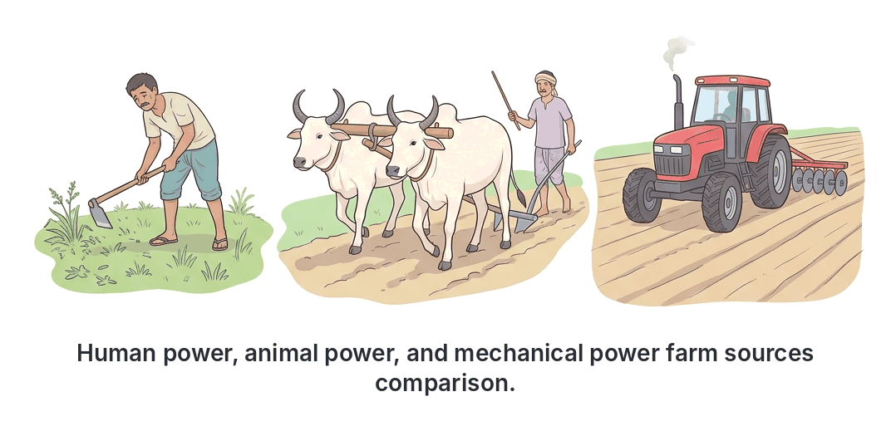
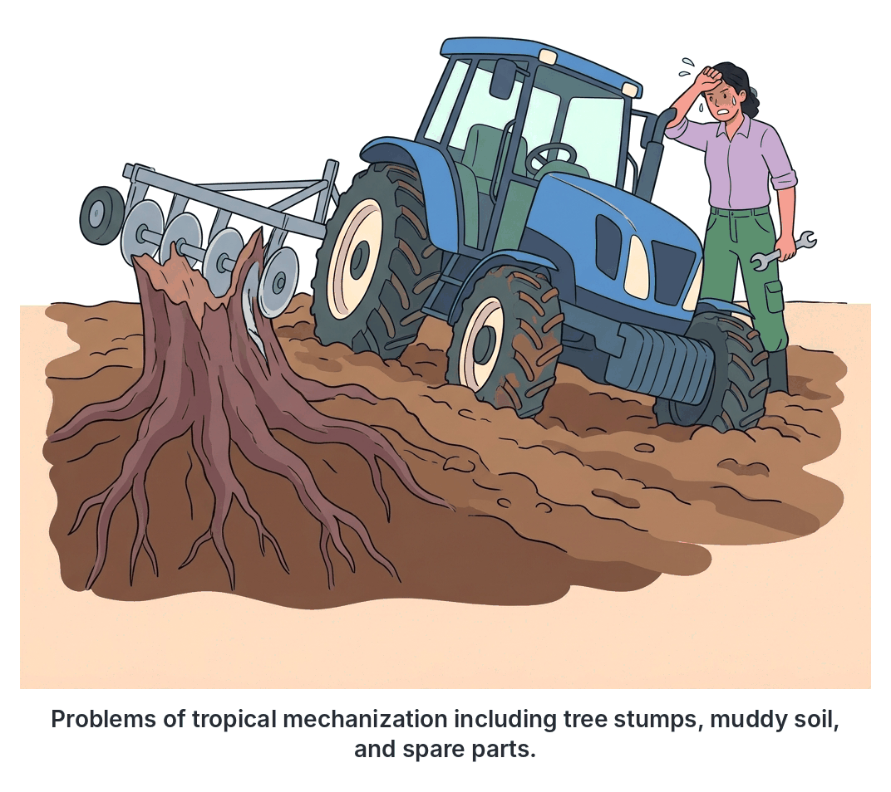

# JAMB Agricultural Science Notes: Mechanization and Sources of Farm Power

## What JAMB expects

This topic is Section E, Topic 4 of the JAMB Agricultural Science syllabus: Mechanization and sources of farm power.

It covers the following content items:
- a. Sources of farm power e.g. animal and machines
- b. Advantages and disadvantages of agricultural mechanization
- c. Problems and prospects of mechanized agriculture in West Africa

By the end of these notes, you should be able to:
1. Compare the advantages and disadvantages of various sources of farm power and their application.
2. Distinguish between the advantages and disadvantages of mechanization.
3. Assess the problems and prospects of mechanized agriculture in West Africa.

**Note on related topics:** The specific tools, implements, and machines used in farming are covered in detail in `E2-simple-farm-tools.md` and `E3-farm-machinery-and-implements.md`. This file focuses on the *power sources* that drive them and the overall concept, benefits, and challenges of mechanizing agriculture.

## Sources of farm power e.g. animal and machines

Farm power refers to the various forms of energy used to carry out agricultural operations such as land preparation, planting, weeding, harvesting, and processing. In West Africa, farmers rely on a mix of traditional and modern power sources depending on their capital, land size, and ecological zone.

The main sources of farm power are human, animal, mechanical, electrical, solar, wind, and water.

### 1. Human Power
Human power is the energy provided by human beings doing manual labour. It is the oldest, most basic, and most common source of farm power in West Africa, especially among peasant (small-scale) farmers.
- **Application:** Used for operating simple farm tools like the cutlass, hoe, and sickle. It is used for slashing, weeding, making mounds, planting seeds, harvesting, and carrying produce on the head.
- **Advantages:**
  - Easily available and cheap to acquire initially.
  - Excellent for delicate operations that heavy machines cannot do (e.g., selectively plucking ripe cocoa pods, harvesting soft fruits like tomatoes, or thinning out fragile seedlings).
  - Can be used on any terrain, including steep slopes, rocky areas, and thick forests where machines cannot go.
  - Does not require special technical training to start.
- **Disadvantages:**
  - Output is very low (a person can only do a limited amount of work in a day).
  - Leads to quick fatigue (tiredness) and heavy drudgery (hard, boring physical work).
  - Very expensive and inefficient in the long run for large-scale commercial farming, as hiring many labourers costs a lot of money over time.
  - Affected by the health, age, and physical condition of the worker.

### 2. Animal Power
Animal power (or draught power) is the energy provided by trained farm animals called **draught animals** or beasts of burden. In Nigeria, the most common draught animals are cattle (especially the White Fulani and Sokoto Gudali breeds), donkeys, horses, and camels.
- **Application:** Used for pulling implements like the ox-drawn plough, ridger, or harrow for land preparation; pulling carts for transporting farm produce; and operating simple crushers (e.g., sugar cane crushers).
- **Advantages:**
  - Can do much more work than a human in the same amount of time.
  - Cheaper to buy and maintain than tractors.
  - The animals produce dung, which serves as valuable organic manure for the farm.
  - Can work in terrains where heavy tractors might get stuck or cannot easily maneuver.
- **Disadvantages:**
  - Restricted to certain ecological zones. In West Africa, draught animals are used mostly in the savanna (Northern Nigeria) because the rainforest (Southern Nigeria) is heavily infested with **tsetse flies**. These flies transmit a deadly disease called **trypanosomiasis** (sleeping sickness) to cattle and horses.
  - Animals get tired and need regular rest.
  - They require daily feeding, watering, veterinary care, and proper housing, even when not working.
  - Require skilled handlers to train and direct them safely.
- **Animal welfare safety note:** Draught animals must be fitted with proper, comfortable harnesses or yokes to prevent painful sores. They should not be beaten, overloaded, overworked, or forced to work in extreme afternoon heat.

### 3. Mechanical Power
Mechanical power is the energy supplied by engines and machines running on fossil fuels (petrol or diesel). This is the hallmark of modern commercial agriculture.
- **Application:** Powering mobile heavy machinery like tractors, bulldozers, and combine harvesters, and driving stationary engines for milling, grinding, and pumping water. The tractor often transfers this power to implements via its Power Take-Off (PTO) shaft.
- **Advantages:**
  - Works extremely fast, saving massive amounts of time and allowing operations to be done exactly at the right season (timeliness).
  - Can cover thousands of hectares of land, making large-scale commercial farming possible.
  - Does not get physically tired (can work day and night if there are different operators and sufficient fuel).
  - Greatly reduces human drudgery.
- **Disadvantages:**
  - Very expensive to buy and maintain.
  - Requires highly trained operators, mechanics, and expensive imported spare parts.
  - Heavy machines press the soil down too tightly (**soil compaction**), destroying its structure and making it difficult for roots to penetrate.
  - Exhaust fumes and fuel spills pollute the air and soil.
- **Safety note:** PTO shafts must always be covered with protective guards to prevent loose clothing from getting caught, which can cause fatal injuries.

### 4. Electrical Power
Electrical power is energy supplied by electricity from the national grid or fuel-powered generators.
- **Application:** Running stationary equipment like incubators (for hatching eggs), milking machines in dairies, feed mills, heating for brooder houses, cold rooms for storage, and lighting the farmstead.
- **Advantages:**
  - Clean at the point of use and does not emit exhaust fumes (if from the grid).
  - Very efficient, quiet, and easy to operate (often at the push of a button).
  - Can be easily automated with timers, sensors, and thermostats.
- **Disadvantages:**
  - Power supply in many parts of West Africa is erratic and unreliable, requiring expensive backup generators.
  - Cannot be easily used for mobile field operations (you cannot plug a tractor into a wall to plough a large field).
  - Can cause fatal electric shocks or fire outbreaks if equipment is poorly wired or handled in wet conditions.

### 5. Solar Power
Solar power is energy tapped directly from the sun using solar panels and solar thermal collectors.
- **Application:** Drying crops (natural sun-drying on mats or controlled solar dryers), powering solar water pumps for irrigation, providing electricity for farmstead lighting, and powering electric fences.
- **Advantages:** Renewable, absolutely free after installation, and environmentally friendly.
- **Disadvantages:** High initial capital cost for panels and batteries; efficiency drops at night or during heavy rains.

### 6. Wind and Water Power
- **Wind power:** Uses windmills to pump water or generate electricity. Cheap and renewable but depends on unpredictable wind speeds.
- **Water power (Hydraulic):** Uses moving water to turn turbines (e.g., Kainji Dam in Nigeria) or watermills. Powerful and renewable but strictly limited to areas with fast-flowing rivers or waterfalls.

## Comparing the advantages and disadvantages of various sources of farm power

Comparing the sources of farm power helps a farmer decide which is most appropriate based on their budget, location, and the type of work to be done. 

| Feature | Human Power | Animal Power | Mechanical Power | Electrical / Solar Power |
| --- | --- | --- | --- | --- |
| **Initial Cost** | Very low (buying simple tools) | Moderate (buying animals and simple implements) | Very high (millions of naira for tractors) | High (wiring, generators, solar panels) |
| **Output / Speed** | Very low | Medium | Very high | High (for stationary jobs) |
| **Drudgery Level** | Extremely high | Low | Very low | Very low |
| **Running Cost** | Wages or food | Feed, water, and veterinary care | Diesel, petrol, oil, and spare parts | Electricity bills, generator fuel, battery replacement |
| **Ecological Limit** | None | Strictly limited by tsetse flies in the rainforest (South) | Limited by swamps, massive tree stumps, and steep hills | Limited by access to the national grid or sunlight hours |
| **Best Application** | Delicate tasks (selective harvesting, weeding fragile crops) | Ploughing in the savanna, pulling transport carts | Massive land clearing, ploughing, and combine harvesting | Operating incubators, milling machines, farm lighting, and pumping water |

## Advantages and disadvantages of agricultural mechanization

Agricultural mechanization is the application of engineering principles and technology to agricultural production. In simple terms, it is the use of modern machines and implements (such as tractors, ploughs, planters, and harvesters) to replace human and animal labour in farming operations.

While mechanization is the dream of most farmers because it makes work easier and boosts production, it comes with both positive and negative effects.

### Advantages of agricultural mechanization

1. **Timeliness of operations:** Machines work very fast. A tractor can plough in one day what would take twenty men a week to do. This speed ensures that crops are planted and harvested at the exact right time of the season, which maximizes yield.
2. **Increase in output and yield:** Because work is faster and less tiring, farmers can cultivate thousands of hectares instead of just one or two. This leads to massive food production for the growing population.
3. **Reduction of drudgery:** It removes the severe physical pain, fatigue, and sweat associated with traditional farming using hoes and cutlasses.
4. **Encourages commercial farming:** Mechanization shifts agriculture from subsistence (farming just to feed the family) to large-scale commercial farming for profit.
5. **Releases labour to other sectors:** Because fewer people are needed on the farm to produce the same or greater amount of food, human labour is freed up to work in other vital sectors of the economy like manufacturing, banking, medicine, and education.
6. **Improved quality of produce:** Modern processing machines handle and process crops more cleanly and efficiently than manual methods (e.g., automated rice milling gives cleaner rice with fewer broken grains compared to manual pounding).

### Disadvantages of agricultural mechanization

1. **High cost of machines:** Tractors, combine harvesters, and their implements are heavily imported and cost tens of millions of naira. Most peasant farmers cannot afford them.
2. **Displacement of workers (Unemployment):** A single combine harvester can do the work of fifty farm labourers. If there are no alternative jobs in other sectors of the economy, rapid mechanization causes mass rural unemployment and poverty.
3. **Destruction of soil structure (Soil compaction):** The heavy weight of tractors and bulldozers presses the soil down tightly. This prevents water from draining properly, reduces aeration, and makes it hard for plant roots to penetrate.
4. **Environmental pollution:** Machines run on diesel and petrol, releasing greenhouse gases. Spilled engine oil and diesel also poison the soil and water bodies.
5. **Erosion and land degradation:** Heavy bulldozers used for land clearing remove the protective topsoil and completely uproot all trees. This leaves the bare, loose soil exposed to severe wind and water erosion.
6. **Maintenance problems:** Machines break down frequently under harsh tropical conditions and require imported spare parts and highly skilled mechanics, which are often scarce in rural farming communities.

## Distinguishing between the advantages and disadvantages of mechanization

To fully understand the impact of mechanization, JAMB requires you to distinguish its positive contributions from its negative side effects across different structural categories (economic, social, and environmental). By categorizing them, you can easily compare both sides of the coin.

| Category | Advantages of Mechanization | Disadvantages of Mechanization |
| --- | --- | --- |
| **Economic** | Increases farm size, total yield, and overall profit; ensures timeliness of operations; improves crop processing quality. | Exceedingly high capital investment required; heavy cost of importing machines and spare parts. |
| **Social** | Reduces human drudgery and fatigue; makes farming an attractive business to the youth; frees up labour for other industries. | Displaces manual farm workers, leading to rural unemployment, poverty, and potential rural-urban migration. |
| **Environmental** | Can quickly and precisely apply exact amounts of fertilizers and pesticides over large areas using boom sprayers. | Heavy machinery causes severe soil compaction; bulldozers strip topsoil, causing erosion; engines cause air and soil pollution. |

## Problems and prospects of mechanized agriculture in West Africa

Despite the obvious benefits of using machines, West African agriculture is still largely unmechanized. There are specific local barriers (problems) preventing widespread mechanization, but there are also solutions and future prospects being developed to overcome them.

### Problems of mechanized agriculture

1. **Land tenure system and fragmentation:** 
   Under traditional land tenure systems (communal or inheritance), land is divided among many family members. This leads to **land fragmentation**, meaning individual farmers own small, scattered plots (often less than one hectare). A tractor cannot be used efficiently on such small, scattered pieces of land.
2. **Lack of capital:** 
   Most West African farmers are poor peasant farmers. They do not have the money or the collateral required by commercial banks to take loans to buy expensive machinery.
3. **Topography and soil types:** 
   Many areas in West Africa are physically unsuitable for machines. Lands may be too steep or rocky. In areas like the Niger Delta, the soil is swampy and waterlogged; heavy tractors sink and get bogged down in such soils.
4. **Presence of massive stumps and trees:** 
   In the southern rainforest zones of West Africa, clearing land leaves behind massive, deep-rooted tree stumps. If a tractor's plough hits these hidden stumps, the implement breaks or the tractor is severely damaged. 
5. **Lack of technical know-how:** 
   There is a shortage of skilled tractor operators, agricultural engineers, and mechanics to drive, service, and properly repair the machines.
6. **Lack of spare parts:** 
   Because most machines are imported from Europe, America, or Asia, their spare parts are scarce and expensive. When a machine breaks down, it may be abandoned for months waiting for a simple part.
7. **Poor road networks:** 
   Many rural farming communities lack good, paved roads. It is difficult and sometimes impossible to move heavy machinery into the farms or transport large mechanized harvests out to the markets.

### Prospects and solutions for mechanized agriculture

1. **Cooperative farming:** 
   Small-scale farmers can join together to form **agricultural cooperative societies**. By pooling their money and merging their adjacent lands, they create a single large expanse of land suitable for mechanization and can afford to collectively buy or hire a tractor.
2. **Local fabrication of farm machines:** 
   Instead of importing expensive machines designed for European soils, local engineers are designing machines suitable for West African conditions. A prime example is the **National Centre for Agricultural Mechanization (NCAM)** in Ilorin, Kwara State, Nigeria, which researches, designs, and fabricates cheaper, locally adapted machines (such as cassava lifters, yam pounders, and simple motorized weeders).
3. **Tractor Hiring Units (THUs):** 
   Governments, through agencies like the Agricultural Development Programmes (ADPs), or private companies can set up centres where farmers can rent tractors and implements for just a few days instead of buying them outright. This removes the barrier of high capital cost.
4. **Land reforms:** 
   Governments can enact and enforce laws (such as the Land Use Act of 1978 in Nigeria) to override rigid traditional tenure systems, making it easier for genuine commercial farmers to acquire large, unbroken tracts of land for mechanization.
5. **Establishment of training centres:** 
   More agricultural engineering schools, universities of agriculture, and vocational centres are being established to train a new generation of mechanics, operators, and technicians.
6. **Subsidies and credit facilities:** 
   Governments and specialized agricultural banks (like the Bank of Agriculture) can provide loans at low, single-digit interest rates, or subsidize the cost of machinery and fuel, so farmers can afford them.
7. **Appropriate technology (Intermediate mechanization):** 
   Rather than jumping straight to massive combine harvesters, the prospect of introducing smaller, hand-guided power tillers (two-wheel tractors) is growing. These are cheaper, easier to maintain, and maneuverable on smaller plots.

## Assessing the problems and prospects of mechanized agriculture

When we assess the balance between the problems and prospects of mechanized agriculture in West Africa, the overall outlook is challenging but highly promising. 

The major hurdles are primarily structural (such as traditional land fragmentation) and economic (such as the extreme poverty of peasant farmers and the high exchange rates making imported parts unaffordable). Furthermore, the natural environment, particularly the dense rainforests with massive stumps and the tsetse-fly-infested zones, creates physical limits that foreign machinery is not built to handle.

However, the prospects show that mechanization does not have to mean importing massive, expensive European tractors. The future lies in **adapted local solutions**. Institutions like NCAM are successfully fabricating appropriate technologies tailored to local soils and crops. Additionally, the rise of Tractor Hiring Units (THUs) and the promotion of cooperative farming provide practical workarounds for land and capital constraints. If governments consistently back these initiatives with strong policies, land reforms, and credit facilities, West Africa can transition smoothly from drudgery-filled subsistence farming to efficient, mechanized commercial agriculture.

## Key terms

| Term | Meaning |
| --- | --- |
| Farm power | The various forms of energy used to carry out agricultural operations on the farm |
| Mechanization | The use of modern machinery and implements to replace human and animal labour in farming |
| Draught animal | A strong beast of burden (like an ox, donkey, or camel) trained to pull heavy loads or farm implements |
| Trypanosomiasis | Sleeping sickness, a deadly disease transmitted by tsetse flies that limits the use of draught animals in Southern Nigeria |
| Soil compaction | The pressing down and squeezing together of soil particles by heavy machinery, destroying its structure and reducing aeration |
| Land fragmentation | The division of land into small, scattered plots due to traditional inheritance, making mechanization difficult |
| Drudgery | Hard, tiring, and boring manual physical labour |
| NCAM | National Centre for Agricultural Mechanization, a Nigerian institute that fabricates farm machines locally to suit local conditions |
| PTO Shaft | Power Take-Off shaft, a part of a tractor that transfers mechanical power to attached implements |
| Tractor Hiring Unit (THU) | A government or private center where farmers can affordably rent farm machinery for short periods |

## Exam tips and common mistakes

- **Animal power ecology limit:** A very common JAMB question asks why animal power is not used in the South (rainforest zone). The answer is *always* the presence of the **tsetse fly** which causes **trypanosomiasis** (sleeping sickness). Draught animals thrive in the savanna (North).
- **Physical vs. Social disadvantages of mechanization:** Do not confuse a *social* disadvantage (unemployment/displacement of workers) with a *physical/environmental* disadvantage. The major physical damage a heavy tractor does to the soil is **soil compaction** and the destruction of soil structure.
- **Land tenure system:** Remember that traditional land tenure leads to **fragmentation** (small, scattered lands). Mechanization requires large, continuous tracts of land. Therefore, land fragmentation is a major *problem* of mechanization, while cooperative farming or land reforms are the *solutions*.
- **Appropriate use of power:** Questions often ask for the best power source for *delicate* operations (like harvesting soft fruits, thinning, or plucking cocoa). The answer is **human power**, because machines are generally too rough and lack precise judgment.
- **Electrical power limitations:** Electrical power is excellent for stationary farmstead operations (incubators, cold rooms, milling) but practically useless for mobile field operations like ploughing, because tractors cannot be plugged into the grid.
- **Tractor Hiring Units (THUs):** This is the most practical solution tested in exams for farmers who lack the capital to buy their own tractors.

## Quick summary

1. Farm power is the energy used for agricultural work; the main sources include human, animal, mechanical, electrical, solar, wind, and water power.
2. Human power is cheap and excellent for delicate work but causes severe drudgery and has very low output.
3. Animal power is faster than human power but is restricted to the tsetse-fly-free savanna zones of West Africa.
4. Mechanical power (tractors, machines) makes work fast, ensures timeliness, and supports large-scale farming, but it is expensive and causes soil compaction.
5. Agricultural mechanization replaces human/animal labour with machines; it massively increases yield and reduces drudgery but can cause rural unemployment and environmental pollution.
6. Major problems of mechanization in West Africa include land fragmentation, lack of capital, heavy tree stumps in the rainforest, poor roads, and a lack of technical know-how.
7. Prospects for improving mechanization include forming farmer cooperatives to hire machines, establishing Tractor Hiring Units (THUs), and the local fabrication of adapted machines (e.g., by NCAM).

## Practice questions

**1. The major constraint to the widespread use of animal power for farm operations in the rainforest zone of West Africa is the**
- A. absence of grazing land
- B. high temperature of the region
- C. presence of tsetse flies
- D. heavy rainfall in the region

**Answer: C.** The rainforest zone (South) is heavily infested with tsetse flies, which transmit trypanosomiasis (sleeping sickness) to cattle and horses, making it very difficult to keep draught animals there. The most tempting wrong option is A, as forest lacks open pasture, but the disease factor is the primary absolute barrier.

**2. Which of the following is a physical disadvantage of using heavy mechanical power on a farm?**
- A. It causes rural unemployment
- B. It leads to soil compaction
- C. It increases the cost of production
- D. It reduces the timeliness of operations

**Answer: B.** Heavy tractors press the soil down tightly, destroying its structure and reducing aeration (soil compaction). The most tempting wrong option is A, but unemployment is a *socio-economic* disadvantage, not a physical/environmental one.

**3. Agricultural mechanization is best described as the**
- A. use of modern machines to replace human and animal labour
- B. use of electricity to power the farmstead
- C. process of training draught animals for ploughing
- D. use of hired manual labour to cultivate large hectares of land

**Answer: A.** Mechanization involves applying engineering technology (machines and implements) to agricultural production to replace manual and animal energy. Option D describes manual commercial farming, not mechanization.

**4. A farmer who needs to selectively harvest delicate, ripe tomatoes is best advised to use**
- A. mechanical power
- B. electrical power
- C. human power
- D. animal power

**Answer: C.** Human power is the best for delicate operations that require judgment and gentle handling, as machines would crush the soft fruits. The most tempting wrong option is A, as people associate harvesting with combine harvesters, but those are for sturdy grains, not soft vegetables.

**5. One major socio-economic problem created by rapid agricultural mechanization is**
- A. destruction of soil structure
- B. displacement of farm workers
- C. environmental pollution
- D. increase in drudgery

**Answer: B.** Displacement of workers (unemployment) is a socio-economic problem. Because one machine can do the work of fifty people, farm labourers lose their jobs. The most tempting wrong option is A, but that is an environmental/soil problem, not socio-economic.

**6. Which of the following sources of farm power is most suitable for operating an incubator in a poultry farm?**
- A. Animal power
- B. Solar power
- C. Electrical power
- D. Human power

**Answer: C.** Electrical power is highly efficient for stationary farm equipment that requires automated, continuous running and precise heat generation, like incubators. Solar power (Option B) is a tempting alternative, but electrical power (grid/generator) is the standard direct source for high-draw heating elements.

**7. How does the traditional land tenure system in West Africa hinder agricultural mechanization?**
- A. It makes the soil too hard for tractors to plough
- B. It leads to land fragmentation into small, scattered plots
- C. It encourages the planting of massive trees
- D. It causes a lack of technical know-how

**Answer: B.** Traditional land inheritance divides land among many relatives, resulting in small, scattered plots (fragmentation) that are too small for a tractor to operate on efficiently. The most tempting wrong option is C, as trees hinder mechanization, but trees are an ecological feature, not a result of land tenure.

**8. Which of the following is a viable solution to the problem of the high cost of farm machinery for peasant farmers?**
- A. Banning the importation of all tractors
- B. Using human power exclusively
- C. Forming cooperative societies to pool resources
- D. Planting only root crops

**Answer: C.** By forming agricultural cooperatives, poor farmers can pool their small funds together to buy or hire machinery from Tractor Hiring Units that they could not afford individually. Option B avoids the problem rather than solving it.

**9. The National Centre for Agricultural Mechanization (NCAM) in Nigeria was established primarily to**
- A. import tractors from Europe
- B. fabricate farm machines locally to suit local conditions
- C. train animals for draught power
- D. provide electricity to rural farmers

**Answer: B.** NCAM researches and fabricates farm machinery adapted to local soils, crops, and economic conditions, reducing the reliance on expensive imported machines and parts. Option A is the exact opposite of its mandate.

**10. A major advantage of agricultural mechanization is the**
- A. increase in the drudgery of farm work
- B. timeliness of farm operations
- C. increase in the number of farm labourers required
- D. prevention of soil erosion

**Answer: B.** Mechanization speeds up work, ensuring that critical tasks like planting and harvesting are completed at the exact right time (timeliness), which maximizes yield. The most tempting wrong option is D, but mechanization often *causes* erosion (due to bulldozing and compaction) rather than preventing it.
