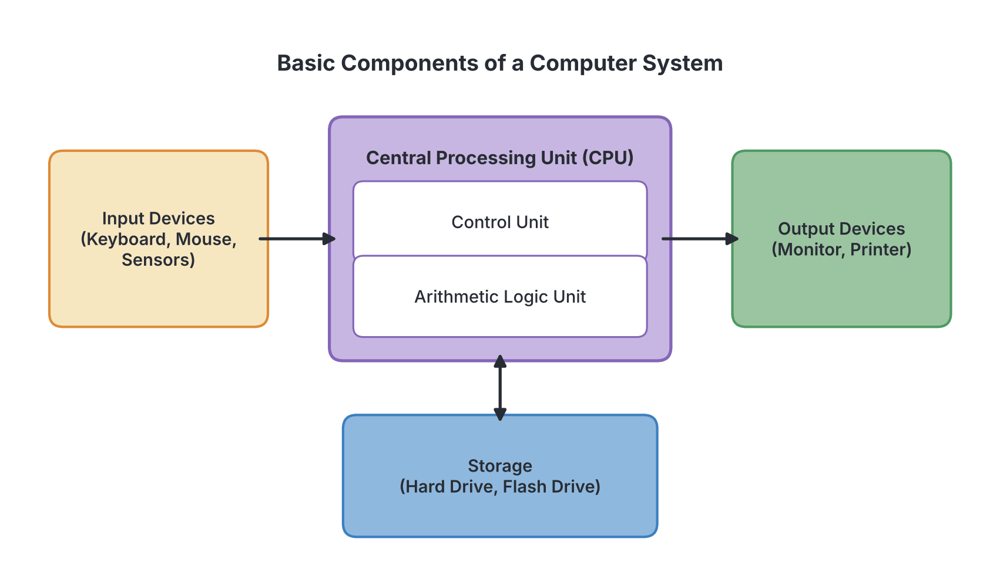
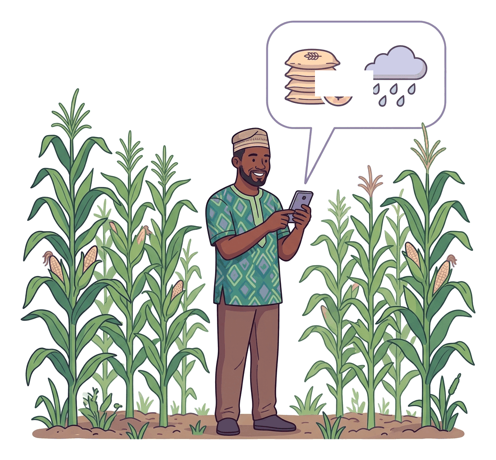

# JAMB Agricultural Science Notes: Application of ICT in Agriculture

## What JAMB expects

This topic is Section E, Topic 7 of the JAMB Agricultural Science syllabus: Application of ICT in agriculture.

It covers the following content items:
- a. Features of computers
- b. Uses of computers in agriculture: disease and weather forecasting, ration formulation, database and simulation studies, etc.
- c. Use of communication gadgets e.g. mobile phone, internet, etc.

By the end of these notes, you should be able to:
1. identify the various components of a computer.
2. use the computer to enhance agricultural practices.
3. use communication gadgets to improve agricultural production.

Information and Communication Technology (ICT) refers to the digital tools used to collect, process, store, and share information. In modern agriculture, farming has evolved from mere guesswork and traditional observation to precision farming driven by data. 

## Features of computers

**Content a: Features of computers.**

A **computer** is an electronic device capable of receiving raw data (input), processing it according to a set of instructions, storing it, and giving out the result (output). To understand why computers are so valuable on a modern farm, we must look at their core features:

1. **Speed:** Computers process millions of instructions per second. A task that would take a farm manager weeks to calculate manually—such as determining the exact nutrient mix for a 100,000-bird poultry farm—can be calculated by a computer in a fraction of a second.
2. **Accuracy:** Unlike humans, computers do not make arithmetic mistakes. Provided the data entered (input) and the program (instructions) are correct, the output will be 100% accurate. This is vital for tasks like financial accounting and calculating agrochemical dosages, where an error could kill crops.
3. **Storage capacity:** A single computer or internet server can store massive amounts of farm records. Decades of data regarding livestock pedigrees, daily milk yields, and rainfall patterns can be stored securely without taking up physical space like filing cabinets.
4. **Diligence (Endurance):** A computer does not suffer from fatigue, boredom, or loss of concentration. It can run a continuous simulation or monitor soil moisture sensors 24 hours a day, 7 days a week without rest.
5. **Versatility:** The same machine can perform highly diverse tasks. A farmer can use one computer to type a business plan, browse the internet for tractor parts, map out a farm using GPS, and play an instructional video on artificial insemination.
6. **Automation:** Once programmed, a computer can execute a series of tasks without human intervention, such as automatically turning on greenhouse sprinklers when the temperature rises above 30 °C.

## Identify the various components of a computer

**Objective: identify the various components of a computer.**

A computer system is divided into two broad categories: **Hardware** (the physical parts) and **Software** (the intangible programs). 

### 1. Hardware
Hardware refers to the physical components of the computer that you can see and touch. For agricultural applications, hardware is grouped into four main types:

| Component Type | Function | Examples in Agriculture |
| --- | --- | --- |
| **Input devices** | Used to feed data and instructions into the computer. | **Keyboard** (for typing records), **Mouse** (for clicking menus), **Scanner** (for digitizing paper land titles), **Sensors** (e.g., soil moisture, temperature, and GPS sensors on a tractor). |
| **Processing unit** | The "brain" that performs calculations and logical decisions. | The **Central Processing Unit (CPU)** located inside the system unit or motherboard. |
| **Output devices** | Used to display or present the processed information to the user. | **Monitor / Screen** (displays weather maps), **Printer** (prints out financial statements and invoices), **Actuators** (valves or motors controlled by the computer to release irrigation water). |
| **Storage devices** | Used to save data permanently so it is not lost when the power goes off. | **Hard Disk Drive (HDD)**, Solid State Drive (SSD), **USB flash drives**, memory cards (used in drones). |

### 2. Software
Software consists of the programs and codes that tell the hardware how to operate. It cannot be touched.
*   **System software:** The basic operating system that runs the machine (e.g., Microsoft Windows, macOS, Android).
*   **Application software:** Specific programs designed for particular tasks (e.g., Microsoft Excel for budgeting, or a specialized dairy management software like *DairyComp* to track milk yields).

## Uses of computers in agriculture

**Content b: Uses of computers in agriculture: disease and weather forecasting, ration formulation, database and simulation studies, etc.**

Computers are widely utilized across various branches of agriculture—from crop science to animal husbandry and farm economics. 

### Disease forecasting
Plant diseases, particularly fungal infections, depend heavily on specific environmental conditions (such as high humidity and optimal temperatures). Computers use mathematical models that combine current weather data with the life cycle of pathogens. 
*   **Example:** In the cocoa-producing regions of South-West Nigeria, high rainfall and humidity trigger Black Pod disease (caused by *Phytophthora*). A computer model can analyze humidity sensors and predict a high-risk period, warning the farmer to spray fungicides *before* the outbreak happens. 

### Weather forecasting
Because West African agriculture is largely rain-fed, weather forecasting is critical. Meteorologists use supercomputers to analyze satellite imagery, wind speeds, and atmospheric pressure. This allows farmers in the Sudan savanna to know exactly when the rains will establish, helping them decide the optimal planting date for drought-tolerant crops like millet and sorghum.

### Ration formulation
Livestock require a balanced diet (ration) containing the exact proportion of carbohydrates, proteins, fats, vitamins, and minerals. Doing this manually is mathematically exhausting. Farmers use computer software that employs linear programming to determine the **least-cost ration**. The software analyzes the nutritional content of available ingredients (like maize, groundnut cake, and bone meal) and their current market prices, then instantly formulates a recipe that meets all the animal's dietary needs at the cheapest possible price.

### Database management
A **database** is a large, organized collection of digital data that can be easily searched, updated, and managed. A commercial farm relies on databases to track its operations. 
*   **Livestock database:** Stores the ear tag number, date of birth, pedigree (parents), vaccination dates, and daily milk or egg production of every animal. 
*   **Crop database:** Stores historical yields per hectare, fertiliser application rates, and soil test results over the years. 

### Simulation studies
A simulation involves using a computer model to imitate a real-world system to observe how it behaves under various conditions over time. It allows researchers to ask "What if?" without spending years or risking real money.
*   **Example:** Researchers can simulate the effect of a 2 °C rise in temperature over the next 20 years on maize yields in Nigeria. By running the simulation, they can predict potential food shortages and begin breeding heat-tolerant maize varieties long before the crisis actually occurs.

## Use the computer to enhance agricultural practices

**Objective: use the computer to enhance agricultural practices.**

Farmers do not just own computers; they actively use them to transform traditional farming into **precision agriculture**. Here is how the computer is used to practically enhance farm operations:

1. **Precision application of inputs:** Modern tractors are equipped with onboard computers and GPS receivers. As the tractor moves, the computer uses satellite data to map the field and steers the tractor automatically to avoid overlapping. It adjusts the rate of fertiliser or herbicide application minute-by-minute based on a digital soil map, ensuring chemicals are only applied exactly where needed. This saves money and protects the environment.
2. **Data-driven breeding decisions:** By querying the farm’s livestock database, a farmer can immediately identify which cows consistently produce the highest milk yields and have the best health records. The computer highlights these superior animals, enhancing the farm's selective breeding program. Poor performers are marked for culling.
3. **Automated climate control:** In modern greenhouses or poultry brooding houses, computers continuously read data from temperature and humidity sensors. If the temperature in a poultry house rises to a dangerous level, the computer automatically switches on exhaust fans and cooling pads to protect the birds from heat stress, enhancing livestock survivability.
4. **Improved financial management:** Farm managers use spreadsheet software (like Excel) or accounting applications to track expenses (e.g., cost of seeds, labour, feed) and income. The computer quickly generates profit and loss statements and calculates gross margins, helping the farmer make better business decisions and easily apply for bank loans.

## Use of communication gadgets

**Content c: Use of communication gadgets e.g. mobile phone, internet, etc.**

Communication gadgets are electronic devices that allow information to be transmitted over distances. They bridge the gap between rural farmers, researchers, extension agents, and the market.

### Mobile phones
The mobile phone is the most revolutionary ICT tool in African agriculture because of its deep penetration into rural areas. 
*   **Basic feature phones:** Even without internet, farmers use Voice calls and SMS to communicate. They also use **USSD codes** (short codes starting with `*` and ending with `#`) to access agricultural services, check weather updates, or verify the authenticity of seeds.
*   **Smartphones:** Allow farmers to take photos of diseased plants, record videos, and use applications like WhatsApp to communicate with buyers and experts.
*   **Mobile Money:** Services (like PoS systems or mobile wallets) allow farmers in unbanked villages to receive payments instantly and securely.

### The Internet
The internet is a vast global network connecting millions of computers and devices. It provides access to limitless information. Farmers access the internet via smartphones, computers, or tablets.

### Radio and Television
While older than the internet, radio and television remain essential communication gadgets in agriculture, particularly for mass communication. They broadcast extension programs, weather warnings, and market trends in local languages (such as Hausa, Igbo, Yoruba, and Pidgin) to millions of farmers simultaneously.

## Use communication gadgets to improve agricultural production

**Objective: use communication gadgets to improve agricultural production.**

Communication gadgets change how farmers interact with the world, directly improving their productivity and profitability in several ways:

1. **Bypassing exploitative middlemen:** Traditionally, rural farmers were ignorant of urban market prices, allowing middlemen to buy their produce at unfairly low prices. Today, a farmer uses a mobile phone to call urban markets or checks prices via the internet. Knowing the true market price improves the farmer's bargaining power and profitability.
2. **Accessing e-Extension services:** Instead of waiting months for a physical visit from a scarce government extension agent, a farmer can use a smartphone to snap a picture of an unknown pest attacking their yam crop. By sending the photo via WhatsApp or an agricultural app to researchers at an institute (like IITA), the farmer receives immediate advice on which pesticide to use, preventing total crop loss.
3. **E-commerce and marketing:** Farmers use the internet to access social media platforms and agricultural websites to advertise their produce globally or nationally. They can form online cooperatives, pool their money to buy fertilisers in bulk at a discount, and secure contracts with food processing companies online.
4. **Acquiring modern skills:** Through the internet, farmers can watch instructional videos (e.g., on YouTube) demonstrating improved techniques, such as how to properly castrate a pig, install a drip irrigation system, or process cassava into high-quality garri. This improves their technical skills and overall production quality.
5. **Fast emergency alerts:** Radio broadcasts and SMS blasts are used by the government to quickly warn farmers about impending natural disasters (like flooding along the banks of the River Niger and Benue) or sudden pest outbreaks (like locusts or fall armyworms), allowing farmers to harvest early or apply preventive measures.

## Key terms

| Term | Meaning |
| --- | --- |
| ICT | Information and Communication Technology; digital tools used for processing and transmitting information. |
| Hardware | The physical, tangible components of a computer (e.g., CPU, monitor, keyboard). |
| Software | The intangible programs and instructions that operate a computer. |
| CPU | Central Processing Unit; the primary component of a computer that processes data and instructions. |
| Database | A structured digital collection of data, such as farm records, that can be easily accessed and managed. |
| Simulation | Using a computer model to replicate real-world scenarios to predict long-term outcomes. |
| Ration formulation | The process of combining various feed ingredients in specific proportions to meet animal nutritional needs, often calculated via software. |
| USSD | Unstructured Supplementary Service Data; mobile phone codes used for services without requiring an internet connection. |
| Precision agriculture | A farming management concept that uses computers, GPS, and sensors to ensure crops and soil receive exactly what they need. |

## Exam tips and common mistakes

*   **Features vs Components:** Be careful! Speed, accuracy, and versatility are *features* (characteristics). Monitor, keyboard, and CPU are *components* (hardware parts).
*   **Hardware categories:** Know which device does what. Keyboards and sensors are *input* devices; monitors and printers are *output* devices. The CPU does the *processing*.
*   **Forecasting vs Simulation:** Forecasting is predicting an upcoming event based on current data (e.g., tomorrow's weather or a disease outbreak next week). Simulation is creating a hypothetical "what if" model to study long-term effects (e.g., climate change over 10 years).
*   **The benefit of computerized ration formulation:** The main advantage of using software here is not just speed, but using mathematical models (linear programming) to create a balanced diet at the **lowest possible cost**.
*   **Mobile phones in extension:** Understand that mobile phones allow for real-time, two-way communication, fundamentally changing agricultural extension from a slow, physical visit process to a fast, remote service (e-extension).

## Quick summary

1. A computer is highly useful in agriculture due to its speed, absolute accuracy, diligence, versatility, and large storage capacity.
2. A computer system comprises hardware (physical input, output, processing, and storage devices) and software (the programs that run the hardware).
3. Computers are used for complex tasks like weather forecasting, predicting disease outbreaks, and managing massive databases of crop and livestock records.
4. Computer software formulates precise livestock rations, balancing nutrient requirements against ingredient prices to achieve the least cost.
5. Simulation studies use computer models to safely test long-term agricultural scenarios (like climate change impacts) without real-world risks.
6. Farmers use computers to enhance practices through precision agriculture—using GPS and sensors to apply fertilisers accurately and automate climate control in greenhouses.
7. Communication gadgets like mobile phones, the internet, and radios connect farmers with vital information.
8. Communication gadgets improve production by giving farmers real-time access to market prices, immediate e-extension advice, and e-commerce opportunities to bypass middlemen.

## Practice questions

**1. The "brain" of the computer, where data processing and logical calculations take place, is the:**
- A. Hard disk drive
- B. Monitor
- C. Central Processing Unit (CPU)
- D. Keyboard

**Answer: C.** The CPU handles all instructions, calculations, and processing, making it the brain of the computer. The hard disk is for storage, the monitor is for output, and the keyboard is for input.

**2. Which of the following is classified as a feature rather than a component of a computer?**
- A. Versatility
- B. Mouse
- C. Printer
- D. Software application

**Answer: A.** Versatility, speed, and accuracy are features (characteristics) of a computer. The mouse and printer are hardware components, and software is a program.

**3. The primary economic benefit of using computer software for livestock ration formulation is to:**
- A. increase the storage space of the computer.
- B. eliminate the need for water in the animal's diet.
- C. balance the nutrient requirements at the lowest possible cost.
- D. simulate a disease outbreak in the poultry house.

**Answer: C.** Ration formulation software uses linear programming to calculate the exact mix of ingredients that meets the nutritional needs of the animals while minimizing the financial cost to the farmer.

**4. A researcher uses a computer program to test how maize yields might change over the next 15 years if the average rainfall drops by 20%. This is an example of:**
- A. database management
- B. weather forecasting
- C. simulation studies
- D. precision agriculture

**Answer: C.** Creating hypothetical long-term scenarios to see how a system reacts without doing it in real life is a simulation study.

**5. Which of the following devices is strictly an output device used on a farm?**
- A. A soil moisture sensor
- B. A computer monitor
- C. A computer keyboard
- D. A computer mouse

**Answer: B.** The monitor displays processed information to the user, making it an output device. Sensors, keyboards, and mice are used to enter data into the computer (input devices).

**6. How do communication gadgets like mobile phones directly protect rural farmers from exploitative middlemen?**
- A. By physically transporting the goods to the city.
- B. By increasing the starch content of the crops.
- C. By allowing farmers to check real-time market prices before selling.
- D. By automatically irrigating the fields at night.

**Answer: C.** By knowing the actual selling price in urban markets via calls or SMS, farmers gain bargaining power and can refuse unfairly low offers from middlemen.

**7. A modern cattle ranch keeps digital records of the birth dates, pedigrees, and daily milk yields of 5,000 cows for easy searching. This application is best described as:**
- A. ration formulation
- B. disease forecasting
- C. a database
- D. word processing

**Answer: C.** A database is a structured collection of data (like livestock records) organized so it can be easily accessed, managed, and updated by a computer.

**8. If a farm computer analyzes current humidity and temperature to warn a cocoa farmer that conditions are ripe for Black Pod disease, the computer is being used for:**
- A. e-commerce
- B. disease forecasting
- C. database simulation
- D. ration formulation

**Answer: B.** Disease forecasting involves analyzing environmental data to predict the imminent outbreak of a disease, allowing the farmer to take preventive action (like spraying fungicide).

**9. Which of the following best describes how a computer enhances precision agriculture?**
- A. By replacing the need for tractors completely.
- B. By using GPS and sensors to apply fertiliser exactly where needed in a field.
- C. By changing the hardware into system software.
- D. By typing letters to agricultural extension agents.

**Answer: B.** Precision agriculture uses computer-guided systems (like GPS and sensors) to apply inputs (seed, water, fertiliser) with pin-point accuracy, saving money and boosting yield.

**10. A farmer using a basic mobile phone (without internet) can still access agricultural market prices and weather updates using:**
- A. USSD codes and SMS
- B. YouTube videos
- C. high-speed broadband
- D. simulation software

**Answer: A.** USSD codes and SMS text messages rely on basic cellular network signals, allowing farmers without internet access or smartphones to receive crucial information.
