# JAMB Biology Notes: Internal Structure of a Flowering Plant and of a Mammal

## What JAMB expects

This topic is Section B, Topic 1 of the JAMB Biology syllabus: Form and Functions – Internal structure of a flowering plant (and of a mammal). This file covers the whole topic. Its content items are:

- **Internal structure of a flowering plant:**
  - i. Root
  - ii. Stem
  - iii. Leaf
- **b. Internal structure of a mammal**

By the end of these notes, you should be able to:

1. Identify the transverse sections of the root, stem and leaf of a flowering plant.
2. Relate the structure of these organs to their functions.
3. Identify the supporting tissues in plants: collenchyma, sclerenchyma, xylem and phloem fibres.
4. Describe the distribution of supporting tissues in roots, stems and leaves.
5. Examine the arrangement of the internal organs of a mammal.
6. Describe the appearance and position of the digestive, reproductive and excretory organs of a mammal.

**Note on the syllabus wording:** the official syllabus numbers the plant content items i, ii and iii (root, stem, leaf), with no "a." in front of them, and then jumps to "b. Internal structure of a mammal". The plant items are clearly meant to be item "a". Objective iii also has an unmatched bracket: "identify supporting tissues in plants (collenchyma) sclerenchyma, xylem and phloem fibres)". It simply means the four supporting tissues collenchyma, sclerenchyma, xylem and phloem fibres.

**Note on overlap with Topic B6:** objectives iii and iv of this topic are repeated almost word for word in Section B, Topic 6 (Support and movement), objectives ii and iii. In this file the focus is on **recognising** the supporting tissues and **where they sit** in transverse sections. File `B6a` looks at them again from the point of view of support and movement. Both files explain them fully, so you can revise from either.

## Before you start: how to look at a transverse section

A **transverse section** (TS, or cross section) is a thin slice cut **across** an organ, at right angles to its length, like slicing a cucumber into rounds. A **longitudinal section** (LS) is cut **along** the length, like slicing a cucumber from end to end.

In the laboratory, a thin TS is cut with a sharp razor blade from a young root or stem (for example, from a seedling of cowpea, groundnut, sunflower or maize), placed in a drop of water on a slide, often stained, and looked at under a microscope. Common stains:

- **Iodine solution** stains starch grains blue-black (useful for the starch sheath and cortex).
- **Phloroglucinol with concentrated hydrochloric acid** stains **lignin** red or pink, so xylem and sclerenchyma show up clearly. (Concentrated acid is dangerous: your teacher handles it.)
- **Safranin** stains lignified walls red; it is often used with a green or blue counterstain for cellulose walls.

In exams you are usually shown a drawing or photograph of a section and asked to name it (root, stem or leaf; monocot or dicot) or a labelled part. The rest of this section teaches you how.

### The plant tissues you will meet

| Tissue | Living or dead | Structure | Main job |
| --- | --- | --- | --- |
| **Epidermis** | Living | One layer of tightly packed cells on the outside; in stems and leaves it is covered by a waxy **cuticle** | Protection; in leaves, gaseous exchange through **stomata**; in roots, absorption through **root hairs** |
| **Parenchyma** | Living | Thin-walled, roughly round cells with air spaces between them | Packing (filling) tissue; food storage; when full of water (turgid) it helps support soft parts; with chloroplasts it is called **chlorenchyma** and photosynthesises |
| **Collenchyma** | Living | Cells with walls thickened with extra **cellulose** (and pectin), mostly at the **corners** | Flexible support in young stems, petioles and leaf midribs |
| **Sclerenchyma** | Dead when mature | Cells with very thick walls of **lignin**, little or no space inside; long **fibres** or short **sclereids** (stone cells) | Strong, rigid support and protection |
| **Xylem** | Mostly dead | Vessels and tracheids (hollow, lignified tubes), xylem fibres and xylem parenchyma | Carries **water and mineral salts** upwards; supports the plant |
| **Phloem** | Living (except the fibres) | Sieve tubes, companion cells, phloem parenchyma and phloem fibres | Carries **manufactured food** (mainly sucrose) to all parts; the fibres give support |
| **Cambium** | Living | A thin layer of dividing (meristematic) cells between the xylem and phloem in dicots | Makes new xylem and phloem, so the stem or root grows thicker (**secondary growth**) |
| **Endodermis** | Living | The innermost layer of the cortex; in roots its cells have a **Casparian strip** | Controls the movement of water and salts into the vascular tissue (roots); stores starch (stems, where it is called the **starch sheath**) |
| **Pericycle** | Living (may include fibres) | One or more layers just inside the endodermis | In roots, gives rise to **lateral roots** and (in dicots) helps form cambium; in some stems it forms fibre caps for support |

A **vascular bundle** is a strand containing xylem and phloem (and, in dicot stems, cambium). The central part of a root or stem containing the vascular tissue is called the **stele** (or vascular cylinder).

### Monocots and dicots

Flowering plants are divided into two big groups (see Topic A2b):

- **Monocotyledons (monocots)** have one seed leaf (cotyledon). Examples: maize, rice, guinea corn (sorghum), millet, sugarcane, onion, oil palm, coconut palm, banana, plantain, yam and grasses.
- **Dicotyledons (dicots)** have two seed leaves. Examples: cowpea, groundnut, sunflower, *Amaranthus* (green, "tete"), mango, orange, hibiscus, cotton, pawpaw, cassava and okra.

Their roots, stems and leaves are built differently on the inside, and JAMB expects you to tell them apart.

**Textbook variation:** modern botanists no longer treat all "dicots" as one natural group (most of them are now called **eudicots**). Secondary school textbooks and JAMB still use the simple monocot and dicot division, so use it in the exam.

## Identifying the transverse sections of the root, stem and leaf

**Objective i: identify the transverse sections of these organs.**

The three organs have the same basic tissue systems:

1. a **dermal** (covering) tissue system: the epidermis;
2. a **ground** tissue system: cortex, pith and mesophyll (mainly parenchyma, with collenchyma and sclerenchyma);
3. a **vascular** tissue system: xylem and phloem.

What changes from organ to organ is how these tissues are **arranged**. The sections below take each organ in turn.

## The root

### The dicotyledonous root (e.g. cowpea, groundnut, bean or sunflower)

A TS of a young dicot root, taken a little above the root-hair zone, shows these regions from the outside inwards.

1. **Piliferous layer (epiblema or root epidermis).** A single layer of thin-walled cells with **no cuticle** and **no stomata**. Many of its cells grow out into long, thin, tube-like **root hairs**. ("Piliferous" means "hair-bearing".) Root hairs greatly increase the surface area for **absorbing water and mineral salts**.
2. **Cortex.** A wide zone of large, thin-walled, rounded **parenchyma** cells with many **intercellular air spaces**. The cells often store **starch**. Water passes across the cortex from the root hairs to the centre. The air spaces let oxygen reach the cells for respiration.
3. **Endodermis.** The innermost layer of the cortex: a single ring of closely packed, barrel-shaped cells. Each cell has a band of waterproof material (**suberin**, with some lignin) running round its side walls, called the **Casparian strip**. The strip blocks the path between the cells, so water and dissolved salts must pass **through** the living endodermal cells. This lets the root **control** which salts enter the xylem. In older roots most endodermal cells become thickly walled, but some thin-walled **passage cells**, usually opposite the xylem arms, still let water through.
4. **Pericycle.** One (sometimes more) layer of thin-walled cells just inside the endodermis. **Lateral (branch) roots** start here, and in dicots it also helps form the cambium for secondary growth.
5. **Vascular tissue (stele).** In the centre:
   - **Xylem** forms a solid **star** or cross shape in the middle, with usually **2 to 6 arms** (often **4**, a "tetrarch" root). The smallest, first-formed xylem (**protoxylem**) is at the **tips of the arms**, towards the outside, and the larger, later xylem (**metaxylem**) is towards the centre. This arrangement is called **exarch**.
   - **Phloem** forms separate patches **between** the arms of the xylem, not on the same radius. Xylem and phloem on different radii is called a **radial** arrangement.
   - **Conjunctive tissue:** parenchyma lying between the xylem and the phloem. In secondary growth, a cambium develops from it.
6. **Pith.** Usually **absent** or very small, because the xylem fills the centre.

**Why is the xylem in the centre of a root?** The root is pulled on by the shoot above as the plant sways in the wind. A strong central core, like the steel core of a cable, best resists **pulling** forces (tension). It also leaves the soft cortex free for water to pass across from the root hairs.

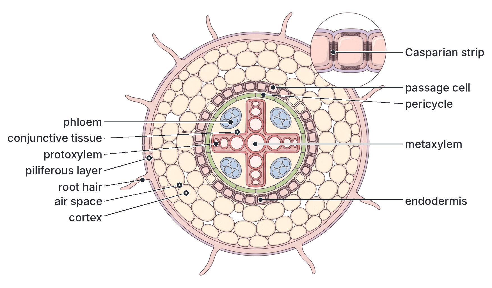

### The monocotyledonous root (e.g. maize)

A TS of a young maize root shows the same main regions, but with some clear differences.

1. **Piliferous layer** with root hairs, as in the dicot root.
2. **Cortex** of parenchyma with air spaces. In many monocot roots (including maize) the outer few layers of the cortex become thick-walled, forming an **exodermis** that protects the root after the root hairs die.
3. **Endodermis** with a Casparian strip. In older monocot roots, the inner and side walls of most endodermal cells become very thick (often seen as a **U-shape** in section), with thin-walled passage cells opposite the protoxylem.
4. **Pericycle**: a ring of cells inside the endodermis; lateral roots arise from it.
5. **Vascular tissue:** **many** separate groups of xylem and phloem arranged **alternately in a ring** (radial and exarch, as in the dicot root). Monocot roots usually have **more than six** xylem groups (this is called **polyarch**); a maize root may have many more.
6. **Pith:** a **large central pith** of parenchyma, in the middle of the ring of vascular tissue.
7. **No cambium** develops, so monocot roots do not grow thicker by secondary growth.

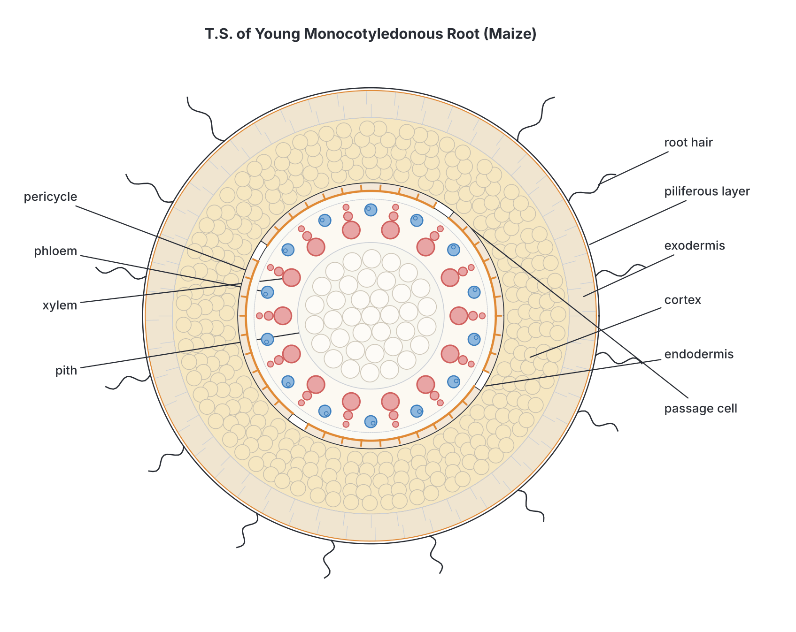

### Dicot root and monocot root compared

| Feature | Dicot root (e.g. cowpea) | Monocot root (e.g. maize) |
| --- | --- | --- |
| Number of xylem groups (arms) | **Few**, usually **2 to 6** (often 4) | **Many**, usually **more than 6** (polyarch) |
| Shape of xylem | A solid **star** or cross in the centre | Separate groups in a **ring** |
| Pith | **Absent** or very small | **Large** and well developed |
| Cambium and secondary growth | Cambium forms later from conjunctive tissue and pericycle; the root can **thicken** | **No** cambium; **no** secondary growth |
| Exodermis | Usually absent | Often present |
| Endodermis in older roots | Casparian strip; walls less heavily thickened | Heavy, often U-shaped wall thickening with clear passage cells |
| Similarities | Both have a piliferous layer with root hairs, a parenchyma cortex, an endodermis with a Casparian strip, a pericycle, and a **radial**, **exarch** arrangement of xylem and phloem |

**Textbook variation:** textbooks give slightly different numbers for the "few" and "many" xylem groups. Most say dicot roots have 2 to 6 and monocot roots more than 6, but some dicot roots have up to 8 and some monocot roots fewer. For the exam: **star-shaped xylem with no pith = dicot root; ring of many xylem groups round a large pith = monocot root.**

## The stem

### The dicotyledonous stem (e.g. sunflower)

The young stem of the sunflower (*Helianthus*) is the classic textbook example. Young stems of *Amaranthus*, cowpea or *Tridax* look similar. A TS shows these regions from the outside inwards.

1. **Epidermis.** A single layer of tightly fitting cells covered with a waxy **cuticle**, which reduces water loss and keeps out germs. It may carry **multicellular hairs** and a few **stomata**.
2. **Cortex**, made of three parts:
   - **Hypodermis:** a few layers of **collenchyma** just under the epidermis. Its cells have thickened corners and give **flexible support**, so the young stem bends in the wind without breaking.
   - **General cortex:** several layers of thin-walled **parenchyma** with air spaces. The outer cells often contain chloroplasts (chlorenchyma), which is why young stems are green.
   - **Endodermis:** the innermost layer of the cortex, a wavy ring of cells containing many starch grains. In stems it is often called the **starch sheath**, because it stains blue-black with iodine.
3. **Pericycle.** Just inside the endodermis. In the sunflower it consists of patches of **sclerenchyma fibres** lying outside each vascular bundle (called **bundle caps** or "hard bast"), with parenchyma between the patches.
4. **Vascular bundles.** Arranged in a **single ring** near the outside of the stem. Each bundle is:
   - **conjoint:** xylem and phloem are together in the same bundle, on the **same radius**;
   - **collateral:** phloem lies **outside** (towards the epidermis) and xylem **inside** (towards the centre);
   - **open:** a strip of **cambium** lies between the xylem and phloem, so the bundle can make new tissue later;
   - **endarch:** the small, first-formed protoxylem is towards the **centre** of the stem and the larger metaxylem towards the outside (the opposite of the root).
5. **Medullary rays (pith rays).** Strips of parenchyma running between the vascular bundles, linking the pith with the cortex. They carry food and water sideways and store food.
6. **Pith (medulla).** A large central region of big, thin-walled parenchyma cells with air spaces. It stores food and water. In some older stems the pith breaks down, leaving the stem hollow.

**Secondary growth (in brief).** In woody dicots (e.g. mango, iroko, mahogany), the cambium inside the bundles joins with new cambium formed in the medullary rays to make a complete ring. This cambium ring makes new xylem towards the inside and new phloem towards the outside every year, so the stem becomes thick and woody. The mass of secondary xylem is **wood**. A layer of **cork** forms outside to replace the epidermis as **bark**.

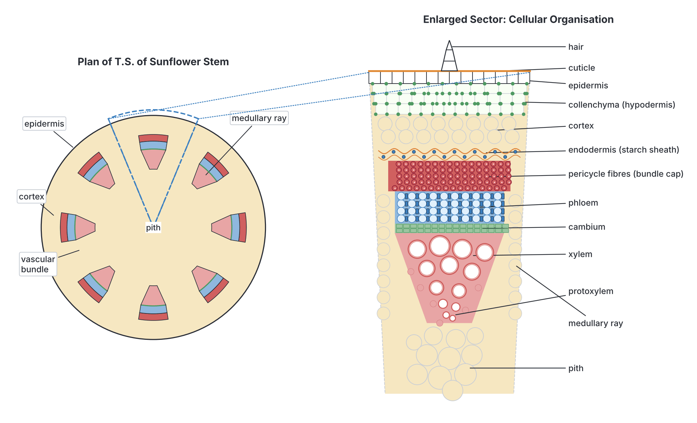

### The monocotyledonous stem (e.g. maize)

Maize, guinea corn, sugarcane and grasses are good examples. A TS of a young maize stem looks very different from a sunflower stem.

1. **Epidermis** with a thick **cuticle**.
2. **Hypodermis:** two or three layers of thick-walled **sclerenchyma** just under the epidermis, forming a hard outer band. (Monocot stems usually have no collenchyma.)
3. **Ground tissue:** the rest of the stem is filled with thin-walled **parenchyma**. There is **no clear cortex, endodermis, pericycle or pith**, and no medullary rays, because the bundles are not in a ring.
4. **Vascular bundles:** **many**, **scattered** throughout the ground tissue. They are **smaller and more crowded near the outside** and **larger and more widely spaced towards the centre**. Each bundle is:
   - **conjoint** and **collateral** (phloem towards the outside, xylem towards the inside), as in the dicot stem;
   - **closed:** there is **no cambium** between xylem and phloem, so there is no secondary growth;
   - surrounded by a **bundle sheath** of sclerenchyma fibres, which makes each bundle a strong rod.
5. **Inside each bundle:** the xylem forms a **Y** or **V** shape: two large **metaxylem vessels** form the "arms", and one or two small protoxylem vessels form the "stem" of the Y, pointing towards the centre of the stem. Below the protoxylem is a large air space, the **protoxylem lacuna** (also called the water cavity), formed when the first protoxylem cells are torn as the stem grows. The phloem, above the xylem, contains sieve tubes and companion cells but **no phloem parenchyma**. Many students say the bundle looks like a **monkey's or human face**: the two large vessels are the "eyes", the lacuna is the "mouth" and the phloem is the "forehead".

**Note:** some monocots, such as the oil palm and other palms, become very thick and tall without true secondary growth. They do this mainly by many bundles and thickening of the primary tissues, not by a cambium ring. A few monocots (e.g. *Dracaena*, often planted in Nigeria as hedges and boundary markers) have an unusual kind of secondary growth.

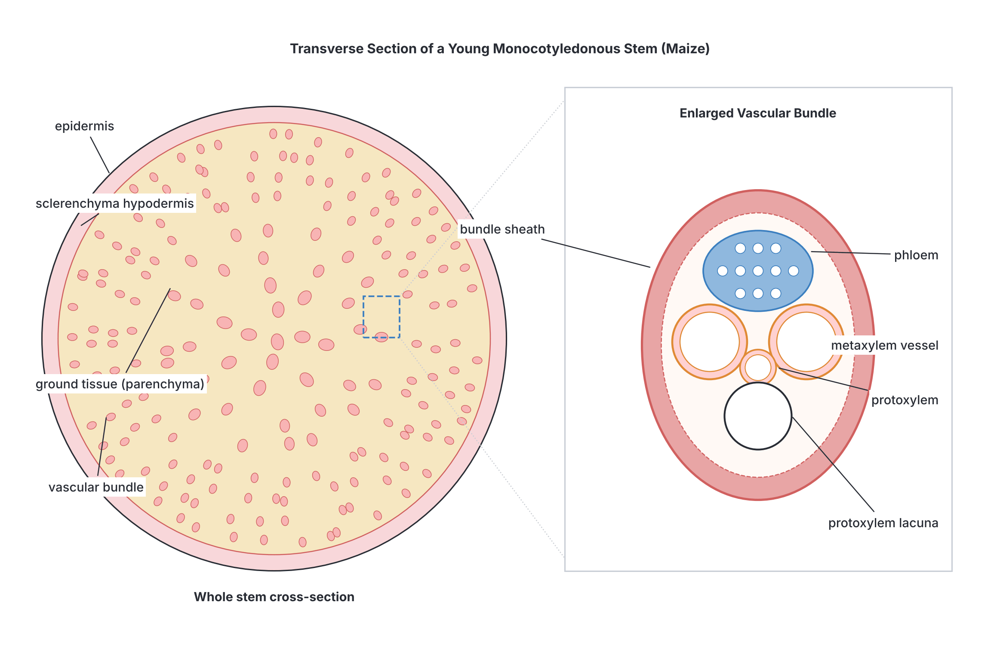

### Dicot stem and monocot stem compared

| Feature | Dicot stem (e.g. sunflower) | Monocot stem (e.g. maize) |
| --- | --- | --- |
| Arrangement of vascular bundles | In a **single ring** near the outside | **Scattered** all over the ground tissue |
| Number and size of bundles | Few, roughly the same size | Many; small near the edge, large towards the centre |
| Cambium in bundles | **Present** (bundles are **open**) | **Absent** (bundles are **closed**) |
| Secondary growth | Possible; the stem can become woody | Usually none |
| Hypodermis | **Collenchyma** | **Sclerenchyma** |
| Cortex, endodermis, pericycle | Distinct | Not distinct (ground tissue only) |
| Pith | Large and distinct | Not distinct |
| Medullary rays | Present | Absent |
| Bundle sheath | Absent (a sclerenchyma cap on the outer side only) | A complete **sclerenchyma sheath** around each bundle |
| Shape of xylem | Rows of vessels in a wedge | **Y** or **V** shape, with a **protoxylem lacuna** |
| Phloem parenchyma | Present | Absent |
| Similarities | Both have an epidermis with cuticle; both have **conjoint, collateral, endarch** bundles; both carry water in xylem and food in phloem |

### The root and the stem compared

JAMB often asks how to tell a root section from a stem section.

| Feature | Root | Stem |
| --- | --- | --- |
| Outer layer | **Piliferous layer** with **root hairs**; no cuticle; no stomata | **Epidermis** with **cuticle**; may have multicellular hairs and stomata |
| Arrangement of xylem and phloem | **Radial**: on **different** radii, alternating | **Conjoint**: on the **same** radius, in the same bundle |
| Position of protoxylem | **Exarch** (towards the outside) | **Endarch** (towards the centre) |
| Position of vascular tissue | **Central** (a core) | Near the **outside** in dicots (a ring); scattered in monocots |
| Endodermis | Very distinct, with a **Casparian strip** | Less distinct; acts as a **starch sheath** |
| Pericycle | Produces **lateral roots** | Lateral branches do **not** come from it (they come from buds); may form fibre caps |
| Chlorophyll | Absent (no light underground) | Often present in the outer cortex of young stems |
| Collenchyma | Usually absent | Present in dicot stems |

## The leaf

### The dicotyledonous leaf (e.g. hibiscus, mango, cowpea or *Amaranthus*)

A leaf is thin and flat. A TS is cut across the blade (lamina), often through the **midrib**. Because the upper and lower surfaces are built differently, a dicot leaf is called **dorsiventral** (or bifacial). From the top surface downwards, the section shows:

1. **Cuticle:** a thin, waxy, waterproof layer made by the epidermis. It is usually **thicker on the upper surface**, which faces the sun. It reduces water loss and keeps out germs.
2. **Upper epidermis:** a single layer of flat, transparent, tightly packed cells with **no chloroplasts**. Light passes through easily. There are **few or no stomata** on the upper surface of most dicot leaves.
3. **Palisade mesophyll** ("mesophyll" means "middle of the leaf"): one or two layers of long, column-shaped cells standing upright and packed closely together, like fence posts (palisade). They contain the **most chloroplasts** in the leaf and are the **main site of photosynthesis**.
4. **Spongy mesophyll:** irregular, rounded cells, loosely packed with large **air spaces** between them. They contain fewer chloroplasts. The air spaces are connected to the stomata and let carbon (IV) oxide (CO₂), oxygen and water vapour diffuse through the leaf.
5. **Vascular bundles (veins):** found in the spongy layer, and a large one in the **midrib**. In each bundle, **xylem is on the upper side** and **phloem on the lower side**. Each small vein is surrounded by a **bundle sheath** of parenchyma cells. The veins form a **network** (reticulate venation) in dicot leaves.
6. **Lower epidermis:** a single layer of cells with a thinner cuticle and **many stomata**.
7. **Stomata (singular: stoma):** tiny pores, each between two bean-shaped (kidney-shaped) **guard cells**. Guard cells are the only epidermal cells with **chloroplasts**. They open the pore (usually in the light) to let CO₂ in for photosynthesis and close it (in the dark or when water is short) to save water. Behind each stoma is a large air space called the **substomatal air chamber**.
8. **The midrib:** the thick central vein. Above and below its vascular bundle, just inside the epidermis, there are patches of **collenchyma** that support the midrib. The rest of the midrib is parenchyma.

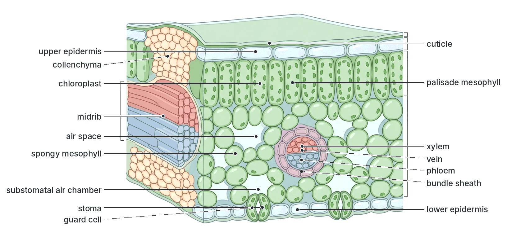

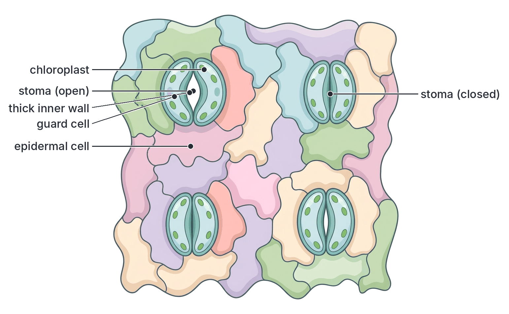

### A note on the monocot leaf

The syllabus content focuses on the dicot leaf, but it helps to know how a monocot leaf (e.g. maize or a grass) differs, so you can recognise it.

| Feature | Dicot leaf (e.g. hibiscus) | Monocot leaf (e.g. maize) |
| --- | --- | --- |
| Type | **Dorsiventral**: upper and lower surfaces differ | Usually **isobilateral**: both surfaces alike (the leaf is held more upright) |
| Mesophyll | Divided into **palisade** and **spongy** layers | Usually **not** divided into palisade and spongy |
| Stomata | Mostly on the **lower** surface | On **both** surfaces in roughly equal numbers |
| Shape of guard cells | Bean-shaped (kidney-shaped) | Dumb-bell shaped (in grasses) |
| Venation | **Network** (reticulate) | **Parallel** veins |
| Bulliform (motor) cells | Absent | Large, thin-walled cells in the upper epidermis of many grasses, which help the leaf roll up in dry weather |
| Sclerenchyma | Little | Often strands of sclerenchyma above and below the larger veins |

**Note:** maize, sugarcane and guinea corn are **C₄ plants**: their veins are surrounded by a ring of large bundle sheath cells with chloroplasts, and the mesophyll cells form a ring around them (called **Kranz anatomy**, from the German word for "wreath"). This lets them photosynthesise efficiently in the hot Nigerian sun. You do not need the details for JAMB.

### The leaf compared with the root and stem

| Feature | Root | Stem | Leaf |
| --- | --- | --- | --- |
| Outer covering | Piliferous layer with root hairs, no cuticle | Epidermis with cuticle | Upper and lower epidermis with cuticle |
| Stomata | None | Few | Many (mostly in the lower epidermis of dicots) |
| Chloroplasts | None | Some in the outer cortex | Many, mostly in the palisade |
| Main ground tissue | Cortex | Cortex and pith (dicot); ground tissue (monocot) | Mesophyll (palisade and spongy) |
| Xylem and phloem | Radial; xylem central | Conjoint; xylem inside, phloem outside | Conjoint; xylem **upper**, phloem **lower** |
| Shape of section | Circular | Circular (sometimes ridged or square, e.g. in many mint-family plants) | Thin and flat, often with a thicker midrib |

**How to identify a section quickly:**

1. **Thin and flat, with palisade cells and stomata?** → leaf.
2. **Round, with root hairs and xylem in the centre (star-shaped or in a ring alternating with phloem)?** → root. Star with no pith = dicot root; many groups round a big pith = monocot root.
3. **Round, with cuticle and bundles containing both xylem and phloem?** → stem. Bundles in a ring = dicot stem; scattered bundles with "faces" = monocot stem.

## Relating structure to function

**Objective ii: relate the structure of these organs to their functions.**

### The root

**Functions:** anchoring the plant; absorbing water and mineral salts; carrying them to the stem; storing food (in some roots); making some plant hormones.

| Structure | How it suits the function |
| --- | --- |
| **Root hairs** on the piliferous layer | Long, thin outgrowths that greatly **increase the surface area** for absorbing water (by osmosis) and mineral salts (by diffusion and active transport). They grow between soil particles and are in close contact with the soil water |
| **Thin walls, no cuticle** in the piliferous layer | Water can enter easily; a cuticle would block it |
| **Cortex** of parenchyma with air spaces | Water passes across it easily; air spaces supply **oxygen** for respiration (needed for active uptake of salts); the cells **store food** (e.g. starch in cassava and sweet potato roots, which are swollen mostly with storage parenchyma) |
| **Endodermis** with **Casparian strip** | Forces water and salts to pass through the living endodermal cells, so the plant **controls** what enters the xylem; it also helps build up **root pressure** by stopping water leaking back out |
| **Pericycle** | Produces **lateral roots**, which spread through the soil and increase absorption and anchorage |
| **Central xylem** with lignified walls | Carries water and salts **up** to the stem; a strong central core resists the **pull** of the shoot (like a cable) and helps **anchor** the plant |
| **Phloem** | Brings food (sugar) down from the leaves for the root cells to respire, grow and store |
| **Cambium** (dicots) | Allows the root to grow thicker and stronger as the tree grows |

### The stem

**Functions:** holding up the leaves to the light and the flowers for pollination; carrying water and salts up and food up and down; storing food and water; in green stems, photosynthesis.

| Structure | How it suits the function |
| --- | --- |
| **Epidermis with cuticle** | Protects the inner tissues; the waxy cuticle **reduces water loss** and keeps out germs |
| **Collenchyma** hypodermis (dicots) | Gives **flexible** support to the young stem, so it bends in the wind without snapping |
| **Sclerenchyma** hypodermis and bundle sheaths (monocots) | Gives **rigid** strength to tall, thin stems like maize and sugarcane |
| **Chlorenchyma** in the outer cortex | Carries out some **photosynthesis** in young green stems |
| **Starch sheath** (endodermis) | Stores starch; some textbooks also link it to the response of the stem to gravity |
| **Vascular bundles in a ring** near the outside (dicots) | The strong xylem and fibres sit near the edge, which best resists **bending** (like the steel rods placed near the edges of a concrete beam); the ring also makes transport easy to all parts |
| **Xylem** (vessels and tracheids) | Long, hollow, lignified tubes with no cross walls (vessels) carry **water and mineral salts** up to the leaves; their lignin also **supports** the stem |
| **Phloem** (sieve tubes and companion cells) | Carries **food** (mainly sucrose) from the leaves to growing points and storage organs (e.g. yam tubers, which are stems) |
| **Cambium** (dicots) | Produces new xylem and phloem each year, so the stem becomes thicker and stronger (secondary growth) |
| **Medullary rays** | Carry water and food **sideways** between pith, vascular tissue and cortex |
| **Pith** | Stores food and water |

### The leaf

**Functions:** photosynthesis (making food); gaseous exchange; transpiration (water loss, which pulls water up the plant and cools the leaf); in some plants, storage (e.g. onion scale leaves) or protection (e.g. cactus spines).

| Structure | How it suits the function |
| --- | --- |
| **Broad, flat, thin lamina** | A large surface area to **trap light**; thin, so CO₂ has a short distance to diffuse to every cell |
| **Waxy cuticle**, thicker on the upper surface | Reduces water loss from the surface most exposed to the sun; it is transparent, so light passes through |
| **Transparent upper epidermis** with no chloroplasts | Lets light pass straight through to the palisade cells |
| **Palisade cells**: tall, closely packed, just under the upper surface, full of chloroplasts | Many chloroplasts are packed into the region that gets the **most light**; the chloroplasts can move inside the cells towards or away from light; the column shape means light passes through fewer cross walls |
| **Spongy mesophyll** with large air spaces | Lets gases **diffuse** quickly between the stomata and all the mesophyll cells; the moist cell surfaces give a large area for CO₂ to dissolve and enter |
| **Stomata** with guard cells, mainly in the lower epidermis | Let CO₂ in and O₂ and water vapour out; guard cells **open and close** the pore to balance photosynthesis against water loss; being on the shaded lower surface reduces water loss |
| **Network of veins** | **Xylem** brings water and mineral salts close to every cell (water is a raw material for photosynthesis); **phloem** carries away the sugar made; the veins also support the blade like the ribs of an umbrella |
| **Collenchyma** in the midrib | Supports the midrib and keeps the blade spread out to catch light |
| **Petiole** (leaf stalk) | Holds the blade at an angle to the light; the leaves of many plants are arranged so they do not shade each other (leaf mosaic) |

**Textbook variation:** older textbooks say stomata are found "only" on the lower surface of dicot leaves. In fact, many dicot leaves have some stomata on the upper surface too, just far fewer. Floating leaves, such as those of the water lily, have stomata only on the upper surface, since the lower surface is in the water.

## Supporting tissues in plants

**Objective iii: identify supporting tissues in plants (collenchyma, sclerenchyma, xylem and phloem fibres).**

### Why plants need support

Plants have no skeleton. Support is needed to:

1. hold the stem upright and the leaves spread out to receive **light** for photosynthesis;
2. hold flowers up where **pollinators** (insects, birds, wind) can reach them, and fruits where they can be **dispersed**;
3. resist the forces of **wind** and **rain**, and the **weight** of the plant itself;
4. keep the **transport tubes** (xylem and phloem) open.

Plants get support from two sources:

- **Turgidity:** when parenchyma cells are full of water, they press against their cell walls and against each other, making soft stems and leaves firm. Young seedlings, leafy vegetables like *Amaranthus* and water leaf (*Talinum*), and herbs depend mainly on this. When they lose water they **wilt**.
- **Special strengthening tissues** with thickened cell walls: **collenchyma**, **sclerenchyma**, **xylem** and **phloem fibres**. These are the tissues named in the syllabus.

### Collenchyma

- **What it is:** a **living** tissue made of elongated cells whose walls are unevenly thickened with extra **cellulose** and pectin, mainly at the **corners** where cells meet. The walls are **not lignified**.
- **How to recognise it in a section:** cells just under the epidermis, with bright, thick, shiny corners and thinner walls between them. The cells have living contents and sometimes chloroplasts.
- **Properties:** strong but **flexible** and **elastic**. Because the cells are alive, they can still **grow and stretch**, so collenchyma suits young, growing parts.
- **Where found:** in the **hypodermis** of young **dicot stems** (often as a continuous ring or as patches in the ridges of angled stems), in **petioles** (leaf stalks) and in the **midribs** of leaves. It is usually **absent from roots** and from most **monocots**.
- **Example you know:** the "strings" in a stick of celery (the leaf stalk) are mostly collenchyma with vascular strands.

### Sclerenchyma

- **What it is:** a **dead** tissue at maturity. The cell walls are very thick and impregnated with **lignin**, a hard, waterproof substance. When the wall is complete, the living contents die, leaving a small or no space (lumen) inside. The walls have small **pits** (thin areas).
- **Two types:**
  - **Fibres:** very **long**, narrow cells with **pointed (tapering) ends** that overlap each other, forming strong strands. They give great strength against **pulling and bending**.
  - **Sclereids (stone cells):** short, roughly round or irregular cells with extremely thick walls. They make tissues **hard**. They form the **gritty** texture in guava and pear fruits, and much of the hard shells of **coconut**, **palm kernel** and other nuts and seed coats.
- **Properties:** very **strong** and **rigid**, but cannot stretch or grow, so it is found in parts that have **stopped growing**.
- **Where found:** in the **hypodermis** of **monocot stems** (e.g. maize, sugarcane); as **bundle sheaths** round monocot vascular bundles; as **bundle caps** (pericycle fibres) over the vascular bundles of dicot stems such as sunflower; in the xylem and phloem as fibres; in leaves of plants like sisal; in seed coats and fruit walls.
- **Economic importance:** plant fibres used to make rope, sacks, mats and cloth are mostly sclerenchyma: for example **kenaf** (grown in parts of Nigeria) and **jute** (phloem fibres; jute belongs to the same genus, *Corchorus*, as the ewedu vegetable), **sisal** (leaf fibres), **coir** from coconut husk, and **cotton** (which is actually a seed hair, not sclerenchyma).

### Xylem

- **What it is:** a complex tissue made of four kinds of cells:
  1. **Vessels:** long tubes made of many cells joined end to end, whose **cross walls have broken down**. The cells are **dead** and empty, with **lignified** walls. They are the main water-carrying cells in flowering plants.
  2. **Tracheids:** single, long, dead cells with tapering ends and lignified walls with pits. They carry water and give support (in ferns and conifers, they are the only water-carrying cells).
  3. **Xylem fibres:** sclerenchyma fibres found among the vessels; they give **extra strength** but do not carry water.
  4. **Xylem parenchyma:** living cells that store food.
- **Patterns of lignin thickening:** the lignin is laid down inside the walls of vessels and tracheids in different patterns: **annular** (rings), **spiral** (a coil), **scalariform** (ladder-like bars), **reticulate** (a net) and **pitted** (almost complete, with small pits). Rings and spirals are found in the first-formed **protoxylem**, which can still stretch as the organ grows; the heavier patterns are found in the later **metaxylem**.
- **Support:** because their walls are lignified, xylem vessels, tracheids and fibres act as strong rods. In trees, the **wood** (secondary xylem) is the main supporting tissue: it holds up trees such as iroko, mahogany and obeche that can grow more than 30 m tall.

### Phloem fibres

- **What they are:** **sclerenchyma fibres** found in the **phloem**. They are also called **bast fibres**. They are long, dead, lignified cells, like other sclerenchyma fibres.
- **The rest of the phloem** (sieve tubes, companion cells and phloem parenchyma) is living and thin-walled. It carries food, and gives little support. Only the **fibres** are supporting cells.
- **Where found:** in the outer part of the phloem of dicot stems, often forming a cap on the outer side of each bundle; in secondary phloem (inner bark) of woody stems.
- **Uses:** phloem fibres from the stems of kenaf, jute, flax and hemp are made into rope, sacks, linen and paper.

**Textbook variation:** in the sunflower stem, the cap of fibres outside each bundle is described in some textbooks as **pericycle fibres** (part of the pericycle) and in others as **phloem fibres** or "hard bast". Modern books say these caps in many dicots arise from the outer phloem (and so call them primary phloem fibres). Either name is accepted in most school exams; know that they are sclerenchyma fibres giving support.

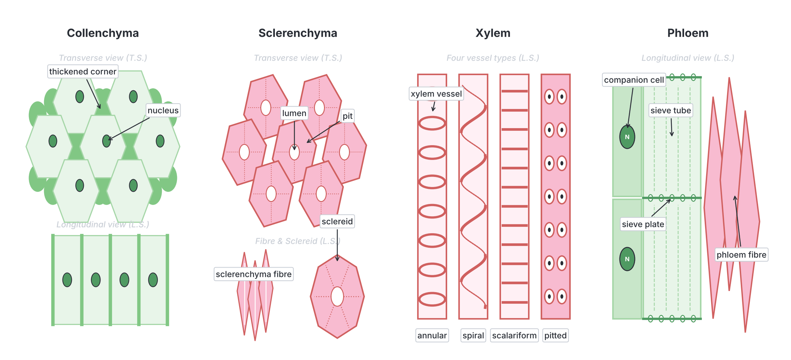

### The supporting tissues compared

| Feature | Collenchyma | Sclerenchyma | Xylem (vessels and tracheids) | Phloem fibres |
| --- | --- | --- | --- | --- |
| Living or dead | **Living** | **Dead** | **Dead** | **Dead** |
| Wall material | **Cellulose** (and pectin), not lignified | **Lignin** | **Lignin** | **Lignin** |
| Pattern of thickening | Uneven, mainly at the **corners** | Even and very thick all round | Rings, spirals, ladders, nets or pits | Even and very thick all round |
| Shape of cells | Elongated, polygonal in section | Long fibres or short sclereids | Long tubes (vessels) or long single cells (tracheids) | Long, narrow, with pointed ends |
| Kind of support | **Flexible**, can stretch | **Rigid**, very strong | Rigid; also carries water | Rigid; strong against pulling |
| Other function | Can photosynthesise if it has chloroplasts | Protection (e.g. hard shells) | **Water and mineral transport** | None (the rest of phloem carries food) |
| Main location | Under the epidermis of young dicot stems, petioles, midribs | Monocot hypodermis, bundle sheaths, bundle caps, seed coats | Vascular bundles of all organs; wood | Outer part of the phloem; inner bark |

## Distribution of supporting tissues in the root, stem and leaf

**Objective iv: describe the distribution of supporting tissues in roots, stem and leaf.**

The supporting tissues are placed where they best resist the forces acting on each organ. This follows simple engineering ideas.

### In the root

- **Force on the root:** mainly **pulling (tension)**, as the shoot sways in the wind and tugs on the root; also pressure from the soil all round.
- **Distribution:** the main supporting tissue is the **xylem**, which forms a solid **central core** (the star in dicots, the ring of xylem groups in monocots). A central core is the best way to resist pulling, just as a rope or a steel cable has its strength in the middle.
- The **endodermis** (with thickened walls in older roots) and, in monocots, the thick-walled **exodermis** add a little strength.
- In older dicot roots, **secondary xylem** (wood) forms a solid central cylinder, making the root very strong (as in the big roots of mango or iroko trees).
- **Collenchyma** is usually **absent** from roots, and there is little sclerenchyma, because the soil itself supports the root from all sides.

### In the stem

- **Forces on the stem:** mainly **bending** (from wind and the weight of the leaves and fruits) and **compression** (from the weight of the shoot above).
- **Distribution in a young dicot stem (e.g. sunflower):** the supporting tissues are arranged towards the **outside**, as a hollow cylinder:
  - **collenchyma** in the **hypodermis**, just under the epidermis;
  - **sclerenchyma fibres** forming **caps** outside each vascular bundle (pericycle or phloem fibres);
  - **xylem** vessels and fibres in the **ring** of vascular bundles.
- **In an old woody dicot stem:** the **wood** (secondary xylem) forms a large solid cylinder that supports the whole tree, with phloem fibres in the bark.
- **Distribution in a monocot stem (e.g. maize):**
  - a band of **sclerenchyma** in the **hypodermis**;
  - a **sclerenchyma bundle sheath** around every vascular bundle;
  - **more bundles crowded near the outside**, so most of the strengthening tissue is near the edge.
- **Why near the outside?** When a stem bends, the outer side is stretched and the inner side is squashed, while the middle is hardly affected. Strong tissue at the edge resists bending best. That is why a hollow iron pipe, a bamboo pole or a sugarcane stalk is strong for its weight, and why builders put steel rods near the edges of concrete beams (the "girder principle").

### In the leaf

- **Forces on the leaf:** **bending** and **tearing** by wind and rain, and its own weight.
- **Distribution:**
  - **Collenchyma** above and below the vascular bundle in the **midrib**, and in the **petiole**.
  - **Xylem** (and some fibres) in the **network of veins**, which spreads through the blade like the ribs of an umbrella or the frame of a kite, keeping it flat and spread out.
  - **Sclerenchyma** in the bundle sheaths of some leaves, at the **leaf margins** of tough leaves (e.g. many grasses, which can cut your skin), and as strands above and below the veins of monocot leaves.
  - **Turgid mesophyll** cells keep the soft blade firm; this is why leaves droop when the plant wilts.
- Tough leaves such as those of the oil palm, coconut palm and sisal contain many sclerenchyma fibres, which is why they are used for brooms, baskets and rope.

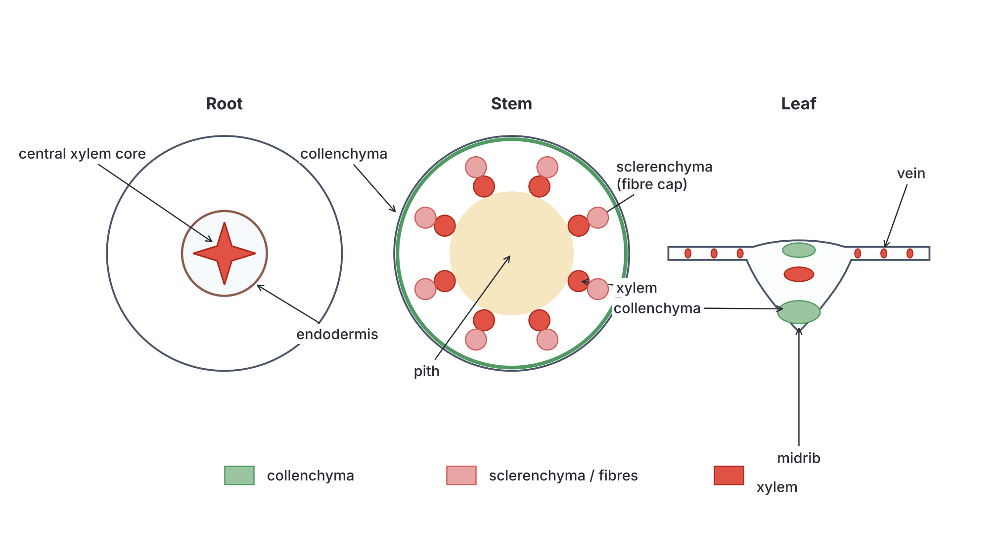

### Summary of distribution

| Organ | Main force | Collenchyma | Sclerenchyma (including phloem fibres) | Xylem | Overall pattern |
| --- | --- | --- | --- | --- | --- |
| **Root** | Pulling (tension) | Usually absent | Little; thick endodermis/exodermis | **Central core** | Like a cable or rope: strength in the centre |
| **Dicot stem** | Bending and weight | **Hypodermis** (under epidermis) | **Bundle caps** (pericycle/phloem fibres) | **Ring** of bundles; later solid wood | Like a hollow tube or girder: strength near the outside |
| **Monocot stem** | Bending and weight | Usually absent | **Hypodermis** and **sheath** round each bundle | Scattered bundles, more near the edge | Strength near the outside |
| **Leaf** | Bending and tearing | **Midrib** and petiole | Around some veins; leaf margins (grasses) | **Network of veins** | Like the ribs of an umbrella |

## The internal structure of a mammal

The second content item is **b. Internal structure of a mammal**. In school laboratories this is usually studied by **dissecting** a small mammal such as a **rabbit** or a **rat** (the albino laboratory rat or a common house rat). Their internal organs are arranged in the same basic way as those of all mammals, including **humans**. In these notes the rabbit and rat are the standard examples, with the human compared at each step.

### Why the rabbit or rat?

- They are small, easy to obtain and to handle.
- They have all the typical mammalian organs and systems.
- Their organs are arranged much like ours, so they help us understand the human body.

The rabbit is a herbivore with a very large caecum; the rat eats almost anything (an omnivore). These differences show how the gut is adapted to diet.

### How the dissection is done (in outline)

You may be asked about the dissection or shown a diagram of a dissected rat. Your teacher does the killing, and in many schools the whole dissection is a teacher demonstration.

1. The animal is **killed humanely** by the teacher, using an approved method (older textbooks describe using chloroform, which is now discouraged because it is harmful to people).
2. It is laid on its **back** (ventral side up) on a **dissecting board** or wax tray, and the four limbs are **pinned** out.
3. The fur on the belly is **wetted** with water so loose hairs do not stick to the organs.
4. The skin of the belly is lifted with **forceps** and a small cut is made with **scissors**. The cut is extended along the **midline** from the urinogenital opening to the lower jaw. Side cuts are made at the limbs, and the skin is pinned back.
5. The **muscular body wall** of the abdomen is lifted and cut in the same way, taking care not to damage the gut below. The flaps are pinned back.
6. To open the **thorax**, the **ribs** are cut on both sides of the breastbone (sternum), and the rib cage is lifted away. The diaphragm can be seen as a thin sheet.
7. The organs are displayed **without cutting them**: the gut is gently moved to one side to show the organs behind it.

**Safety and care:** wear gloves; use sharp instruments carefully, pointing away from yourself; wash hands thoroughly afterwards; dispose of the remains as the teacher directs.

### General arrangement of the internal organs

**Objective v: examine the arrangement of the mammalian internal organs.**

The mammalian body contains a large space, the **body cavity** (coelom), in which the organs lie. It is lined by a thin, smooth, moist membrane that lets organs slide past each other without rubbing.

The body cavity is divided into two parts by a dome-shaped sheet of muscle and tendon called the **diaphragm**. The diaphragm is found **only in mammals**, and it also helps in breathing.

1. **The thorax (chest cavity)** is in front of (above, in humans) the diaphragm. It is protected by the **rib cage** (ribs, sternum and vertebral column). It contains:
   - the **heart**, in the middle, enclosed in a tough bag, the **pericardium**, and tilted slightly to the left;
   - two **lungs**, pink and spongy, one on each side of the heart, each enclosed in **pleural membranes**;
   - the **trachea** (windpipe), with C-shaped rings of cartilage, dividing into two **bronchi**;
   - the **oesophagus** (gullet), lying behind (dorsal to) the trachea and passing through the diaphragm;
   - the **thymus gland**, a soft pinkish gland over the front of the heart; it is large in young animals and shrinks with age;
   - major blood vessels (aorta, venae cavae, pulmonary vessels).
2. **The abdomen (abdominal cavity)** is behind (below, in humans) the diaphragm. It is protected by the muscles of the body wall and, at the back, by the vertebral column and lower ribs. It contains:
   - most of the **digestive system**: stomach, intestines, liver, gall bladder (not in the rat) and pancreas;
   - the **spleen** (part of the lymphatic and circulatory systems);
   - the **excretory (urinary) organs**: kidneys, ureters and bladder;
   - the **reproductive organs** (some lie in the pelvic region at the back of the abdomen, and in males the testes lie outside in the scrotum);
   - the **adrenal glands**, on top of the kidneys.
   The gut is held in loops by thin, transparent sheets of tissue called **mesenteries**, which carry blood vessels, lymph vessels and nerves to the gut. Fat is often stored in the mesenteries.
3. **The pelvic region** at the hind end of the abdomen, inside the hip girdle (pelvis), contains the **bladder**, the **rectum**, and parts of the reproductive system (e.g. the uterus and vagina in females).

**Order of organs on opening the abdomen of a rat or rabbit (ventral view, from front to back):**

1. Just behind the diaphragm: the dark reddish-brown, lobed **liver**, covering the front of the stomach.
2. Under the liver on the left side of the animal: the **stomach**, with the dark red, strap-shaped **spleen** along its outer curve.
3. Filling much of the middle and back of the abdomen: the coiled **small intestine** and, in the rabbit especially, the very large **caecum**.
4. Behind the gut, against the back (dorsal) wall: the two **kidneys**, with the ureters running back to the **bladder**.
5. At the hind end, in the pelvic region: the **bladder** and the **reproductive organs**, with the **rectum** running to the anus.

**Note on directions:** in a four-legged animal like a rat, "anterior" (front) means towards the head and "posterior" means towards the tail; "dorsal" means towards the back and "ventral" means towards the belly. In an upright human, the head end is "superior" (upper) and the belly is the front. The **animal's left** is on **your right** when you look down at a dissection lying on its back, just as when you face another person.

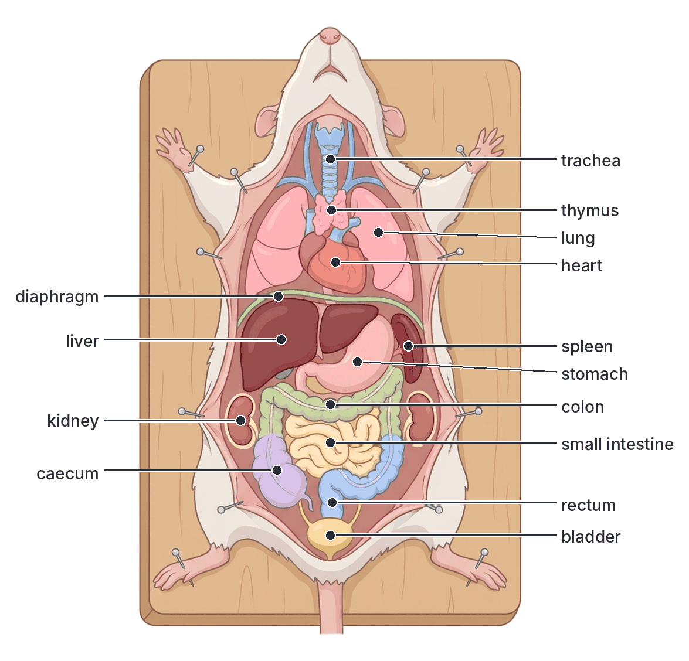

### Arrangement in the human body

The human body follows the same plan. Because we stand upright, "anterior" (head end) becomes "upper".

| Organ | Position in the human |
| --- | --- |
| **Heart** | In the middle of the chest, between the lungs, behind the breastbone, with its pointed tip (apex) tilted to the **left** |
| **Lungs** | Fill most of the chest on either side of the heart; the right lung has **3 lobes**, the left lung **2** (to make room for the heart) |
| **Diaphragm** | A dome-shaped sheet below the lungs, at about the level of the lower ribs |
| **Liver** | The largest internal organ; in the **upper right** of the abdomen, just under the diaphragm, protected by the lower right ribs |
| **Gall bladder** | A small green-coloured sac on the underside of the liver |
| **Stomach** | Upper **left** of the abdomen, just under the diaphragm, partly behind the liver |
| **Spleen** | Upper left, behind and to the left of the stomach |
| **Pancreas** | A long, soft gland lying **behind the stomach**, with its "head" in the curve (loop) of the duodenum |
| **Small intestine** | Coiled in the middle and lower part of the abdomen |
| **Large intestine** | Frames the small intestine: the caecum and appendix in the **lower right**, then the colon goes up the right side, across under the stomach, and down the left side to the rectum |
| **Kidneys** | Against the **back wall** of the abdomen, one each side of the backbone, at about waist level, partly protected by the lowest ribs; the right kidney is slightly **lower** than the left because the liver is above it |
| **Bladder** | In the pelvis, low down at the front, behind the pubic bone |
| **Uterus and ovaries (female)** | In the pelvis, the uterus between the bladder (in front) and the rectum (behind) |

[IMAGE: Front view outline of a human torso (gender-neutral) showing the positions of the main internal organs as simple soft-coloured shapes. Chest: two lungs, heart between them tilted to the left, trachea above. Diaphragm as a curved line. Abdomen: large liver on the upper right of the body (viewer's left) with the small gall bladder beneath it; stomach on the upper left (viewer's right); spleen behind and left of the stomach; pancreas partly visible behind the stomach; coiled small intestine in the middle; large intestine framing it (caecum and appendix lower right of the body, colon around, rectum); bladder low in the pelvis. Show the two kidneys as dotted outlines behind the gut. Labels: trachea, lung, heart, diaphragm, liver, gall bladder, stomach, spleen, pancreas, small intestine, large intestine (colon), caecum, appendix, kidney, bladder, rectum. Clean flat textbook style, white background.]

## The digestive, reproductive and excretory organs

**Objective vi: describe the appearance and position of the digestive, reproductive and excretory organs.**

### Digestive organs

The digestive system is a long tube, the **alimentary canal**, running from the mouth to the anus, with **accessory organs** (liver, gall bladder and pancreas) joined to it by ducts. How each part works in digestion is covered in file `B2e` (the alimentary canal and digestion); here we look at what each organ **looks like** and **where it is**.

| Organ | Appearance | Position |
| --- | --- | --- |
| **Oesophagus (gullet)** | A narrow, soft, muscular tube, flattened when empty | Runs from the throat (pharynx) down the neck and thorax, **behind the trachea**, and through the diaphragm to the stomach |
| **Stomach** | A J-shaped (in humans) or bean-shaped (in rabbit and rat), thick-walled, muscular bag; pinkish-grey | Just behind (below) the diaphragm, mostly on the **left** side, partly covered by the liver. Its entrance is guarded by the cardiac sphincter and its exit by the **pyloric sphincter** |
| **Duodenum** | The first part of the small intestine, forming a **U-shaped loop** | Leaves the stomach on the right side; the pancreas lies in its loop, and the bile duct and pancreatic duct open into it |
| **Pancreas** | In the **rabbit and rat**: a pale pink, **diffuse**, branching gland spread thinly in the mesentery of the duodenal loop (easy to miss). In **humans**: a compact, soft, pinkish-grey, elongated gland about 15 cm long | In the **loop of the duodenum** and, in humans, behind the stomach |
| **Ileum** | A long, narrow, much-coiled tube, the longest part of the gut; its inner surface is velvety with **villi** | Fills much of the abdomen, held in loops by the **mesentery** |
| **Liver** | The **largest gland** in the body; dark **reddish-brown**, smooth, soft and divided into **lobes** (the rat's liver has four main lobes; the rabbit's has several) | Just behind (below) the diaphragm, covering the stomach; in humans mainly on the **right** side |
| **Gall bladder** | A small, thin-walled, **greenish** sac filled with bile | Attached to the underside of the liver. It is present in the **rabbit** and **human** but **absent in the rat** (the rat's bile flows straight from the liver to the duodenum) |
| **Caecum** | In the **rabbit**, very large, thin-walled and coiled, with a spiral fold inside, ending in a finger-like, thick-walled **vermiform appendix**. In the **rat**, fairly large but with **no true appendix**. In **humans**, small, with a small, narrow appendix | At the junction of the small and large intestines. In humans, in the **lower right** of the abdomen |
| **Colon** | Wider than the ileum. In the rabbit and rat, the hind colon contains **faecal pellets** (like beads in a string); in humans the colon is puckered into pouches | Runs from the caecum around the abdomen to the rectum |
| **Rectum** | A short, straight, muscular tube storing faeces | In the pelvic region, against the back wall, ending at the **anus** |
| **Anus** | An opening closed by a ring of muscle (anal sphincter) | At the hind end, below the tail (rabbit and rat); between the buttocks (human) |

**Note:** the **spleen** is seen next to the stomach in every dissection. It is a dark red, strap-shaped (rabbit and rat) or fist-sized oval (human) organ. It is **not** a digestive organ: it removes old red blood cells and helps fight infection.

**The rabbit's caecum and appendix:** the rabbit feeds on grass and leaves, which are rich in **cellulose**. Mammals cannot make the enzyme that digests cellulose, so bacteria living in the rabbit's huge caecum and appendix do it for them. The rabbit then eats its own soft caecal droppings (this is called **coprophagy** or caecotrophy) to absorb the products. In humans, the appendix has no digestive role, and inflammation of it (**appendicitis**) is a common emergency needing surgery.

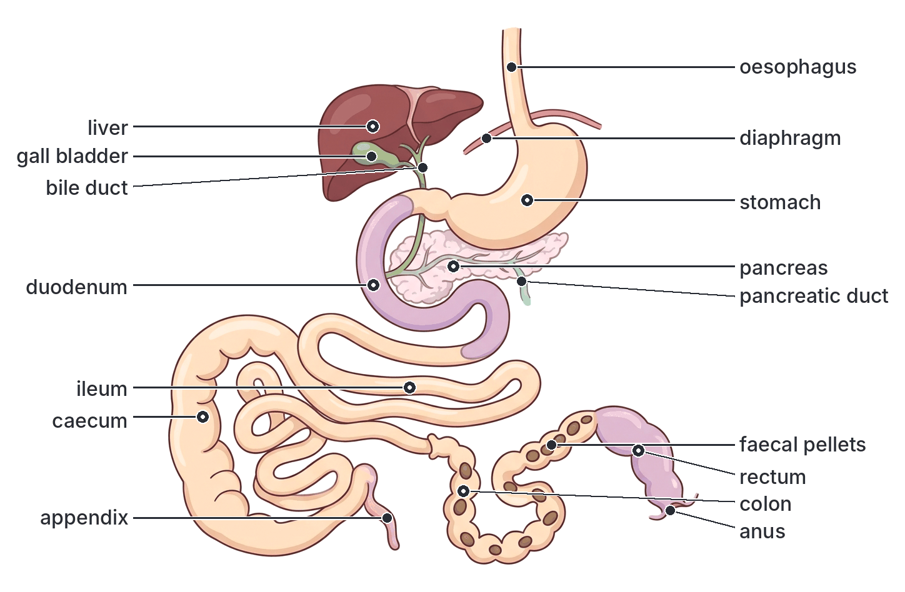

### Excretory organs

The main excretory organs (making up the **urinary system**) are the kidneys, ureters, bladder and urethra. The **lungs** (removing carbon (IV) oxide), **skin** (sweat) and **liver** (making urea and bile pigments) are also excretory organs. The details of excretion are covered in Topic B5.

| Organ | Appearance | Position |
| --- | --- | --- |
| **Kidneys** | A pair of **bean-shaped**, dark **reddish-brown**, smooth organs, with an inward dent (the **hilum**) on the inner side, where the blood vessels and ureter join. In humans each is about 10 to 12 cm long; in the rat about 1.5 cm | Against the **dorsal (back) wall** of the abdomen, one on each side of the backbone, outside the body cavity lining, often surrounded by fat. In the **rabbit and rat**, the **right kidney is further forward** (nearer the head) than the left. In **humans**, the **right kidney is slightly lower** than the left (pushed down by the liver) |
| **Adrenal glands** | Small, yellowish or pinkish caps or round bodies (endocrine, not excretory) | On or near the front end of each kidney |
| **Renal artery and renal vein** | Blood vessels: the artery (from the aorta) bright red, the vein (to the vena cava) dark red | Enter and leave each kidney at the hilum |
| **Ureters** | Two thin, pale, whitish tubes | Run from the hilum of each kidney, along the back wall, to the bladder |
| **Urinary bladder** | A thin-walled, muscular, pear-shaped bag; pale and transparent when full, with yellowish urine | In the **pelvic region**, at the hind end of the abdomen, on the ventral (front) side |
| **Urethra** | A narrow tube with a ring of muscle (sphincter) at its start | Runs from the neck of the bladder to the outside. In males it passes through the **penis** and also carries semen; in females it is short and opens just in front of the vagina (in rabbits it opens into the vagina; see below) |

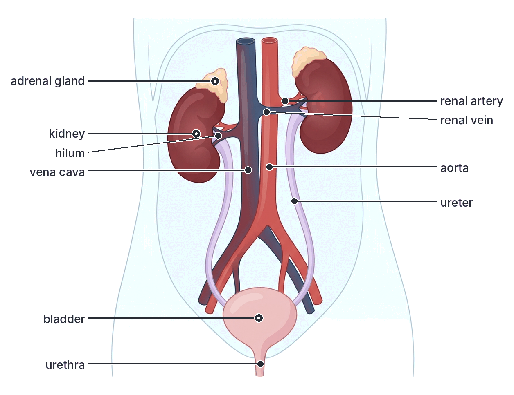

### Male reproductive organs

| Organ | Appearance | Position and function |
| --- | --- | --- |
| **Testes** (singular: testis) | A pair of **oval**, smooth, whitish or pinkish organs (large in the rat) | Outside the abdomen in a skin bag, the **scrotum** (scrotal sacs), between the hind legs. The cooler temperature there (about 2 to 3 °C below body temperature) is needed to make healthy **sperm**. The testes also make the hormone **testosterone**. In the rabbit and rat, the testes can be drawn back into the abdomen through the **inguinal canal**, for example outside the breeding season or when the animal is frightened; in humans they stay in the scrotum after birth |
| **Epididymis** | A long, tightly coiled tube forming a cap over one side of each testis (in the rabbit and rat, visible at both ends as the "head" and "tail") | On the testis. Stores sperm while they mature |
| **Vas deferens (sperm duct)** | A narrow, whitish, muscular tube | Runs from the epididymis up through the inguinal canal into the abdomen, loops over the ureter, and joins the urethra behind the bladder. Carries sperm during ejaculation |
| **Seminal vesicles** | A pair of pale, sac-like or lobed glands (large and curved in the rat) | Behind the bladder, near where the sperm ducts meet the urethra. Add a sugary (fructose-rich) fluid to the semen, which gives energy to the sperm |
| **Prostate gland** | A firm gland (in humans the size of a walnut) | Surrounds the start of the urethra just below (behind) the bladder. Adds an alkaline fluid to semen, which neutralises acidity in the urethra and vagina |
| **Cowper's glands (bulbourethral glands)** | A pair of small, pea-sized glands | Beside the urethra at the base of the penis. Add mucus to lubricate the urethra |
| **Urethra** | A tube carrying both **urine** and **semen** (but not at the same time) | From the bladder through the penis |
| **Penis** | A muscular organ with spongy erectile tissue, which fills with blood to become erect | Outside the body, in front of the scrotum (in rabbits and rats it lies in a sheath (prepuce) just in front of the scrotal sacs). Deposits semen in the female's vagina |

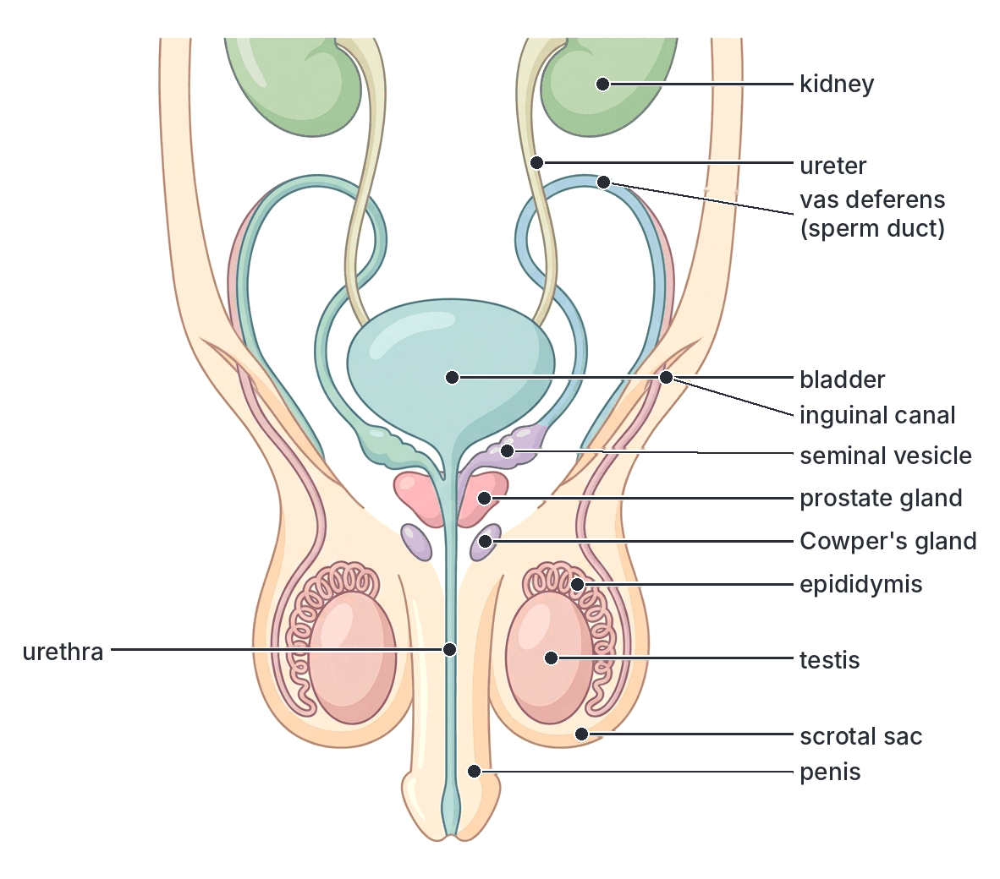

### Female reproductive organs

| Organ | Appearance | Position and function |
| --- | --- | --- |
| **Ovaries** | A pair of small, oval, pinkish organs, often knobbly with developing follicles (in the rat, tiny and grape-like, embedded in fat) | In the abdomen, near the **back wall**, just **behind (below) the kidneys** in the rabbit and rat; in humans, at the sides of the pelvis on either side of the uterus. They make **eggs (ova)** and the hormones **oestrogen** and **progesterone** |
| **Oviducts (Fallopian tubes)** | A pair of narrow, coiled tubes, each with a funnel-shaped opening with finger-like edges (**fimbriae**) close to the ovary | Run from near each ovary to the uterus. Carry the egg to the uterus; **fertilisation** takes place here |
| **Uterus (womb)** | A thick-walled, muscular organ. In the **rabbit and rat**, it is a **duplex** uterus: **two long, separate uterine horns**, each with its own opening (cervix) into the vagina (the rat's two horns join near the lower end but stay separate inside). In **humans**, it is a **single**, pear-shaped organ (simplex uterus) | In the pelvic region, between the bladder (ventral) and the rectum (dorsal). The embryo implants and develops here. Rabbits and rats carry **several young** (a litter), spaced out along both horns; humans usually carry one baby |
| **Cervix** | A ring of muscle forming the neck of the uterus | Between the uterus and the vagina |
| **Vagina** | A muscular tube with a thick, folded lining | Behind the bladder, leading to the outside. Receives the penis during mating; the birth canal |
| **Vestibule (urinogenital sinus)** | In the **rabbit**, the vagina and urethra join to form a short common passage called the vestibule (urinogenital sinus), which opens to the outside at the **vulva** | In the rat and human, the urethra and vagina open **separately** to the outside |
| **Vulva** | The external opening, with folds of skin around it | In front of the anus |

**Textbook variation:** textbooks describe the uterus of the rat slightly differently: some call it "duplex" (two completely separate horns), others note that the two horns run side by side for a short distance near the cervix. Both describe a uterus with **two horns**, which is the key difference from the single human uterus.

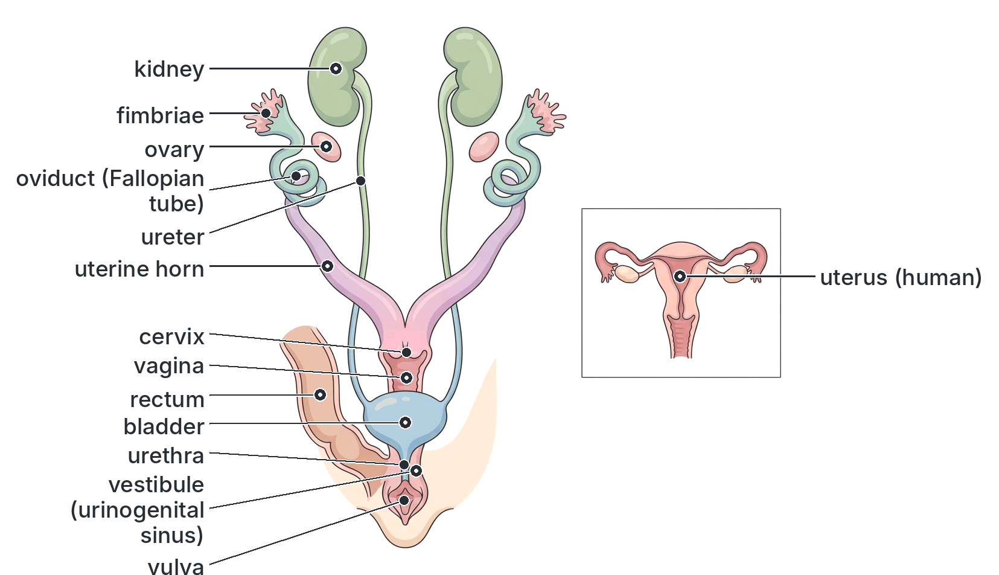

### The rabbit, the rat and the human compared

| Feature | Rabbit | Rat | Human |
| --- | --- | --- | --- |
| Diet | Herbivore | Omnivore | Omnivore |
| Caecum | **Very large**, coiled | Fairly large | **Small** |
| Appendix | **Large**, at the tip of the caecum | **Absent** | Small and narrow |
| Gall bladder | Present | **Absent** | Present |
| Pancreas | **Diffuse**, in the mesentery of the duodenal loop | **Diffuse**, in the mesentery | **Compact** gland behind the stomach |
| Position of right kidney | Further forward (anterior) than the left | Further forward (anterior) than the left | Slightly **lower** than the left |
| Testes | In scrotal sacs; can be drawn back into the abdomen | In a scrotum; can be drawn back into the abdomen | In the scrotum permanently after birth |
| Uterus | **Duplex** (two separate horns, two cervices) | Two horns (duplex) | **Simplex** (one uterus, one cervix) |
| Urethra in female | Joins the vagina to form a **vestibule** | Opens separately | Opens separately |
| Number of young | A litter (often 4 to 12) | A litter (often 6 to 12) | Usually one |

**Textbook variation:** litter sizes vary a lot with breed and conditions; the numbers above are typical ranges only.

## Key terms

| Term | Meaning |
| --- | --- |
| Transverse section (TS) | A thin slice cut across an organ, at right angles to its length |
| Monocotyledon | A flowering plant with one seed leaf, e.g. maize |
| Dicotyledon | A flowering plant with two seed leaves, e.g. cowpea |
| Piliferous layer | The outer layer of a young root, which bears root hairs |
| Cortex | The region of ground tissue between the epidermis and the vascular tissue |
| Endodermis | The innermost layer of the cortex; in stems it is called the starch sheath |
| Casparian strip | A waterproof band of suberin in the walls of root endodermis cells |
| Pericycle | The layer just inside the endodermis; lateral roots arise from it |
| Stele | The central vascular cylinder of a root or stem |
| Radial arrangement | Xylem and phloem on different radii, alternating (as in roots) |
| Conjoint bundle | A vascular bundle with xylem and phloem together on the same radius (as in stems) |
| Collateral bundle | A bundle with phloem on the outer side and xylem on the inner side |
| Open bundle | A bundle with cambium between xylem and phloem (dicot stems) |
| Closed bundle | A bundle with no cambium (monocot stems) |
| Exarch / endarch | Protoxylem towards the outside (roots) / towards the centre (stems) |
| Cambium | A layer of dividing cells that makes new xylem and phloem |
| Secondary growth | Increase in thickness of a stem or root due to cambium |
| Medullary ray | A strip of parenchyma between vascular bundles of a dicot stem |
| Pith (medulla) | Central parenchyma of a stem or monocot root |
| Palisade mesophyll | Column-shaped cells under the upper epidermis of a leaf; the main site of photosynthesis |
| Spongy mesophyll | Loosely packed leaf cells with large air spaces |
| Stoma | A pore in the epidermis surrounded by two guard cells |
| Collenchyma | Living supporting tissue with cellulose thickening at the cell corners |
| Sclerenchyma | Dead supporting tissue with thick lignified walls (fibres and sclereids) |
| Lignin | A hard, waterproof substance in the walls of xylem and sclerenchyma |
| Phloem (bast) fibres | Sclerenchyma fibres found in the phloem |
| Diaphragm | Sheet of muscle and tendon separating the thorax from the abdomen in mammals |
| Mesentery | Thin membrane that holds the gut in place and carries its blood vessels |
| Hilum (of kidney) | The dent in a kidney where the ureter and blood vessels join |
| Duplex uterus | A uterus with two separate horns, as in the rabbit and rat |

## Exam tips and common mistakes

- **Root or stem?** Radial vascular bundles (xylem and phloem alternating on different radii) and root hairs = **root**. Conjoint bundles (xylem and phloem together) and a cuticle = **stem**.
- **Dicot or monocot stem?** Bundles in a **ring** with cambium = dicot; bundles **scattered** with no cambium = monocot. Do not say monocot stems "have no vascular bundles": they have many.
- **Dicot or monocot root?** Star-shaped xylem with no pith = dicot; many xylem groups round a large pith = monocot.
- **Exarch vs endarch:** in roots, the protoxylem is towards the outside (exarch); in stems, towards the centre (endarch).
- **Leaf bundles:** xylem is on the **upper** side, phloem on the **lower** side of a leaf vein.
- **Most photosynthesis** happens in the **palisade mesophyll**, not the spongy layer and not the epidermis. The only epidermal cells with chloroplasts are the guard cells.
- **Collenchyma is living** with cellulose thickening; **sclerenchyma is dead** with lignin. A common wrong option says collenchyma is lignified.
- **Phloem fibres support; sieve tubes transport.** Not all of the phloem is supporting tissue.
- **Distribution:** the root's support is in the **centre** (to resist pulling); the stem's is towards the **outside** (to resist bending).
- **The diaphragm** separates the thorax from the abdomen and is found only in mammals.
- **Rat vs rabbit:** the rat has **no gall bladder** and **no appendix**; the rabbit has a huge caecum and appendix.
- **Kidneys lie against the back wall** of the abdomen, not in the front among the intestines. The bladder lies in the pelvis.
- **The urethra in males** carries both urine and semen; the **sperm duct (vas deferens)** carries only sperm.

## Quick summary

1. A transverse section is cut across an organ; roots, stems and leaves each have an epidermis, ground tissue and vascular tissue, but arranged differently.
2. Roots have a piliferous layer with root hairs, a wide cortex, an endodermis with a Casparian strip, a pericycle and radial, exarch vascular tissue in the centre (star-shaped in dicots; a ring of many groups round a large pith in monocots).
3. Stems have an epidermis with cuticle and conjoint, collateral, endarch bundles: in a ring with cambium in dicots (sunflower), scattered and closed with a sclerenchyma sheath in monocots (maize).
4. The dicot leaf has a cuticle, upper epidermis, palisade and spongy mesophyll, veins with xylem above and phloem below, and a lower epidermis with many stomata; each part suits photosynthesis and gaseous exchange.
5. The supporting tissues are collenchyma (living, cellulose, flexible), sclerenchyma (dead, lignified fibres and sclereids), xylem (lignified vessels, tracheids and fibres) and phloem fibres (bast).
6. Support is central in roots (resisting pulling), towards the outside in stems (resisting bending), and in the midrib and network of veins in leaves.
7. In a mammal, the diaphragm divides the body cavity into the thorax (heart, lungs) and abdomen (digestive, excretory and reproductive organs), with the gut held by mesenteries and the kidneys against the back wall.
8. The rabbit has a large caecum and appendix and a duplex uterus; the rat has no gall bladder or appendix; humans have a small caecum and appendix and a single uterus.

## Practice questions

**1. In a transverse section of a young dicotyledonous root, the xylem**

- A. forms a ring of bundles with the phloem on the same radius
- B. is scattered throughout the ground tissue
- C. forms a star shape in the centre, with phloem between its arms
- D. lies on the upper side of each vein

**Answer: C.** The young dicot root has a central star of xylem with patches of phloem between the arms (a radial arrangement). A describes a dicot stem, B a monocot stem and D a leaf.

**2. Which of the following features is found in the stem of maize but NOT in the stem of sunflower?**

- A. Scattered vascular bundles
- B. Cuticle
- C. Xylem vessels
- D. Phloem

**Answer: A.** Monocot stems such as maize have scattered bundles; the dicot sunflower stem has a ring of bundles. Both have a cuticle, xylem and phloem.

**3. The Casparian strip is found in the**

- A. pericycle
- B. endodermis
- C. cortex of the stem
- D. palisade mesophyll

**Answer: B.** The Casparian strip is a waterproof band in the walls of the endodermis cells of the root; it makes water and salts pass through living cells.

**4. Most photosynthesis in a dicotyledonous leaf takes place in the**

- A. upper epidermis
- B. spongy mesophyll
- C. guard cells
- D. palisade mesophyll

**Answer: D.** The palisade cells lie just under the upper surface and contain the most chloroplasts.

**5. Which of the following correctly describes collenchyma?**

- A. Living cells with walls thickened with cellulose at the corners
- B. Dead cells with thick lignified walls
- C. Living cells with sieve plates
- D. Dead, hollow tubes with no cross walls

**Answer: A.** Collenchyma is a living tissue thickened with cellulose (not lignin), mainly at the corners. B is sclerenchyma, C is phloem sieve tubes and D is xylem vessels.

**6. In the root, the main supporting tissue is arranged in the centre because this position best resists**

- A. bending forces
- B. pulling forces
- C. attack by insects
- D. water loss

**Answer: B.** The swaying shoot pulls on the root; a central core, like a cable, resists pulling best. In the stem, supporting tissue near the outside resists bending.

**7. A vascular bundle that has cambium between its xylem and phloem is described as**

- A. closed
- B. radial
- C. open
- D. exarch

**Answer: C.** An open bundle has cambium and can produce secondary tissue; closed bundles (monocot stems) have none.

**8. In the dissected rat, the organ that separates the thoracic cavity from the abdominal cavity is the**

- A. mesentery
- B. pericardium
- C. pleural membrane
- D. diaphragm

**Answer: D.** The diaphragm is a sheet of muscle and tendon found only in mammals; it separates the thorax from the abdomen.

**9. Which of the following is absent in the rat but present in the rabbit and in man?**

- A. Gall bladder
- B. Liver
- C. Pancreas
- D. Caecum

**Answer: A.** The rat has no gall bladder; bile flows from the liver straight to the duodenum. All three have a liver, pancreas and caecum.

**10. In a mammal, the kidneys are found**

- A. in the thorax, beside the heart
- B. against the dorsal wall of the abdomen, one on each side of the backbone
- C. in the pelvic region, in front of the bladder
- D. in the loop of the duodenum

**Answer: B.** The kidneys lie against the back (dorsal) wall of the abdomen, one on each side of the vertebral column. The pancreas lies in the duodenal loop and the bladder in the pelvis.
