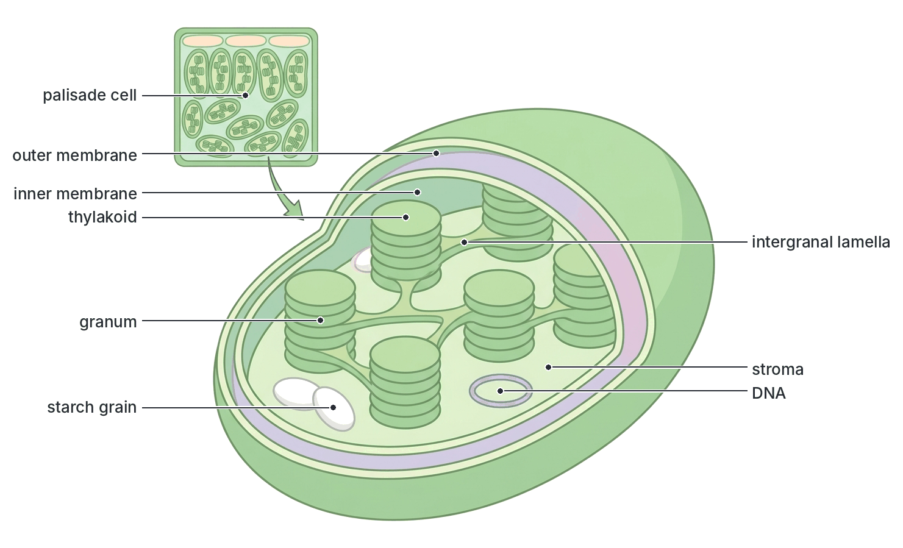
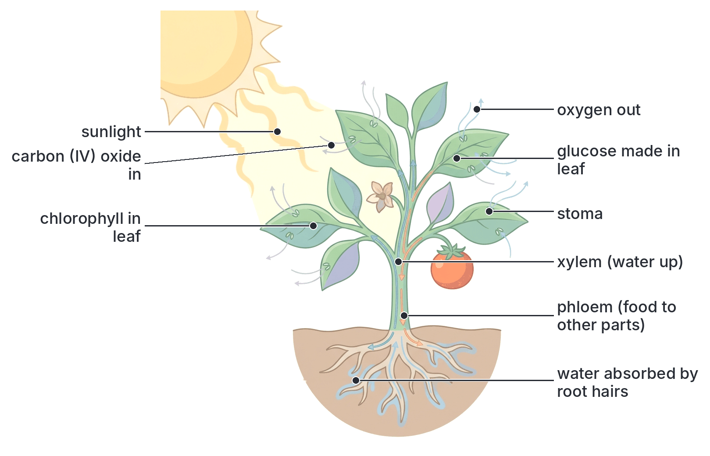
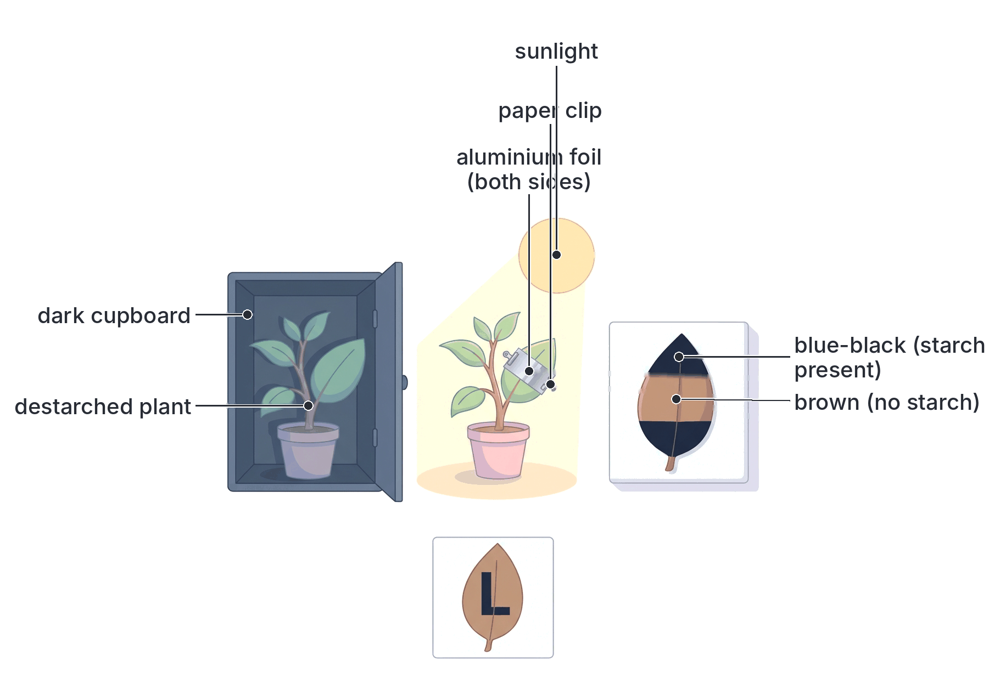
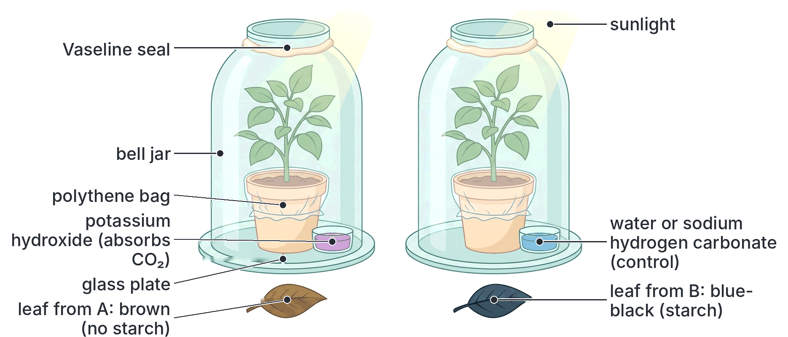
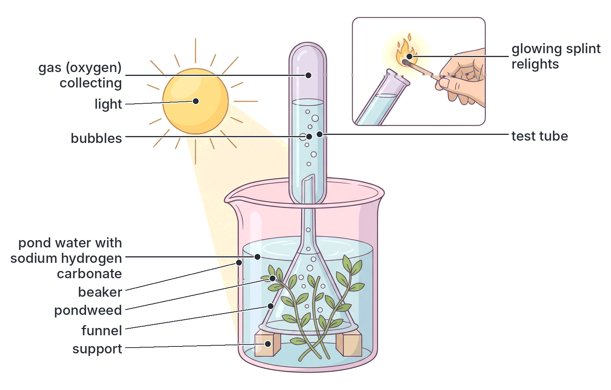
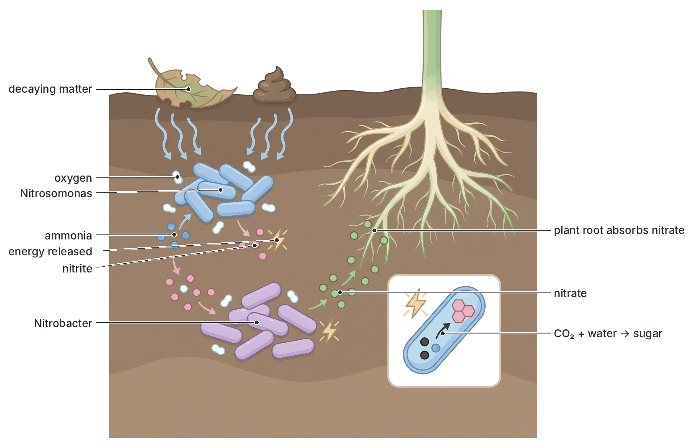
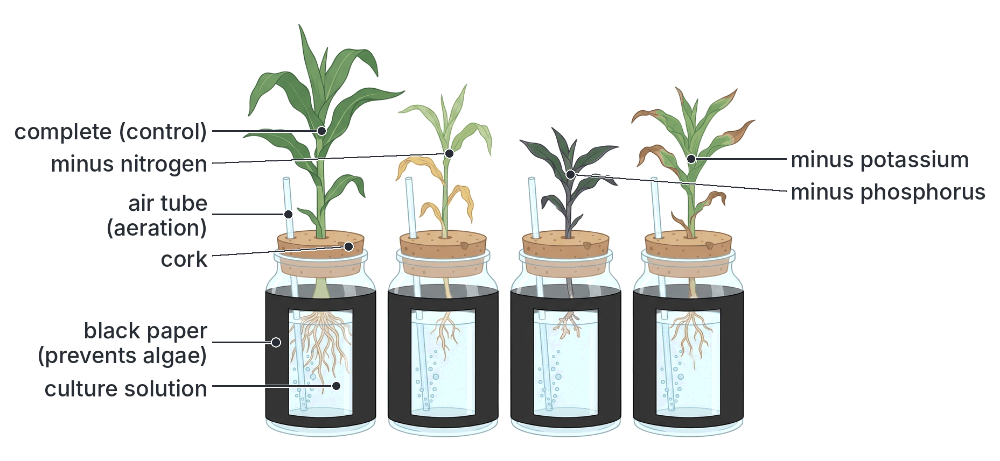
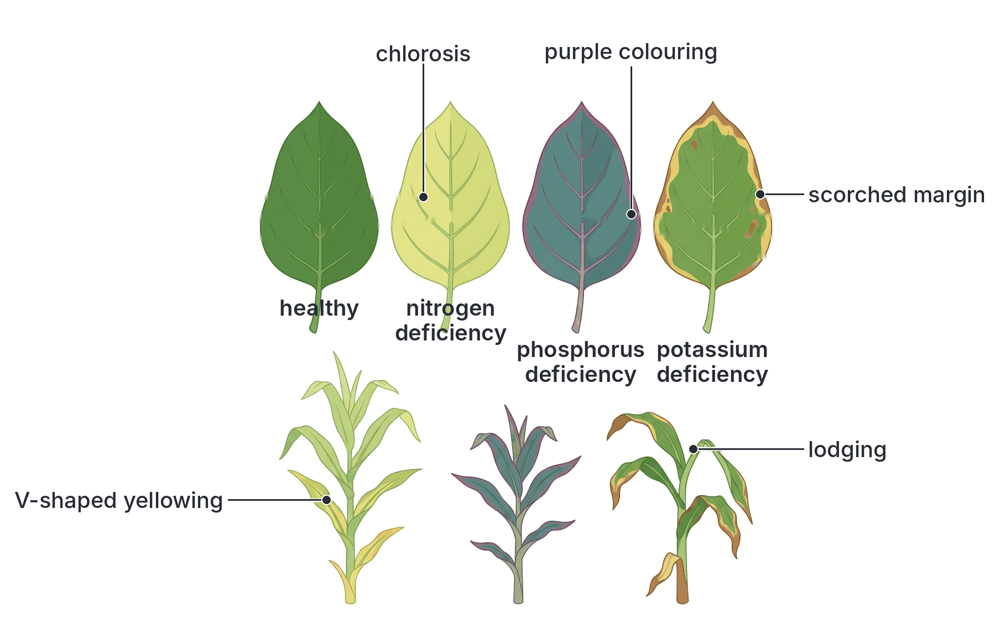

# JAMB Biology Notes: Nutrition (Part 2): Plant Nutrition

## What JAMB expects

This topic is Section B, Topic 2 of the JAMB Biology syllabus: Form and Functions – Nutrition. Nutrition is split into five files:

- **B2a:** modes of nutrition and types of nutrition.
- **B2b (this file):** plant nutrition.
- **B2c:** classes of food substances, food tests and the nutritional value of food.
- **B2d:** the mammalian tooth.
- **B2e:** the mammalian alimentary canal and the nutrition process.

This file covers content item **c. Plant nutrition**:

- i. Photosynthesis
- ii. Chemosynthesis
- iii. Mineral requirements (macro- and micro-nutrients)

By the end of these notes, you should be able to:

1. Compare the photosynthetic and chemosynthetic modes of nutrition (objective iii).
2. Differentiate the light and dark reactions of photosynthesis (objective v).
3. Determine the necessity of light, carbon (IV) oxide and chlorophyll in photosynthesis (objective vi).
4. Detect the presence of starch in a leaf as evidence of photosynthesis (objective vii).
5. Identify the macro- and micro-elements required by plants (objective viii).
6. Recognise the deficiency symptoms of nitrogen, phosphorus and potassium (objective ix).

**Note on the syllabus wording:** objective v is printed as "differentiate the light and dark reactions, of photosynthesis", with a stray comma; it simply means the light and dark reactions of photosynthesis. Objective ix spells phosphorus as "phosphorous". The correct spelling of the element is **phosphorus**; "phosphorous" is an adjective used in chemistry for some compounds. Objective viii says "macro-and micro-elements" while the content item says "macro and micro-nutrients": they mean the same thing (mineral elements needed in large and in small amounts).

## Photosynthesis

### What is photosynthesis?

**Photosynthesis** is the process by which green plants (and algae and some bacteria) **make simple sugar (glucose)** from **carbon (IV) oxide (CO₂)** and **water**, using **light energy** absorbed by **chlorophyll**. **Oxygen** is given off as a by-product.

The word means "putting together (synthesis) with light (photo)".

**Word equation:**

carbon (IV) oxide + water → (light energy, chlorophyll) → glucose + oxygen

**Balanced chemical equation:**

6CO₂ + 6H₂O → (light, chlorophyll) → C₆H₁₂O₆ + 6O₂

**Textbook variation:** some textbooks write the equation as 6CO₂ + 12H₂O → C₆H₁₂O₆ + 6O₂ + 6H₂O. This version shows that all the oxygen given off comes from water (12 molecules of water are split, and 6 new water molecules are made). Both equations are correct; the simpler one is the "overall" equation.

Photosynthesis changes **light energy** into **chemical energy** stored in glucose. Almost all the energy used by living things on Earth was first trapped this way.

### Requirements (raw materials and conditions)

| Requirement | Source | How it reaches the chloroplasts |
| --- | --- | --- |
| **Carbon (IV) oxide** | The air (about 0.04%); for water plants, CO₂ dissolved in water | Diffuses in through the **stomata**, through the air spaces of the spongy mesophyll, and dissolves in the water on the cell walls before entering the cells |
| **Water** | The soil | Absorbed by **root hairs** (osmosis), carried up the **xylem** of the root, stem and leaf veins, then passes from cell to cell |
| **Light** | The sun (or artificial light) | Passes through the transparent cuticle and epidermis to the palisade cells |
| **Chlorophyll** | Made by the plant (needs light, magnesium, nitrogen and iron) | Present in the **chloroplasts** |
| **Suitable temperature** | Surroundings | Needed because the reactions are controlled by **enzymes** |

### Where photosynthesis happens

- **The organ:** mainly the **leaf** (see Topic B1 for its structure), and also green stems.
- **The tissue:** mainly the **palisade mesophyll**, and also the spongy mesophyll and guard cells.
- **The organelle:** the **chloroplast**.

**Structure of the chloroplast** (seen with an electron microscope):

1. A **double membrane** (envelope) surrounds it.
2. Inside is a system of flattened membrane sacs called **thylakoids**. In many places they are stacked like piles of coins to form **grana** (singular: granum). The grana are joined by single thylakoids (**intergranal lamellae**).
3. The **chlorophyll** and other pigments are in the **thylakoid membranes**. This is where the **light reactions** take place.
4. The thylakoids are surrounded by a fluid called the **stroma**, which contains enzymes, DNA, ribosomes and **starch grains**. This is where the **dark reactions** take place.

**The pigments:**

- **Chlorophyll a** (blue-green) and **chlorophyll b** (yellow-green) are the main pigments. Chlorophyll contains **magnesium** at the centre of each molecule.
- **Carotenoids**: **carotene** (orange) and **xanthophyll** (yellow) absorb other colours of light and pass the energy to chlorophyll. They also protect chlorophyll from damage by too much light. They can be seen in leaves that turn yellow before they fall.
- Chlorophyll absorbs mainly **red** and **blue (violet)** light. It absorbs very little **green** light, which is reflected or passes through, so leaves look **green**.

## The light and dark reactions of photosynthesis

**Objective v: differentiate the light and dark reactions of photosynthesis.**

Photosynthesis is not one single reaction. It happens in two linked stages:

1. the **light reactions** (light-dependent stage), which need light directly;
2. the **dark reactions** (light-independent stage), which do not need light directly but use the products of the light reactions.

### Stage 1: the light reactions (light-dependent stage)

**Where:** in the **thylakoid membranes** of the **grana**.

**What happens, step by step:**

1. **Light absorption:** chlorophyll molecules absorb **light energy**. This energy "excites" electrons in the chlorophyll, raising them to a high energy level.
2. **Photolysis of water:** the light energy is used to **split water molecules** into hydrogen (hydrogen ions and electrons) and **oxygen**. This splitting of water by light is called **photolysis**.

   2H₂O → 4H⁺ + 4e⁻ + O₂

   The electrons replace those lost by chlorophyll.
3. **Release of oxygen:** the **oxygen** from the water is the **by-product** of photosynthesis. Some is used by the plant's own cells for respiration; the rest diffuses out of the leaf through the stomata.
4. **Making ATP:** the energy of the excited electrons, as they pass along a chain of carrier molecules in the thylakoid membrane, is used to make **ATP** (adenosine triphosphate) from ADP and phosphate. Making ATP using light energy is called **photophosphorylation**.
5. **Making reduced NADP:** the hydrogen ions and electrons are picked up by a carrier molecule called **NADP** (nicotinamide adenine dinucleotide phosphate), forming **reduced NADP** (NADPH, written NADPH₂ in many textbooks).

**Products of the light reactions:** **oxygen** (released), **ATP** (energy carrier) and **reduced NADP** (hydrogen carrier). The ATP and reduced NADP move into the stroma for the dark reactions.

**How we know the oxygen comes from water:** in 1941, scientists (Ruben and Kamen) gave plants water containing a heavy form of oxygen (oxygen-18). The heavy oxygen appeared in the **oxygen gas** given off. When the heavy oxygen was put into CO₂ instead, the oxygen gas given off was normal. This showed that the oxygen released in photosynthesis comes from **water**, not from carbon (IV) oxide.

### Stage 2: the dark reactions (light-independent stage, or Calvin cycle)

**Where:** in the **stroma** of the chloroplast.

**What happens, step by step:**

1. **Carbon fixation:** CO₂ that has diffused into the chloroplast combines with a five-carbon sugar called **ribulose bisphosphate (RuBP)**. The enzyme that does this is **rubisco** (RuBP carboxylase), one of the most abundant proteins on Earth. The unstable six-carbon compound formed splits at once into **two molecules** of a three-carbon compound, **glycerate 3-phosphate** (also called phosphoglyceric acid, **PGA**).
2. **Reduction:** using **ATP** (energy) and **reduced NADP** (hydrogen) from the light reactions, PGA is **reduced** to a three-carbon sugar, **triose phosphate** (also called glyceraldehyde 3-phosphate, GALP or PGAL).
3. **Making glucose and other products:** some triose phosphate is used to build **glucose** (two triose phosphates make one six-carbon sugar), which is then turned into **starch**, **sucrose**, **cellulose**, and also used to make fats and (with nitrogen from nitrates) amino acids.
4. **Regeneration of RuBP:** most of the triose phosphate is used, with more **ATP**, to remake **RuBP**, so that the cycle can continue and fix more CO₂.

The cycle has to turn **six times** to fix six molecules of CO₂ and produce the equivalent of **one glucose** molecule.

The pathway was worked out by **Melvin Calvin** and his co-workers (using radioactive carbon-14), and is called the **Calvin cycle**. Calvin received the Nobel Prize in Chemistry in 1961.

**Why "dark" reactions?** They do not need light **directly**, so they can, in principle, take place in the dark. But they need the ATP and reduced NADP made in the light reactions, which run out within seconds of the light being switched off. So in practice the dark reactions take place **in the light, at the same time** as the light reactions. That is why many modern textbooks prefer the name **light-independent reactions**.

**Textbook variation:** textbooks use different names for the same things: "light stage" or "photochemical stage" or "light-dependent reactions"; "dark stage" or "thermochemical stage", "biochemical stage", "light-independent reactions" or "Calvin cycle"; "NADPH", "NADPH₂" or "reduced NADP"; "PGA", "phosphoglyceric acid" or "glycerate 3-phosphate"; "PGAL", "GALP" or "triose phosphate". JAMB questions usually test the main ideas: where each stage happens, what goes in and what comes out.

[IMAGE: Flow diagram of the two stages of photosynthesis inside a large oval chloroplast. Left half "light reactions (grana / thylakoids)": sunlight striking a stack of thylakoids; water (H₂O) entering and splitting into oxygen (O₂, arrow leaving the chloroplast) and hydrogen; ADP + phosphate → ATP; NADP → reduced NADP. Two arrows carrying ATP and reduced NADP across to the right half. Right half "dark reactions (stroma) / Calvin cycle": a circular cycle with CO₂ entering and combining with RuBP (5C), forming 2 × PGA (3C), then reduced to triose phosphate (3C) using ATP and reduced NADP; one arrow leaving the cycle to glucose → starch; the rest returning to RuBP using ATP. ADP and NADP arrows return to the left half. Labels: sunlight, chlorophyll, water, photolysis, oxygen, ATP, ADP + phosphate, reduced NADP, NADP, CO₂, RuBP, PGA, triose phosphate, glucose, starch, Calvin cycle, granum, stroma. Clean flat textbook style, white background.]

### Light and dark reactions compared

| Feature | Light reactions (light-dependent stage) | Dark reactions (light-independent stage) |
| --- | --- | --- |
| Need for light | Need light **directly** | Do **not** need light directly (but need products of the light reactions) |
| Site in the chloroplast | **Grana** (thylakoid membranes) | **Stroma** |
| Pigments involved | **Chlorophyll** and other pigments absorb light | No pigments involved |
| Raw materials used | **Water**, light energy, ADP + phosphate, NADP | **Carbon (IV) oxide**, ATP, reduced NADP, RuBP |
| Products | **Oxygen**, **ATP**, **reduced NADP** | **Glucose** (via triose phosphate), ADP, NADP, regenerated RuBP |
| Key process | **Photolysis** (splitting of water by light); photophosphorylation | **Carbon fixation** and **reduction** of CO₂ (the Calvin cycle) |
| Energy change | Light energy → chemical energy (ATP and reduced NADP) | Chemical energy in ATP and reduced NADP → chemical energy stored in glucose |
| Oxygen given off? | **Yes** | No |
| Effect of temperature | Little effect (photochemical) | Strongly affected, because many **enzymes** are involved (e.g. rubisco) |
| Main limiting factor | Light intensity | CO₂ concentration and temperature |
| Order | First | Second (depends on the first) |

**Similarities:** both take place inside the chloroplast; both are part of photosynthesis; they depend on each other (the dark reactions use ATP and reduced NADP from the light reactions, and return ADP and NADP for reuse).

### What happens to the products of photosynthesis

**Glucose** made in the leaf is used in several ways:

1. **Respiration:** some is broken down in the plant's own cells to release energy.
2. **Storage as starch:** glucose is quickly turned into **starch** in the chloroplasts during the day. Starch is **insoluble**, so it does not affect the water balance of the cells by osmosis, and it is compact. At night it is broken down again.
3. **Transport as sucrose:** glucose is changed to **sucrose** and carried in the **phloem** to the growing points, roots, flowers, fruits and storage organs. There it may be stored as **starch** (e.g. in yam and cassava tubers, maize grains, rice) or as sugar (e.g. in sugarcane stems and sweet fruits).
4. **Building cell walls:** glucose is made into **cellulose**.
5. **Making fats and oils:** stored in seeds such as groundnut, oil palm kernel, melon (egusi) and soya bean.
6. **Making proteins:** sugars are combined with **nitrogen** (from nitrates absorbed from the soil), and sometimes sulphur, to make **amino acids** and then proteins.

**Oxygen** is partly used in the plant's respiration and partly released into the air. In bright light, a plant releases far more oxygen than it uses.

### Factors affecting the rate of photosynthesis

The rate of photosynthesis depends on several factors. When a process depends on several factors, its rate is limited by the factor that is in shortest supply. This factor is called the **limiting factor** (an idea put forward by F. F. **Blackman** in 1905, known as the **law of limiting factors**).

| Factor | Effect |
| --- | --- |
| **Light intensity** | As light increases, the rate rises steadily until another factor becomes limiting; then the graph levels off. Very strong light can damage chlorophyll |
| **CO₂ concentration** | The air has only about 0.04% CO₂, so in bright, warm conditions CO₂ is often the limiting factor. Greenhouse farmers sometimes add CO₂ to increase yields |
| **Temperature** | The dark reactions are controlled by **enzymes**. The rate roughly doubles for every 10 °C rise up to an optimum (for many tropical plants about 30 to 35 °C); above about 40 °C it falls as enzymes are denatured |
| **Water** | Water is a raw material, but a shortage usually affects photosynthesis **indirectly**: a wilting plant closes its stomata to save water, which stops CO₂ from entering |
| **Chlorophyll** | Leaves with less chlorophyll (e.g. yellow leaves caused by mineral deficiency or disease) photosynthesise less |
| **Mineral salts** | Magnesium and nitrogen are needed to make chlorophyll; iron is needed for chlorophyll formation |

**Compensation point:** at dawn and dusk, when light is dim, the rate of photosynthesis exactly equals the rate of respiration, so there is no net gain or loss of CO₂ or O₂. This light intensity is called the **compensation point**.

[IMAGE: A line graph of the rate of photosynthesis (y-axis) against light intensity (x-axis). Three curves: the lowest curve levels off early (labelled low CO₂, 25 °C); the middle curve levels off higher (high CO₂, 25 °C); the top curve levels off highest (high CO₂, 35 °C). On the lowest curve, mark the rising part as "light is the limiting factor" and the flat part as "another factor is limiting". Axis labels: rate of photosynthesis, light intensity. Simple coloured lines (green, blue, orange) with a small key. Clean flat textbook style, white background.]

### Importance of photosynthesis

1. It produces **food** (sugars, starch, proteins, fats) for the plant and, through food chains, for all animals, fungi and most bacteria.
2. It releases **oxygen** into the air, which most living things need for respiration.
3. It removes **CO₂** from the air, helping to reduce global warming.
4. It traps **energy** from the sun and passes it into ecosystems; fossil fuels (coal, petroleum and natural gas, such as those found in Nigeria) contain energy trapped by photosynthesis millions of years ago.
5. It provides raw materials such as **timber**, **cotton**, **rubber** and **palm oil**.

## Showing that light, carbon (IV) oxide and chlorophyll are necessary for photosynthesis

**Objective vi: determine the necessity of light, carbon (IV) oxide and chlorophyll in photosynthesis.**

To prove that a factor is **necessary**, we take it away from one plant (or part of a leaf) and leave it present in a **control**, keeping everything else the same. Then we test the leaves for **starch**. Starch is used as **evidence** of photosynthesis, because the glucose made in photosynthesis is quickly turned into starch in the leaf (see objective vii below).

### Destarching: the first step in every experiment

Before any of these experiments, the plant must be **destarched**, that is, all the starch already in its leaves must be removed. Otherwise, starch found at the end might have been made **before** the experiment started, and the results would mean nothing.

**How to destarch a plant:**

1. Place a healthy potted plant (or the whole plant, if it is small) in a **dark cupboard** or a dark room for **24 to 48 hours** (some textbooks say about 2 days).
2. In the dark, the plant cannot photosynthesise. It **uses up** the starch in its leaves: the starch is broken down to sugar, which is respired or carried away to other parts.
3. **Check** that destarching is complete: pick one leaf and test it for starch. It should **not** turn blue-black with iodine (it stays brown).

Good plants to use are those with soft, thin leaves, such as balsam (*Impatiens*), *Coleus*, hibiscus, bean or *Pelargonium*.

### Experiment 1: light is necessary for photosynthesis

**Aim:** to show that light is necessary for photosynthesis.

**Materials:** a destarched potted plant; **aluminium foil** or **black paper** (or a light screen/stencil, such as Ganong's light screen); paper clips; materials for the starch test.

**Method:**

1. Destarch the plant by keeping it in the dark for 24 to 48 hours.
2. Cover **part** of one leaf, on **both** sides, with a strip of aluminium foil or black paper held in place with paper clips. (Alternatively, cut a shape or letters, e.g. "L" or "LIGHT", out of the foil to make a **stencil**, and clip it over the leaf.) Covering both sides ensures that no light reaches the covered part, while air can still reach the leaf from the edges of the paper.
3. Place the plant in **bright sunlight** (or under a bright lamp) for **4 to 6 hours**.
4. Remove the leaf, take off the foil, and test the whole leaf for **starch** with iodine.

**Observation:** the part of the leaf that was **exposed to light** turns **blue-black**. The part that was **covered** stays **brown** (the colour of iodine). With a stencil, the shape cut out of the foil appears **blue-black** on a brown background.

**Conclusion:** starch was formed only in the part of the leaf that received light. **Light is necessary for photosynthesis.**

**Control:** the uncovered part of the same leaf, which received light and was otherwise treated in exactly the same way.

### Experiment 2: carbon (IV) oxide is necessary for photosynthesis

**Aim:** to show that carbon (IV) oxide is necessary for photosynthesis.

**Materials:** two similar destarched potted plants; two **bell jars**; two glass plates; **Vaseline** (petroleum jelly); a small dish of **potassium hydroxide (KOH) solution** or **soda lime** (which absorbs CO₂); a small dish of **water** or **sodium hydrogen carbonate solution** (which gives out CO₂); polythene bags tied around the pots; materials for the starch test.

**Method:**

1. Destarch both plants by keeping them in the dark for 24 to 48 hours.
2. Cover the soil and pot of each plant with a **polythene bag** tied round the base of the stem. This stops CO₂ given off by microorganisms and roots in the soil from reaching the leaves.
3. **Experimental set-up (A):** place one plant on a glass plate beside a dish of **potassium hydroxide solution** (or soda lime), and cover both with a bell jar. Seal the rim of the bell jar to the glass plate with **Vaseline** to make it **airtight**. The KOH (or soda lime) **absorbs all the CO₂** in the air inside the jar.
4. **Control (B):** set up the second plant in exactly the same way, but with a dish of **water** (or **sodium hydrogen carbonate solution**, which releases CO₂) in place of the KOH. This plant has CO₂.
5. Place both set-ups in **bright sunlight** for **4 to 6 hours**.
6. Remove a leaf from each plant and test for **starch**.

**Observation:** the leaf from the plant **with KOH** (no CO₂) stays **brown** with iodine: **no starch**. The leaf from the control plant (with CO₂) turns **blue-black**: **starch is present**.

**Conclusion:** the plant could not make starch without CO₂. **Carbon (IV) oxide is necessary for photosynthesis.**

**Why each step matters:**

- **Destarching** ensures that any starch found was made during the experiment.
- **Vaseline** makes the jar airtight so that CO₂ from the outside air cannot get in.
- **Polythene bag** over the pot prevents CO₂ from soil respiration reaching the leaves.
- **KOH or soda lime** removes CO₂ from the air in the jar. (Soda lime is a solid mixture of calcium hydroxide and sodium hydroxide; it also absorbs water vapour.)
- **The control** is identical except that it has CO₂, so the only difference between the two is CO₂.

**Variation: Moll's half-leaf experiment.** Instead of a whole plant, half of one leaf (still attached to the plant) is pushed through a split cork into a flask containing KOH solution, so that half of the leaf is inside the flask and half outside in the air. After several hours in light, only the half **outside** the flask (with CO₂) contains starch; the half inside the flask (no CO₂) has none. The part held tightly in the cork also has no starch (no light and no CO₂ reach it).

### Experiment 3: chlorophyll is necessary for photosynthesis

**Aim:** to show that chlorophyll is necessary for photosynthesis.

**Materials:** a potted plant with **variegated leaves** (leaves with green parts and white or yellow parts), such as *Coleus*, croton, variegated hibiscus, *Pelargonium* or variegated *Dracaena* or *Pothos*; paper and pencil (or a camera); materials for the starch test.

**Method:**

1. Destarch the plant in the dark for 24 to 48 hours. (Some textbooks skip this step, because the white parts never make starch anyway; but destarching makes the result clearer.)
2. Place the plant in **bright sunlight** for **4 to 6 hours**.
3. Pick a variegated leaf and **draw its outline**, marking the green and white (or yellow) areas carefully, or photograph it. This is important because the boiling and alcohol will **remove the chlorophyll**, and you will not otherwise know which parts were green.
4. Test the leaf for **starch**.
5. Compare the pattern of blue-black and brown areas with your drawing.

**Observation:** only the parts that were **green** (with chlorophyll) turn **blue-black**. The parts that were **white or yellow** (without chlorophyll) stay **brown**.

**Conclusion:** starch was formed only where chlorophyll was present. **Chlorophyll is necessary for photosynthesis.**

**Control:** the green parts of the same leaf, which received the same light, CO₂ and water as the white parts.

**Note:** the white parts of a variegated leaf may contain some yellow carotenoid pigments but **no chlorophyll**.

[IMAGE: Two drawings of the same variegated leaf side by side. Left: before the test, the leaf has a green centre and an irregular creamy-white border, with a pencil outline drawing beside it marking "green" and "white" areas. Right: the same leaf after the starch test on a white tile: the formerly green centre is blue-black and the formerly white border is brown. An arrow between them labelled "starch test". Labels: green part (chlorophyll), white part (no chlorophyll), blue-black (starch present), brown (no starch). Clean flat textbook style, white background.]

### Extra experiment: oxygen is given off during photosynthesis

This experiment is not named in the objective, but it is often used to show that photosynthesis is happening and that **light** is needed.

**Aim:** to show that oxygen is produced during photosynthesis.

**Method:**

1. Place some shoots of a water plant (pondweed such as *Elodea*, *Hydrilla* or *Ceratophyllum*) in a beaker of pond water (with a little sodium hydrogen carbonate added to supply CO₂).
2. Cover the plants with an upside-down **glass funnel** raised on small supports, so water can circulate.
3. Place a **test tube full of water** upside down over the stem of the funnel.
4. Put the set-up in **bright sunlight** for several hours (a second set-up kept in the dark acts as the control).
5. Bubbles of gas rise from the cut stems and collect at the top of the test tube.
6. When enough gas has collected, remove the test tube with your thumb over its mouth, and put a **glowing splint** into it.

**Observation:** the glowing splint **relights** (bursts into flame). In the set-up kept in the dark, little or no gas collects.

**Conclusion:** the gas given off by the plant in light is **oxygen**. (The gas collected is not pure oxygen, but it is rich enough in oxygen to relight the splint.)

**Using it to show the effect of light intensity:** moving a lamp closer to the plant increases the number of bubbles given off per minute. Counting the bubbles gives a rough measure of the rate of photosynthesis.

### Summary of the experiments

| Factor tested | How it is removed | Control | Result in the test leaf | Conclusion |
| --- | --- | --- | --- | --- |
| **Light** | Cover part of a leaf with foil or black paper | Uncovered part of the same leaf | Covered part stays **brown** | Light is necessary |
| **Carbon (IV) oxide** | Seal the plant in a bell jar with **KOH** or **soda lime** | Identical plant with water or sodium hydrogen carbonate | Leaf stays **brown** | CO₂ is necessary |
| **Chlorophyll** | Use the white parts of a **variegated leaf** | Green parts of the same leaf | White parts stay **brown** | Chlorophyll is necessary |
| **Oxygen produced** | (Collect gas from pondweed in light) | Set-up in the dark | Gas relights a glowing splint | Oxygen is given off |

**Showing that water is necessary** is difficult, because a plant without water wilts and closes its stomata, so it lacks CO₂ as well, and dies. That is why this is not a standard school experiment. The use of water in photosynthesis is shown by the heavy-oxygen experiments described above.

## Testing a leaf for starch

**Objective vii: detect the presence of starch in a leaf as evidence of photosynthesis.**

### Why we test for starch and not glucose

The **first** sugar made in photosynthesis becomes **glucose**, but glucose does not stay in the leaf for long: it is quickly changed into **starch** (for storage) or **sucrose** (for transport). Starch builds up in the leaf in the light and can be detected easily with **iodine solution**. So the presence of starch in a leaf is taken as **evidence that photosynthesis has taken place**.

### The iodine test for starch: step by step

**Materials:** a leaf; a beaker of **boiling water**; a Bunsen burner or other heater; a boiling tube; **ethanol** (alcohol) or methylated spirit; forceps; a white tile; **iodine solution** (iodine in potassium iodide solution); a dropper.

**Method:**

1. **Pick the leaf** from the plant after it has been in the light for some hours.
2. **Boil the leaf in water** for about **1 to 2 minutes**.
   - *Why:* boiling **kills** the cells and **stops all chemical reactions** (e.g. it stops enzymes from changing the starch to sugar). It also **breaks down the cell membranes**, so that the iodine solution can get into the cells later. It softens the leaf.
3. **Turn off the flame.** Ethanol is **highly flammable**, so there must be **no naked flame** near it.
4. **Put the leaf into a boiling tube of ethanol**, and stand the tube in the hot water in the beaker (a **water bath**) for about **5 to 10 minutes**, until the leaf becomes pale or white.
   - *Why:* hot ethanol **dissolves and removes the chlorophyll**. The green colour would hide the colour change of iodine. The ethanol turns green.
   - *Why a water bath?* Ethanol boils at about 78 °C, below the boiling point of water, so the hot water can heat it safely without a flame.
5. **Dip the leaf in warm water** for a few seconds.
   - *Why:* ethanol makes the leaf **hard and brittle**. Warm water **softens** it again so it can be spread out without breaking, and it washes off the ethanol.
6. **Spread the leaf flat on a white tile.**
   - *Why:* the white background makes the colour easy to see.
7. **Add a few drops of iodine solution** to the leaf and wait a minute or two.
8. **Observe the colour.**

**Results:**

| Colour of the leaf with iodine | Meaning |
| --- | --- |
| **Blue-black** (dark blue) | **Starch is present**: the leaf (or that part) has carried out photosynthesis |
| **Brown** or yellow-brown (the colour of iodine) | **No starch**: no photosynthesis (or the starch was used up) |

**Safety:** keep ethanol away from flames; use forceps to handle the hot leaf; wear eye protection; iodine stains skin and clothes.

[IMAGE: Step-by-step diagram of the iodine test for starch in a leaf, in six numbered panels in two rows. 1: a leaf in a beaker of boiling water over a Bunsen flame. 2: the flame turned off. 3: the leaf in a boiling tube of ethanol standing in the beaker of hot water (water bath), the ethanol turning green. 4: the now pale leaf being dipped in a beaker of warm water. 5: the leaf spread flat on a white tile. 6: iodine solution being added with a dropper, the leaf turning blue-black. Labels: boil in water 1–2 minutes (kills cells), turn off flame, ethanol in water bath (removes chlorophyll), warm water (softens leaf), white tile, iodine solution, blue-black = starch. Clean flat textbook style, white background.]

### Common errors in the starch test

| Error | Result |
| --- | --- |
| Not boiling the leaf first | Iodine cannot get through the cell membranes; enzymes may change the starch to sugar |
| Not removing the chlorophyll | Green colour hides the blue-black colour |
| Heating ethanol over a naked flame | Danger of fire |
| Not softening the leaf in warm water | Brittle leaf cracks when spread out |
| Not destarching the plant first (in an experiment) | Starch may be from before the experiment; results are not reliable |

## Chemosynthesis

**Chemosynthesis** is the process by which some bacteria make their own organic food (carbohydrates) from **carbon (IV) oxide** and **water** (or other hydrogen sources), using **chemical energy** released by the **oxidation of simple inorganic substances**, such as ammonia, nitrites, hydrogen sulphide, sulphur, iron (II) compounds or hydrogen gas. No light and no chlorophyll are needed. Organisms that feed this way are **chemosynthetic** (chemoautotrophic) **bacteria**.

**How it works (in two steps):**

1. **Releasing energy:** the bacterium **oxidises** an inorganic substance from its surroundings. This releases chemical energy, which is trapped as **ATP**, and also provides the hydrogen (reducing power) it needs.
2. **Making food:** the bacterium uses this energy to **fix CO₂** into sugars, using a pathway similar to the **dark reactions** (Calvin cycle) of photosynthesis.

### Examples of chemosynthetic bacteria

| Bacteria | Substance oxidised | Product | Where they live and importance |
| --- | --- | --- | --- |
| ***Nitrosomonas*** (nitrite bacteria) | **Ammonia** or ammonium compounds | **Nitrites** | Soil and water. First step of **nitrification** in the nitrogen cycle |
| ***Nitrobacter*** (nitrate bacteria) | **Nitrites** | **Nitrates** | Soil and water. Second step of nitrification; produces nitrates, which plants absorb |
| **Sulphur bacteria** (e.g. *Beggiatoa*, *Thiobacillus*) | **Hydrogen sulphide** or sulphur | Sulphur or **sulphates** | Sulphur springs, mud, swamps, and around hot vents on the deep-sea floor |
| **Iron bacteria** (e.g. *Ferrobacillus*, *Leptothrix*) | **Iron (II)** compounds | **Iron (III)** compounds (rust-coloured) | Iron-rich streams and water pipes; form brown, slimy deposits |
| **Hydrogen bacteria** | **Hydrogen gas** | Water | Soil and some special habitats |

**The nitrifying bacteria in equations (simplified):**

- *Nitrosomonas*: 2NH₃ + 3O₂ → 2HNO₂ + 2H₂O + **energy** (ammonia → nitrous acid / nitrite)
- *Nitrobacter*: 2HNO₂ + O₂ → 2HNO₃ + **energy** (nitrite → nitric acid / nitrate)

The energy released is then used to make carbohydrates from CO₂.

**Importance of chemosynthesis:**

1. **Soil fertility:** nitrifying bacteria turn ammonium compounds from decaying matter and animal wastes into **nitrates**, the main form of nitrogen used by plants. Without them, the **nitrogen cycle** would not work properly (see Topic C2). Farmers benefit from well-aerated soils, because these bacteria need **oxygen**.
2. **Deep-sea food chains:** around hot springs (hydrothermal vents) on the deep ocean floor, where there is no light at all, chemosynthetic bacteria are the **producers** that support whole communities of tube worms, clams and crabs.
3. **Mining:** some sulphur and iron bacteria are used to extract metals such as copper from low-grade ores (bioleaching).
4. **Harmful effects:** some sulphur bacteria produce acids that corrode concrete and metal pipes; iron bacteria can block water pipes.

## Photosynthesis and chemosynthesis compared

**Objective iii: compare the photosynthetic and chemosynthetic modes of nutrition.**

| Feature | Photosynthesis | Chemosynthesis |
| --- | --- | --- |
| Source of energy | **Light energy** (from the sun) | **Chemical energy** from the **oxidation of inorganic substances** (e.g. ammonia, nitrites, hydrogen sulphide, iron (II) compounds) |
| Pigment needed | **Chlorophyll** (or other light-absorbing pigments) | **No** pigment needed |
| Need for light | **Yes** | **No**; can take place in total darkness |
| Organisms | Green plants, algae, *Euglena*, cyanobacteria, some purple and green bacteria | Only certain **bacteria** (e.g. *Nitrosomonas*, *Nitrobacter*, sulphur and iron bacteria) |
| Source of hydrogen for reducing CO₂ | **Water** (split by photolysis) in plants and algae | The inorganic substance oxidised, or water |
| Oxygen given off | **Yes** (in plants, algae and cyanobacteria) | **No**; in fact most chemosynthetic bacteria **use** oxygen to oxidise their substances |
| Raw material for food | CO₂ and water | CO₂ and water |
| Product | Glucose (carbohydrate) | Carbohydrate |
| Where it occurs | In **chloroplasts** (plants and algae) | In the **cytoplasm** and cell membrane of bacteria (no chloroplasts) |
| Amount of food made on Earth | Very large: the main source of food for nearly all ecosystems | Small, but important in the nitrogen cycle and in deep-sea vent ecosystems |
| Time | Only during daylight (or in artificial light) | Day and night |
| Ecological role | Producers in almost all food chains; release O₂ | Producers in a few special habitats; recycle minerals (e.g. make nitrates) |

**Similarities:**

1. Both are **autotrophic**: the organism makes its own organic food.
2. Both use **carbon (IV) oxide** as the source of carbon.
3. Both produce **carbohydrates** (sugars).
4. Both use **ATP** and a reducing agent to fix CO₂, by a similar pathway (the Calvin cycle).
5. Organisms carrying out both are **producers**.

## Mineral requirements of plants

Plants make carbohydrates from CO₂ and water, but to make **proteins, chlorophyll, nucleic acids, enzymes** and other substances, and to keep their cells working, they also need **mineral elements**. These are absorbed from the soil (or water) as **ions** (charged particles) dissolved in water, mainly by **root hairs**, often by **active transport** (which uses energy from respiration).

| Element | Absorbed mainly as |
| --- | --- |
| Nitrogen | Nitrate ions (NO₃⁻) and ammonium ions (NH₄⁺) |
| Phosphorus | Phosphate ions (H₂PO₄⁻, HPO₄²⁻) |
| Potassium | Potassium ions (K⁺) |
| Calcium | Calcium ions (Ca²⁺) |
| Magnesium | Magnesium ions (Mg²⁺) |
| Sulphur | Sulphate ions (SO₄²⁻) |
| Iron | Iron ions (Fe²⁺ or Fe³⁺) |

**Carbon, hydrogen and oxygen** are also essential elements (they make up most of the plant's dry mass), but they come from **CO₂ and water**, not from soil minerals, so they are not usually counted as "mineral" elements.

**Textbook variation:** textbooks give different numbers of essential elements (16 or 17 is common) and do not always agree on the list of micronutrients. **Nickel** is included in many modern lists; some books add **sodium**, **silicon** or **cobalt** for some plants. Older textbooks sometimes put **iron** among the macronutrients; most modern books call it a **micronutrient**.

## Macro- and micro-elements required by plants

**Objective viii: identify macro- and micro-elements required by plants.**

### Macronutrients (macro-elements)

**Macronutrients** (major elements) are mineral elements needed by plants in **relatively large amounts**. The six mineral macronutrients are:

**Nitrogen (N), Phosphorus (P), Potassium (K), Calcium (Ca), Magnesium (Mg) and Sulphur (S).**

(Together with carbon, hydrogen and oxygen, these make nine macro-elements.)

**Memory aid:** "**N**o **P**lant **K**eeps **C**alm **M**inus **S**alts" = N, P, K, Ca, Mg, S.

### Micronutrients (micro-elements or trace elements)

**Micronutrients** (trace elements) are needed in **very small amounts**, but are just as **essential**: the plant cannot grow properly or complete its life cycle without them. Too much of a micronutrient is often **poisonous**. The usual list is:

**Iron (Fe), Manganese (Mn), Zinc (Zn), Copper (Cu), Boron (B), Molybdenum (Mo), Chlorine (Cl)** and (in many modern lists) **Nickel (Ni)**.

**Memory aid:** "**Fe**w **M**en **Z**ip **C**old **B**oats **M**ore **C**arefully" = Fe, Mn, Zn, Cu, B, Mo, Cl.

### Functions of the macronutrients

| Element | Main functions in the plant |
| --- | --- |
| **Nitrogen (N)** | Part of **amino acids** and **proteins** (including all **enzymes**), **chlorophyll**, **nucleic acids** (DNA and RNA), ATP and some hormones. Needed for **growth** of leaves and stems ("the growth element"); gives leaves their dark green colour |
| **Phosphorus (P)** | Part of **nucleic acids** (DNA, RNA), **ATP** (energy transfer), and **phospholipids** in cell membranes. Needed for **cell division**, **root development**, flowering, **seed and fruit formation** and early **ripening** (maturity) |
| **Potassium (K)** | Activates many **enzymes** (e.g. in respiration, photosynthesis and protein synthesis); controls **stomatal opening and closing** (by changing water pressure in guard cells); helps keep the **water balance** of cells; helps move sugars in the phloem and form **starch** in storage organs; increases resistance to **disease** and **drought**; gives strong stems |
| **Calcium (Ca)** | Forms **calcium pectate** in the **middle lamella** that cements plant cell walls together; needed for **cell division**, the working of cell membranes, and growth of **root and shoot tips**; neutralises acids in cells |
| **Magnesium (Mg)** | The central atom of every **chlorophyll** molecule; activates enzymes, especially those using ATP; needed for ribosomes to work in protein synthesis |
| **Sulphur (S)** | Part of some **amino acids** (cysteine and methionine) and so of **proteins**; part of some vitamins and coenzymes (e.g. coenzyme A); gives the smell and taste of onions, garlic and cabbage |

### Functions of the micronutrients

| Element | Main functions in the plant |
| --- | --- |
| **Iron (Fe)** | Needed to **make chlorophyll** (although not part of the chlorophyll molecule); part of **cytochromes** (electron carriers in respiration and photosynthesis) and of some enzymes |
| **Manganese (Mn)** | Activates enzymes; needed for the **splitting of water** (photolysis) in the light reactions |
| **Zinc (Zn)** | Activates many enzymes; needed to make the plant hormone **auxin** (IAA), so it affects stem lengthening and leaf size |
| **Copper (Cu)** | Part of enzymes and electron carriers in photosynthesis (plastocyanin) and respiration (cytochrome oxidase) |
| **Boron (B)** | Needed for **cell division** at growing points, movement of **sugars**, **pollen germination** and pollen tube growth, and cell wall formation |
| **Molybdenum (Mo)** | Part of the enzyme **nitrate reductase**, which plants need to use nitrates; part of **nitrogenase**, the enzyme used by nitrogen-fixing bacteria (e.g. *Rhizobium* in legume nodules) |
| **Chlorine (Cl)** | Helps in the photolysis of water; helps control water balance (osmosis) and stomatal movement |
| **Nickel (Ni)** | Part of the enzyme **urease**, which breaks down urea in the plant |

### Deficiency symptoms of the other essential elements

The syllabus asks specifically for the symptoms of N, P and K (next section). Symptoms of the others are useful to know, because JAMB sometimes asks about magnesium, calcium and iron.

| Element lacking | Main symptoms |
| --- | --- |
| **Calcium** | Death of **growing points** (terminal buds and root tips); young leaves curled, hooked or distorted; poor root growth; in tomato fruits, **blossom-end rot** (a dark, sunken patch at the tip of the fruit) |
| **Magnesium** | **Chlorosis** (yellowing) **between the veins** (interveinal chlorosis) of **older** leaves, while the veins stay green; leaves may later turn reddish or purple and fall early |
| **Sulphur** | General yellowing (chlorosis) of **young** leaves; small, thin plants; poor growth |
| **Iron** | **Interveinal chlorosis** of the **young** leaves at the top of the plant (old leaves stay green); in severe cases young leaves become almost white |
| **Manganese** | Interveinal chlorosis with small dead (grey or brown) spots on leaves |
| **Zinc** | Small, narrow leaves ("**little leaf**"); short internodes, so leaves crowd together in a rosette ("**rosetting**") |
| **Copper** | Wilting and death (**dieback**) of young shoots; poor flowering |
| **Boron** | Death of the **growing points**; brittle, distorted young leaves; hollow or cracked stems; poor flowering and fruit set; **heart rot** of beetroot |
| **Molybdenum** | Symptoms like nitrogen deficiency (because nitrates cannot be used); "**whiptail**" in cauliflower (narrow, twisted leaves) |

**Why some symptoms appear in old leaves and others in young leaves:** some elements (N, P, K and Mg) are **mobile**: when they are short, the plant moves them out of its **older** leaves to the young, growing parts, so the symptoms appear first in the **older (lower) leaves**. Other elements (Ca, Fe, B and, mostly, S) are **immobile**: once built into the old leaves, they cannot be moved, so the **young** leaves and growing points suffer first.

### The water culture experiment: showing which elements are needed

How do we know which elements are essential? Scientists grow plants in **water (solution) culture**: the roots are in a solution of mineral salts instead of soil, so the exact minerals can be controlled. (This method is also the basis of **hydroponics**, a way of growing crops without soil.)

**Aim:** to show the effect of the absence of a particular mineral element on plant growth.

**Method:**

1. Prepare a **complete culture solution** containing all the essential elements (e.g. **Knop's solution** or **Sachs' solution**). Prepare other solutions that are exactly the same except that each **lacks one element** (e.g. "minus nitrogen", "minus phosphorus", "minus potassium").
2. Pour each solution into a clean glass jar. Cover each jar with **black paper** (or paint it black) to keep out light, so that **algae** do not grow in the solution and compete with the plant, and the roots are kept in the dark.
3. Take several **similar seedlings** (e.g. maize, bean or cowpea) of the same age and size. Fix one seedling in the cork or cotton-wool stopper of each jar, with its roots in the solution.
4. **Bubble air** through each solution regularly (or every day), to supply **oxygen** to the roots for respiration (needed for active uptake of minerals).
5. **Replace** the solutions every week or two to keep the concentrations steady.
6. Keep all the jars in the same conditions of light and temperature, and observe the plants for several weeks.

**Observation:** the seedling in the **complete** solution grows normally (the **control**). Each seedling lacking one element shows **poor growth** and its own **deficiency symptoms** (e.g. the "minus nitrogen" plant is small and yellow).

**Conclusion:** each missing element is **necessary** for healthy plant growth.

## Deficiency symptoms of nitrogen, phosphorus and potassium

**Objective ix: recognise the deficiency symptoms of nitrogen, phosphorus and potassium.**

Nitrogen, phosphorus and potassium are needed in the **largest amounts**, and they are the elements most often in short supply in farm soils, including many Nigerian soils that have been farmed for many years or washed by heavy rain. They are the "**NPK**" of compound fertilisers.

**Chlorosis** means the yellowing of leaves because of a lack of chlorophyll. **Necrosis** means the death of tissue, which turns brown or black.

### Nitrogen deficiency

**Why the symptoms happen:** nitrogen is needed for **proteins** (for new cells, so for growth) and for **chlorophyll** (for the green colour).

**Symptoms:**

1. **Stunted (poor) growth:** the plant is small, with thin, weak, spindly stems and few branches (or few tillers in cereals).
2. **Chlorosis:** the leaves turn **pale green** and then **yellow**, starting with the **older (lower) leaves**, because nitrogen is mobile and is moved to the young leaves. The yellowing is fairly **uniform** over the leaf. In maize, the yellowing often starts at the **leaf tip** and spreads down the **midrib** in a V shape.
3. Small leaves that may fall early (premature leaf fall).
4. Sometimes a reddish or purplish colour on stems and leaf veins.
5. **Early (premature) flowering** and ripening, but with a **poor yield**: few, small fruits and seeds with low protein content.

**Effect of too much nitrogen:** very dark green, soft, leafy ("lush") growth; delayed flowering and ripening; weak stems that fall over (lodging); greater attack by pests and diseases.

**Correction:** apply nitrogen fertilisers such as **urea**, **ammonium sulphate**, **calcium ammonium nitrate (CAN)** or compound **NPK** fertiliser; add **organic manure** (animal droppings, compost); grow **legumes** (cowpea, groundnut, soya bean) in rotation, because their root nodules contain nitrogen-fixing *Rhizobium*.

### Phosphorus deficiency

**Why the symptoms happen:** phosphorus is needed for **ATP**, **nucleic acids** and cell membranes, so for **cell division**, **root growth** and the formation of **flowers, seeds and fruits**.

**Symptoms:**

1. **Poor root development:** few, short roots, so the plant is poorly anchored and absorbs water and minerals poorly.
2. **Stunted growth:** small plants with short, thin stems.
3. **Dark green or bluish-green leaves**, often with **purple or reddish** colouring (caused by a build-up of the pigment anthocyanin), especially on the **older leaves**, the **undersides** of leaves, the **leaf edges** and the **stems**. In maize, the leaf edges of young plants turn purple.
4. Small leaves; older leaves may become brown and die.
5. **Delayed maturity:** flowering, fruiting and ripening are late.
6. **Poor flowering, fruit and seed formation**, and low yield.

**Correction:** apply phosphate fertilisers such as **single superphosphate (SSP)** or **triple superphosphate**, rock phosphate, bone meal, or compound **NPK** fertiliser; add organic manure.

### Potassium deficiency

**Why the symptoms happen:** potassium activates enzymes, controls stomata and water balance, and helps move sugars and build starch.

**Symptoms:**

1. **Scorching of the leaf margins:** the **edges and tips** of the **older leaves** turn yellow and then **brown and dry**, as if burnt (**marginal necrosis** or "leaf scorch"). The leaf may curl.
2. **Mottled chlorosis:** yellow patches or spots, sometimes with brown dead spots, between the veins of older leaves.
3. **Weak stems** that bend and fall easily (lodging in cereals such as maize and rice).
4. **Poor root growth** and wilting, because water balance is poor.
5. **Poor quality fruits, seeds and tubers:** small, shrivelled grains; small yam and cassava tubers with less starch; poor-quality fruits.
6. Lower resistance to **diseases**, pests and drought.
7. Early death of leaves; shortened internodes.

**Correction:** apply potassium fertilisers such as **muriate of potash** (potassium chloride) or **sulphate of potash**, or compound **NPK**; add **wood ash** (which contains potassium) or organic manure.

### N, P and K deficiency symptoms compared

| Feature | Nitrogen deficiency | Phosphorus deficiency | Potassium deficiency |
| --- | --- | --- | --- |
| Leaf colour | **Pale green to yellow** (chlorosis), fairly uniform | **Dark green or bluish-green**, with **purple or reddish** tints | Green, with **yellow then brown, scorched edges and tips** |
| Which leaves first | **Older (lower)** leaves | **Older** leaves, leaf undersides and stems | **Older** leaves |
| Growth | **Stunted**, spindly | **Stunted**, with **very poor roots** | Weak stems; plants fall over (**lodging**) |
| Roots | Small | **Poorly developed** (most typical) | Poorly developed |
| Flowering and maturity | Early flowering, poor yield | **Delayed** maturity, poor flowering and fruiting | Poor fruit, seed and tuber quality |
| Other | Small leaves; early leaf fall | Small leaves | Low resistance to disease and drought |
| Common fertilisers | Urea, ammonium sulphate, CAN, NPK | Superphosphate, bone meal, NPK | Muriate of potash, sulphate of potash, wood ash, NPK |

**NPK fertilisers in Nigeria:** compound fertilisers are labelled with three numbers, such as **NPK 15:15:15** or **NPK 20:10:10**. The numbers give the percentages of nitrogen (N), phosphate (as P₂O₅) and potash (as K₂O) in the bag. For example, NPK 20:10:10 has twice as much nitrogen as phosphate or potash, which suits leafy crops and cereals such as maize.

**Textbook variation:** descriptions of deficiency symptoms vary a little between textbooks and between crops (for example, some books describe nitrogen-deficient plants as "yellow" and others as "pale green"; some say phosphorus-deficient leaves turn "purple" and others "dull bluish-green"). Real plants may show more than one deficiency at once, and diseases can cause similar symptoms, so farmers often confirm deficiencies with a **soil test**.

## Key terms

| Term | Meaning |
| --- | --- |
| Photosynthesis | Making glucose from CO₂ and water using light energy trapped by chlorophyll, with oxygen as a by-product |
| Chlorophyll | The green pigment in chloroplasts that absorbs light energy (mainly red and blue light) |
| Chloroplast | The organelle in which photosynthesis takes place |
| Granum (grana) | A stack of thylakoids in the chloroplast; site of the light reactions |
| Stroma | The fluid of the chloroplast; site of the dark reactions |
| Light reactions | The light-dependent stage: photolysis of water, release of oxygen, and production of ATP and reduced NADP |
| Dark reactions (Calvin cycle) | The light-independent stage: fixation of CO₂ and its reduction to sugar using ATP and reduced NADP |
| Photolysis | The splitting of water molecules using light energy |
| ATP | Adenosine triphosphate, the energy-carrying molecule of cells |
| NADP | A hydrogen carrier; reduced in the light reactions and used to reduce CO₂ in the dark reactions |
| RuBP | Ribulose bisphosphate, the five-carbon sugar that combines with CO₂ in the Calvin cycle |
| Limiting factor | The factor in shortest supply that limits the rate of a process |
| Compensation point | The light intensity at which photosynthesis and respiration are equal |
| Destarching | Removing starch from leaves by keeping the plant in darkness for 24 to 48 hours |
| Variegated leaf | A leaf with green parts (with chlorophyll) and white or yellow parts (without chlorophyll) |
| Soda lime / potassium hydroxide | Chemicals that absorb carbon (IV) oxide |
| Iodine test | Test for starch: blue-black colour shows starch is present |
| Chemosynthesis | Making food from CO₂ using energy from the oxidation of inorganic substances |
| Nitrifying bacteria | Bacteria that oxidise ammonia to nitrites (*Nitrosomonas*) and nitrites to nitrates (*Nitrobacter*) |
| Macronutrient | A mineral element needed by plants in large amounts (N, P, K, Ca, Mg, S) |
| Micronutrient (trace element) | A mineral element needed in very small amounts (Fe, Mn, Zn, Cu, B, Mo, Cl, Ni) |
| Chlorosis | Yellowing of leaves due to lack of chlorophyll |
| Necrosis | Death of plant tissue, which turns brown or black |
| Water (solution) culture | Growing plants with their roots in a solution of known mineral salts |
| Mobile element | An element that can be moved from old leaves to young ones, so deficiency shows first in old leaves |
| NPK fertiliser | A compound fertiliser containing nitrogen, phosphorus and potassium |

## Exam tips and common mistakes

- **The oxygen given off in photosynthesis comes from water**, not from CO₂. It is released in the **light** reactions by **photolysis**.
- **Light reactions in the grana; dark reactions in the stroma.** Do not reverse them.
- **Products of the light reactions** are ATP, reduced NADP and oxygen. **Glucose** is made in the **dark** reactions.
- **"Dark" reactions do not need darkness.** They happen in daylight, using products of the light reactions; they are simply not driven by light directly.
- **Destarching** is done by keeping the plant in the **dark** for 24 to 48 hours, so that any starch found later was made during the experiment.
- **KOH and soda lime absorb CO₂**; sodium hydrogen carbonate **supplies** CO₂. Vaseline makes the bell jar airtight.
- **Order of the starch test:** boil in water (kill cells) → turn off flame → hot ethanol in a water bath (remove chlorophyll) → warm water (soften) → white tile → iodine. **Blue-black = starch.**
- **Never heat ethanol over a naked flame;** it is highly flammable.
- **Variegated leaf:** only the parts that were green turn blue-black. Draw the leaf before testing because the chlorophyll will be removed.
- **Chemosynthesis needs no light and no chlorophyll;** it is carried out only by certain bacteria, and it is still **autotrophic**.
- **Magnesium is part of chlorophyll; iron is needed to make chlorophyll but is not part of it.**
- **N deficiency = yellow older leaves and stunting; P deficiency = purple tints, poor roots, late maturity; K deficiency = scorched (brown) leaf edges and weak stems.**
- **Macro vs micro:** the division is by the **amount** needed, not by importance. Lack of a micronutrient can be just as harmful.

## Quick summary

1. Photosynthesis makes glucose from CO₂ and water using light energy absorbed by chlorophyll in the chloroplasts, releasing oxygen: 6CO₂ + 6H₂O → C₆H₁₂O₆ + 6O₂.
2. The light reactions (in the grana) absorb light, split water (photolysis), release oxygen and make ATP and reduced NADP; the dark reactions (in the stroma, the Calvin cycle) use these to fix CO₂ into sugar.
3. Experiments on destarched plants show that light (foil-covered leaf), CO₂ (bell jar with KOH or soda lime) and chlorophyll (variegated leaf) are necessary for starch to form.
4. A leaf is tested for starch by boiling it in water, removing the chlorophyll with hot ethanol in a water bath, softening it in warm water and adding iodine: blue-black shows starch.
5. Chemosynthetic bacteria (e.g. *Nitrosomonas*, *Nitrobacter*) make food using chemical energy from oxidising inorganic substances, without light or chlorophyll; both modes are autotrophic.
6. Plants need macronutrients (N, P, K, Ca, Mg, S) in large amounts and micronutrients (Fe, Mn, Zn, Cu, B, Mo, Cl, Ni) in small amounts, as shown by water culture experiments.
7. Nitrogen deficiency causes stunting and yellowing of older leaves; phosphorus deficiency causes poor roots, purple tints and delayed maturity; potassium deficiency causes scorched leaf edges, weak stems and poor fruits.

## Practice questions

**1. The oxygen released during photosynthesis comes from**

- A. carbon (IV) oxide
- B. glucose
- C. water
- D. chlorophyll

**Answer: C.** Water is split by light energy (photolysis) in the light reactions, releasing oxygen. Experiments with heavy oxygen (oxygen-18) proved this.

**2. The dark reactions of photosynthesis take place in the**

- A. stroma
- B. grana
- C. cytoplasm
- D. mitochondria

**Answer: A.** The Calvin cycle (dark reactions) takes place in the stroma; the light reactions take place in the grana.

**3. Which of the following are products of the light reactions of photosynthesis?**

- A. Glucose and oxygen
- B. Starch and water
- C. Carbon (IV) oxide and ATP
- D. ATP, reduced NADP and oxygen

**Answer: D.** The light reactions produce ATP, reduced NADP and oxygen. Glucose is made in the dark reactions.

**4. A potted plant is kept in darkness for 48 hours before an experiment on photosynthesis in order to**

- A. make it absorb more water
- B. remove starch from its leaves
- C. increase the amount of chlorophyll
- D. open its stomata

**Answer: B.** Destarching ensures that any starch found at the end was made during the experiment.

**5. In an experiment to show that carbon (IV) oxide is necessary for photosynthesis, potassium hydroxide is placed under the bell jar to**

- A. absorb carbon (IV) oxide
- B. supply carbon (IV) oxide
- C. absorb oxygen
- D. keep the air moist

**Answer: A.** Potassium hydroxide (like soda lime) absorbs CO₂, so the plant in that jar has no CO₂ for photosynthesis.

**6. In the test for starch in a leaf, the leaf is placed in hot ethanol in order to**

- A. kill the cells
- B. soften the leaf
- C. remove the chlorophyll
- D. stop enzyme action

**Answer: C.** Hot ethanol dissolves the chlorophyll so that the colour change with iodine can be seen. Boiling in water kills the cells and stops enzymes; warm water softens the leaf.

**7. After a variegated leaf was tested with iodine, only the parts that had been green turned blue-black. This shows that**

- A. light is necessary for photosynthesis
- B. carbon (IV) oxide is necessary for photosynthesis
- C. oxygen is produced in photosynthesis
- D. chlorophyll is necessary for photosynthesis

**Answer: D.** The white parts lack chlorophyll and made no starch, while the green parts did; all parts received the same light and CO₂.

**8. Which of the following is a major difference between photosynthesis and chemosynthesis?**

- A. Chemosynthesis produces carbohydrates
- B. Chemosynthesis uses energy from the oxidation of inorganic substances
- C. Photosynthesis uses carbon (IV) oxide
- D. Photosynthesis is a form of autotrophic nutrition

**Answer: B.** Chemosynthesis gets its energy from oxidising substances such as ammonia or nitrites, not from light. Both processes use CO₂, produce carbohydrate and are autotrophic.

**9. Which of the following groups contains only micronutrients?**

- A. Nitrogen, phosphorus, potassium
- B. Calcium, magnesium, sulphur
- C. Iron, zinc, boron
- D. Nitrogen, iron, copper

**Answer: C.** Iron, zinc and boron are needed in very small amounts. N, P, K, Ca, Mg and S are macronutrients.

**10. A maize plant has scorched brown edges on its older leaves and weak stems that fall over easily. The element most likely lacking is**

- A. nitrogen
- B. phosphorus
- C. potassium
- D. iron

**Answer: C.** Scorching of the leaf margins (marginal necrosis) and lodging are typical of potassium deficiency. Nitrogen deficiency gives yellow leaves; phosphorus deficiency gives purple tints and poor roots; iron deficiency yellows the young leaves between the veins.
