# JAMB Biology Notes: Nutrition (Part 3): Food Substances and Food Tests

## What JAMB expects

This is Part 3 of Section B, Topic 2 of the JAMB Biology syllabus: Form and Functions – Nutrition. Nutrition is a big topic, so it is split into five files:

- Part 1 (`B2a-modes-and-types-of-nutrition.md`) covers the modes of nutrition (autotrophic and heterotrophic) and the types of heterotrophic feeding.
- Part 2 (`B2b-plant-nutrition.md`) covers plant nutrition: photosynthesis, chemosynthesis and mineral requirements.
- **Part 3 (this file)** covers the classes of food substances and food tests.
- Part 4 (`B2d-mammalian-teeth.md`) covers the mammalian tooth.
- Part 5 (`B2e-alimentary-canal-and-digestion.md`) covers the mammalian alimentary canal and the nutrition process.

The syllabus content covered in this file is from **d. Animal nutrition**:

- **i. Classes of food substances:** carbohydrates, proteins, fats and oils, vitamins, mineral salts and water (and roughage, which many textbooks add).
- **ii. Food tests**, e.g. starch, reducing sugar, protein, oil, fat, etc.

By the end of these notes, you should be able to:

1. Indicate the sources of the various classes of food (objective x).
2. Determine the nutritional value of food (objective xi).
3. Relate the importance and deficiency (e.g. scurvy, rickets, kwashiorkor) of each class of food (objective xii).
4. Determine the importance of a balanced diet (objective xiii).
5. Detect the presence of a food type from the result of a given experiment (objective xiv).

**Note on the syllabus wording:** in objective iv, the line "determine their nutritional value" is printed as a fifth bullet inside the list of heterotrophic feeding examples (holozoic, parasitic, saprophytic, carnivorous plants). It does not belong to that list; it repeats objective xi ("determine the nutritional value of food"). Both are covered together in this file, in the section on nutritional value. Also, the syllabus says "oil, fat" separately in the food tests; the tests for fats and for oils are the same, because both are lipids.

## Food and nutrients: the basics

**Food** is any substance that an organism takes in and uses to obtain energy, to grow, to repair its body or to keep healthy. The useful chemical substances in food are called **nutrients** (food substances).

Humans and other mammals are **heterotrophs**: they cannot make their own food, so they must eat ready-made food made by plants or other animals (see `B2a-modes-and-types-of-nutrition.md`).

Nutrients can be grouped in two useful ways:

| Grouping | Nutrients | Notes |
| --- | --- | --- |
| **By amount needed** | **Macronutrients** (needed in large amounts): carbohydrates, proteins, fats and oils, water. **Micronutrients** (needed in tiny amounts): vitamins and mineral salts | Needing only tiny amounts does not mean they are less important. Lack of a vitamin can kill |
| **By chemistry** | **Organic** (contain carbon, made by living things): carbohydrates, proteins, fats and oils, vitamins. **Inorganic**: mineral salts and water | Organic foods can be burned or broken down to release energy (except vitamins, which give no energy) |
| **By main job** | **Energy-giving foods**: carbohydrates and fats (and proteins when needed). **Body-building foods**: proteins (and some minerals such as calcium). **Protective foods**: vitamins and mineral salts | This grouping is often used in Nigerian primary and secondary health education |

## The classes of food

The syllabus lists **six classes of food**:

1. Carbohydrates
2. Proteins
3. Fats and oils (lipids)
4. Vitamins
5. Mineral salts
6. Water

**Textbook variation:** many textbooks add **roughage (dietary fibre)** as a **seventh class**. Others say roughage is not a true nutrient, because it is not digested or absorbed by humans, and treat it as a part of the diet rather than a class of food. The syllabus does not list it, but JAMB questions often ask about its function (preventing constipation), so learn it. In these notes it is covered after water.

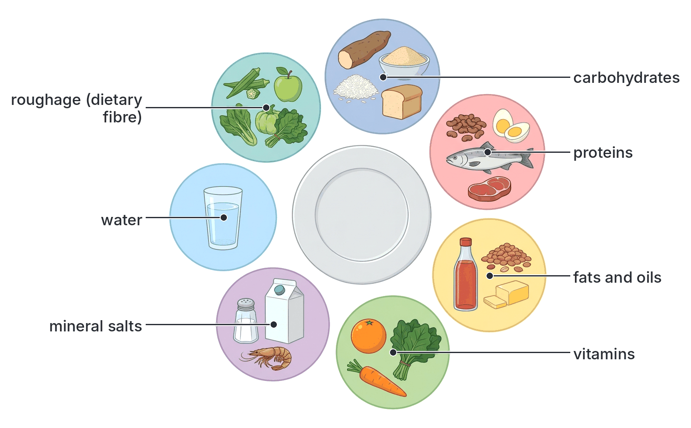

### Carbohydrates

**Carbohydrates** are energy-giving foods made of the elements **carbon, hydrogen and oxygen** only. Hydrogen and oxygen are present in the ratio **2:1**, as in water. Their general formula is often written as **Cx(H₂O)y**, which is how they got their name ("hydrated carbon").

They are the **main source of energy** in most Nigerian diets, which are based on starchy staples such as yam, cassava, rice, maize, millet, sorghum and plantain.

#### Types of carbohydrates

| Type | Meaning | Examples | Sweet? | Soluble in water? |
| --- | --- | --- | --- | --- |
| **Monosaccharides** (simple sugars) | Single sugar units; the building blocks of all carbohydrates. Most have the formula **C₆H₁₂O₆** (hexose sugars) | **Glucose** (in fruits, honey, blood), **fructose** (fruit sugar, in fruits and honey), **galactose** (part of milk sugar) | Yes | Yes |
| **Disaccharides** (double sugars) | Two monosaccharide units joined together, formula **C₁₂H₂₂O₁₁** | **Maltose** (malt sugar) = glucose + glucose; **sucrose** (cane sugar, table sugar) = glucose + fructose; **lactose** (milk sugar) = glucose + galactose | Yes | Yes |
| **Polysaccharides** | Many monosaccharide units (often thousands) joined in long chains | **Starch** (food store in plants, e.g. yam, cassava, rice); **glycogen** ("animal starch", food store in the liver and muscles of animals and in fungi); **cellulose** (makes plant cell walls) | No | No (or hardly) |

**How sugars join and split:**

- When two monosaccharides join to form a disaccharide, a molecule of water is removed. This is called **condensation**:
  glucose + glucose → maltose + water
- When a disaccharide or polysaccharide is broken down, water is added. This is called **hydrolysis**. Digestion is hydrolysis:
  maltose + water → glucose + glucose

Because starch and glycogen are large and insoluble, they are good **storage** molecules: they do not dissolve and do not affect the water balance of cells. Sugars are small and soluble, so they can be **transported** in blood or phloem sap.

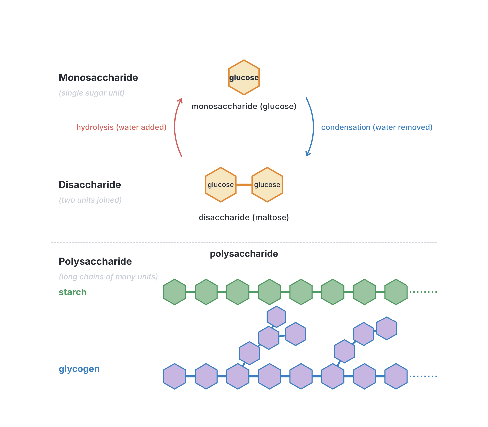

#### Sources of carbohydrates

- **Starch:** yam (pounded yam, amala), cassava (garri, fufu, lafun), rice, maize (ogi/pap, tuwo masara), millet and sorghum (tuwo, fura, kunu), cocoyam, sweet potato, Irish potato, plantain, bread, biscuits, spaghetti and noodles.
- **Sugars:** table sugar (from sugar cane), honey, ripe fruits (bananas, oranges, pineapples, mangoes, pawpaw), sugar cane, sweets, soft drinks, malt drinks, and milk (lactose).
- **Cellulose:** all plant foods, especially vegetables (ugwu, bitter leaf, waterleaf, okro), fruits eaten with their skins, beans and whole grains.

#### Importance (functions) of carbohydrates

1. **Main source of energy.** In the cells, glucose is broken down by respiration to release energy for all life activities (muscle contraction, growth, keeping warm, nerve impulses):
   glucose + oxygen → carbon (IV) oxide (CO₂) + water + energy
2. **Storage of energy:** excess glucose is stored as **glycogen** in the liver and muscles, and the rest is turned into fat.
3. **Protein sparing:** when there is enough carbohydrate, the body does not need to burn protein for energy, so protein can be used for growth and repair.
4. **Roughage:** cellulose in plant foods adds bulk to the faeces (see roughage below).
5. **Building other molecules:** sugars such as ribose and deoxyribose are part of RNA, DNA and ATP.

#### Deficiency and excess of carbohydrates

- **Deficiency:** tiredness and weakness, loss of weight as the body burns its fat and then its protein (muscle), and in children, when combined with lack of protein, **marasmus** (see the deficiency diseases section).
- **Excess:** extra carbohydrate is turned into fat, causing **obesity** (overweight), which increases the risk of type 2 diabetes, high blood pressure and heart disease. Frequent eating of sugary foods also causes **tooth decay (dental caries)** (see `B2d-mammalian-teeth.md`).

### Proteins

**Proteins** are body-building foods. They contain **carbon, hydrogen, oxygen and nitrogen**, and often **sulphur** (and sometimes phosphorus). The presence of **nitrogen** makes them different from carbohydrates and fats.

#### Structure of proteins

- Proteins are made of building blocks called **amino acids**. About **20** different amino acids are found in proteins.
- Amino acids are joined together by **peptide bonds** (formed by condensation) to make long chains called **polypeptides**. One or more polypeptides fold up to form a protein.
- Two amino acids joined = a **dipeptide**; many joined = a **polypeptide**.
- Each protein has its own order (sequence) of amino acids, which gives it its own shape and job. That is why there are thousands of different proteins in the body.
- Digestion breaks proteins back down into amino acids by hydrolysis.

#### Essential and non-essential amino acids

- **Essential amino acids** cannot be made by the body, so they **must** be eaten in food.
- **Non-essential amino acids** can be made in the body (in the liver) from other amino acids, so they need not be in the diet.

**Textbook variation:** older textbooks say adults need **8** essential amino acids (and children 9 or 10). Modern textbooks and nutrition bodies list **9** for adults (histidine is now included). Know that "essential" means "must be supplied in the diet".

#### First-class and second-class proteins

| Feature | First-class (complete) proteins | Second-class (incomplete) proteins |
| --- | --- | --- |
| Source | Mainly **animal** foods | Mainly **plant** foods |
| Essential amino acids | Contain **all** the essential amino acids in good amounts | Lack, or are low in, one or more essential amino acids |
| Examples | Meat, fish, crayfish, eggs, milk, wara (local cheese), chicken, snails | Beans (cowpea), groundnuts, soya beans, melon seeds (egusi), maize, rice, locust beans (iru/dawadawa) |
| Cost in Nigeria | Usually more expensive | Usually cheaper |

**Combining plant proteins:** different plant foods lack different amino acids. Cereals (rice, maize) are low in the amino acid lysine, while beans are low in methionine. Eating them **together**, as in **rice and beans**, **beans and ogi**, or **moi moi with pap**, gives a mixture of amino acids nearly as good as animal protein. This is very important for families who cannot afford much meat or fish. **Soya beans** are one of the best plant proteins and are used to make soy milk and "soya beans cake" (tofu, called *awara* in parts of Nigeria).

#### Sources of proteins

- **Animal sources:** meat (beef, goat meat, chicken, bush meat), fish (fresh, smoked, stockfish), crayfish, prawns, periwinkles, snails, eggs, milk, wara, nono (fermented milk), yoghurt, liver, kidney.
- **Plant sources:** beans (cowpea), soya beans, groundnuts, bambara nut (okpa), pigeon pea, melon seeds (egusi), locust beans, cashew nuts.
- **Insects:** roasted termites and palm weevil larvae (edible palm grubs) are eaten in many parts of Nigeria and are rich in protein.

#### Importance (functions) of proteins

1. **Growth:** making new cells and tissues (protoplasm). Growing children, pregnant women and breastfeeding mothers need extra protein.
2. **Repair:** replacing worn-out and damaged cells and healing wounds.
3. **Enzymes:** all enzymes are proteins (e.g. pepsin, amylase), so protein is needed to control body chemistry.
4. **Hormones:** some hormones are proteins, e.g. **insulin**.
5. **Antibodies:** proteins that fight disease (immunity).
6. **Transport:** **haemoglobin** in red blood cells carries oxygen.
7. **Structure and movement:** muscle proteins (actin and myosin), keratin (hair, nails), collagen (skin, tendons, bone).
8. **Energy:** when carbohydrates and fats are not enough (e.g. during starvation), proteins are broken down for energy.

The body cannot store excess amino acids. In the liver, the nitrogen part (amino group) is removed (**deamination**) and turned into **urea**, which is excreted by the kidneys; the rest is used for energy or stored as glycogen or fat.

#### Deficiency of proteins

- In children: **kwashiorkor**, and (when energy is also lacking) **marasmus**. Both are explained fully in the deficiency diseases section below.
- In adults: muscle wasting, weakness, slow wound healing, low resistance to infection, oedema (swelling due to fluid).

### Fats and oils (lipids)

**Fats and oils** together are called **lipids**. They contain **carbon, hydrogen and oxygen**, like carbohydrates, but have **much less oxygen** in proportion to carbon and hydrogen. This is why they release much more energy when broken down.

#### Structure of fats and oils

- A fat or oil molecule (a **triglyceride**) is made of **one glycerol** molecule joined to **three fatty acid** molecules.
- Digestion (by lipase) breaks them down into **fatty acids and glycerol**.

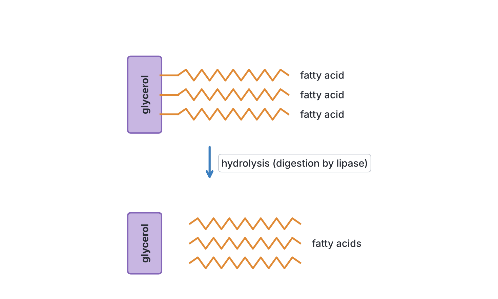

#### Fats compared with oils

| Feature | Fats | Oils |
| --- | --- | --- |
| State at room temperature (about 25 °C) | **Solid** | **Liquid** |
| Usual source | Mainly animals | Mainly plants (and fish) |
| Type of fatty acids | Mostly **saturated** | Mostly **unsaturated** |
| Examples | Butter, lard, the fat on meat, suet, ghee, shea butter (from a plant) | Groundnut oil, soya bean oil, cottonseed oil, olive oil, fish liver oil, palm kernel oil |
| Effect on health if eaten in large amounts | Raise blood cholesterol more; linked to heart disease | Generally healthier in moderate amounts |

**Note:** there are exceptions. **Shea butter** and **cocoa butter** are plant fats that are solid at room temperature. **Palm oil** and **coconut oil** are plant oils that are fairly high in saturated fatty acids and become solid or semi-solid in cool weather, which is why they often "freeze" in a bottle during the harmattan.

#### Sources of fats and oils

Red palm oil, palm kernel oil, groundnut oil, groundnuts, coconut, melon seeds (egusi), soya beans, shea butter, avocado pear, butter, margarine, cheese, milk, egg yolk, fatty meat, fish (especially mackerel/"titus" and sardines), fish liver oil and suya fat.

#### Importance (functions) of fats and oils

1. **Concentrated energy source:** 1 g of fat releases more than twice as much energy as 1 g of carbohydrate or protein (see nutritional value below).
2. **Energy store:** excess food is stored as fat in **adipose tissue** under the skin and around organs.
3. **Insulation:** the fat layer under the skin reduces heat loss and keeps the body warm.
4. **Protection:** fat around delicate organs such as the kidneys and heart cushions them against shock.
5. **Carrier of fat-soluble vitamins:** vitamins **A, D, E and K** dissolve in fat, so fat in the diet is needed for them to be absorbed and stored.
6. **Building cell membranes:** phospholipids and cholesterol are parts of all cell membranes; some hormones (e.g. sex hormones) are made from lipids.
7. **Waterproofing:** oils on the skin, hair and feathers.
8. **Metabolic water:** when fat is respired, water is produced. Camels and desert animals benefit from this.

#### Deficiency and excess of fats and oils

- **Deficiency** is uncommon. When it happens, there is loss of weight, dry and scaly skin, and **deficiency of the fat-soluble vitamins** (A, D, E and K), because they cannot be absorbed without fat. Some fatty acids are **essential fatty acids** and must come from the diet.
- **Excess** leads to **obesity**, and saturated fats raise blood **cholesterol**, which can be deposited in the walls of arteries (**atherosclerosis**), leading to high blood pressure, heart attack and stroke.

### Vitamins

**Vitamins** are **organic** substances needed in **very small amounts** for normal growth, health and metabolism. Most cannot be made by the body (or not in enough amounts), so they must come from food. They **do not provide energy** and are not used to build the body in bulk. Many act as **coenzymes**, helping enzymes to work. A disease caused by lack of a vitamin is called a **deficiency disease**.

The name comes from "vitamine", a word made up by the biochemist Casimir Funk in 1912, because he thought these substances were "vital amines". Not all vitamins are amines, so the "e" was dropped.

Vitamins are divided into two groups:

| Feature | Fat-soluble vitamins | Water-soluble vitamins |
| --- | --- | --- |
| Members | **A, D, E, K** (remember "**ADEK**") | **B group** and **C** |
| Dissolve in | Fat and oil | Water |
| Storage in the body | Stored in the liver and fatty tissue, so we can go a while without eating them | Not stored much (except B12); excess is lost in urine, so they must be eaten regularly |
| Danger of overdose | Possible (too much vitamin A or D from supplements is harmful) | Rare |
| Loss in cooking | Fairly stable | Easily lost: they dissolve in cooking water, and vitamin C (and some B vitamins) are destroyed by heat |

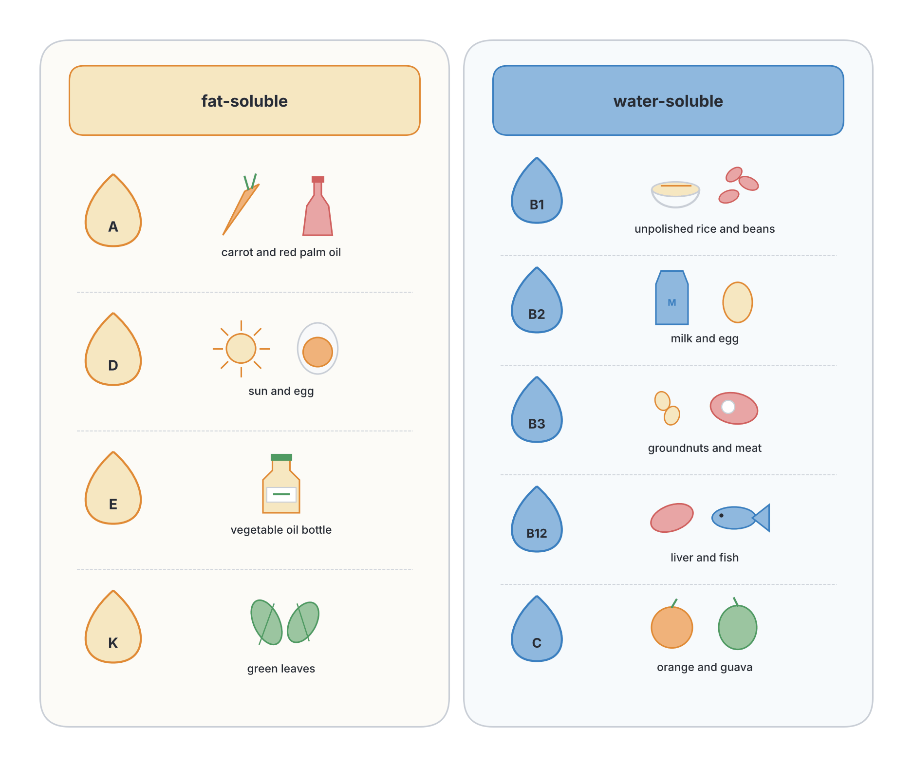

#### Vitamin A (retinol)

- **Sources:** liver, fish liver oil, egg yolk, milk, butter and cheese (as retinol). Plants contain **carotene** (beta-carotene), an orange pigment the body turns into vitamin A. Rich plant sources are **red palm oil** (one of the richest sources in the world), carrots, dark green leafy vegetables (ugwu, efo/spinach, bitter leaf), mangoes, pawpaw, yellow maize, orange-fleshed sweet potato and pumpkin.
- **Functions:**
  1. Needed to make **rhodopsin** (visual purple), the light-sensitive pigment in the **rod cells** of the retina, which allows us to see in **dim light**.
  2. Keeps the **epithelial tissues** (skin, cornea of the eye, linings of the breathing and digestive tracts) healthy and moist.
  3. Helps the body resist infections and supports normal growth.
- **Deficiency:** **night blindness** (cannot see well in dim light), **xerophthalmia** (dry, damaged cornea that can lead to permanent blindness), dry rough skin, and more frequent infections such as measles complications and diarrhoea in children.

#### The vitamin B group (B complex)

The B vitamins are a family of water-soluble vitamins that are often found together in the same foods. Most act as **coenzymes in respiration**, helping the cells release energy from food. The syllabus does not list them one by one, but JAMB commonly tests B1, B2, B3 and B12.

##### Vitamin B1 (thiamine)

- **Sources:** whole grains, **unpolished** (brown) rice and local rice such as ofada rice, wheat germ, beans, groundnuts, soya beans, yeast, pork, liver and eggs.
- **Functions:** needed for the release of energy from **carbohydrates** (respiration), and for the healthy working of **nerves** and **heart muscle**.
- **Deficiency:** **beriberi**. Most thiamine in rice is in the outer brown layer (bran) and germ. When rice is **polished** (milled until white), these are removed, so people who live mainly on polished white rice can develop beriberi.

**Textbook variation:** thiamine is also spelled "thiamin", and older books call it "aneurin".

##### Vitamin B2 (riboflavin)

- **Sources:** milk, eggs, liver, kidney, meat, fish, green leafy vegetables, yeast and whole grains.
- **Functions:** forms part of coenzymes (FAD) used in **respiration**; keeps the **skin, lips, tongue and eyes** healthy.
- **Deficiency:** **ariboflavinosis**: cracks and sores at the **corners of the mouth** (angular stomatitis), sore, swollen, reddish-purple tongue, inflamed lips, and itchy, watery eyes that are sensitive to light.

**Note:** riboflavin is destroyed by light, which is one reason milk is often sold in non-transparent containers.

##### Vitamin B3 (niacin, nicotinic acid)

- **Sources:** meat, liver, fish, chicken, groundnuts, whole grains, beans and yeast. The body can also make some niacin from the amino acid tryptophan, found in protein foods.
- **Functions:** forms part of coenzymes (NAD) used in **respiration**; keeps the skin, digestive system and nervous system healthy.
- **Deficiency:** **pellagra**.

**Textbook variation:** niacin is also called "nicotinic acid", and old books call it "vitamin PP" (pellagra-preventing factor).

##### Vitamin B12 (cobalamin)

- **Sources:** found naturally only in **animal foods**: liver, kidney, meat, fish, eggs, milk and cheese. It is made by bacteria, not by plants. It contains the element **cobalt**.
- **Functions:** needed for making **red blood cells** in the bone marrow, and for healthy **nerve cells**.
- **Deficiency:** a type of **anaemia** with large, abnormal red blood cells (megaloblastic anaemia), and nerve damage (numbness, poor balance). People who eat no animal products at all (strict vegetarians or vegans) are at risk unless they take supplements.
- **Absorption:** B12 can only be absorbed in the ileum if it is first bound to a substance called **intrinsic factor**, made by the stomach lining. If the stomach cannot make intrinsic factor, the person develops **pernicious anaemia**, even if there is enough B12 in the diet.

##### Other B vitamins (for completeness)

- **Folic acid (folate, vitamin B9):** in green leafy vegetables, liver, beans and oranges. Needed with B12 for making red blood cells and for cell division. Lack causes anaemia, and in early pregnancy increases the risk of birth defects of the baby's spine (neural tube defects). This is why pregnant women in Nigerian antenatal clinics are given folic acid tablets.
- **Vitamin B6 (pyridoxine):** in meat, fish, whole grains and bananas. Needed for protein (amino acid) metabolism.

#### Vitamin C (ascorbic acid)

- **Sources:** fresh fruits and vegetables, especially **guava** (very rich), **cashew apple**, oranges, lemons, limes, grapefruit, tangerines, pawpaw, pineapple, mangoes, tomatoes, fresh peppers and fresh green leafy vegetables.
- **Functions:**
  1. Needed to make **collagen**, the protein that holds cells and tissues together (skin, gums, blood vessel walls, bones).
  2. Keeps the **gums** and **skin** healthy and helps **wounds heal**.
  3. Helps the body **absorb iron** from food.
  4. Helps the body resist infection; acts as an antioxidant.
- **Deficiency:** **scurvy**.
- **Easily destroyed:** vitamin C is destroyed by **heat** (overcooking), by long **storage**, by exposure to **air**, and by adding potash or soda to cook vegetables. It also dissolves into cooking water. To keep it, eat fruits fresh, cook vegetables for a short time in little water, and do not keep cut fruits for long.

**History:** in 1747, the Scottish naval surgeon James Lind showed that sailors with scurvy recovered when they ate oranges and lemons. Long sea voyages without fresh food had killed many sailors.

#### Vitamin D (calciferol)

- **Sources:** made in the **skin** when it is exposed to **sunlight** (ultraviolet light), which is the main source for most people. In food: fish liver oil (cod liver oil), oily fish (mackerel, sardines), egg yolk, liver, butter, and fortified milk and margarine.
- **Functions:** helps the small intestine **absorb calcium and phosphorus** from food, and so is needed for the formation and hardening of **bones and teeth**.
- **Deficiency:** **rickets** in children and **osteomalacia** in adults (soft, weak bones).

**Textbook variation:** vitamin D exists in two main forms, D2 (ergocalciferol, from plants and fungi) and D3 (cholecalciferol, made in the skin and found in animal foods). Some books call D3 the "sunshine vitamin". Strictly, because the body can make it, some scientists call vitamin D a hormone rather than a true vitamin.

#### Vitamin E (tocopherol)

- **Sources:** vegetable oils (palm oil, groundnut oil, soya oil), wheat germ, nuts and seeds, green leafy vegetables and egg yolk.
- **Functions:** acts as an **antioxidant**, protecting cell membranes and red blood cells from damage; needed for normal reproduction in some animals.
- **Deficiency:** in **rats**, lack of vitamin E causes **sterility** (infertility) and miscarriage, which is why older textbooks call it the "**anti-sterility vitamin**". In humans, deficiency is rare; when it occurs (e.g. in premature babies), it can cause breakdown of red blood cells (haemolytic anaemia) and nerve damage.

**Textbook variation:** many West African textbooks give "sterility" or "infertility" as the deficiency effect of vitamin E. This was shown in experimental animals. For the exam, "sterility" is the expected answer, but know that it has not been proven as a common cause of infertility in humans.

#### Vitamin K (phylloquinone)

- **Sources:** **green leafy vegetables** (ugwu, spinach, cabbage, lettuce), liver, soya beans and vegetable oils. It is also **made by bacteria** living in the large intestine (colon).
- **Functions:** needed by the liver to make **prothrombin** and other clotting factors, so it is essential for **blood clotting**.
- **Deficiency:** blood takes a long time to clot, so the person **bleeds** easily (haemorrhage) and bruises easily.
- **Newborn babies** have no gut bacteria yet and little vitamin K, so in many hospitals they are given a vitamin K injection at birth to prevent bleeding.

**Textbook variation:** K comes from "Koagulation", the German and Danish spelling of coagulation (clotting).

### Mineral salts

**Mineral salts (minerals)** are **inorganic** elements that the body needs in small amounts. Plants absorb them from the soil, and animals get them by eating plants or other animals, and from water. They are needed to **build** body structures (bones, teeth, haemoglobin) and to **control** body processes (nerve impulses, muscle contraction, water balance, enzyme action).

- **Major elements (macro-minerals),** needed in larger amounts: calcium, phosphorus, sodium, potassium, chlorine, magnesium, sulphur.
- **Trace elements (micro-minerals),** needed in tiny amounts: iron, iodine, fluorine, zinc, copper, cobalt, manganese.

**Textbook variation:** some textbooks put iron with the major elements because it is so important; strictly, it is a trace element because only a few milligrams a day are needed.

#### Calcium (Ca)

- **Sources:** milk, wara and other cheese, yoghurt, small fish eaten with their bones (sardines, dried fish), crayfish, eggs, green leafy vegetables, beans and hard drinking water.
- **Functions:** forms **bones and teeth** (as calcium phosphate, with phosphorus); needed for **blood clotting**, **muscle contraction** and the working of **nerves**.
- **Deficiency:** **rickets** in children and **osteomalacia** in adults (soft, weak bones); weak teeth; slow blood clotting; **muscle cramps and spasms** (tetany). In older people, especially women after menopause, loss of calcium from bones causes **osteoporosis** (brittle bones that fracture easily).
- **Absorption** needs vitamin D.

#### Phosphorus (P)

- **Sources:** milk, cheese, eggs, meat, fish, beans, groundnuts and whole grains. It is found in most protein foods.
- **Functions:** with calcium, forms **bones and teeth**; part of **ATP** (the energy carrier of cells), **DNA and RNA**, and the phospholipids of **cell membranes**.
- **Deficiency:** rare, because phosphorus is in so many foods; causes weak bones and teeth (rickets), and muscle weakness.

#### Iron (Fe)

- **Sources:** liver (very rich), kidney, red meat, egg yolk, fish, beans, groundnuts, dark green leafy vegetables (ugwu, efo/spinach, waterleaf), and iron-fortified foods. Iron from meat is absorbed more easily than iron from plants; vitamin C helps absorb plant iron.
- **Functions:** forms part of **haemoglobin**, the red pigment in red blood cells that carries oxygen; part of **myoglobin** in muscles and of some respiratory enzymes.
- **Deficiency:** **iron-deficiency anaemia**: too little haemoglobin, so the blood carries less oxygen. The person is **pale** (check the inside of the lower eyelid, palms and nails), tired, weak, breathless and dizzy.
- **Who needs extra:** growing children, women who are menstruating, and **pregnant women** (antenatal clinics in Nigeria give iron tablets, often with folic acid).

#### Iodine (I)

- **Sources:** **iodised table salt**, seafood (sea fish, crayfish, periwinkles, shrimps), seaweed, and vegetables grown in iodine-rich soil. In Nigeria, salt sold for eating is required to be iodised.
- **Functions:** needed by the **thyroid gland** in the neck to make the hormone **thyroxine**, which controls the rate of metabolism, growth and brain development.
- **Deficiency:** **goitre** (a swelling of the thyroid gland in the neck). Lack of iodine in a pregnant mother can cause her baby to be born with **cretinism** (stunted growth and severe learning disability).

#### Sodium (Na)

- **Sources:** **table salt** (sodium chloride), seasoning cubes, salted and smoked fish, processed foods, meat, milk and eggs.
- **Functions:** needed for the transmission of **nerve impulses** and for muscle contraction; helps control the **water balance** and the volume of body fluids and blood.
- **Deficiency:** **muscle cramps**, weakness and tiredness, especially after heavy sweating (e.g. labourers and athletes in hot weather) or severe diarrhoea and vomiting.
- **Excess:** too much salt raises **blood pressure** (hypertension), which can lead to stroke and heart and kidney disease.

#### Potassium (K)

- **Sources:** bananas, plantain, oranges, tomatoes, potatoes, beans, green vegetables, coconut water, dates and meat.
- **Functions:** works with sodium in **nerve impulses** and **muscle contraction** (including the heartbeat); helps keep the water balance inside cells.
- **Deficiency:** muscle weakness, cramps and an irregular heartbeat. It can occur after severe diarrhoea and vomiting.

#### Fluorine (F, as fluoride)

- **Sources:** **fluoride toothpaste**, drinking water (naturally or where fluoride is added), tea and seafood.
- **Functions:** makes **tooth enamel** harder and more resistant to acid, so it helps prevent **tooth decay (dental caries)**; strengthens bones.
- **Deficiency:** greater risk of **dental caries**.
- **Excess:** too much fluoride while the teeth are forming causes **dental fluorosis**: white or brown spots and streaks (mottling) on the teeth. This occurs in some areas where groundwater is naturally high in fluoride.

#### Chlorine (Cl, as chloride)

- **Sources:** table salt (sodium chloride) and most foods.
- **Functions:** needed to make **hydrochloric acid** in the stomach; helps control water balance with sodium.
- **Deficiency:** rare; muscle cramps and poor digestion.

#### Magnesium (Mg)

- **Sources:** green vegetables (magnesium is part of chlorophyll), whole grains, nuts, beans and meat.
- **Functions:** part of bones and teeth; activates many enzymes, including those of respiration; needed for muscles and nerves.
- **Deficiency:** muscle weakness, cramps and tremors.

#### Zinc (Zn)

- **Sources:** meat, liver, seafood, eggs, beans, groundnuts and whole grains.
- **Functions:** part of many enzymes; needed for growth, wound healing, immunity and the sense of taste.
- **Deficiency:** slow growth, slow healing of wounds, poor appetite and more infections (zinc is given with oral rehydration solution to children with diarrhoea).

#### Other minerals

- **Sulphur (S):** in protein foods; part of some amino acids, and of keratin in hair and nails.
- **Cobalt (Co):** part of vitamin B12.
- **Copper (Cu):** needed with iron for making haemoglobin.

### Water

**Water** is the most plentiful substance in the body. It makes up roughly **60–70%** of the body mass of an adult (more in babies), and about 90% of blood plasma. A person can live for weeks without food but only a few days without water.

**Textbook variation:** the percentage of water in the body is given differently in different books (from about 55% to 70% for adults), because it depends on age, sex and how much fat a person has.

#### Sources of water

- **Drinking water** and drinks (tea, soft drinks, kunu, zobo, soups such as pepper soup).
- **Water in food:** fruits (watermelon, oranges, cucumber, pawpaw) and vegetables are mostly water; soups, pap and boiled foods contain a lot of water.
- **Metabolic water:** water produced inside the cells by **respiration** (see the equation under carbohydrates).

#### Importance (functions) of water

1. **Solvent:** most chemical reactions in the body take place in water; it dissolves food, gases, salts and wastes.
2. **Transport:** blood plasma, lymph and tissue fluid are mainly water, and carry dissolved food, hormones and waste around the body.
3. **Digestion:** digestion is **hydrolysis** (breaking food down by adding water); digestive juices are mostly water.
4. **Excretion:** urea and excess salts are removed dissolved in water as **urine** and sweat.
5. **Temperature control:** evaporation of **sweat** cools the body.
6. **Lubrication:** in saliva and mucus (helping food move along the gut), in the fluid of joints (synovial fluid) and in tears.
7. **Shape and support:** keeps cells firm; forms the fluid that cushions the brain and the baby in the womb (amniotic fluid).
8. **Prevents constipation**, together with roughage.

#### Deficiency of water

- Lack of water causes **dehydration**: thirst, dry mouth, small amounts of dark urine, headache, tiredness and constipation. Severe dehydration causes sunken eyes, loss of skin elasticity, confusion, kidney failure and death.
- Children with **diarrhoea** (e.g. from cholera or contaminated water) lose water and salts very quickly. They are treated with **oral rehydration solution (ORS)**, a mixture of clean water, salt and sugar.
- Drinking water must be **clean** (boiled, filtered or treated), to avoid water-borne diseases such as cholera, typhoid and dysentery.

### Roughage (dietary fibre)

**Roughage** (dietary fibre) is the part of plant food that humans **cannot digest**. It is made mainly of **cellulose** from plant cell walls (and other plant fibres). Humans have no enzyme (**cellulase**) to digest cellulose, so it passes through the alimentary canal almost unchanged.

**Sources:** vegetables (ugwu, okro, bitter leaf, waterleaf, cabbage, garden egg), fruits eaten with their skins or pulp (oranges, guava, mangoes, garden egg), beans, whole grains (brown rice, ofada rice, whole-wheat bread, millet, guinea corn), unsifted garri, corn on the cob, sugar cane fibre and coconut.

**Importance (functions):**

1. Adds **bulk** to the food in the intestine, giving the gut muscles something to push against, so it **stimulates peristalsis** (the wave-like muscular contractions that move food along).
2. Holds water, keeping the faeces soft and easy to pass, which **prevents constipation**.
3. Helps you feel full, which can help prevent overeating and obesity.
4. Many textbooks add that a high-fibre diet is linked to a lower risk of bowel cancer, heart disease and piles.

**Deficiency:** **constipation** (hard, dry faeces that are difficult to pass); straining can lead to **haemorrhoids (piles)**.

**In herbivores:** cows, sheep and goats depend on micro-organisms in their gut that produce cellulase, so cellulose is a major food for them (see `B2e-alimentary-canal-and-digestion.md`).

## Sources of the various classes of food

**Objective x: indicate the sources of the various classes of food.**

Most foods contain **more than one** class of food. We say a food is a "source" of a class when that class is the main or a very rich nutrient in it. The table below summarises the sources, using foods eaten in Nigeria.

| Class of food | Rich sources (Nigerian examples) | Main nutrient in these foods |
| --- | --- | --- |
| **Carbohydrates (starch)** | Yam, cassava (garri, fufu, lafun), rice, maize (ogi, tuwo masara), millet, sorghum (guinea corn), cocoyam, sweet potato, plantain, bread | Starch |
| **Carbohydrates (sugars)** | Sugar cane, table sugar, honey, ripe bananas, oranges, pineapples, mangoes, soft drinks, malt drinks, milk | Glucose, fructose, sucrose, lactose |
| **Proteins (animal)** | Meat, fish, stockfish, crayfish, chicken, eggs, milk, wara, nono, snails, periwinkles, liver | First-class protein |
| **Proteins (plant)** | Beans (cowpea), soya beans, groundnuts, bambara nut, melon seeds (egusi), locust beans (iru, dawadawa) | Second-class protein |
| **Fats and oils** | Red palm oil, palm kernel oil, groundnut oil, groundnuts, coconut, shea butter, egusi, avocado, butter, margarine, egg yolk, fatty meat, oily fish | Lipids |
| **Vitamin A** | Red palm oil, carrots, ugwu, efo, mango, pawpaw, liver, egg yolk, milk, fish liver oil | Retinol and carotene |
| **Vitamin B group** | Unpolished rice, whole grains, beans, groundnuts, yeast, liver, meat, eggs, milk | Thiamine, riboflavin, niacin, B12 |
| **Vitamin C** | Guava, cashew apple, oranges, lemons, limes, pawpaw, pineapple, tomatoes, fresh peppers, fresh leafy vegetables | Ascorbic acid |
| **Vitamin D** | Sunlight on the skin, fish liver oil, oily fish, egg yolk, liver, butter | Calciferol |
| **Vitamin E** | Vegetable oils, wheat germ, nuts, green vegetables, egg yolk | Tocopherol |
| **Vitamin K** | Green leafy vegetables, liver; made by gut bacteria | Phylloquinone |
| **Calcium and phosphorus** | Milk, wara, small fish with bones, crayfish, eggs, beans, green vegetables | Ca, P |
| **Iron** | Liver, red meat, egg yolk, beans, ugwu, efo, waterleaf | Fe |
| **Iodine** | Iodised salt, sea fish, crayfish, periwinkles, seaweed | I |
| **Sodium and chlorine** | Table salt, seasoning cubes, salted fish | Na, Cl |
| **Potassium** | Bananas, plantain, oranges, tomatoes, coconut water, beans | K |
| **Fluorine** | Fluoride toothpaste, some drinking water, tea, seafood | F |
| **Water** | Drinking water, drinks, soups, fruits (watermelon, oranges), vegetables; metabolic water | H₂O |
| **Roughage** | Vegetables, fruits with skin, beans, whole grains, unpolished rice, okro | Cellulose |

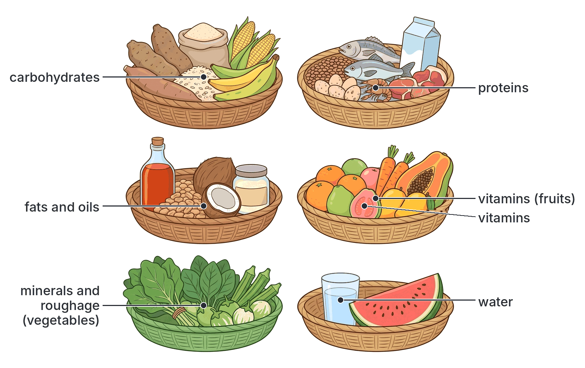

**Composition of some common Nigerian foods (main nutrients only):**

| Food | Main class | Also contains |
| --- | --- | --- |
| Garri | Carbohydrate (starch) | Very little protein; some roughage; vitamins and minerals are low (unless fortified or mixed with palm oil, as in yellow garri) |
| Beans (cowpea) | Protein | Starch, roughage, B vitamins, iron |
| Groundnut | Fat (oil) and protein | B vitamins (niacin), vitamin E, roughage |
| Egg | Protein | Fat (in the yolk), vitamins A, D and B12, iron |
| Milk | Protein, fat and sugar (lactose) | Calcium, phosphorus, vitamins A, B2, D; low in iron and vitamin C |
| Red palm oil | Fat (oil) | Very rich in carotene (vitamin A) and vitamin E |
| Orange | Sugar | Vitamin C, water, roughage |
| Ugwu (fluted pumpkin leaves) | Vitamins and minerals | Iron, calcium, vitamin A (carotene), roughage, some protein |
| Liver | Protein | Iron, vitamins A, B12 and D |

## The nutritional value of food

**Objective xi: determine the nutritional value of food.**

(This section also covers the stray line in objective iv, "determine their nutritional value", which repeats objective xi.)

The **nutritional value** of a food is how useful it is to the body. It depends on:

1. **Which nutrients** it contains (which classes of food).
2. **How much** of each nutrient it contains.
3. **How much energy** it provides (its **energy value**).
4. **How well** the body can digest and absorb those nutrients (e.g. iron from meat is absorbed better than iron from plants).
5. **The quality** of its nutrients (e.g. first-class proteins have all the essential amino acids; second-class proteins do not).

We find the nutritional value of a food by **food tests** (which classes are present), by measuring its **energy value**, and from **food composition tables** and **food labels**.

### Energy value of the classes of food

Energy is measured in **joules (J)** and **kilojoules (kJ)** (1 kJ = 1,000 J). Older books and food labels also use **calories**: 1 kilocalorie (kcal, often written "Calorie") = 4.2 kJ (more exactly 4.184 kJ).

| Class of food | Energy released per gram | Notes |
| --- | --- | --- |
| Carbohydrate | About **17 kJ** (about 4 kcal) | Quickest and cheapest source of energy |
| Protein | About **17 kJ** (about 4 kcal) | Used for energy only when carbohydrate and fat are not enough |
| Fat or oil | About **38–39 kJ** (about 9 kcal) | More than twice as much as carbohydrate or protein, because it has less oxygen |
| Vitamins, minerals, water, roughage | **None** | They do not provide energy |

**Textbook variation:** different textbooks give slightly different energy values, e.g. 16 or 17.2 kJ/g for carbohydrate, 17 or 22 kJ/g for protein, and 37, 38 or 39 kJ/g for fat. The higher value for protein is what it gives when burned completely in a calorimeter; in the body some energy is lost in urea, so about 17 kJ/g is used. In the exam, remember the **pattern**: fat gives the most energy per gram, and carbohydrate and protein give about the same.

### Experiment: measuring the energy value of a food

**Aim:** to compare the energy content of two foods, e.g. a groundnut and a piece of dried bread or yam chip.

**Materials:** groundnut (dry), small piece of dried bread, mounted needle (or pin stuck in a cork), boiling tube, clamp stand, thermometer, measuring cylinder, water, Bunsen burner or spirit lamp, balance.

**Method:**

1. Weigh the food sample (e.g. 0.5 g of groundnut).
2. Measure 20 cm³ of water (20 g) into a boiling tube clamped to a stand. Record its starting temperature.
3. Fix the food on the mounted needle and set it alight using the Bunsen flame.
4. As soon as it is burning, hold it immediately under the boiling tube until it burns out completely. Relight if it goes out.
5. Stir the water and record the highest temperature reached.
6. Repeat with a fresh 20 cm³ of water and the same mass of the second food.

**Calculation:**

Energy released (J) = mass of water (g) × 4.2 × rise in temperature (°C)

Energy per gram = energy released ÷ mass of food burned

(4.2 J is the energy needed to raise the temperature of 1 g of water by 1 °C.)

**Worked example:** 0.5 g of groundnut heats 20 g of water from 27 °C to 52 °C (a rise of 25 °C).

- Energy = 20 × 4.2 × 25 = 2,100 J = 2.1 kJ
- Energy per gram = 2.1 ÷ 0.5 = **4.2 kJ per gram**

**Observation and conclusion:** the groundnut produces a larger temperature rise than the same mass of bread, because groundnut is rich in **oil**, and fat or oil releases more energy per gram than carbohydrate.

**Sources of error:** the result is much lower than the real energy value of groundnut (food tables give about 24 kJ per gram), because much of the heat is lost to the air, to the glass and the needle, and the food may not burn completely. A **bomb calorimeter**, which burns food completely in oxygen inside an insulated container, gives accurate values.

**Control/fair test:** use the same mass of food, the same volume of water, the same distance between the flame and the tube, and the same tube for each food.

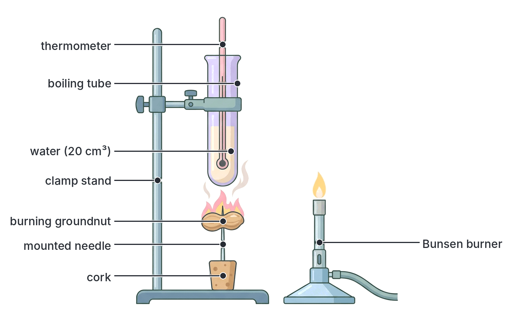

### Factors that change the nutritional value of food

- **Processing:** **polishing rice** removes the bran and germ, which contain thiamine (B1), fibre and minerals. **Sieving** flour removes fibre. Turning cassava into garri leaves mainly starch.
- **Cooking:** makes starch and protein easier to digest and kills germs, but **overcooking**, especially with potash or soda, destroys vitamin C and some B vitamins. Throwing away cooking water loses dissolved vitamins and minerals.
- **Storage:** fruits and vegetables lose vitamin C when stored for long; foods may become mouldy (e.g. groundnuts and maize can be contaminated with poisonous **aflatoxins** from moulds).
- **Fermentation:** making ogi, iru (locust beans), nono, yoghurt and bread can increase some B vitamins and make foods easier to digest.
- **Fortification:** adding nutrients to foods, e.g. iodine to salt, vitamin A to vegetable oil, sugar and flour.

### Energy needs vary

How much energy a person needs each day depends on:

- **Age:** growing teenagers need a lot of energy and protein; old people need less energy.
- **Sex:** males usually need more than females of the same age and size, because they usually have more muscle.
- **Occupation and activity:** a farmer, labourer or athlete needs much more energy than an office worker or a student sitting all day.
- **Body size:** larger people need more.
- **Pregnancy and breastfeeding:** extra energy, protein, iron, calcium and folic acid are needed.
- **Climate:** people in cold places need more energy to keep warm.
- **Health:** people recovering from illness or injury need extra protein.

## Importance and deficiency of each class of food

**Objective xii: relate the importance and deficiency (e.g. scurvy, rickets, kwashiorkor etc.) of each class of food.**

### Summary table: importance and deficiency of each class

| Class of food | Main importance | Effect of deficiency |
| --- | --- | --- |
| **Carbohydrates** | Main source of energy; energy store (glycogen); spares protein | Tiredness, weight loss; marasmus (with lack of protein) |
| **Proteins** | Growth and repair; enzymes, hormones, antibodies, haemoglobin | **Kwashiorkor**; marasmus; poor growth; slow healing |
| **Fats and oils** | Concentrated energy; insulation; protection of organs; carrier of vitamins A, D, E, K | Weight loss; dry skin; lack of fat-soluble vitamins |
| **Vitamin A** | Vision in dim light; healthy skin and eyes | **Night blindness**; xerophthalmia |
| **Vitamin B1** | Release of energy from carbohydrates; healthy nerves | **Beriberi** |
| **Vitamin B2** | Respiration; healthy skin, mouth and eyes | Cracks at the corners of the mouth; sore tongue |
| **Vitamin B3** | Respiration; healthy skin and nerves | **Pellagra** |
| **Vitamin B12** | Red blood cell formation; healthy nerves | **Anaemia** (pernicious/megaloblastic) |
| **Vitamin C** | Collagen, healthy gums and skin, wound healing, iron absorption | **Scurvy** |
| **Vitamin D** | Absorption of calcium and phosphorus; strong bones and teeth | **Rickets** (children); **osteomalacia** (adults) |
| **Vitamin E** | Antioxidant; reproduction in animals | Sterility in rats; rare in humans |
| **Vitamin K** | Blood clotting | Slow clotting; excessive bleeding |
| **Calcium** | Bones, teeth, blood clotting, muscle contraction | Rickets, osteomalacia, weak teeth, muscle cramps |
| **Phosphorus** | Bones, teeth, ATP, DNA | Weak bones and teeth (rickets) |
| **Iron** | Haemoglobin | **Anaemia** |
| **Iodine** | Thyroxine | **Goitre**; cretinism in babies |
| **Sodium and chlorine** | Nerve impulses, water balance, stomach acid | Muscle cramps |
| **Potassium** | Nerve impulses, heartbeat | Muscle weakness, irregular heartbeat |
| **Fluorine** | Hard tooth enamel | Dental caries (tooth decay) |
| **Water** | Solvent, transport, temperature control, excretion | **Dehydration** |
| **Roughage** | Stimulates peristalsis | **Constipation**; piles |

### Malnutrition

**Malnutrition** means poor nutrition caused by a diet that does not provide the right amounts of nutrients. It includes:

- **Undernutrition:** too little food overall, or too little of one or more nutrients (e.g. kwashiorkor, marasmus, anaemia, goitre). This is still common in parts of Nigeria, especially among young children in poor households and in areas affected by drought, conflict or displacement.
- **Overnutrition:** too much food, especially fat and sugar, leading to **obesity**, which raises the risk of type 2 diabetes, high blood pressure, heart disease and stroke. This is increasing in Nigerian towns and cities.

A **deficiency disease** is a disease caused by the lack of a particular nutrient in the diet. Each of the main deficiency diseases is explained below.

### Kwashiorkor

- **Cause:** a diet very **low in protein** (and often other nutrients), even though the child may be getting some energy from starchy food.
- **Who gets it:** usually children aged about 1 to 4 years, often after they are **weaned** from breast milk onto a diet of mainly starchy food (e.g. ogi or pap made only from maize, garri, cassava). The name comes from the Ga language of Ghana and is often translated as "the sickness the older child gets when the next baby is born", because the older child is removed from the breast when a new baby arrives.
- **Signs and symptoms:**
  1. **Oedema:** swelling of the feet, legs, hands and face ("moon face") caused by fluid collecting in the tissues. The swollen, rounded belly is due to oedema and an enlarged **fatty liver**.
  2. **Hair changes:** the hair becomes thin, soft and straight, loses its colour (turns reddish-brown, light brown or greyish) and is easily pulled out.
  3. **Skin changes:** patches of dark, peeling skin that crack and look like "flaking paint"; sores.
  4. **Muscle wasting** (hidden by the swelling).
  5. **Misery and apathy:** the child is irritable, unhappy, has no interest in its surroundings and has a **poor appetite**.
  6. Diarrhoea and more infections; **stunted growth**.
- **Prevention and treatment:** give protein-rich foods (milk, eggs, fish, crayfish, beans, soya beans, groundnuts); enrich weaning foods (e.g. ogi with milk or soya beans or crayfish); breastfeed for longer; nutrition education; severe cases need medical treatment.

### Marasmus

- **Cause:** a severe lack of **both energy (calories) and protein**: the child simply does not get enough food of any kind. It is a severe form of **protein-energy malnutrition (PEM)**.
- **Who gets it:** usually babies under 1 year, e.g. those stopped from breastfeeding very early, babies given over-diluted infant formula, or children with repeated diarrhoea.
- **Signs and symptoms:**
  1. **Severe wasting:** the child is extremely thin, "skin and bones", with visible ribs and very thin arms and legs; almost no fat under the skin.
  2. Loose, wrinkled skin; the face looks like that of an **old person** ("old man's face"), with sunken cheeks and eyes.
  3. **No oedema.**
  4. Very low weight for its age; stunted growth.
  5. The child is often **hungry** and may be alert, though weak.
  6. Frequent diarrhoea and infections.
- **Prevention and treatment:** exclusive breastfeeding for the first 6 months; correct preparation of formula; enough food of all kinds; treating diarrhoea with ORS; severe cases need hospital care.

#### Kwashiorkor and marasmus compared

| Feature | Kwashiorkor | Marasmus |
| --- | --- | --- |
| Main cause | Lack of **protein** (with some energy from starchy food) | Lack of **both energy and protein** (too little food overall) |
| Usual age | About 1 to 4 years (after weaning) | Usually under 1 year |
| Oedema (swelling) | **Present** (swollen feet, face, belly) | **Absent** |
| Body appearance | May look "plump" because of swelling; muscles wasted | Extremely thin, "skin and bones" |
| Hair | Thin, discoloured (reddish or pale), easily pulled out | Usually less changed; may be thin |
| Skin | Peeling, "flaky paint" patches | Loose and wrinkled; no peeling patches |
| Face | Moon face (swollen) | Old man's face (shrunken) |
| Liver | Enlarged, fatty | Not usually enlarged |
| Appetite and mood | Poor appetite; miserable and apathetic | Often hungry; may be alert |

**Textbook variation:** some textbooks describe marasmus simply as "lack of carbohydrate", and kwashiorkor as "lack of protein". Modern books treat both as forms of **protein-energy malnutrition**, with marasmus caused by a severe lack of energy and protein together. A child can also have features of both (**marasmic kwashiorkor**).

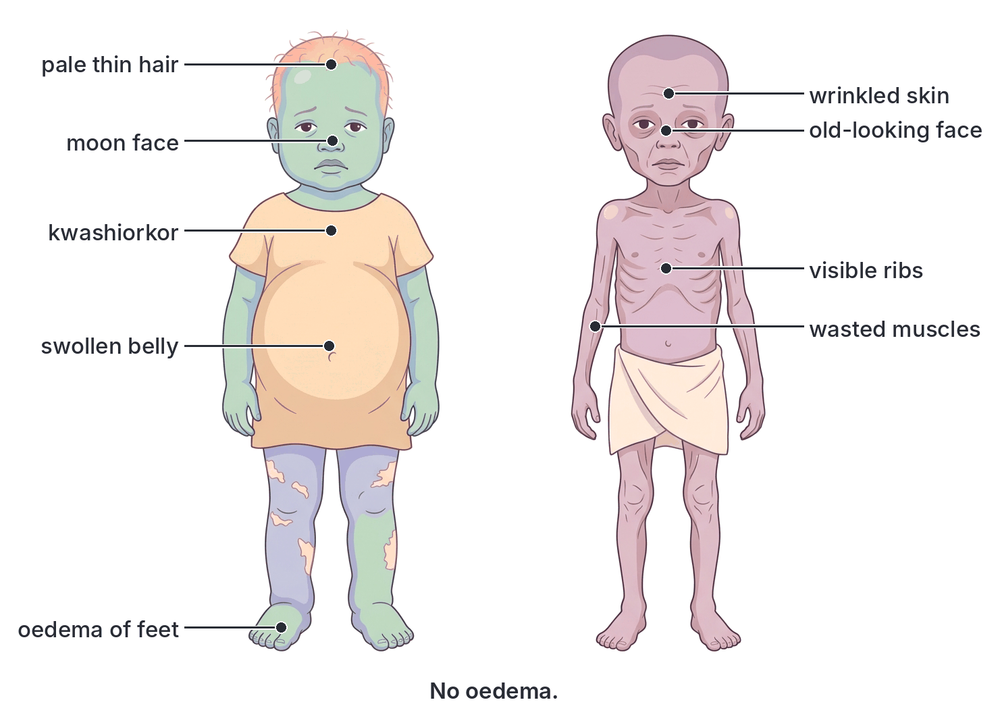

### Scurvy

- **Cause:** lack of **vitamin C** (ascorbic acid).
- **Signs and symptoms:** swollen, spongy, **bleeding gums**; loose teeth that may fall out; bleeding under the skin (small red-purple spots and bruises); **slow healing of wounds**; painful joints; tiredness and weakness; anaemia.
- **Why:** without vitamin C, the body cannot make collagen, so the walls of blood vessels and the gums become weak.
- **Prevention:** eat fresh fruits (oranges, guava, cashew apple, pawpaw) and lightly cooked vegetables every day.

### Rickets

- **Cause:** lack of **vitamin D**, or of **calcium** (or phosphorus), in **children**, whose bones are still growing.
- **Signs and symptoms:** soft, weak bones that **bend** under the body's weight, giving **bow legs** or **knock knees**; swollen wrists, ankles and knees; a row of bumps on the ribs ("rickety rosary"); a bulging forehead; delayed walking and late, poor teeth.
- **Note for Nigeria:** although Nigeria has plenty of sunshine, rickets still occurs in some Nigerian children. Research in Nigeria has shown that many of these cases are caused mainly by **low calcium intake** (diets low in milk and dairy foods) rather than lack of sunlight. Children kept indoors or fully covered also make less vitamin D.
- **Prevention:** enough sunlight on the skin; milk, eggs, fish and other foods rich in calcium and vitamin D.

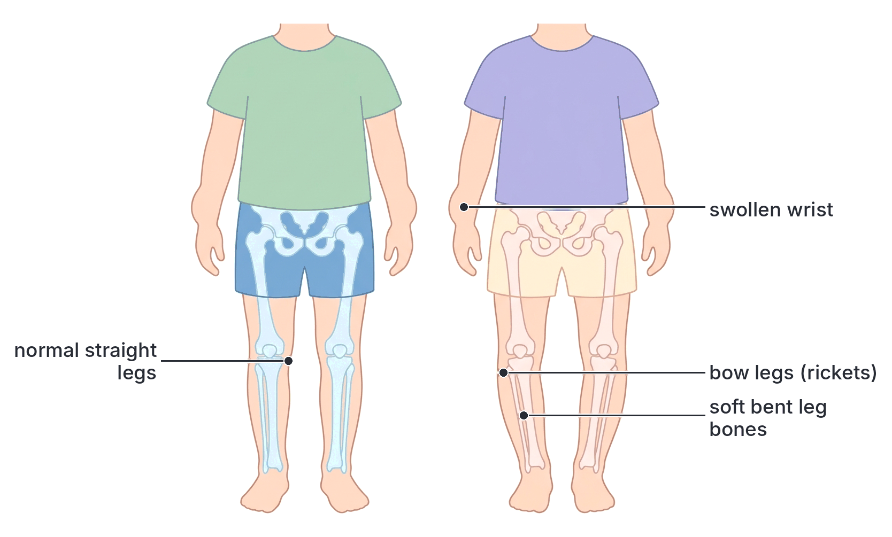

### Osteomalacia

- **Cause:** lack of **vitamin D** or **calcium** in **adults**. It is the adult form of rickets.
- **Who gets it:** adults who get little sunlight or calcium, especially **women who have had many pregnancies** and long periods of breastfeeding (the baby takes calcium from the mother), and elderly people who stay indoors.
- **Signs and symptoms:** bones become **soft** and weak, causing bone pain (especially in the hips, back and legs), muscle weakness, difficulty walking and easy fractures.
- **Prevention:** sunlight, calcium-rich foods and vitamin D.

**Note:** do not confuse osteomalacia (soft bones from lack of vitamin D or calcium) with **osteoporosis** (thin, brittle bones from loss of bone mass in old age).

### Beriberi

- **Cause:** lack of **vitamin B1 (thiamine)**. It is common where people eat mainly **polished white rice** or other highly refined cereals, and among alcoholics.
- **Signs and symptoms:**
  - **Dry beriberi:** damage to the nerves, causing numbness and tingling in the hands and feet, **muscle weakness and wasting**, difficulty walking, and paralysis of the legs.
  - **Wet beriberi:** affects the heart: a fast heartbeat, breathlessness, swelling (oedema) of the legs, and heart failure.
- The word "beriberi" is said to come from a Sinhalese phrase meaning "I cannot, I cannot", describing the patient's extreme weakness.
- **Prevention:** eat unpolished or parboiled rice, whole grains, beans and groundnuts.

### Pellagra

- **Cause:** lack of **vitamin B3 (niacin)** (and of the amino acid tryptophan, from which the body can make niacin). It is common in people who live mainly on **maize**, because the niacin in maize is mostly bound in a form the body cannot use (unless the maize is treated with lime, as is traditionally done in Mexico), and maize protein is low in tryptophan.
- **Signs and symptoms:** often remembered as the "**three Ds**":
  1. **Dermatitis:** rough, scaly, darkened skin on parts exposed to sunlight (face, neck, hands and feet).
  2. **Diarrhoea** and an inflamed mouth and tongue.
  3. **Dementia:** confusion, depression and memory loss.
  Untreated, it can lead to the fourth D, **death**.
- The name comes from Italian words meaning "rough skin".
- **Prevention:** a mixed diet with meat, fish, groundnuts, beans and whole grains.

### Night blindness and xerophthalmia

- **Cause:** lack of **vitamin A**.
- **Night blindness:** the person cannot see well in dim light (at dusk or at night), because the rod cells of the retina cannot make enough **rhodopsin** (visual purple). It is often the first sign of vitamin A deficiency.
- **Xerophthalmia** ("dry eye"): if the deficiency continues, the conjunctiva and cornea become dry and rough; foamy grey patches (**Bitot's spots**) may appear on the white of the eye; the cornea may soften and ulcerate, causing **permanent blindness**. Vitamin A deficiency is a leading cause of preventable blindness in children worldwide.
- **Prevention:** red palm oil, dark green vegetables, carrots, mangoes, liver, eggs and milk; vitamin A supplements given to young children during immunisation campaigns.

### Goitre

- **Cause:** lack of **iodine**. Without iodine, the thyroid gland cannot make enough **thyroxine**. The pituitary gland keeps stimulating the thyroid, which grows larger.
- **Signs:** a visible **swelling at the front of the neck** (the enlarged thyroid gland); tiredness, weight gain, slowness and feeling cold (if thyroxine is low). In a pregnant woman, severe iodine lack can cause **cretinism** in her baby.
- **Where common:** in inland and mountainous areas far from the sea, where soil and water contain little iodine. Goitre used to be common in parts of Nigeria before salt iodisation.
- **Prevention:** use **iodised salt**; eat seafood.

**Note:** goitre can also have other causes (e.g. an overactive thyroid), but in JAMB, goitre is linked to **iodine deficiency**.

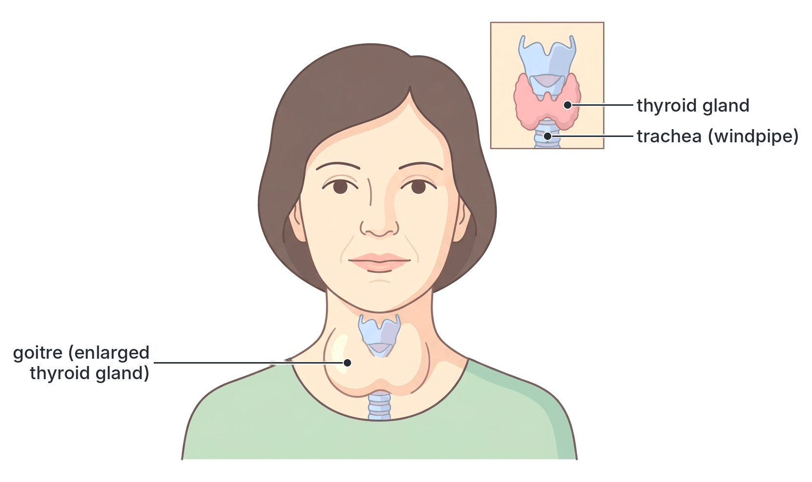

### Anaemia

- **Meaning:** a shortage of **haemoglobin** or of **red blood cells**, so the blood carries less oxygen.
- **Dietary causes:** lack of **iron** (most common), **vitamin B12**, **folic acid** or protein. (Copper and vitamin C deficiency also contribute.)
- **Other causes common in Nigeria:** **malaria** (the parasite destroys red blood cells), **hookworm** infection (the worms suck blood from the intestine), heavy menstrual bleeding, blood loss from injury, pregnancy, and sickle cell disease.
- **Signs and symptoms:** **pale** skin, inner eyelids, tongue and nails; tiredness and weakness; shortness of breath; dizziness; fast heartbeat; poor concentration.
- **Prevention:** iron-rich foods (liver, meat, beans, green leafy vegetables) with vitamin C; iron and folic acid tablets in pregnancy; preventing and treating malaria and hookworm.

### Other deficiency effects to know

| Deficiency | Effect |
| --- | --- |
| Vitamin B2 | Cracks at the corners of the mouth, sore tongue (ariboflavinosis) |
| Vitamin E | Sterility in experimental rats; rare in humans |
| Vitamin K | Slow clotting, excessive bleeding |
| Fluorine | Dental caries |
| Sodium | Muscle cramps |
| Water | Dehydration |
| Roughage | Constipation, piles |

## The balanced diet

**Objective xiii: determine the importance of a balanced diet.**

### What is a balanced diet?

A **balanced diet** is a diet that contains **all the classes of food** (carbohydrates, proteins, fats and oils, vitamins, mineral salts and water, plus roughage) in the **right proportions and amounts** to meet the needs of the body for energy, growth, repair and good health.

Key points:

- "**All classes**" is not enough: they must be in the **right amounts**. A meal of a huge mound of fufu with a little soup has all classes, but is mostly carbohydrate.
- The **right amounts depend on the person**: age, sex, activity, body size, health, and whether a woman is pregnant or breastfeeding (see "Energy needs vary" above).
- Energy taken in should roughly **equal** the energy used. Too little leads to weight loss; too much leads to obesity.

A common guide (shown as a **food plate** or **food pyramid**) is:

- **Plenty** of fruits and vegetables.
- **Plenty** of starchy foods, preferably whole grains (the main energy source).
- **Moderate** amounts of protein foods (beans, fish, meat, eggs, milk).
- **Small** amounts of fats, oils, sugar and salt.
- Enough clean **water** every day.

**Textbook variation:** different countries and textbooks draw the food guide differently (a pyramid, a plate, or a "food wheel") and suggest slightly different proportions. The principle is the same: variety and moderation.

[IMAGE: A balanced diet plate divided into sections, viewed from above, with Nigerian foods: about one third vegetables and fruits (ugwu leaves, tomatoes, carrots, orange slices, pawpaw), about one third starchy foods (jollof rice, boiled yam, plantain), a smaller section of protein foods (fried fish, boiled egg, beans, chicken), a small section of milk and dairy (glass of milk, wara), a tiny section of fats and oils (small bottle of palm oil). A glass of water beside the plate. Labels: fruits and vegetables, starchy foods (carbohydrates), protein foods, milk and dairy, fats and oils (small amount), water. Clean flat textbook style, white background.]

### Importance of a balanced diet

1. **Provides enough energy** for daily activities (work, study, play) and for keeping warm.
2. **Promotes normal growth** in children and teenagers, and helps the development of the brain.
3. **Repairs** worn-out and damaged tissues and helps wounds heal.
4. **Prevents deficiency diseases** such as kwashiorkor, marasmus, scurvy, rickets, beriberi, goitre and anaemia.
5. **Prevents diseases of excess**, such as obesity, high blood pressure, type 2 diabetes and heart disease.
6. **Strengthens the immune system**, so the body resists infections such as malaria, measles and diarrhoeal diseases, and recovers faster.
7. **Supports healthy pregnancy** and the growth of the baby, and the production of good breast milk.
8. **Keeps the bowels working well** (roughage and water prevent constipation).
9. **Maintains a healthy body weight**, and helps students concentrate and learn better.

### Nigerian meal examples

**Balanced or nearly balanced meals** (each provides carbohydrate, protein, fat or oil, vitamins, minerals, roughage and water):

| Meal | Carbohydrate | Protein | Fat or oil | Vitamins, minerals and roughage | Water |
| --- | --- | --- | --- | --- | --- |
| **Eba (garri) with egusi soup and ugwu, with fish or meat; an orange afterwards** | Garri | Fish, meat, crayfish, egusi | Palm oil, egusi | Ugwu leaves, pepper, orange | Soup, drinking water |
| **Jollof rice with chicken or fish, coleslaw or salad and fried plantain; a glass of water** | Rice, plantain | Chicken or fish | Vegetable oil | Tomatoes, peppers, carrots, cabbage | Water |
| **Beans and plantain (dodo) with vegetable sauce** | Plantain | Beans | Palm oil | Vegetables, tomatoes | Water |
| **Amala with ewedu and gbegiri, with fish or meat** | Amala (yam flour) | Gbegiri (beans), fish or meat | Palm oil | Ewedu (jute leaves) | Soup, water |
| **Tuwo shinkafa with miyan kuka (or miyan taushe) and meat** | Tuwo (rice) | Meat, dawadawa | Oil | Kuka (baobab leaves), vegetables | Soup, water |
| **Breakfast: ogi (akamu, pap) with milk, akara or moi moi, and a banana** | Ogi | Akara or moi moi (beans), milk | Oil in akara, milk fat | Banana, peppers | Pap, milk |
| **Boiled yam with egg sauce (tomato, onion, egg) and a slice of pawpaw** | Yam | Egg | Oil | Tomatoes, onions, pawpaw | Water |

**Unbalanced meals and why:**

| Meal | What is wrong | How to improve it |
| --- | --- | --- |
| Soaked garri with sugar and water only | Almost all carbohydrate; very little protein, vitamins or minerals | Add groundnuts and milk; eat fruit as well |
| Fufu or pounded yam with plain pepper soup with no meat or fish | Mostly carbohydrate; little protein | Add fish, meat, crayfish or eat with beans; add vegetables |
| Plain white bread and tea with sugar | Carbohydrate only | Add egg, beans (akara) or milk, and fruit |
| Indomie (instant noodles) alone, every day | Mostly carbohydrate and fat; high salt; low protein and vitamins | Add egg, vegetables and fish |
| Fried snacks and fizzy drinks | Too much fat, sugar and salt; little protein, vitamins or fibre | Replace with fruit, groundnuts, boiled corn, water |

### Special needs

- **Children and adolescents:** more protein, calcium and iron for growth.
- **Pregnant women:** extra protein, iron, folic acid, calcium, iodine and energy.
- **Breastfeeding mothers:** extra energy, protein, calcium and water.
- **Manual labourers and athletes:** more energy (carbohydrates) and water.
- **Elderly people:** less energy, but enough protein, calcium, vitamin D and fibre.
- **Sick or recovering people:** extra protein and vitamins for repair.
- **Babies:** **exclusive breastfeeding** for the first 6 months (breast milk contains all the nutrients a baby needs, plus antibodies), then gradually adding enriched weaning foods.

## Food tests

**Food tests** are simple chemical tests used to find out which classes of food are present in a sample. They show **whether** a food substance is present (qualitative tests), and the Benedict's test can also give a rough idea of **how much** (semi-quantitative).

### General method and safety

1. **Prepare the sample.** Solid foods (yam, bread, groundnut, beans) are crushed or ground in a mortar with a little distilled water to make a solution or suspension. Liquids (milk, orange juice, egg white mixed with water) can be used directly.
2. Put about **2 cm³** of the sample into a clean test tube.
3. **Add the reagent** and, if needed, heat in a **water bath** (a beaker of boiling water). Never heat a test tube directly over a flame with the mouth pointing at anyone.
4. **Observe** the colour change.
5. **Control:** do the same test on **distilled water** (no food). It should give the negative result, so that you know any colour change is caused by the food and not the reagent.
6. **Safety:** wear eye protection; sodium hydroxide is corrosive; ethanol is flammable (keep away from flames); Millon's reagent contains mercury and is toxic (teacher only).

### Test for starch (iodine test)

- **Reagent:** **iodine solution** (iodine dissolved in potassium iodide solution). It is **yellow-brown** (brown).
- **Method:**
  1. Put a little of the food (solid or solution) on a white tile or in a test tube.
  2. Add a few drops of iodine solution.
- **Positive result:** the yellow-brown colour changes to **blue-black** (dark blue). **Starch is present.**
- **Negative result:** the colour remains **yellow-brown** (brown). Starch is absent.
- **Notes:**
  - No heating is needed. In fact, the blue-black colour disappears if the mixture is heated, and comes back on cooling, so do the test cold.
  - Foods that give a positive result: yam, cassava, garri, rice, maize, bread, potato, cocoyam, unripe plantain.
  - The iodine test is also used to test a leaf for starch as evidence of photosynthesis (see `B2b-plant-nutrition.md`).

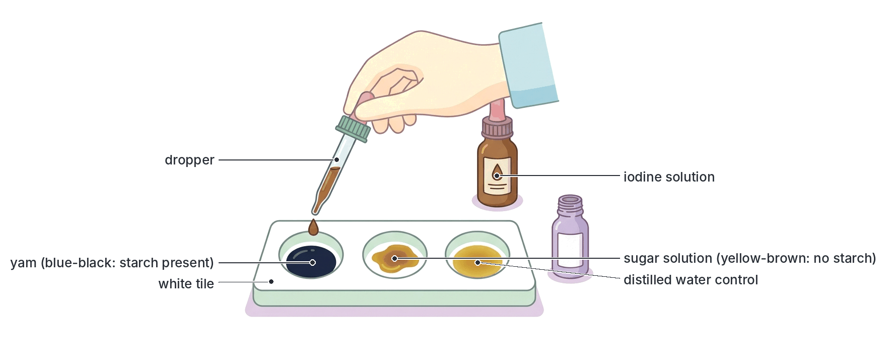

### Test for reducing sugars (Benedict's or Fehling's test)

**Reducing sugars** are sugars that can reduce (give electrons to) copper(II) ions in Benedict's and Fehling's solutions. **All monosaccharides** (glucose, fructose, galactose) and most disaccharides (**maltose** and **lactose**) are reducing sugars. **Sucrose** is **not**.

#### Benedict's test

- **Reagent:** **Benedict's solution** (blue; contains copper(II) sulphate, sodium carbonate and sodium citrate).
- **Method:**
  1. Put about 2 cm³ of the food solution in a test tube.
  2. Add an **equal volume** (about 2 cm³) of Benedict's solution.
  3. **Heat** in a boiling water bath for a few minutes.
- **Positive result:** the blue solution changes through **green**, **yellow** and **orange** to a **brick-red precipitate**. **A reducing sugar is present.**
- **Negative result:** the solution remains **blue**. No reducing sugar.
- **Semi-quantitative:** the final colour shows roughly how much reducing sugar is present:

| Final colour | Amount of reducing sugar |
| --- | --- |
| Blue | None |
| Green | Trace (very little) |
| Yellow | Low |
| Orange | Moderate |
| Brick-red | High |

**What happens:** the reducing sugar reduces the blue copper(II) ions to **copper(I) oxide**, which is an insoluble red-brown precipitate.

#### Fehling's test

- **Reagents:** **Fehling's solution A** (blue copper(II) sulphate solution) and **Fehling's solution B** (colourless; potassium sodium tartrate and sodium hydroxide). They are kept separate and mixed in **equal volumes** just before use, giving a deep blue solution.
- **Method:** add about 2 cm³ of the mixed Fehling's solution to 2 cm³ of the food solution and heat in a boiling water bath.
- **Positive result:** a **brick-red (red) precipitate** forms. A reducing sugar is present.
- **Negative result:** the solution stays **blue**.

**Benedict's vs Fehling's:** they give the same result. Benedict's is more commonly used today because it is a single, stable solution and is less caustic.

- **Foods that give a positive result:** glucose solution, ripe fruits (orange juice, banana, pawpaw, mango), honey, milk (lactose), malt drinks (maltose).

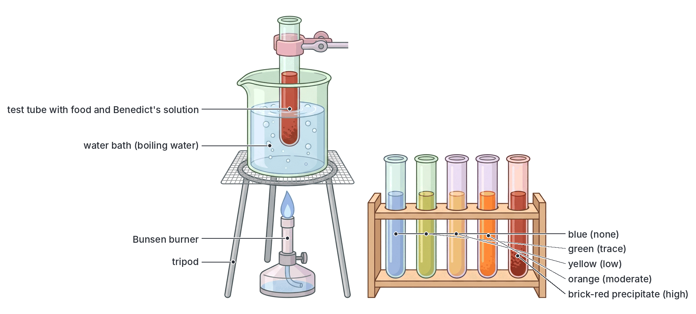

### Test for non-reducing sugars (e.g. sucrose)

**Sucrose** (cane sugar, table sugar) is a **non-reducing sugar**: it gives a **negative** Benedict's test on its own. To detect it, it must first be **hydrolysed** (split) into glucose and fructose, which are reducing sugars.

- **Reagents:** Benedict's solution, dilute **hydrochloric acid**, **sodium hydrogencarbonate** (sodium bicarbonate) powder (or dilute sodium hydroxide).
- **Method:**
  1. First, do Benedict's test on a sample. If it stays **blue**, there is no reducing sugar. (If there is some reducing sugar, note the colour and use it for comparison.)
  2. Put 2 cm³ of a **fresh** sample into a test tube and add about 1 cm³ of **dilute hydrochloric acid**.
  3. **Boil** in a water bath for about 2 to 5 minutes. The acid hydrolyses sucrose into glucose and fructose.
  4. Cool, then **neutralise** the acid by adding sodium hydrogencarbonate a little at a time, until the **fizzing stops** (Benedict's solution does not work in acid).
  5. Add 2 cm³ of Benedict's solution and heat in the water bath.
- **Positive result:** a **brick-red (or orange) precipitate** forms after acid hydrolysis, although the first Benedict's test was negative (or less red). **A non-reducing sugar is present.**
- **Negative result:** the solution stays **blue**.
- **Foods:** table sugar, sugar cane juice, and many fruits (which contain both reducing sugars and sucrose).

**Why the acid?** Acid hydrolysis breaks the glycosidic bond in sucrose:
sucrose + water → glucose + fructose (both reducing sugars)

**Note:** the enzyme **sucrase** (invertase) can be used instead of acid to split sucrose. Starch boiled with acid is also hydrolysed into reducing sugars, so a sample containing starch can give a positive result too; test for starch first.

### Test for proteins

#### Biuret test

- **Reagents:** **sodium hydroxide** solution (or potassium hydroxide) and **1% copper(II) sulphate** solution. (A ready-mixed **Biuret reagent**, which is blue, contains both.)
- **Method:**
  1. Put 2 cm³ of the food solution in a test tube.
  2. Add about 2 cm³ of sodium hydroxide solution and shake.
  3. Add **1% copper(II) sulphate** solution **drop by drop**, shaking after each drop. (Or add an equal volume of Biuret reagent.)
  4. **Do not heat.** Leave to stand for a minute or two.
- **Positive result:** a **violet (purple or mauve/lilac)** colour appears. **Protein is present.**
- **Negative result:** the solution stays **blue**.
- **What it detects:** the **peptide bonds** in proteins and polypeptides. (Single amino acids do not give a positive result.)
- **Foods that give a positive result:** egg white (albumen), milk, beans, soya beans, groundnuts, meat extract, fish.

**Textbook variation:** the positive colour is described as "violet", "purple", "mauve" or "lilac" in different books. They all mean the same result.

#### Millon's test

- **Reagent:** **Millon's reagent** (a solution of mercury in nitric acid, containing mercury nitrates). It is **poisonous**, so this test is usually done by the teacher, or is described only.
- **Method:**
  1. Put 2 cm³ of the food solution in a test tube.
  2. Add a few drops of Millon's reagent. A **white precipitate** forms.
  3. **Heat gently** in a water bath.
- **Positive result:** the white precipitate turns **brick-red** (red or pink-red). **Protein is present.**
- **Negative result:** no red colour.
- **What it detects:** the amino acid **tyrosine**, which is found in most proteins. (Proteins with little or no tyrosine, such as gelatin, give a weak or negative result.)

**Other protein test (for interest):** in the **xanthoproteic test**, concentrated nitric acid is warmed with the food; a **yellow** colour shows protein, and it turns **orange** when ammonia solution is added. This explains why nitric acid stains skin yellow.

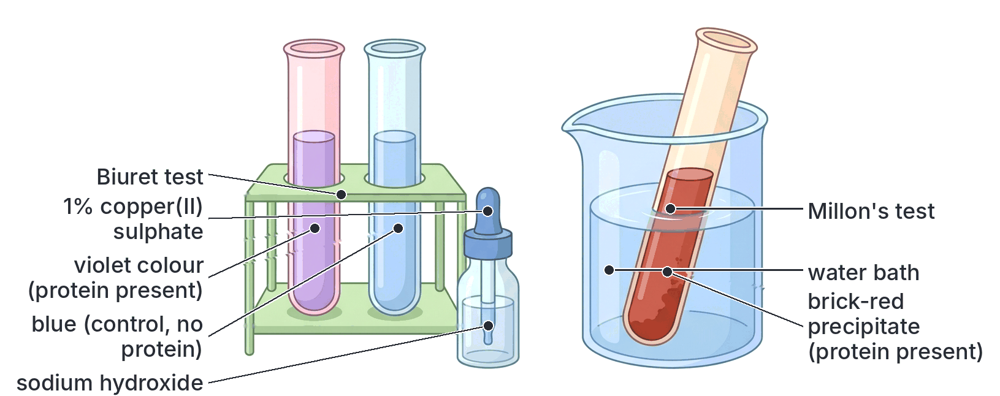

### Tests for fats and oils

All three tests below work for both **fats** and **oils**, because both are lipids. The syllabus lists "oil" and "fat" separately, but the tests are the same.

#### Sudan III test

- **Reagent:** **Sudan III**, a **red dye** that dissolves in fats and oils but **not in water**.
- **Method:**
  1. Put 2 cm³ of the food (e.g. groundnut paste mixed with water, or a few drops of oil in water) in a test tube.
  2. Add a few drops of Sudan III solution and shake well.
  3. Leave to stand.
- **Positive result:** a **red-stained oily layer** separates and **floats on top** of the water (or red-stained droplets are seen). **Fat or oil is present.**
- **Negative result:** no red layer; the red dye forms small red particles or spreads in the water, but no separate red oil layer appears.
- **Why it floats:** oil is less dense than water and does not mix with it.
- **Note:** Sudan III can also be used to stain fat in cells and tissues seen under the microscope (fat droplets appear red). Some books use **Sudan IV**, which works the same way.

#### Grease-spot test (translucent paper test)

- **Materials:** a piece of clean **white paper** (filter paper, plain paper or brown paper).
- **Method:**
  1. Rub a little of the food (e.g. crushed groundnut, a drop of palm oil, butter) on the paper. As a control, put a drop of water on another part of the paper.
  2. Leave it to dry for a few minutes, or warm it gently.
  3. Hold the paper up to the light.
- **Positive result:** a **translucent (semi-transparent) spot** remains that lets light through, and it **does not disappear** when the paper dries. **Fat or oil is present.**
- **Negative result:** the wet spot dries away and the paper becomes **opaque** again (like the water control).
- **Why:** water evaporates, but oil does not; it stays in the paper and makes it translucent. This is the "grease spot" seen on paper used to wrap akara, puff-puff, chin-chin or fried yam.

#### Emulsion test (ethanol test)

- **Reagents:** **ethanol** (absolute alcohol) and **distilled water**.
- **Method:**
  1. Put a small amount of the food (crushed or a few drops) in a **dry** test tube.
  2. Add about 2 cm³ of ethanol and **shake** well, so any fat or oil dissolves in the ethanol.
  3. Pour the ethanol (clear liquid, leaving any solid behind) into another test tube containing about 2 cm³ of **water**.
- **Positive result:** a **cloudy white emulsion** (milky appearance) forms. **Fat or oil is present.**
- **Negative result:** the mixture stays **clear**.
- **Why:** fat dissolves in ethanol but not in water. When the ethanol is added to water, the fat comes out of solution as tiny droplets spread through the water (an **emulsion**), which scatter light and look milky.
- **Safety:** ethanol is flammable; keep it away from flames.

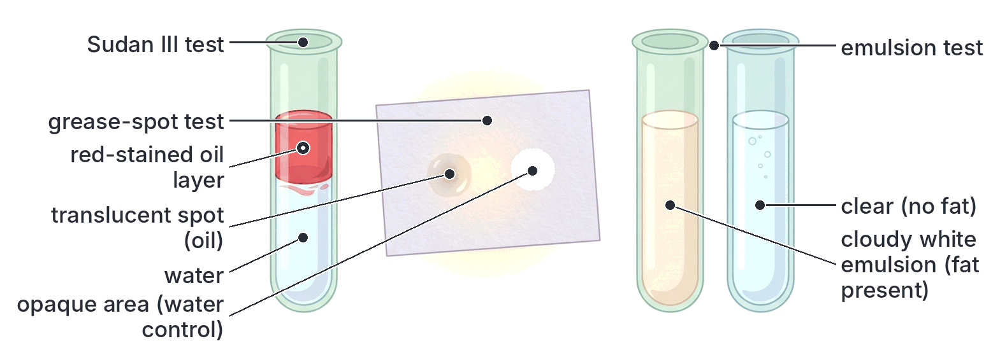

### Summary of food tests

| Food substance | Test | Reagent(s) | Heat? | Positive result | Negative result |
| --- | --- | --- | --- | --- | --- |
| **Starch** | Iodine test | Iodine solution (in potassium iodide) | No | **Blue-black** | Yellow-brown |
| **Reducing sugar** (glucose, fructose, maltose, lactose) | Benedict's test | Benedict's solution | Yes (water bath) | Green → yellow → orange → **brick-red precipitate** | Stays blue |
| **Reducing sugar** | Fehling's test | Fehling's A + B (mixed) | Yes | **Brick-red precipitate** | Stays blue |
| **Non-reducing sugar** (sucrose) | Acid hydrolysis then Benedict's | Dilute HCl, sodium hydrogencarbonate, Benedict's | Yes | **Brick-red** only after hydrolysis (first Benedict's test blue) | Stays blue |
| **Protein** | Biuret test | Sodium hydroxide + 1% copper(II) sulphate | No | **Violet / purple** | Stays blue |
| **Protein** | Millon's test | Millon's reagent | Yes (gently) | White precipitate turns **brick-red** | No red colour |
| **Fat or oil** | Sudan III test | Sudan III (red dye) | No | **Red-stained layer** floats on top | No red oil layer |
| **Fat or oil** | Grease-spot test | White or filter paper | Dry or warm | **Translucent spot** remains | Spot dries and disappears |
| **Fat or oil** | Emulsion test | Ethanol, then water | No | **Cloudy white emulsion** | Stays clear |

**Memory tricks:**

- "**I**odine → **S**tarch → **B**lue-black" (no heat).
- "**B**enedict's needs **B**oiling; **B**rick-red means sugar."
- "**Biu**ret is **vio**let" (no heat); both have "i" and "v" sounds.
- "**S**udan **S**tains fat red."

## Detecting the presence of a food type from experimental results

**Objective xiv: detect the presence of a food type from the result of a given experiment.**

In JAMB, you are often given the results of food tests on an unknown sample, as a table or a description, and asked which food substance(s) it contains, or which food it might be. Use these steps.

### How to interpret results

1. **Look at each reagent and its final colour.** Compare it with the positive and negative results in the summary table above.
2. **Positive = present; negative = absent.** Write down the food substances present.
3. **Check the control.** If the distilled water control also changed colour, the reagent is contaminated, and the results cannot be trusted.
4. **Watch for the non-reducing sugar trick:** a sample that is **blue with Benedict's** but **brick-red after boiling with acid and neutralising** contains a **non-reducing sugar** (e.g. sucrose). A sample that is brick-red with Benedict's straight away contains a **reducing sugar**.
5. **Match to a food:** use your knowledge of which nutrients common foods contain (e.g. egg white is mainly protein; groundnut is rich in oil and protein; yam is mainly starch; table sugar is sucrose; milk contains protein, fat and lactose).
6. **Remember what each test does NOT show:** the iodine test does not detect sugar; Benedict's does not detect starch or sucrose; Biuret does not detect amino acids; a negative Sudan III result means no fat, not "no food".

### Worked results table

| Sample | Iodine | Benedict's | Acid hydrolysis then Benedict's | Biuret | Sudan III / emulsion | Food substances present | Likely food |
| --- | --- | --- | --- | --- | --- | --- | --- |
| P | Blue-black | Blue | (Brick-red, from starch hydrolysis) | Blue | Negative | **Starch** | Yam, cassava or garri solution |
| Q | Yellow-brown | Brick-red | Brick-red | Blue | Negative | **Reducing sugar** | Glucose solution or honey |
| R | Yellow-brown | Blue | Brick-red | Blue | Negative | **Non-reducing sugar** (sucrose) | Table sugar solution |
| S | Yellow-brown | Blue | Blue | Violet | Negative | **Protein** | Egg white (albumen) |
| T | Yellow-brown | Orange or brick-red | Brick-red | Violet | Red layer / cloudy emulsion | **Reducing sugar, protein and fat** | Milk |
| U | Yellow-brown (or faint blue-black) | Blue | Blue | Violet | Red layer / cloudy emulsion | **Fat (oil) and protein** | Groundnut |
| V | Yellow-brown | Blue | Blue | Blue | Red layer / cloudy emulsion; translucent spot | **Fat or oil only** | Palm oil or groundnut oil |
| W | Yellow-brown | Blue | Blue | Blue | Negative | **None of these** | Distilled water (control) or plain salt solution |

**Notes on the table:**

- For sample P, boiling starch with acid hydrolyses it into reducing sugars, so the acid test can come out positive; that is why you should always use the iodine test for starch.
- Groundnuts contain some carbohydrate, so they may give a weak positive with iodine; but their strongest results are for fat and protein.

### Worked examples

**Example 1:** A food sample turned violet when sodium hydroxide and copper(II) sulphate solution were added. It remained yellow-brown with iodine solution, and blue with Benedict's solution after heating. Which food substance is present?

**Answer:** **protein** only. The violet colour in the Biuret test shows protein; the negative iodine and Benedict's tests show that starch and reducing sugar are absent.

**Example 2:** A student heated a food solution with Benedict's solution and it stayed blue. She then boiled a fresh sample with dilute hydrochloric acid, neutralised it with sodium hydrogencarbonate and heated it again with Benedict's solution. A brick-red precipitate formed. What does the sample contain?

**Answer:** a **non-reducing sugar**, such as **sucrose**. The acid hydrolysed the sucrose into glucose and fructose, which are reducing sugars.

**Example 3:** A piece of paper rubbed with a crushed seed showed a translucent spot that did not disappear after drying. The seed is rich in

**Answer:** **oil** (lipid). Water would dry off; oil leaves a permanent translucent spot.

**Example 4:** Three test tubes contain solutions X, Y and Z. With iodine solution, X turns blue-black. With Benedict's solution and heat, Y gives a brick-red precipitate. With ethanol and water, Z gives a cloudy white emulsion. Identify the food substances.

**Answer:** X contains **starch**; Y contains a **reducing sugar**; Z contains **fat or oil**.

**Example 5:** A food sample gave a green colour with Benedict's solution, while another gave a brick-red precipitate. What can you conclude?

**Answer:** both contain a reducing sugar, but the second sample contains **much more** reducing sugar than the first (green = trace).

### Experiment: testing a starch solution after adding saliva

This classic experiment links food tests with digestion (see `B2e-alimentary-canal-and-digestion.md`).

- **Aim:** to show that saliva digests starch into a reducing sugar.
- **Method:**
  1. Put 2 cm³ of starch solution into each of two test tubes, A and B.
  2. To A, add 1 cm³ of saliva (rinse your mouth first with water and collect saliva in a clean beaker). To B (the **control**), add 1 cm³ of **boiled** (and cooled) saliva or distilled water.
  3. Keep both tubes in a water bath at about **37 °C** for 15 to 20 minutes.
  4. Test a little from each tube with **iodine solution**, and the rest with **Benedict's solution**.
- **Results:**

| Tube | Iodine test | Benedict's test |
| --- | --- | --- |
| A (starch + saliva) | Yellow-brown (no starch left) | Brick-red (reducing sugar present) |
| B (starch + boiled saliva or water) | Blue-black (starch still present) | Blue (no reducing sugar) |

- **Conclusion:** an enzyme in saliva (**salivary amylase**, or ptyalin) digested starch into a reducing sugar (**maltose**). Boiling destroyed (denatured) the enzyme, so starch in tube B was not digested.

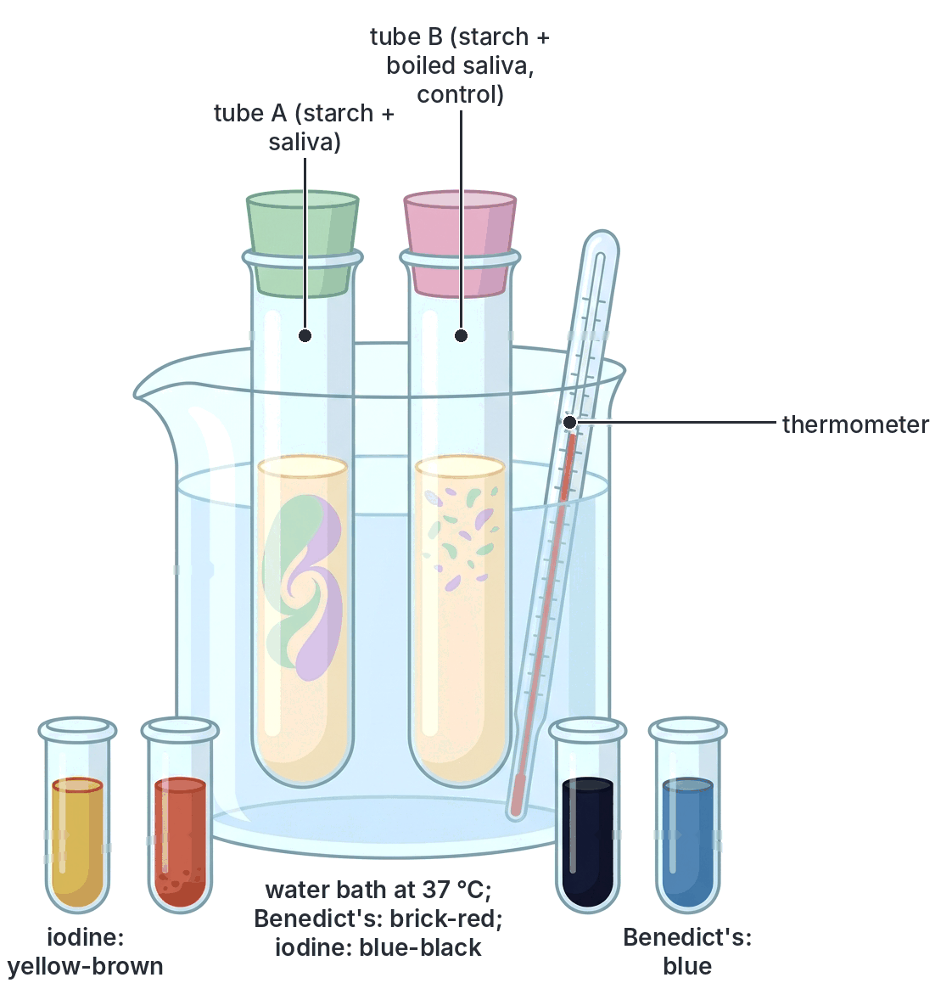

## Key terms

| Term | Meaning |
| --- | --- |
| Nutrient | A useful chemical substance in food |
| Macronutrient | A nutrient needed in large amounts (carbohydrates, proteins, fats, water) |
| Micronutrient | A nutrient needed in tiny amounts (vitamins and minerals) |
| Monosaccharide | A simple sugar with a single unit, e.g. glucose, fructose |
| Disaccharide | A sugar made of two monosaccharide units, e.g. maltose, sucrose, lactose |
| Polysaccharide | A large carbohydrate made of many sugar units, e.g. starch, glycogen, cellulose |
| Condensation | Joining of small molecules with the removal of water |
| Hydrolysis | Breaking down of a large molecule by adding water |
| Amino acid | The building block of proteins |
| Peptide bond | The bond joining two amino acids |
| Essential amino acid | An amino acid that cannot be made by the body and must be eaten |
| First-class protein | A protein containing all the essential amino acids, usually from animals |
| Triglyceride | A fat or oil molecule: glycerol joined to three fatty acids |
| Vitamin | An organic substance needed in tiny amounts for health; gives no energy |
| Mineral salt | An inorganic element needed in small amounts, e.g. iron, calcium, iodine |
| Roughage (dietary fibre) | Indigestible plant material (mainly cellulose) that helps peristalsis |
| Deficiency disease | A disease caused by lack of a particular nutrient in the diet |
| Malnutrition | Poor nutrition from too little, too much or the wrong balance of nutrients |
| Kwashiorkor | Protein deficiency disease of young children, with oedema |
| Marasmus | Severe wasting from lack of both energy and protein |
| Balanced diet | A diet containing all classes of food in the right proportions and amounts |
| Reducing sugar | A sugar that gives a brick-red precipitate with Benedict's or Fehling's solution |
| Non-reducing sugar | A sugar (e.g. sucrose) that gives a positive Benedict's test only after hydrolysis |
| Emulsion | Tiny droplets of one liquid (e.g. oil) spread through another (e.g. water), looking milky |
| Translucent | Letting some light through, but not clearly see-through |
| Energy value | The amount of energy released when a gram of food is respired or burned |
| Control | Part of an experiment set up without the factor being tested, for comparison |

## Exam tips and common mistakes

- **Nitrogen marks protein:** proteins contain C, H, O and **N** (often S). Carbohydrates and fats contain only C, H and O.
- **Fat has the most energy per gram:** about 38–39 kJ/g, more than twice carbohydrate or protein (about 17 kJ/g). Vitamins, minerals, water and roughage give no energy.
- **Fat-soluble vitamins are ADEK;** B and C are water-soluble. Vitamin C is destroyed by heat and long storage.
- **Match vitamin to disease:** A → night blindness; B1 → beriberi; B3 → pellagra; B12 → anaemia; C → scurvy; D → rickets (children) and osteomalacia (adults); K → slow clotting.
- **Match mineral to disease:** iron → anaemia; iodine → goitre; calcium → rickets; fluorine → dental caries.
- **Kwashiorkor vs marasmus:** kwashiorkor has **oedema** (swelling) and is mainly lack of **protein**; marasmus is severe **wasting** with no oedema, from lack of **energy and protein**.
- **Iodine test needs no heat; Benedict's needs heat; Biuret needs no heat.** Mixing these up is a common error.
- **Positive colours:** starch = blue-black; reducing sugar = brick-red; protein = violet (purple); fat = red layer (Sudan III), translucent spot, or milky emulsion.
- **Sucrose is a non-reducing sugar.** It stays blue in Benedict's test until it is boiled with acid and neutralised.
- **Do not neutralise with acid:** after acid hydrolysis, you neutralise with an **alkali** (sodium hydrogencarbonate) before adding Benedict's.
- **Iodine solution is yellow-brown, not "colourless".** Benedict's solution is blue. A "negative" result means the reagent keeps its own colour.
- **A balanced diet is not "a lot of food":** it is all the classes in the right proportions for that person.
- **Roughage is not digested** in humans (no cellulase), but it is still important for peristalsis.

## Quick summary

1. The six classes of food in the syllabus are carbohydrates, proteins, fats and oils, vitamins, mineral salts and water; many textbooks add roughage (dietary fibre) as a seventh.
2. Carbohydrates (starch and sugars) and fats give energy; fat gives about 38–39 kJ/g and carbohydrate and protein about 17 kJ/g. Proteins, made of amino acids, are for growth and repair.
3. Vitamins (A, D, E, K are fat-soluble; B group and C are water-soluble) and mineral salts (calcium, phosphorus, iron, iodine, sodium, potassium, fluorine and others) are needed in small amounts to keep the body healthy.
4. Lack of particular nutrients causes deficiency diseases: kwashiorkor and marasmus (protein and energy), scurvy (C), rickets and osteomalacia (D and calcium), beriberi (B1), pellagra (B3), night blindness (A), goitre (iodine) and anaemia (iron, B12, folic acid).
5. A balanced diet contains all classes of food in the right proportions for a person's age, sex, activity and condition; Nigerian meals such as eba with egusi soup and fish, or jollof rice with chicken and salad, can be balanced.
6. Food tests: iodine turns starch blue-black; Benedict's or Fehling's gives a brick-red precipitate with reducing sugars; sucrose needs acid hydrolysis first; Biuret gives violet and Millon's gives brick-red with protein; Sudan III, the grease-spot test and the emulsion test detect fats and oils.
7. To detect a food from experimental results, compare each result with the positive and negative colours, check the control, and remember which tests need heat.

## Practice questions

**1. Which of the following elements is present in proteins but absent in carbohydrates and fats?**

- A. Carbon
- B. Hydrogen
- C. Nitrogen
- D. Oxygen

**Answer: C.** Proteins contain nitrogen (in their amino groups); carbohydrates and fats contain only carbon, hydrogen and oxygen.

**2. A food sample gave a violet colour when sodium hydroxide and copper(II) sulphate solutions were added to it. The sample contains**

- A. protein
- B. starch
- C. reducing sugar
- D. fat

**Answer: A.** A violet (purple) colour in the Biuret test shows the presence of protein.

**3. Which of the following foods would give the most energy per gram when fully respired?**

- A. Yam
- B. Sugar
- C. Egg white
- D. Palm oil

**Answer: D.** Palm oil is a lipid; fats and oils release about 38–39 kJ/g, more than twice as much as carbohydrates (yam, sugar) or protein (egg white).

**4. A child has swollen feet and face, thin reddish hair, peeling skin and a poor appetite. The child is most likely suffering from**

- A. marasmus
- B. kwashiorkor
- C. rickets
- D. scurvy

**Answer: B.** Oedema (swelling), hair and skin changes and apathy are signs of kwashiorkor, caused by lack of protein. Marasmus has severe wasting without oedema.

**5. Bleeding gums and slow healing of wounds are signs of a deficiency of**

- A. vitamin A
- B. vitamin B1
- C. vitamin C
- D. vitamin D

**Answer: C.** Lack of vitamin C causes scurvy, because collagen is not formed properly in the gums, skin and blood vessels.

**6. A food solution remained blue when heated with Benedict's solution. A fresh sample was boiled with dilute hydrochloric acid, neutralised and heated with Benedict's solution, and it gave a brick-red precipitate. The food contains**

- A. glucose
- B. starch only
- C. protein
- D. sucrose

**Answer: D.** Sucrose is a non-reducing sugar. Acid hydrolysis splits it into glucose and fructose, which then reduce Benedict's solution. Glucose would have given a positive result in the first test.

**7. Which of the following is a fat-soluble vitamin whose deficiency causes night blindness?**

- A. Vitamin A
- B. Vitamin B2
- C. Vitamin C
- D. Vitamin K

**Answer: A.** Vitamin A is needed to make rhodopsin (visual purple) in the rods of the retina; lack of it causes night blindness. B2 and C are water-soluble, and K is needed for blood clotting.

**8. Goitre is caused by a deficiency of**

- A. iron
- B. calcium
- C. fluorine
- D. iodine

**Answer: D.** Iodine is needed to make thyroxine; without it, the thyroid gland enlarges, forming a goitre.

**9. The main function of roughage in the human diet is to**

- A. provide energy
- B. stimulate peristalsis and prevent constipation
- C. build new tissues
- D. help blood to clot

**Answer: B.** Roughage (mainly cellulose) is not digested in humans; it adds bulk to food in the intestine, stimulating peristalsis and preventing constipation.

**10. Which of the following meals is the most balanced?**

- A. Garri soaked in water with sugar
- B. Bread and tea with sugar
- C. Eba with egusi soup containing fish and vegetables, and an orange
- D. Fufu with plain pepper soup

**Answer: C.** It contains carbohydrate (eba), protein (fish, egusi), oil (palm oil, egusi), vitamins and minerals (vegetables, orange), roughage and water. The others are mostly carbohydrate.
