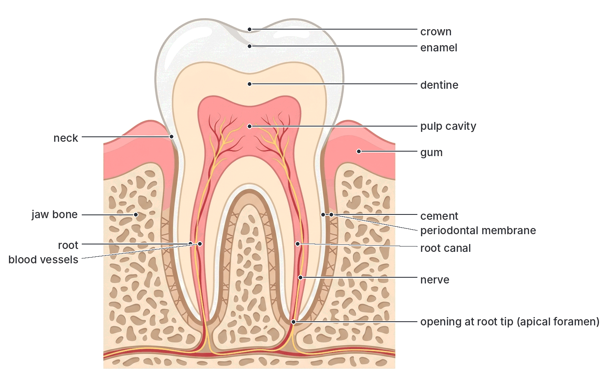
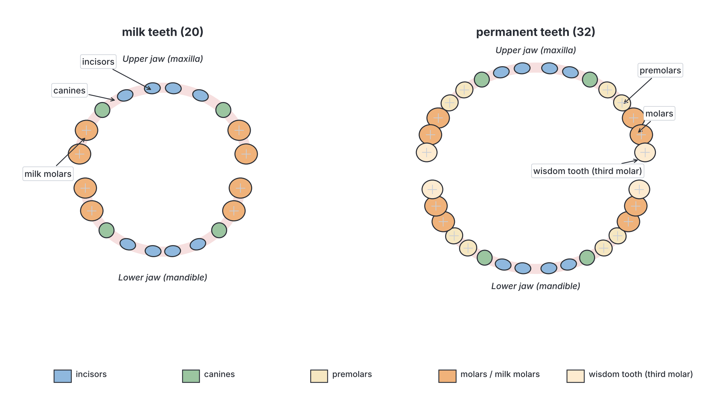
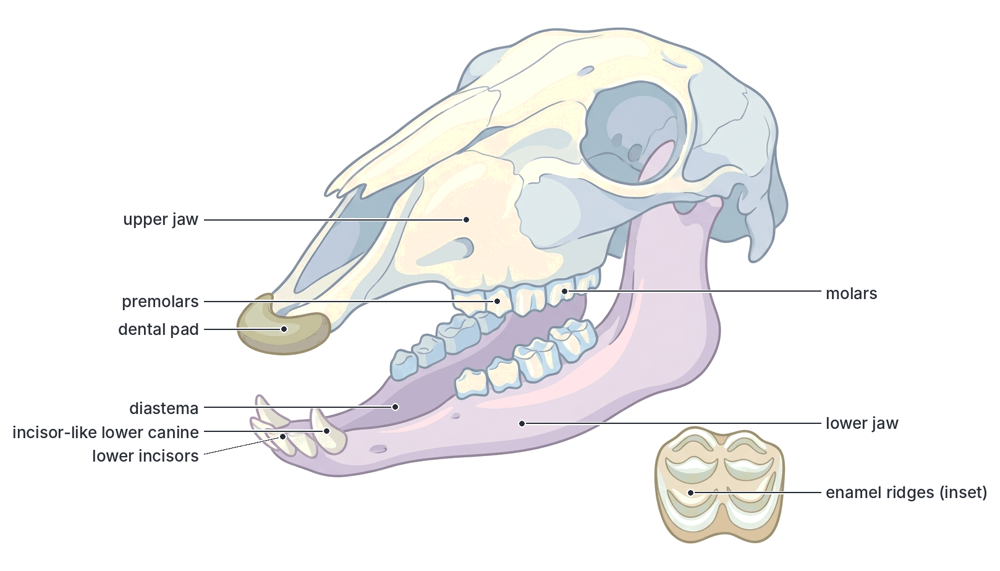
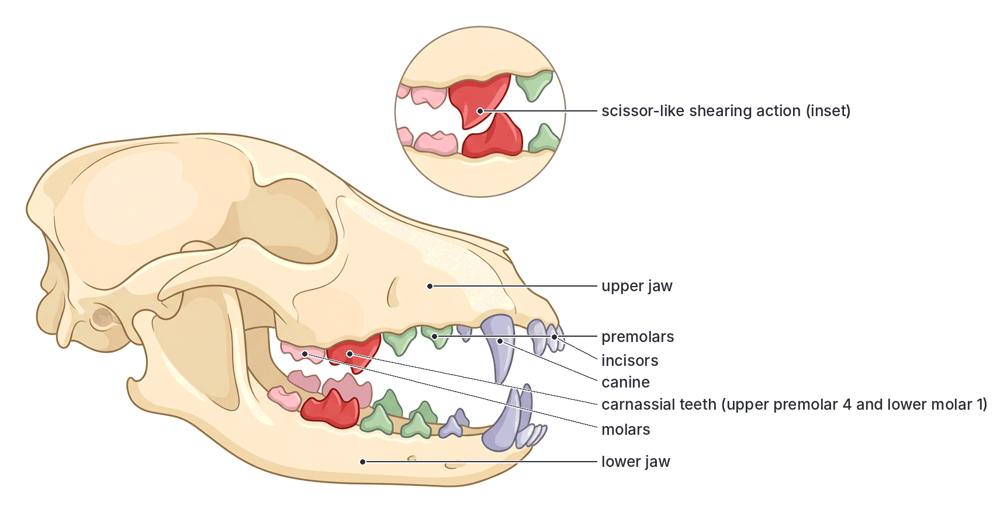
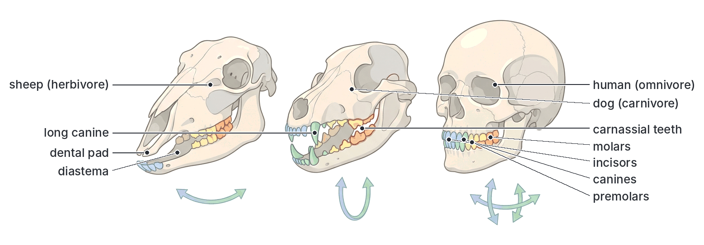
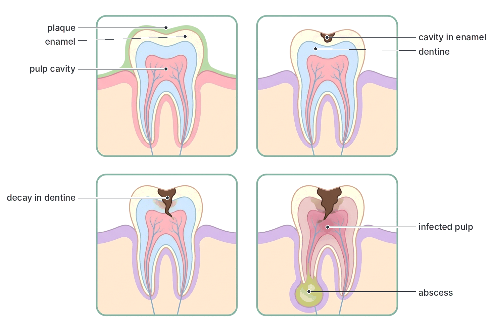

# JAMB Biology Notes: Nutrition (Part 4): The Mammalian Tooth

## What JAMB expects

This is Part 4 of Section B, Topic 2 of the JAMB Biology syllabus: Form and Functions – Nutrition. Nutrition is a big topic, so it is split into five files:

- Part 1 (`B2a-modes-and-types-of-nutrition.md`) covers the modes of nutrition (autotrophic and heterotrophic) and the types of heterotrophic feeding.
- Part 2 (`B2b-plant-nutrition.md`) covers plant nutrition: photosynthesis, chemosynthesis and mineral requirements.
- Part 3 (`B2c-food-substances-and-food-tests.md`) covers the classes of food substances and food tests.
- **Part 4 (this file)** covers the mammalian tooth.
- Part 5 (`B2e-alimentary-canal-and-digestion.md`) covers the mammalian alimentary canal and the nutrition process.

The syllabus content covered in this file is from **d. Animal nutrition**:

- **iii. The mammalian tooth** (structures, types and functions).

By the end of these notes, you should be able to:

1. Describe the structure of a typical mammalian tooth (objective xv).
2. Differentiate the types of mammalian tooth and relate their structures to their functions (objective xvi).
3. Compare the dental formulae of man, sheep and dog (objective xvii).

This file also explains milk and permanent teeth, care of the teeth and tooth decay, and the dentition of herbivores, carnivores and omnivores, because JAMB questions on teeth often draw on them.

## Teeth in mammals: an introduction

Teeth are hard structures in the jaws used for **biting, cutting, tearing, crushing and grinding food**. Breaking food into small pieces is the first stage of **mechanical (physical) digestion**. It:

- makes food easier to **swallow**;
- increases the **surface area** of the food, so digestive enzymes can act on it faster;
- mixes the food with **saliva**.

Teeth are also used by many mammals for catching and killing prey, for defence and fighting (e.g. the tusks of elephants and warthogs, which are modified teeth), for grooming, and, in rodents, for gnawing.

### Special features of mammalian teeth

Mammalian teeth differ from the teeth of fish, amphibians and reptiles in three important ways:

| Feature | Meaning | In mammals | In most fish, amphibians and reptiles |
| --- | --- | --- | --- |
| **Heterodont** | Teeth are of **different types** (incisors, canines, premolars, molars), each with a different shape and job | Yes | No: they are usually **homodont** (all teeth alike, usually simple cones) |
| **Thecodont** | Each tooth sits in its own **socket** in the jaw bone | Yes | Many have teeth fused to the surface of the jaw |
| **Diphyodont** | **Two sets** of teeth in a lifetime: milk (deciduous) teeth, then permanent teeth | Yes | Usually **polyphyodont**: teeth are replaced many times throughout life |

**Note:** crocodiles also have teeth in sockets (thecodont), but they are homodont and replace their teeth many times.

## Structure of a typical mammalian tooth

**Objective xv: describe the structure of a typical mammalian tooth.**

A tooth is studied by cutting it lengthwise (a **longitudinal section**, LS). A **molar** or an **incisor** is usually used. Every tooth has three external regions:

| Region | Where it is | Description |
| --- | --- | --- |
| **Crown** | Above the gum | The visible part of the tooth, covered by enamel. Its shape differs between the types of teeth (sharp edge, point, or broad surface with cusps) |
| **Neck** | At the level of the gum | The slightly narrowed part where the crown meets the root; it is surrounded by the gum |
| **Root** | Below the gum, inside the jaw bone | Fixes the tooth firmly in its socket in the jaw bone. A tooth may have one, two or three roots |

### The parts of a tooth and their functions

#### Enamel

- The **outermost layer of the crown**.
- It is the **hardest substance in the body**. It is made almost entirely (about 96%) of **mineral salts**, mainly **calcium phosphate** (in the form of crystals of hydroxyapatite), with a little calcium carbonate and fluoride.
- It is **non-living**: it has no cells, blood vessels or nerves, so it **cannot repair itself** once damaged.
- **Function:** forms a hard, wear-resistant **biting and grinding surface**, and **protects** the softer dentine and pulp underneath from wear, acids and bacteria.
- It is strengthened by **fluoride**, and can be dissolved by **acids** (e.g. acids made by bacteria from sugar), which is how tooth decay starts.

#### Dentine

- Lies **beneath the enamel** in the crown and beneath the cement in the root. It forms the **bulk (main mass)** of the tooth.
- It is **bone-like** but harder than bone and softer than enamel. It is about 70% mineral salts (calcium phosphate) with organic material (collagen fibres) and water.
- It is **living**: it is crossed by thousands of very fine canals (**dentinal tubules**) containing thin strands of cytoplasm from cells (**odontoblasts**) that line the pulp cavity. These cells can lay down more dentine slowly throughout life.
- **Function:** gives the tooth its **shape and strength**, supports the enamel, and protects the pulp. Because it contains living strands from the pulp, it is **sensitive**: when enamel is lost, hot, cold or sweet things can cause pain.

#### Pulp cavity

- The **central hollow space** inside the tooth, extending down into the root as the **root canal**.
- It is filled with **pulp**: soft connective tissue containing **blood vessels** and **nerves**, and lined by the dentine-forming **odontoblasts**.
- The blood vessels and nerves enter the tooth through a small opening at the tip of the root (the **apical foramen**).
- **Function:** keeps the tooth **alive**: the blood supplies food and oxygen to the living cells and removes waste; the nerves make the tooth **sensitive** to pain, heat, cold and pressure; the odontoblasts make new dentine.

#### Nerves and blood vessels

- **Blood vessels** (a small artery and vein, with capillaries) in the pulp bring **nutrients and oxygen** to the odontoblasts and pulp cells, and remove carbon (IV) oxide (CO₂) and other wastes.
- **Nerves** in the pulp carry impulses to the brain. They sense pain and warn of damage, e.g. toothache when decay reaches the pulp.
- When the pulp dies (e.g. after severe decay or injury), the tooth becomes "dead" and may darken; the dentist may remove the pulp (root canal treatment).

#### Cement (cementum)

- A thin layer of **bone-like** material covering the **root** (it takes the place of enamel below the gum).
- **Function:** it provides a rough surface to which the fibres of the **periodontal membrane** are attached, so it helps **fix the tooth** in the socket.

#### Periodontal membrane (periodontal ligament)

- A layer of tough **connective tissue fibres** (collagen) between the **cement** of the root and the **bone** of the socket.
- **Functions:**
  1. **Anchors** the tooth firmly to the jaw bone.
  2. Acts as a **shock absorber**, allowing the tooth to move very slightly when biting and chewing, so it does not crack.
  3. Contains nerve endings that sense the pressure of biting.

#### Gum (gingiva)

- The soft, pink tissue that covers the **jaw bone** and fits tightly around the **neck** of each tooth.
- **Function:** protects the jaw bone and the root, and **seals** the gap around the neck of the tooth so that food and bacteria cannot enter the socket. Healthy gums are firm and pink; swollen, bleeding gums are a sign of gum disease (or of scurvy; see `B2c-food-substances-and-food-tests.md`).

#### Jaw bone and socket

- Each tooth sits in a **socket** in the jaw bone: the **upper jaw (maxilla)** or the **lower jaw (mandible)**.
- The bone supports the tooth and, with the periodontal membrane and cement, holds it firmly in place.

### Summary of tooth structure

| Part | Location | Living or non-living? | Main function |
| --- | --- | --- | --- |
| Enamel | Covers the crown | Non-living | Hard surface for biting and grinding; protects dentine |
| Dentine | Under enamel and cement; bulk of the tooth | Living (contains cytoplasmic strands) | Gives shape and strength; supports enamel |
| Pulp cavity | Centre of the tooth | Living | Contains blood vessels and nerves; keeps the tooth alive and sensitive |
| Blood vessels | In the pulp | Living | Supply food and oxygen; remove waste |
| Nerves | In the pulp | Living | Sense pain, heat, cold, pressure |
| Cement | Covers the root | Living (bone-like) | Attaches periodontal fibres; fixes the tooth |
| Periodontal membrane | Between cement and jaw bone | Living | Anchors the tooth; absorbs shock |
| Gum | Around the neck, over the jaw bone | Living | Protects the jaw bone; seals the socket |

**Textbook variation:** some textbooks call cement "cementum", the periodontal membrane "periodontal ligament" or "periodontal fibres", and the gum "gingiva". Some books show the root canal and apical foramen; others just show the pulp cavity reaching the root tip. They describe the same structures.

## Types of mammalian teeth and their functions

**Objective xvi: differentiate the types of mammalian tooth and relate their structures to their functions.**

Mammals have four types of teeth, arranged from the front of the jaw to the back:

1. **Incisors (I)**: at the front.
2. **Canines (C)**: one on each side, behind the incisors.
3. **Premolars (PM)**: behind the canines, at the sides (cheek teeth).
4. **Molars (M)**: at the back of the jaw (cheek teeth).

Premolars and molars together are called **cheek teeth** (or "grinders").

[IMAGE: The four types of human teeth drawn side by side as single whole teeth (not sections), each in side view and with its crown also shown from above: an incisor with a flat chisel-shaped crown and one root; a canine with a pointed cone-shaped crown and one long root; a premolar with a broad crown with two cusps and one or two roots; a molar with a broad crown with four or five cusps and two or three roots. Labels: incisor, chisel-shaped cutting edge, one root; canine, pointed crown, one long root; premolar, two cusps, one or two roots; molar, several cusps, two or three roots. Clean flat textbook style, white background.]

### Incisors

- **Position:** at the **front** of the upper and lower jaws.
- **Structure:**
  - Crown is **flat and chisel-shaped**, with a **sharp, straight cutting edge** (like a blade).
  - Usually **one root**.
- **Function:** **biting and cutting** food, e.g. biting a piece of bread, an orange or roasted corn, or cutting grass.
- **Structure related to function:** the thin, sharp edge concentrates the force of biting on a small area, so the tooth cuts food like a chisel or knife. Upper and lower incisors pass each other like the blades of scissors.
- **In other mammals:** in **rodents** (rats, squirrels, grasscutters) and rabbits, the incisors are large, curved and **grow continuously** throughout life; enamel is only on the front surface, so the softer dentine behind wears faster, keeping a sharp chisel edge for gnawing. In **sheep and cattle**, there are no upper incisors (see dental pad below). The **tusks** of elephants are enlarged upper incisors.

### Canines

- **Position:** one on each side of each jaw, just **behind the incisors** (at the "corner" of the mouth).
- **Structure:**
  - Crown is **long, pointed and cone-shaped** (conical).
  - **One long root**, which is the longest root in the human mouth.
  - In carnivores (dogs, cats, lions), canines are very long, curved and sharp ("**fangs**").
- **Function:** **tearing and piercing** food; in carnivores, **catching, holding and killing prey** and tearing flesh; also used for **defence** and fighting.
- **Structure related to function:** the sharp point pierces skin and flesh; the curved shape hooks into prey so it cannot escape; the long, deep root holds the tooth firmly against the strong pulling forces of tearing.
- **In other mammals:** in **humans**, canines are small and similar in height to the incisors, and are used for tearing tough food. In **sheep**, there are no upper canines, and the lower canines look like incisors (**incisiform**). Warthog tusks are enlarged canines.

### Premolars

- **Position:** behind the canines, at the **sides** of the jaw.
- **Structure:**
  - Crown is **broad**, with **two cusps** (raised points) in humans, which is why they are also called **bicuspids**.
  - **One or two roots** (in humans, most have one root; the upper first premolar usually has two).
  - In herbivores, the crown has ridges for grinding; in carnivores, it is pointed and blade-like for cutting.
- **Function:** **crushing and grinding** food (in carnivores, also cutting and shearing flesh).
- **Structure related to function:** the broad surface with cusps fits against the cusps of the opposite teeth when the jaws close, so food is crushed and ground between them, like grain between grinding stones.
- **Note:** premolars have **milk predecessors**: in the milk set, their places are held by milk teeth that are later shed and replaced by the permanent premolars. In humans these milk teeth are called **milk molars**, because they look like small molars, but they are replaced by premolars, not by molars.

### Molars

- **Position:** at the **back** of the jaw, behind the premolars.
- **Structure:**
  - The **largest** teeth, with a **broad, flat crown** and **several cusps** (usually 4 or 5 in humans) or ridges.
  - **Two or three roots** (in humans, upper molars usually have three roots and lower molars two), which anchor them firmly against heavy grinding forces.
- **Function:** **crushing and grinding** food into a fine paste. In carnivores, flattened molars are used to crush bones.
- **Structure related to function:** the large surface area and many cusps grind food efficiently; the several roots resist the great pressure of chewing.
- **Note:** molars have **no milk predecessors**: they are found **only in the permanent set**. In humans, the third molars are called **wisdom teeth**; they appear late (usually between about 17 and 25 years of age) or sometimes never.

### The types of teeth compared

| Feature | Incisors | Canines | Premolars | Molars |
| --- | --- | --- | --- | --- |
| **Position** | Front of the jaw | Beside the incisors, one on each side | Behind the canines, at the sides | At the back of the jaw |
| **Shape of crown** | Flat, **chisel-shaped**, sharp edge | Long, **pointed, conical** | Broad, with **2 cusps** (or ridges) | **Broadest**, with **4–5 cusps** (or ridges) |
| **Number of roots** | **One** | **One** (long) | **One or two** | **Two or three** |
| **Main function** | **Biting and cutting** | **Tearing, piercing**, holding prey | **Crushing and grinding** | **Crushing and grinding** |
| **Number in adult human (whole mouth)** | 8 | 4 | 8 | 12 |
| **Milk predecessors?** | Yes | Yes | Yes (in humans, the milk molars) | **No** (permanent set only) |
| **In the sheep** | Lower jaw only; upper replaced by dental pad | Lower jaw only, incisor-like | Ridged grinders | Large ridged grinders |
| **In the dog** | Small, for nipping and scraping meat off bones | Long, curved fangs | Pointed, cutting; upper last premolar is a carnassial | Lower first molar is a carnassial; others flattened for crushing |

## Milk teeth and permanent teeth

Mammals are **diphyodont**: they have two sets of teeth.

1. **Milk teeth (deciduous teeth, primary teeth):** the first set. In humans, they begin to appear (erupt) at about **6 months** of age, starting with the lower front incisors, and all 20 are usually present by about **2 to 3 years**.
2. **Permanent teeth (secondary teeth):** they develop in the jaw below the milk teeth and push them out. In humans, the first permanent molars appear at about **6 years**; the milk teeth are shed between about 6 and 12 years; and the full permanent set (except the wisdom teeth) is usually complete by about **12 to 14 years**.

**Textbook variation:** the ages at which teeth appear vary a lot from child to child, and textbooks give slightly different age ranges. Learn the pattern, not exact ages.

| Feature | Milk (deciduous) teeth | Permanent teeth |
| --- | --- | --- |
| Number in humans | **20** | **32** |
| Dental formula (humans) | i 2/2, c 1/1, m 2/2 = 10 × 2 = **20** | I 2/2, C 1/1, PM 2/2, M 3/3 = 16 × 2 = **32** |
| Types present | Incisors, canines and milk molars (no premolars, no true molars) | Incisors, canines, premolars and molars |
| Time of appearance | From about 6 months to 2–3 years | From about 6 years; wisdom teeth from about 17–25 years |
| Size | Smaller | Larger |
| Colour | Whiter (bluish-white) | Slightly more yellowish (thicker dentine shows through) |
| Roots | Shorter, thinner; they are absorbed (dissolve) as the permanent tooth pushes up | Longer and stronger |
| Enamel | Thinner | Thicker |
| Lifespan | Shed in childhood | Meant to last for life; if lost, not replaced naturally |

**Note:** the human milk set has **"molars"** (milk molars), but these are **replaced by the permanent premolars**. The permanent molars have no milk predecessors. That is why lowercase letters are often used for milk teeth (i, c, m) to avoid confusing them with permanent teeth.

## Dental formulae of man, sheep and dog

**Objective xvii: compare the dental formulae of man, sheep and dog.**

### What is a dental formula?

A **dental formula** is a short way of showing the **number and types** of teeth in **one half** of the upper jaw and **one half** of the lower jaw of a mammal. Because the left and right sides are the same, the total is found by **multiplying by 2**.

**How to write it:**

- The letters stand for the types of teeth: **I** = incisors, **C** = canines, **PM** = premolars, **M** = molars.
- For each type, the number in **one half of the upper jaw** is written **above** the line, and the number in **one half of the lower jaw** **below** the line (e.g. I 2/2 means 2 upper and 2 lower incisors on each side).
- Add the numbers in the half-jaws, then multiply by 2 to get the total number of teeth.

**Example (man):**

I 2/2, C 1/1, PM 2/2, M 3/3

- Upper half-jaw: 2 + 1 + 2 + 3 = 8
- Lower half-jaw: 2 + 1 + 2 + 3 = 8
- One side (upper + lower) = 16
- Total = 16 × 2 = **32**

**Textbook variation in notation:** you may see the dental formula written in several ways. They all mean the same thing:

- As fractions: I 2/2, C 1/1, PM 2/2, M 3/3 = 32
- With "× 2" shown: 2 × (I 2/2, C 1/1, PM 2/2, M 3/3) = 32
- Without letters, as one fraction: 2123/2123 = 32 (upper over lower, in the order I, C, PM, M)
- Some books use **P** instead of PM, and **lowercase letters** (i, c, m) for milk teeth.
- A few older books write the numbers for the **whole** upper and lower jaws (e.g. I 4/4, C 2/2, PM 4/4, M 6/6 = 32). This is less common; JAMB normally uses the half-jaw form.

Always check whether the question asks for the number in the half-jaw or the whole mouth.

### Dental formula of man (an omnivore)

**I 2/2, C 1/1, PM 2/2, M 3/3 = 32**

- **Incisors:** 2 upper and 2 lower on each side (8 in all). Chisel-shaped for biting.
- **Canines:** 1 upper and 1 lower on each side (4 in all). Pointed but **short**, not much longer than the incisors; used for tearing.
- **Premolars:** 2 upper and 2 lower on each side (8 in all). Bicuspid, for crushing and grinding.
- **Molars:** 3 upper and 3 lower on each side (12 in all), including the wisdom teeth. Broad with cusps, for grinding.
- **No diastema** (no gap): the teeth form a continuous row.
- **No dental pad** and **no carnassial teeth**.
- The jaw can move **up and down** and **sideways**, so humans can both bite and grind. This suits a **mixed (omnivorous) diet** of plant and animal foods.

[IMAGE: Side view of a human skull with the jaws slightly open, showing a continuous row of teeth without gaps. Colour-code the teeth: incisors (blue), canine (green), premolars (yellow), molars (orange). Labels: incisors, canine, premolars, molars, upper jaw (maxilla), lower jaw (mandible), no diastema. Clean flat textbook style, white background.]

### Dental formula of sheep (a herbivore)

**I 0/3, C 0/1, PM 3/3, M 3/3 = 32**

- Upper half-jaw: 0 + 0 + 3 + 3 = 6
- Lower half-jaw: 3 + 1 + 3 + 3 = 10
- One side = 16; total = 16 × 2 = **32**

Key features of the sheep's teeth:

1. **No upper incisors or upper canines.** In their place is a hard, horny pad of thickened gum called the **dental pad** (horny pad).
2. **Lower incisors and canines** are sharp, chisel-shaped and slope forward. The lower **canines look like incisors** (they are **incisiform**), so the front of the lower jaw has a row of **8 cutting teeth**.
3. **Biting grass:** the sheep grips grass between the **lower incisors and the dental pad**, and tears it off with a jerk of the head. (The tongue and lips also help pull grass into the mouth.)
4. **Diastema:** a wide **gap** between the front teeth (incisors and canines) and the premolars, where canines and front premolars would be in other mammals. The **tongue** uses this space to move and turn freshly cut grass and to separate it from food being chewed.
5. **Cheek teeth (premolars and molars):** large, broad and very tall (high-crowned). Their grinding surfaces have **crescent-shaped ridges of enamel** with softer dentine and cement between them. Because these wear at different rates, the ridges stay sharp and form a rough grinding surface, like a file or grinding stone. The upper and lower cheek teeth fit together so that the ridges grind grass finely.
6. **Sideways (lateral) chewing:** the jaw joint is loose, so the lower jaw moves **from side to side** as well as up and down, giving a **grinding** action. This is needed to break down the tough cellulose cell walls of grass.
7. Grass contains hard, gritty material, so the cheek teeth **wear down** slowly throughout life. Their tall crowns keep pushing up from the jaw to make up for the wear.

**Textbook variation:**

- Because the lower canine looks exactly like an incisor, some textbooks write the sheep's formula as **I 0/4, C 0/0, PM 3/3, M 3/3 = 32**. Both give a total of 32. The standard JAMB form is **I 0/3, C 0/1, PM 3/3, M 3/3 = 32**.
- Many textbooks say the cheek teeth of herbivores have **"open roots"** and "grow throughout life". This is true of rabbits and rodents (and of the incisors of rodents). In sheep, goats and cattle, the cheek teeth are very tall and keep emerging from the jaw as they wear, but their roots eventually close in older animals.
- Goats and cattle have the **same dental formula** as sheep.

### Dental formula of dog (a carnivore)

**I 3/3, C 1/1, PM 4/4, M 2/3 = 42**

- Upper half-jaw: 3 + 1 + 4 + 2 = 10
- Lower half-jaw: 3 + 1 + 4 + 3 = 11
- One side = 21; total = 21 × 2 = **42**

Key features of the dog's teeth:

1. **Incisors:** small and sharp, used for **nipping** and **scraping** flesh from bones, and for grooming.
2. **Canines:** very **long, curved, sharp and pointed** ("fangs"), with deep roots. They pierce, grip and kill prey and tear flesh. When the mouth is closed, the upper and lower canines lock past each other.
3. **Premolars:** pointed, with sharp cutting edges, used for **cutting and tearing** flesh.
4. **Carnassial teeth:** the **last upper premolar** (PM4) and the **first lower molar** (M1) on each side are very large, with **sharp, blade-like** cusps. When the jaw closes, they slide past each other like the blades of a pair of **scissors**, **shearing (slicing)** flesh and cracking bones. A dog chewing a bone moves it to the side of its mouth to use its carnassials.
5. **Molars** (other than the lower carnassial): smaller, flatter, with low cusps, used for **crushing bones**.
6. **No dental pad.** The dog has a small gap where the canines lock in, but **no large diastema** like the sheep.
7. **Up-and-down jaw movement only:** the jaw joint is a tight hinge, so the jaw cannot move much sideways. This gives a powerful **cutting and crushing** bite, not grinding. Very strong jaw muscles (the temporal muscles) close the jaw with great force.
8. Flesh is easier to digest than grass, so dogs swallow food in large pieces after little chewing.

### The dental formulae compared

| Feature | Man (omnivore) | Sheep (herbivore) | Dog (carnivore) |
| --- | --- | --- | --- |
| **Dental formula** | I 2/2, C 1/1, PM 2/2, M 3/3 | I 0/3, C 0/1, PM 3/3, M 3/3 | I 3/3, C 1/1, PM 4/4, M 2/3 |
| **Total number of teeth** | **32** | **32** | **42** |
| **Teeth in one upper half-jaw** | 8 | 6 | 10 |
| **Teeth in one lower half-jaw** | 8 | 10 | 11 |
| **Upper incisors** | Present (2 each side) | **Absent** (dental pad instead) | Present (3 each side) |
| **Canines** | Small, short, pointed | Upper absent; lower **incisor-like** | **Long, curved, pointed fangs** |
| **Premolars** | 2 each side in each jaw; bicuspid | 3 each side in each jaw; ridged for grinding | 4 each side in each jaw; pointed for cutting |
| **Molars** | 3 each side in each jaw; cusped | 3 each side in each jaw; large, ridged | 2 upper and 3 lower each side; flattened |
| **Dental pad** | Absent | **Present** | Absent |
| **Diastema** | Absent | **Present** (large) | Absent (only a small space for canines) |
| **Carnassial teeth** | Absent | Absent | **Present** (upper PM4 and lower M1) |
| **Cheek teeth surface** | Rounded cusps | Crescent-shaped enamel ridges | Sharp blade-like cusps |
| **Jaw movement** | Up and down, and some sideways | Mainly **sideways** (grinding), also up and down | **Up and down only** (cutting and crushing) |
| **Type of diet** | Mixed: plants and animals | Plants (grass) | Flesh (meat) |

**Things that look like "tricks" in JAMB questions:**

- **Man and sheep both have 32 teeth**, but in a very different arrangement. The total alone does not tell you the animal.
- The **sheep has more teeth in the lower jaw than in the upper jaw** (10 against 6 per half), because it has no upper incisors or canines.
- The **dog has one more molar in the lower jaw** than in the upper jaw (M 2/3).
- The dog has the **most teeth** (42) of the three.

### Using a dental formula to identify an animal's diet

- **0 upper incisors + a diastema** → a herbivore such as a sheep, goat or cow.
- **Long canines + carnassials + many premolars** → a carnivore such as a dog, cat or lion.
- **All four types present, small canines, no diastema, no carnassials** → an omnivore such as man (or a pig).

## Dentition of herbivores, carnivores and omnivores

**Dentition** means the type, number and arrangement of teeth in an animal. Teeth are closely adapted to diet.

| Feature | Herbivores (e.g. sheep, goat, cow, rabbit) | Carnivores (e.g. dog, cat, lion) | Omnivores (e.g. man, pig, rat) |
| --- | --- | --- | --- |
| Food | Plants, mainly grass and leaves | Flesh and bones of other animals | Both plants and animals |
| Incisors | Sharp, chisel-like (lower only in ruminants); upper replaced by dental pad in ruminants | Small, for nipping and scraping | Chisel-shaped, for biting |
| Canines | Absent or small (incisor-like in sheep) | Long, curved, pointed | Present, moderately sized |
| Diastema | Present | Absent | Absent (in man) |
| Premolars and molars | Broad, ridged, high-crowned for grinding | Sharp, blade-like; carnassials for shearing | Cusped, for crushing and grinding |
| Jaw movement | Side to side (grinding) | Up and down only | Up and down and some side to side |
| Jaw joint | Loose | Tight hinge | Intermediate |
| Main jaw muscles | Masseter (side-to-side grinding) well developed | Temporal muscles (powerful closing) well developed | Both moderately developed |
| Chewing | Long, thorough chewing (and chewing the cud in ruminants) | Little chewing; food swallowed in large pieces | Moderate chewing |

**Rodents and rabbits (gnawing mammals; rabbits are herbivores, rats are omnivores):** rats, squirrels, the grasscutter (cane rat) and rabbits have **large, chisel-like incisors** that grow throughout life, **no canines**, and a wide **diastema**. The grasscutter, a popular bush meat in Nigeria, uses its powerful incisors to cut tough grass and sugar cane stems.

## Care of the teeth and dental problems

The syllabus does not list dental diseases by name, but questions on the structure of teeth often ask why enamel matters and how teeth decay.

### Dental caries (tooth decay)

**Dental caries** is the gradual destruction of the hard tissues of the tooth (enamel and dentine) by **acids** produced by **bacteria**.

**How tooth decay happens, step by step:**

1. A sticky, colourless film called **plaque** forms on the teeth. It is made of saliva, food particles and **bacteria**.
2. When we eat **sugary** foods and drinks (sweets, soft drinks, biscuits, chin-chin, sugary tea), the bacteria in plaque **ferment** the sugar and produce **acids** (mainly lactic acid).
3. The acid **dissolves the calcium salts of the enamel**, making a small hole (a **cavity**). At this stage there is no pain, because enamel has no nerves.
4. The decay spreads into the softer **dentine**, which is attacked faster. The tooth becomes **sensitive** to sweet, hot and cold things.
5. When the decay reaches the **pulp cavity**, bacteria infect the pulp. The pulp becomes inflamed, causing severe **toothache**.
6. Infection may spread to the root tip and jaw bone, forming a painful swelling of pus (**abscess**). The tooth may die and have to be removed.

### Gum (periodontal) disease

- If plaque is not removed, it hardens into **tartar (calculus)** at the gum line.
- Bacteria in plaque and tartar cause the gums to become red, swollen and to **bleed** easily (**gingivitis**).
- If untreated, the infection destroys the **periodontal membrane** and the bone of the socket (**periodontitis**, also called **pyorrhoea**). The gums shrink back, pus may form, and the teeth become **loose and fall out**.
- Gum disease is a major cause of tooth loss in adults.

### Other dental problems

- **Malocclusion:** upper and lower teeth do not meet properly (e.g. crowded or protruding teeth); it can be corrected by a dentist with braces.
- **Dental fluorosis:** brown or white mottling of the teeth from too much fluoride while teeth are forming (see `B2c-food-substances-and-food-tests.md`).
- **Broken or worn teeth:** from accidents, opening bottles with the teeth, or chewing very hard objects.

### How to care for the teeth

1. **Brush the teeth at least twice a day** (in the morning and before going to bed), using a soft toothbrush and **fluoride toothpaste**. Brush all surfaces, including along the gum line.
2. **Chewing sticks** are widely used in Nigeria (e.g. *pako* in Yoruba). Sticks from plants such as *Massularia acuminata* and species of *Garcinia* are traditional and contain natural antibacterial substances; used properly, they clean the teeth well. The frayed end should be replaced often.
3. **Clean between the teeth** with dental floss to remove food and plaque where the brush cannot reach.
4. **Reduce sugary foods and drinks**, especially **between meals** and at bedtime. Rinse the mouth with water after eating sweets.
5. **Eat a balanced diet** rich in **calcium, phosphorus and vitamin D** (for strong teeth), **vitamin C** (for healthy gums) and **fluoride**.
6. **Chew fibrous foods** (raw carrots, sugar cane, fruits), which clean the teeth and stimulate the gums.
7. **Do not use the teeth** to open bottles or crack very hard objects.
8. **Visit a dentist regularly** (about every 6 months) for check-ups, scaling (removing tartar) and early filling of cavities.

## Key terms

| Term | Meaning |
| --- | --- |
| Crown | Part of the tooth above the gum |
| Neck | Part of the tooth at the gum level, between crown and root |
| Root | Part of the tooth embedded in the jaw bone |
| Enamel | Hardest substance in the body; non-living layer covering the crown |
| Dentine | Bone-like living layer forming the bulk of the tooth |
| Pulp cavity | Central space in a tooth containing blood vessels and nerves |
| Cement (cementum) | Bone-like layer covering the root |
| Periodontal membrane | Fibres that fix the tooth to the jaw bone and absorb shock |
| Gum (gingiva) | Soft tissue covering the jaw bone and surrounding the neck of the tooth |
| Incisor | Chisel-shaped front tooth for biting and cutting |
| Canine | Pointed, conical tooth for tearing and piercing |
| Premolar | Cheek tooth with two cusps for crushing and grinding; has milk predecessors |
| Molar | Large back tooth with several cusps for grinding; permanent set only |
| Heterodont | Having different types of teeth |
| Thecodont | Having teeth set in sockets |
| Diphyodont | Having two sets of teeth (milk and permanent) |
| Milk (deciduous) teeth | The first set of teeth, shed in childhood |
| Dental formula | A formula showing the number and type of teeth in one half of the upper and lower jaws |
| Dental pad | Hard, horny pad replacing the upper incisors and canines in sheep and cattle |
| Diastema | A gap between the front teeth and the cheek teeth in herbivores |
| Carnassial teeth | Large, blade-like shearing teeth (upper PM4 and lower M1) in carnivores |
| Incisiform | Shaped like an incisor (e.g. the lower canine of the sheep) |
| Dental caries | Tooth decay caused by acids made by bacteria from sugar |
| Plaque | Sticky film of bacteria and food on the teeth |
| Dentition | The type, number and arrangement of teeth in an animal |

## Exam tips and common mistakes

- **Enamel is the hardest substance in the body and is non-living;** dentine forms the bulk of the tooth and is living. Do not swap them.
- **The pulp cavity contains blood vessels and nerves.** It is the only part with nerves inside the tooth, which is why decay hurts only when it reaches the dentine and pulp.
- **Cement and periodontal membrane fix the tooth;** the periodontal membrane also acts as a shock absorber.
- **Molars are found only in the permanent set.** Premolars (in humans) replace the milk molars.
- **Dental formula is for half a jaw.** Multiply by 2 for the total: man 32, sheep 32, dog 42.
- **Sheep: I 0/3 C 0/1 PM 3/3 M 3/3.** The zeros mean no upper incisors or canines (dental pad instead). Some books write I 0/4 C 0/0; the total is still 32.
- **Dog: I 3/3 C 1/1 PM 4/4 M 2/3.** Note the 2/3 for molars.
- **Carnassials are the upper last premolar and the lower first molar** of carnivores; they shear flesh. Herbivores and humans have none.
- **Diastema is a gap,** found in herbivores (sheep, rabbit, rodents), not in the dog or man. It lets the tongue move grass about.
- **Herbivores grind sideways; carnivores bite up and down.**
- **Tooth decay starts in the enamel** with acids from bacteria fermenting sugar. Fluoride strengthens enamel.

## Quick summary

1. A mammalian tooth has a crown (above the gum), a neck (at the gum) and a root (in the jaw bone).
2. Enamel is the hardest, non-living outer layer of the crown; dentine forms the living bulk of the tooth; the pulp cavity contains blood vessels and nerves; cement and the periodontal membrane fix the root in the jaw bone; the gum seals the socket.
3. Mammals have four types of teeth: incisors (chisel-shaped, biting and cutting), canines (pointed, tearing), premolars and molars (broad, cusped, crushing and grinding), each with a shape suited to its job.
4. Humans have 20 milk teeth (no premolars or molars of the permanent kind) and 32 permanent teeth; molars appear only in the permanent set.
5. Dental formulae: man I 2/2 C 1/1 PM 2/2 M 3/3 = 32; sheep I 0/3 C 0/1 PM 3/3 M 3/3 = 32; dog I 3/3 C 1/1 PM 4/4 M 2/3 = 42.
6. The sheep has a dental pad, a diastema, incisor-like lower canines and ridged grinding cheek teeth with sideways jaw movement; the dog has long canines, carnassial teeth and an up-and-down bite; man has an unspecialised omnivore dentition.
7. Tooth decay is caused by acids made by bacteria from sugar; brushing with fluoride toothpaste, less sugar, a good diet and dental check-ups protect the teeth.

## Practice questions

**1. The hardest substance in the mammalian body is the**

- A. dentine
- B. enamel
- C. cement
- D. bone

**Answer: B.** Enamel, made almost entirely of calcium salts, is the hardest substance in the body. It covers the crown of the tooth.

**2. Which part of a tooth contains blood vessels and nerves?**

- A. Enamel
- B. Dentine
- C. Pulp cavity
- D. Cement

**Answer: C.** The pulp cavity contains blood vessels, which nourish the tooth, and nerves, which make it sensitive.

**3. The structure that fixes the root of a tooth to the jaw bone and acts as a shock absorber is the**

- A. periodontal membrane
- B. gum
- C. enamel
- D. pulp

**Answer: A.** The fibres of the periodontal membrane join the cement of the root to the bone of the socket and allow slight movement when chewing.

**4. The dental formula I 0/3, C 0/1, PM 3/3, M 3/3 belongs to a**

- A. dog
- B. man
- C. rat
- D. sheep

**Answer: D.** The absence of upper incisors and canines (replaced by a dental pad) and the incisor-like lower canine are features of the sheep.

**5. The total number of teeth in an adult dog is**

- A. 32
- B. 36
- C. 42
- D. 44

**Answer: C.** The dog's formula is I 3/3, C 1/1, PM 4/4, M 2/3. One side has 10 + 11 = 21 teeth, so the total is 21 × 2 = 42.

**6. Carnassial teeth in a dog are formed by the**

- A. upper canine and lower canine
- B. last upper premolar and first lower molar
- C. first upper molar and last lower premolar
- D. upper and lower incisors

**Answer: B.** The last upper premolar and the first lower molar are enlarged, blade-like teeth that slide past each other like scissors to shear flesh.

**7. The gap between the front teeth and the cheek teeth in the sheep is called the**

- A. diastema
- B. dental pad
- C. pulp cavity
- D. carnassial

**Answer: A.** The diastema is a toothless gap that allows the tongue to move and turn grass in the mouth.

**8. Which type of tooth is absent in the milk dentition of man?**

- A. Incisor
- B. Canine
- C. Milk molar
- D. Premolar

**Answer: D.** The human milk set has incisors, canines and milk molars (20 teeth). The permanent premolars replace the milk molars, and the permanent molars have no milk predecessors.

**9. The broad surface with several cusps on a molar is an adaptation for**

- A. cutting food
- B. tearing flesh
- C. grinding food
- D. holding prey

**Answer: C.** The large surface with cusps meets the opposite molars to crush and grind food into a fine paste.

**10. Tooth decay begins when**

- A. acids produced by bacteria from sugar dissolve the enamel
- B. the pulp cavity loses its blood supply
- C. the periodontal membrane becomes loose
- D. calcium is deposited on the dentine

**Answer: A.** Bacteria in plaque ferment sugars and produce acids that dissolve the calcium salts of the enamel, forming a cavity that spreads into the dentine and pulp.
