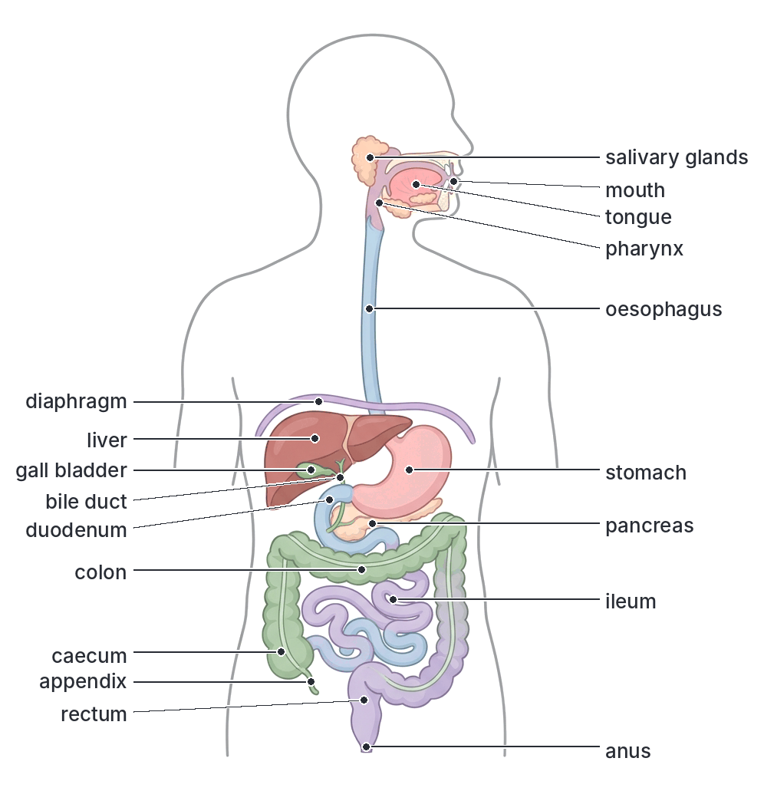
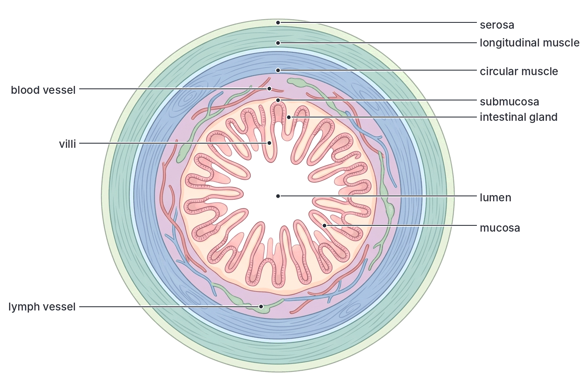
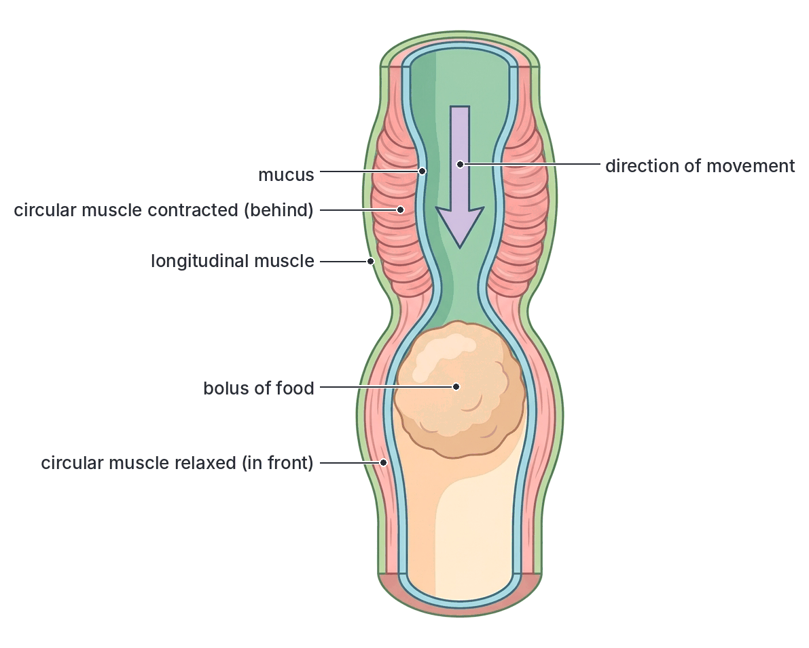
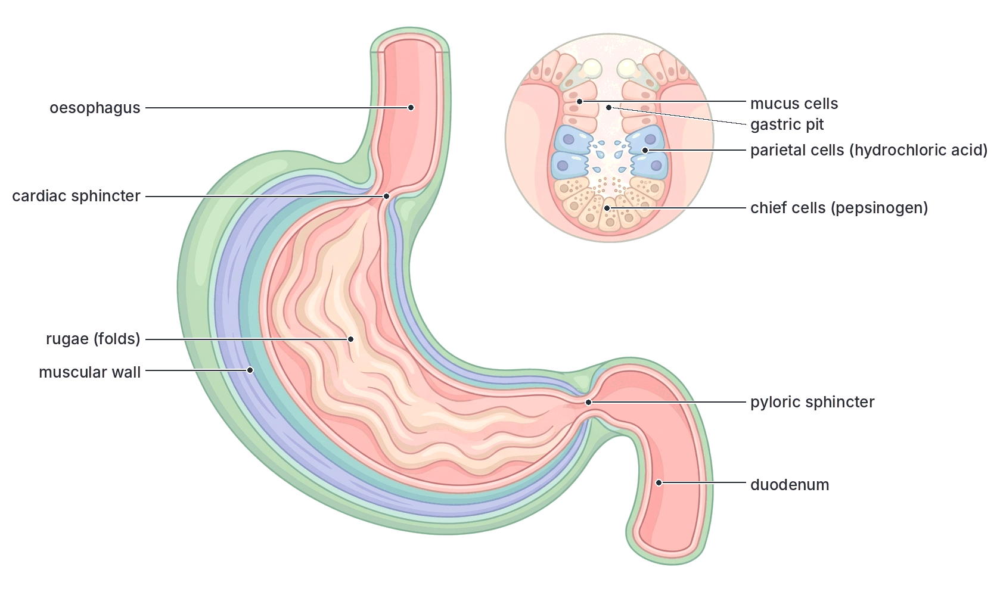
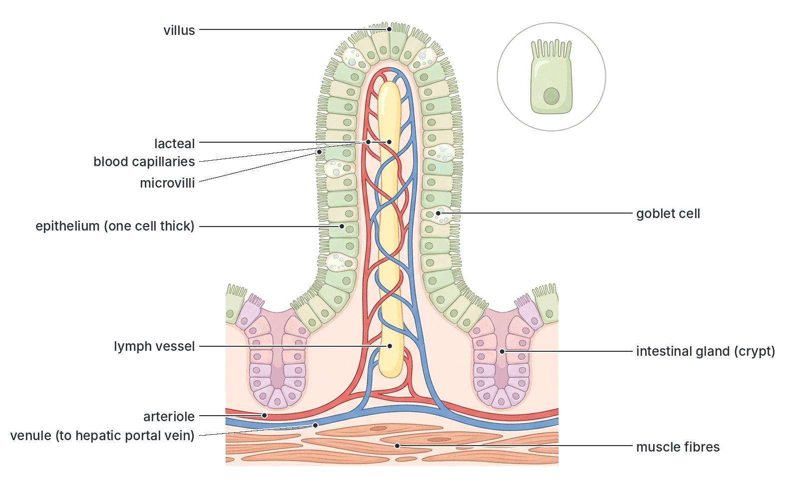
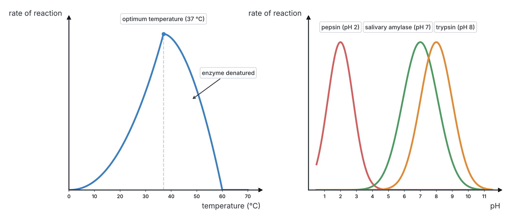
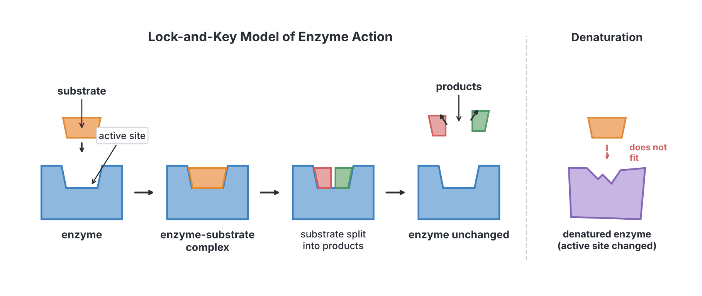
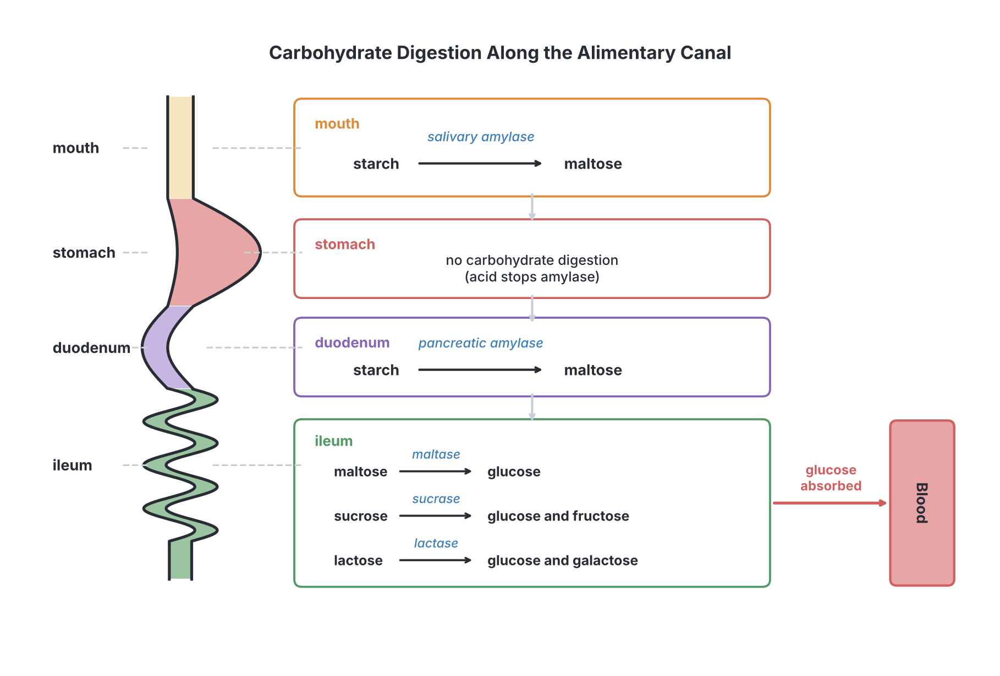
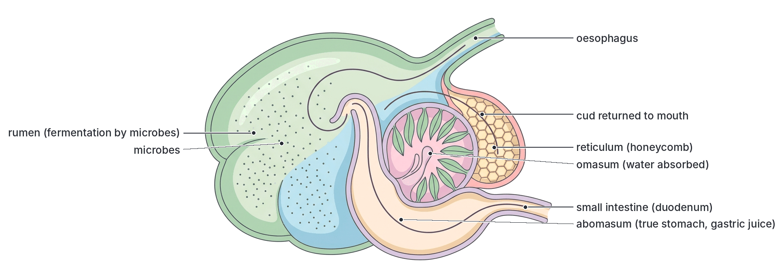

# JAMB Biology Notes: Nutrition (Part 5): The Alimentary Canal and Digestion

## What JAMB expects

This is Part 5 of Section B, Topic 2 of the JAMB Biology syllabus: Form and Functions – Nutrition. Nutrition is a big topic, so it is split into five files:

- Part 1 (`B2a-modes-and-types-of-nutrition.md`) covers the modes of nutrition (autotrophic and heterotrophic) and the types of heterotrophic feeding.
- Part 2 (`B2b-plant-nutrition.md`) covers plant nutrition: photosynthesis, chemosynthesis and mineral requirements.
- Part 3 (`B2c-food-substances-and-food-tests.md`) covers the classes of food substances and food tests.
- Part 4 (`B2d-mammalian-teeth.md`) covers the mammalian tooth.
- **Part 5 (this file)** covers the mammalian alimentary canal and the nutrition process.

The syllabus content covered in this file is from **d. Animal nutrition**:

- **iv. Mammalian alimentary canal.**
- **v. Nutrition process** (ingestion, digestion, absorption and assimilation of digested food).

By the end of these notes, you should be able to:

1. Relate the structure of the various parts of the alimentary canal and its accessory organs (liver, pancreas and gall bladder) to their functions (objective xviii).
2. Identify the general characteristics of digestive enzymes (objective xix).
3. Associate enzymes with the digestion of carbohydrates, proteins and fats (objective xx).
4. Determine the end products of the digestion of these classes of food (objective xxi).

This file also describes the **ruminant stomach of the sheep**, because the syllabus uses the sheep and man as its examples of holozoic feeding (objective iv, covered in `B2a-modes-and-types-of-nutrition.md`) and compares their teeth (objective xvii, in `B2d-mammalian-teeth.md`).

**Note on the syllabus wording:** objective xx ends with "and", running straight into objective xxi ("determine the end products of these classes of food"). The two objectives belong together: each enzyme in objective xx produces the end products in objective xxi. Content item v lists "ingestion, digestion, absorption, and assimilation"; **egestion**, the final stage, is not named but is part of every textbook account, so it is included here too.

## The nutrition process: an overview

Mammals, including humans and sheep, are **holozoic** feeders: they take in solid pieces of food, break them down inside a special tube (the **alimentary canal**), absorb the useful products and get rid of what is left. The process has five stages:

| Stage | Meaning | Where it happens in man |
| --- | --- | --- |
| **1. Ingestion** | Taking food into the mouth | Mouth |
| **2. Digestion** | Breaking down large, insoluble food molecules into small, soluble molecules that can be absorbed | Mouth, stomach, small intestine (duodenum and ileum) |
| **3. Absorption** | Taking the small, soluble molecules of digested food through the wall of the gut into the blood and lymph | Mainly the ileum (small intestine); water also in the colon |
| **4. Assimilation** | Using the absorbed food molecules in the body's cells (for energy, growth and repair) or storing them | Body cells, especially the liver |
| **5. Egestion** | Removing undigested food (faeces) from the body through the anus | Rectum and anus |

**Why food must be digested:** most of the food we eat (starch, proteins and fats) is made of **large, insoluble molecules**. They cannot pass through the wall of the gut or the membranes of cells. Digestion turns them into **small, soluble molecules** (glucose, amino acids, fatty acids and glycerol) that can be absorbed into the blood and used by the cells.

**Two kinds of digestion:**

| Feature | Mechanical (physical) digestion | Chemical digestion |
| --- | --- | --- |
| What happens | Food is broken into **smaller pieces**, without changing the molecules | Large molecules are **broken down chemically** into small molecules |
| How | Chewing by the teeth, rolling by the tongue, churning by the stomach muscles, emulsification of fat by bile | **Enzymes** catalyse **hydrolysis** (splitting molecules by adding water) |
| Where | Mouth, stomach, duodenum (bile) | Mouth, stomach, duodenum and ileum |
| Result | Larger surface area for enzymes to act on; easier swallowing | Small, soluble molecules ready for absorption |

## The mammalian alimentary canal

The **alimentary canal** (gut, digestive tract or gastrointestinal tract) is a long, muscular tube that runs from the **mouth** to the **anus**. In an adult human it is about **8 to 9 metres** long. It is coiled and folded so that it fits into the abdomen.

**Textbook variation:** the length of the human alimentary canal is given as anything from about 8 m to 10 m in different textbooks, and the small intestine as about 5 to 7 m. The length measured in a living person is shorter than in a dead body, because the muscles of the gut wall are partly contracted in life.

The parts, in order, are:

**Mouth (buccal cavity) → pharynx → oesophagus (gullet) → stomach → small intestine (duodenum → jejunum → ileum) → large intestine (caecum and appendix → colon → rectum) → anus**

The **accessory organs** are not part of the tube, but pour secretions into it through ducts: the **salivary glands**, the **liver** (with the **gall bladder**) and the **pancreas**.

### The general structure of the gut wall

From the oesophagus to the rectum, the wall of the alimentary canal has the same basic layers, from the inside out:

| Layer | Structure | Function |
| --- | --- | --- |
| **Mucosa** (mucous membrane) | The inner lining: **epithelium** (columnar in the stomach and intestines), with **glands** and **goblet cells** | Secretes **mucus** and **digestive juices**; absorbs digested food (in the intestines) |
| **Submucosa** | Connective tissue with **blood vessels**, **lymph vessels** and **nerves** | Carries away absorbed food; supplies the gut with blood; controls the glands and muscles |
| **Circular muscle** | Muscle fibres running **around** the gut | Contracts to **narrow** the gut and squeeze food along; forms the **sphincters** |
| **Longitudinal muscle** | Muscle fibres running **along** the gut | Contracts to **shorten** the gut and widen it in front of the food |
| **Serosa** (serous coat) | Thin outer covering, part of the peritoneum | Reduces friction between the gut and other organs |

### Peristalsis: how food moves along the gut

**Peristalsis** is a **wave of muscular contraction and relaxation** that passes along the wall of the alimentary canal and pushes food along. It is **involuntary** (we do not control it).

Step by step:

1. Food stretches the wall of the gut.
2. The **circular muscles behind** the food **contract**, making the gut narrower there, so the food is squeezed forward. At the same time, the longitudinal muscles there relax.
3. The **circular muscles in front** of the food **relax** (and the longitudinal muscles contract), making the gut wider there, so the food can move into it.
4. This wave passes along the gut, like squeezing toothpaste along a tube, pushing the food (bolus) forward.

Peristalsis happens in the **oesophagus, stomach and intestines**. It works even if you are upside down, and is helped by **roughage**, which gives the muscles something to push against. Mucus lubricates the food so it slides easily.

**Sphincters** are rings of circular muscle that close an opening and control the flow of food, e.g. the **cardiac sphincter** (between the oesophagus and stomach), the **pyloric sphincter** (between the stomach and duodenum) and the **anal sphincters**.

## Structure and function of the parts of the alimentary canal

**Objective xviii: relate the structure of the various components of the alimentary canal and its accessory organs (liver, pancreas and gall bladder) to their functions.**

### The mouth (buccal cavity)

The mouth is where **ingestion** takes place, and where digestion begins.

| Structure | Description | Function |
| --- | --- | --- |
| **Lips** | Muscular folds around the opening | Take in food and keep it in the mouth while chewing |
| **Teeth** | Incisors, canines, premolars and molars (see `B2d-mammalian-teeth.md`) | **Mechanical digestion**: bite, tear, crush and grind food, increasing its surface area |
| **Tongue** | Muscular organ covered with **taste buds** | Tastes food; rolls and mixes food with saliva; shapes food into a ball (**bolus**); pushes the bolus to the back of the mouth for swallowing |
| **Salivary glands** | Three pairs of glands with ducts opening into the mouth | Secrete **saliva** |
| **Hard and soft palate** | The roof of the mouth (bony in front, soft behind) | Separates the mouth from the nasal cavity; the soft palate rises during swallowing to close off the nose |

#### The salivary glands and saliva

There are **three pairs** of salivary glands:

1. **Parotid glands:** the largest, in front of and below each ear.
2. **Submandibular (submaxillary) glands:** under the lower jaw.
3. **Sublingual glands:** under the tongue.

An adult produces roughly 1 to 1.5 litres of saliva a day. Saliva is produced as a **reflex** when food is in the mouth, and even at the smell, sight or thought of food (your "mouth waters" when you smell suya or jollof rice).

**Saliva contains:**

- **Water** (over 99%): moistens and softens food, and dissolves some of it so that it can be tasted.
- **Mucus (mucin):** lubricates food so it is easy to swallow.
- **Salivary amylase (ptyalin):** an enzyme that begins the digestion of **starch** into **maltose**.
- Salts that keep saliva about **neutral** (pH about 7), the best pH for salivary amylase.
- **Lysozyme:** an enzyme that kills some bacteria.

**Functions of saliva:**

1. Moistens and lubricates food, making it easier to chew and swallow.
2. Begins chemical digestion of starch (cooked starch is digested faster).
3. Dissolves food so it can be tasted.
4. Keeps the mouth moist, which helps in speaking.
5. Cleans the mouth and teeth, and helps control bacteria.

**Note:** food stays only a short time in the mouth, so little starch is digested there. Salivary amylase continues to work inside the bolus in the stomach until stomach acid penetrates it and stops it. You can show its action by chewing a piece of bread or boiled yam for a few minutes: it begins to taste sweet as maltose is formed.

### The pharynx and swallowing

The **pharynx** (throat) is the space at the back of the mouth where the pathways for food and air cross. Food passes into the **oesophagus**; air passes into the **larynx** and **trachea** (windpipe).

**Swallowing, step by step:**

1. The tongue pushes the **bolus** upwards and backwards into the pharynx. This first step is voluntary; the rest is a reflex.
2. The **soft palate** rises to close the opening to the nasal cavity, so food does not go up into the nose.
3. The **larynx** moves up, and the **epiglottis** (a flap of cartilage) folds over the opening of the larynx (the glottis), so food does not enter the trachea.
4. Breathing stops for a moment.
5. The bolus enters the oesophagus and is carried down by **peristalsis**.

If food or water "goes down the wrong way" into the larynx, it triggers violent coughing to force it out.

### The oesophagus (gullet)

| Structure | Function |
| --- | --- |
| A narrow, muscular tube about **25 cm** long, running from the pharynx through the chest, behind the trachea and heart, and through the **diaphragm** to the stomach | Carries food from the pharynx to the stomach |
| Thick layers of **circular and longitudinal muscle** | Produce **peristalsis**, which pushes the bolus down to the stomach in a few seconds |
| Lining of tough, many-layered (stratified) epithelium with **mucus glands** | Resists wear from rough food; mucus lubricates the bolus |
| **Cardiac sphincter** at the lower end | Opens to let food into the stomach and closes to stop stomach contents flowing back (when it fails, acid causes "heartburn") |

**No digestion** by the oesophagus's own secretions takes place in the oesophagus; it is only a passage.

### The stomach

The stomach is a **J-shaped**, muscular bag on the left side of the upper abdomen, just below the diaphragm. In an adult it can hold about 1 to 1.5 litres of food (more when stretched). Food stays in it for about **2 to 4 hours** (longer after a fatty meal).

| Structure | Function |
| --- | --- |
| **Thick muscular wall** with three layers of muscle (longitudinal, circular and oblique) | Strong churning movements mix food with gastric juice and break it up (**mechanical digestion**), turning it into a creamy liquid called **chyme** |
| **Folds (rugae)** in the lining | Allow the stomach to **stretch** when full; increase the area of lining |
| **Gastric glands** (in pits in the lining) | Secrete **gastric juice** (about 2 litres a day) |
| **Mucus (goblet) cells** | Secrete a thick layer of **mucus** that protects the stomach wall from being digested by its own acid and pepsin |
| **Parietal (oxyntic) cells** | Secrete **hydrochloric acid** |
| **Chief (zymogen or peptic) cells** | Secrete **pepsinogen** (inactive pepsin) and, in young mammals, **prorennin** |
| **Cardiac sphincter** (top) | Keeps food in and stops it going back up |
| **Pyloric sphincter** (bottom) | Relaxes from time to time to let small amounts of chyme into the duodenum, so the small intestine is not overloaded |
| Good **blood supply** | Brings oxygen and food to the active glands and muscles; absorbs some substances (water, alcohol, some drugs such as aspirin) |

#### Gastric juice

Gastric juice contains:

1. **Hydrochloric acid (HCl):** makes the stomach contents strongly **acidic** (pH about 2, between about 1 and 3). Its functions:
   - **Kills most bacteria** and other germs in food and water.
   - **Activates pepsinogen** into **pepsin**.
   - Provides the **acid pH** at which pepsin works best.
   - **Stops the action of salivary amylase**, which cannot work in acid.
   - Helps to soften food and dissolve minerals (e.g. iron) for absorption.
2. **Pepsin:** begins the digestion of **proteins** into shorter chains (polypeptides and peptones).
3. **Rennin:** in young mammals, **curdles milk** (see the enzyme section).
4. **Mucus:** protects the stomach lining.
5. **Intrinsic factor:** needed for the absorption of vitamin B12 in the ileum (see `B2c-food-substances-and-food-tests.md`).
6. A small amount of **gastric lipase**, which digests a little fat.

**Why are enzymes made in inactive form?** Pepsin is a protein-digesting enzyme. If it were made in its active form, it would digest the gland cells that make it. It is therefore secreted as inactive **pepsinogen** and activated only in the stomach cavity by HCl. The mucus layer protects the lining from the active pepsin and acid. If the mucus layer is damaged, a painful sore called a **peptic (stomach) ulcer** can form; most ulcers are linked to infection with the bacterium *Helicobacter pylori* or to frequent use of drugs such as aspirin.

**Control of gastric juice:** the sight, smell, taste and thought of food trigger the release of some gastric juice by nerve reflexes. When food reaches the stomach, the stomach wall releases a hormone, **gastrin**, into the blood, which stimulates the gastric glands to secrete more juice.

### The small intestine

The **small intestine** is the **longest** part of the alimentary canal (about 6 m in an adult human), but it is narrow (about 2.5 cm wide), hence "small". It is coiled in the middle of the abdomen and held in place by a thin membrane (the **mesentery**), which carries its blood vessels, lymph vessels and nerves. It is where **most digestion** and nearly **all absorption** of food take place.

It has three parts:

1. **Duodenum:** the first part, about **25 cm** long, a C-shaped loop around the head of the pancreas. It receives **bile** from the liver and gall bladder and **pancreatic juice** from the pancreas, through a common opening of the **bile duct** and **pancreatic duct**.
2. **Jejunum:** the middle part (about 2.5 m).
3. **Ileum:** the last and longest part (about 3.5 m). It joins the large intestine at the caecum.

**Textbook variation:** many textbooks divide the small intestine into only two parts, the **duodenum** and the **ileum**, and treat the jejunum as the upper part of the ileum. JAMB questions usually use "duodenum" and "ileum".

#### The duodenum

| Structure | Function |
| --- | --- |
| Receives **bile** (from the gall bladder through the bile duct) | Bile neutralises acid chyme and **emulsifies fats** |
| Receives **pancreatic juice** (through the pancreatic duct) | Contains enzymes that digest **starch, proteins and fats**; its alkali neutralises acid chyme |
| **Brunner's glands** in its wall | Secrete alkaline **mucus** that protects the lining from the acid chyme |
| **Intestinal glands** (crypts) and lining cells | Produce intestinal juice and enzymes (see ileum) |
| Releases the hormones **secretin** and **cholecystokinin (CCK)** when acid chyme and fat arrive | Secretin stimulates the pancreas to release alkaline juice; CCK makes the gall bladder contract to release bile and stimulates the pancreas to release enzymes |

The contents of the duodenum become **alkaline** (pH about 7 to 8), which is the best pH for the pancreatic and intestinal enzymes.

#### The ileum

The ileum completes digestion and is the main site of **absorption**. Its structure is beautifully adapted for absorption:

| Structural feature | How it helps |
| --- | --- |
| **Very long** (the small intestine is about 6 m) | Gives a large surface area and plenty of time for digestion and absorption |
| Inner lining thrown into **circular folds** | Increases the surface area |
| Lining covered with millions of tiny finger-like projections called **villi** (singular: villus), each about 0.5–1 mm long | Greatly **increase the surface area** for absorption |
| The epithelial cells of the villi have tiny projections called **microvilli** (the "brush border") | Increase the surface area even more; digestive enzymes are attached to them |
| The epithelium of each villus is **only one cell thick** | Digested food has only a **short distance** to travel to reach the blood |
| Each villus has a **dense network of blood capillaries** | Absorbs glucose, amino acids, vitamins and minerals and carries them away, keeping a steep **concentration gradient** for diffusion |
| Each villus has a central **lacteal** (lymph vessel) | Absorbs fatty acids and glycerol (as fat droplets) |
| **Intestinal glands** (crypts of Lieberkühn) between the villi | Secrete intestinal juice (mostly water and mucus) and produce new epithelial cells |
| **Goblet cells** | Secrete mucus to lubricate and protect the lining |
| **Muscles** in the wall and inside each villus | Peristalsis moves food along; villi move gently, mixing food and helping the flow of lymph and blood |
| Many **mitochondria** in the epithelial cells | Supply energy for **active transport** of some food molecules |

**Textbook variation:** the total surface area of the small intestine is often quoted in textbooks as about 200–300 m² (larger than a tennis court). More recent measurements suggest a smaller figure, about 30 m² (about half a badminton court). Either way, the folds, villi and microvilli give an enormous area for absorption.

### The large intestine

The **large intestine** is about **1.5 m** long but wider (about 6 cm) than the small intestine. It has no villi and produces **no digestive enzymes**, only mucus.

| Part | Structure | Function |
| --- | --- | --- |
| **Caecum** | A blind-ended pouch where the ileum joins the large intestine | Small in humans with no important digestive function; very large in rabbits and horses, where bacteria digest cellulose |
| **Appendix** | A narrow, finger-like, blind tube on the caecum | No digestive function in humans (often called **vestigial**); contains lymphoid tissue that may help immunity. If it becomes blocked and infected (**appendicitis**), it must be removed surgically |
| **Colon** (ascending, transverse and descending) | A wide tube with a lining that has many **goblet cells** but no villi; contains huge numbers of **bacteria** | **Absorbs water** and **mineral salts** from the undigested remains, making them semi-solid **faeces**; bacteria make **vitamin K** and some **B vitamins**, which are absorbed; mucus lubricates the faeces |
| **Rectum** | The last part, a muscular tube | **Stores faeces** until they are passed out |
| **Anus** | The opening at the end, controlled by two **anal sphincters** (one involuntary, one voluntary) | **Egestion**: faeces are passed out when the sphincters relax |

**Faeces** consist of undigested food (mainly **cellulose/roughage**), dead bacteria, dead cells from the gut lining, mucus, bile pigments (which give faeces their brown colour) and water.

**Problems:**

- If food passes through the colon **too fast** (e.g. due to infection, as in cholera or dysentery), too little water is absorbed and **diarrhoea** occurs; a lot of water and salts are lost (treat with ORS).
- If food passes **too slowly**, too much water is absorbed and the faeces become hard and dry: **constipation**. Eating enough roughage and drinking enough water prevent it.

### The accessory organs

#### The liver

The **liver** is the **largest gland** (and largest internal organ) in the body, weighing about 1.5 kg in an adult. It lies under the diaphragm, mostly on the **right** side of the upper abdomen, above the stomach. It is dark reddish-brown and has several lobes.

**Structure related to function:**

| Structure | Function |
| --- | --- |
| Made of millions of **liver cells (hepatocytes)** arranged in small units called **lobules** | Each cell carries out many chemical reactions; the huge number of cells gives a large capacity |
| Receives blood from the **hepatic portal vein**, which comes straight from the stomach and intestines | Gets all absorbed food first, so it can **control the level of glucose** and other substances in the blood before they reach the rest of the body |
| Receives oxygen-rich blood from the **hepatic artery** | Supplies oxygen for its very active cells |
| Liver cells secrete **bile** into tiny channels (bile canaliculi) that join to form the **hepatic duct** | Bile is carried to the gall bladder for storage |

**Functions of the liver in digestion and nutrition:**

1. **Makes bile**, which emulsifies fats and neutralises acid chyme.
2. **Regulates blood sugar:** stores excess glucose as **glycogen** (under the control of the hormone **insulin**) and changes glycogen back to glucose when blood sugar falls (under the control of **glucagon**).
3. **Deamination:** removes the nitrogen-containing amino group from excess amino acids and turns it into **urea**, which is carried in the blood to the kidneys for excretion. The rest of the amino acid is used for energy or turned into glycogen or fat.
4. **Stores** vitamins **A, D and B12**, and minerals such as **iron** and copper.
5. **Makes plasma proteins**, such as **fibrinogen** and **prothrombin** (for blood clotting) and albumin.
6. **Detoxification:** breaks down poisons, drugs and **alcohol** into harmless substances.
7. **Breaks down old red blood cells:** the haemoglobin is broken down; the iron is stored and the rest forms **bile pigments**.
8. **Converts and stores fats;** makes **cholesterol**.
9. **Produces heat:** because of its many chemical reactions, it helps keep the body warm.

(The liver is also an excretory organ; see the excretion topic in Section B.)

#### The gall bladder and bile

The **gall bladder** is a small, green, pear-shaped sac attached to the underside of the liver.

| Structure | Function |
| --- | --- |
| A muscular sac connected by the **cystic duct** to the hepatic duct; together they form the **bile duct**, which opens into the duodenum | **Stores** bile made by the liver, and **concentrates** it by absorbing water |
| **Muscular wall** | **Contracts** to squeeze bile into the duodenum when fatty food enters it (stimulated by the hormone cholecystokinin) |

**Bile** is a greenish-yellow, **alkaline** liquid. It contains:

- **Bile salts** (sodium glycocholate and sodium taurocholate): these **emulsify fats**, breaking large fat globules into tiny droplets, which greatly increases the surface area for **lipase** to act on. This is a physical (mechanical) process, not chemical digestion.
- **Bile pigments** (bilirubin and biliverdin), formed from the breakdown of haemoglobin. These are **excretory products**; they colour the faeces brown.
- **Sodium hydrogencarbonate**, which helps **neutralise** the acid chyme from the stomach, providing the alkaline pH that pancreatic and intestinal enzymes need.
- Cholesterol, water and salts.

**Bile contains no digestive enzymes.** This is a favourite JAMB trick.

**Problems:** if cholesterol and bile pigments form hard lumps (**gallstones**), they can block the bile duct. Bile pigments then build up in the blood, making the skin and the whites of the eyes yellow (**jaundice**), and fats are poorly digested.

#### The pancreas

The **pancreas** is a soft, pinkish-cream, leaf-shaped gland lying just below and behind the stomach, with its head in the loop of the duodenum.

It is a **dual (mixed) gland**:

| Part | Type of gland | Secretion | Function |
| --- | --- | --- | --- |
| Most of the pancreas (the **acini**, groups of secretory cells) | **Exocrine** (has a duct) | **Pancreatic juice**, carried by the **pancreatic duct** into the duodenum | Digests starch, proteins and fats; neutralises acid |
| Small groups of cells scattered through it: the **islets of Langerhans** | **Endocrine** (ductless) | Hormones **insulin** and **glucagon**, released directly into the blood | Control the level of glucose in the blood |

**Pancreatic juice** is **alkaline** (pH about 8), due to **sodium hydrogencarbonate**, and contains:

- **Pancreatic amylase (amylopsin):** starch → maltose.
- **Trypsin** (secreted as inactive **trypsinogen**, activated in the duodenum by **enterokinase**): proteins and polypeptides → shorter peptides. (Also **chymotrypsin**, which works in a similar way.)
- **Pancreatic lipase (steapsin):** fats → fatty acids and glycerol.
- (Also nucleases, which digest nucleic acids.)

[IMAGE: Diagram of the liver, gall bladder, pancreas and duodenum and their ducts, front view. Show the large lobed liver at the top with the hepatic duct coming out, the green gall bladder below it joined by the cystic duct, the two ducts joining to form the bile duct, the pancreas lying horizontally below with the pancreatic duct running through it, the bile duct and pancreatic duct joining and opening into the C-shaped duodenum, the stomach and pyloric sphincter on the left of the duodenum, and a few small islets of Langerhans shown as dots in the pancreas. Labels: liver, hepatic duct, gall bladder, cystic duct, bile duct, pancreas, pancreatic duct, islets of Langerhans, duodenum, stomach, pyloric sphincter, hepatic portal vein. Clean flat textbook style, white background.]

### Summary: parts of the alimentary canal and their functions

| Part | Main structure | Secretion | Main function |
| --- | --- | --- | --- |
| Mouth | Teeth, tongue, salivary glands | Saliva (salivary amylase, mucus) | Ingestion; chewing; starch digestion begins |
| Pharynx | Epiglottis, soft palate | None | Swallowing |
| Oesophagus | Muscular tube, about 25 cm | Mucus | Carries food to the stomach by peristalsis |
| Stomach | J-shaped muscular bag; gastric glands; sphincters | Gastric juice (HCl, pepsin, rennin, mucus) | Stores and churns food; protein digestion begins; kills germs |
| Duodenum | C-shaped first part of the small intestine; receives ducts | Receives bile and pancreatic juice; alkaline mucus | Digestion of starch, proteins and fats; neutralises acid |
| Ileum | Long, with villi and microvilli | Intestinal juice; enzymes on the lining cells | Completes digestion; **absorbs** digested food |
| Caecum and appendix | Blind pouches | None | No important function in man; cellulose digestion in some herbivores |
| Colon | Wide tube with no villi; many bacteria | Mucus | Absorbs **water** and salts; bacteria make vitamins K and B |
| Rectum and anus | Muscular tube and sphincters | Mucus | Stores and **egests** faeces |
| Liver | Largest gland | Bile | Makes bile; controls blood sugar; deamination; storage; detoxification |
| Gall bladder | Muscular sac | (Stores bile) | Stores, concentrates and releases bile |
| Pancreas | Dual gland | Pancreatic juice; insulin and glucagon | Digests starch, proteins and fats; neutralises acid; controls blood sugar |

## General characteristics of digestive enzymes

**Objective xix: identify the general characteristics of digestive enzymes.**

**Enzymes** are **biological catalysts**: proteins made by living cells that **speed up** chemical reactions in living things without being used up. **Digestive enzymes** are enzymes that break down large food molecules into small ones by **hydrolysis**. Most of them are made by gland cells and released into the gut (they work **outside** the cells that make them, so they are called **extracellular** enzymes).

### Characteristics of enzymes

1. **They are proteins.** All enzymes are made of protein (a few biological catalysts made of RNA exist, but all digestive enzymes are proteins). So, like other proteins, they are damaged by heat and extreme pH.
2. **They are catalysts.** They **speed up** reactions that would otherwise be very slow at body temperature. They lower the energy needed to start the reaction.
3. **They are not used up or changed** by the reaction. At the end of the reaction, the enzyme is free to act again, so a **small amount** of enzyme can act on a **large amount** of substrate.
4. **They are specific.** Each enzyme acts on only **one substrate** (or one type of substrate). For example, amylase acts only on starch, not on protein; pepsin acts only on protein, not on fat. This is because the enzyme has an **active site** with a particular shape that fits only its own substrate, like a **key in a lock** (the "lock and key" model).
5. **They are affected by temperature.**
   - At **low temperatures** (e.g. 0 °C), enzymes work very slowly or stop, but they are **not destroyed**; they work again when warmed.
   - As temperature rises, the rate of reaction increases, up to the **optimum temperature**, at which the enzyme works fastest. For human enzymes, this is about **37 °C** (body temperature), often quoted as between about 35 and 40 °C.
   - Above the optimum, the rate falls quickly. At high temperatures (above about 50–60 °C), the enzyme's shape is permanently changed: it is **denatured** and can no longer work. Boiling destroys enzymes.
6. **They are affected by pH.** Each enzyme has an **optimum pH** at which it works best. Outside a narrow range, it works slowly or is denatured.
   - **Salivary amylase:** about neutral (pH about 7, often given as 6.8).
   - **Pepsin:** acidic (pH about 2).
   - **Trypsin, pancreatic amylase and lipase:** alkaline (pH about 8).
7. **Many reactions they catalyse are reversible.** The same enzyme can speed up a reaction in either direction, depending on the conditions (e.g. the concentrations of substrate and product).
8. **They can be inhibited (poisoned).** Some substances, such as heavy metal ions (e.g. lead and mercury) and cyanide, stop enzymes working.
9. **Some need helpers.** Some enzymes need **coenzymes** (often made from vitamins, e.g. B vitamins) or **activators** (e.g. mineral ions such as chloride ions for salivary amylase) to work.
10. **Some are secreted in an inactive form.** Protein-digesting enzymes such as **pepsinogen** and **trypsinogen** are inactive when made, so they do not digest the cells that make them. They are activated in the gut (by HCl and enterokinase respectively).
11. **Their rate depends on concentration.** Increasing the amount of enzyme or substrate increases the rate of reaction, up to a limit.
12. **They are named by adding "-ase"** to the name of the substrate: e.g. **maltase** acts on maltose, **sucrase** on sucrose, **lactase** on lactose, **lipase** on lipids, **protease** on proteins. Some old names do not follow this rule (e.g. pepsin, trypsin, rennin, ptyalin).

**Textbook variation:** the optimum temperature and pH of each enzyme are given slightly differently in different books (e.g. pepsin pH 1.5–2.5; salivary amylase pH 6.5–7). The patterns are what matter: pepsin works in acid, trypsin in alkali, salivary amylase near neutral, and human enzymes best at about body temperature.

### The lock and key model

1. The enzyme has a special region called the **active site**, with a particular shape.
2. Only a substrate molecule with the **matching shape** fits into the active site (like a key into a lock).
3. The enzyme and substrate join to form an **enzyme–substrate complex**.
4. The reaction takes place (e.g. a bond in the substrate is broken by adding water).
5. The **products** leave the active site, and the enzyme is **unchanged**, ready to take another substrate molecule.

When an enzyme is **denatured** by heat or extreme pH, the shape of its active site is changed permanently, so the substrate no longer fits. That is why boiled saliva cannot digest starch.

### Experiment: effect of temperature on the action of salivary amylase

- **Aim:** to find out how temperature affects the digestion of starch by salivary amylase.
- **Materials:** starch solution, saliva (diluted with water), test tubes, water baths at about 0 °C (ice), 37 °C and 100 °C (boiling), iodine solution, white spotting tile, droppers, stopwatch.
- **Method:**
  1. Put 5 cm³ of starch solution in each of three test tubes, A, B and C, and 1 cm³ of saliva in each of three other tubes.
  2. Place one starch tube and one saliva tube in each water bath: A in ice (about 0 °C), B at 37 °C, C in boiling water (100 °C), for 5 minutes so they reach the temperature.
  3. Mix the saliva with the starch in each bath and start the stopwatch.
  4. Every minute, take a drop from each tube and add it to a drop of iodine solution on the spotting tile.
  5. Record the time when the drop no longer turns blue-black (starch has all been digested).
  6. **Control:** a tube of starch solution with water instead of saliva, at 37 °C.
- **Results (expected):**

| Tube | Temperature | Iodine test over time | Conclusion |
| --- | --- | --- | --- |
| A | About 0 °C | Stays **blue-black** for a long time | Enzyme is **inactive** at low temperature (not destroyed) |
| B | 37 °C | Changes from blue-black to **yellow-brown** quickly (in a few minutes) | Enzyme works fastest at about body temperature (**optimum**) |
| C | 100 °C | Stays **blue-black** | Enzyme is **denatured** (destroyed) by boiling |
| Control | 37 °C, no saliva | Stays **blue-black** | Starch is not broken down without the enzyme |

- **Extra step:** if tube A is then warmed to 37 °C, the starch is digested, showing that cold does not destroy the enzyme. Tube C, cooled to 37 °C, still does not digest starch, because the enzyme has been permanently denatured.
- **Conclusion:** salivary amylase works best at about 37 °C; it is inactive at low temperatures and destroyed at high temperatures.

### Experiment: effect of pH on the action of pepsin

- **Aim:** to show that pepsin digests protein only in acid conditions.
- **Materials:** egg white (albumen) suspension (cloudy; made by boiling egg white in water), pepsin solution, dilute hydrochloric acid, dilute sodium hydroxide, test tubes, water bath at 37 °C.
- **Method:**

| Tube | Contents |
| --- | --- |
| A | Egg white suspension + pepsin + dilute HCl (acid) |
| B | Egg white suspension + pepsin + water (neutral) |
| C | Egg white suspension + pepsin + dilute sodium hydroxide (alkaline) |
| D (control) | Egg white suspension + boiled pepsin + dilute HCl |

  Keep all tubes at 37 °C for about 30 minutes to an hour.
- **Observation:** only tube **A** becomes **clear**; the others stay cloudy.
- **Conclusion:** pepsin digests protein (the cloudy egg white) into soluble products only in **acid** conditions (optimum about pH 2). Boiling destroys pepsin (tube D).

[IMAGE: Experiment on the effect of pH on pepsin: four test tubes labelled A, B, C and D standing in a water bath at 37 °C with a thermometer. Tube A (egg white + pepsin + hydrochloric acid) is clear; tubes B (egg white + pepsin + water), C (egg white + pepsin + sodium hydroxide) and D (egg white + boiled pepsin + hydrochloric acid) are cloudy white. Labels: A: acid, clear (protein digested); B: neutral, cloudy; C: alkaline, cloudy; D: boiled pepsin, cloudy (control); water bath at 37 °C; thermometer. Clean flat textbook style, white background.]

## Enzymes in the digestion of carbohydrates, proteins and fats

**Objective xx: associate enzymes with digestion of carbohydrates, proteins and fats.**

### Enzymes by region of the alimentary canal

| Region | Juice (gland) | pH | Enzyme | Substrate | Product(s) |
| --- | --- | --- | --- | --- | --- |
| **Mouth** | Saliva (salivary glands) | About 7 (neutral) | **Salivary amylase (ptyalin)** | Starch (cooked) | **Maltose** |
| **Stomach** | Gastric juice (gastric glands) | About 2 (acidic) | **Pepsin** (from pepsinogen, activated by HCl) | Proteins | **Polypeptides** (peptones) |
| | | | **Rennin** (in young mammals) | Soluble milk protein (**caseinogen**) | Insoluble **casein** (curdled milk), which pepsin then digests |
| | | | (Gastric lipase, minor) | Fats | Fatty acids and glycerol |
| **Duodenum** | Pancreatic juice (pancreas) | About 8 (alkaline) | **Pancreatic amylase (amylopsin)** | Starch | **Maltose** |
| | | | **Trypsin** (from trypsinogen, activated by enterokinase) and chymotrypsin | Proteins and polypeptides | **Shorter peptides** (polypeptides and dipeptides) |
| | | | **Pancreatic lipase (steapsin)** | Fats and oils (emulsified by bile) | **Fatty acids and glycerol** |
| **Duodenum** | Bile (liver; stored in gall bladder) | Alkaline | **No enzyme** (bile salts) | Large fat globules | Tiny fat droplets (**emulsification**, physical) |
| **Ileum** (and duodenum) | Intestinal juice (succus entericus) and enzymes on the epithelial cells | About 7–8 | **Maltase** | Maltose | **Glucose** (2 molecules) |
| | | | **Sucrase (invertase)** | Sucrose | **Glucose and fructose** |
| | | | **Lactase** | Lactose (milk sugar) | **Glucose and galactose** |
| | | | **Erepsin** (a mixture of **peptidases**) | Peptides (polypeptides and dipeptides) | **Amino acids** |
| | | | **Intestinal lipase** | Fats | **Fatty acids and glycerol** |
| | | | **Enterokinase** (enteropeptidase) | Trypsinogen | Active **trypsin** (it is an activator, not a digestive enzyme of food) |

### Enzymes by class of food

#### Digestion of carbohydrates

1. **Mouth:** salivary amylase (ptyalin) begins to change **starch → maltose**.
2. **Stomach:** no carbohydrate digestion by the stomach's own enzymes. Salivary amylase is stopped by the acid.
3. **Duodenum:** pancreatic amylase changes the remaining **starch → maltose**.
4. **Ileum:** maltase changes **maltose → glucose**; sucrase changes **sucrose → glucose + fructose**; lactase changes **lactose → glucose + galactose**.
5. **Cellulose** is **not digested** in humans (no cellulase). It passes out as roughage. (In herbivores, microbes digest it; see the ruminant stomach below.)

**End products:** **monosaccharides**, mainly **glucose** (with fructose and galactose).

#### Digestion of proteins

1. **Mouth:** no protein digestion (only chewing).
2. **Stomach:** HCl activates pepsinogen to **pepsin**. Pepsin breaks **proteins → polypeptides** (peptones). In young mammals, **rennin** curdles milk (caseinogen → casein) so it stays longer in the stomach for pepsin to digest.
3. **Duodenum:** enterokinase activates trypsinogen to **trypsin**. Trypsin (and chymotrypsin) break **proteins and polypeptides → shorter peptides**.
4. **Ileum:** **erepsin** (peptidases) breaks **peptides → amino acids**.

**End products:** **amino acids**.

#### Digestion of fats and oils

1. **Mouth:** no fat digestion.
2. **Stomach:** very little (gastric lipase); fats are melted by body heat and churned.
3. **Duodenum:** **bile salts emulsify** large fat globules into tiny droplets (increasing the surface area). **Pancreatic lipase** then breaks **fats → fatty acids and glycerol**.
4. **Ileum:** **intestinal lipase** completes the digestion of fats → fatty acids and glycerol.

**End products:** **fatty acids and glycerol**.

### Enzyme naming variations

Enzymes have old and new names, and textbooks use both. All the names in each row refer to the same enzyme (or group of enzymes):

| Modern name | Other names you may see | Notes |
| --- | --- | --- |
| Salivary amylase | **Ptyalin** | Same enzyme |
| Pancreatic amylase | **Amylopsin**, diastase (in some old books) | Diastase strictly refers to amylase from germinating seeds (malt) |
| Pancreatic lipase | **Steapsin** | Same enzyme |
| Pepsin | Gastric protease | Made as pepsinogen |
| Trypsin | Pancreatic protease | Made as trypsinogen |
| Rennin | **Chymosin** | See note below |
| Peptidases | **Erepsin** | "Erepsin" is an old name for the mixture of peptidases (dipeptidases and aminopeptidases) from the small intestine |
| Sucrase | **Invertase** | "Invertase" is used especially for the yeast and plant enzyme |
| Enterokinase | **Enteropeptidase** | Activates trypsinogen |
| Intestinal juice | **Succus entericus** | The juice of the small intestine |

**Textbook variation on rennin:** most West African textbooks list **rennin** as an enzyme of human gastric juice that curdles milk, especially in babies. In fact, rennin (chymosin) is produced in large amounts mainly in the stomachs of **young ruminants** such as calves (the abomasum), and it is used to make cheese. Human infants produce little or none; in humans, milk is curdled mainly by **pepsin** and acid. For JAMB, learn that **rennin curdles milk** (converts soluble caseinogen into insoluble casein) and is found in the **stomach**, especially of young mammals.

**Textbook variation on intestinal enzymes:** older textbooks say maltase, sucrase, lactase, erepsin and lipase are secreted into the **intestinal juice**. Modern textbooks explain that most of them stay attached to the **microvilli (brush border)** of the epithelial cells, or work inside those cells, and that the intestinal juice itself is mostly water and mucus. Either way, these enzymes act in the **small intestine** (mainly the ileum).

**Textbook variation on the products of pepsin and trypsin:** some books say pepsin produces "peptones" and trypsin produces "polypeptides" or "peptides"; others say pepsin produces "polypeptides" and trypsin produces "shorter polypeptides" or "dipeptides". These all describe protein chains that are being cut into shorter and shorter pieces. Only peptidases (erepsin) finally release **amino acids**.

## End products of digestion

**Objective xxi: determine the end products of these classes of food.**

| Class of food | Enzymes involved (in order) | Final end products | Where absorbed | Absorbed into |
| --- | --- | --- | --- | --- |
| **Carbohydrates** (starch, sugars) | Salivary amylase → pancreatic amylase → maltase, sucrase, lactase | **Monosaccharides: glucose** (and fructose, galactose) | Ileum (villi) | **Blood capillaries** → hepatic portal vein → liver |
| **Proteins** | Pepsin (and rennin) → trypsin → erepsin (peptidases) | **Amino acids** | Ileum (villi) | **Blood capillaries** → hepatic portal vein → liver |
| **Fats and oils** | (Bile emulsifies) → pancreatic lipase → intestinal lipase | **Fatty acids and glycerol** | Ileum (villi) | **Lacteals** (lymph) → lymphatic system → blood (near the neck) |

Other substances **do not need digestion**, because their molecules are already small and soluble: **water, mineral salts, vitamins and glucose** (if eaten as glucose) are absorbed as they are. **Cellulose** is not digested in humans and has no end product; it leaves the body in the faeces.

**Memory aid:**

- **Carbo**hydrates → **glucose** (simple sugars)
- **Pro**teins → **amino acids**
- **Fats** → **fatty acids + glycerol**

## The nutrition process step by step

### 1. Ingestion

**Ingestion** is the taking of food into the mouth.

1. Food is placed in the mouth (with the hands or cutlery, in humans; with the lips, tongue and teeth in many animals).
2. The incisors **bite** off a piece; the lips close to keep the food in.
3. Smell, sight and taste of food trigger the secretion of saliva and gastric juice.

A sheep ingests grass by gripping it between its lower incisors and dental pad and jerking its head (see `B2d-mammalian-teeth.md`).

### 2. Digestion

**Mechanical digestion:**

1. **Chewing (mastication):** the teeth cut, tear, crush and grind food; the tongue mixes it with saliva and rolls it into a bolus.
2. **Churning** in the stomach: the muscular wall mixes food with gastric juice and turns it into chyme.
3. **Emulsification** of fats by bile salts in the duodenum.
4. **Peristalsis** mixes and moves food along.

**Chemical digestion** (by enzymes), in order:

1. **Mouth:** starch → maltose (salivary amylase).
2. **Stomach:** proteins → polypeptides (pepsin); milk curdled (rennin, in the young). HCl kills germs and provides acid.
3. **Duodenum:** acid chyme neutralised by bile and pancreatic juice; starch → maltose (pancreatic amylase); proteins → peptides (trypsin); fats → fatty acids and glycerol (lipase).
4. **Ileum:** maltose, sucrose and lactose → monosaccharides; peptides → amino acids (erepsin); remaining fats → fatty acids and glycerol.

**Following a meal of yam and egg sauce through the gut:**

| Where | What happens to the yam (starch) | What happens to the egg (protein and fat) |
| --- | --- | --- |
| Mouth | Chewed; salivary amylase begins changing starch to maltose | Chewed; no chemical digestion |
| Stomach | Amylase stopped by acid; churning | Pepsin begins breaking protein into polypeptides |
| Duodenum | Pancreatic amylase changes starch to maltose | Trypsin changes polypeptides to peptides; bile emulsifies the fat; lipase changes it to fatty acids and glycerol |
| Ileum | Maltase changes maltose to glucose; glucose absorbed into the blood | Erepsin changes peptides to amino acids, absorbed into the blood; fatty acids and glycerol absorbed into lacteals |
| Colon | Fibre (cellulose) remains; water absorbed | — |
| Rectum and anus | Undigested fibre egested in faeces | — |

### 3. Absorption

**Absorption** is the passage of the small, soluble products of digestion through the wall of the gut into the **blood** or **lymph**. It takes place mainly in the **ileum**, through the **villi**.

**How substances are absorbed:**

- **Glucose and amino acids** pass through the epithelium of the villi into the **blood capillaries**, by **diffusion** and by **active transport** (which uses energy from respiration and can absorb food even against a concentration gradient).
- **Fatty acids and glycerol** enter the epithelial cells, where they **recombine into fats**. These are coated with protein to form tiny droplets that pass into the **lacteals**. The lymph, now milky with fat, flows through the **lymphatic vessels** and enters the blood through the **thoracic duct**, which empties into a large vein (the left subclavian vein) near the neck.
- **Water** is absorbed by **osmosis**, mostly in the small intestine; the rest in the colon.
- **Mineral salts** and **water-soluble vitamins** are absorbed by diffusion and active transport; **fat-soluble vitamins** (A, D, E, K) are absorbed along with fats.
- **Alcohol** and some drugs are absorbed partly through the stomach wall.

**After absorption:** the blood capillaries of the villi join to form the **hepatic portal vein**, which carries the absorbed glucose, amino acids, minerals and vitamins straight to the **liver**. The liver processes them before the blood flows on to the heart and the rest of the body.

[IMAGE: Diagram showing the routes of absorbed food. On the left, a villus with arrows showing glucose and amino acids entering the blood capillaries and fatty acids and glycerol entering the central lacteal. From the capillaries, a blue vessel labelled hepatic portal vein leads to the liver, then to the heart. From the lacteal, a yellow lymph vessel leads up to the thoracic duct, which joins a large vein near the neck and then the heart. Labels: villus, blood capillaries, lacteal, glucose and amino acids, fatty acids and glycerol, hepatic portal vein, liver, lymph vessel, thoracic duct, vein near the neck (subclavian vein), heart. Clean flat textbook style, white background.]

### 4. Assimilation

**Assimilation** is the **use of the absorbed food** by the body's cells: it becomes part of the body or is used to release energy.

| Absorbed food | How it is assimilated |
| --- | --- |
| **Glucose** | Carried to all cells and **respired** to release energy: glucose + oxygen → carbon (IV) oxide + water + energy. Excess is changed into **glycogen** and stored in the **liver** and **muscles** (controlled by insulin). When glycogen stores are full, extra glucose is turned into **fat** and stored |
| **Amino acids** | Used by cells to build new **proteins**: for growth and repair of tissues, and to make **enzymes**, **hormones** (e.g. insulin), **antibodies** and **haemoglobin**. Excess amino acids cannot be stored: they are **deaminated** in the liver; the nitrogen part becomes **urea** (excreted by the kidneys) and the rest is used for energy or stored as glycogen or fat |
| **Fatty acids and glycerol** | Used to build **cell membranes** and some hormones; respired for **energy** (especially when glucose is short); excess is stored as **fat** in **adipose tissue** under the skin and around organs, where it also insulates and protects |
| **Vitamins and minerals** | Used in their specific jobs (e.g. iron into haemoglobin, calcium into bones, vitamins as coenzymes); some are stored in the liver |
| **Water** | Becomes part of blood plasma, tissue fluid and cytoplasm |

### 5. Egestion

**Egestion** (defecation) is the removal of **undigested** food and other waste from the alimentary canal, as **faeces**, through the **anus**.

1. In the colon, water and salts are absorbed from the remains, forming semi-solid faeces.
2. Faeces are stored in the **rectum**.
3. When the rectum is full, its stretching sends nerve impulses that create the urge to empty the bowels.
4. The **anal sphincters** relax, and the muscles of the rectum and abdomen contract, pushing the faeces out.

**Egestion vs excretion:**

| Feature | Egestion | Excretion |
| --- | --- | --- |
| What is removed | **Undigested** food that never entered the body cells (mainly cellulose), plus bacteria and dead cells | **Waste products of metabolism** made inside the cells (e.g. urea, carbon (IV) oxide, excess salts) |
| Did the material take part in the body's chemistry? | No; it only passed through the gut | Yes; made by chemical reactions in the cells |
| Organ | Anus (rectum) | Kidneys, lungs, skin, liver |
| Example | Faeces | Urine, sweat, exhaled CO₂, bile pigments |

**Note:** bile pigments in faeces are an **excretory** product (made from the breakdown of haemoglobin in the liver), even though they leave the body through the anus.

## The ruminant stomach of the sheep

The syllabus uses the **sheep** and **man** as examples of holozoic feeders. A sheep is a **herbivore** and a **ruminant**: an animal that **chews the cud**. Goats, cattle, antelopes and camels are also ruminants. (Camels have a slightly different, three-chambered stomach.)

### Why sheep need a special stomach

Grass is made of plant cells with **cellulose** cell walls. Mammals, including sheep, **cannot make cellulase**, the enzyme that digests cellulose. Ruminants solve this by keeping huge numbers of **micro-organisms** (bacteria, protozoa and fungi) in a large chamber of the stomach. The microbes **do** make cellulase, and digest the cellulose for the sheep. This is an example of **mutualism** (symbiosis): the microbes get food and a warm, moist home; the sheep gets digested food.

### The four chambers

The sheep's stomach has **four chambers**: the **rumen**, **reticulum**, **omasum** and **abomasum**. The first three are thought to be enlarged parts of the oesophagus or the front of the stomach; only the abomasum is the "true stomach" with gastric glands.

| Chamber | Other name | Structure | Function |
| --- | --- | --- | --- |
| **Rumen** | Paunch | The **largest** chamber, a huge sac filling much of the left side of the abdomen | Stores swallowed grass; **bacteria and protozoa** digest **cellulose** by **fermentation**, producing **volatile fatty acids** (absorbed through the rumen wall and used for energy), and the gases **methane** and **carbon (IV) oxide** (belched out) |
| **Reticulum** | Honeycomb | Small chamber with a **honeycomb-like** lining | Continues fermentation; forms the food into soft balls (**cud**) that are sent back to the mouth for re-chewing; traps heavy objects (such as stones or nails) |
| **Omasum** | Psalterium, "manyplies" or "book" | Has many **leaf-like folds** (like the pages of a book) | **Absorbs water**, salts and some fatty acids; grinds and squeezes the food |
| **Abomasum** | True stomach, "rennet stomach" | Has **gastric glands**, like the human stomach | Secretes **gastric juice** (HCl and pepsin; rennin in lambs) and digests **proteins**, including the proteins of the microbes that pass in from the rumen |

### How a sheep digests grass, step by step

1. **Ingestion:** the sheep grips grass between its **lower incisors and dental pad**, tears it off, chews it **lightly** and swallows it, mixed with a lot of saliva.
2. The grass goes into the **rumen** (and reticulum), where **microbes ferment** it. Cellulose is broken down; the volatile fatty acids made by the microbes are **absorbed** through the rumen wall into the blood and are the sheep's main source of energy.
3. When the sheep is resting, the partly digested food is formed into balls of **cud** in the reticulum and **regurgitated** (brought back up) into the mouth.
4. The sheep **chews the cud** slowly and thoroughly with its **grinding cheek teeth**, using **side-to-side** jaw movements. This is called **rumination**. It breaks the plant cell walls further, increasing the surface area for the microbes. Ruminants spend many hours a day chewing the cud.
5. The cud is **swallowed again**. Now finely ground, it passes through the reticulum to the **omasum**, where water is absorbed.
6. It then passes to the **abomasum**, where **gastric juice** digests proteins, including the **microbes** themselves, which are a valuable source of protein.
7. Digestion is completed in the **small intestine** (with bile and pancreatic juice, as in man), and the products are absorbed there.
8. In the large intestine and the moderately large **caecum**, some further microbial digestion of cellulose and absorption of water take place.
9. Undigested material is **egested** as faecal pellets.

### Digestion in man and sheep compared

| Feature | Man (omnivore) | Sheep (ruminant herbivore) |
| --- | --- | --- |
| Diet | Mixed: plant and animal food | Grass and other plants |
| Teeth | All four types; no dental pad or diastema (I 2/2, C 1/1, PM 2/2, M 3/3) | No upper incisors or canines; dental pad; diastema; ridged grinding cheek teeth (I 0/3, C 0/1, PM 3/3, M 3/3) |
| Jaw movement | Up and down and some sideways | Mainly sideways (grinding) |
| Chewing | Food chewed once | Food chewed lightly, then re-chewed as cud (**rumination**) |
| Stomach | **Single** chamber | **Four** chambers: rumen, reticulum, omasum, abomasum |
| Cellulose digestion | **Not digested** (no cellulase); acts as roughage | **Digested** by microbes in the rumen (and caecum) |
| Main source of energy absorbed | Glucose | Volatile fatty acids from microbial fermentation |
| Protein source | Proteins in food | Plant proteins plus the **microbes** digested in the abomasum |
| Length of the gut relative to body length | Shorter | Much longer (plant food is harder to digest) |
| Caecum | Small, with appendix | Moderately large |
| Saliva | Contains salivary amylase | Produced in very large amounts, with alkaline salts that help keep the rumen near neutral; contains little or no amylase |
| Gases produced | Little | Large amounts of methane and CO₂, belched out |

**Note on other herbivores:** non-ruminant herbivores such as **rabbits** and **horses** digest cellulose with microbes in a very large **caecum** and colon instead of a rumen. Rabbits eat some of their own soft faeces (**coprophagy**) so the food passes through the gut twice and more nutrients are absorbed.

## Key terms

| Term | Meaning |
| --- | --- |
| Alimentary canal | The muscular tube from the mouth to the anus in which food is digested and absorbed |
| Ingestion | Taking food into the mouth |
| Digestion | Breaking down large, insoluble food molecules into small, soluble ones |
| Mechanical digestion | Physical breakdown of food into smaller pieces (chewing, churning, emulsification) |
| Chemical digestion | Breakdown of food molecules by enzymes (hydrolysis) |
| Absorption | Passage of digested food through the gut wall into the blood or lymph |
| Assimilation | Use of absorbed food by the body's cells |
| Egestion | Removal of undigested food (faeces) through the anus |
| Bolus | A ball of chewed food mixed with saliva |
| Chyme | Creamy, acidic, partly digested food that leaves the stomach |
| Peristalsis | Waves of muscular contraction that push food along the gut |
| Sphincter | A ring of muscle that closes an opening, e.g. the pyloric sphincter |
| Epiglottis | Flap of cartilage that covers the larynx during swallowing |
| Villus | A finger-like projection of the ileum lining that absorbs digested food |
| Microvilli | Tiny projections on the surface of the epithelial cells of the villi |
| Lacteal | Lymph vessel in the centre of a villus that absorbs fats |
| Hepatic portal vein | Vein carrying absorbed food from the intestines to the liver |
| Bile | Alkaline liquid made by the liver that emulsifies fats; contains no enzymes |
| Emulsification | Breaking large fat globules into tiny droplets |
| Enzyme | A protein that acts as a biological catalyst |
| Active site | Part of an enzyme into which the substrate fits |
| Substrate | The substance an enzyme acts on |
| Optimum | The temperature or pH at which an enzyme works fastest |
| Denaturation | Permanent change in an enzyme's shape (e.g. by heat) so it stops working |
| Hydrolysis | Breaking a molecule by adding water |
| Deamination | Removal of the amino group from excess amino acids in the liver, forming urea |
| Exocrine gland | A gland that releases its secretion through a duct |
| Endocrine gland | A ductless gland that releases hormones into the blood |
| Ruminant | A herbivore with a four-chambered stomach that chews the cud |
| Rumination | Bringing back food (cud) from the stomach to the mouth to chew it again |

## Exam tips and common mistakes

- **Bile has no enzymes.** It emulsifies fats (a physical change) and neutralises acid. It is made by the **liver** and only **stored** in the gall bladder.
- **Most digestion and nearly all absorption happen in the small intestine** (ileum), not the stomach. The large intestine absorbs mainly **water**.
- **The stomach does not digest starch;** its acid stops salivary amylase. It begins **protein** digestion with pepsin.
- **Pepsin works in acid (pH about 2);** trypsin and pancreatic enzymes work in alkali (pH about 8); salivary amylase works near neutral.
- **Enzymes are not destroyed by cold,** only slowed down; they are destroyed (denatured) by high temperatures.
- **End products:** starch → glucose; proteins → amino acids; fats → fatty acids and glycerol. Maltose and peptides are only intermediate products.
- **Glucose and amino acids go into blood capillaries** (then the hepatic portal vein to the liver); **fatty acids and glycerol go into the lacteals** (lymph).
- **Egestion is not excretion:** faeces are mainly undigested food that never entered the cells.
- **Rennin curdles milk** (caseinogen → casein); it does not digest starch or fat.
- **Ptyalin = salivary amylase; steapsin = pancreatic lipase; amylopsin = pancreatic amylase; erepsin = peptidases; invertase = sucrase.** Learn the old names, because JAMB uses them.
- **The pancreas is both exocrine (pancreatic juice) and endocrine (insulin and glucagon).**
- **In the sheep, cellulose is digested by microbes in the rumen,** not by the sheep's own enzymes. The abomasum is the true stomach.

## Quick summary

1. The nutrition process in mammals has five stages: ingestion, digestion (mechanical and chemical), absorption, assimilation and egestion.
2. The alimentary canal runs from the mouth through the pharynx, oesophagus, stomach, small intestine (duodenum and ileum) and large intestine (caecum, colon, rectum) to the anus; food is moved along by peristalsis.
3. The liver makes bile (which emulsifies fats and has no enzymes), the gall bladder stores it, and the pancreas makes pancreatic juice with amylase, trypsin and lipase, as well as insulin and glucagon.
4. Enzymes are protein catalysts that are specific, unchanged by the reactions they speed up, sensitive to temperature (optimum about 37 °C in man, denatured by heat) and pH (pepsin acid, trypsin alkaline, salivary amylase neutral).
5. Carbohydrates are digested by salivary and pancreatic amylase, maltase, sucrase and lactase into glucose and other monosaccharides; proteins by pepsin, trypsin and erepsin into amino acids; fats, after emulsification by bile, by lipase into fatty acids and glycerol.
6. The ileum is adapted for absorption by its length, folds, villi, microvilli, thin epithelium, capillaries and lacteals; glucose and amino acids go to the liver in the hepatic portal vein, and fats go into the lymph.
7. Absorbed food is assimilated for energy, growth and repair or stored; undigested food is egested as faeces.
8. The sheep is a ruminant with a four-chambered stomach (rumen, reticulum, omasum, abomasum), in which microbes digest cellulose and the sheep chews the cud.

## Practice questions

**1. Which of the following is the correct order of the stages of the nutrition process in mammals?**

- A. Digestion, ingestion, absorption, assimilation, egestion
- B. Ingestion, digestion, absorption, assimilation, egestion
- C. Ingestion, absorption, digestion, egestion, assimilation
- D. Ingestion, digestion, assimilation, absorption, egestion

**Answer: B.** Food is taken in, broken down, absorbed into the blood, used by the cells, and the undigested remains are removed.

**2. Bile is important in digestion because it**

- A. contains lipase that digests fats
- B. converts starch to maltose
- C. emulsifies fats and neutralises acid chyme
- D. activates pepsinogen

**Answer: C.** Bile contains no enzymes. Its salts break fats into tiny droplets (emulsification), giving lipase a larger surface area, and its alkali neutralises the acid from the stomach.

**3. Which enzyme acts in an acidic medium?**

- A. Pepsin
- B. Trypsin
- C. Salivary amylase
- D. Pancreatic lipase

**Answer: A.** Pepsin works best at about pH 2 in the stomach, where hydrochloric acid is secreted. Trypsin and pancreatic lipase work in alkali; salivary amylase near neutral.

**4. A test tube containing starch solution and saliva was boiled and then kept at 37 °C for 30 minutes. When tested with iodine solution, it turned blue-black because**

- A. saliva contains no enzyme
- B. 37 °C is too low for amylase
- C. iodine destroys amylase
- D. the enzyme in saliva was denatured by boiling

**Answer: D.** Boiling permanently changes the shape of salivary amylase, so it cannot digest starch, and starch remains.

**5. The end products of the digestion of fats are**

- A. amino acids
- B. glucose and fructose
- C. fatty acids and glycerol
- D. peptides and polypeptides

**Answer: C.** Lipase hydrolyses fats into fatty acids and glycerol.

**6. In the villus, fatty acids and glycerol are absorbed into the**

- A. lacteal
- B. hepatic portal vein
- C. blood capillaries
- D. goblet cells

**Answer: A.** Fatty acids and glycerol recombine into fats in the epithelial cells and pass into the lacteal (lymph vessel); glucose and amino acids enter the blood capillaries.

**7. The enzyme that converts soluble caseinogen in milk into insoluble casein is**

- A. pepsin
- B. rennin
- C. erepsin
- D. lactase

**Answer: B.** Rennin, found in the stomach of young mammals, curdles milk so that it stays longer in the stomach to be digested by pepsin. Lactase digests the milk sugar lactose, not the protein.

**8. Which of the following organs is both an exocrine and an endocrine gland?**

- A. Liver
- B. Gall bladder
- C. Salivary gland
- D. Pancreas

**Answer: D.** The pancreas secretes pancreatic juice through a duct (exocrine) and the hormones insulin and glucagon directly into the blood from its islets of Langerhans (endocrine).

**9. Which of the following is NOT a characteristic of enzymes?**

- A. They are proteins
- B. They are used up in the reactions they catalyse
- C. They are specific in their action
- D. They are affected by pH

**Answer: B.** Enzymes are catalysts: they speed up reactions but are not used up, so they can be used again and again.

**10. In the sheep, cellulose is mainly digested in the**

- A. abomasum, by pepsin
- B. omasum, by lipase
- C. rumen, by micro-organisms
- D. mouth, by salivary amylase

**Answer: C.** Bacteria and protozoa in the rumen produce cellulase and ferment cellulose. The abomasum is the true stomach that digests protein, and the omasum absorbs water.
