# JAMB Biology Notes: Transport (Part 1): Transport in Animals

## What JAMB expects

This topic is Section B, Topic 3 of the JAMB Biology syllabus: Form and Functions – Transport. The topic is large, so it is split into two files:

- **This file (`B3a-transport-in-animals.md`)** covers the need for transport, the materials transported, the mammalian circulatory system, the media of transport in animals (including blood and lymph), and open and closed circulatory systems in animals.
- **`B3b-transport-in-plants.md`** covers the plant vascular system (xylem and phloem), the media of transport in plants, the processes of diffusion, osmosis, plasmolysis and turgidity, and the mechanisms of transport in plants (transpiration pull, root pressure and active transport). It ends with a table comparing all the mechanisms, including the open circulatory system described here.

The syllabus content items covered in this file are:

- a. Need for transportation.
- b. Materials for transportation (excretory products, gases, manufactured food, digested food, nutrients, water and hormones).
- c. Channels for transportation: i. mammalian circulatory system (heart, arteries, veins and capillaries).
- d. Media and processes of mechanism for transportation (the animal part; the plant part is in B3b).

By the end of these notes, you should be able to:

1. Determine the relationship between increase in size and complexity, and the need for the development of a transport system in plants and animals (objective i).
2. Determine the sources of materials and the forms in which they are transported (objective ii).
3. Describe the general circulatory system (objective iii).
4. Compare the specific functions of the hepatic portal vein, the pulmonary vein and artery, the aorta, and the renal artery and vein (objective iv).
5. Identify the media of transportation: cytoplasm, cell sap, body fluid, blood and lymph (objective vii).
6. State the composition and functions of blood and lymph (objective viii).
7. Compare the open circulatory systems of animals with closed circulatory systems (the animal part of objective x).

**Note on the syllabus wording:** content item d reads "Media and processes of mechanism for transportation"; it means the media (the fluids that carry materials) and the processes (mechanisms) by which materials move. Objective x lists "open circulatory systems in animal" in the same sentence as transpiration pull, root pressure and active transport "in plants". The animal part (open circulation) is explained fully in this file; the plant mechanisms are in B3b, which also contains one table comparing all of them.

## What is transport?

**Transport** is the movement of materials (such as food, oxygen, water, wastes and hormones) from where they are taken in or made, to where they are used, stored or removed. Every living cell needs a steady supply of food and oxygen, and needs its wastes taken away. In a very small organism this happens by **diffusion** alone. In a large organism, a **transport system** is needed: a set of tubes (vessels), a fluid (medium) that flows in them, and usually a pump (the heart).

A transport system has three parts:

| Part | Meaning | In mammals | In flowering plants |
| --- | --- | --- | --- |
| **Medium** | The fluid that carries the materials | Blood and lymph | Water (xylem sap), phloem sap, cell sap |
| **Channels** | The tubes through which the medium flows | Arteries, veins, capillaries, lymph vessels | Xylem vessels and phloem sieve tubes |
| **Driving force** | What makes the medium move | Pumping of the heart; muscle contraction (for veins and lymph) | Transpiration pull, root pressure, pressure differences in phloem |

## The need for transport

**Objective i: determine the relationship between increase in size and complexity; and the need for the development of a transport system in plants and animals.**

### Diffusion is enough for small organisms

**Diffusion** is the movement of molecules from a region where they are in high concentration to a region where they are in low concentration (it is explained fully in B3b). Diffusion is fast over very short distances but very slow over long ones.

- In a single-celled organism such as *Amoeba* or *Paramecium*, no part of the cell is more than a fraction of a millimetre from the surface. Oxygen diffuses in, and carbon (IV) oxide (CO₂) diffuses out, through the cell membrane quickly enough to supply the whole cell. Inside the cell, materials are spread by diffusion and by the flowing of the cytoplasm (**cytoplasmic streaming**).
- In *Hydra*, the body wall is only two cell layers thick. Every cell is in contact either with the outside water or with the water in the gut cavity (**enteron**), so materials reach every cell by diffusion.
- In flatworms (such as planarians and tapeworms), the body is very **thin and flat**, so no cell is far from the surface. They have no blood system.

### Why diffusion is not enough for large organisms

As an organism becomes **larger and more complex**, three problems arise:

1. **The surface area to volume ratio falls.** The body has less surface for each unit of volume that needs supplying (see below).
2. **Distances become too great.** Many cells lie deep inside the body, far from the surface. Diffusion over a distance of several centimetres would take hours or days. For example, oxygen would take far too long to diffuse from your lungs to your toes.
3. **The body has a waterproof covering and special organs.** In complex organisms, the skin or cuticle is often thick and waterproof, so materials cannot pass through it. Instead, materials enter at special organs (lungs, gut, roots, leaves) and must be carried from there to all the other cells. Different organs do different jobs (division of labour), so they need a way of exchanging materials.

In addition, many large animals (especially birds and mammals) are **very active and warm-blooded**. Their cells use food and oxygen fast, so they need a fast supply. A transport system with a pump (the heart) moves materials by **mass flow**: the whole fluid moves, carrying everything dissolved in it, much faster than diffusion.

### Surface area to volume ratio

The **surface area to volume ratio** (SA:V ratio) compares the area of an organism's outer surface with the volume of its body.

- The **surface area** decides how fast materials can enter or leave the body.
- The **volume** decides how much material is needed (how many cells need supplying).

As an object gets bigger, its **volume increases faster than its surface area**, so the SA:V ratio gets **smaller**. Look at cubes of different sizes:

| Length of side of cube | Surface area (6 × side × side) | Volume (side × side × side) | Surface area : volume ratio |
| --- | --- | --- | --- |
| 1 cm | 6 cm² | 1 cm³ | **6 : 1** |
| 2 cm | 24 cm² | 8 cm³ | **3 : 1** |
| 3 cm | 54 cm² | 27 cm³ | **2 : 1** |
| 4 cm | 96 cm² | 64 cm³ | **1.5 : 1** |
| 5 cm | 150 cm² | 125 cm³ | **1.2 : 1** |

When the side doubles from 1 cm to 2 cm, the surface area increases 4 times but the volume increases 8 times. So the large cube has only half as much surface for each cm³ of volume.

**What this means for living things:**

- A small organism has a **large** SA:V ratio. Its surface is big enough to supply its whole body by diffusion.
- A large organism has a **small** SA:V ratio. Its surface is too small to supply its body, and many cells are deep inside. It needs **specialised exchange surfaces** with a large area (lungs with alveoli, gills, villi in the gut, root hairs, leaves) and a **transport system** to carry materials between these surfaces and the cells.

**This applies to plants as well as animals:**

| Organism | Size and complexity | Transport system |
| --- | --- | --- |
| *Amoeba*, *Paramecium*, *Chlamydomonas* (unicellular) | Microscopic; very large SA:V ratio | None; diffusion and cytoplasmic streaming |
| *Spirogyra* (filamentous alga) | Thin threads one cell wide; every cell touches the water | None; diffusion |
| *Hydra* (two cell layers) | Small; every cell touches water | None; diffusion, helped by water in the enteron |
| Flatworms (planarian, tapeworm) | Thin and flat, so a large SA:V ratio | None; diffusion |
| Mosses (e.g. *Funaria*) | Small; live in damp places | No true xylem or phloem; water moves by diffusion, osmosis and capillarity |
| Earthworm | Long, thicker body; active | Closed blood system with "hearts" |
| Insects (e.g. cockroach) | Larger, active, with a waterproof cuticle | Open blood system (oxygen goes by a separate system of air tubes, the tracheae) |
| Ferns and flowering plants | Large, tall, with roots, stems and leaves | Vascular system: xylem and phloem |
| Fish, amphibians, reptiles, birds, mammals | Large, complex and active | Closed blood system with a muscular heart; lymphatic system |

**Why plants can manage with a simpler system than animals:**

1. Plants have a **lower rate of metabolism** (they do not move about or keep warm), so they need less oxygen and food per gram of body.
2. Plants have a **branched shape** with thin, flat leaves and many fine roots, so their surface area is large compared with that of a compact animal.
3. Gases enter and leave plants mainly by **diffusion** through stomata, lenticels and air spaces, not through the vascular system.
4. Plants have no heart: water is pulled up by transpiration, and food moves in the phloem (see B3b).

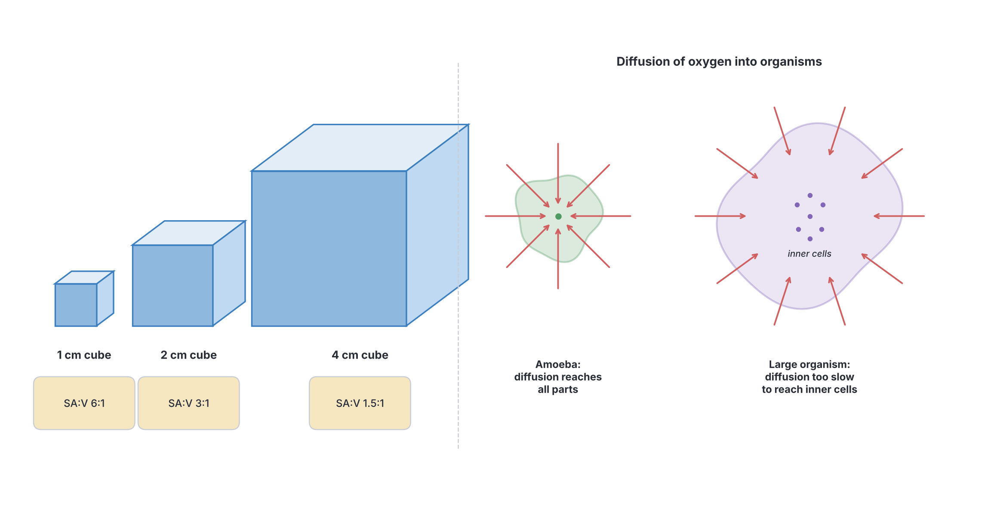

### Experiment: surface area to volume ratio and diffusion (agar cubes)

**Aim:** to show that small blocks are supplied by diffusion faster than large blocks.

**Materials:** agar jelly made with dilute sodium hydroxide and a few drops of **phenolphthalein** indicator (this makes the agar pink), a knife and ruler, dilute hydrochloric acid, a beaker, a stopwatch.

**Method:**

1. Cut the pink agar into cubes with sides of 1 cm, 2 cm and 3 cm.
2. Place all the cubes at the same time into a beaker of dilute hydrochloric acid, so that they are fully covered.
3. Watch the cubes. Record the time each cube takes to lose its pink colour completely.

**Observation:** the acid diffuses into the agar from the surface, neutralises the alkali, and the pink colour disappears from the outside inwards. The **smallest cube becomes completely colourless first**. The largest cube takes much longer; its centre stays pink for a long time.

**Conclusion:** the smaller the block, the larger its SA:V ratio and the shorter the distance to the centre, so diffusion supplies all of it quickly. A large organism made like the large cube could not be supplied by diffusion alone; it needs a transport system.

[IMAGE: Experimental set-up: a glass beaker of clear dilute acid containing three pink agar cubes of different sizes (small, medium, large). Beside it, the same three cubes cut in half after 5 minutes: the small cube fully colourless, the medium cube with a small pink centre, the large cube with a large pink centre and a colourless outer rim. Labels to add: "dilute hydrochloric acid", "agar with alkali and phenolphthalein (pink)", "1 cm cube", "2 cm cube", "3 cm cube", "colourless where acid has diffused in", "pink centre not yet reached". Clean flat textbook style, white background.]

## Materials for transport

**Objective ii: determine the sources of materials and the forms in which they are transported.**

The syllabus lists seven groups of materials: **excretory products, gases, manufactured food, digested food, nutrients, water and hormones**. For each one, you must know **where it comes from** (its source), **what form it travels in**, and **where it goes**.

### Excretory products

Excretory products are the waste substances made by the chemical reactions of the cells (metabolism). If they build up, they poison the body.

- **Urea:** made in the **liver** when excess amino acids are broken down (deamination). It dissolves in the **blood plasma** and is carried to the **kidneys**, which remove it in urine.
- **Carbon (IV) oxide (CO₂):** made in **all respiring cells**. It is carried in the blood to the **lungs** (see "Gases" below).
- **Excess water and mineral salts:** carried in the plasma to the kidneys and skin.
- **Bile pigments** (bilirubin): made in the liver and spleen from the breakdown of old red blood cells; carried in the plasma and removed by the liver in bile.

In **plants**, waste substances such as tannins, resins, gums and calcium oxalate crystals are stored in cells, bark and old leaves, which later fall off. Waste gases leave by diffusion through stomata and lenticels.

### Gases

**Oxygen**

- **Source:** the air in the **lungs** (alveoli), or the water flowing over the gills of fish.
- **Form:** about 98–99% is carried combined with **haemoglobin** in the red blood cells as **oxyhaemoglobin**; a very small amount dissolves in the plasma.
- **Destination:** all respiring cells, where oxyhaemoglobin releases its oxygen.

**Carbon (IV) oxide**

- **Source:** all **respiring cells** (tissues).
- **Forms:**
  1. Mostly as **hydrogencarbonate (bicarbonate) ions (HCO₃⁻)** in the **plasma**. CO₂ enters the red blood cells, where the enzyme **carbonic anhydrase** quickly combines it with water to form carbonic acid, which splits into hydrogen ions and hydrogencarbonate ions. The hydrogencarbonate ions pass out into the plasma.
  2. Some combined with **haemoglobin** as **carbaminohaemoglobin**.
  3. A small amount **dissolved** in the plasma.
- **Destination:** the **lungs**, where the reactions reverse and CO₂ diffuses into the alveoli and is breathed out.

**Textbook variation:** the percentages for the three forms of CO₂ differ between books. Common figures are about **70%** as hydrogencarbonate, about **20–23%** as carbaminohaemoglobin and about **5–10%** dissolved in plasma. Some older books simply say that CO₂ is carried "as bicarbonate in the plasma". All agree that hydrogencarbonate is the main form.

In **plants**, oxygen and CO₂ are **not** carried in the vascular system. They move by **diffusion** through stomata, lenticels and the air spaces between cells.

### Manufactured food

"Manufactured food" means food **made by green plants** by photosynthesis.

- **Source:** the **leaves** (and other green parts).
- **Form:** mainly **sucrose** (a soluble sugar), and also **amino acids**. Glucose made in photosynthesis is turned into sucrose before it is transported, because sucrose is less reactive and is not used up on the way.
- **Channel:** the **phloem** (sieve tubes).
- **Destination:** growing points (root and shoot tips), developing fruits and seeds, and storage organs (e.g. yam and cassava tubers, where sucrose is changed into starch for storage).

This is explained in B3b.

### Digested food

"Digested food" means the small, soluble molecules produced by digestion in the gut of animals.

| Digested food | Form transported | Where absorbed | First channel | Destination |
| --- | --- | --- | --- | --- |
| Carbohydrates | **Glucose** (and other simple sugars) dissolved in plasma | Villi of the **ileum** (small intestine) | Blood capillaries in the villi → **hepatic portal vein** → liver | Liver (stores excess as glycogen); then all cells for respiration |
| Proteins | **Amino acids** dissolved in plasma | Villi of the ileum | Blood capillaries → hepatic portal vein → liver | Liver (deaminates excess); all cells for growth and repair |
| Fats and oils | **Fatty acids and glycerol**, which are rebuilt into fat droplets in the villus cells | Villi of the ileum | **Lacteals** (lymph vessels) in the villi → lymphatic system → blood near the heart | Fat stores under the skin and around organs; cells for energy |

**Note:** fat droplets do not enter the hepatic portal vein. They enter the **lacteals** and travel in the **lymph**, so the lymph from the gut is milky white after a fatty meal (this milky lymph is called **chyle**).

### Nutrients

"Nutrients" here means other useful substances, such as **mineral salts** and **vitamins**.

- **In animals:** mineral salts (e.g. sodium, potassium, calcium, iron, iodine) are absorbed in the gut and carried as **ions dissolved in the plasma**. Water-soluble vitamins (B and C) travel dissolved in plasma; fat-soluble vitamins (A, D, E and K) travel with the fats. **Iron** is carried in the plasma bound to a protein, to the bone marrow, where it is used to make haemoglobin.
- **In plants:** mineral salts (e.g. nitrates, phosphates, potassium and magnesium ions) are absorbed from the soil by the **root hairs** and carried upwards as **ions dissolved in water** in the **xylem**.

### Water

- **In animals:** water is absorbed mainly in the small intestine and colon. It makes up most of the **plasma** (about 90%), so the blood itself transports water to all tissues. Excess water is carried to the kidneys and skin.
- **In plants:** water is absorbed from the soil by the **root hairs** (by osmosis) and carried up the **xylem** to the leaves (see B3b).

### Hormones

**Hormones** are chemical messengers made in one part of the body that act on another part.

- **In animals:** hormones are made by **endocrine (ductless) glands**, such as the pituitary, thyroid, adrenal glands, pancreas (islets of Langerhans), ovaries and testes. They pass **directly into the blood** and are carried **dissolved in the plasma** to their target organs. For example, **insulin** from the pancreas is carried in the blood to the liver and muscles.
- **In plants:** plant hormones (growth substances such as **auxins**) are made mainly in shoot and root tips. They move from cell to cell by diffusion and active transport, and some travel in the phloem and xylem.

### Other materials

The blood also carries **heat** (from active organs such as the liver and muscles to the rest of the body and the skin), **antibodies** and **white blood cells** (for defence), and **clotting factors**.

### Summary table: sources and forms of transported materials

| Material | Source | Form transported | Medium and channel | Destination |
| --- | --- | --- | --- | --- |
| Urea | Liver (deamination of excess amino acids) | Dissolved in plasma | Blood | Kidneys (removed in urine) |
| Oxygen | Lungs (alveoli) or gills | **Oxyhaemoglobin** in red blood cells (tiny amount dissolved) | Blood | All respiring cells |
| Carbon (IV) oxide | All respiring cells | Mainly **hydrogencarbonate ions** in plasma; some carbaminohaemoglobin; some dissolved | Blood | Lungs |
| Manufactured food (plants) | Leaves (photosynthesis) | **Sucrose** and amino acids in solution | Phloem sap in sieve tubes | Growing points, fruits, seeds, storage organs |
| Digested carbohydrate and protein | Ileum (villi) | **Glucose** and **amino acids** dissolved in plasma | Blood (hepatic portal vein to liver) | Liver, then all cells |
| Digested fats | Ileum (villi) | **Fat droplets** (from fatty acids and glycerol) | Lymph in lacteals, then blood | Fat stores, cells |
| Mineral salts (animals) | Gut | **Ions** dissolved in plasma | Blood | All cells, bones, teeth, blood |
| Mineral salts (plants) | Soil, via root hairs | **Ions** dissolved in water | Xylem | All cells, especially leaves |
| Water (animals) | Gut | Water of the plasma | Blood | All tissues; excess to kidneys and skin |
| Water (plants) | Soil, via root hairs | Water | Xylem | Leaves (photosynthesis and transpiration), all cells |
| Hormones (animals) | Endocrine glands | Dissolved in plasma | Blood | Target organs |
| Hormones (plants) | Shoot and root tips | Dissolved | Cell to cell; phloem | Growing regions |
| Heat | Liver and muscles | Warm blood | Blood | Whole body; skin |

## The general circulatory system

**Objective iii: describe the general circulatory system.**

The **circulatory system** (also called the **cardiovascular system**) of a mammal is made up of:

1. **The heart:** a muscular pump.
2. **Blood vessels:** **arteries** carry blood away from the heart; **veins** carry blood back to the heart; **capillaries** are tiny vessels that join arteries to veins and where materials are exchanged with the cells.
3. **Blood:** the fluid medium.

Mammals have a **closed circulatory system**: the blood always stays inside the heart and blood vessels. (The open system of insects is compared later in this file.)

### Double circulation

Mammals (and birds) have a **double circulation**: the blood passes **through the heart twice** in one complete journey round the body.

1. **Pulmonary circulation:** the **right** side of the heart pumps **deoxygenated** blood to the **lungs**, where it picks up oxygen and loses CO₂. The oxygenated blood returns to the **left** side of the heart.
2. **Systemic circulation:** the **left** side of the heart pumps **oxygenated** blood to **all the other parts of the body** (the brain, gut, liver, kidneys, muscles, skin and so on). There it gives up oxygen and picks up CO₂. The deoxygenated blood returns to the **right** side of the heart.

**The path of blood through the body, step by step:**

1. Deoxygenated blood from the body enters the **right atrium** through the **venae cavae** (the superior vena cava from the head and arms, the inferior vena cava from the rest of the body).
2. The right atrium contracts and pushes blood through the **tricuspid valve** into the **right ventricle**.
3. The right ventricle contracts and pumps blood through the **semilunar valve** into the **pulmonary artery**.
4. The pulmonary artery carries blood to the **lungs**. In the lung capillaries, CO₂ diffuses out into the alveoli and oxygen diffuses in. The blood becomes **oxygenated**.
5. Oxygenated blood returns to the **left atrium** through the **pulmonary veins**.
6. The left atrium contracts and pushes blood through the **bicuspid (mitral) valve** into the **left ventricle**.
7. The left ventricle contracts strongly and pumps blood through the **semilunar valve** into the **aorta**.
8. The aorta branches into **arteries** that carry blood to every organ. Arteries divide into **arterioles** and then **capillaries**, where oxygen and food pass to the cells and CO₂ and wastes pass into the blood.
9. Capillaries join to form **venules**, then **veins**, which return the deoxygenated blood to the venae cavae and the right atrium. The cycle starts again.

**Short form:** body → venae cavae → right atrium → right ventricle → pulmonary artery → lungs → pulmonary veins → left atrium → left ventricle → aorta → body.

[IMAGE: Simple schematic of the mammalian double circulation. The heart in the centre drawn as four boxes (right atrium and right ventricle on the viewer's left, left atrium and left ventricle on the viewer's right, as in a front view). An upper loop going to a pair of lungs at the top, and a lower loop going to a box representing body organs at the bottom. Vessels carrying oxygenated blood coloured red and deoxygenated blood coloured blue, with arrows showing the direction of flow. Labels to add: "lungs", "body organs", "right atrium", "right ventricle", "left atrium", "left ventricle", "pulmonary artery", "pulmonary vein", "aorta", "vena cava", "pulmonary circulation", "systemic circulation", "oxygenated blood", "deoxygenated blood". Clean flat textbook style, white background.]

#### Advantages of a double circulation

1. **Oxygenated and deoxygenated blood are kept completely separate** (in a four-chambered heart), so the blood reaching the body carries as much oxygen as possible.
2. Blood returning from the lungs is pumped a **second time**, so it reaches the body at **high pressure**. This gives a fast flow to the tissues, which is needed by active, warm-blooded animals.
3. The **pulmonary circulation can work at a lower pressure** than the systemic circulation. This protects the delicate lung capillaries from damage and stops fluid being forced out into the alveoli.

#### Single and double circulation compared

Fish have a **single circulation**: blood passes through the heart **only once** in each complete circuit (heart → gills → body → heart).

| Feature | Single circulation (fish) | Double circulation (mammals and birds) |
| --- | --- | --- |
| Times blood passes through the heart per circuit | Once | Twice |
| Number of circuits | One: heart → gills → body → heart | Two: pulmonary (heart → lungs → heart) and systemic (heart → body → heart) |
| Heart chambers | 2 (one atrium, one ventricle) | 4 (two atria, two ventricles) |
| Blood in the heart | Only deoxygenated | Deoxygenated on the right side, oxygenated on the left side, kept separate |
| Blood pressure to the body | Low (pressure is lost in the gill capillaries) | High (blood is pumped again after the lungs) |
| Suits | Cold-blooded animals in water, where the body is supported | Active, warm-blooded animals on land |

**Note:** amphibians and most reptiles also have a double circulation, but their hearts have **three chambers** (two atria and one ventricle, partly divided in reptiles), so some mixing of oxygenated and deoxygenated blood can happen in the ventricle. Crocodiles, birds and mammals have four chambers (see Topic A2c).

[IMAGE: Side-by-side comparison of a fish single circulation and a mammal double circulation. Left: a two-chambered heart (atrium and ventricle) with one loop going to the gills and then on to the body and back to the heart. Right: a four-chambered heart with two loops, one to the lungs and one to the body. Red for oxygenated and blue for deoxygenated blood, with arrows. Labels to add: "fish: single circulation", "mammal: double circulation", "gills", "lungs", "body", "atrium", "ventricle", "heart". Clean flat textbook style, white background.]

### The heart

The **heart** is a hollow, muscular organ about the size of its owner's clenched fist. In humans it lies in the **chest (thoracic) cavity**, between the two lungs, slightly to the left, protected by the ribs and breastbone (sternum).

#### Structure of the heart

**Outside:**

- The heart is enclosed in a double membrane, the **pericardium**. Between its two layers is a little **pericardial fluid**, which reduces friction as the heart beats.
- The wall of the heart is made of **cardiac muscle**, a special muscle that contracts rhythmically all through life **without tiring** and without needing nerve impulses to start each beat.
- The heart muscle gets its own supply of oxygenated blood from the **coronary arteries**, which branch from the aorta just after it leaves the heart and run over the surface of the heart. If a coronary artery is blocked (for example by fatty deposits or a clot), part of the heart muscle is starved of oxygen and dies. This is a **heart attack** (coronary thrombosis).

**Inside, the heart has four chambers:**

| Chamber | Receives blood from | Pumps blood to | Wall |
| --- | --- | --- | --- |
| **Right atrium** (auricle) | Body, through the superior and inferior **venae cavae** | Right ventricle | Thin |
| **Right ventricle** | Right atrium | **Lungs**, through the pulmonary artery | Thicker than the atria, but thinner than the left ventricle |
| **Left atrium** (auricle) | Lungs, through the **pulmonary veins** | Left ventricle | Thin |
| **Left ventricle** | Left atrium | **Whole body**, through the aorta | **Thickest** (about three times thicker than the right ventricle) |

- The two **atria** (singular: atrium; also called **auricles**) are the upper, thin-walled receiving chambers. They only need to push blood a short distance into the ventricles below.
- The two **ventricles** are the lower, thick-walled pumping chambers.
- The **left ventricle** has the thickest wall because it must pump blood at high pressure all round the body. The **right ventricle** only pumps blood to the nearby lungs, so its wall is thinner.
- The right and left sides are separated by a muscular wall, the **septum**. It keeps deoxygenated blood (right side) and oxygenated blood (left side) apart.

**Valves:** valves make sure that blood flows in **one direction only**.

| Valve | Position | Function |
| --- | --- | --- |
| **Tricuspid valve** (three flaps) | Between the right atrium and right ventricle | Stops blood flowing back into the right atrium when the right ventricle contracts |
| **Bicuspid valve** (two flaps; also called the **mitral valve**) | Between the left atrium and left ventricle | Stops blood flowing back into the left atrium when the left ventricle contracts |
| **Semilunar valves** (half-moon shaped pockets) | At the base of the **pulmonary artery** (pulmonary valve) and the **aorta** (aortic valve) | Stop blood flowing back from the arteries into the ventricles when the ventricles relax |

The tricuspid and bicuspid valves are called **atrioventricular valves**. Their flaps are held by tough strings, the **chordae tendineae** ("heart strings"), attached to **papillary muscles** on the ventricle wall. These stop the flaps from turning inside out (like an umbrella in the wind) when the ventricles contract with great force.

**Memory trick:** "**Tri** on the **R**ight" (both contain an "r"), and "**LAB**": **L**eft **A**trium, **B**icuspid.

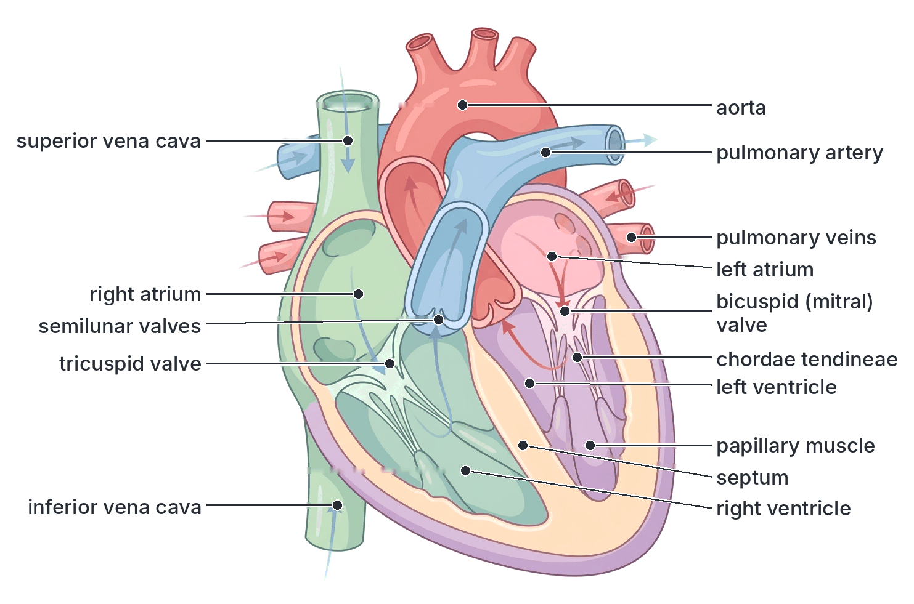

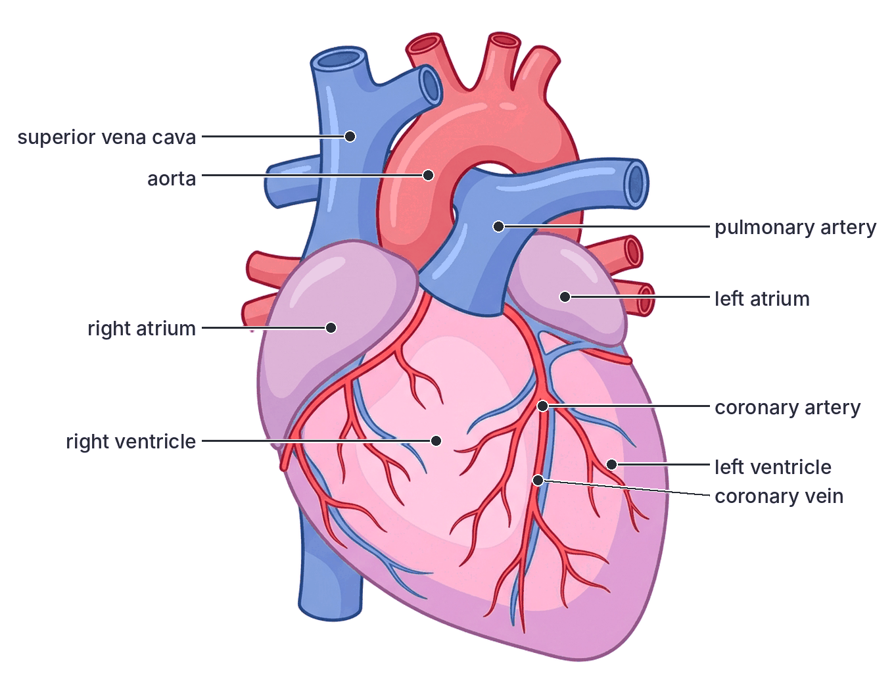

#### The cardiac cycle (heartbeat)

The **cardiac cycle** is the sequence of events in one heartbeat. Contraction of a chamber is called **systole**; relaxation is called **diastole**. At rest, an adult human heart beats about **70–75 times per minute** (normally between about 60 and 100), so one cycle lasts about **0.8 seconds**.

**Stages of the cardiac cycle, step by step:**

1. **Diastole (whole heart relaxed), about 0.4 s:** the atria and ventricles are relaxed. Blood flows from the venae cavae into the right atrium and from the pulmonary veins into the left atrium. Because the atrioventricular (tricuspid and bicuspid) valves are open, much of this blood flows straight on into the ventricles. The semilunar valves are closed, so blood in the arteries cannot flow back into the ventricles.
2. **Atrial systole, about 0.1 s:** both atria contract together. They push the remaining blood through the open tricuspid and bicuspid valves into the ventricles, filling them completely.
3. **Ventricular systole, about 0.3 s:** both ventricles contract together, a moment after the atria.
   - The pressure in the ventricles rises above that in the atria, so the **tricuspid and bicuspid valves snap shut**. This makes the first heart sound, "**lub**".
   - When the pressure in the ventricles rises above that in the arteries, the **semilunar valves open**, and blood is forced into the pulmonary artery and aorta.
4. **Ventricles relax (start of diastole again):** the pressure in the ventricles falls below that in the arteries. Blood starts to flow back, filling the pockets of the semilunar valves, which **snap shut**. This makes the second heart sound, "**dub**". The atria are already refilling, and the cycle repeats.

**Textbook variation:** the times given (0.1 s, 0.3 s, 0.4 s) are for a heart rate of about 75 beats per minute. Different books round them slightly differently, and they change when the heart rate changes.

The two heart sounds ("lub-dub") can be heard with a **stethoscope**. A doctor who hears an extra "whooshing" sound (a **murmur**) may suspect a leaking or narrowed valve.

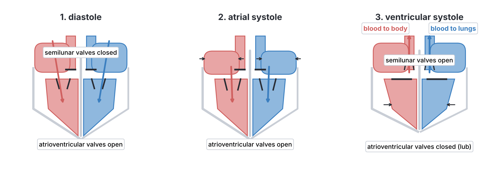

#### How the heartbeat is controlled

1. Heart muscle is **myogenic**: the beat starts in the heart muscle itself, not in a nerve.
2. The beat starts in a small patch of special tissue in the wall of the right atrium, the **sinoatrial node (SAN)**, called the **pacemaker**.
3. The SAN sends out a wave of electrical excitation across both atria, making them contract.
4. The wave reaches the **atrioventricular node (AVN)**, between the atria and the ventricles. The AVN **delays** the wave very slightly, so that the atria finish emptying before the ventricles contract.
5. The wave then passes down special fibres in the septum (the **bundle of His**) and spreads up the ventricle walls through **Purkinje fibres**, so the ventricles contract from the bottom upwards, squeezing blood up into the arteries.
6. Nerves from the brain (and the hormone **adrenaline**) can **speed up or slow down** the rate set by the SAN. During exercise, fear or excitement, the heart beats faster and more strongly.

#### Pulse and blood pressure

- **Pulse:** each time the left ventricle contracts, a surge of blood stretches the walls of the arteries. This can be felt as a **pulse** where an artery runs near the surface over a bone, such as the **wrist** (radial artery) or the **neck** (carotid artery). The pulse rate equals the heart rate.
- **Blood pressure:** the pressure of blood against the artery walls. It is measured with a **sphygmomanometer** and written as two numbers, e.g. **120/80 mmHg** for a healthy young adult. The higher number is the pressure when the ventricles contract (systolic pressure); the lower number is the pressure when the heart relaxes (diastolic pressure). Persistently high blood pressure (**hypertension**) is a serious and common health problem in Nigeria; it is linked to too much salt, obesity, stress, smoking, too little exercise and inherited factors.

**Factors that increase heart rate:** exercise, fear, anger and excitement (adrenaline), fever, high CO₂ in the blood, and some drugs (e.g. caffeine). Heart rate is generally faster in young children than in adults, and lower in fit athletes at rest.

### Blood vessels: arteries, veins and capillaries

Blood flows from the heart in **arteries**, which branch into smaller **arterioles**, then into microscopic **capillaries**. Capillaries join into **venules**, which join into **veins** that return blood to the heart.

**Heart → arteries → arterioles → capillaries → venules → veins → heart**

The walls of arteries and veins have three layers:

1. An outer layer of tough **connective tissue** (with collagen fibres).
2. A middle layer of **smooth muscle and elastic fibres**.
3. An inner lining of a single layer of flat cells, the **endothelium**, around the space (**lumen**) through which blood flows.

#### Arteries

**Arteries** carry blood **away from the heart**.

- They carry blood at **high pressure**, which flows in **spurts** (pulses) with each heartbeat.
- They have **thick walls** with a lot of **elastic fibres** and **muscle**. The elastic fibres stretch as each surge of blood arrives and then recoil, which keeps the blood flowing smoothly between beats. The muscle can contract to narrow the arteries and arterioles, controlling how much blood goes to each organ.
- They have a **small, round lumen** compared with the thickness of the wall.
- They have **no valves** (except the semilunar valves at the start of the aorta and pulmonary artery), because the high pressure keeps blood moving forward.
- They usually lie **deep** in the body, protected by muscles.
- All arteries carry **oxygenated** blood, **except the pulmonary artery** (and the umbilical arteries of the fetus), which carry deoxygenated blood.

#### Veins

**Veins** carry blood **towards the heart**.

- The blood is at **low pressure** and flows **smoothly** and slowly, without a pulse.
- They have **thinner walls** with **less muscle and elastic tissue** than arteries.
- They have a **large lumen**, which offers less resistance to the slow-moving blood.
- They have **valves** (semilunar, pocket-shaped) at intervals, which stop blood flowing backwards. This is important in the legs, where blood must flow upwards against gravity.
- Many veins lie **near the surface** (you can see blue veins on the back of your hand).
- All veins carry **deoxygenated** blood, **except the pulmonary veins** (and the umbilical vein of the fetus), which carry oxygenated blood.

**How blood returns to the heart in veins:** the pressure left in the veins is low. Blood is helped back by:

1. **Skeletal muscle pump:** when the muscles of the legs and arms contract, they squeeze the veins running between them and push blood along. The valves make sure it can only go towards the heart.
2. **Breathing movements:** when you breathe in, the pressure in the chest falls, which helps draw blood into the large veins near the heart.
3. **Suction** of the relaxing atria, and the small amount of pressure remaining from the heartbeat.

This is why soldiers standing still on parade for a long time sometimes faint: without muscle movement, blood collects in the legs and less reaches the brain.

**A simple demonstration of valves in veins:** let your arm hang down until the veins on the back of your hand or forearm stand out. Press a finger on a vein and stroke another finger along it, away from the heart, to empty a short section. The section stays empty until you lift the first finger; blood cannot flow back into it because of a valve. This experiment was first described by **William Harvey** in 1628, who showed that blood circulates.

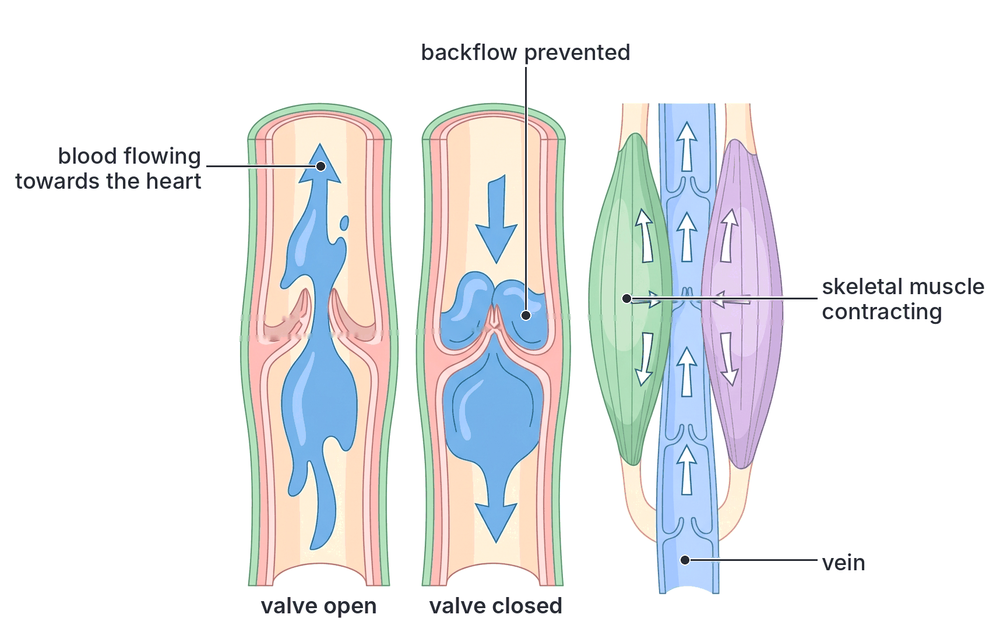

#### Capillaries

**Capillaries** are the smallest blood vessels. They form networks (**capillary beds**) in every tissue, so almost every cell is close to a capillary.

- Their walls are **only one cell thick** (just the endothelium), so substances can pass through them easily and quickly.
- They are **very narrow**, about 7–10 micrometres wide, so red blood cells pass through them in single file. This slows the blood down and brings it very close to the cells, giving time for exchange.
- There are **millions** of them, giving a **huge surface area** for exchange.
- The walls are **permeable**: small gaps between the cells allow water and dissolved substances (and white blood cells) to pass out, but not red blood cells or most plasma proteins.
- Blood pressure in them is lower than in arteries, and falls along their length.

**Function:** capillaries are where **exchange** happens between the blood and the cells. Oxygen, glucose, amino acids, mineral salts, hormones and water pass out to the cells; CO₂, urea and other wastes pass into the blood.

#### Formation of tissue fluid

1. At the **arterial end** of a capillary, the blood pressure is fairly high. It forces water and small dissolved molecules (glucose, amino acids, salts, oxygen) out through the capillary walls into the spaces between the cells. This fluid is **tissue fluid** (also called **interstitial fluid** or intercellular fluid). It bathes every cell.
2. Red blood cells, platelets and most **plasma proteins** are too large to leave, so they stay in the blood.
3. Cells take what they need from the tissue fluid and pass their wastes (CO₂, urea) into it.
4. At the **venous end** of the capillary, the blood pressure is lower. The plasma proteins left in the blood draw water back in by osmosis. Most of the tissue fluid (with its wastes) returns into the capillary.
5. The tissue fluid that does not return to the capillaries drains into **lymph capillaries** and becomes **lymph** (see the lymphatic system later in this file).

Tissue fluid is the "middleman" between the blood and the cells: substances pass from blood → tissue fluid → cell, and from cell → tissue fluid → blood.

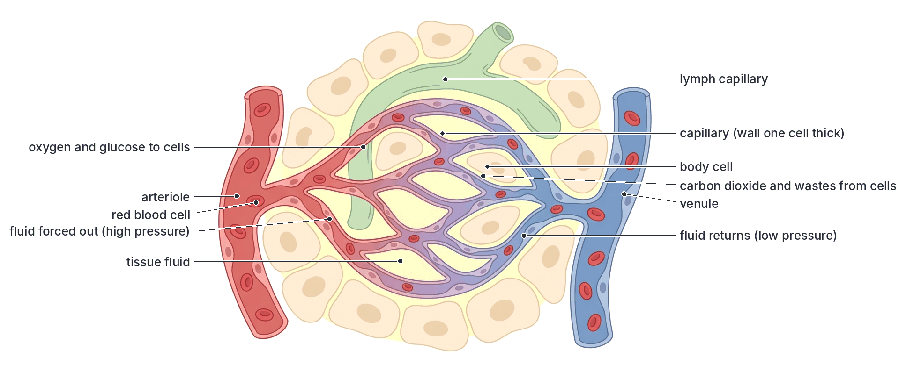

#### Arteries, veins and capillaries compared

| Feature | Arteries | Veins | Capillaries |
| --- | --- | --- | --- |
| Direction of blood flow | **Away from** the heart | **Towards** the heart | From arterioles to venules, through the tissues |
| Wall | **Thick**, with much muscle and elastic tissue | **Thin**, with little muscle and elastic tissue | **One cell thick** (endothelium only) |
| Lumen | Small, round | Large, often flattened or irregular in section | Very narrow (just wider than a red blood cell) |
| Valves | Absent (except at the base of the aorta and pulmonary artery) | **Present** at intervals | Absent |
| Blood pressure | **High** | **Low** | Medium, falling along the length |
| Flow | Fast, in pulses (spurts) | Slow, smooth, no pulse | Very slow, smooth |
| Oxygen content of blood | Oxygenated (except pulmonary artery) | Deoxygenated (except pulmonary veins) | Oxygenated at the arterial end, deoxygenated at the venous end |
| Position | Usually deep | Many near the surface | In every tissue, close to cells |
| Exchange with cells | None (walls too thick) | None | **Yes**, all exchange happens here |
| When cut | Blood spurts out, bright red | Blood flows out steadily, darker red | Blood oozes slowly |

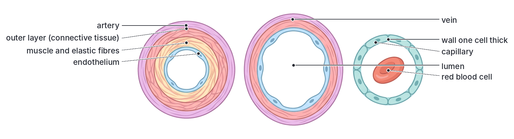

### The main blood vessels of the body

Every major organ has an artery bringing blood from the aorta and a vein returning blood to the venae cavae. Each artery and vein is usually named after the organ it serves.

| Organ | Artery (brings blood) | Vein (takes blood away) |
| --- | --- | --- |
| Lungs | Pulmonary artery | Pulmonary veins |
| Head and brain | Carotid arteries | Jugular veins |
| Arms | Subclavian arteries | Subclavian veins |
| Liver | Hepatic artery (and hepatic portal vein) | Hepatic vein |
| Stomach and intestines | Mesenteric arteries (and gastric arteries) | Hepatic portal vein |
| Kidneys | Renal arteries | Renal veins |
| Legs | Iliac arteries (then femoral arteries) | Iliac veins (from femoral veins) |
| Heart muscle | Coronary arteries | Coronary veins |

[IMAGE: Simplified plan of the human blood system in front view, with the heart in the chest, the lungs, liver, stomach and intestines, and two kidneys drawn as simple shapes. Show the aorta arching up from the heart and running down the body, the venae cavae, the pulmonary artery and veins to the lungs, the carotid artery and jugular vein to the head, the hepatic artery and hepatic vein, the hepatic portal vein running from the intestines to the liver, and the renal artery and renal vein to each kidney, and iliac vessels to the legs. Arteries in red, veins in blue, the hepatic portal vein in purple to stand out. Labels to add: "aorta", "vena cava", "pulmonary artery", "pulmonary vein", "carotid artery", "jugular vein", "hepatic artery", "hepatic vein", "hepatic portal vein", "renal artery", "renal vein", "mesenteric artery", "iliac artery", "iliac vein", "heart", "lungs", "liver", "intestines", "kidney". Clean flat textbook style, white background.]

## Specific functions of some important blood vessels

**Objective iv: compare specific functions of the hepatic portal vein, the pulmonary vein and artery, aorta, the renal artery and vein.**

### The hepatic portal vein

- **From:** the **stomach, small intestine (ileum), large intestine (colon), spleen and pancreas**.
- **To:** the **liver**.
- **Type of blood:** **deoxygenated**.
- **Special feature:** it is a **portal vein**: it begins in **capillaries** (in the gut wall) and ends in **capillaries** (in the liver), instead of going back to the heart. "Hepatic" means "of the liver".
- **Function:** it carries the **absorbed products of digestion** (glucose, amino acids, mineral salts, water-soluble vitamins) straight from the gut to the liver. The liver can then:
  - store excess glucose as **glycogen** (under the control of insulin), and release glucose when blood sugar is low;
  - **deaminate** excess amino acids, making **urea**;
  - **detoxify** poisons, drugs and alcohol absorbed from the gut;
  - store iron and some vitamins (A, D, B₁₂).
- **Content:** after a meal, the hepatic portal vein carries the **highest concentration of glucose and amino acids** of any blood vessel. Its glucose content **varies a lot**: very high after a meal and lower between meals. The liver then releases blood with a fairly steady glucose level into the hepatic vein.

**Note:** the liver receives blood from two vessels: the **hepatic portal vein** (food-rich, deoxygenated) and the **hepatic artery** (oxygen-rich, from the aorta). Blood leaves the liver through the **hepatic vein**, which joins the inferior vena cava.

### The pulmonary artery

- **From:** the **right ventricle**. **To:** the **lungs** (it divides into a right and a left branch).
- **Type of blood:** **deoxygenated**. It is the **only artery in the adult body that carries deoxygenated blood**.
- **Function:** carries deoxygenated blood, rich in CO₂, to the lungs to be oxygenated and to get rid of CO₂.
- **Pressure:** fairly low compared with the aorta, because the right ventricle is less muscular and the lungs are close.

### The pulmonary vein

- **From:** the **lungs**. **To:** the **left atrium**. (There are usually four pulmonary veins, two from each lung.)
- **Type of blood:** **oxygenated**. The pulmonary veins are the **only veins in the adult body that carry oxygenated blood**.
- **Function:** returns freshly oxygenated blood from the lungs to the heart, to be pumped round the body.
- **Content:** it carries the blood with the **highest oxygen content** and the **lowest CO₂ content** in the body.

### The aorta

- **From:** the **left ventricle**. **To:** all parts of the body except the lungs (through its branches).
- **Type of blood:** **oxygenated**.
- **Special features:** it is the **largest artery** in the body. It carries blood at the **highest pressure**. Its wall is thick and very elastic. A **semilunar valve** at its base stops blood flowing back into the left ventricle.
- **Function:** distributes oxygenated blood to the whole body (systemic circulation). Its first branches are the **coronary arteries** that feed the heart muscle. It then arches over (the **aortic arch**), giving branches to the head and arms, and runs down the back of the chest and abdomen, giving branches to the gut, liver, kidneys and legs.

### The renal artery

- **From:** the **aorta** (one renal artery to each kidney). "Renal" means "of the kidney".
- **Type of blood:** **oxygenated**.
- **Function:** brings blood to the kidneys to be **filtered and cleaned**. This blood contains **urea** and other wastes, as well as excess water and salts, which the kidneys remove.
- **Content:** compared with the renal vein, it has **more urea**, more oxygen, and more water and salts (if the body has too much).

### The renal vein

- **From:** the **kidneys**. **To:** the **inferior vena cava**.
- **Type of blood:** **deoxygenated**.
- **Function:** returns **cleaned (filtered) blood** from the kidneys to the general circulation.
- **Content:** the renal vein carries the blood with the **lowest concentration of urea** in the body, because the kidneys have just removed it. It has less oxygen and more CO₂ than the renal artery (the kidney cells use oxygen for respiration, especially for active transport). Its water and salt content has been adjusted to the body's needs.

### The six vessels compared

| Vessel | Carries blood from | Carries blood to | Oxygenated or deoxygenated | Special feature or content | Main function |
| --- | --- | --- | --- | --- | --- |
| **Hepatic portal vein** | Stomach, intestines, spleen, pancreas | Liver | Deoxygenated | Capillaries at both ends; **richest in digested food** (glucose, amino acids) after a meal; glucose level varies | Carries absorbed food to the liver for storage, regulation and detoxification |
| **Pulmonary artery** | Right ventricle | Lungs | **Deoxygenated** (the only such artery in adults) | Rich in CO₂; lower pressure than the aorta | Takes blood to the lungs for gaseous exchange |
| **Pulmonary vein** | Lungs | Left atrium | **Oxygenated** (the only such veins in adults) | **Highest oxygen** and lowest CO₂ content | Returns oxygenated blood to the heart |
| **Aorta** | Left ventricle | All body organs (through branches) | Oxygenated | **Largest artery; highest blood pressure**; very elastic wall; semilunar valve at its base | Distributes oxygenated blood to the whole body |
| **Renal artery** | Aorta | Kidney | Oxygenated | **High in urea** (compared with the renal vein) | Brings blood to the kidney to be filtered |
| **Renal vein** | Kidney | Inferior vena cava | Deoxygenated | **Lowest urea** content in the body | Returns cleaned blood to the circulation |

**Quick answers JAMB likes:**

- Highest concentration of digested food after a meal: **hepatic portal vein**.
- Lowest concentration of urea: **renal vein**.
- Highest concentration of oxygen: **pulmonary vein** (and the aorta, which carries the same blood on).
- Highest blood pressure: **aorta**.
- An artery carrying deoxygenated blood: **pulmonary artery**.
- A vein carrying oxygenated blood: **pulmonary vein**.

[IMAGE: Close-up diagram of the abdomen showing the small intestine with villi capillaries joining into the hepatic portal vein (purple) running to the liver, the hepatic artery (red) from the aorta to the liver, the hepatic vein (blue) from the liver to the inferior vena cava, and two kidneys each with a renal artery (red) from the aorta and a renal vein (blue) to the inferior vena cava. Small arrows show the direction of flow. Labels to add: "aorta", "inferior vena cava", "liver", "small intestine", "hepatic portal vein", "hepatic artery", "hepatic vein", "kidney", "renal artery", "renal vein", "digested food to liver", "urea removed by kidney". Clean flat textbook style, white background.]

## Media of transport

**Objective vii: identify media of transportation (e.g., cytoplasm, cell sap, body fluid, blood and lymph).**

A **medium of transport** (plural: media) is the **fluid** in which materials are carried. The syllabus names five.

### Cytoplasm

- The **cytoplasm** is the jelly-like fluid inside every cell.
- In single-celled organisms such as *Amoeba*, *Paramecium* and *Euglena*, it is the **only** medium of transport. Materials taken in at the surface spread through the cytoplasm by **diffusion** and by **cytoplasmic streaming** (the cytoplasm flowing round the cell). In *Amoeba*, the cytoplasm flows into the pseudopodia as it moves. In *Paramecium*, food vacuoles are carried round the cell by streaming cytoplasm while their food is digested.
- In multicellular organisms, the cytoplasm moves materials **within each cell**. In plant cells, cytoplasmic streaming (also called **cyclosis**) carries chloroplasts and dissolved substances round the cell; it can be seen in the leaf cells of water plants such as *Elodea* (Canadian pondweed) under the microscope.
- In plants, the cytoplasm of neighbouring cells is joined by fine strands (**plasmodesmata**), so materials can pass from cell to cell through the cytoplasm. The **phloem** sieve tubes are living cells; the food they carry moves in their cytoplasm-like sap.

### Cell sap

- **Cell sap** is the watery solution in the large **vacuole** of a plant cell. It contains water, sugars, salts, pigments and wastes.
- It is a medium for **storing** and moving water and dissolved substances in plants. Water moves from cell sap to cell sap by **osmosis**, for example from the root hair across the root cortex to the xylem (see B3b).
- The cell sap pressing outwards on the cell wall keeps plant cells firm (**turgid**).

### Body fluid

"Body fluid" is a general term for the watery fluids that fill the body spaces and bathe the cells of animals. Examples:

- **Tissue fluid** (interstitial fluid): bathes the cells of vertebrates (see "Formation of tissue fluid" above); exchange between blood and cells happens through it.
- **Haemolymph** (blood) of **insects**: fills the body cavity (**haemocoel**) and bathes all the organs directly (see "Open circulatory system" below).
- **Coelomic fluid** of the **earthworm**: fills the body cavity (coelom) and helps distribute materials, as well as acting as a hydrostatic skeleton.
- The water in the **enteron** (gut cavity) of ***Hydra***: water flows in and out of the mouth, carrying food particles and oxygen to the cells lining it.

### Blood

**Blood** is the main medium of transport in vertebrates and many invertebrates (e.g. the earthworm). It is a **liquid tissue** made of a fluid (**plasma**) carrying **cells**. It flows inside blood vessels in a **closed** system, pumped by the heart. Its composition and functions are described in detail in the next section.

### Lymph

**Lymph** is the fluid in the **lymphatic vessels** of vertebrates. It is formed from tissue fluid, contains many lymphocytes, and carries absorbed fat from the gut. It flows slowly and returns to the blood near the heart. It is described in detail below.

### Media of transport compared

| Medium | Found in | What it transports | How it moves |
| --- | --- | --- | --- |
| **Cytoplasm** | All cells; the only medium in unicellular organisms (*Amoeba*, *Paramecium*) | Food, gases, wastes within the cell | Diffusion; cytoplasmic streaming |
| **Cell sap** | Vacuoles of plant cells | Water, sugars, salts, pigments | Osmosis and diffusion from cell to cell |
| **Body fluid** (tissue fluid, haemolymph, coelomic fluid) | Spaces between cells; body cavities of insects and earthworms | Food, wastes, hormones; oxygen in some | Diffusion; body movements; heart pumping (insects) |
| **Blood** | Blood vessels of vertebrates and some invertebrates | Oxygen, CO₂, food, wastes, hormones, heat, antibodies | Pumped by the heart in vessels |
| **Lymph** | Lymphatic vessels of vertebrates | Excess tissue fluid, fats, lymphocytes | Squeezed by muscles; valves keep it flowing one way |

## Composition and functions of blood

**Objective viii: state the composition and functions of blood and lymph.**

An adult human has about **5 litres** of blood (about 5–6 litres in men and 4–5 litres in women). If blood is left to stand in a test tube with a chemical that stops clotting, or is spun in a machine called a **centrifuge**, it separates into two parts:

1. A pale yellow liquid on top: the **plasma**, about **55%** of the volume.
2. A red layer below: the **blood cells** (the "formed elements"), about **45%**: red blood cells at the bottom, with a thin pale layer (the "buffy coat") of white blood cells and platelets on top of them.

**Textbook variation:** the figures for plasma and cells vary slightly: plasma is given as 55–60% and cells as 40–45%. The proportion of red cells (the haematocrit) is usually a little higher in men than in women.

[IMAGE: A test tube of blood that has been spun in a centrifuge, showing a large pale yellow upper layer, a very thin whitish middle band, and a dark red lower layer. Beside it, a bracket and small pie chart showing about 55% plasma and 45% cells. Labels to add: "plasma (about 55%)", "white blood cells and platelets (buffy coat)", "red blood cells (about 45%)". Clean flat textbook style, white background.]

### Plasma

**Plasma** is the liquid part of the blood. It is a pale yellow, slightly alkaline (about pH 7.4) solution.

**Composition of plasma:**

| Component | Approximate amount | Examples and notes |
| --- | --- | --- |
| **Water** | About 90–92% | The solvent for everything else |
| **Plasma proteins** | About 7–8% | **Albumin** (keeps water in the blood by osmosis; carries some substances); **globulins** (including **antibodies**); **fibrinogen** and **prothrombin** (for clotting) |
| **Digested food** | Small amounts | Glucose, amino acids, fats, vitamins |
| **Mineral salts (ions)** | About 0.9% | Sodium, chloride, potassium, calcium, hydrogencarbonate ions |
| **Excretory products** | Small amounts | **Urea**, uric acid, CO₂ (as hydrogencarbonate) |
| **Hormones** | Tiny amounts | Insulin, adrenaline, thyroxine and others |
| **Dissolved gases** | Small amounts | Oxygen, CO₂, nitrogen |
| **Enzymes** | Tiny amounts | Various |

**Functions of plasma:**

1. Transports digested food from the gut to the liver and all cells.
2. Transports excretory products (urea to the kidneys; CO₂, mainly as hydrogencarbonate, to the lungs).
3. Transports hormones from endocrine glands to target organs.
4. Distributes **heat** around the body.
5. Contains **antibodies** that fight infection.
6. Contains **fibrinogen and prothrombin**, needed for blood clotting.
7. Carries the blood cells and platelets.
8. Helps keep the pH of the blood steady (buffering) and helps maintain the osmotic balance of the blood.

**Serum** is plasma from which the clotting proteins (especially fibrinogen) have been removed. It is the clear yellow fluid that separates out when blood clots.

### Red blood cells (erythrocytes)

**Structure:**

- **Biconcave disc** shape: round, flattened, and thinner in the middle than at the edges. This gives a **large surface area** for oxygen to diffuse in and out, and keeps every part of the cell close to the surface.
- **No nucleus** in mature mammalian red blood cells (and few organelles, including no mitochondria). This leaves more room for **haemoglobin**. (The red blood cells of fish, amphibians, reptiles and birds do have a nucleus.)
- Packed with **haemoglobin**, a red, **iron**-containing protein that carries oxygen.
- **Small** (about 7–8 micrometres across) and **flexible**, so they can squeeze through narrow capillaries.
- **Very numerous:** about **5 million per mm³** of blood (about 5–5.5 million in men and 4.5–5 million in women).

**Formation and lifespan:**

- Made in the **red bone marrow** of bones such as the ribs, sternum, vertebrae, skull, pelvis and the ends of the long bones. (In the fetus, they are also made in the liver and spleen.)
- Each lives for about **120 days** (4 months). Old red cells are broken down in the **liver** and **spleen**. Their iron is kept and reused; the rest of the haemoglobin is turned into **bile pigments**.
- Iron, protein, vitamin B₁₂ and folic acid are needed to make new red cells.

**Function: transport of oxygen.**

1. In the **lungs**, where the oxygen concentration is high, haemoglobin combines with oxygen to form **oxyhaemoglobin** (bright red). Each haemoglobin molecule can carry **four** oxygen molecules.

   haemoglobin + oxygen ⇌ oxyhaemoglobin

2. In the **tissues**, where the oxygen concentration is low (because cells use it up in respiration), oxyhaemoglobin breaks down, releasing oxygen, which diffuses into the cells. The blood becomes darker red (deoxygenated).
3. Red blood cells also help carry **CO₂**: they contain the enzyme **carbonic anhydrase** (which forms hydrogencarbonate ions), and some CO₂ joins haemoglobin.

**Health links:**

- **Anaemia:** too few red cells or too little haemoglobin, so too little oxygen reaches the tissues; the person is pale, tired and breathless. Common causes in Nigeria include lack of iron in the diet, blood loss (e.g. heavy periods, hookworm infection), malaria (the parasite destroys red cells) and sickle cell disease.
- **Sickle cell anaemia:** an inherited condition in which abnormal haemoglobin (HbS) makes red cells bend into a **sickle** shape when oxygen is low. Sickle cells are rigid, break down early and block small vessels, causing pain (crises) and anaemia. Nigeria has one of the highest numbers of babies born with sickle cell disease in the world. It is studied further under genetics.
- **Carbon monoxide** (from car exhaust, generators and charcoal fires in closed rooms) combines with haemoglobin far more strongly than oxygen does, forming **carboxyhaemoglobin**, so the blood cannot carry oxygen. This is why running a generator indoors can kill.

### White blood cells (leucocytes)

**General features:**

- They have a **nucleus** and are usually **larger** than red cells.
- They have **no haemoglobin**, so they are colourless.
- They are **far fewer** than red cells: about **5,000–10,000 per mm³** (roughly 1 white cell for every 600–700 red cells).
- Many can change shape and **squeeze out through capillary walls** into the tissues to fight infection.
- They are made in the **bone marrow**; lymphocytes also mature and multiply in the **lymph nodes, thymus, spleen and tonsils**.

**Textbook variation:** the normal white cell count is given differently in different books, for example 4,000–11,000, 5,000–10,000 or 6,000–9,000 per mm³. The count rises during infection.

**Main function: defending the body against disease.**

White cells are divided into two groups, according to whether their cytoplasm contains granules (seen after staining).

| Type | Group | Approximate share of white cells | Nucleus | Function |
| --- | --- | --- | --- | --- |
| **Neutrophils** | Granulocyte (granular) | About 60–70% (the most common) | Lobed (2–5 lobes) | **Phagocytosis**: engulf and digest bacteria; the first cells to arrive at an infection; dead neutrophils form much of **pus** |
| **Eosinophils** | Granulocyte | About 2–4% | Usually two lobes | Increase in **allergies** (e.g. asthma, hay fever) and **parasitic worm** infections (e.g. hookworm, roundworm); help destroy parasites and control allergic reactions |
| **Basophils** | Granulocyte | Under 1% (the rarest) | Lobed, often hidden by granules | Release **histamine** (involved in inflammation and allergy) and **heparin** (an anticoagulant that stops blood clotting inside vessels) |
| **Lymphocytes** | Agranulocyte (non-granular) | About 20–30% | Large, round, filling most of the cell | Produce **antibodies** (B-lymphocytes) and kill infected cells or control the immune response (T-lymphocytes); give **immunity** and "memory" of past infections |
| **Monocytes** | Agranulocyte | About 3–8% | Large, kidney- or bean-shaped | The **largest** white cells; leave the blood and become **macrophages**, large phagocytes that engulf bacteria, dead cells and debris |

**Textbook variation:** the percentages differ slightly between books (e.g. neutrophils 50–70%, lymphocytes 20–40%). The order of abundance is the same: neutrophils > lymphocytes > monocytes > eosinophils > basophils.

**Phagocytosis, step by step:**

1. Bacteria enter the body through a cut. Damaged cells release chemicals that attract **phagocytes** (neutrophils and macrophages).
2. The phagocyte squeezes out of a capillary and moves towards the bacteria.
3. It pushes out **pseudopodia** around a bacterium and engulfs it in a vacuole.
4. Enzymes from **lysosomes** enter the vacuole and **digest** the bacterium.
5. Many phagocytes die in the process; dead phagocytes, bacteria and tissue fluid form **pus**.

**How antibodies work:** an **antigen** is a foreign substance (often on the surface of a germ) that triggers an immune response. Lymphocytes make **antibodies**, special proteins that fit only one antigen. Different antibodies act in different ways:

- **Antitoxins** neutralise poisons (toxins) made by bacteria, such as those of tetanus and diphtheria.
- **Agglutinins** make germs **clump together**, so phagocytes can engulf them easily.
- **Lysins** break open (dissolve) the cell walls or membranes of germs.
- **Opsonins** coat germs so that phagocytes recognise and engulf them more easily.

After an infection or a **vaccination**, some lymphocytes remain as **memory cells**, so if the same germ attacks again, antibodies are made very quickly. This is **immunity**. Vaccination against measles, polio, tuberculosis, yellow fever and other diseases is part of Nigeria's routine immunisation programme.

**Health link:** in **HIV/AIDS**, the virus destroys a type of T-lymphocyte, weakening the immune system, so the body cannot fight infections. In **leukaemia** (a cancer of the blood), very large numbers of abnormal white cells are made.

### Platelets (thrombocytes)

- **Structure:** small, colourless, irregular **fragments of cells**, with **no nucleus**. They break off from very large cells (**megakaryocytes**) in the red bone marrow.
- **Number:** about **150,000–400,000 per mm³** of blood (textbooks give figures from about 150,000 to 450,000; older books often give 250,000).
- **Lifespan:** about **7–10 days**.
- **Function:** **blood clotting**. They also help seal small breaks in blood vessels by sticking together to form a **platelet plug**.

### Blood clotting

When a blood vessel is cut, the blood **clots** to stop bleeding and to stop germs entering the body.

**Steps of blood clotting:**

1. A blood vessel is damaged, exposing the tissue under its lining to the blood.
2. **Platelets** stick to the damaged area and to each other, forming a **platelet plug**.
3. The **damaged tissues and platelets** release an enzyme called **thromboplastin** (also called **thrombokinase**).
4. Thromboplastin, in the presence of **calcium ions** (and other clotting factors in the plasma), converts the inactive plasma protein **prothrombin** into the active enzyme **thrombin**.
5. **Thrombin** converts the soluble plasma protein **fibrinogen** into insoluble threads of **fibrin**.
6. The fibrin threads form a **mesh** over the wound, which **traps red blood cells**, platelets and plasma, forming a **clot**.
7. The clot dries and hardens into a **scab**, which protects the wound while new skin grows underneath.

**In summary:**

damaged tissue + platelets → thromboplastin

prothrombin → (thromboplastin + calcium ions) → thrombin

fibrinogen → (thrombin) → fibrin (mesh that traps blood cells to form a clot)

**Things needed for clotting:** platelets, thromboplastin, calcium ions, prothrombin, fibrinogen and **vitamin K** (the liver needs vitamin K to make prothrombin and some other clotting factors).

**Why blood does not normally clot inside blood vessels:** the lining of healthy vessels is smooth, so platelets are not activated; the blood flows quickly; and the blood contains **heparin** (an anticoagulant from basophils and from cells in the liver and other tissues) which stops clotting.

**Textbook variation:** clotting really involves a long chain (cascade) of more than a dozen clotting factors. School textbooks simplify it to the steps above. Some books say thromboplastin acts on prothrombin; others call the activating enzyme "thrombokinase". For JAMB, use the simplified sequence above.

**Importance of clotting:** prevents excessive loss of blood (**haemorrhage**); prevents germs from entering the body through wounds; begins wound healing.

**Health links:** **haemophilia** is an inherited disorder in which a clotting factor is missing, so the blood takes a very long time to clot; even small cuts can bleed dangerously. A clot that forms inside a blood vessel (a **thrombus**) can block it, causing a heart attack (in a coronary artery) or a stroke (in the brain).

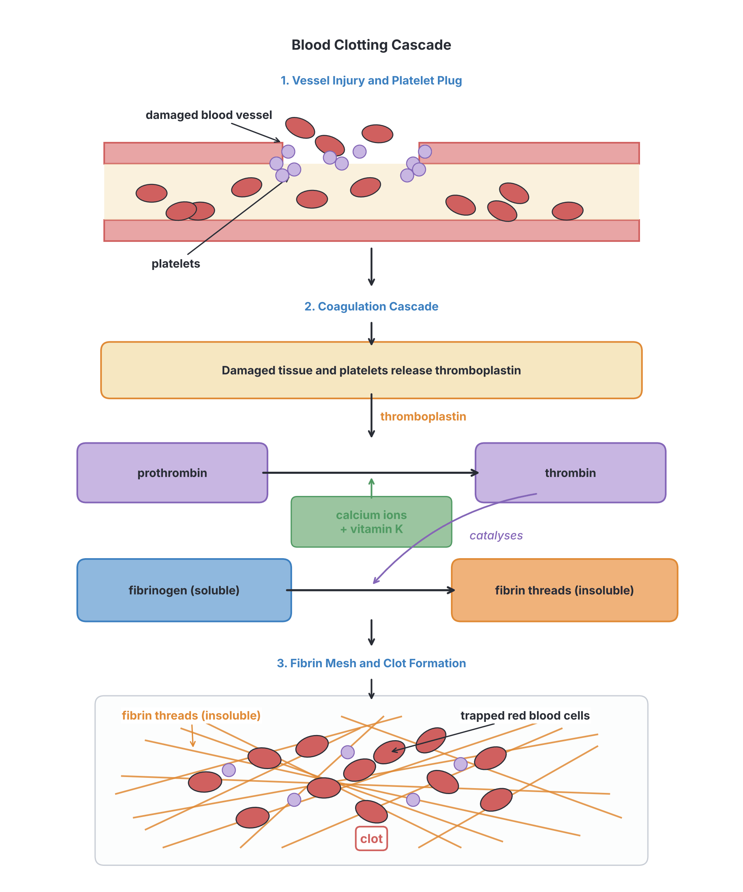

### The blood cells compared

| Feature | Red blood cells | White blood cells | Platelets |
| --- | --- | --- | --- |
| Other name | Erythrocytes | Leucocytes | Thrombocytes |
| Shape | Biconcave disc | Irregular, can change shape | Small irregular fragments |
| Nucleus | **Absent** (in mammals) | **Present** (often lobed) | Absent (cell fragments) |
| Haemoglobin | Present | Absent | Absent |
| Size | About 7–8 µm | Larger (about 8–20 µm) | Smallest (about 2–4 µm) |
| Number per mm³ | About 5 million | About 5,000–10,000 | About 150,000–400,000 |
| Lifespan | About 120 days | A few hours to days for most; some lymphocytes for years | About 7–10 days |
| Where made | Red bone marrow | Bone marrow; lymph nodes, thymus, spleen (lymphocytes) | Red bone marrow (from megakaryocytes) |
| Function | Carry oxygen (and help carry CO₂) | Defend the body (phagocytosis, antibodies) | Blood clotting |

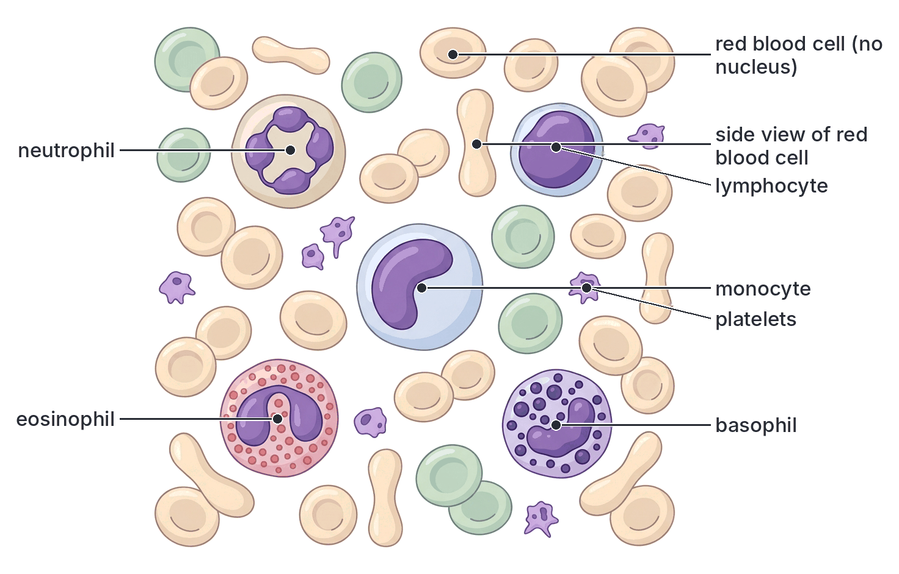

### Functions of blood: summary

**A. Transport functions**

1. **Oxygen** from the lungs to all cells (as oxyhaemoglobin in red cells).
2. **Carbon (IV) oxide** from cells to the lungs (mainly as hydrogencarbonate in plasma).
3. **Digested food** (glucose, amino acids) from the small intestine to the liver and all cells.
4. **Excretory products**, e.g. urea from the liver to the kidneys.
5. **Hormones** from endocrine glands to target organs.
6. **Heat** from active organs (liver, muscles) to all parts of the body, helping keep body temperature even.
7. **Water and mineral salts** to all tissues.

**B. Defence (protective) functions**

8. **Phagocytosis** by neutrophils and monocytes (macrophages).
9. **Antibody** production by lymphocytes, giving immunity.
10. **Blood clotting** by platelets and plasma proteins, which stops blood loss and keeps germs out.

**C. Regulating functions (homeostasis)**

11. Helps keep body **temperature** steady (by carrying heat to the skin when hot, and away from it when cold).
12. Helps keep the **pH** of body fluids steady (buffering by plasma proteins and hydrogencarbonate).
13. Helps keep the **water and salt balance** of the tissues steady.

## Lymph and the lymphatic system

### What is lymph?

**Lymph** is a clear, colourless or pale yellowish fluid found in the lymphatic vessels. It is formed from **tissue fluid**: the fluid that leaks out of blood capillaries but does not return to them drains into tiny, blind-ended **lymph capillaries** among the cells. Once inside the lymph capillaries, it is called lymph.

### Composition of lymph

- **Water**, with dissolved substances such as glucose, amino acids, salts and wastes, in roughly the same concentrations as in plasma and tissue fluid.
- **Fewer plasma proteins** than blood plasma (most proteins are too large to leave the blood capillaries).
- **Many lymphocytes** (added as lymph passes through the lymph nodes).
- **No red blood cells** and usually **no platelets** (some books say very few).
- **Fats:** lymph from the **lacteals** of the small intestine contains many tiny **fat droplets** after a fatty meal, making it milky (**chyle**).
- Some clotting proteins, so lymph can clot slowly.

### The lymphatic system

The **lymphatic system** is made up of:

1. **Lymph capillaries:** tiny, thin-walled, **blind-ended** tubes among the tissue cells. Their walls are very permeable, so tissue fluid, large protein molecules and even bacteria can enter. In each villus of the small intestine there is a lymph capillary called a **lacteal**.
2. **Lymph vessels (lymphatics):** formed by lymph capillaries joining. Like veins, they have **thin walls** and many **valves**, which keep lymph flowing in one direction, towards the heart.
3. **Lymph nodes (lymph glands):** small bean-shaped swellings along the lymph vessels, found in groups in the **neck, armpits, groin** and inside the chest and abdomen. They contain many **lymphocytes** and **macrophages**.
4. **Main lymph ducts:** all the lymph vessels join into two main ducts that empty into the blood in the **subclavian veins** (under the collarbones), near where they join the vena cava:
   - The **thoracic duct** (the largest lymph vessel) collects lymph from the legs, abdomen (including the lacteals), the left side of the chest, the left arm and the left side of the head, and empties into the **left subclavian vein**.
   - The **right lymphatic duct** collects lymph from the right arm and the right side of the head and chest, and empties into the **right subclavian vein**.
5. **Lymphoid organs:** the **spleen**, **thymus**, **tonsils** and **adenoids** contain lymphatic tissue that makes and stores lymphocytes.

**How lymph moves:** the lymphatic system has **no pump**. Lymph moves slowly because:

1. The **contraction of skeletal muscles** squeezes the lymph vessels.
2. **Breathing movements** change the pressure in the chest, which draws lymph upwards.
3. **Valves** stop it flowing backwards.
4. New tissue fluid constantly entering the lymph capillaries pushes the lymph along.

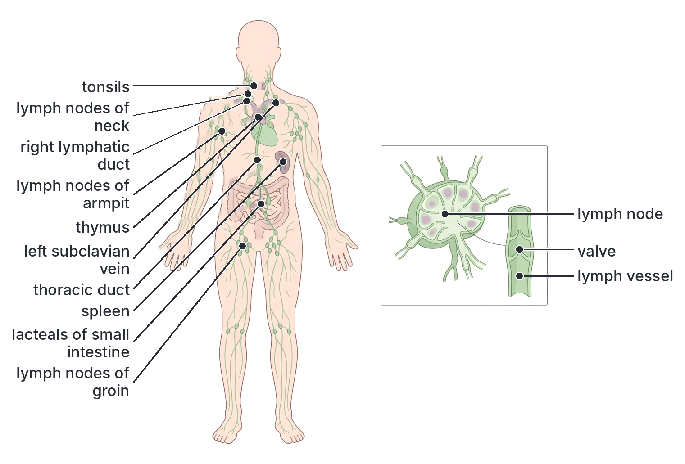

### Functions of the lymphatic system and lymph

1. **Returns tissue fluid to the blood.** About 2–3 litres of fluid a day would be lost from the blood into the tissues without it. If lymph vessels are blocked, fluid builds up and the tissue swells (**oedema**).
2. **Returns leaked plasma proteins to the blood.**
3. **Absorbs and transports fats** from the small intestine (through the lacteals) to the blood.
4. **Defence against disease:**
   - Lymph nodes **filter** lymph: macrophages in them engulf bacteria, dead cells and debris before the lymph reaches the blood.
   - Lymph nodes and other lymphoid organs **produce lymphocytes**, which make antibodies.
   - During an infection, the lymph nodes near the infected part become **swollen and tender** (e.g. swollen nodes in the neck during a sore throat), because lymphocytes are multiplying there to fight it.
5. Carries lymphocytes and antibodies into the bloodstream.

**Health link: elephantiasis (lymphatic filariasis).** This disease is caused by thread-like roundworms (mainly *Wuchereria bancrofti*) transmitted by the bites of mosquitoes (in Nigeria, mainly *Anopheles* and *Culex*). The adult worms live in the lymph vessels and block them. Lymph cannot drain, so fluid builds up and parts of the body, often the legs or scrotum, swell enormously and the skin thickens. Nigeria has one of the largest numbers of people at risk of lymphatic filariasis in Africa, and mass drug treatment campaigns are carried out to control it.

### Blood, tissue fluid and lymph compared

| Feature | Blood | Tissue fluid | Lymph |
| --- | --- | --- | --- |
| Where found | Heart and blood vessels | Spaces between cells | Lymph capillaries and vessels |
| Red blood cells | Present | Absent | Absent |
| White blood cells | All types | A few (phagocytes that have squeezed out) | **Many lymphocytes** |
| Platelets | Present | Absent | Absent (or very few) |
| Plasma proteins | **Many** | Few | Few (more than tissue fluid) |
| Fats | Some | Few | **Many after a fatty meal** (in lymph from the gut) |
| Oxygen | High (in arterial blood) | Less | Little |
| Movement | Pumped by the heart, fast | Hardly moves | Slow; squeezed by muscles; no pump |

### Blood and lymph compared

| Feature | Blood | Lymph |
| --- | --- | --- |
| Colour | Red | Colourless or pale yellow (milky after a fatty meal) |
| Red blood cells | Present | Absent |
| Lymphocytes | Fewer | More |
| Platelets | Present | Absent (or very few) |
| Proteins | More | Fewer |
| Pump | Heart | None (muscle contractions and valves) |
| Direction of flow | Round a closed circuit (away from and back to the heart) | One way only: from the tissues to the subclavian veins |
| Speed of flow | Fast | Slow |
| Main transport function | Oxygen, CO₂, food, wastes, hormones, heat | Excess tissue fluid, fats, lymphocytes |
| Clotting | Clots quickly | Clots slowly |

## Open and closed circulatory systems in animals

**Objective x (animal part): compare the various mechanisms of open circulatory systems in animal.** (The plant mechanisms named in objective x, and a single table comparing all the mechanisms, are in B3b.)

There are two kinds of blood system in animals:

- In an **open circulatory system**, the blood is **not always enclosed in vessels**. The heart pumps it into vessels that **open into a large body cavity** (the **haemocoel**), where the blood bathes the organs directly. It then flows slowly back to the heart.
- In a **closed circulatory system**, the blood **always stays inside the heart and blood vessels**. Materials pass between the blood and the cells through the walls of the capillaries, via tissue fluid.

### Open circulatory system: insects (e.g. the cockroach)

Open circulation is found in **arthropods** (insects such as the cockroach and grasshopper, crustaceans such as crabs and prawns, and spiders) and in most **molluscs** (e.g. snails).

**Structure in an insect such as the cockroach:**

1. The **heart** is a long, **tubular** organ lying along the **upper (dorsal)** side of the **abdomen**, just under the body wall. It is divided into a series of chambers, one in each segment.
2. Each chamber has a pair of small openings with valves, called **ostia** (singular: ostium), through which blood enters the heart.
3. The heart continues forward as a single vessel, the **aorta**, which runs into the head and opens there.
4. The heart sits in a space called the **pericardial sinus**, separated from the rest of the body cavity by a thin membrane (the pericardial diaphragm). Fan-shaped **alary muscles** are attached to the heart and the body wall.
5. The body cavity is a **haemocoel** (blood-filled cavity), not a true coelom. All the internal organs are bathed in the blood.
6. The blood is called **haemolymph**. It is usually **colourless or pale green or yellowish**, because it has **no haemoglobin** (in most insects) and no red cells. It contains a few white cells (**haemocytes**), which engulf germs and help seal wounds.

**How blood flows, step by step:**

1. The heart chambers contract in a **wave from the back (posterior) to the front (anterior)**, pumping haemolymph forward along the heart into the **aorta**.
2. The aorta pours the haemolymph out into the **haemocoel of the head**.
3. The haemolymph then flows **slowly backwards** through the haemocoel of the thorax and abdomen, **bathing the organs directly**. Materials are exchanged directly between the haemolymph and the cells.
4. Body movements and the movements of the gut help mix it. In many insects, small **accessory pumps** at the bases of the wings, legs and antennae help push haemolymph into these long appendages.
5. When the heart relaxes (helped by the alary muscles pulling on it), the haemolymph is drawn from the pericardial sinus into the heart through the **ostia**. The valves of the ostia stop it flowing back out.

**What insect haemolymph transports:** digested food, water, mineral salts, excretory products (to the **Malpighian tubules**), hormones, and defence cells. It carries **very little oxygen**: insects get oxygen to their cells through a separate system of air tubes, the **tracheal system** (see B4a). Because the blood does not need to carry oxygen quickly, a slow, low-pressure open system is enough for insects.

**Other functions of haemolymph:** it provides the pressure that helps a newly moulted insect expand its new cuticle and its wings, and it stores water.

[IMAGE: Side view (longitudinal section) of a cockroach body (head, thorax and abdomen) showing the open circulatory system. A long tubular heart along the dorsal side of the abdomen with paired ostia in each segment and fan-shaped alary muscles, continuing forward as the aorta into the head where it opens. The haemocoel filling the body around the gut and other organs is tinted pale yellow-green, with arrows showing haemolymph flowing forward in the heart and aorta, out into the head, then backward through the body cavity, and back into the heart through the ostia. Labels to add: "tubular heart", "ostia", "alary muscles", "aorta", "haemocoel", "haemolymph bathing organs", "gut", "head", "thorax", "abdomen", "direction of flow". Clean flat textbook style, white background.]

### Closed circulatory system: the earthworm

The earthworm is a simple example of a **closed** system, found in annelids.

1. A **dorsal blood vessel** runs along the top of the body above the gut. It **contracts in waves from back to front**, pumping blood **forwards**. It has valves to stop backflow.
2. A **ventral blood vessel** runs along the underside of the body below the gut, carrying blood **backwards**.
3. In the front of the body, several pairs of thick, muscular, ring-like vessels join the dorsal and ventral vessels around the gut. They pump blood from the dorsal to the ventral vessel and are often called the **"hearts"** (aortic arches or pseudohearts).
4. In each segment, smaller vessels branch off and divide into **capillaries** in the body wall, gut and other organs, and then join back to the main vessels.
5. The earthworm's blood is **red**, because it contains **haemoglobin**, but the haemoglobin is **dissolved in the plasma**, not inside red cells.
6. Oxygen enters by diffusion through the **moist skin** into a dense network of capillaries just under it (see B4a).

**Textbook variation:** most textbooks say the common earthworm (*Lumbricus*) has **five pairs** of "hearts" (in segments 7 to 11). The number differs in other kinds of earthworm (in some species, four pairs). Some books call them "pseudohearts" because they are not true chambered hearts.

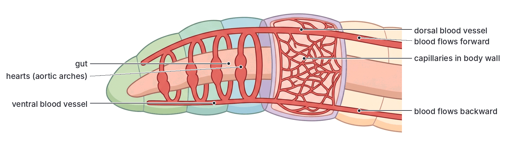

### Closed circulatory system: vertebrates

All vertebrates (fish, amphibians, reptiles, birds and mammals) have a closed system with a **ventral, muscular, chambered heart**, arteries, veins and capillaries, and blood with **red blood cells containing haemoglobin**. Fish have a single circulation; the other vertebrates have a double circulation (see "Single and double circulation compared" above).

### Open and closed circulatory systems compared

| Feature | Open circulatory system | Closed circulatory system |
| --- | --- | --- |
| Examples | Insects (cockroach, grasshopper), crabs, spiders, snails | Earthworm, octopus, all vertebrates (fish, toad, lizard, birds, mammals) |
| Blood in vessels? | Only partly; leaves vessels and flows through the body cavity | **Always** inside the heart and vessels |
| Body cavity | **Haemocoel** (blood-filled) | Coelom (not filled with blood) |
| Contact with cells | Blood **bathes the organs directly** | Exchange through capillary walls, via tissue fluid |
| Capillaries | Absent | Present |
| Heart | Usually a **dorsal tubular heart** with ostia (in insects) | Muscular, chambered heart (vertebrates, usually ventral) or contractile vessels and "hearts" (earthworm) |
| Blood pressure | **Low** | **High** |
| Speed of flow | **Slow** | **Fast** |
| Control of blood to different organs | Little or none | Good: arterioles can open or close to send more blood where it is needed |
| Respiratory pigment | Usually none in insects (some other groups, e.g. snails and crabs, have the blue pigment **haemocyanin** dissolved in the blood) | Usually **haemoglobin** (in red cells in vertebrates; dissolved in plasma in the earthworm) |
| Oxygen transport | Little in insects (oxygen goes by tracheae) | Main job of the blood |
| Name of blood | Haemolymph | Blood |
| Suits | Small animals, or animals with a separate system for oxygen (insects) | Larger, more active animals that need fast delivery of oxygen |

**Advantages of a closed system:** blood flows faster and at higher pressure; oxygen and food reach active tissues quickly; blood can be directed to the organs that need it most; it allows animals to be large and very active.

**Advantages of an open system:** it is simpler and needs less energy to run; it works well in small animals, and in insects, whose tracheal system supplies oxygen directly to the cells.

## Key terms

| Term | Meaning |
| --- | --- |
| Transport system | A system of a medium, channels and a pump that carries materials around the body |
| Surface area to volume ratio | The surface area of an organism divided by its volume; it gets smaller as size increases |
| Mass flow | Movement of a whole fluid, carrying dissolved substances with it, e.g. blood pumped by the heart |
| Double circulation | A circulation in which blood passes through the heart twice in one complete circuit (pulmonary and systemic) |
| Pulmonary circulation | The circuit from the right ventricle to the lungs and back to the left atrium |
| Systemic circulation | The circuit from the left ventricle to the body and back to the right atrium |
| Atrium (auricle) | A thin-walled upper chamber of the heart that receives blood |
| Ventricle | A thick-walled lower chamber of the heart that pumps blood out |
| Septum | The muscular wall dividing the right and left sides of the heart |
| Tricuspid valve | The valve between the right atrium and right ventricle |
| Bicuspid (mitral) valve | The valve between the left atrium and left ventricle |
| Semilunar valve | A half-moon shaped valve at the base of the aorta or pulmonary artery, or in veins |
| Cardiac cycle | The sequence of contraction (systole) and relaxation (diastole) in one heartbeat |
| Sinoatrial node (pacemaker) | The patch of tissue in the right atrium that starts each heartbeat |
| Artery | A thick-walled vessel carrying blood away from the heart |
| Vein | A thin-walled vessel with valves carrying blood towards the heart |
| Capillary | A tiny vessel with walls one cell thick, where materials are exchanged with the cells |
| Tissue fluid | Fluid forced out of capillaries that bathes the cells |
| Portal vein | A vein that runs between two capillary networks, e.g. the hepatic portal vein (gut to liver) |
| Plasma | The pale yellow liquid part of blood |
| Haemoglobin | The red, iron-containing protein in red blood cells that carries oxygen |
| Oxyhaemoglobin | Haemoglobin combined with oxygen |
| Phagocytosis | Engulfing and digesting germs or particles by a white blood cell |
| Antibody | A protein made by lymphocytes that acts against a particular antigen |
| Platelets | Cell fragments that start blood clotting |
| Fibrin | Insoluble protein threads that form the mesh of a blood clot |
| Lymph | Fluid in the lymphatic vessels, formed from tissue fluid |
| Lacteal | The lymph capillary in a villus that absorbs fat |
| Lymph node | A swelling on a lymph vessel that filters lymph and makes lymphocytes |
| Open circulatory system | A system in which blood leaves the vessels and bathes the organs in a body cavity |
| Haemocoel | The blood-filled body cavity of arthropods and molluscs |
| Haemolymph | The blood of insects and other animals with an open system |

## Exam tips and common mistakes

- **Arteries go Away from the heart; veins go towards it.** The difference is the direction of flow, not whether the blood is oxygenated. The pulmonary artery carries deoxygenated blood, and the pulmonary veins carry oxygenated blood.
- **The left ventricle has the thickest wall,** because it pumps blood all round the body. Do not confuse "left" in a diagram: in a front view, the heart's left side is on the viewer's right.
- **Tricuspid on the right, bicuspid (mitral) on the left.** Semilunar valves are at the base of the aorta and pulmonary artery (and in veins).
- **"Lub" is the closing of the atrioventricular valves; "dub" is the closing of the semilunar valves.**
- **Vessel extremes:** most digested food after a meal = hepatic portal vein; least urea = renal vein; most oxygen = pulmonary vein; highest pressure = aorta.
- **Fats are absorbed into lacteals (lymph), not into the hepatic portal vein.**
- **Exchange happens only in capillaries,** because their walls are one cell thick.
- **Mature mammalian red blood cells have no nucleus;** white blood cells have a nucleus; platelets are cell fragments.
- **Neutrophils and monocytes engulf germs; lymphocytes make antibodies.** Neutrophils are the most common white cell.
- **Clotting order:** thromboplastin → prothrombin to thrombin (needs calcium) → fibrinogen to fibrin. Vitamin K is needed to make prothrombin.
- **Serum is not the same as plasma:** serum is plasma without the clotting proteins.
- **Insect blood (haemolymph) carries little oxygen;** oxygen goes through the tracheae. Insects have an open system with a dorsal tubular heart.
- **Small organisms have a large SA:V ratio,** so they manage by diffusion; large organisms need a transport system.

## Quick summary

1. As organisms get larger and more complex, their surface area to volume ratio falls and diffusion distances increase, so they need a transport system; small organisms such as *Amoeba* and *Hydra* rely on diffusion.
2. Materials transported include oxygen (as oxyhaemoglobin), CO₂ (mainly as hydrogencarbonate in plasma), digested food (glucose and amino acids in plasma; fats in lymph), manufactured food (sucrose in phloem), urea, water, mineral salts and hormones.
3. Mammals have a closed, double circulation: the pulmonary circulation (right side of the heart to the lungs) and the systemic circulation (left side of the heart to the body).
4. The heart has four chambers, a septum and valves (tricuspid, bicuspid, semilunar); each heartbeat is a cardiac cycle of atrial systole, ventricular systole and diastole, started by the pacemaker (SAN).
5. Arteries (thick, elastic, high pressure) carry blood away from the heart; veins (thin, with valves, low pressure) return it; capillaries (one cell thick) are where exchange happens through tissue fluid.
6. The hepatic portal vein carries digested food to the liver; the pulmonary artery and vein link the heart and lungs; the aorta distributes oxygenated blood at high pressure; the renal artery brings blood to the kidney and the renal vein carries away blood with the least urea.
7. Blood is plasma (about 55%) plus red cells (oxygen transport), white cells (phagocytosis and antibodies) and platelets (clotting); lymph is tissue fluid returned through lymph vessels and nodes, carrying fats and lymphocytes.
8. Insects have an open circulatory system (dorsal tubular heart, haemocoel, slow low-pressure flow); earthworms and vertebrates have closed systems with blood always in vessels.

## Practice questions

**1. Which of the following organisms depends on diffusion alone for the transport of materials in its body?**

- A. Earthworm
- B. Cockroach
- C. *Amoeba*
- D. Toad

**Answer: C.** *Amoeba* is a single cell with a very large surface area to volume ratio, so diffusion and cytoplasmic streaming are enough. The others have blood systems.

**2. The blood vessel that carries blood with the highest concentration of digested food shortly after a meal is the**

- A. hepatic portal vein
- B. hepatic artery
- C. renal vein
- D. pulmonary vein

**Answer: A.** The hepatic portal vein carries glucose and amino acids absorbed in the small intestine straight to the liver.

**3. Which of the following blood vessels carries oxygenated blood?**

- A. Pulmonary artery
- B. Vena cava
- C. Renal vein
- D. Pulmonary vein

**Answer: D.** The pulmonary veins bring oxygenated blood from the lungs to the left atrium. They are the only veins in the adult body that carry oxygenated blood.

**4. The left ventricle of the mammalian heart has a thicker wall than the right ventricle because it**

- A. receives blood from the lungs
- B. pumps blood to all parts of the body
- C. contains more blood
- D. pumps deoxygenated blood

**Answer: B.** The left ventricle must pump blood at high pressure through the systemic circulation to the whole body; the right ventricle only pumps blood to the nearby lungs.

**5. The valve that prevents the backflow of blood from the left ventricle into the left atrium is the**

- A. tricuspid valve
- B. semilunar valve
- C. bicuspid valve
- D. pulmonary valve

**Answer: C.** The bicuspid (mitral) valve lies between the left atrium and left ventricle. The tricuspid valve is on the right side.

**6. Which of the following blood vessels contains the least amount of urea?**

- A. Renal vein
- B. Renal artery
- C. Hepatic vein
- D. Aorta

**Answer: A.** The kidneys remove urea from the blood, so the blood leaving them in the renal vein has the lowest urea concentration in the body. The hepatic vein carries urea newly made in the liver.

**7. Which of the following is NOT true of mammalian red blood cells?**

- A. They contain haemoglobin
- B. They are biconcave in shape
- C. They have a large nucleus
- D. They are made in the red bone marrow

**Answer: C.** Mature mammalian red blood cells have no nucleus, which leaves more room for haemoglobin.

**8. In blood clotting, thrombin converts**

- A. fibrinogen into fibrin
- B. prothrombin into thromboplastin
- C. fibrin into fibrinogen
- D. calcium ions into prothrombin

**Answer: A.** Thrombin is the enzyme that changes soluble fibrinogen into insoluble fibrin threads, which trap blood cells to form a clot.

**9. Digested fats are absorbed from the small intestine into the**

- A. hepatic portal vein
- B. lacteals
- C. hepatic artery
- D. mesenteric artery

**Answer: B.** Fat droplets enter the lacteals (lymph capillaries) in the villi and travel in the lymph before entering the blood near the heart.

**10. In the cockroach, the blood flows in a body cavity called the haemocoel. This shows that the cockroach has**

- A. a closed circulatory system
- B. a double circulation
- C. a single circulation through gills
- D. an open circulatory system

**Answer: D.** In an open circulatory system, blood leaves the vessels and bathes the organs directly in the haemocoel.
