# JAMB Biology Notes: Transport (Part 2): Transport in Plants and Mechanisms of Transport

## What JAMB expects

This topic is Section B, Topic 3 of the JAMB Biology syllabus: Form and Functions – Transport. The topic is large, so it is split into two files:

- **`B3a-transport-in-animals.md`** covers the need for transport and the surface area to volume ratio (for plants and animals), the materials transported, the mammalian circulatory system, blood and lymph, and open and closed circulatory systems in animals.
- **This file (`B3b-transport-in-plants.md`)** covers the plant vascular system (xylem and phloem), the media of transport in plants, the processes of diffusion, osmosis, plasmolysis and turgidity, and the mechanisms that move water, minerals and food in plants (transpiration pull, root pressure and active transport). It ends with one table comparing all the mechanisms of transport named in objective x, including the open circulatory system of animals from B3a.

The syllabus content items covered in this file are:

- c. Channels for transportation: ii. plant vascular system (phloem and xylem).
- d. Media and processes of mechanism for transportation (the plant part, and the processes of diffusion, osmosis, plasmolysis and turgidity, which apply to all organisms).

By the end of these notes, you should be able to:

1. Identify the organs of the plant vascular system (objective v).
2. Understand the specific functions of the phloem and xylem (objective vi).
3. Identify the media of transport in plants: cell sap and cytoplasm (the plant part of objective vii).
4. Describe diffusion, osmosis, plasmolysis and turgidity as mechanisms of transport in organisms (objective ix).
5. Compare the various mechanisms of open circulatory systems in animals, transpiration pull, root pressure and active transport as mechanisms of transport in plants (objective x).

**Note on the syllabus wording:** objective x says "compare the various mechanisms of open circulatory systems in animal, transpiration pull, root pressure and active transport as mechanisms of transportation in plants". It mixes one animal mechanism (open circulation, fully explained in B3a) with three plant mechanisms. Each plant mechanism has its own section here, and the final comparison table includes all four. Transpiration is not named in the syllabus on its own, but transpiration pull cannot be understood without it, and JAMB regularly asks about transpiration, its factors and the potometer, so it is covered in full.

## Why plants need a transport system (a reminder)

Objective i (the link between size, complexity and the need for transport, and the surface area to volume ratio) is explained fully in B3a. In short:

- Small, simple plants such as *Chlamydomonas*, *Spirogyra* and mosses have no true vascular tissue; water and food move by **diffusion, osmosis and cytoplasmic streaming**, and mosses are small and live in damp places.
- A large flowering plant takes in water and mineral salts at its **roots**, under the ground, but makes food in its **leaves**, high above. The leaves need water and minerals from the roots; the roots (which cannot photosynthesise) need food from the leaves. The distance may be many metres (the tallest trees are over 100 m high). Diffusion alone would be far too slow, so the plant needs a **vascular system**: **xylem** to carry water and minerals up, and **phloem** to carry food to where it is needed.
- Plants manage without a heart because they have a lower rate of metabolism than animals, and their gases move by diffusion through stomata, lenticels and air spaces, not in the vascular system.

## Media of transport in plants

**Objective vii (plant part): identify media of transportation (e.g., cytoplasm, cell sap, body fluid, blood and lymph).**

Plants have no blood or lymph. Their media of transport are watery solutions:

### Cell sap

- **Cell sap** is the solution of water, sugars, mineral salts, organic acids, pigments and waste substances in the large central **vacuole** of a plant cell. It is surrounded by a membrane, the **tonoplast**.
- Water moves from the cell sap of one cell to the cell sap of the next by **osmosis**. For example, water absorbed by a root hair passes inwards from vacuole to vacuole across the cortex towards the xylem, because each cell further in has slightly more concentrated sap.
- The cell sap stores dissolved food and minerals until they are needed.
- When the vacuole is full of cell sap, it presses the cytoplasm against the cell wall and keeps the cell **turgid** (firm). This is how cell sap supports soft (herbaceous) plants.
- The cell sap of some cells contains coloured pigments (anthocyanins), which give red, purple or blue colours to flowers, fruits and leaves (e.g. the purple outer leaves of red onion, the red sap of beetroot, the purple leaves of *Rhoeo* (*Tradescantia spathacea*)).

### Cytoplasm

- The **cytoplasm** of every plant cell is a medium in which materials move **within the cell**, by diffusion and **cytoplasmic streaming** (**cyclosis**): the cytoplasm flows round the cell between the cell membrane and the vacuole, carrying chloroplasts and dissolved substances with it. Streaming is easy to see in the leaf cells of the water plant *Elodea* and in the cells of *Spirogyra* under a microscope.
- Neighbouring plant cells are joined through their walls by fine strands of cytoplasm called **plasmodesmata** (singular: plasmodesma). Sugars, amino acids, ions and hormones can pass from the cytoplasm of one cell to the next through them, without crossing a membrane.
- The **sieve tubes** of the phloem are living cells. Food travels in their cytoplasm-like sap.

### Xylem sap and phloem sap

- **Xylem sap** is mainly **water** carrying **dissolved mineral salts** (ions such as nitrate, phosphate, potassium, calcium and magnesium) from the roots upwards. It also carries small amounts of other substances, e.g. some amino acids and hormones.
- **Phloem sap** is a sugary solution, mainly **sucrose** (in many plants it makes up most of the dissolved material), with **amino acids**, some hormones, mineral ions and other organic substances, carried from the leaves (and storage organs) to wherever food is needed.

| Medium | Where found | Main materials carried | How it moves |
| --- | --- | --- | --- |
| Cell sap | Vacuoles of living cells | Water, sugars, salts, pigments, wastes | Osmosis and diffusion from cell to cell |
| Cytoplasm | All living cells; joined by plasmodesmata | Food, ions, hormones within and between cells | Diffusion; cytoplasmic streaming |
| Xylem sap | Xylem vessels and tracheids | Water and mineral salts | Transpiration pull (mainly), root pressure, capillarity |
| Phloem sap | Phloem sieve tubes | Sucrose, amino acids, hormones | Translocation (pressure differences between source and sink) |

## Mechanisms of transport: diffusion, osmosis, plasmolysis and turgidity

**Objective ix: describe diffusion, osmosis, plasmolysis and turgidity as mechanisms of transportation in organisms.**

These processes happen in all organisms, plants and animals alike. They move materials into and out of cells and from cell to cell.

### Diffusion

**Diffusion** is the movement of molecules or ions of a substance from a region where they are in **higher concentration** to a region where they are in **lower concentration**, until they are evenly spread out.

- The difference in concentration between two regions is called the **concentration gradient** (or diffusion gradient). Diffusion goes "down" the gradient.
- Diffusion happens because molecules are always moving about randomly (kinetic energy). It is a **passive** process: the cell does **not** use energy from respiration for it.
- It happens in gases and liquids, and through cell membranes if the molecules can pass through.

**Examples of diffusion in living things:**

| Where | What diffuses | Direction |
| --- | --- | --- |
| Alveoli of the lungs | Oxygen | From the air in the alveoli into the blood |
| Alveoli of the lungs | Carbon (IV) oxide (CO₂) | From the blood into the alveoli |
| Leaves (in light) | CO₂ | From the air through the stomata into the leaf cells (for photosynthesis) |
| Leaves (in light) | Oxygen and water vapour | Out of the leaf through the stomata |
| Small intestine | Some digested food (e.g. glucose when its concentration in the gut is high) | From the gut into the blood in the villi |
| Body tissues | Oxygen, glucose; CO₂ and urea | From capillaries into cells; from cells into capillaries |
| *Amoeba* and other unicellular organisms | Oxygen, CO₂, ammonia | Across the cell membrane |
| Placenta | Oxygen and food; CO₂ and urea | From mother to fetus; from fetus to mother |

**Factors that affect the rate of diffusion:**

1. **Concentration gradient:** the steeper (greater) the difference in concentration, the faster the diffusion. Organisms keep gradients steep, e.g. blood flow constantly carries oxygen away from the alveoli.
2. **Temperature:** molecules move faster at higher temperatures, so diffusion is faster.
3. **Surface area:** the larger the surface across which diffusion happens, the faster the total rate (e.g. the many alveoli, villi and root hairs).
4. **Distance (thickness of the surface):** the shorter the distance, the faster the diffusion (e.g. alveolus and capillary walls are only one cell thick).
5. **Size of molecules:** small molecules diffuse faster than large ones.
6. **The medium:** diffusion is fastest in gases, slower in liquids and slowest in solids.

#### Experiment 1: diffusion in a liquid

**Aim:** to demonstrate diffusion in a liquid.

**Materials:** a beaker of still water, a crystal of **potassium permanganate** (potassium tetraoxomanganate(VII)), forceps.

**Method:**

1. Fill a beaker with water and leave it to stand until the water is completely still.
2. Using forceps, gently drop a crystal of potassium permanganate to the bottom of the beaker, without stirring.
3. Observe at intervals over an hour or more.

**Observation:** the purple colour spreads slowly outwards from the crystal, until after some hours the whole beaker is evenly pale purple.

**Conclusion:** the permanganate particles moved from where they were concentrated (at the crystal) to where they were less concentrated, by diffusion. If the experiment is repeated with warm water, the colour spreads faster, showing that temperature increases the rate of diffusion.

#### Experiment 2: diffusion of a gas

**Aim:** to demonstrate diffusion in a gas.

**Materials:** a long glass tube, strips of **damp red litmus paper**, cotton wool soaked in concentrated **ammonia solution**, corks or rubber bungs, a stopwatch.

**Method:**

1. Place strips of damp red litmus paper at equal intervals along the inside of the glass tube.
2. Close one end with a cork carrying the cotton wool soaked in ammonia solution, and close the other end.
3. Observe the litmus papers.

**Observation:** the red litmus papers turn **blue** one after the other, starting with the one nearest the ammonia.

**Conclusion:** ammonia gas (an alkali) diffused along the tube from the high concentration at the cotton wool to the lower concentration further along. (A simpler everyday example: the smell of perfume, or of fried plantain or fish, spreads through a room by diffusion.)

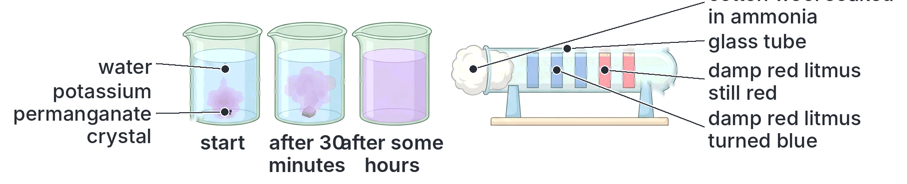

### Osmosis

**Osmosis** is the movement of **water molecules** from a region of **higher water concentration** (a **dilute** solution) to a region of **lower water concentration** (a **concentrated** solution) through a **selectively (partially) permeable membrane**.

Put more simply: water moves through a membrane **from a weak solution into a strong solution**.

Important points:

- Osmosis is a **special kind of diffusion**: the diffusion of **water** through a **selectively permeable membrane**.
- A **selectively permeable membrane** (also called partially or semi-permeable) lets small molecules such as water pass through, but stops larger molecules such as sugar. The **cell membrane** and the **tonoplast** (vacuole membrane) are selectively permeable. Non-living examples used in experiments include **Visking (dialysis) tubing** and **cellophane**.
- Like diffusion, osmosis is **passive**: the cell uses no energy from respiration.
- A dilute solution has **more water molecules** in a given volume than a concentrated one, so more water molecules strike the membrane from the dilute side and pass across.

**Textbook variation:** many modern textbooks explain osmosis using **water potential**: water moves from a region of **higher (less negative) water potential** to a region of **lower (more negative) water potential**. Pure water has the highest water potential (zero); adding solutes lowers it. This is the same idea in different words. Older books describe it in terms of the "osmotic pressure" of solutions: water moves towards the solution with the higher osmotic pressure.

#### Describing solutions: hypotonic, hypertonic and isotonic

When we compare a solution with the contents of a cell:

| Term | Meaning | Effect on a cell placed in it |
| --- | --- | --- |
| **Hypotonic** solution | **Less concentrated** (more dilute) than the cell contents; e.g. pure water or rainwater | Water **enters** the cell by osmosis |
| **Hypertonic** solution | **More concentrated** than the cell contents; e.g. strong salt or sugar solution | Water **leaves** the cell by osmosis |
| **Isotonic** solution | **The same concentration** as the cell contents; e.g. 0.9% salt solution (normal saline) for human cells | No overall movement of water; the cell stays the same |

#### Osmosis in animal cells

Animal cells have **no cell wall**, so they are easily damaged by osmosis.

- In a **hypotonic** solution (e.g. pure water), red blood cells take in water, swell and **burst**. Bursting of red blood cells is called **haemolysis**.
- In a **hypertonic** solution (e.g. strong salt solution), red blood cells lose water and **shrink**, becoming wrinkled (with a spiky outline). This is called **crenation**.
- In an **isotonic** solution, red blood cells keep their normal shape.

This is why a patient in hospital is given a drip of **normal saline** (0.9% sodium chloride) or a drip whose concentration matches the blood, and never pure water. In the body, the **kidneys** keep the blood plasma at the right concentration (osmoregulation). Single-celled freshwater organisms such as *Amoeba* and *Paramecium* live in a hypotonic medium; water constantly enters them by osmosis, and their **contractile vacuoles** pump it out, so they do not burst.

#### Osmosis in plant cells

Plant cells have a strong **cellulose cell wall**, which is **fully permeable** (it lets water and solutes through freely) and does not stretch much.

- In a **hypotonic** solution (e.g. water), water enters the vacuole by osmosis. The vacuole swells and pushes the cytoplasm against the cell wall. The wall pushes back and stops the cell from bursting. The cell becomes firm: it is **turgid**.
- In a **hypertonic** solution (e.g. strong salt or sugar solution), water leaves the vacuole by osmosis. The vacuole shrinks, the cell becomes soft (**flaccid**), and eventually the cytoplasm pulls away from the cell wall: the cell is **plasmolysed**.

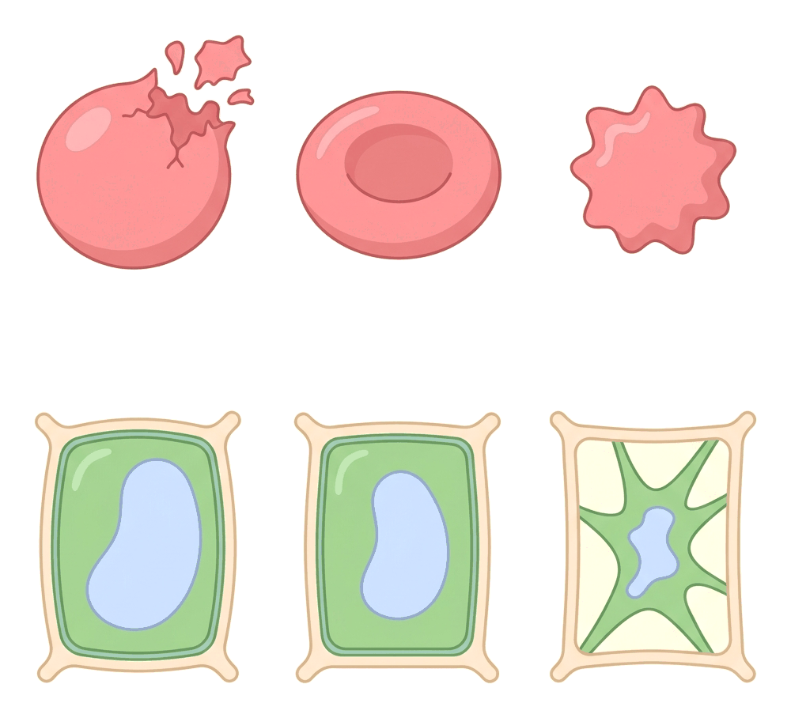

#### Experiment 3: osmosis using a thistle funnel osmometer

An **osmometer** is an apparatus for demonstrating (or measuring) osmosis.

**Aim:** to demonstrate osmosis through a non-living selectively permeable membrane.

**Materials:** a thistle funnel, a piece of **Visking tubing** or cellophane (or, in older books, a piece of pig's bladder), thread, concentrated sugar solution (sucrose), a beaker of distilled water, a clamp and stand.

**Method:**

1. Tie the membrane tightly over the wide mouth of the thistle funnel.
2. Fill the funnel bowl and part of the stem with concentrated sugar solution. Mark the level of the solution in the stem.
3. Clamp the funnel upside down (mouth downwards) in a beaker of distilled water, so the membrane is under the water.
4. Leave for several hours, and note the level of the solution in the stem.

**Observation:** the level of the sugar solution in the stem of the funnel **rises**.

**Conclusion:** water moved by osmosis from the distilled water (higher water concentration), through the selectively permeable membrane, into the sugar solution (lower water concentration). Sugar molecules are too big to pass out through the membrane.

**Control:** set up the same apparatus with distilled water (instead of sugar solution) in the funnel. The level does not rise.

#### Experiment 4: the potato osmometer (a living membrane)

**Aim:** to demonstrate osmosis in living plant tissue.

**Materials:** a large raw potato (Irish potato) tuber, a knife and a cork borer or spoon, a Petri dish or shallow dish, concentrated sugar solution (or salt), distilled water, a pin, a beaker of boiling water.

**Method:**

1. Peel the potato and cut off one end to make a flat base, so it can stand upright.
2. Cut or scoop out a deep **cavity** (hole) in the top, leaving a thick wall and base.
3. Stand the potato (cup) in a dish containing **distilled water**.
4. Pour **concentrated sugar solution** into the cavity until it is about half full. Mark the level with a pin pushed into the wall of the cavity.
5. Set up a **control**: prepare a second potato cup in the same way, but first **boil** it for a few minutes to kill its cells. Fill it with sugar solution and stand it in water.
6. Leave both for several hours (or overnight) and observe the level of the solution in the cavities.

**Observation:**

- In the **raw** potato, the level of the solution in the cavity **rises** (it may even overflow), and the solution becomes more dilute.
- In the **boiled** potato (control), the level **does not rise**.

**Explanation:**

1. The cell sap of the potato cells is less concentrated than the sugar solution in the cavity but more concentrated than the distilled water in the dish.
2. Water enters the outer potato cells from the dish by osmosis.
3. Water then moves inwards **from cell to cell by osmosis**, each time from the cell with more dilute sap to the cell with more concentrated sap.
4. Finally, water passes from the innermost cells into the concentrated sugar solution in the cavity, so the level rises.
5. The **living cell membranes** act as the selectively permeable membranes. Boiling **kills** the cells and destroys the selective permeability of their membranes, so osmosis does not occur in the control.

**Conclusion:** living plant cells have selectively permeable membranes, and water moves through them by osmosis. Water can travel from cell to cell through a tissue by osmosis.

**A variation:** put **distilled water** in the cavity and stand the potato in **concentrated sugar solution**. The level in the cavity **falls**, because water now moves out of the cavity, through the potato cells, into the strong solution in the dish.

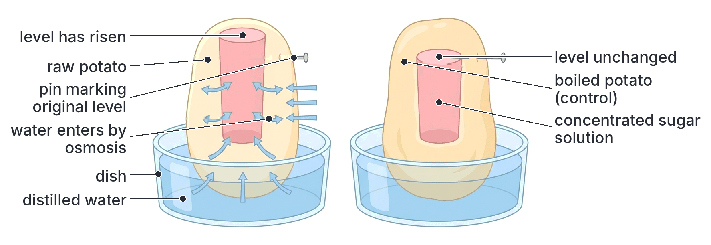

#### Experiment 5: potato strips in water and in salt solution

**Aim:** to show the effect of osmosis on plant tissue.

**Method:**

1. Cut equal strips (or cylinders, using a cork borer) of raw potato, each, say, 5 cm long. Dry them gently, measure their length and weigh them, and note how firm they are.
2. Put some strips into **distilled water** and some into **concentrated salt (or sugar) solution**.
3. After about an hour (or longer), take them out, dry them gently, and measure, weigh and feel them again.

**Observation and explanation:**

| | Strips in distilled water | Strips in concentrated salt solution |
| --- | --- | --- |
| Length | Increased | Decreased |
| Mass | Increased | Decreased |
| Texture | **Firm and stiff** (turgid) | **Soft and bendy** (flaccid; cells plasmolysed) |
| Explanation | Water entered the cells by osmosis from the hypotonic water | Water left the cells by osmosis into the hypertonic salt solution |

If strips are placed in a range of sugar solutions, the concentration in which their length and mass do not change is **isotonic** with the cell sap.

The same thing happens in the kitchen: sliced garden egg, cucumber or lettuce put in water becomes crisp; salted vegetables (and fish and meat) lose water and go limp.

### Plasmolysis

**Plasmolysis** is the **shrinking of the cytoplasm away from the cell wall** of a plant cell, caused by the **loss of water by osmosis** when the cell is placed in a **hypertonic** (more concentrated) solution.

**Stages of plasmolysis, step by step:**

1. A turgid plant cell is placed in a strong salt or sugar solution, which is more concentrated than its cell sap.
2. Water passes out of the vacuole, through the tonoplast, the cytoplasm and the cell membrane, and out through the fully permeable cell wall, by osmosis.
3. The vacuole shrinks and the cell loses its turgor; it becomes **flaccid** (soft).
4. The point at which the cytoplasm is **just about to come away** from the wall is called **incipient plasmolysis**. (At incipient plasmolysis, the cell sap and the outside solution have about the same concentration.)
5. As more water is lost, the cell membrane and cytoplasm **pull away from the cell wall**, first at the corners and then all round. The cell is **plasmolysed**.
6. The space between the cell wall and the shrunken cytoplasm fills with the **outside solution**, because the cell wall is fully permeable.

**Deplasmolysis:** if a plasmolysed cell is put back into water (a hypotonic solution) **before it dies**, water re-enters the vacuole by osmosis, the cytoplasm moves back against the wall, and the cell becomes turgid again. This is called **deplasmolysis**. If a cell stays plasmolysed for too long, it dies.

**Plasmolysis does not happen in animal cells,** because they have no cell wall for the cytoplasm to pull away from; they simply shrink (crenation).

#### Experiment 6: observing plasmolysis in onion epidermis

**Aim:** to observe plasmolysis and deplasmolysis in plant cells.

**Materials:** an onion (a **red onion** is best, because its coloured cell sap makes the vacuole easy to see; the purple lower epidermis of a *Rhoeo* leaf works just as well), forceps, microscope slides and cover slips, a dropper, distilled water, **strong sugar solution** (e.g. about 30%) or strong salt solution, filter paper, a light microscope.

**Method:**

1. Peel a thin piece of the **epidermis** from a fleshy scale leaf of the onion (or from the lower surface of a *Rhoeo* leaf).
2. Mount it in a drop of **distilled water** on a slide, cover with a cover slip, and look at it under the microscope. Draw a few cells.
3. Place a drop of strong sugar solution at one edge of the cover slip and draw it under the cover slip by holding a piece of filter paper at the opposite edge (this is called **irrigation**). Repeat two or three times to replace all the water.
4. After a few minutes, look at the cells again and draw them.
5. Finally, irrigate the slide with distilled water again, wait a few minutes, and observe.

**Observations:**

- In **water**, the cells are **turgid**: the coloured vacuole fills almost the whole cell, and the cytoplasm is pressed against the walls.
- In **strong sugar solution**, the vacuole **shrinks**, its colour becomes **darker** (the sap is more concentrated), and the cytoplasm **pulls away from the cell wall**, first at the corners. The cells are **plasmolysed**.
- Back in **water**, the vacuoles swell again and the cytoplasm returns to the walls: **deplasmolysis**.

**Conclusion:** the onion cells lost water by osmosis in the hypertonic sugar solution (plasmolysis) and regained it in water (deplasmolysis). This also shows that the cell membrane is selectively permeable while the cell wall is fully permeable.

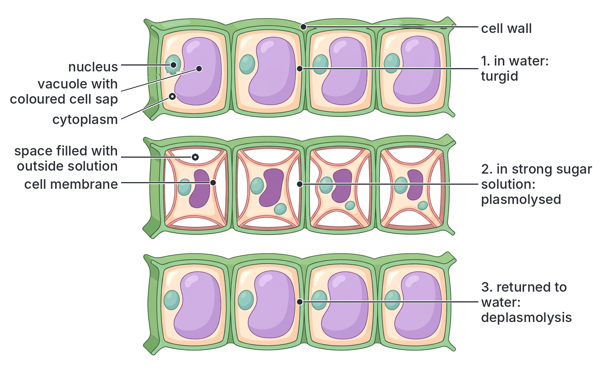

#### Plasmolysis in everyday life

1. **Salting fish and meat** (e.g. dried, salted fish sold in Nigerian markets): salt draws water out of bacterial and fungal cells by osmosis and plasmolyses them, so they cannot grow, and the food keeps longer. Sugar does the same in jams and in fruits preserved in syrup.
2. **Killing weeds with salt:** pouring strong salt solution on weeds (e.g. between paving stones) plasmolyses their cells, and they die.
3. **Fertiliser "burn":** putting too much fertiliser close to plant roots makes the soil water hypertonic. Water is drawn out of the roots, the plant wilts, and may die.
4. **Snails and salt:** sprinkling salt on a snail or slug draws water out of its body.
5. **Irrigation with salty water:** in some dry areas, poor irrigation leaves salt in the soil, which makes it hard for crops to take up water.

### Turgidity

**Turgidity** is the state of a plant cell when its vacuole is full of water, so that the cytoplasm is pressed firmly against the cell wall and the cell is **firm and rigid**. The cell is said to be **turgid**.

**How a cell becomes turgid, step by step:**

1. The cell is in a hypotonic solution (e.g. soil water or pure water).
2. Water enters the vacuole by osmosis.
3. The vacuole swells and pushes the cytoplasm outwards against the cell wall. This outward pressure is called **turgor pressure**.
4. The cell wall is strong and only slightly elastic. It presses back on the cell contents with an equal and opposite pressure, called **wall pressure**.
5. When wall pressure becomes equal to the tendency of water to enter, no more water can enter. The cell is **fully turgid**. The wall stops the cell from bursting.

**Flaccidity:** when a cell loses water and its vacuole no longer presses on the wall, the cell becomes soft and limp. It is **flaccid**.

**Importance of turgidity to plants:**

1. **Support:** turgid cells press against each other, like blown-up balloons packed in a box, keeping **herbaceous** (non-woody) plants upright and leaves spread out to catch light. Young seedlings, leaves and soft stems such as those of *Amaranthus* (green, "tete") and balsam depend on turgidity for support.
2. **Opening of stomata:** stomata open when their guard cells become turgid and close when they become flaccid (see B4a).
3. **Growth:** turgor pressure stretches young cell walls, helping new cells to enlarge.
4. **Movement of some plant parts:** the leaves of *Mimosa pudica* (touch-me-not) fold when touched because cells at the base of the leaflets suddenly lose turgor. Some flowers open and close by turgor changes.
5. **Keeping soft fruits and vegetables crisp.**

**Wilting:** on a hot afternoon, when a plant loses water by transpiration faster than its roots can absorb it, its cells lose turgor and become flaccid; the leaves and soft stems droop. This is **wilting**. In the cool evening the plant often recovers (**temporary wilting**). If the soil is very dry, it does not recover (**permanent wilting**) and dies. Wilting is a useful protection: drooping, folded leaves receive less sunlight, and the stomata close, so less water is lost.

### Diffusion, osmosis and active transport compared

Active transport is explained in full later in this file. Because JAMB often compares the three, here they are side by side.

| Feature | Diffusion | Osmosis | Active transport |
| --- | --- | --- | --- |
| What moves | Any molecules or ions (gases, solutes, water) | **Water only** | Usually ions and some molecules (e.g. mineral ions, glucose) |
| Direction | **Down** a concentration gradient (high to low) | From dilute solution to concentrated solution (high to low water concentration) | Usually **against** (up) a concentration gradient (low to high) |
| Membrane needed? | No (but can occur across one) | **Yes**, a selectively permeable membrane | Yes, a living cell membrane with carrier proteins |
| Energy from respiration (ATP) | **Not** needed (passive) | **Not** needed (passive) | **Needed** (active) |
| Occurs in dead tissue? | Yes | Through a non-living selectively permeable membrane, yes; but not through cells killed by boiling | **No**, only in living cells |
| Affected by lack of oxygen or respiratory poisons? | No | No | **Yes**, stops or slows |
| Examples | Oxygen into the blood in the alveoli; CO₂ into a leaf | Water from the soil into root hairs; water into red cells in pure water | Mineral ions into root hairs; glucose absorption in the ileum; reabsorption in the kidney |

## The plant vascular system

The **vascular system** of a flowering plant is made of two **vascular tissues**, **xylem** and **phloem**, which run side by side in continuous strands (**vascular bundles** or a central **stele**) through the root, stem, leaves, flowers and fruits.

### Organs of the plant vascular system

**Objective v: identify the organs of the plant vascular system.**

The vascular tissues run through every organ of the plant. The main organs of the vascular system are the **root**, the **stem** and the **leaf**; xylem and phloem also extend into flowers, fruits and seeds.

#### The root

- **Functions in transport:** absorbs **water** (by osmosis) and **mineral salts** (by active transport and diffusion) from the soil through its **root hairs**, and passes them into the xylem. Receives food from the leaves through the phloem, for its growth and respiration. In some plants it **stores food** (e.g. cassava and carrot roots).
- **Arrangement of the vascular tissue:** in a **dicot root** (e.g. bean, groundnut), the xylem and phloem are in the centre, in a solid core called the **stele**. The xylem forms a **star** shape (often with 3–5 arms, commonly 4, in a "+" or "X" shape), and the phloem lies in separate groups **between the arms** of the xylem. This is called a **radial** arrangement. Around the stele is the **pericycle**, and around that the **endodermis**, a single layer of cells that controls what passes into the stele. Outside is a wide **cortex** of parenchyma cells and the outer **piliferous layer** (epidermis), which bears the root hairs. There is usually **no pith** (or a very small one).
- In a **monocot root** (e.g. maize, guinea corn), there are **many** groups of xylem and phloem arranged alternately in a ring, with a large **pith** in the middle.

**Why the root has its vascular tissue in the centre:** roots are pulled (by the wind swaying the plant), not bent, so a central, cable-like core resists pulling forces; it is also close to every part of the cortex, to which it supplies food.

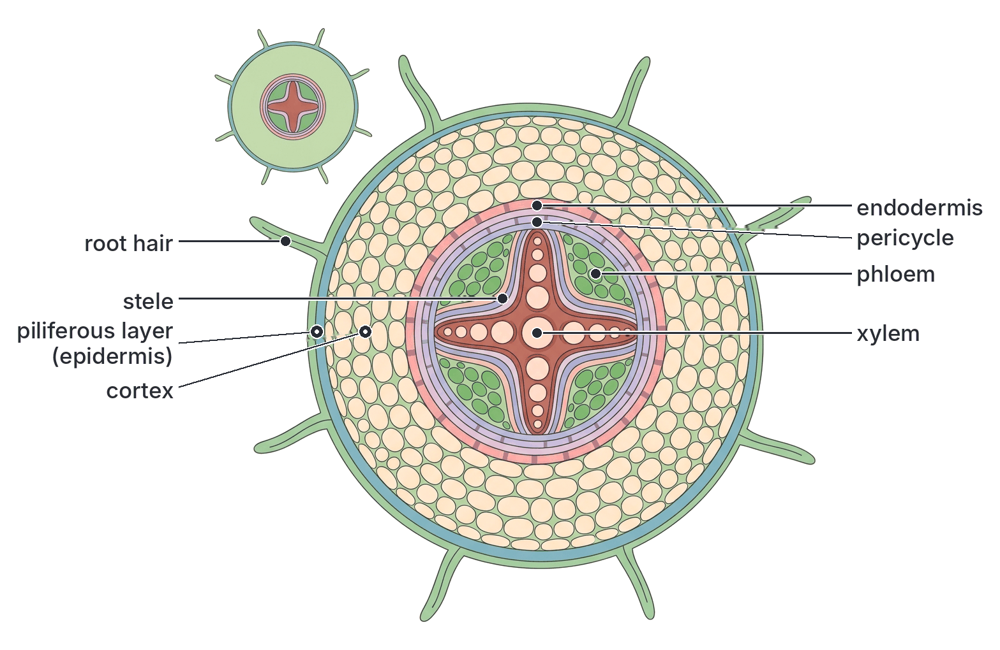

#### The stem

- **Functions in transport:** the main **link** between the roots and the leaves. It carries **water and minerals up** in the xylem, and **food up and down** in the phloem. It holds the leaves up to the light, and the flowers and fruits in position. Some stems store food (e.g. yam tubers, which are stem tubers; Irish potato; sugarcane).
- **Arrangement of the vascular tissue in a dicot stem** (e.g. sunflower, *Tridax*, balsam, young hibiscus):
  - The vascular tissues are in separate **vascular bundles** arranged in a **ring** near the outside of the stem.
  - In each bundle, the **phloem** is on the **outside** (towards the epidermis), the **xylem** on the **inside** (towards the centre), with a thin layer of dividing cells, the **cambium**, between them. Because of the cambium, these bundles are called **open** bundles, and the stem can grow thicker (secondary growth), which is how trees form wood.
  - Outside the ring are the **cortex** (with **collenchyma** for support just under the epidermis, and parenchyma) and the **epidermis**, covered by a waxy cuticle. Often there is a band of fibres (sclerenchyma) or a **pericycle** just outside each bundle.
  - In the centre is a large **pith** of parenchyma cells. Strips of parenchyma between the bundles, the **medullary rays** (pith rays), link the pith with the cortex.
- **In a monocot stem** (e.g. maize, guinea corn, sugarcane, grasses):
  - The vascular bundles are **scattered** throughout the ground tissue, more crowded near the outside.
  - Each bundle is surrounded by a **sheath of sclerenchyma** (bundle sheath).
  - There is **no cambium**, so the bundles are **closed**, and the stem cannot grow much thicker.
  - There is no clear division into cortex and pith.
- **Why the stem has its vascular tissue near the outside (in dicots):** a stem must resist **bending** by the wind and the weight of leaves. A ring of strong tissue near the outside resists bending best (like the hollow steel pipes used for scaffolding).

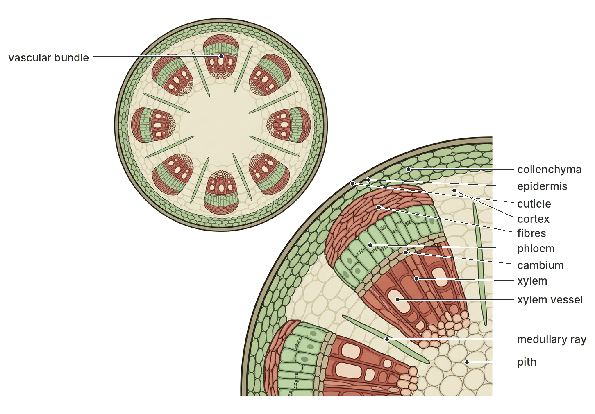

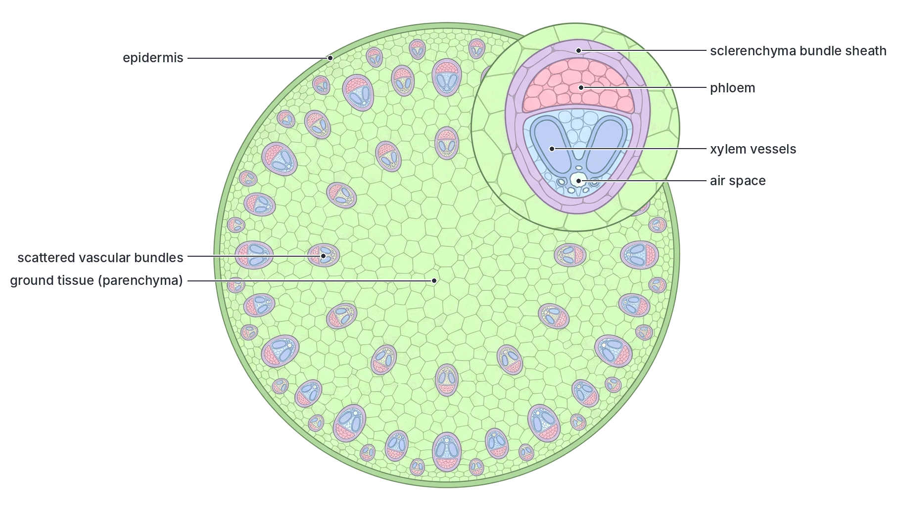

#### The leaf

- **Functions in transport:** the leaf is where water arrives (in the xylem) for **photosynthesis** and where most water is lost by **transpiration**. It is the main **source** of manufactured food, which is loaded into the phloem and carried away.
- **Arrangement:** the vascular tissue forms the **midrib** and the **veins**. In each vein, the **xylem** is towards the **upper** surface and the **phloem** towards the **lower** surface. (This is because the leaf vein is a continuation of a stem bundle, which bends outwards into the leaf, so its inner xylem ends up on top.) Veins branch again and again, so that no leaf cell is more than a few cells away from a vein.
- Dicot leaves (e.g. mango, cocoa, hibiscus) have a **network** of veins (**net venation**); monocot leaves (e.g. maize, oil palm leaflets, grasses) have **parallel** veins.
- The veins also **support** the leaf blade, keeping it spread out to the light.

#### Flowers, fruits and seeds

Branches of the vascular tissue enter the flower stalk and the flower parts. In developing **fruits and seeds**, the phloem delivers sugars and amino acids, which are stored as starch, oil and protein (e.g. in maize grains, groundnuts and beans).

#### Dicot and monocot vascular arrangement compared

| Feature | Dicot (e.g. bean, sunflower) | Monocot (e.g. maize, guinea corn) |
| --- | --- | --- |
| Vascular bundles in the stem | In a **ring** | **Scattered** |
| Cambium in stem bundles | **Present** (open bundles) | **Absent** (closed bundles) |
| Secondary thickening | Can occur (trees, woody shrubs) | Usually absent |
| Pith in the stem | Large, distinct | Not distinct |
| Xylem in the root | Star-shaped, few arms (usually 2–6) | Many groups (often more than 6) in a ring |
| Pith in the root | Absent or very small | Large |
| Leaf veins | Net (reticulate) | Parallel |

### The structure of xylem and phloem

#### Xylem

**Xylem** is the tissue that carries **water and mineral salts** upwards from the roots to the leaves. It also **supports** the plant. Wood is made almost entirely of xylem.

Xylem is made of four kinds of cells:

| Component | Structure | Function |
| --- | --- | --- |
| **Xylem vessels** | Long, wide tubes formed from rows of cells placed end to end. The **end walls break down**, forming continuous hollow pipes. The cells are **dead** (no cytoplasm) when mature. The side walls are thickened with **lignin**, a hard, waterproof substance, laid down in rings (annular), spirals, networks (reticulate) or with small unthickened areas called **pits** | Carry water and mineral salts up the plant; the lignin makes them strong so they do not collapse under the tension of the transpiration pull, and gives support |
| **Tracheids** | Long, narrow, dead cells with **tapering ends** and lignified walls with pits. They have end walls, so water passes from one to the next through the pits | Carry water (the main water-conducting cells in ferns and conifers such as pines); support |
| **Xylem fibres** | Long, narrow, dead cells with very thick lignified walls | Support (strength) |
| **Xylem parenchyma** | Living, thin-walled cells | Store food; help move substances sideways |

**Key features to remember about xylem:** mostly **dead** cells; walls with **lignin**; vessels are **hollow tubes without end walls**; flow is **one way** (upwards from roots to leaves); it is the tissue that makes **wood**.

#### Phloem

**Phloem** is the tissue that carries **manufactured food** (mainly sucrose and amino acids) from the leaves to all other parts of the plant. This is called **translocation**.

| Component | Structure | Function |
| --- | --- | --- |
| **Sieve tubes** (made of sieve tube elements) | Long tubes made of **living** cells placed end to end. Their end walls are perforated with many small pores, forming **sieve plates**. The mature cells have a thin layer of cytoplasm but **no nucleus**, and few organelles | Carry dissolved food (sucrose, amino acids) up and down the plant; the food flows through the pores of the sieve plates from one cell to the next |
| **Companion cells** | Small, narrow cells beside each sieve tube element, with **dense cytoplasm**, a **nucleus** and many **mitochondria**; joined to the sieve tube by many plasmodesmata | Control the sieve tube, which has no nucleus; supply it with energy (ATP) and proteins; help load sugar into the sieve tubes |
| **Phloem parenchyma** | Living, thin-walled cells | Store food |
| **Phloem fibres** | Thick-walled, dead cells (sclerenchyma) | Support. Phloem fibres of some plants are used to make rope and sacks (e.g. jute, kenaf, and the bast fibres of hibiscus relatives) |

**Key features to remember about phloem:** mostly **living** cells; sieve tubes have **sieve plates** and **no nucleus**; companion cells have a nucleus; flow can be **in both directions** (up and down); walls are not lignified (except fibres).

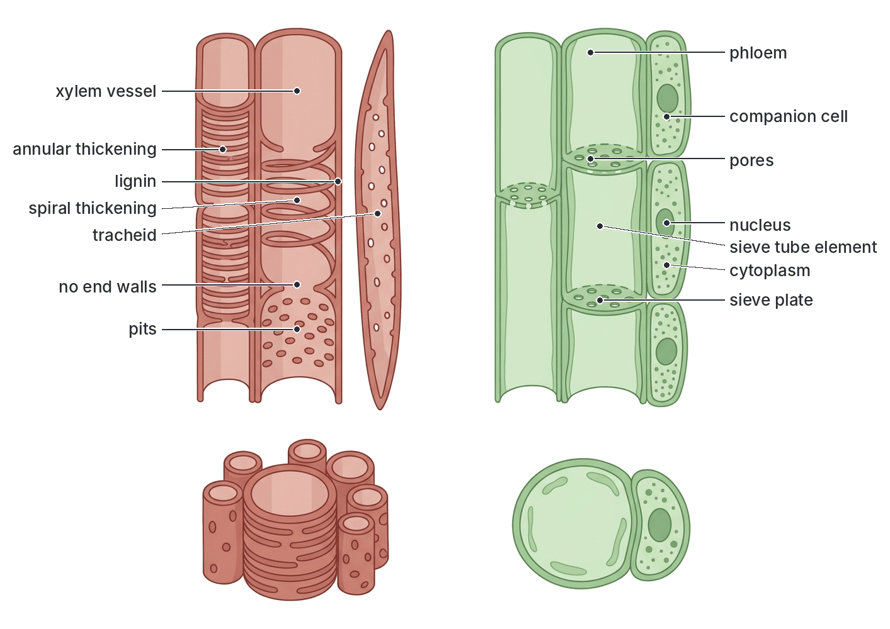

## Functions of the xylem and phloem

**Objective vi: understand the specific functions of the phloem and xylem.**

### Functions of the xylem

1. **Transport of water** from the roots to the stem, leaves, flowers and fruits. Water is needed for photosynthesis, for keeping cells turgid, for transpiration (cooling), and as the solvent for all the cell's chemical reactions.
2. **Transport of mineral salts** (dissolved ions) from the roots to all parts of the plant.
3. **Mechanical support:** the lignified vessels, tracheids and fibres make the stem strong and rigid. The trunks of trees such as iroko, mahogany and obeche are made of xylem (wood), which is why timber is so strong.
4. **Storage:** xylem parenchyma stores food (e.g. starch).

### Functions of the phloem

1. **Translocation** of **manufactured food**, mainly **sucrose**, and **amino acids** from the leaves (the **source**) to the parts that use or store food (the **sinks**): growing tips of roots and shoots, flowers, developing fruits and seeds, and storage organs (e.g. tubers of yam and cassava, the swollen roots of carrots).
2. Transport in **both directions**: upwards (e.g. from leaves to the shoot tip and fruits) and downwards (e.g. from leaves to the roots). In the growing season, food stored in tubers or roots can be moved **upwards** to new shoots, so the storage organ then becomes the source. For example, when a yam sett sprouts, food stored in it is carried to the growing shoot.
3. Transport of some **plant hormones** and other organic substances.
4. **Support** (phloem fibres).

### Translocation: how food moves in the phloem

**Translocation** is the movement of manufactured food (sucrose and amino acids) in the phloem from the source to the sinks.

The most widely accepted explanation is the **mass (pressure) flow hypothesis**, first proposed by **Ernst Münch** in 1930:

1. In the leaf (the **source**), sucrose is made from the sugars produced by photosynthesis.
2. Sucrose is **actively loaded** into the sieve tubes (with the help of the companion cells, using energy from ATP). This makes the sap in the sieve tubes very concentrated.
3. Water enters the sieve tubes from the nearby xylem by **osmosis**, building up a high **pressure** in the sieve tubes in the leaf.
4. At the **sink** (e.g. a root, a fruit or a growing tip), sucrose is removed from the sieve tubes and used (in respiration or growth) or stored (as starch). Water follows it out, so the pressure in the sieve tubes there is **low**.
5. The sap therefore flows **from high pressure to low pressure**, from source to sink, carrying the dissolved food with it.

**Textbook variation:** most textbooks give mass (pressure) flow as the main explanation for translocation, but note that it does not explain everything (for example, how different substances can sometimes move in opposite directions in the same plant). Older books also mention cytoplasmic streaming in the sieve tubes. JAMB rarely asks for this detail; the key facts are that translocation happens in the **phloem**, carries mainly **sucrose**, moves from **source to sink**, can go **up or down**, and needs **living** cells.

### Evidence for the functions of xylem and phloem

#### Experiment 7: the eosin experiment (xylem carries water)

**Aim:** to show that water travels up the stem in the **xylem**.

**Materials:** a young, leafy, soft-stemmed plant such as **balsam** (*Impatiens*; its stem is translucent, so the dye can be seen through it) or a young sunflower or bean seedling, a beaker of **eosin solution** (a red dye; red ink or food colouring can be used instead), a sharp razor blade, a hand lens or microscope, slides.

**Method:**

1. Carefully uproot the plant and wash the soil from its roots (or cut the shoot off under water).
2. Stand the roots (or the cut end of the shoot) in the eosin solution.
3. Leave it in a warm, bright place for a few hours, so that the plant is transpiring.
4. Observe the stem and leaves. Then cut thin **transverse sections** of the stem (and a root) with the razor blade, mount them in water, and examine them with a hand lens or microscope. Cut a **longitudinal section** as well.

**Observations:**

1. Red streaks can be seen running up the stem (through the translucent balsam stem), and the **veins** of the leaves turn red.
2. In the transverse section of the stem, **only the xylem** in each vascular bundle (the inner part of the bundle, in a ring) is stained **red**. The phloem, cortex and pith are not stained.
3. In the transverse section of the root, the central star-shaped xylem is stained red.
4. In the longitudinal section, the red dye is seen in long, continuous tubes (the vessels).

**Conclusion:** the dye travelled up the plant with the water in the **xylem vessels**. Therefore xylem is the tissue that conducts water (and dissolved mineral salts) up the plant. The coloured leaf veins show that the xylem continues into the leaves.

**A simple version:** stand a white flower (e.g. a white rose or a white periwinkle) or a stick of celery in coloured water; after some hours the petals become streaked with colour.

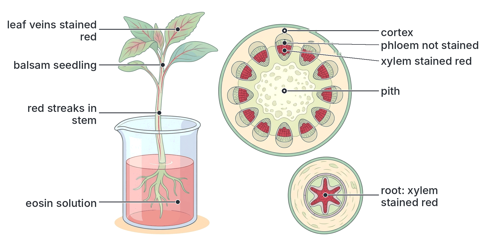

#### Experiment 8: the ringing (girdling) experiment (phloem carries food)

**Aim:** to show that manufactured food is carried down the stem in the **phloem**, and that water goes up in the xylem.

**Background:** in a woody stem, the **bark** contains the **phloem** (on the inside of the bark), while the **xylem** forms the wood. Removing a ring of bark therefore removes the phloem but leaves the xylem.

**Materials:** a young woody plant (a shrub or young tree such as hibiscus, or a woody twig of a tree) growing in a pot or in the ground, a sharp knife.

**Method:**

1. With a sharp knife, cut two circles about 1–2 cm apart right round the stem, cutting through the bark only, down to the wood.
2. Peel off the ring of bark between the cuts, exposing the wood (xylem) all round. This is called **ringing** or **girdling**.
3. Keep the plant watered and observe it for a few weeks. Keep a similar plant that has not been ringed as a **control**.

**Observations:**

1. The **leaves above the ring do not wilt**; they stay fresh and green for a long time.
2. After some weeks, the bark **just above the ring swells** (a bulge or callus forms), and may produce new roots if kept moist. Analysis shows it is rich in **sugars and starch**.
3. The bark below the ring does not swell. Growth of the roots slows.
4. Eventually, over a longer time, the **roots** starve, because no food reaches them, and the **whole plant dies**.
5. The control plant grows normally.

**Explanations:**

- The leaves do not wilt because the **xylem** (wood) is intact, so **water and minerals still travel up** to them.
- The swelling above the ring is caused by **food building up**: food coming down from the leaves in the phloem cannot cross the gap, so it collects above the ring. The extra food is used for growth there.
- The roots die because they receive **no food** (they cannot photosynthesise). When the roots die, they stop absorbing water, and finally the whole plant dies.

**Conclusion:** food made in the leaves is carried **down** the stem in the **phloem** (in the bark); water is carried **up** in the **xylem** (in the wood).

**Practical importance:** animals such as goats, rats, porcupines and elephants that strip bark all the way round a tree trunk can kill the tree in the same way. Farmers protect young trees from them. In some forestry practice, trees are ringed deliberately to kill them before felling.

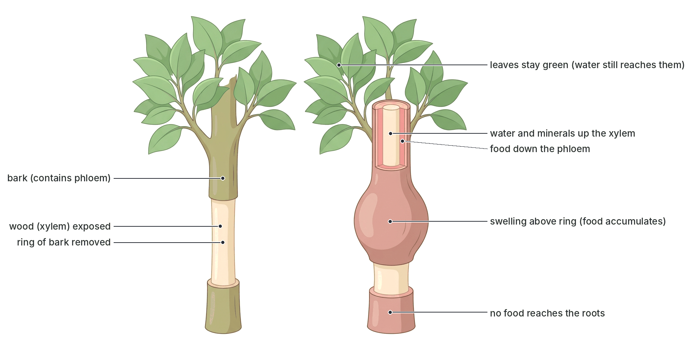

#### Other evidence

- **Radioactive tracers:** if a leaf is given CO₂ containing radioactive carbon (carbon-14), the radioactive sugars made in photosynthesis are later found in the **phloem** (detected on photographic film, a method called autoradiography), showing that the phloem carries manufactured food.
- **Aphids:** greenfly (aphids) feed by pushing their needle-like mouthparts (stylets) into a single **sieve tube**. If the aphid is cut off, leaving the stylet in place, sap flows out and can be collected; it is rich in **sucrose and amino acids**. This shows what the phloem carries, and that its contents are under pressure.
- **Mineral uptake:** radioactive mineral ions given to the roots appear first in the xylem.

### Xylem and phloem compared

| Feature | Xylem | Phloem |
| --- | --- | --- |
| Main materials carried | **Water and mineral salts** | **Manufactured food** (sucrose, amino acids) |
| Direction of flow | **Upwards only** (roots to leaves) | **Both directions** (source to sink) |
| Main conducting cells | Vessels and tracheids | Sieve tubes (with companion cells) |
| Living or dead | Conducting cells are **dead** | Conducting cells are **living** |
| Cytoplasm | None in vessels and tracheids | Present in sieve tubes (thin layer) |
| Nucleus | None | Absent in mature sieve tubes; **present in companion cells** |
| Cell walls | Thick, **lignified** | Thin, cellulose (not lignified, except fibres) |
| Cross walls | Absent in vessels (end walls broken down) | Perforated **sieve plates** |
| Main force moving the contents | Transpiration pull (with root pressure and capillarity) | Pressure differences between source and sink (mass flow); needs energy for loading |
| Support | Gives a lot of support (forms wood) | Gives little support (only fibres) |
| Position in dicot stem bundle | **Inner** side (towards the pith) | **Outer** side (towards the epidermis) |
| Position in leaf vein | Upper side | Lower side |
| Position in dicot root | Central star | Between the arms of the xylem |
| Effect of ringing | Not removed (in the wood) | Removed with the bark |

## Movement of water through the plant

Before looking at the mechanisms, here is the complete journey of water from the soil to the air, step by step.

### Absorption of water by root hairs

**Root hairs** are long, thin outgrowths of single cells of the piliferous layer, just behind the root tip. They are adapted for absorbing water:

1. They are very **numerous** (thousands on each root), giving a **huge surface area**.
2. They are **long and thin**, growing between the soil particles and in close contact with the soil water.
3. They have **thin walls**, with no cuticle, so water passes in easily.
4. Their **cell sap is more concentrated** than the soil water, so water enters them by osmosis.
5. They have many mitochondria and selectively permeable membranes for the active uptake of mineral ions.

**The path of water, step by step:**

1. **Soil water → root hair:** the soil water is a dilute solution of mineral salts. The cell sap of the root hair is more concentrated. Water passes from the soil into the root hair by **osmosis**, through the cell wall and the selectively permeable cell membrane.
2. **Across the cortex:** the root hair's sap is now more dilute than the sap of the next cortex cell inwards. Water passes by **osmosis from cell to cell** across the cortex towards the centre. Much water also seeps along the **cell walls** and through the spaces between them, without entering the cells.
3. **Through the endodermis:** the endodermis cells have a waterproof band in their walls (the **Casparian strip**), which blocks the path along the cell walls. Water must pass **through the living cells** of the endodermis, which therefore control what enters the xylem.
4. **Into the xylem:** water passes through the pericycle into the **xylem vessels** of the root.
5. **Up the xylem:** water moves up through the xylem of the root and stem into the leaves (by **transpiration pull**, helped by root pressure and capillarity).
6. **Into the leaf cells:** in the leaf, water leaves the xylem in the veins and passes by osmosis into the mesophyll cells.
7. **Out of the leaf:** water evaporates from the wet walls of the mesophyll cells into the air spaces, and the water vapour **diffuses** out through the **stomata** into the air (**transpiration**).

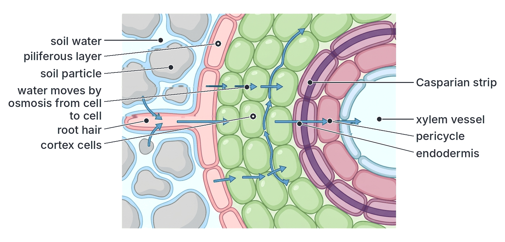

### Absorption of mineral salts

Mineral salts are absorbed as **ions** (e.g. nitrate NO₃⁻, phosphate, potassium K⁺, magnesium Mg²⁺, calcium Ca²⁺) dissolved in the soil water.

- Some ions enter by **diffusion**, when their concentration in the soil water is higher than in the root hair.
- Most mineral ions are absorbed by **active transport**, because they are usually **more concentrated inside** the root cells than in the soil water (see "Active transport" below).
- The ions then pass across the cortex to the xylem and are carried up with the water in the **transpiration stream**.

## Transpiration

**Transpiration** is the **loss of water in the form of water vapour** from the aerial (above-ground) parts of a plant, mainly through the **stomata** of the leaves, into the atmosphere.

### Types of transpiration

| Type | Where water vapour is lost | Share of total |
| --- | --- | --- |
| **Stomatal transpiration** | Through the **stomata** of leaves (and young green stems) | By far the largest share, about 80–95% |
| **Cuticular transpiration** | Directly through the **cuticle** of leaves and young stems | Small (about 5–10%); larger if the cuticle is thin, very small if it is thick and waxy |
| **Lenticular transpiration** | Through the **lenticels** in the bark of woody stems and on fruits | Very small |

**Textbook variation:** the shares given for each type differ between textbooks (for stomatal transpiration, figures from about 80% to over 90% are quoted), but all agree that stomatal transpiration is by far the most important. Books also differ on how much of the water absorbed is lost by transpiration: figures of "over 90%" and "about 95–99%" are common, with only about 1–2% used in photosynthesis and other processes.

### How transpiration happens, step by step

1. Water reaches the leaf through the xylem of the **veins**.
2. It passes by osmosis into the **spongy and palisade mesophyll cells**, keeping their walls wet.
3. Water **evaporates** from the moist surfaces of the mesophyll cell walls into the **air spaces** inside the leaf. The air spaces become **saturated** with water vapour.
4. When the stomata are open, the water vapour **diffuses** out through the stomata, from the humid air spaces (high concentration of water vapour) into the drier outside air (lower concentration).
5. The cells that lost water now have more concentrated sap, so they draw water by osmosis from neighbouring cells, which draw it from the xylem. This creates a **pull** on the water in the xylem (the transpiration pull; see below).

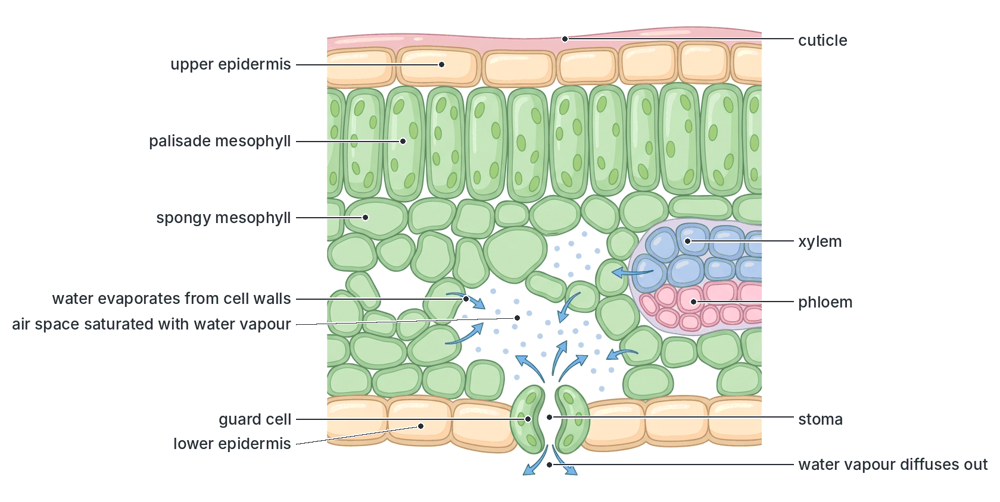

### Importance of transpiration

1. **Transpiration pull:** it provides the main force that draws water and dissolved mineral salts up from the roots to the leaves (the **transpiration stream**).
2. **Distribution of minerals:** mineral salts dissolved in the water are carried to all parts of the plant.
3. **Cooling:** evaporation of water uses heat (latent heat), so it **cools** the leaves, which would otherwise overheat in strong tropical sunshine.
4. **Keeps cells supplied with water,** so they stay turgid (as long as the roots can keep up).
5. It plays a part in the **water cycle**, returning large amounts of water vapour to the air; forests help to keep the air humid and bring rain. Cutting down forests can make an area drier.

### Disadvantages of transpiration

1. If water is lost faster than it is absorbed (on hot, dry, windy days, in the dry season and harmattan, or when the soil is dry), the plant **wilts**, photosynthesis slows (the stomata close), and the plant may die.
2. Much of the water absorbed is "wasted". For this reason transpiration is often called a **"necessary evil"**: it is harmful in that it wastes water, but it is unavoidable, because the stomata must open to let in CO₂ for photosynthesis, and once they are open, water vapour escapes.

### Factors affecting the rate of transpiration

**External (environmental) factors:**

| Factor | Effect on rate of transpiration | Reason |
| --- | --- | --- |
| **Light** | **Increases** with light intensity | Stomata **open** in light (for photosynthesis) and close in darkness, so transpiration is fast by day and slow at night. Light also warms the leaf |
| **Temperature** | **Increases** with temperature | Water evaporates faster from cell walls; water molecules diffuse faster; warm air can hold more water vapour, so it is "drier" (relative humidity falls) |
| **Humidity** of the air | **Decreases** when the air is humid | Moist air reduces the concentration gradient of water vapour between the inside of the leaf and the air, so diffusion is slower. Transpiration is slow in the humid rainy season and in the humid south of Nigeria, and fast in the dry harmattan of the north |
| **Wind (air movement)** | **Increases** with wind | Wind blows away the layer of humid air that collects around the leaf, keeping the concentration gradient steep. (Very strong wind may cause stomata to close.) |
| **Availability of soil water** | **Decreases** when soil water is scarce | If roots cannot absorb enough water, the cells lose turgor and the stomata close |
| **Atmospheric pressure** | Increases when air pressure is low | Water evaporates more easily at low pressure (e.g. on high mountains) |

**Internal (plant) factors:**

1. **Leaf surface area:** more leaves or larger leaves = more transpiration. Many trees in the savanna **shed their leaves** in the dry season to reduce water loss.
2. **Number and distribution of stomata:** more stomata = more transpiration. In most dicot leaves, most stomata are on the **lower** surface, which is shaded and cooler, reducing water loss.
3. **Thickness of the cuticle:** a thick, waxy cuticle reduces cuticular transpiration.
4. **Sunken stomata, hairs and rolled leaves:** stomata sunk in pits, a covering of hairs, or leaves that roll up (as in some grasses during drought) trap a layer of moist air, reducing transpiration.
5. **Leaves reduced to spines or scales** (e.g. cactus) or **fleshy, water-storing leaves and stems** (succulents) in xerophytes.

### Experiments on transpiration

#### Experiment 9: showing that water is lost from leaves (the bell jar experiment)

**Aim:** to show that a leafy plant gives off water vapour.

**Method:**

1. Take a well-watered potted plant. Cover the **pot and soil** completely with a polythene bag (tied round the base of the stem), so no water can evaporate from the soil or pot.
2. Place the plant on a glass plate and cover it with a dry **bell jar**. Seal the rim with petroleum jelly (Vaseline).
3. **Control:** set up an identical bell jar over a pot of wet soil (covered in the same way) with **no plant** (or with a leafless stick).
4. Leave both in bright light for a few hours.

**Observation:** droplets of a clear liquid (mist) form on the inside of the bell jar containing the plant, but not in the control. The liquid turns **white anhydrous copper(II) sulphate blue**, or **blue cobalt(II) chloride paper pink**, showing that it is **water**.

**Conclusion:** the leafy shoot gave off water vapour, which condensed on the cool glass.

#### Experiment 10: comparing water loss from the two surfaces of a leaf (cobalt chloride paper)

**Aim:** to compare the rate of transpiration from the upper and lower surfaces of a leaf.

**Background:** **cobalt(II) chloride paper** is **blue when dry** and turns **pink when it absorbs water**.

**Method:**

1. Dry two small squares of cobalt(II) chloride paper (e.g. in a warm oven or over a flame) until they are blue. Handle them with forceps (not fingers, which are moist).
2. Place one square on the **upper surface** and one on the **lower surface** of a leaf on a well-watered plant (e.g. hibiscus).
3. Cover each with a glass slide (or clear tape) and hold them in place with clips or rubber bands, to stop moisture from the air reaching the papers.
4. Note the time each paper takes to turn **pink**.

**Observation:** the paper on the **lower surface** turns pink **much faster** than the paper on the upper surface.

**Conclusion:** more water vapour is lost from the lower surface of the leaf, because it has **more stomata** than the upper surface (and the upper surface has a thicker cuticle).

**Note:** in leaves that float on water, such as the water lily, the stomata are on the upper surface. In upright monocot leaves such as maize, stomata are found on both surfaces in similar numbers.

#### Experiment 11: measuring the rate of transpiration with a potometer

A **potometer** is an apparatus that measures the **rate of water uptake** by a leafy shoot. Because almost all the water taken up is lost by transpiration, the rate of water uptake is used as a measure of the **rate of transpiration**. (The commonly used type is the **bubble potometer**; another type is Farmer's potometer.)

**Materials:** a leafy shoot (e.g. a branch of hibiscus or another leafy plant), a potometer (a flask or tube filled with water, connected to a long **capillary tube** with a **scale** beside it, and a **reservoir** with a tap to reset the bubble), a basin of water, petroleum jelly, a stopwatch.

**Method:**

1. Cut the leafy shoot **under water** (and fit it into the potometer under water), so that **no air enters the xylem vessels** and blocks the flow of water.
2. Fit the shoot tightly into the potometer through a rubber bung, and seal all joints with **petroleum jelly** so the apparatus is **airtight and watertight**.
3. Make sure the apparatus is completely full of water. Dry the leaves.
4. Lift the end of the capillary tube out of the water for a moment to let in a single **air bubble**, then put it back.
5. As the shoot takes up water, the bubble moves along the capillary tube towards the shoot. Measure the **distance the bubble moves** along the scale in a given time (e.g. 5 minutes). This is the rate of water uptake.
6. Open the tap of the reservoir to push the bubble back to the start, and repeat to get an average.
7. To study a factor, change only that factor, e.g. place the potometer in front of a fan (wind), in darkness, near a lamp (light and heat), or cover the shoot with a clear polythene bag (high humidity), and measure the rate again each time.

**Observations (typical):** the bubble moves **faster** in bright light, in moving air (fan), and in warm, dry air; it moves **slower** in darkness, in still air, and when the shoot is covered with a polythene bag (humid air).

**Conclusion:** light, temperature and wind increase the rate of transpiration; high humidity and darkness reduce it.

**Limitations of the potometer:**

- It measures **water uptake**, not water loss. A small part of the water taken up is used in photosynthesis or to make cells turgid, so uptake is not exactly equal to transpiration.
- The shoot is cut, so it has **no roots**; this is not exactly like a whole plant.
- Any air leak or air in the xylem gives wrong results.

**Weighing method:** another way to measure water loss is to weigh a potted plant (with the pot and soil sealed in polythene) at intervals. The loss of mass is mainly the water lost by transpiration.

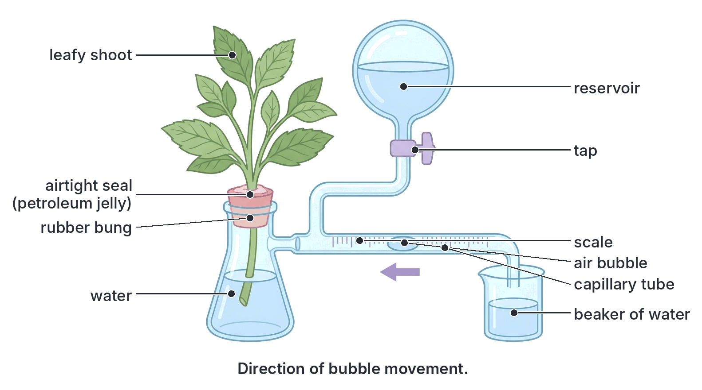

### Guttation

**Guttation** is the loss of **liquid water** (as drops, not vapour) from the edges or tips of leaves, through special pores called **hydathodes**. It happens when the air is **very humid** (so transpiration is very slow) and the soil is **moist and warm**, usually at night or early in the morning. It is caused by **root pressure** forcing water up the xylem. You can see it as drops of water along the edges of **grass leaves** and at the tips of **cocoyam** (*Colocasia*) leaves in the early morning. Guttation drops are often mistaken for dew.

| Feature | Transpiration | Guttation |
| --- | --- | --- |
| Form of water lost | Water **vapour** | **Liquid** water (drops) |
| Where lost | Mainly stomata (also cuticle, lenticels) | **Hydathodes** at leaf tips and edges |
| When | Mainly by day | At night or early morning, when the air is humid |
| Cause | Evaporation and diffusion | Root pressure |
| Water | Pure water vapour | Contains dissolved salts and sugars |

## Mechanisms of transport in plants

**Objective x: compare the various mechanisms of open circulatory systems in animal, transpiration pull, root pressure and active transport as mechanisms of transportation in plants.**

Water rises in plants, even in trees more than 100 m tall, without any pump. Three forces help: **transpiration pull** (the most important), **root pressure** and **capillarity**. Minerals are taken up mainly by **active transport**.

### Transpiration pull (the cohesion–tension theory)

**Transpiration pull** is the **pulling force**, created by the loss of water by transpiration from the leaves, that draws a continuous column of water up the xylem from the roots.

The explanation is called the **cohesion–tension theory**, put forward by **Henry Dixon and John Joly** in 1894.

**How transpiration pull works, step by step:**

1. Water **evaporates** from the mesophyll cells in the leaf and diffuses out through the stomata (transpiration).
2. The mesophyll cells that have lost water now have more concentrated sap, so they take water by **osmosis** from the cells next to them, and finally from the **xylem** in the leaf veins.
3. This removal of water at the top of the xylem creates a **tension** (a pull, or negative pressure) in the xylem.
4. Water molecules **stick strongly to each other**. This attraction is called **cohesion**. Because of cohesion, the water in each xylem vessel forms a **continuous column** (thread) of water, unbroken from the leaves down to the roots.
5. Water molecules also **stick to the walls** of the xylem vessels. This attraction between different substances is called **adhesion**. It helps hold the column up and prevents it from breaking away from the walls.
6. So when water is pulled out at the top, the **whole column moves up**, like a rope being pulled from above. Water is drawn up from the roots, and the roots absorb more water from the soil.
7. The **lignified walls** of the xylem vessels are strong enough to stop them collapsing inwards under this tension.

**Evidence for transpiration pull:**

1. The rate at which water moves up the xylem rises and falls with the rate of transpiration: it is fastest at midday, when transpiration is fastest.
2. The **trunks of trees shrink very slightly in diameter** during the day, when the tension in the xylem is greatest, and swell again at night. This can be measured with sensitive instruments.
3. If a xylem vessel is cut while the plant is transpiring, **air is sucked in** (rather than sap leaking out), showing that the water is under tension.
4. A leafy shoot can pull water up a tube and even lift a column of mercury slightly in a simple apparatus.
5. A potometer shows that a cut leafy shoot (with no roots, and so no root pressure) still takes up water quickly.

**Importance:** transpiration pull is the **main force** that moves water and minerals up the xylem, especially in tall trees. It does **not** use energy from the plant's respiration; the energy comes from the **sun**, which evaporates the water.

**Problem:** if an **air bubble** forms in a xylem vessel (for example, when a stem is cut in air, or in very dry conditions), the water column breaks and that vessel can no longer carry water. This is why shoots for potometers are cut under water. Water can pass round a blocked vessel through the pits into neighbouring vessels.

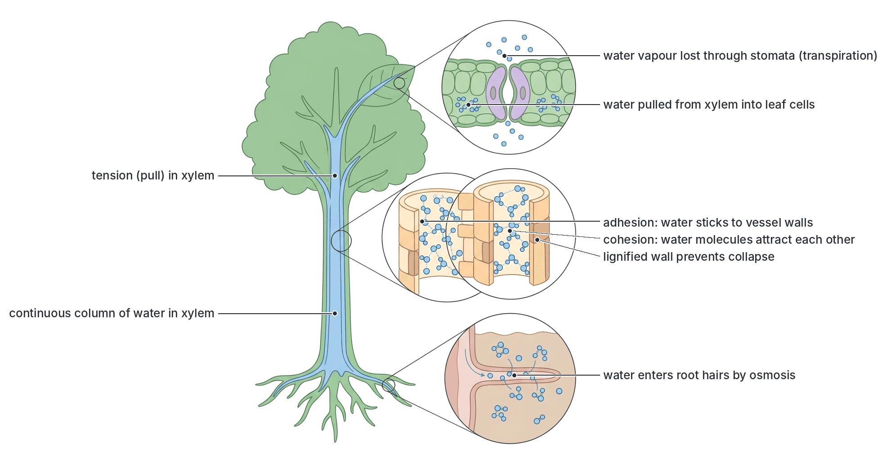

### Root pressure

**Root pressure** is the **pressure developed in the roots** that **pushes water up** the xylem of the stem from below.

**How root pressure is produced, step by step:**

1. Root cells **actively pump mineral ions** into the xylem of the root, using energy (ATP) from respiration.
2. This makes the solution in the root xylem **more concentrated** than the cells around it.
3. Water follows by **osmosis** from the surrounding cells (and ultimately from the soil) into the xylem.
4. Water continually entering the xylem builds up a **pressure** that pushes the water upwards.

**Evidence for root pressure:**

1. **Exudation (bleeding):** if the stem of a well-watered plant (e.g. a balsam or tomato plant) is cut off a little above the soil, **sap oozes out** of the cut stump for some time. This is caused by root pressure.
2. **Guttation:** water forced out of hydathodes at night (see above) is caused by root pressure.
3. **Manometer experiment:** attach a glass tube containing mercury (a **manometer**) to the cut stump of a well-watered potted plant with a rubber tube. Water exuded from the stump pushes the mercury up the tube, showing a pressure.
4. Root pressure **stops** if the roots are killed, deprived of **oxygen** (e.g. waterlogged soil) or poisoned with a respiratory inhibitor (such as cyanide), or if they are cold. This shows that it depends on **living cells using energy** from respiration.

**Limitations:** root pressure is **small** (usually only about 1–2 atmospheres, often less), enough to push water up only a few metres. It is greatest at night and early morning and when the soil is warm and wet, and very small or absent when transpiration is fast. Many trees, such as conifers, show little or no root pressure. So root pressure **alone cannot explain** how water reaches the tops of tall trees; it is only a **helper** to transpiration pull, especially in small plants, at night, and in spring before leaves open.

**Textbook variation:** the size of root pressure quoted varies between books (from "less than 1 atmosphere" up to about 2 atmospheres, or about 0.1–0.2 MPa). All agree it is too small to raise water to the top of a tall tree.

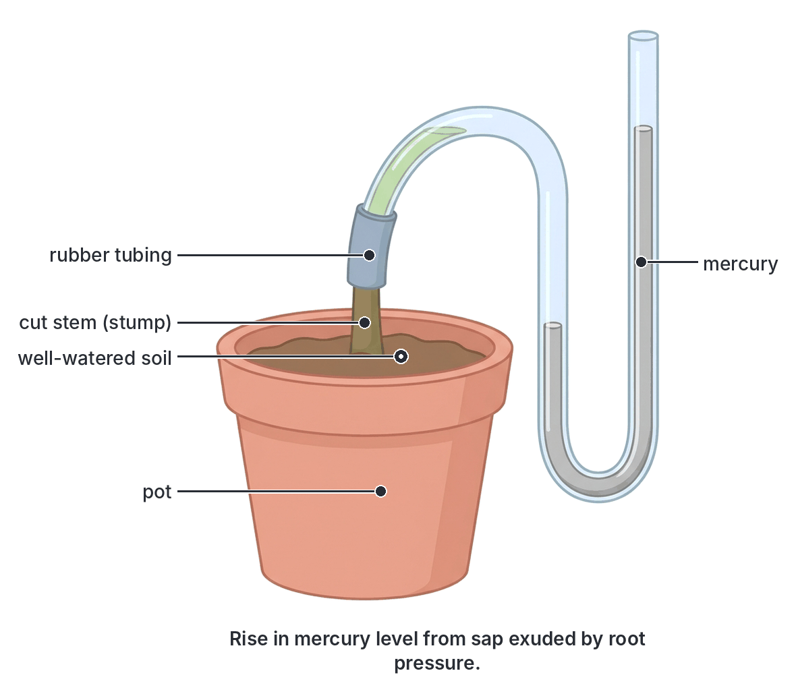

### Capillarity (capillary action)

**Capillarity** is the rise of water in very narrow tubes, caused by **adhesion** of water to the walls of the tube and **cohesion** between water molecules. The narrower the tube, the higher the water rises. Xylem vessels and tracheids are very narrow tubes, so capillarity helps water rise a little way in them. However, it can raise water only a **short distance** (much less than the height of even a small tree), so it is only a minor force.

### Active transport in plants

**Active transport** is the movement of substances (usually ions or molecules) across a cell membrane **against a concentration gradient** (from a region of **lower** concentration to a region of **higher** concentration), using **energy** from respiration (in the form of **ATP**) and **carrier proteins** in the membrane.

**Active transport in plants, examples:**

1. **Uptake of mineral salts by root hairs:** the concentration of ions such as nitrate and potassium is often many times **higher in the cell sap of root hairs** than in the soil water. Diffusion alone would carry the ions **out**. The root hair cells use **carrier proteins** and **ATP** to pump the ions **in**, against the gradient.
2. **Loading of the xylem in the root:** ions are pumped into the xylem, which causes root pressure.
3. **Loading of sugar into the phloem** sieve tubes at the source (in the leaf), with the help of companion cells.
4. **Opening of stomata:** potassium ions are pumped into the guard cells (see B4a).

**How active transport works, step by step:**

1. An ion (e.g. K⁺) in the soil water binds to a specific **carrier protein** in the cell membrane of the root hair.
2. Energy from **ATP** (made in the mitochondria by respiration) changes the shape of the carrier protein.
3. The change of shape carries the ion across the membrane and releases it on the inside of the cell.
4. The carrier returns to its original shape, ready to pick up another ion.

**Evidence that mineral uptake by roots is active:**

1. Roots take up ions **against a concentration gradient** (the ions build up inside the root to much higher concentrations than in the soil).
2. Uptake is **reduced or stopped** if the roots are deprived of **oxygen** (e.g. bubbling nitrogen through the culture solution instead of air, or **waterlogged** soil), because aerobic respiration, which supplies ATP, slows down. This is one reason why crops do poorly in waterlogged soils and why farmers loosen (aerate) the soil.
3. Uptake is reduced by **respiratory poisons** (e.g. cyanide) and by **low temperature**, which slows respiration.
4. Uptake is **selective**: roots take up some ions faster than others, not just in proportion to their concentration in the soil.
5. Root cells that absorb many minerals have many **mitochondria**.

**Active transport in animals (for comparison):** absorption of glucose and amino acids in the **ileum** (when their concentration in the gut is lower than in the blood); reabsorption of glucose and salts in the **kidney tubules**; the sodium–potassium pump in **nerve cells**.

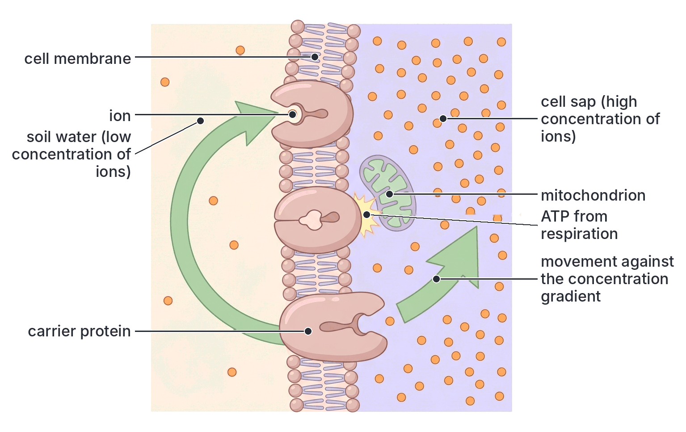

### Comparison of the mechanisms of transport (objective x)

This table compares the four mechanisms named in objective x. The open circulatory system of animals is described in full in B3a; diffusion and osmosis are added at the end because they work alongside all of them.

| Feature | Open circulatory system (animals) | Transpiration pull (plants) | Root pressure (plants) | Active transport (plants and animals) |
| --- | --- | --- | --- | --- |
| Organisms or places | Insects (e.g. cockroach), crabs, snails | Xylem of all vascular plants, especially tall trees | Xylem of roots and lower stem, especially in small herbaceous plants | Root hairs (mineral uptake), phloem loading, guard cells; ileum and kidney in animals |
| What is moved | Haemolymph carrying food, wastes, hormones | Water and dissolved mineral salts | Water and dissolved mineral salts | Mineral ions, sugars and other solutes |
| Direction of movement | From the dorsal heart forward into the haemocoel, then back to the heart | Upwards from roots to leaves | Upwards from roots | Into cells, usually **against** a concentration gradient |
| Driving force | Contraction of a **dorsal tubular heart** and body movements | **Evaporation** of water from leaves (transpiration), with cohesion and adhesion of water | Osmosis following the **active pumping** of ions into root xylem | Carrier proteins powered by **ATP** |
| Push or pull? | Push (pumping) | **Pull** from above (tension) | **Push** from below (pressure) | Pumping across a membrane |
| Uses energy from the organism's respiration? | Yes (heart muscle contraction) | **No** (energy from the sun) | **Yes** (to pump ions in the roots) | **Yes** (ATP) |
| Needs living cells? | Yes | No (the xylem vessels are dead; it works even in a cut, rootless shoot) | Yes (living root cells) | Yes |
| Affected by lack of oxygen or respiratory poisons? | Yes | Not directly | Yes, stops | Yes, stops |
| When most active | All the time | **By day**, in warm, dry, sunny, windy weather | **At night** and early morning, in warm, moist soil | All the time, when energy is available |
| Size of effect | Low pressure, slow flow | **Very large**; can raise water over 100 m | **Small** (a few metres at most) | Moves substances only across membranes, short distances |
| Evidence | Dissection shows haemocoel and dorsal heart with ostia | Potometer; trunk shrinkage at midday; air sucked into cut xylem | Exudation from cut stumps; guttation; manometer | Uptake against a gradient; stopped by lack of oxygen or cyanide |

**How diffusion and osmosis fit in:** **osmosis** moves water from the soil into root hairs and from cell to cell; **diffusion** moves water vapour out through the stomata and gases in and out of the leaf. Both are passive and need no energy from respiration. Transpiration pull, root pressure and active transport build on them.

## Key terms

| Term | Meaning |
| --- | --- |
| Vascular tissue | Tissue that conducts materials in plants: xylem and phloem |
| Xylem | Tissue of dead, lignified vessels and tracheids that carries water and mineral salts upwards and supports the plant |
| Phloem | Tissue of living sieve tubes and companion cells that carries manufactured food in both directions |
| Vascular bundle | A strand containing xylem and phloem (and cambium in dicots) |
| Sieve plate | A perforated end wall between two sieve tube elements |
| Companion cell | A small living cell with a nucleus beside a sieve tube, which controls and supplies it |
| Lignin | A hard, waterproof substance that thickens the walls of xylem |
| Translocation | Movement of manufactured food (sucrose, amino acids) in the phloem |
| Source and sink | The source is where food is made or released (e.g. leaf); the sink is where it is used or stored (e.g. root, fruit) |
| Cell sap | The solution in the vacuole of a plant cell |
| Cytoplasmic streaming (cyclosis) | The flowing movement of cytoplasm inside a cell |
| Diffusion | Movement of particles from a region of high concentration to a region of low concentration |
| Concentration gradient | The difference in concentration between two regions |
| Osmosis | Movement of water from a dilute solution to a more concentrated solution through a selectively permeable membrane |
| Selectively permeable membrane | A membrane that lets some molecules (e.g. water) pass but not others (e.g. sugar) |
| Hypotonic / hypertonic / isotonic | Less concentrated / more concentrated / equally concentrated compared with the cell contents |
| Haemolysis | Bursting of red blood cells in a hypotonic solution |
| Crenation | Shrinking of red blood cells in a hypertonic solution |
| Plasmolysis | Shrinking of the cytoplasm away from the cell wall due to loss of water by osmosis |
| Incipient plasmolysis | The point at which the cytoplasm is just about to pull away from the cell wall |
| Deplasmolysis | Recovery of a plasmolysed cell when placed in water |
| Turgidity | The firm state of a plant cell whose vacuole is full of water, pressing the cytoplasm against the wall |
| Flaccid | Soft and limp because of water loss |
| Turgor pressure | The outward pressure of the cell contents against the cell wall |
| Wilting | Drooping of a plant when its cells lose turgor |
| Transpiration | Loss of water vapour from the aerial parts of a plant, mainly through stomata |
| Potometer | Apparatus that measures the rate of water uptake by a leafy shoot (used to estimate transpiration) |
| Guttation | Loss of liquid water through hydathodes, caused by root pressure |
| Transpiration pull | The pull on the water column in the xylem caused by transpiration |
| Cohesion | Attraction between water molecules |
| Adhesion | Attraction between water molecules and the walls of the vessels |
| Root pressure | The pressure in the roots that pushes water up the xylem |
| Active transport | Movement of substances against a concentration gradient using energy from ATP |

## Exam tips and common mistakes

- **Xylem = water and minerals, upwards, dead, lignified. Phloem = food, both directions, living, sieve plates.** Remember "**X**ylem carries **water** (think of xylophone pipes)", "**Ph**loem carries **food**" (both have the sound "f").
- **In a dicot stem bundle, xylem is inside and phloem is outside;** in a dicot root, xylem is a central star with phloem between its arms; in a leaf vein, xylem is on top.
- **Ringing removes the phloem only** (in the bark). Leaves above stay green (xylem intact); the bark above the ring swells with food; the roots eventually starve.
- **The eosin experiment stains the xylem,** showing that xylem carries water.
- **Osmosis is the movement of water only,** through a selectively permeable membrane, from a dilute to a concentrated solution. Do not say "from a concentrated to a dilute solution".
- **The cell wall is fully permeable; the cell membrane is selectively permeable.** In a plasmolysed cell, the space between the wall and the cytoplasm is filled with the outside solution.
- **Boiled potato in the osmometer is the control,** because boiling kills the cells and destroys their selectively permeable membranes.
- **Plasmolysis happens only in plant cells** (they have walls). Red blood cells in strong salt solution undergo crenation; in water they undergo haemolysis.
- **Transpiration is increased by light, high temperature, wind and low humidity;** decreased by darkness, cold, still air and high humidity.
- **The potometer measures water uptake,** not transpiration directly. Cut the shoot under water to keep air out of the xylem.
- **Transpiration pull uses solar energy, not the plant's ATP; root pressure and active transport need energy from respiration.**
- **Guttation is liquid water through hydathodes (root pressure); transpiration is water vapour through stomata.**

## Quick summary

1. In plants, the media of transport are cell sap, cytoplasm (with cytoplasmic streaming), xylem sap (water and minerals) and phloem sap (sucrose and amino acids).
2. Diffusion (high to low concentration) and osmosis (water moving from a dilute to a concentrated solution through a selectively permeable membrane) are passive processes; the potato osmometer and thistle funnel osmometer demonstrate osmosis.
3. Plant cells in hypertonic solutions lose water and become plasmolysed (seen in onion epidermis); in hypotonic solutions they become turgid, which supports herbaceous plants and opens stomata; animal cells instead shrink (crenation) or burst (haemolysis).
4. The vascular system runs through the root (central star of xylem), stem (bundles in a ring in dicots, scattered in monocots) and leaf (veins, xylem on top), and into flowers and fruits.
5. Xylem (dead, lignified vessels and tracheids) carries water and minerals upwards and supports the plant; phloem (living sieve tubes and companion cells) translocates food in both directions; the eosin and ringing experiments show these functions.
6. Transpiration is the loss of water vapour, mainly through stomata; it is increased by light, heat, wind and dry air, and can be measured with a potometer.
7. Water rises mainly by transpiration pull (cohesion–tension), helped by root pressure and capillarity; minerals are absorbed by active transport, which needs ATP; open circulation in insects moves haemolymph by a dorsal tubular heart.

## Practice questions

**1. Which of the following tissues is stained red when a balsam seedling is placed in eosin solution for some hours?**

- A. Phloem
- B. Cortex
- C. Xylem
- D. Pith

**Answer: C.** Eosin travels up with the water in the xylem vessels, so only the xylem is stained.

**2. When a ring of bark is removed from a woody stem, the bark just above the ring later swells. This is because**

- A. water accumulates above the ring
- B. food carried down in the phloem accumulates above the ring
- C. the xylem has been removed
- D. mineral salts cannot move upwards

**Answer: B.** Ringing removes the phloem; food coming down from the leaves cannot cross the gap and builds up above the ring. The xylem (wood) is not removed.

**3. In a potato osmometer, the boiled potato serves as a control because boiling**

- A. makes the potato cells more concentrated
- B. removes the starch from the potato
- C. kills the cells and destroys the selective permeability of their membranes
- D. makes the cell walls impermeable

**Answer: C.** Osmosis through the potato depends on living, selectively permeable cell membranes; boiling destroys them, so no water enters the cavity.

**4. A plant cell placed in a concentrated salt solution becomes**

- A. plasmolysed
- B. turgid
- C. haemolysed
- D. crenated

**Answer: A.** Water leaves the cell by osmosis, and the cytoplasm pulls away from the cell wall. Haemolysis and crenation describe red blood cells.

**5. Which of the following conditions will cause the bubble in a potometer to move fastest?**

- A. Still, humid air in darkness
- B. Moving, dry air in bright light
- C. Still, dry air in darkness
- D. Moving, humid air in darkness

**Answer: B.** Wind, low humidity and light (which opens the stomata) all increase transpiration, so water uptake is fastest.

**6. The main force responsible for the rise of water to the top of tall trees is**

- A. root pressure
- B. capillarity
- C. active transport
- D. transpiration pull

**Answer: D.** Transpiration pull, explained by the cohesion–tension theory, can raise water over 100 m; root pressure and capillarity can raise it only a short distance.

**7. Mineral salts are absorbed by root hairs against a concentration gradient by**

- A. diffusion
- B. osmosis
- C. active transport
- D. transpiration

**Answer: C.** Active transport moves ions from low to high concentration using carrier proteins and energy (ATP) from respiration.

**8. Which of the following is NOT a feature of phloem sieve tubes?**

- A. They contain sieve plates
- B. They are living cells
- C. Their walls are heavily lignified
- D. They have companion cells beside them

**Answer: C.** Lignified walls are a feature of xylem. Sieve tubes have thin cellulose walls.

**9. Blue cobalt(II) chloride paper placed on the lower surface of a hibiscus leaf turns pink faster than paper on the upper surface because the lower surface**

- A. has more stomata
- B. receives more light
- C. has a thicker cuticle
- D. has more chloroplasts

**Answer: A.** Most dicot leaves have more stomata on the lower surface, so more water vapour is lost from it.

**10. Sap oozing from the stump of a well-watered plant whose stem has been cut near the soil is evidence of**

- A. transpiration pull
- B. root pressure
- C. guttation
- D. plasmolysis

**Answer: B.** Root pressure, caused by the active pumping of ions into the root xylem and the osmotic entry of water, pushes sap out of the cut stump.
