# JAMB Biology Notes: Respiration (Part 1): Respiratory Organs and Gaseous Exchange

## What JAMB expects

This topic is Section B, Topic 4 of the JAMB Biology syllabus: Form and Functions – Respiration. The topic is large, so it is split into two files:

- **This file (`B4a-respiratory-organs-and-gaseous-exchange.md`)** covers the respiratory organs and surfaces of plants and animals, how stomata open and close, and the mechanisms of gaseous exchange (breathing) in plants and animals.
- **`B4b-cellular-respiration.md`** covers aerobic and anaerobic respiration inside cells: the significance of respiration, glycolysis and the Krebs cycle, the role of oxygen, oxygen debt, experiments on respiration, fermentation by yeast and the economic importance of yeasts.

The syllabus content items covered in this file are:

- a. Respiratory organs and surfaces.
- b. The mechanism of gaseous exchange in: i. plants; ii. animals.

By the end of these notes, you should be able to:

1. Describe the following respiratory organs and surfaces, with the organisms in which they occur: body surface, gill, trachea, lungs, stomata and lenticel (objective iv).
2. Describe the mechanism for the opening and closing of the stomata (objective v).
3. Determine the respiratory mechanisms in plants and animals (objective vi).

**Note on the syllabus wording:** objective iv lists "stomata and lenticel" as respiratory organs. They are not organs in the strict sense (a stoma is a pore between two cells; a lenticel is a small patch of loose tissue in bark), but they are the **surfaces through which plants exchange gases**, so they are treated here alongside the animal organs. Stomata also come up again under transpiration (B3b) and excretion.

## Respiration, breathing and gaseous exchange: getting the words right

Three ideas are easily confused. JAMB often tests the difference.

| Term | Meaning | Where it happens |
| --- | --- | --- |
| **Respiration** (cellular or tissue respiration) | The **chemical breakdown of food** (mainly glucose) inside living cells to **release energy** | Inside every living cell (in the cytoplasm and mitochondria). See B4b |
| **Gaseous exchange** | The **exchange of gases** (oxygen in, carbon (IV) oxide out) between an organism and its surroundings, by **diffusion** across a respiratory surface | At the respiratory surface: alveoli, gills, tracheoles, skin, stomata, lenticels |
| **Breathing** (ventilation) | The **movements** that bring fresh air (or water) to the respiratory surface and remove stale air (or water) | In animals with lungs, gills or tracheae; plants do **not** breathe |

**External respiration** is an older name some books use for gaseous exchange (and breathing); **internal respiration** is an older name for respiration in the cells.

Respiration in cells needs a supply of **oxygen** (for aerobic respiration) and produces **carbon (IV) oxide (CO₂)**, which must be removed. Gaseous exchange makes this possible.

## Features of a good respiratory surface

Every respiratory surface, in any organism, has most of these features. They all help **diffusion** to happen fast.

1. **Large surface area** compared with the volume of the organism, so that a lot of gas can be exchanged at once (e.g. millions of alveoli, many gill filaments, many tracheoles, many stomata).
2. **Thin** (often only one cell thick), so that the gases have only a **short distance** to diffuse.
3. **Moist,** so that gases can **dissolve** before they diffuse across the surface. (Gases cross cell membranes in solution.)
4. **Permeable** to oxygen and CO₂.
5. **Well supplied with blood capillaries** (in animals with blood that carries oxygen), so that oxygen is carried away and CO₂ brought quickly. This keeps the **concentration gradient steep**.
6. **Ventilated** (in active animals): fresh air or water is moved over it, again keeping the gradient steep.
7. **Protected** from damage and drying out (e.g. lungs inside the chest, gills under the operculum, tracheae inside the body).

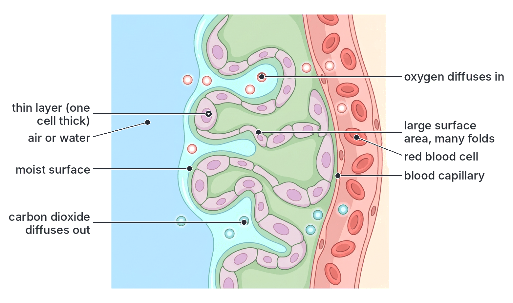

## Respiratory organs and surfaces

**Objective iv: describe the following respiratory organs and surfaces with organisms in which they occur; body surface, gill, trachea, lungs, stomata and lenticel.**

### Body surface

Some organisms exchange gases across their whole **body surface** (cell membrane or skin). This works only if the organism is **small**, or **thin and flat**, or has a **low rate of metabolism**, and if its surface is **moist**. Gaseous exchange across the skin is called **cutaneous respiration**.

#### *Amoeba* (and other unicellular organisms)

- *Amoeba* is a single cell living in fresh water. Its whole **cell membrane** is the respiratory surface.
- Because it is so small, it has a **very large surface area to volume ratio** (see B3a), and no part of the cell is far from the surface.
- The membrane is thin, moist (in water) and permeable.
- **Oxygen dissolved in the water** diffuses into the cell, because the cell uses oxygen in respiration and so keeps its own oxygen concentration lower than that of the water.
- **CO₂** produced by respiration diffuses out into the water, because its concentration is higher inside the cell.
- Inside, the gases are spread through the cell by diffusion and cytoplasmic streaming. No special organ or breathing movement is needed.

The same applies to *Paramecium*, *Euglena* and *Chlamydomonas*, and to small, thin animals such as *Hydra* and flatworms (planarians), whose every cell is close to the water.

#### The earthworm

- The earthworm is larger than *Amoeba*, but it has a long, thin, cylindrical body, giving a fairly large surface area for its volume, and a low rate of metabolism.
- It has **no special respiratory organ**; its **moist skin** is the respiratory surface.
- **Features of the earthworm's skin for gaseous exchange:**
  1. It is **thin** and covered by a thin, permeable cuticle.
  2. It is kept **moist** by **mucus** from gland cells in the skin, and by **coelomic fluid** that comes out through small **dorsal pores** along its back.
  3. A dense **network of blood capillaries** lies just beneath the skin.
  4. Its blood contains **haemoglobin** (dissolved in the plasma), which picks up oxygen and carries it round the body. A closed blood system, pumped by the "hearts", carries the oxygen to all the cells (see B3a).
- **How gaseous exchange happens:** oxygen from the air in the soil spaces dissolves in the moisture on the skin, diffuses through the skin into the capillaries and combines with haemoglobin. CO₂ diffuses out of the blood, through the skin, into the air.
- **Why the earthworm must stay moist:** if the skin dries out, gases cannot dissolve and diffuse across it, and the worm suffocates. This is why earthworms live in damp soil, come out mainly at night or after rain, and die quickly if left in the sun.
- **Why earthworms come to the surface after heavy rain:** many textbooks explain that when the soil is flooded, the water in the burrows holds little oxygen, so the worms come up to avoid suffocating. (Scientists have suggested other reasons as well, such as moving to new areas while the ground is wet; the oxygen explanation is the usual textbook answer.)

**Other animals that use their skin:** frogs and toads use their moist skin as well as their lungs (see "Lungs" below).

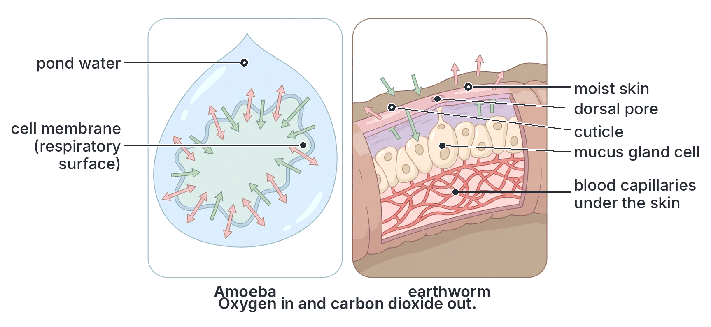

### Gills

**Gills** are the respiratory organs of most aquatic animals: **fish**, **tadpoles** (larvae of frogs and toads), crabs, prawns and many molluscs. They take in **oxygen dissolved in water**. Water holds far less oxygen than air (about 1/30 as much, or less in warm water), so gills must be very efficient.

#### Gills of a bony fish (e.g. *Tilapia*)

*Tilapia* is a bony fish common in Nigerian rivers, lakes, dams and fish ponds.

**Position:** on each side of the head, behind the mouth, there are **four gills**, in a **gill chamber** (branchial chamber). They are covered and protected by a hard, movable bony flap, the **operculum** (gill cover). Between the gills are **gill slits** (gill clefts) leading from the pharynx to the gill chamber.

**Structure of one gill:**

| Part | Structure | Function |
| --- | --- | --- |
| **Gill arch** (gill bar) | A curved bar of bone (or cartilage) | Supports the gill; carries the main blood vessels (afferent vessel bringing deoxygenated blood, efferent vessel taking away oxygenated blood) |
| **Gill rakers** | Short, stiff, finger-like projections on the **inner** (front) side of the gill arch, facing the pharynx | Act as a **sieve**: stop food particles and grit from passing out over the gill filaments and damaging them; in filter-feeding fish, trap food |
| **Gill filaments** | Two rows of soft, thin, **bright red**, feather-like filaments on the **outer** side of each gill arch | Provide a **huge surface area** for gaseous exchange |
| **Gill lamellae** (secondary lamellae, gill plates) | Many tiny, very thin plates on each filament, each with a dense network of **blood capillaries** just under a very thin surface | The actual **site of gaseous exchange** |

**Features that make the gill an efficient respiratory surface:**

1. **Very large surface area:** many filaments, each with many lamellae.
2. **Very thin** walls of the lamellae: oxygen has a short distance to diffuse.
3. **Rich blood supply**: a dense capillary network gives the gills their bright red colour.
4. **Moist**: always in water.
5. **Countercurrent flow**: blood in the lamellae flows in the **opposite direction** to the water flowing over them. So all along the lamella, the water always has a little more oxygen than the blood it meets, and oxygen keeps diffusing into the blood. A fish can take up a large proportion of the oxygen from the water this way (much more than if water and blood flowed in the same direction).
6. **Ventilation**: a one-way current of water is kept flowing over the gills (see "Breathing in fish" below).
7. **Protection** by the operculum.

**Why fish die out of water:** in air, the soft gill filaments **collapse and stick together**, so the surface area becomes very small; they also **dry out**. The fish suffocates even though air contains more oxygen than water.

**Note:** cartilaginous fish such as sharks and rays have no operculum; their gill slits (usually five pairs) open directly to the outside.

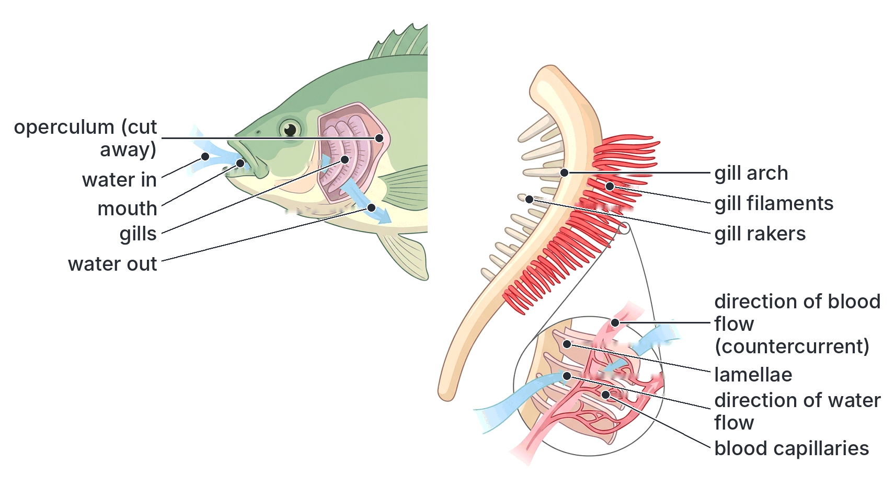

#### Gills of a tadpole

The **tadpole** (the larva of a frog or toad) lives in water and breathes with gills.

1. **External gills:** a very young tadpole, soon after hatching, has **external gills**: feathery, branched outgrowths (usually three pairs) on each side of the head, outside the body. They are thin, have a large surface area and are richly supplied with blood. Oxygen diffuses into them directly from the water as the tadpole wriggles.
2. **Internal gills:** after a few days, a fold of skin (the **operculum**) grows back over the gills, and the external gills are replaced by **internal gills** inside a gill chamber, a little like a fish's. Water enters through the mouth, passes over the internal gills and leaves through a single opening called the **spiracle** (usually on the left side of the body in frog tadpoles).
3. **Skin:** the tadpole also exchanges some gases through its thin skin.
4. **Lungs at metamorphosis:** as the tadpole changes into a young frog or toad (**metamorphosis**), it develops **lungs**, the gills disappear, and it comes up to the surface to gulp air. This shows the transition from water to land (see Topic A2c).

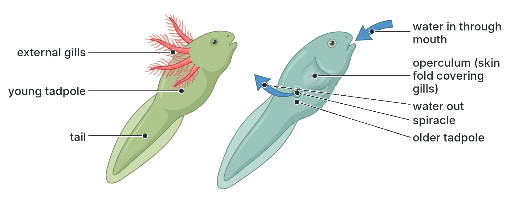

### Trachea (the tracheal system of insects)

Insects (e.g. the **cockroach**, grasshopper, housefly, bee) breathe by a system of **air tubes** called **tracheae** (singular: trachea). (Do not confuse these with the mammalian trachea, the windpipe.) The tracheal system carries **air directly to the tissues**, so the insect's blood is not needed to carry oxygen.

#### The tracheal system of the cockroach

**Structure:**

1. **Spiracles:** small, paired openings along the sides of the thorax and abdomen. The cockroach has **10 pairs** of spiracles: **2 pairs on the thorax** and **8 pairs on the abdomen**.
   - Each spiracle is guarded by **valves** (operated by muscles) that can **open and close**, controlling air flow and reducing water loss.
   - Many spiracles have **hairs** that filter out dust and keep out parasites.
2. **Tracheae:** each spiracle leads into a **trachea**, a tube that runs inwards. The tracheae join into **main longitudinal tracheal trunks** running along each side of the body, and branch again and again into smaller tubes reaching every organ.
   - The tracheae are lined with **chitin**, thickened in a **spiral** (or ring-like) pattern (the thickenings are called taenidia). This keeps the tubes **open**, like the coiled wire in a flexible pipe, even when the body moves or the air pressure falls.
3. **Tracheoles:** the smallest tracheae branch into very fine tubes, the **tracheoles**, less than one micrometre wide, which have no chitin lining. They end **inside or right next to the cells** of the tissues (especially the flight and leg muscles).
   - The ends of the tracheoles contain a little **fluid**. Oxygen dissolves in this fluid and diffuses into the cells; CO₂ diffuses out the other way. During hard muscle activity, some of the fluid is drawn out of the tracheole ends, so air comes closer to the cells and oxygen reaches them faster.
4. **Air sacs:** some insects (e.g. grasshoppers, bees and flies) also have thin-walled, balloon-like **air sacs** connected to the tracheae, which store air and help ventilation. Cockroaches have few or none.

**Features that make the tracheal system efficient:**

1. Tracheoles reach **every cell**, giving a huge total surface area.
2. Oxygen goes **directly to the cells** as a gas, which diffuses about 10,000 times faster in air than in water. No blood pigment is needed.
3. The tracheole ends are **moist** and very thin.
4. Spiracles can **close**, reducing water loss, which is important for small land animals with a large surface area.
5. Larger, active insects **ventilate** the system by pumping movements of the abdomen.

**Limitation:** diffusion along tracheae works well only over short distances. This is one reason why insects are small.

[IMAGE: Top view (dorsal view) of a cockroach outline showing the tracheal system in silver-white: ten pairs of spiracles along the sides (two on the thorax, eight on the abdomen), each leading to short tracheae that join two main longitudinal tracheal trunks along each side, with branches to the legs, head and organs. An inset shows an enlarged trachea with spiral chitin thickening branching into very fine tracheoles ending among muscle cells, with a little fluid at the tracheole ends. Another inset shows a spiracle with hairs and a valve. Labels to add: "spiracle", "thoracic spiracles (2 pairs)", "abdominal spiracles (8 pairs)", "trachea", "longitudinal tracheal trunk", "spiral chitin thickening", "tracheoles", "fluid at tracheole end", "muscle cell", "valve", "hairs (filter dust)". Clean flat textbook style, white background.]

### Lungs

**Lungs** are internal, air-filled respiratory organs found in land vertebrates: **mammals**, **birds**, **reptiles** and **adult amphibians (toads and frogs)**, as well as lungfish. They are inside the body, which protects them and stops them drying out.

#### Lungs of mammals (e.g. humans)

**The respiratory system of a mammal:**

| Part | Structure | Function |
| --- | --- | --- |
| **Nostrils and nasal cavity** | Openings leading to a cavity lined with hairs and a moist, **ciliated** membrane that produces **mucus**, with many blood vessels | Air is **filtered** (hairs and mucus trap dust and germs), **warmed** (by blood vessels) and **moistened** before it reaches the lungs. Smell receptors are here |
| **Pharynx** (throat) | Shared passage for air and food | Carries air from the nose to the larynx |
| **Epiglottis** | A flap of cartilage at the top of the larynx | **Closes** over the opening of the larynx (the **glottis**) during swallowing, so food goes into the oesophagus and not into the windpipe |
| **Larynx** (voice box) | A box of cartilage (the "Adam's apple") containing the **vocal cords** | Produces sound (voice) when air is forced over the vocal cords |
| **Trachea** (windpipe) | A tube in the neck, held open by **C-shaped rings of cartilage** (incomplete at the back, next to the oesophagus). Lined with **ciliated epithelium** and **goblet cells** that make **mucus** | The cartilage rings keep the trachea **open** at all times, so air can flow freely. Mucus traps dust and germs, and the beating **cilia** sweep the mucus up to the throat, where it is swallowed or coughed out. The gap in the rings allows the oesophagus to bulge as food passes |
| **Bronchi** (singular: bronchus) | Two branches of the trachea, one to each lung, also supported by cartilage | Carry air into each lung |
| **Bronchioles** | Many fine branches of the bronchi; the smallest have no cartilage, but have smooth muscle in their walls | Carry air to the alveoli. Their muscle can narrow them (as happens in an **asthma** attack) |
| **Alveoli** (air sacs; singular: alveolus) | Tiny, thin-walled, balloon-like sacs in clusters at the ends of the bronchioles, each surrounded by a network of **capillaries** | The **site of gaseous exchange** |
| **Pleural membranes** (pleura) | Two thin, moist membranes: one covering each lung, the other lining the inside of the chest wall, with a thin layer of **pleural fluid** between them | The fluid **reduces friction** as the lungs move during breathing; the membranes help the lungs follow the movements of the chest wall |
| **Ribs and intercostal muscles** | Twelve pairs of ribs (in humans) with **external** and **internal intercostal muscles** between them | Protect the lungs and heart; move the ribs during breathing |
| **Diaphragm** | A dome-shaped sheet of muscle and tendon separating the chest (thorax) from the abdomen | The main muscle of breathing |

**Features of the alveoli that make them efficient for gaseous exchange:**

1. **Huge surface area:** the two human lungs contain hundreds of millions of alveoli, with a total surface area of roughly 70 m² (often compared to the size of a tennis court).
2. **Very thin walls:** the wall of the alveolus and the wall of the capillary are each **one cell thick**, so oxygen and CO₂ diffuse a very short distance (less than one thousandth of a millimetre).
3. **Moist lining:** a thin film of moisture lines each alveolus, so oxygen can dissolve. (The lining also contains a **surfactant** that stops the alveoli from collapsing and sticking together.)
4. **Rich blood supply:** each alveolus is wrapped in a dense network of **capillaries**, which constantly carry oxygenated blood away and bring deoxygenated blood, keeping the concentration gradients steep.
5. **Ventilation:** breathing constantly replaces the air in the lungs, keeping the oxygen concentration in the alveoli high and the CO₂ concentration low.

**Textbook variation:** the number of alveoli in human lungs is given as about **300 million**, **300–500 million** or **about 700 million**, and their total area as about **50–100 m²** (often "about 70 m²"). All books agree that the area is enormous, many times the area of the skin.

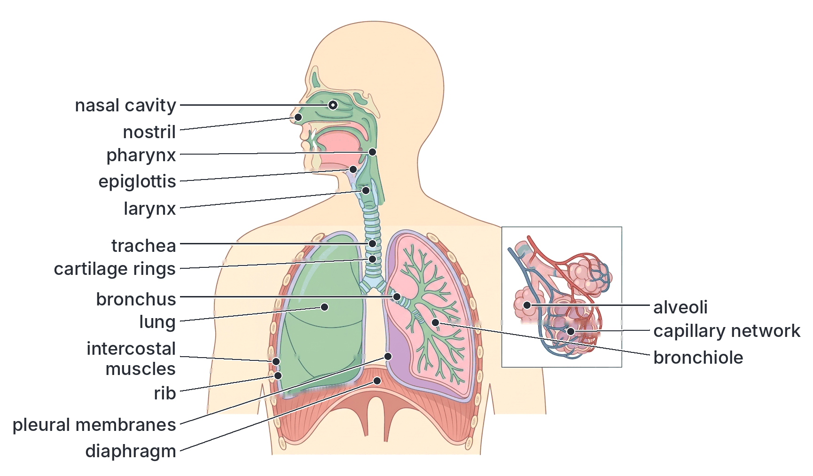

#### Lungs of toads (and frogs)

Adult toads and frogs are **amphibians**. They use **three** respiratory surfaces:

1. **Lungs:** a pair of **simple, thin-walled, sac-like** (balloon-like) lungs. Their inner walls are folded into small pockets, but they have a **much smaller surface area** than mammalian lungs (no bronchioles or alveoli as in mammals). They are used mainly when the animal is active.
2. **Skin (cutaneous respiration):** the toad's skin is **thin**, kept **moist** by mucus glands, and has a **rich supply of blood capillaries**. A large part of its gaseous exchange, especially the loss of CO₂, happens through the skin. When it is buried in mud during the dry season or resting in water, the skin is its main respiratory surface.
3. **Lining of the mouth (buccal cavity) and pharynx (buccopharyngeal respiration):** the moist, well-vascularised lining of the mouth also absorbs oxygen. You can see a resting toad's throat moving up and down rapidly, which ventilates the mouth cavity.

Toads have **no ribs** (or only very short ones) and **no diaphragm**, so they cannot breathe like mammals. Instead they **push** air into their lungs by a pumping action of the floor of the mouth (see "Breathing in toads" below).

**Note:** toads have drier, wartier skin than frogs and rely somewhat more on their lungs, but both use all three surfaces.

#### Lungs of birds

Birds are very active, warm-blooded animals that fly, which needs a great deal of energy, so they have the most efficient lungs of all vertebrates.

1. The **lungs** are **small, compact and spongy**, fixed against the ribs; they hardly change in volume during breathing.
2. Instead of blind-ended alveoli, the lungs contain many tiny, open-ended tubes called **parabronchi**, surrounded by very fine **air capillaries** where gaseous exchange takes place.
3. The lungs are connected to a system of thin-walled **air sacs** (most birds have nine) that extend into the body cavity and even into some of the **hollow (pneumatic) bones**. The air sacs act like **bellows**: they store air and pump it through the lungs, but they are **not** themselves respiratory surfaces.
4. Air flows **in one direction only** through the lungs (from the posterior air sacs through the parabronchi to the anterior air sacs), rather than in and out. A breath of air needs **two cycles** of breathing in and out to pass right through the system.
5. Because of this one-way flow, the lungs receive fresh air **both when the bird breathes in and when it breathes out**, and there is little stale air left in the lungs. Blood and air flow across each other (a **crosscurrent** arrangement), which also improves oxygen uptake.
6. Birds have **no diaphragm**. Breathing is done by **muscles moving the sternum (breastbone) and ribs**, which change the volume of the air sacs.

**Other advantages of the air sacs:** they make the bird **lighter** for flight and help it **lose heat** during strenuous flying.

**Textbook variation:** the number of air sacs differs between bird species (commonly nine, but from about seven to twelve). Some school textbooks simply say birds have "lungs with air sacs" without describing the one-way flow.

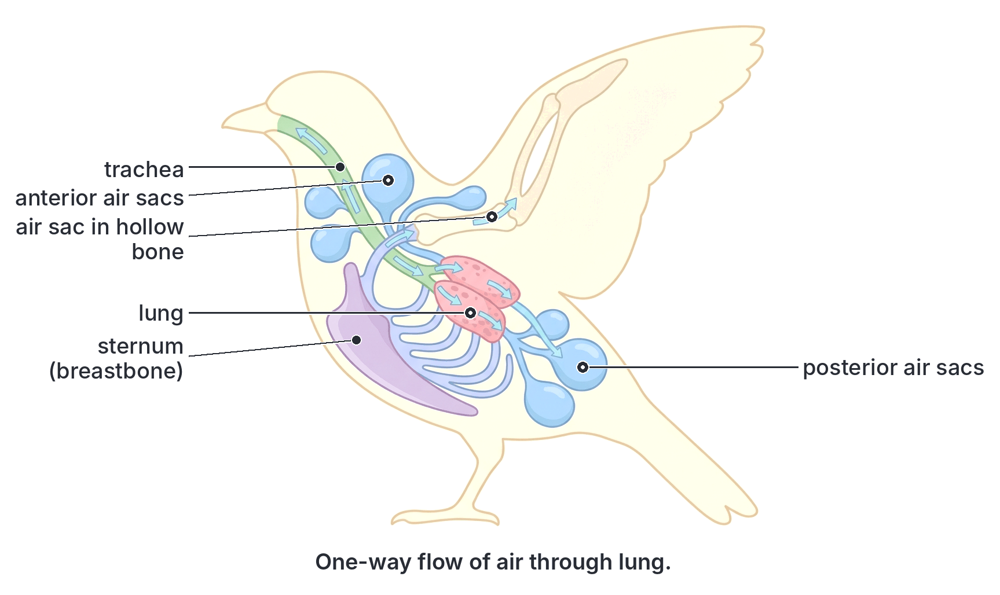

### Stomata

**Stomata** (singular: **stoma**) are tiny **pores** in the **epidermis** of leaves and young green stems. They are the main surfaces for **gaseous exchange** in plants (and also for transpiration; see B3b).

**Where found:** in most dicot leaves (e.g. hibiscus, mango, cocoa, beans), stomata are much more numerous on the **lower surface**. In upright monocot leaves such as maize and grasses, they are found on **both** surfaces. In floating leaves such as the water lily, they are only on the **upper** surface. Submerged water plants have few or none.

**Structure:**

1. Each stoma is bordered by **two guard cells**.
2. In most plants (e.g. dicots), the guard cells are **bean-shaped** or **kidney-shaped**. In grasses and maize, they are **dumbbell-shaped**, with special neighbouring cells (subsidiary cells).
3. Unlike the other cells of the epidermis, guard cells **contain chloroplasts**.
4. The wall of each guard cell next to the pore (the **inner wall**) is **thicker and less elastic** than the outer wall (the wall away from the pore). Bands of cellulose microfibrils run around the guard cells, which stops them getting fatter but lets them get longer and curve.
5. Under each stoma is a large air space (the **substomatal air space** or substomatal chamber), connected to the air spaces among the spongy mesophyll cells.

**How gases are exchanged through stomata:** when the stomata are open, gases **diffuse** between the outside air and the air spaces inside the leaf, from where they diffuse into and out of the moist surfaces of the mesophyll cells. The direction depends on the time of day (see "Gaseous exchange in plants" below).

**Why stomata are good structures for gaseous exchange:**

- There are very many of them (often hundreds per square millimetre on the lower surface).
- They lead to an extensive system of **air spaces**, giving the mesophyll cells a huge, **moist** surface.
- They can **open and close** to balance the need for CO₂ (photosynthesis) against the danger of losing too much water.

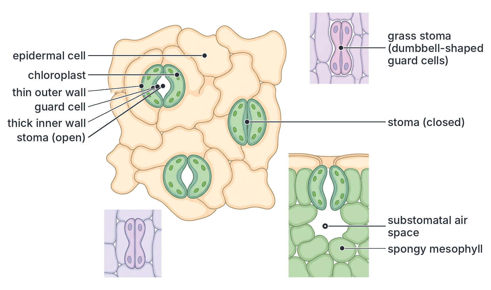

### Lenticels

**Lenticels** are small, raised, **pores** or spots in the **bark** of woody stems and roots, and on some fruits and tubers. They allow **gaseous exchange** between the outside air and the living cells inside woody parts of the plant.

**Why they are needed:** as a stem grows thicker, its epidermis is replaced by **cork** (bark), whose cells are dead and coated with a waterproof, gas-tight substance (**suberin**). The living cells inside the stem (the cambium, phloem and living cells of the wood) still need oxygen for respiration and must lose CO₂. Lenticels provide openings through the cork.

**Structure:**

1. A lenticel is a small area where the cork cambium produces **loosely packed, rounded cells** (filling or complementary cells) with many **air spaces** between them, instead of tightly packed cork cells.
2. The loose cells push up through the bark, forming a raised, lens-shaped bump or line (the word "lenticel" means "little lens"), often seen as pale spots or horizontal lines on the bark.
3. Lenticels often form just beneath where stomata were in the young stem.
4. Unlike stomata, lenticels **cannot open or close**; they are always open.

**How gases are exchanged:** oxygen diffuses from the air through the air spaces of the lenticel into the living tissues; CO₂ (and some water vapour) diffuses out.

**Where to see lenticels:**

- On the bark of **young woody twigs** of many trees and shrubs, e.g. mango, hibiscus and cassava stems, where they appear as small raised dots or short lines.
- On the skin of **Irish potato tubers** (small pale dots) and some fruits such as apples and pears.
- On the **pneumatophores** (breathing roots) and stilt roots of **mangrove** trees in the **Niger Delta** and coastal lagoons of Nigeria. Mangrove roots grow in waterlogged mud, which has almost no oxygen. The black mangrove (*Avicennia*) sends up vertical pneumatophores that stick out of the mud, and the red mangrove (*Rhizophora*) has arching stilt roots; both are covered with lenticels through which air enters, and the air then diffuses down through air spaces to the buried roots.

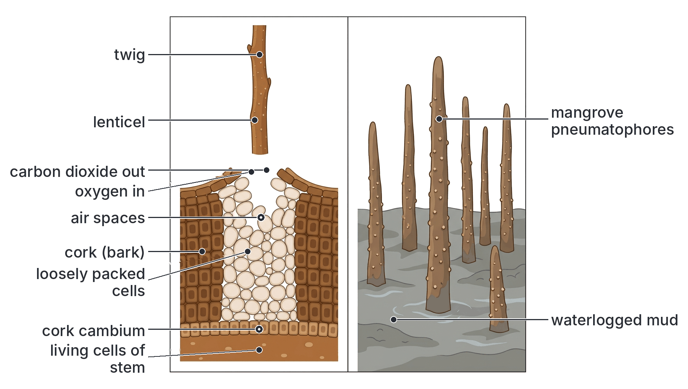

### Stomata and lenticels compared

| Feature | Stomata | Lenticels |
| --- | --- | --- |
| Where found | Epidermis of leaves and young green stems | Bark of woody stems and roots; some fruits and tubers |
| Structure | A pore between two guard cells | A patch of loosely packed cells with air spaces |
| Can they open and close? | **Yes** (guard cells change shape) | **No** (always open) |
| Contain chloroplasts? | Guard cells do | No |
| Number | Very many | Relatively few |
| Main functions | Gaseous exchange for photosynthesis and respiration; transpiration | Gaseous exchange for respiration of inner stem tissues; small amount of transpiration |

### Summary: respiratory organs and surfaces

| Respiratory organ or surface | Examples of organisms | Key features | Medium |
| --- | --- | --- | --- |
| **Body surface (cell membrane)** | *Amoeba*, *Paramecium*, *Chlamydomonas* | Small size, large SA:V ratio, thin moist membrane | Water |
| **Body surface (skin)** | Earthworm (also toads, frogs) | Moist (mucus, coelomic fluid), thin, dense capillaries, haemoglobin in plasma | Air in soil |
| **Gills** | *Tilapia* and other fish; tadpoles; crabs, prawns | Gill filaments and lamellae with large area and rich blood supply, countercurrent flow, operculum | Water |
| **Tracheae** | Insects, e.g. cockroach, grasshopper | Spiracles with valves, chitin-ringed tracheae, tracheoles reaching every cell; no blood transport of oxygen | Air |
| **Lungs** | Mammals, birds, reptiles, adult toads and frogs | Internal; alveoli (mammals), simple sacs (toads), parabronchi with air sacs (birds) | Air |
| **Stomata** | Leaves of flowering plants (e.g. hibiscus, maize) | Pores between guard cells that open and close; lead to air spaces | Air |
| **Lenticels** | Woody stems (e.g. mango); potato tubers; mangrove roots | Loosely packed cells with air spaces in bark; always open | Air |

## The opening and closing of stomata

**Objective v: describe the mechanism for the opening and closing of the stomata.**

### The basic principle: turgor changes in the guard cells

All the explanations agree on the basic mechanism:

1. When the **guard cells take in water** by osmosis and become **turgid**, they swell. Because the **inner wall** (next to the pore) is **thicker and less elastic** than the outer wall, the outer walls stretch more. The guard cells **bend (curve) outwards**, away from each other, and the **pore opens**.
2. When the **guard cells lose water** and become **flaccid**, they straighten and come together, and the **pore closes**.

So the key question is: **what makes water enter or leave the guard cells?** Water enters when the guard cell sap becomes **more concentrated** than that of the surrounding epidermal cells, and leaves when it becomes **less concentrated**. Two main theories explain how the concentration changes.

**General pattern:** in most plants, stomata **open in the light** (in the daytime) and **close in the dark** (at night). They also **close when the plant is short of water**, even in light, for example at midday on a very hot day in the dry season.

### The potassium ion (K⁺) theory (modern theory)

This is the explanation accepted by most scientists today.

**Opening (in light), step by step:**

1. In the light, the guard cells (which have chloroplasts) make **ATP**, by photosynthesis and respiration. Light (especially blue light) is detected by the guard cells.
2. The ATP powers **pumps** in the guard cell membrane that pump **hydrogen ions (H⁺) out** of the guard cells.
3. This makes the inside of the guard cells more negative, so **potassium ions (K⁺)** flow **into** the guard cells from the neighbouring epidermal cells (through special channels). Chloride ions (Cl⁻) also enter, and the guard cells make **malate** (an organic acid ion) from their stored starch, to balance the positive charge of the K⁺.
4. The build-up of potassium (and chloride and malate) ions makes the guard cell sap **more concentrated** (lowers its water potential).
5. Water enters the guard cells from the neighbouring cells by **osmosis**.
6. The guard cells become **turgid**, curve outwards and the **stoma opens**.

**Closing (in darkness or when water is short), step by step:**

1. In the dark, the pumps stop. When the plant is short of water, the roots and leaves make the hormone **abscisic acid (ABA)**, which acts on the guard cells.
2. **Potassium ions (and chloride ions) leave** the guard cells.
3. The guard cell sap becomes **less concentrated**.
4. Water leaves the guard cells by **osmosis**.
5. The guard cells become **flaccid**, straighten and the **stoma closes**.

**Evidence for the K⁺ theory:** measurements show that the potassium content of guard cells rises greatly when stomata open and falls when they close; stomata will not open without potassium; the changes in sugar content are far too small to cause the observed changes in turgor.

### The starch–sugar theory (older theory)

This older theory was first proposed in the early twentieth century (by J. D. Sayre in 1923, and later modified by others).

**Opening (in light), step by step:**

1. In the light, the chloroplasts of the guard cells **photosynthesise**, using up the **CO₂** in the guard cells.
2. Because CO₂ forms a weak acid (carbonic acid) in water, removing it makes the guard cell sap **less acidic** (the **pH rises**, towards alkaline).
3. At this higher pH, the enzyme (starch phosphorylase) in the guard cells converts **insoluble starch into soluble sugar** (glucose phosphate, then glucose).
4. The sugar makes the guard cell sap **more concentrated**.
5. Water enters the guard cells from the neighbouring epidermal cells by **osmosis**.
6. The guard cells become **turgid** and the **stoma opens**.

(Some textbooks give a simpler version: in the light, the guard cells' chloroplasts make **sugar by photosynthesis**, which raises the concentration of their sap, so water enters and the stoma opens.)

**Closing (in darkness), step by step:**

1. In the dark, there is no photosynthesis, but the guard cells continue to **respire**, so **CO₂ builds up**.
2. The guard cell sap becomes **more acidic** (pH falls).
3. At this lower pH, the enzyme converts **sugar back into insoluble starch**.
4. The guard cell sap becomes **less concentrated**.
5. Water leaves the guard cells by osmosis; they become **flaccid** and the **stoma closes**.

**Weaknesses of the starch–sugar theory:**

- The conversion of starch to sugar is **too slow** to explain how quickly stomata open (often within minutes).
- The guard cells of some plants, such as **onion**, contain **no starch**, but their stomata still open and close.
- Measurements show that the amount of sugar produced is too small to cause the change in turgor.
- In the K⁺ theory, starch actually **decreases** as stomata open because it is used to make malate, not just sugar.

**Textbook variation:** many West African school textbooks (and older past questions) still describe the **starch–sugar theory**, sometimes as the only explanation, while newer books give the **potassium ion theory** as the accepted one and treat starch–sugar as historical. Both may appear in JAMB. If a question mentions **potassium ions**, use the K⁺ theory; if it mentions **starch, sugar and pH**, use the starch–sugar theory. In both, the **final step is the same**: guard cell sap becomes more concentrated, water enters by osmosis, the guard cells become turgid and the stoma opens.

### The two theories compared

| Feature | Potassium ion (K⁺) theory | Starch–sugar theory |
| --- | --- | --- |
| Status | Modern, widely accepted | Older; still found in many school books |
| What raises the concentration of guard cell sap in light | Active uptake of **K⁺ ions** (with Cl⁻ and malate) | Conversion of **starch to sugar** (or sugar made by photosynthesis) |
| Role of light | Provides ATP (and a blue-light signal) to drive ion pumps | Allows photosynthesis, which uses up CO₂ and raises the pH |
| Role of pH | Not central (H⁺ is pumped out of the cell) | **Central**: high pH favours starch → sugar; low pH favours sugar → starch |
| Energy (ATP) needed | **Yes**, for active transport | Not stated |
| What happens to starch when stomata open | Decreases (used to make malate) | Decreases (converted to sugar) |
| Speed explained | Fast opening (minutes) | Too slow to explain fast opening |
| Common ground | Guard cell sap becomes more concentrated → water enters by osmosis → guard cells become turgid → stoma opens; the reverse closes it | Same |

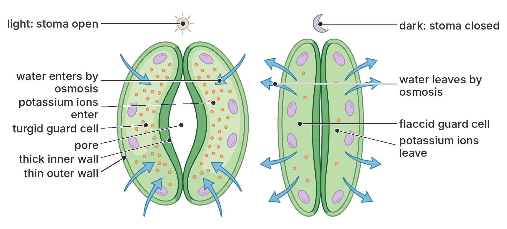

### Factors that affect the opening of stomata

| Factor | Effect |
| --- | --- |
| **Light** | Stomata **open in light** and **close in darkness** (in most plants) |
| **Water supply** | When the plant is **short of water**, the guard cells lose turgor and abscisic acid is released, so stomata **close**, even in light. This reduces water loss, but also stops CO₂ getting in |
| **CO₂ concentration inside the leaf** | **Low** CO₂ (when photosynthesis is using it up) makes stomata **open**; **high** CO₂ makes them **close** |
| **Temperature** | Very high temperatures often cause stomata to close (partly because of water loss and higher CO₂ from faster respiration) |
| **Internal rhythm** | Many plants open and close their stomata in a daily rhythm even when kept in constant conditions for a short time |

**Exception:** many desert plants such as cacti and pineapples (called **CAM plants**) **open their stomata at night**, when it is cool and humid, and **close them by day**, to save water. They take in CO₂ at night and store it as an acid, which they use for photosynthesis the next day.

## Respiratory mechanisms in plants and animals

**Objective vi: determine respiratory mechanisms in plants and animals.**

A **respiratory mechanism** is the way an organism brings oxygen to its respiratory surface and removes CO₂: by simple diffusion, or by **ventilation** (breathing movements) that pump air or water over the surface.

### Gaseous exchange in plants

Plants have **no breathing movements** and **no special respiratory organs**. Every living cell of a plant respires, and gases move by **diffusion** through:

- **stomata** (leaves and young stems),
- **lenticels** (woody stems, roots and some fruits),
- the **air spaces** between cells, which form a continuous system through the plant,
- the surfaces of **root hairs** and young root cells (oxygen from the air in the soil spaces).

Once inside, oxygen dissolves in the film of water on the cell walls and diffuses into the cells; CO₂ diffuses out the same way.

#### Gaseous exchange in leaves: day and night

Green leaves carry out **two processes** that exchange gases in opposite directions:

- **Respiration** (all the time, day and night): uses **oxygen**, gives out **CO₂**.
- **Photosynthesis** (only in light): uses **CO₂**, gives out **oxygen**.

| Time | Processes going on | Net (overall) gaseous exchange through the stomata |
| --- | --- | --- |
| **Bright daylight** | Photosynthesis **faster** than respiration | **CO₂ taken in, oxygen given out.** The CO₂ produced by respiration is used in photosynthesis, together with extra CO₂ from the air; the oxygen from photosynthesis supplies respiration, and the rest is given out |
| **Dawn and dusk (dim light)** | Photosynthesis **equal** to respiration (the **compensation point**) | **No net exchange** of oxygen and CO₂: the oxygen produced by photosynthesis is exactly used up by respiration, and the CO₂ produced by respiration is exactly used up by photosynthesis |
| **Night (darkness)** | **Only respiration** | **Oxygen taken in, CO₂ given out** (the stomata are mostly closed, so exchange is slow; some gas passes through the cuticle and partly open stomata) |

**Note:** the old belief that it is dangerous to sleep in a room with potted plants because they "use up the oxygen at night" is greatly exaggerated: the amount of oxygen a few plants use is tiny compared with what one person uses.

**How to show that plants respire (give out CO₂):** keep a potted plant in the **dark** (so it cannot photosynthesise) under a bell jar, and pass air through lime water. The lime water turns milky. (Full details of this experiment are in B4b.)

#### Gaseous exchange in stems and roots

- **Young green stems** exchange gases through **stomata**.
- **Woody stems and roots** exchange gases through **lenticels**.
- **Roots** take in oxygen from the **air spaces in the soil** by diffusion through the root hairs and epidermis. This is why **waterlogged soil** harms most crops: water fills the soil air spaces, the roots run short of oxygen, cannot respire aerobically, and absorb fewer minerals (see B3b). Farmers drain and loosen (till) the soil to keep it aerated. Earthworms help by making burrows.
- **Plants of waterlogged places** have special adaptations: mangroves have **pneumatophores** with lenticels; water plants such as the water lily and water lettuce (*Pistia*), and rice, have a tissue with **large air spaces (aerenchyma)** that carries air down from the leaves to the submerged parts.

#### Why plants manage without breathing movements

1. Plants have a **low rate of respiration** compared with active animals, so their oxygen needs are small.
2. Their **branched shape** with thin, flat leaves gives a large surface area.
3. The system of **air spaces** brings air close to every cell, so diffusion distances are short.
4. In light, the **oxygen produced by photosynthesis** is available for respiration on the spot.

### Gaseous exchange in *Amoeba* and other small organisms

- In *Amoeba*, *Paramecium* and other unicellular organisms, and in small animals such as *Hydra*, gases are exchanged by **simple diffusion** across the whole body surface.
- **No breathing movements** are needed. The organism's own movement and water currents help bring fresh water to its surface.
- The **concentration gradient** is kept up because the cell continuously uses oxygen and produces CO₂ in respiration.

### Gaseous exchange in the earthworm

1. Oxygen from the soil air **dissolves** in the moist mucus on the skin.
2. It **diffuses** through the thin skin into the capillaries just below.
3. It combines with **haemoglobin** in the blood plasma and is carried round the body by the blood, pumped by the dorsal vessel and the "hearts".
4. In the tissues, oxygen is released and diffuses into the cells.
5. CO₂ travels the opposite way and diffuses out through the skin.
6. There are **no breathing movements**; the earthworm's movement through the soil brings it into contact with fresh air.

### Breathing in insects (e.g. the cockroach)

1. **Diffusion alone** is enough in small or resting insects: oxygen diffuses from the air, in through the open spiracles, along the tracheae and tracheoles to the cells; CO₂ diffuses out the opposite way.
2. **Ventilation in active insects:** larger and active insects (e.g. a running cockroach, a flying grasshopper or bee) pump air in and out:
   - **Expiration:** muscles in the abdomen contract, flattening the abdomen (pulling the upper and lower plates together). This **squeezes the tracheae and air sacs**, forcing air **out**.
   - **Inspiration:** the muscles relax, and the elastic abdomen springs back to its original shape. The tracheae and air sacs expand, and air is drawn **in**.
   - In many insects, the spiracles open and close in a coordinated order, so that air enters through the **front** (thoracic) spiracles and leaves through the **back** (abdominal) spiracles. This creates a **one-way flow** through the main tracheal trunks.
   - You can see these pumping movements of the abdomen in a grasshopper or cockroach at rest after running.
3. **Water conservation:** the spiracles stay **closed** as much as possible, opening only when the insect needs oxygen, to reduce water loss by evaporation.

### Breathing in fish (e.g. *Tilapia*)

Fish keep a **continuous, one-way current** of water flowing over their gills: in through the **mouth**, out under the **operculum**. This is done by changing the volume of the mouth (**buccal**) cavity and the gill (**opercular**) cavities.

**Inspiration (water drawn in), step by step:**

1. The **mouth opens**.
2. The **floor of the buccal cavity (mouth) is lowered**.
3. This **increases the volume** of the buccal cavity, so the **pressure falls** below that of the water outside.
4. **Water flows in** through the mouth.
5. At the same time, the **operculum is pressed shut** against the body (by the outside water pressure and by muscles), so water cannot enter from behind. The opercular cavities also expand, drawing water from the mouth across the gills.

**Expiration (water forced out), step by step:**

1. The **mouth closes** (and in many fish, flaps of skin called oral valves inside the mouth stop water flowing back out).
2. The **floor of the buccal cavity is raised**.
3. This **decreases the volume** and **increases the pressure** in the buccal cavity.
4. **Water is forced** from the mouth through the **gill slits**, over the **gill filaments**, where gaseous exchange takes place.
5. The pressure of the water **pushes the operculum open**, and the water flows **out** behind it.

**Gaseous exchange at the gills:** as the water passes over the lamellae, **dissolved oxygen** diffuses from the water into the blood in the capillaries, and **CO₂** diffuses from the blood into the water. Because of the **countercurrent** arrangement, oxygen keeps diffusing in along the whole length of each lamella.

**Note:** some fast-swimming fish (e.g. tuna and many sharks) also use **ram ventilation**: they swim with their mouths open, so water is forced over the gills by their forward movement.

**Effect of low oxygen in water:** fish in warm, polluted or overcrowded ponds may come to the surface and "gulp" at the air. This is common in Nigerian fish ponds on hot afternoons and is a sign that the water needs more oxygen (e.g. by changing the water or aerating it). The African lungfish (*Protopterus*) and the catfish *Clarias* (popular in Nigerian fish farming) have extra air-breathing organs and can survive in water with very little oxygen.

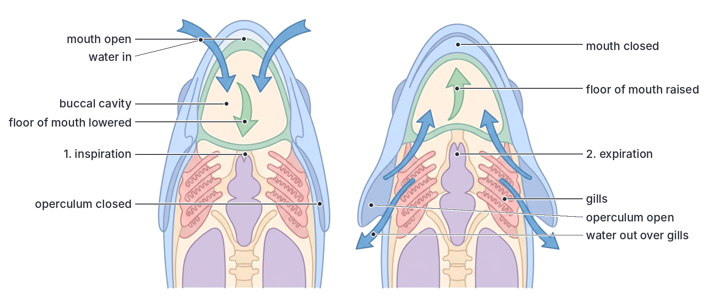

### Breathing in tadpoles

- **Young tadpoles** with external gills exchange gases directly with the water as they swim; the movement of the tadpole keeps fresh water flowing over the gills.
- **Older tadpoles** with internal gills pump water in through the mouth and out through the spiracle, by raising and lowering the floor of the mouth, in a similar way to fish.
- The skin also exchanges gases.

### Breathing in toads and frogs

Adult toads have no diaphragm and no proper ribs, so they cannot suck air into their lungs. They use **buccal pumping (positive pressure breathing)**: they **force** air into their lungs by pumping with the floor of the mouth, a bit like swallowing air.

**Buccal (mouth) breathing (between lung breaths):** with the mouth closed and the **nostrils open**, the toad rapidly raises and lowers the **floor of the mouth**. Air moves in and out of the mouth cavity through the nostrils, and gaseous exchange takes place across the moist lining of the mouth. This is the rapid throat movement you see in a resting toad.

**Filling the lungs, step by step:**

1. **Air into the mouth:** with the mouth closed and the nostrils **open**, the floor of the mouth is **lowered**. Air is drawn in through the nostrils into the buccal cavity.
2. **Old air out of the lungs:** the glottis (the opening to the lungs) opens. Air from the lungs, pushed out by the **elastic recoil** of the lungs and the contraction of the body wall muscles, passes into the mouth and is expelled through the nostrils. (Fresh and used air mix a little in the mouth.)
3. **Air forced into the lungs:** the **nostrils are closed** (by small valves), and the **floor of the mouth is raised**. This pushes the air through the open glottis **into the lungs**.
4. The glottis closes, keeping the air in the lungs while gaseous exchange takes place.

**Skin breathing:** oxygen dissolves in the mucus on the skin and diffuses into the capillaries; CO₂ diffuses out. This continues all the time, and is the main method when the animal is under water or buried in mud.

**Textbook variation:** the exact order of the steps (especially whether the lungs empty before or after the mouth fills) is described slightly differently in different textbooks. The key points are: **nostrils open + floor of mouth lowered = air in to the mouth; nostrils closed + floor of mouth raised = air pushed into the lungs.**

### Breathing in birds

1. **Inspiration:** muscles move the **sternum (breastbone) forwards and downwards** and the ribs outwards. The volume of the body cavity and the **air sacs increases**, and air is drawn in through the trachea. Fresh air goes mainly into the **posterior air sacs**, while air already in the lungs moves on into the **anterior air sacs**.
2. **Expiration:** the sternum moves **back up** and the body cavity becomes smaller, **squeezing the air sacs**. Air from the posterior air sacs is forced **through the lungs** (parabronchi), where gaseous exchange takes place, and air from the anterior air sacs is pushed out through the trachea.
3. So air flows in **one direction** through the lungs during both inspiration and expiration.

### Breathing in mammals (e.g. humans)

Breathing in mammals depends on changing the **volume** of the **thoracic (chest) cavity**, which changes the **pressure** inside the lungs. Air always moves from a region of **higher pressure** to a region of **lower pressure**.

The structures involved are:

- the **ribs** (joined to the backbone behind and, mostly, to the sternum in front);
- the **intercostal muscles** between the ribs: the **external intercostal muscles** (outer layer) and the **internal intercostal muscles** (inner layer);
- the **diaphragm**, a dome-shaped sheet of muscle and tendon below the lungs, curving upwards into the chest when relaxed;
- the **lungs**, which are elastic and airtight, and follow the movements of the chest wall because of the pleural membranes and fluid.

#### Inspiration (inhalation, breathing in), step by step

1. The **external intercostal muscles contract** (and the internal intercostal muscles relax).
2. This pulls the **ribs upwards and outwards**, and the **sternum** moves **up and forwards**.
3. At the same time, the **muscles of the diaphragm contract**, so the diaphragm **flattens** (moves **downwards**), pushing the abdominal organs down.
4. Both movements **increase the volume** of the thoracic cavity (from front to back, side to side, and top to bottom).
5. The lungs **expand** to fill the larger space, so the **pressure inside the lungs falls** below the atmospheric pressure outside.
6. **Air rushes in** through the nose, trachea, bronchi and bronchioles into the alveoli, until the pressure inside equals the pressure outside.

#### Expiration (exhalation, breathing out), step by step

1. The **external intercostal muscles relax**. (In forced breathing out, for example when coughing, blowing or during exercise, the **internal intercostal muscles contract**.)
2. The **ribs move downwards and inwards**, and the sternum moves down and back, under their own weight and the elastic recoil of the tissues.
3. The **muscles of the diaphragm relax**, and the diaphragm **returns to its dome shape** (moves **upwards**), pushed up by the abdominal organs. (In forced breathing out, the abdominal muscles contract to push it up further.)
4. Both movements **decrease the volume** of the thoracic cavity.
5. The **elastic lungs recoil** (shrink), so the **pressure inside the lungs rises** above atmospheric pressure.
6. **Air is forced out** of the lungs.

**Note:** quiet (resting) expiration is mainly **passive**: it happens when the muscles relax, and needs little energy. Forced expiration is **active**.

**Textbook variation:** some textbooks say that in **every** expiration the internal intercostal muscles contract and the external intercostals relax. More detailed books explain that in **quiet** breathing out, the internal intercostals play little part and expiration is mainly due to relaxation and elastic recoil; they contract mainly in **forced** expiration. For JAMB, remember: **external intercostals contract in inspiration; internal intercostals contract in (forced) expiration.**

#### Inspiration and expiration compared

| Feature | Inspiration (breathing in) | Expiration (breathing out) |
| --- | --- | --- |
| External intercostal muscles | **Contract** | **Relax** |
| Internal intercostal muscles | Relax | Contract (in forced expiration) |
| Ribs and sternum | Move **upwards and outwards** | Move **downwards and inwards** |
| Diaphragm muscles | **Contract** | **Relax** |
| Shape of diaphragm | **Flattens** (moves down) | Returns to **dome shape** (moves up) |
| Volume of thoracic cavity | **Increases** | **Decreases** |
| Pressure in lungs | **Falls** below atmospheric | **Rises** above atmospheric |
| Lungs | Expand (inflate) | Recoil (deflate) |
| Movement of air | **Into** the lungs | **Out** of the lungs |
| Energy | Active (muscle contraction) | Mainly passive at rest; active when forced |

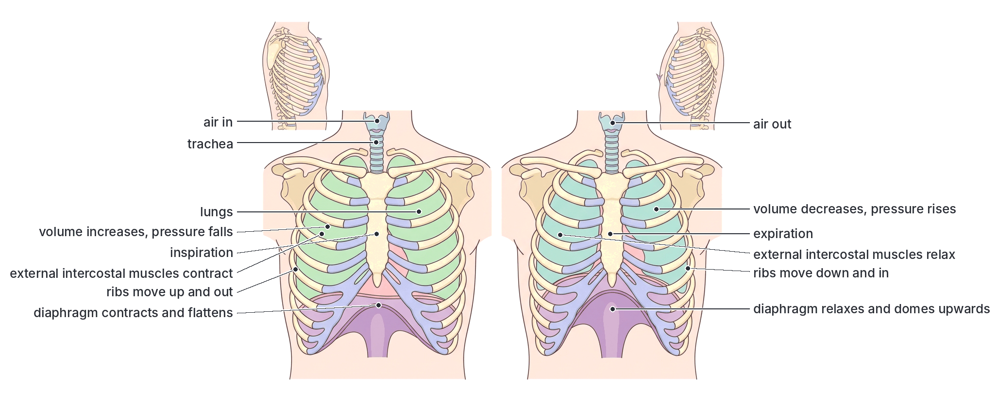

#### Experiment: the bell jar model of the lungs

**Aim:** to demonstrate how movements of the diaphragm cause air to enter and leave the lungs.

**Apparatus:** a **bell jar** (open at the bottom), a rubber stopper with a **Y-shaped glass tube** through it, two small **balloons** tied to the arms of the Y-tube inside the jar, and a **thin rubber sheet** tied over the open bottom of the jar, with a knob or string in the middle to pull it.

**What each part represents:**

| Part of the model | Part of the body it represents |
| --- | --- |
| Bell jar | Thoracic cavity (chest wall and ribs) |
| Rubber sheet | Diaphragm |
| Balloons | Lungs |
| Y-shaped tube | Trachea and bronchi |
| Space inside the jar around the balloons | Pleural cavity |

**Method and observations:**

1. **Pull the rubber sheet down:** the volume inside the jar increases and the pressure falls. Air rushes in through the Y-tube and the **balloons inflate**. This represents **inspiration** (the diaphragm contracting and flattening).
2. **Push the rubber sheet up** (or release it): the volume inside the jar decreases and the pressure rises. Air is forced out and the **balloons deflate**. This represents **expiration** (the diaphragm relaxing and doming upwards).

**Conclusion:** increasing the volume of the chest lowers the pressure, so air enters the lungs; decreasing the volume raises the pressure, so air leaves.

**Limitations of the model:**

1. The bell jar is **rigid**: it cannot show the movement of the **ribs and intercostal muscles**, which also change the chest volume.
2. The rubber sheet is pulled **down** into a flat or bulging shape, whereas the real diaphragm is **dome-shaped** when relaxed and flattens when it contracts.
3. The balloons do not fill the jar; in the body, the lungs fill the chest cavity and the pleural space is tiny and contains fluid.
4. The balloons are not made of many alveoli and do not exchange gases.

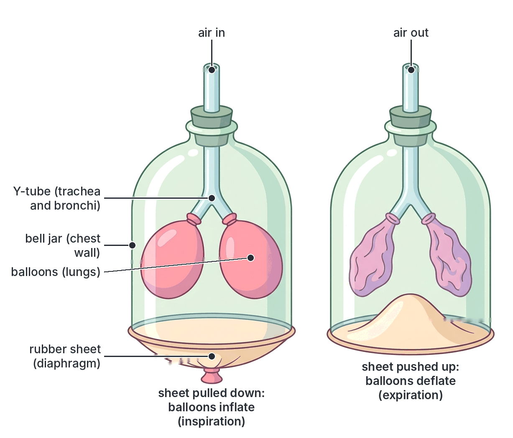

#### Gaseous exchange in the alveoli, step by step

1. Air breathed in reaches the **alveoli**. It has a **high concentration of oxygen** and a **low concentration of CO₂**.
2. Blood arriving in the capillaries round the alveoli (from the **pulmonary artery**) is **deoxygenated**: it has a **low oxygen** and a **high CO₂** concentration.
3. **Oxygen dissolves** in the moist lining of the alveolus and **diffuses** through the alveolar wall and the capillary wall into the **plasma**, and then into the **red blood cells**, where it combines with **haemoglobin** to form **oxyhaemoglobin**.
4. At the same time, **CO₂** (released from hydrogencarbonate ions in the plasma and from carbaminohaemoglobin) **diffuses** from the blood into the alveolus.
5. Water vapour also evaporates from the moist lining into the alveolar air.
6. The **oxygenated** blood is carried away by the **pulmonary vein** to the heart; the CO₂ and water vapour are breathed out.
7. Constant breathing and blood flow keep the **concentration gradients steep**, so diffusion continues.

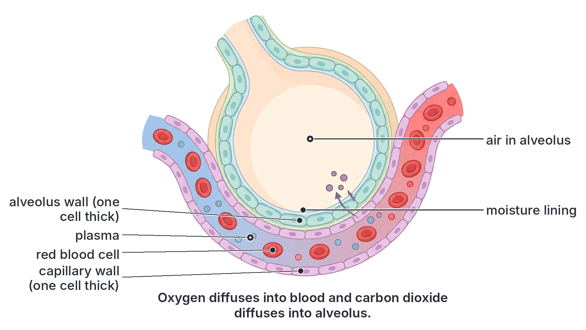

#### Composition of inhaled and exhaled air

| Component | Inhaled air (atmospheric air) | Exhaled air | Reason for the difference |
| --- | --- | --- | --- |
| **Oxygen** | About **21%** | About **16%** | Oxygen is absorbed into the blood in the alveoli and used in respiration |
| **Carbon (IV) oxide** | About **0.04%** | About **4%** (roughly 100 times more) | CO₂ produced by respiration in the cells diffuses from the blood into the alveoli |
| **Nitrogen** (with small amounts of argon and other inert gases) | About **78–79%** | About **79%** | Nitrogen is not used by the body; its percentage rises very slightly because the volume of the other gases changes |
| **Water vapour** | Variable (depends on the weather; low in the dry harmattan, high in the rainy season) | **Saturated** | Water evaporates from the moist lining of the alveoli and air passages |
| **Temperature** | Variable (the temperature of the surroundings) | About **body temperature** (around 37 °C, slightly lower at the mouth) | Air is warmed in the nasal passages and lungs |
| **Dust and germs** | Variable | Fewer | Trapped by hairs, mucus and cilia in the air passages |

**Textbook variation:** the CO₂ content of inhaled air is given as **0.03%** in older textbooks and **0.04%** in newer ones, because the CO₂ in the atmosphere has been rising (it is now a little over 0.04%). Exhaled air is given as about **4%** (sometimes 4.0–4.5%) CO₂ and about **16%** (sometimes 16–17%) oxygen. Some books combine nitrogen and the inert gases (about 79%), while others give nitrogen alone (about 78%) and list argon (about 0.9%) separately.

**Important:** exhaled air still contains about **16% oxygen**. This is why **mouth-to-mouth resuscitation** (rescue breathing) can keep an unconscious person alive.

**Simple test:** breathing out through a tube into **lime water** (calcium hydroxide solution) turns it **milky** quickly, while drawing ordinary air through lime water takes a very long time to turn it milky. This shows that exhaled air contains much more CO₂ than inhaled air. (The full experimental set-up is in B4b.) Breathing onto a cold mirror or glass shows the water vapour in exhaled air, which condenses; it turns blue cobalt(II) chloride paper pink.

#### Lung volumes

- **Tidal volume:** the volume of air breathed in or out in **one normal, quiet breath**: about **500 cm³** (0.5 dm³) in an adult.
- **Vital capacity:** the **largest** volume of air that can be breathed out after the deepest possible breath in: about **3.5–5 dm³** in adults (more in tall people, men, athletes and those who play wind instruments; less in smokers).
- **Residual volume:** the air that **always remains** in the lungs even after the strongest breath out, about **1.5 dm³**. It stops the lungs from collapsing and keeps gaseous exchange going between breaths.
- **Total lung capacity** = vital capacity + residual volume (about 5–6 dm³).
- **Breathing rate:** at rest, an adult breathes about **12–20 times per minute** (often quoted as about 16–18). During exercise, both the rate and the depth of breathing increase.

**Textbook variation:** the figures for lung volumes and breathing rate differ between books, and between individuals; those above are typical values.

#### Control of breathing (brief)

The rate and depth of breathing are controlled by the **breathing centre** in the **medulla oblongata** of the brain. It is sensitive mainly to the **concentration of CO₂** in the blood (and the acidity it causes), not mainly to oxygen. When CO₂ rises (for example during exercise), the centre sends more nerve impulses to the intercostal muscles and diaphragm, so breathing becomes faster and deeper. That is why you cannot hold your breath for very long: CO₂ builds up and forces you to breathe.

#### Keeping the respiratory system healthy

- **Smoking** damages the cilia, causes excess mucus, damages the alveoli (emphysema), and causes bronchitis and lung cancer; carbon monoxide in smoke reduces the oxygen carried by the blood.
- **Smoke from firewood and charcoal stoves** in poorly ventilated kitchens, **generator fumes** and **dust** (e.g. harmattan dust) also irritate and damage the airways.
- **Tuberculosis** and **pneumonia** are serious lung infections in Nigeria.
- Regular **exercise** strengthens the breathing muscles and increases vital capacity.

### Respiratory mechanisms compared

| Organism | Respiratory surface | Ventilation (breathing movements) | How oxygen reaches the cells |
| --- | --- | --- | --- |
| Flowering plant | Stomata, lenticels, root surfaces; cell surfaces lining air spaces | **None**; diffusion only | Diffusion through air spaces directly to the cells |
| *Amoeba* | Cell membrane | None | Diffusion |
| Earthworm | Moist skin | None | Diffusion into blood; carried by haemoglobin in plasma |
| Insect (cockroach) | Tracheoles | Diffusion; abdominal pumping in active insects | Directly as gas through tracheae and tracheoles (not by blood) |
| Fish (*Tilapia*) | Gills (lamellae) | Mouth and operculum movements; one-way flow of water | Diffusion into blood; carried by haemoglobin in red cells |
| Tadpole | External, then internal gills; skin | Wriggling; later mouth movements | Diffusion into blood |
| Toad | Lungs, skin, mouth lining | Buccal pumping (pushes air in); no diaphragm or ribs | Diffusion into blood |
| Bird | Air capillaries in parabronchi of lungs | Movements of sternum and ribs; air sacs as bellows; one-way flow | Diffusion into blood |
| Mammal | Alveoli of lungs | Intercostal muscles, ribs and diaphragm; in and out (tidal) flow | Diffusion into blood |

## Key terms

| Term | Meaning |
| --- | --- |
| Respiration | The chemical breakdown of food in cells to release energy |
| Gaseous exchange | The exchange of oxygen and carbon (IV) oxide between an organism and its surroundings by diffusion |
| Breathing (ventilation) | Movements that bring fresh air or water to a respiratory surface |
| Respiratory surface | The surface across which gases are exchanged, e.g. alveoli, gills, skin |
| Cutaneous respiration | Gaseous exchange through the skin |
| Gill filaments | The thin, red, feathery parts of a gill that provide a large surface area |
| Gill rakers | Projections on the inner side of the gill arch that protect the filaments and filter food |
| Operculum | The bony gill cover of a bony fish (or the skin fold over a tadpole's gills) |
| Countercurrent flow | Flow of blood and water in opposite directions in the gills, which increases oxygen uptake |
| Spiracle | An opening of the tracheal system on the side of an insect's body (also the gill opening of a tadpole) |
| Trachea (insects) | An air tube, strengthened with chitin, that carries air into an insect's body |
| Tracheole | The finest branch of an insect's tracheal system, ending at the cells |
| Trachea (mammals) | The windpipe, held open by C-shaped rings of cartilage |
| Alveolus | A tiny air sac in the lung where gaseous exchange takes place |
| Pleural membranes | The two moist membranes around the lungs that reduce friction |
| Diaphragm | The dome-shaped sheet of muscle separating the thorax from the abdomen |
| Intercostal muscles | Muscles between the ribs that move the ribs during breathing |
| Air sacs (birds) | Thin-walled sacs connected to bird lungs that act as bellows |
| Buccal pumping | The way toads and frogs force air into their lungs by raising the floor of the mouth |
| Stoma | A pore in the epidermis of a leaf, bordered by two guard cells |
| Guard cells | The two bean-shaped cells, with chloroplasts, that open and close a stoma |
| Lenticel | A pore of loosely packed cells in the bark of a woody stem, for gaseous exchange |
| Pneumatophore | A breathing root of mangroves that grows up out of the mud |
| Compensation point | The light intensity at which photosynthesis and respiration exactly balance, so there is no net gaseous exchange |
| Abscisic acid | A plant hormone that causes stomata to close when the plant is short of water |
| Tidal volume | The volume of air breathed in or out in one normal breath (about 500 cm³) |
| Vital capacity | The largest volume of air that can be breathed out after a deepest breath in |
| Residual volume | The air that always remains in the lungs |

## Exam tips and common mistakes

- **Respiration is not breathing.** Respiration releases energy in cells; breathing moves air; gaseous exchange is the diffusion of gases at a respiratory surface. Plants respire but do not breathe.
- **Inspiration: external intercostals contract, ribs up and out, diaphragm contracts and flattens, volume up, pressure down, air in.** Expiration is the reverse. Do not say the diaphragm "moves up" when it contracts.
- **The bell jar model:** rubber sheet = diaphragm, balloons = lungs, bell jar = chest wall, Y-tube = trachea and bronchi. Its main weakness is that it cannot show the ribs moving.
- **Fish:** mouth opens and floor lowers → water in (operculum closed); mouth closes and floor rises → water over gills and out (operculum opens). Gill rakers protect the gills; filaments and lamellae exchange gases.
- **Insects:** oxygen goes through **spiracles → tracheae → tracheoles → cells**, not through the blood. The cockroach has 10 pairs of spiracles.
- **Toads use lungs, skin and the lining of the mouth,** and push air into their lungs (no diaphragm).
- **Stomata open when guard cells are turgid** and close when they are flaccid; the thick inner wall makes them curve apart. In light: K⁺ in (modern theory) or starch → sugar (older theory), water in by osmosis, stoma opens.
- **Lenticels are always open;** stomata can open and close.
- **Plants by day: CO₂ in, O₂ out (photosynthesis faster). At night: O₂ in, CO₂ out (respiration only). At the compensation point: no net exchange.**
- **Exhaled air has about 16% oxygen and 4% CO₂;** inhaled air has about 21% oxygen and 0.04% (older books: 0.03%) CO₂. Nitrogen hardly changes.
- **The mammalian trachea has C-shaped (incomplete) rings of cartilage** to keep it open; the insect trachea is strengthened by spiral chitin.

## Quick summary

1. Respiration releases energy from food in cells; gaseous exchange is the diffusion of oxygen in and CO₂ out at a respiratory surface; breathing is the movement that ventilates that surface.
2. A good respiratory surface has a large surface area, is thin, moist and permeable, and (in animals) has a rich blood supply and is ventilated.
3. Small organisms (*Amoeba*) and the earthworm use their body surface; fish (*Tilapia*) and tadpoles use gills; insects (cockroach) use tracheae and tracheoles; mammals, birds and adult toads use lungs (toads also use skin and the mouth lining); plants use stomata and lenticels.
4. Stomata open when the guard cells take in water and become turgid, and close when they become flaccid; the potassium ion theory (K⁺ pumped in using ATP in light) is the modern explanation, while the older starch–sugar theory relates opening to the conversion of starch to sugar at high pH in light.
5. Plants exchange gases by diffusion only: by day, photosynthesis exceeds respiration (CO₂ in, O₂ out); at night, respiration alone (O₂ in, CO₂ out); at the compensation point, there is no net exchange.
6. Fish ventilate their gills with a one-way flow of water using the mouth, the floor of the buccal cavity and the operculum; insects pump air with abdominal movements; toads push air into their lungs by buccal pumping; birds use air sacs for a one-way flow through the lungs.
7. In mammals, inspiration is caused by contraction of the external intercostal muscles and diaphragm, which enlarge the chest and lower the pressure; expiration is the reverse; exhaled air has less oxygen (about 16%) and more CO₂ (about 4%) and water vapour than inhaled air.

## Practice questions

**1. Which of the following is the respiratory surface of the earthworm?**

- A. Gills
- B. Tracheae
- C. Lungs
- D. Moist skin

**Answer: D.** The earthworm has no special respiratory organ; oxygen diffuses through its thin, moist skin into the capillaries beneath it.

**2. In a bony fish, the structures that prevent food particles from passing out over the gill filaments are the**

- A. gill rakers
- B. gill lamellae
- C. gill arches
- D. opercula

**Answer: A.** Gill rakers on the inner side of the gill arch act as a sieve, protecting the delicate filaments.

**3. The openings through which air enters the tracheal system of a cockroach are called**

- A. stomata
- B. spiracles
- C. tracheoles
- D. lenticels

**Answer: B.** Spiracles are paired openings along the thorax and abdomen; they lead into the tracheae.

**4. During inspiration in mammals,**

- A. the diaphragm relaxes and becomes dome-shaped
- B. the ribs move downwards and inwards
- C. the external intercostal muscles contract and the diaphragm flattens
- D. the pressure in the lungs rises above atmospheric pressure

**Answer: C.** Contraction of the external intercostal muscles raises the ribs, and contraction of the diaphragm flattens it; the chest volume increases, so pressure falls and air enters.

**5. In the bell jar model of the lungs, the rubber sheet represents the**

- A. ribs
- B. diaphragm
- C. trachea
- D. pleural membrane

**Answer: B.** Pulling the rubber sheet down (like the diaphragm contracting) increases the volume in the jar, and the balloons (lungs) inflate.

**6. According to the potassium ion theory, stomata open in light because**

- A. potassium ions leave the guard cells
- B. sugar in the guard cells is converted to starch
- C. potassium ions enter the guard cells, and water follows by osmosis
- D. the guard cells lose water and become flaccid

**Answer: C.** Active uptake of K⁺ makes the guard cell sap more concentrated, so water enters by osmosis; the guard cells become turgid and curve apart.

**7. Gaseous exchange in the woody stem of a mango tree takes place through the**

- A. lenticels
- B. stomata
- C. root hairs
- D. hydathodes

**Answer: A.** The bark of a woody stem is gas-tight cork; lenticels, made of loosely packed cells with air spaces, allow gases to diffuse in and out.

**8. Which of the following is the main difference between inhaled and exhaled air?**

- A. Exhaled air contains no oxygen
- B. Exhaled air contains much more nitrogen
- C. Inhaled air is saturated with water vapour
- D. Exhaled air contains about 100 times more carbon (IV) oxide

**Answer: D.** Exhaled air has about 4% CO₂ compared with about 0.04% in inhaled air. Exhaled air still has about 16% oxygen, and its nitrogen content is almost the same.

**9. At the compensation point, a green plant**

- A. takes in oxygen and gives out carbon (IV) oxide
- B. shows no net exchange of oxygen and carbon (IV) oxide
- C. takes in carbon (IV) oxide and gives out oxygen
- D. stops both photosynthesis and respiration

**Answer: B.** At the compensation point, the rate of photosynthesis equals the rate of respiration, so the gases produced by one are exactly used by the other.

**10. A toad forces air into its lungs by**

- A. contracting its diaphragm
- B. raising its ribs with intercostal muscles
- C. closing its nostrils and raising the floor of its mouth
- D. pumping its abdomen like an insect

**Answer: C.** Toads have no diaphragm and no proper ribs; with the nostrils closed, raising the floor of the mouth pushes air through the glottis into the lungs.
