# JAMB Biology Notes: Respiration (Part 2): Aerobic and Anaerobic Respiration

## What JAMB expects

This topic is Section B, Topic 4 of the JAMB Biology syllabus: Form and Functions – Respiration. The topic is large, so it is split into two files:

- **`B4a-respiratory-organs-and-gaseous-exchange.md`** covers the respiratory organs and surfaces (body surface, gills, tracheae, lungs, stomata and lenticels), the opening and closing of stomata, and the mechanisms of gaseous exchange (breathing) in plants and animals.
- **This file (`B4b-cellular-respiration.md`)** covers respiration inside the cells: aerobic and anaerobic respiration, their significance and chemistry, the role of oxygen, oxygen debt, experiments on respiration, fermentation by yeast and the economic importance of yeasts.

The syllabus content items covered in this file are:

- c. Aerobic respiration.
- d. Anaerobic respiration.

By the end of these notes, you should be able to:

1. Explain the significance of respiration (objective i).
2. Describe a simplified outline of the chemical processes involved in glycolysis and the Krebs cycle, with reference to ATP production (objective ii).
3. Deduce gaseous exchange, the products of respiration and the production of heat energy during respiration from experimental set-ups (objective iii).
4. Examine the role of oxygen in the liberation of energy for the activities of living organisms (objective vii).
5. Explain the effect of insufficient supply of oxygen to the muscles (objective viii).
6. Use yeast cells and sugar solution to demonstrate the process of fermentation (objective ix).
7. State the economic importance of yeasts (objective x).

**Note on the syllabus wording:** objective iii reads "deduce gaseous exchange and products, exchange and production of heat energy during respiration from experimental set up". The repeated word "exchange" makes the sentence awkward; it means you should be able to work out, from a drawing or description of an experiment, that respiration **uses oxygen**, **gives out carbon (IV) oxide** (and water), and **releases heat energy**. Objectives iv, v and vi (respiratory organs, stomata and respiratory mechanisms) are covered in B4a.

## What is respiration?

**Respiration** (also called **cellular respiration** or **tissue respiration**) is the **chemical process** by which **food substances**, mainly **glucose**, are **broken down** (oxidised) inside living cells to **release energy**. The energy is captured in a chemical called **ATP** (adenosine triphosphate), which the cell then uses to do work.

Key points:

- Respiration happens in **every living cell**, of every organism (plants, animals, fungi, bacteria), **all the time**, day and night. A cell that stops respiring dies.
- It is a series of many small steps, each controlled by an **enzyme**. Because enzymes are involved, respiration is affected by **temperature** and **pH**.
- It takes place in the **cytoplasm** and in the **mitochondria**.
- Respiration is **not** the same as **breathing** (the movement of air in and out of the lungs) or **gaseous exchange** (diffusion of gases at a respiratory surface). See the comparison table later in this file and B4a.

There are two types of respiration:

1. **Aerobic respiration:** uses **oxygen**; breaks glucose down **completely** to carbon (IV) oxide (CO₂) and water; releases a **large** amount of energy.
2. **Anaerobic respiration:** takes place **without oxygen**; breaks glucose down **incompletely** to ethanol and CO₂ (in yeast and plants) or to lactic acid (in muscles and some bacteria); releases only a **small** amount of energy.

## ATP: the energy currency of the cell

Before looking at the chemistry, you need to know about **ATP**.

**ATP (adenosine triphosphate)** is a molecule made of:

- **adenine** (a nitrogen-containing base),
- **ribose** (a 5-carbon sugar),
- **three phosphate groups** joined in a chain.

(Adenine + ribose together are called **adenosine**.)

**How ATP stores and releases energy:**

1. Energy released in respiration is used to attach a third phosphate group to **ADP** (adenosine **di**phosphate, with two phosphates), making **ATP**. This is called **phosphorylation**.

   ADP + phosphate + energy (from respiration) → ATP

2. When the cell needs energy, an enzyme breaks off the last phosphate group, turning ATP back into ADP and releasing the energy where it is needed.

   ATP → ADP + phosphate + energy (for cell activities)

3. The ADP is recycled and turned back into ATP by respiration again, over and over.

ATP is called the **"energy currency"** of the cell because, like money, it is made in one place (mainly the mitochondria) and "spent" in many places on many different jobs. It releases energy in small, convenient amounts, quickly, exactly where it is needed.

**Textbook variation:** the energy released when one mole of ATP is broken down to ADP is given as about **30.5 kJ**, **30.6 kJ**, **31 kJ** or **34 kJ** in different books (about 7.3 kcal). All agree it is a small, convenient "packet" of energy compared with the energy in one glucose molecule.

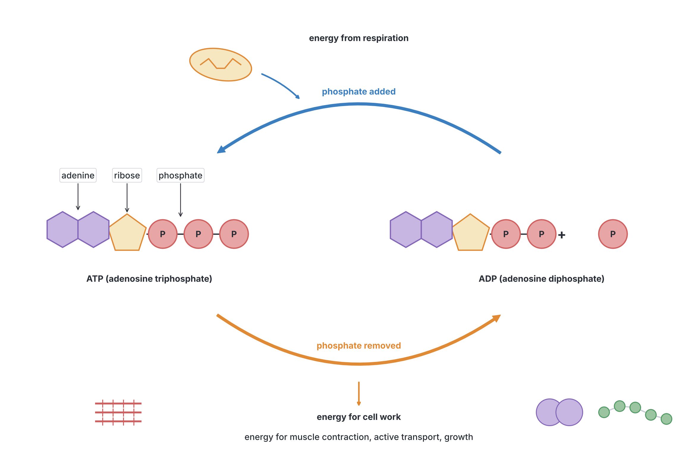

## The significance of respiration

**Objective i: explain the significance of respiration.**

Respiration is important because it **releases the energy** that every living organism needs to stay alive. Without energy, no life process can take place.

### Uses of the energy released by respiration

| Use of energy | Examples |
| --- | --- |
| **Muscle contraction (movement)** | Walking, running, breathing movements, the heartbeat, movement of food along the gut (peristalsis); the beating of cilia and flagella in *Paramecium* and *Euglena*; movement of *Amoeba* |
| **Growth and repair (building large molecules)** | Making proteins from amino acids (e.g. new muscle, enzymes, hormones), making starch, cellulose and glycogen, making fats, copying DNA |
| **Cell division** | Mitosis for growth and repair; meiosis for making gametes |
| **Active transport** | Absorption of mineral ions by root hairs; absorption of glucose in the ileum; reabsorption in the kidney tubules; opening of stomata (potassium pumps) |
| **Transmission of nerve impulses** | Pumping sodium and potassium ions across nerve cell membranes; releasing chemicals at synapses |
| **Keeping the body warm** | Birds and mammals use heat released by respiration to keep their body temperature constant (about 37 °C in humans) |
| **Secretion** | Making and releasing enzymes, hormones, mucus, milk, sweat |
| **Reproduction** | Producing gametes, swimming of sperm, growth of embryos, flowering, seed and fruit formation |
| **Excretion** | The work of the kidneys (filtration and active reabsorption) |
| **Producing light** | Fireflies (glow-worms) produce light (bioluminescence) using ATP |
| **Germination of seeds** | Breaking down stored food and building new cells in the seedling |

### Other significance of respiration

1. **Heat production:** some of the energy released is always lost as **heat**. In warm-blooded animals this heat keeps the body warm. In plants it is usually lost, though germinating seeds and decaying compost heaps become noticeably warm (see the vacuum flask experiment below).
2. **Production of CO₂:** the CO₂ released by respiration of all organisms returns carbon to the air, where green plants use it for **photosynthesis**. Respiration and photosynthesis together keep the **carbon cycle** going.
3. **Production of water (metabolic water):** aerobic respiration produces water. Some desert animals (e.g. desert rats and gerbils) get much of their water this way.
4. **Raw materials for other processes:** the substances formed in the middle of respiration (intermediate compounds such as pyruvic acid and the acids of the Krebs cycle) are used to make amino acids, fats and other substances.
5. **Useful products of anaerobic respiration:** fermentation by yeasts and bacteria gives us bread, alcoholic drinks, ethanol, yoghurt, cheese and fermented foods such as *ogi* (*akamu*) and garri (see objective x).

## Aerobic respiration

**Aerobic respiration** is the breakdown of glucose **in the presence of oxygen**, to release a **large amount of energy**, with **carbon (IV) oxide and water** as waste products.

**Word equation:**

glucose + oxygen → carbon (IV) oxide + water + energy (ATP and heat)

**Balanced chemical equation:**

C₆H₁₂O₆ + 6O₂ → 6CO₂ + 6H₂O + energy (about 2,880 kJ per mole of glucose)

- The **total energy** released by the complete oxidation of one mole of glucose (180 g) is about **2,880 kJ**. Only part of this (roughly 40% or less) is captured in ATP; the rest is lost as **heat**.
- **Where it happens:** it begins in the **cytoplasm** (glycolysis) and is completed in the **mitochondria** (link reaction, Krebs cycle and electron transport chain). This is why mitochondria are called the "powerhouses" of the cell (see Topic A1). Very active cells, such as muscle cells, liver cells, sperm cells and the cells of root hairs and companion cells, have many mitochondria.
- **Who carries it out:** almost all plants and animals, most fungi and many bacteria, most of the time.

**Textbook variation:** the total energy released per mole of glucose is given as **2,880 kJ**, **2,870 kJ**, **2,830 kJ** or **2,900 kJ** (about **686–690 kcal**) in different books. They are all approximately the same value; use 2,880 kJ if asked.

**Other foods:** fats and proteins can also be respired. **Fats** release about twice as much energy per gram as carbohydrates (about 39 kJ/g compared with about 17 kJ/g). Proteins are normally respired only when carbohydrate and fat are scarce (e.g. in starvation), because they are needed for growth and repair.

## A simplified outline of the chemistry of aerobic respiration

**Objective ii: describe a simplified outline of the chemical processes involved in glycolysis and Krebs cycle with reference to ATP production.**

Aerobic respiration takes place in **stages**. Glucose is not burnt in one step (which would release all its energy at once as heat and kill the cell). Instead it is broken down **step by step**, each step controlled by an enzyme, so the energy is released in small amounts and much of it is trapped as ATP.

The four stages are:

| Stage | Where it happens | Needs oxygen? |
| --- | --- | --- |
| 1. **Glycolysis** | **Cytoplasm** | **No** (common to aerobic and anaerobic respiration) |
| 2. **Link reaction** (pyruvic acid → acetyl coenzyme A) | **Matrix** of the mitochondrion | Only takes place when oxygen is available |
| 3. **Krebs cycle** (citric acid cycle) | **Matrix** of the mitochondrion | Only takes place when oxygen is available |
| 4. **Electron transport chain** (oxidative phosphorylation) | **Inner membrane** of the mitochondrion (the **cristae**) | **Yes**: oxygen is the final acceptor |

### Hydrogen carriers: NAD and FAD

At several steps, **hydrogen** (hydrogen atoms, made up of electrons and hydrogen ions) is removed from the food molecules. This removal is called **dehydrogenation** (a form of **oxidation**) and is done by enzymes called **dehydrogenases**. The hydrogen is picked up by **carrier molecules (coenzymes)**:

- **NAD** (nicotinamide adenine dinucleotide), which becomes **reduced NAD** (written **NADH** or NADH₂ in different books).
- **FAD** (flavin adenine dinucleotide), which becomes **reduced FAD** (**FADH₂**).

These carriers take the hydrogen to the **electron transport chain**, where most of the ATP is made. (The vitamins **niacin** and **riboflavin**, from the vitamin B group, are needed to make NAD and FAD. This is one reason why B vitamins are important, and why yeast, which is rich in B vitamins, is a useful food supplement.)

### Stage 1: Glycolysis

**Glycolysis** means "splitting of sugar". It takes place in the **cytoplasm** and **does not need oxygen**. It is the first stage of **both** aerobic and anaerobic respiration.

**Steps of glycolysis (simplified):**

1. **Activation (phosphorylation):** a glucose molecule (6 carbon atoms, 6C) is made more reactive by adding **two phosphate groups**, taken from **2 ATP** molecules. This "invests" 2 ATP. The product is a 6-carbon sugar phosphate (fructose bisphosphate).
2. **Splitting:** the 6-carbon sugar phosphate splits into **two 3-carbon** sugar phosphate molecules (**triose phosphate**, also called glyceraldehyde phosphate).
3. **Oxidation:** each triose phosphate is **oxidised** by the removal of hydrogen, which is picked up by **NAD**, forming **reduced NAD (NADH)**. Two NADH are formed per glucose.
4. **ATP formation:** as each triose phosphate is converted into **pyruvic acid (pyruvate)** (3C), enough energy is released to make **2 ATP** from each one, so **4 ATP** are made in all. (This direct way of making ATP is called **substrate-level phosphorylation**.)

**Summary of glycolysis (per molecule of glucose):**

- Starts with: 1 glucose (6C).
- Ends with: **2 pyruvic acid** (3C each).
- ATP used: 2. ATP made: 4. **Net gain: 2 ATP.**
- Also produces: **2 reduced NAD (NADH)**.
- Oxygen: **not needed**. CO₂: **not produced**.

glucose (6C) → 2 pyruvic acid (3C) + 2 ATP (net) + 2 NADH

**What happens next depends on whether oxygen is present:**

- **With oxygen:** pyruvic acid enters the **mitochondrion** and is completely oxidised (link reaction, Krebs cycle and electron transport chain). This is aerobic respiration.
- **Without oxygen:** pyruvic acid stays in the cytoplasm and is changed into **ethanol and CO₂** (in yeast and plants) or **lactic acid** (in animal muscles and some bacteria). This is anaerobic respiration (see below).

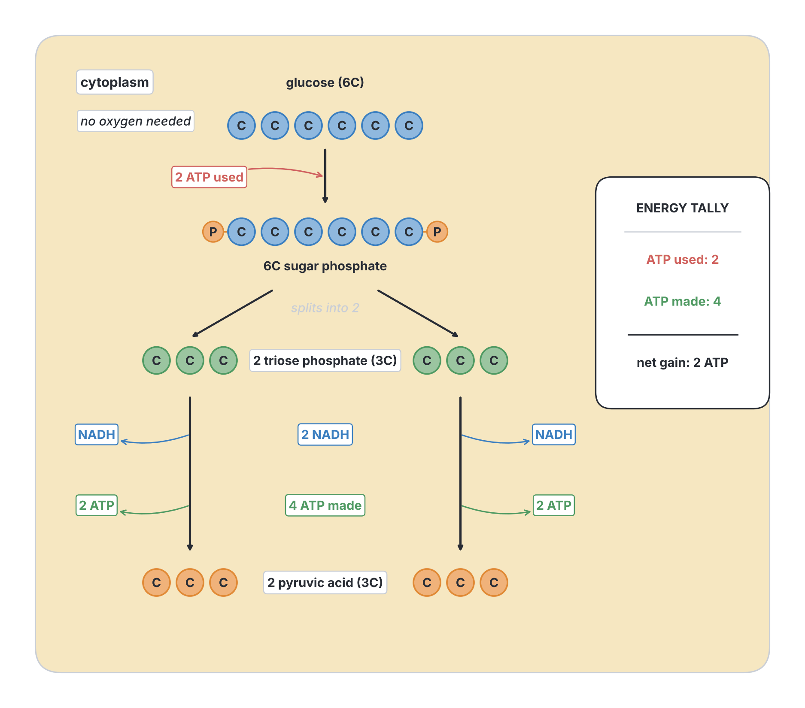

### Stage 2: The link reaction

If oxygen is available, each pyruvic acid molecule passes from the cytoplasm into the **matrix** of a **mitochondrion**. There:

1. One carbon atom is removed as **CO₂** (this is called **decarboxylation**).
2. Hydrogen is removed and picked up by NAD, forming **NADH**.
3. The remaining **2-carbon** unit (an **acetyl** group) joins with **coenzyme A**, forming **acetyl coenzyme A (acetyl CoA)**.

pyruvic acid (3C) → acetyl CoA (2C) + CO₂ + NADH

Since each glucose gives **two** pyruvic acids, the link reaction happens **twice** per glucose, giving **2 CO₂** and **2 NADH**. No ATP is made directly.

**Textbook variation:** many school textbooks do not name the link reaction separately. They simply say "pyruvic acid enters the Krebs cycle" or "pyruvic acid is converted to acetyl coenzyme A, which enters the Krebs cycle". Some count it as part of the Krebs cycle.

### Stage 3: The Krebs cycle

The **Krebs cycle** is named after the scientist **Sir Hans Krebs**, who worked it out in **1937** (he received a Nobel Prize in 1953). It is also called the **citric acid cycle** or the **tricarboxylic acid (TCA) cycle**. It takes place in the **matrix** of the mitochondrion and only works when oxygen is available (because it needs a constant supply of NAD and FAD, which are only freed again by the electron transport chain).

**Steps of the Krebs cycle (simplified):**

1. **Acetyl CoA (2C)** combines with a **4-carbon** acid already present in the mitochondrion (**oxaloacetic acid**, oxaloacetate), forming a **6-carbon** acid, **citric acid** (citrate). Coenzyme A is released and reused.
2. Citric acid (6C) is **decarboxylated** (one CO₂ removed) and **dehydrogenated** (hydrogen removed, picked up by NAD), forming a **5-carbon** acid (**α-ketoglutaric acid**, alpha-ketoglutarate).
3. The 5-carbon acid is again **decarboxylated** (a second CO₂ removed) and dehydrogenated (more NADH formed), forming a **4-carbon** acid.
4. The 4-carbon acid goes through several more steps in which:
   - **1 ATP** is made directly (by substrate-level phosphorylation);
   - hydrogen is removed and picked up by **FAD** (forming **FADH₂**) and by **NAD** (forming NADH).
5. At the end, **oxaloacetic acid (4C)** is formed again. It is ready to combine with the next acetyl CoA, so the cycle **turns** again.

**Products of one turn of the Krebs cycle (from one acetyl CoA):**

- **2 CO₂** (given off as waste),
- **3 NADH**,
- **1 FADH₂**,
- **1 ATP** (in some organisms this is first made as GTP, then converted to ATP).

**Per glucose molecule,** the cycle turns **twice** (because one glucose gives two acetyl CoA), so the totals are **4 CO₂, 6 NADH, 2 FADH₂ and 2 ATP**.

**Where the CO₂ comes from:** all **six** carbon atoms of glucose end up as **CO₂**: **2** from the link reaction and **4** from the Krebs cycle. This is the CO₂ you breathe out.

**Main job of the Krebs cycle:** to **strip hydrogen** from the food molecule and pass it to the carriers (NAD and FAD), which take it to the electron transport chain where most of the ATP is made. Only a little ATP is made directly in the cycle.

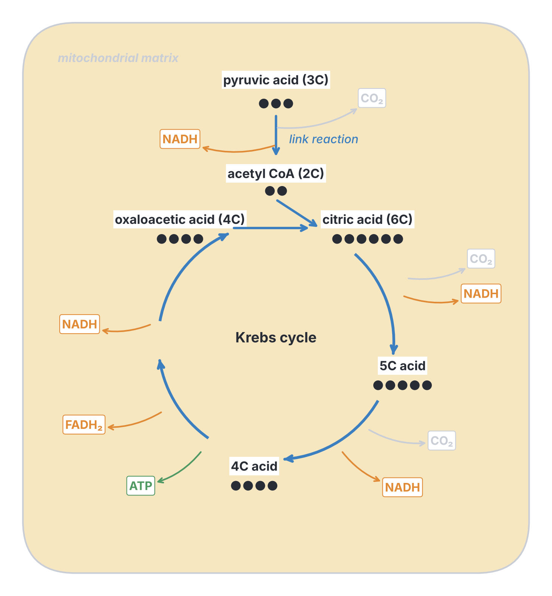

### Stage 4: The electron transport chain

The **electron transport chain** (also called the **respiratory chain** or **cytochrome system**) is found on the **inner membrane** of the mitochondrion, which is folded into **cristae** to give a large surface area for it.

**What happens (simplified), step by step:**

1. **Reduced NAD (NADH)** and **reduced FAD (FADH₂)**, made in glycolysis, the link reaction and the Krebs cycle, bring **hydrogen** to the inner mitochondrial membrane.
2. The hydrogen atoms split into **hydrogen ions (H⁺)** and **electrons**.
3. The **electrons** are passed along a chain of **carrier molecules** in the membrane (including proteins called **cytochromes**), from one carrier to the next, like a bucket being passed along a line of people. NAD and FAD are released to be used again.
4. At each step, the electrons lose a little **energy**. This energy is used to make **ATP** from ADP and phosphate. Making ATP this way, using energy from the electron transport chain with oxygen at the end, is called **oxidative phosphorylation**.
5. At the end of the chain, the electrons and hydrogen ions combine with **oxygen**, forming **water**:

   oxygen + hydrogen (ions and electrons) → water

6. **Oxygen is the final hydrogen (electron) acceptor.** Without oxygen to remove them, the electrons would pile up, the chain would stop, and no more ATP could be made this way (see objective vii below).

**ATP yield:** this stage produces **most** of the ATP made in aerobic respiration. In the traditional calculation, each **NADH** gives **3 ATP** and each **FADH₂** gives **2 ATP**.

**Textbook variation:** many school textbooks do not describe the electron transport chain at all and simply say that "hydrogen from the Krebs cycle combines with oxygen to form water, releasing energy which is stored as ATP". More detailed books describe how the energy is first used to pump hydrogen ions across the inner membrane, and the ions then flow back through an enzyme called **ATP synthase**, which makes the ATP (the chemiosmotic theory of Peter Mitchell). JAMB requires only the simplified idea.

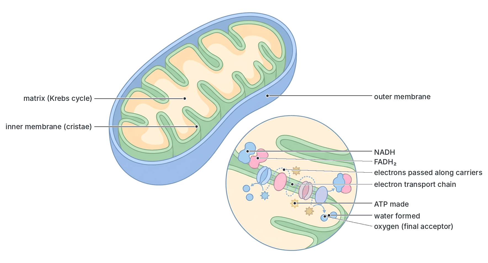

### ATP production in aerobic respiration: the totals

**Traditional calculation (per molecule of glucose):**

| Stage | ATP made directly | Reduced carriers made | ATP from the carriers (NADH = 3, FADH₂ = 2) | Total ATP |
| --- | --- | --- | --- | --- |
| Glycolysis (cytoplasm) | 2 (net) | 2 NADH | 6 | **8** |
| Link reaction (×2) | 0 | 2 NADH | 6 | **6** |
| Krebs cycle (×2) | 2 | 6 NADH, 2 FADH₂ | 18 + 4 = 22 | **24** |
| **Total** | **4** | 10 NADH, 2 FADH₂ | **34** | **38** |

So, in the traditional textbook calculation, one molecule of glucose gives a **maximum of 38 ATP** in aerobic respiration, compared with only **2 ATP** in anaerobic respiration (glycolysis only).

**Textbook variation (important):** different textbooks give different totals for the ATP made from one glucose molecule:

- **38 ATP:** the traditional maximum, used in most older and many current West African school textbooks and in past JAMB and WAEC questions. It assumes every NADH gives 3 ATP and every FADH₂ gives 2 ATP.
- **36 ATP:** used in some textbooks. The 2 NADH made in glycolysis are in the **cytoplasm** and cannot enter the mitochondrion directly; in some cells (e.g. muscle), their hydrogen is passed into the mitochondrion by a "shuttle" that hands it to FAD instead of NAD, so each gives only 2 ATP. That reduces the total by 2, giving 36.
- **About 30–32 ATP:** modern measurements show that the yield is lower, because each NADH actually gives about **2.5** ATP and each FADH₂ about **1.5** ATP, and some energy is used to move substances in and out of the mitochondrion. Many university textbooks now give **about 30 or 32 ATP**.

**For JAMB:** if 38 is one of the options, it is almost certainly the expected answer. If 38 is not offered but 36 is, choose 36. Always remember the **net gain from glycolysis is 2 ATP**, and that aerobic respiration releases **many times more** energy (about 19 times, by the traditional figures of 38 versus 2) than anaerobic respiration.

**Efficiency:** using the traditional figures, 38 ATP × about 30.5 kJ ≈ 1,160 kJ is captured out of 2,880 kJ, an efficiency of about **40%**. The remaining 60% or so is released as **heat**.

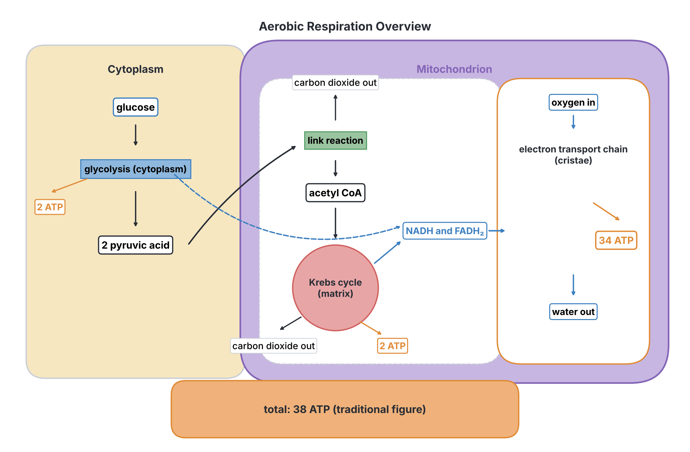

## Anaerobic respiration

**Anaerobic respiration** is the breakdown of glucose **in the absence of oxygen** (or when oxygen is too scarce), to release a **small amount of energy**. The glucose is broken down **incompletely**, so much of its energy is left locked up in the products (ethanol or lactic acid).

Anaerobic respiration consists of **glycolysis** (exactly as in aerobic respiration, giving 2 pyruvic acid, a net 2 ATP and 2 NADH) followed by **one extra step** in which pyruvic acid is converted into ethanol and CO₂, or into lactic acid. The extra step uses up the hydrogen from NADH, regenerating **NAD**, so that glycolysis can continue. No more ATP is made in this extra step.

All anaerobic respiration happens in the **cytoplasm**; mitochondria are not involved.

### Anaerobic respiration in yeast and plants: alcoholic fermentation

In **yeast** (and in plant cells, e.g. in roots in waterlogged soil and in germinating seeds before the seed coat splits), glucose is broken down to **ethanol** (alcohol) and **carbon (IV) oxide**. This is called **alcoholic fermentation**.

**Word equation:**

glucose → ethanol + carbon (IV) oxide + energy (small amount)

**Balanced equation:**

C₆H₁₂O₆ → 2C₂H₅OH + 2CO₂ + energy (about 210 kJ per mole of glucose; 2 ATP)

**Steps:**

1. Glycolysis: glucose → 2 pyruvic acid + 2 ATP (net) + 2 NADH.
2. Each pyruvic acid (3C) loses CO₂ (decarboxylation), forming **ethanal** (acetaldehyde, 2C).
3. Ethanal accepts hydrogen from NADH and is **reduced** to **ethanol** (2C). NAD is set free to be used again in glycolysis.

**Note:** ethanol is **poisonous** to the yeast. When the alcohol concentration rises to about 12–15% (depending on the strain), the yeast cells die and fermentation stops. This is why naturally fermented drinks such as palm wine or ordinary wine cannot become stronger than this; stronger spirits (such as *ogogoro*, gin or whisky) are made by **distilling** the fermented liquid.

**Textbook variation:** the energy released by alcoholic fermentation is given as about **210 kJ** per mole of glucose in most textbooks (some give 218 kJ or about 230 kJ). In all cases, only **2 ATP** are made per glucose.

### Anaerobic respiration in muscles: lactic acid fermentation

In **animal muscle cells** during very vigorous exercise (and in some bacteria, such as the *Lactobacillus* bacteria that sour milk), glucose is broken down to **lactic acid**. **No CO₂** is produced.

**Word equation:**

glucose → lactic acid + energy (small amount)

**Balanced equation:**

C₆H₁₂O₆ → 2C₃H₆O₃ + energy (about 150 kJ per mole of glucose; 2 ATP)

**Steps:**

1. Glycolysis: glucose → 2 pyruvic acid + 2 ATP (net) + 2 NADH.
2. Each pyruvic acid (3C) accepts hydrogen from NADH and is **reduced** to **lactic acid** (3C). NAD is freed so glycolysis can continue.

**Textbook variation:** the energy released by lactic acid fermentation is given as about **150 kJ** per mole of glucose in most school textbooks (some give 120 kJ or 210 kJ). Again, only **2 ATP** are made.

**Red blood cells** (which have no mitochondria) always respire anaerobically, producing lactic acid.

### Organisms and oxygen

| Type of organism | Relationship with oxygen | Examples |
| --- | --- | --- |
| **Obligate aerobes** | Must have oxygen; cannot survive without it | Most plants and animals, including humans; many bacteria |
| **Facultative anaerobes** | Respire aerobically when oxygen is present, but can switch to anaerobic respiration when it is absent | **Yeast**; many bacteria (e.g. *Escherichia coli*); human muscle cells can do this for short periods |
| **Obligate anaerobes** | Can live only without oxygen; oxygen is poisonous to them | Some bacteria, e.g. *Clostridium tetani* (causes tetanus, and grows in deep, dirty wounds with little oxygen), and the methane-producing bacteria in swamps, rubbish dumps and the stomachs of cattle |

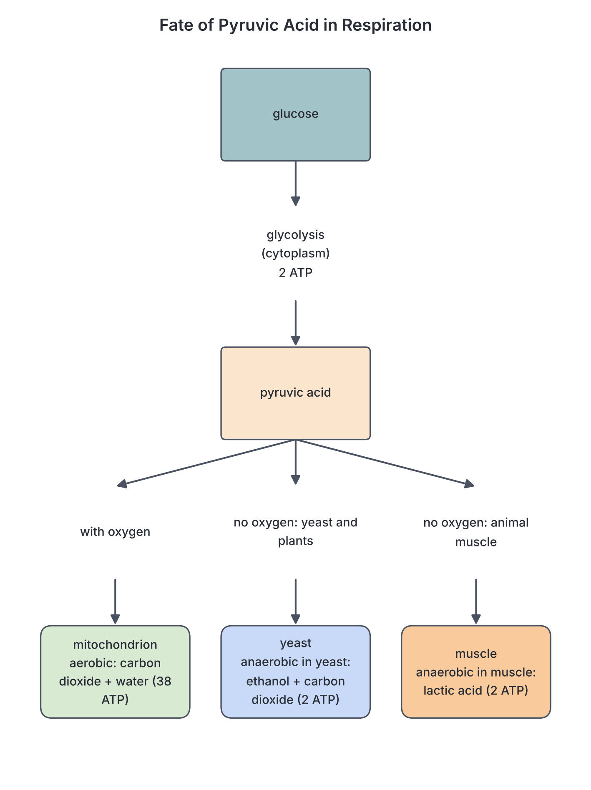

### Aerobic and anaerobic respiration compared

| Feature | Aerobic respiration | Anaerobic respiration |
| --- | --- | --- |
| Oxygen | **Needed** | **Not needed** (takes place in its absence or shortage) |
| Breakdown of glucose | **Complete** | **Incomplete** |
| End products | **CO₂ and water** | **Ethanol and CO₂** (yeast, plants) or **lactic acid** (muscles, some bacteria) |
| Energy released per mole of glucose | **Large** (about 2,880 kJ) | **Small** (about 210 kJ for alcoholic fermentation; about 150 kJ for lactic acid) |
| ATP per glucose (traditional figures) | **38** (36 or about 30–32 in some books) | **2** |
| Where it happens in the cell | Cytoplasm (glycolysis) **and mitochondria** (link reaction, Krebs cycle, electron transport chain) | **Cytoplasm only** |
| Stages | Glycolysis, link reaction, Krebs cycle, electron transport chain | Glycolysis plus one extra step (pyruvic acid → ethanol + CO₂, or lactic acid) |
| Toxic products | None (CO₂ and water are easily removed) | Ethanol and lactic acid are toxic in large amounts |
| Duration | Can continue indefinitely | Can continue for only a short time in most organisms (except some microbes) |
| Examples of organisms | Most plants and animals, most of the time | Yeast, some bacteria, muscles during vigorous exercise, roots in waterlogged soil |
| Common features | Both start with **glycolysis**; both are controlled by **enzymes**; both release energy as **ATP** and **heat** from glucose | Same |

## The role of oxygen in the liberation of energy

**Objective vii: examine the role of oxygen in the liberation of energy for the activities of the living organisms.**

### What oxygen does

1. **Oxygen is the final acceptor of hydrogen (electrons)** at the end of the electron transport chain. It combines with the hydrogen removed from glucose to form **water**.
2. By removing the hydrogen, oxygen **keeps the electron transport chain moving**, so electrons keep flowing along the carriers and their energy keeps being used to make ATP.
3. This **frees the carriers NAD and FAD** (they hand over their hydrogen and become oxidised again), so they can go back to collect more hydrogen from the **Krebs cycle** and **glycolysis**.
4. So, **with oxygen**, glucose can be broken down **completely** to CO₂ and water, and **all** the stages run, producing up to **38 ATP** per glucose (traditional figure).

### What happens without oxygen

1. With no oxygen to accept hydrogen, the **electron transport chain stops**.
2. NADH and FADH₂ cannot hand on their hydrogen, so **no free NAD or FAD** is available.
3. The **Krebs cycle and link reaction stop**, because they need NAD and FAD.
4. Only **glycolysis** can continue, and only if its NADH is recycled by turning pyruvic acid into **ethanol** (yeast, plants) or **lactic acid** (muscles).
5. Only **2 ATP** are made per glucose, and most of the energy stays locked in the ethanol or lactic acid.

### Why oxygen matters to organisms

- **Aerobic respiration releases about 19 times more ATP** per glucose than anaerobic respiration (38 compared with 2, using traditional figures). Organisms that need a lot of energy, such as active, warm-blooded birds and mammals, depend on a constant supply of oxygen.
- This is why animals have efficient gas exchange and transport systems (lungs, gills, tracheae, blood with haemoglobin; see B3a and B4a), and why breathing and heart rate increase during exercise.
- **The brain** is especially dependent on oxygen: brain cells begin to die within a few minutes if their oxygen supply is cut off (e.g. in drowning, choking, a stroke, or carbon monoxide poisoning from a generator in a closed room).
- **Roots** need oxygen from the soil air to make the ATP used for active uptake of mineral salts (see B3b). In waterlogged soil they respire anaerobically, make little energy, absorb few minerals and may be poisoned by ethanol; most crops then grow poorly or die (rice is an exception, with air channels to its roots).
- **Seeds** need oxygen to germinate (one of the conditions for germination, along with water and a suitable temperature), because germination needs a lot of energy.
- **Oxygen is not a source of energy itself.** The energy comes from the **food** (glucose). Oxygen makes it possible to release **all** of that energy instead of a small part.

## The effect of insufficient oxygen supply to the muscles

**Objective viii: explain the effect of insufficient supply of oxygen to the muscles.**

### What happens during vigorous exercise, step by step

1. When you run fast (e.g. a 100 m race, or running to catch a bus), your **leg muscles need a lot of energy** very quickly.
2. Your **breathing** becomes faster and deeper and your **heart beats faster**, to bring more oxygen to the muscles. But there is a limit to how fast oxygen can be delivered.
3. When the muscles need energy faster than the oxygen supply allows, the muscle cells **also respire anaerobically**, breaking glucose down to **lactic acid**, which gives a little extra ATP very quickly.
4. **Lactic acid builds up** in the muscles and passes into the blood.
5. The build-up of lactic acid (and the fall in pH that comes with it) is linked to **muscle fatigue** and **cramp**:
   - **Fatigue:** the muscles feel tired and painful, and cannot contract as strongly; eventually you have to slow down or stop.
   - **Cramp:** a sudden, painful, involuntary contraction of a muscle that will not relax.
6. The body now has an **oxygen debt**.

### Oxygen debt

The **oxygen debt** is the **extra oxygen** that the body needs **after** vigorous exercise, to remove the lactic acid that built up during anaerobic respiration and to restore the body to normal.

**How the oxygen debt is "repaid", step by step:**

1. After the exercise stops, you **keep breathing fast and deeply** (panting) and your heart keeps beating fast for some minutes, even though you are now resting.
2. The extra oxygen taken in is used to deal with the **lactic acid**:
   - The lactic acid is carried in the **blood** to the **liver**.
   - In the liver, **some** of the lactic acid is **oxidised** (by aerobic respiration) to **CO₂ and water**, releasing energy.
   - This energy is used to convert the **rest** of the lactic acid back into **glucose** (and then **glycogen**, for storage).
3. The extra oxygen also refills the oxygen stores of the muscles (oxygen held by **myoglobin**, the red pigment of muscle) and the blood, and remakes ATP and other energy stores in the muscles.
4. When all the lactic acid has been removed, breathing and heart rate return to normal. The debt has been **repaid**.

**Textbook variation:** many textbooks say that about **one-fifth** of the lactic acid is oxidised to CO₂ and water and the remaining **four-fifths** is turned back into glucose or glycogen; other books do not give fractions. Modern physiology books use the term **excess post-exercise oxygen consumption (EPOC)** instead of "oxygen debt", because the extra oxygen is also used for other recovery processes (such as cooling down and repairing muscles), not only for removing lactic acid.

**Textbook variation on cramp and fatigue:** school textbooks link **cramp** and **fatigue** to the build-up of lactic acid, and this is the answer JAMB expects. Modern research suggests that fatigue and cramp have **several causes** (for example, loss of salts and water in sweat, tiredness of the nerves controlling the muscle, and changes in the muscle cells), and that lactic acid is not the only, or even the main, cause. Give the textbook answer in the exam.

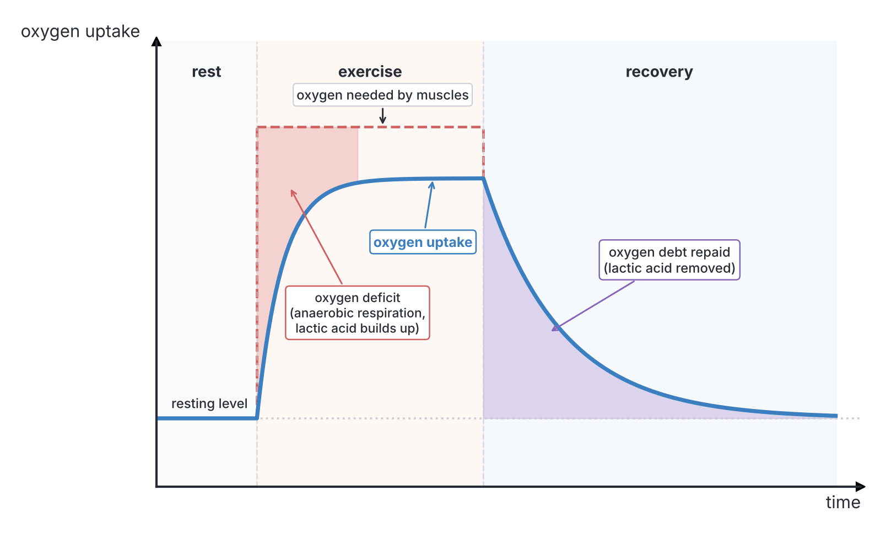

### Other effects of insufficient oxygen

- **Sprinters** in a 100 m race respire largely anaerobically and build up a large oxygen debt; **long-distance runners** run at a pace at which their muscles can respire mostly aerobically, so they build up little lactic acid.
- **Training** improves the heart, lungs and blood supply to the muscles, increases the number of mitochondria in muscle cells, and so allows a person to exercise harder before respiring anaerobically. Some athletes also train at high altitude, where the air holds less oxygen, so that the body makes more red blood cells.
- **Rest, massage and gentle stretching** help relieve cramp by improving blood flow, which removes lactic acid and brings oxygen.
- **Heart muscle** must have a constant supply of oxygen: if a coronary artery is blocked, the heart muscle beyond it is starved of oxygen, causing chest pain (angina) or a heart attack.

## Experiments on respiration

**Objective iii: deduce gaseous exchange and products, exchange and production of heat energy during respiration from experimental set up.**

JAMB often shows a diagram of an experiment and asks what it shows, what a particular chemical is for, what the control is, or what the result will be. For each experiment below, learn the **purpose of each part**.

### Useful reagents and what they do

| Reagent | What it does | Colour change |
| --- | --- | --- |
| **Lime water** (calcium hydroxide solution) | Tests for **CO₂** | Clear → **milky** (cloudy white) with CO₂ |
| **Potassium hydroxide (KOH) solution** or **sodium hydroxide (NaOH) solution** | **Absorbs CO₂** | No visible change |
| **Soda lime** (solid) | **Absorbs CO₂** (and water vapour) | No visible change (some types have an indicator) |
| **Hydrogencarbonate (bicarbonate) indicator** | Shows changes in **CO₂ concentration** | Orange-red (normal air) → **yellow** (more CO₂) → **purple** (less CO₂) |
| **Alkaline pyrogallol** | **Absorbs oxygen** | Turns brown |
| **Anhydrous copper(II) sulphate** | Tests for **water** | White → **blue** |
| **Cobalt(II) chloride paper** | Tests for **water** | Blue → **pink** |
| **Acidified potassium dichromate** | Tests for **ethanol** (alcohol) | Orange → **green** |

### Experiment 1: to show that carbon (IV) oxide is produced during respiration

**Aim:** to show that living organisms (animals, germinating seeds or a green plant kept in the dark) give out CO₂ in respiration.

**Apparatus (set up in a line, joined by delivery tubes):**

1. **Flask A: potassium hydroxide (KOH) solution** (or soda lime) — air is drawn through it first. **Purpose:** to **absorb CO₂** from the incoming air, so that any CO₂ detected later must have come from the organism.
2. **Flask B: lime water** — **Purpose:** to **check** that all the CO₂ has been removed from the incoming air. It should **remain clear**.
3. **Bell jar or flask C: the living organism** — e.g. a small animal such as a mouse, a cockroach or grasshoppers, or **germinating seeds** (e.g. beans or maize), or a **potted green plant**. If a green plant is used, the bell jar must be **covered with a black cloth** (or kept in the dark) to **prevent photosynthesis**, which would use up the CO₂. If a potted plant is used, the pot and soil should be covered with a polythene bag to stop CO₂ from soil microorganisms getting in.
4. **Flask D: lime water** — **Purpose:** to **test for CO₂** in the air leaving the organism.
5. **An aspirator** or **suction pump** at the end, which slowly draws air through the whole apparatus.

**Control:** an identical set-up with **no organism**, or with **boiled (dead) seeds** soaked in disinfectant (to kill microorganisms), in place of the living organism.

**Observations:**

- Lime water in flask B (before the organism) **stays clear**.
- Lime water in flask D (after the organism) **turns milky**.
- In the control, the lime water in flask D **stays clear**.

**Conclusion:** the organism gave out **carbon (IV) oxide**, which turned the lime water milky. CO₂ is a product of respiration.

**Variation:** instead of lime water, **hydrogencarbonate indicator** can be used: it turns from **red to yellow** as CO₂ from respiration is added. Small organisms (e.g. maggots, woodlice or germinating seeds) can be placed on a gauze platform in a test tube above the indicator, with a control tube containing glass beads.

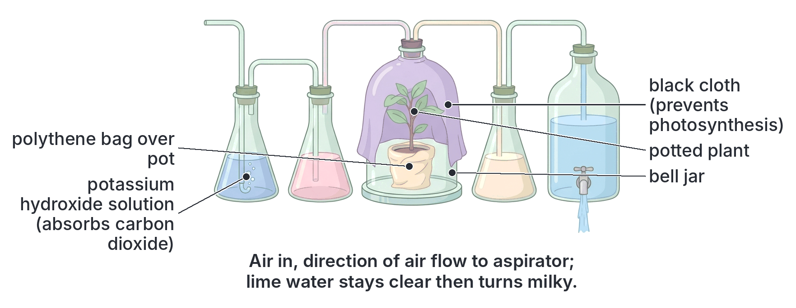

### Experiment 2: to compare the CO₂ in inhaled and exhaled air

**Apparatus:** two boiling tubes, **A** and **B**, each containing the **same volume of lime water**, fitted with bungs and glass tubes and joined to a common mouthpiece. In tube **A**, the long tube from the mouthpiece reaches **above** the lime water and the other tube dips into it; in tube **B**, the tube from the mouthpiece **dips into** the lime water.

**Method:**

1. Breathe **in** gently through the mouthpiece. Air is drawn from outside **through the lime water in tube A** (inhaled air).
2. Breathe **out** gently through the mouthpiece. The air goes **through the lime water in tube B** (exhaled air).
3. Repeat several times.

**Observation:** the lime water in tube **B** (exhaled air) turns **milky quickly**; the lime water in tube **A** (inhaled air) stays clear or turns milky only after a very long time.

**Conclusion:** exhaled air contains **much more CO₂** (about 4%) than inhaled air (about 0.04%), because CO₂ produced by respiration in the body's cells is breathed out (see B4a).

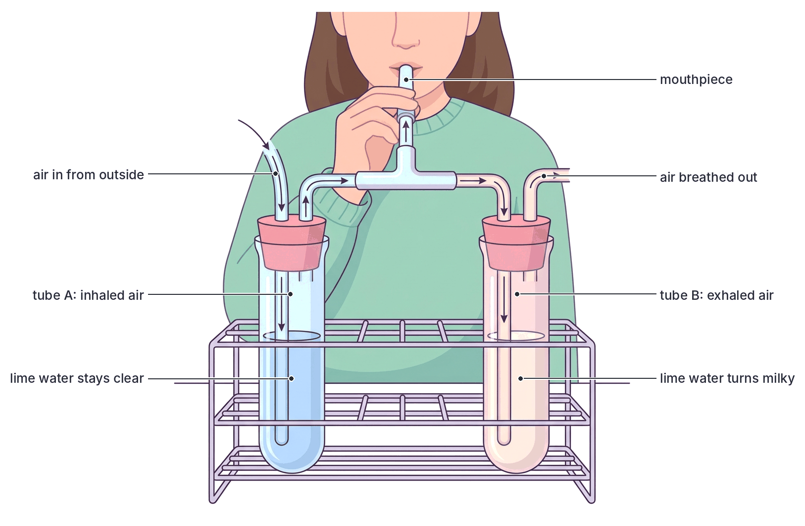

### Experiment 3: to show that heat energy is released during respiration (germinating seeds in vacuum flasks)

**Aim:** to show that respiring (germinating) seeds release heat.

**Materials:** two **vacuum (thermos) flasks**, two **thermometers**, **cotton wool**, soaked **germinating seeds** (e.g. beans, peas or maize soaked in water for about 24 hours), a dilute **disinfectant** (e.g. a weak solution of a household antiseptic, or formalin), a source of boiling water.

**Method:**

1. Divide the soaked seeds into two equal lots.
2. **Boil** one lot for about 10 minutes to **kill** them. Cool them to room temperature.
3. **Rinse both lots in dilute disinfectant**, to **kill bacteria and fungi** on their surface. (Otherwise microorganisms respiring on the dead seeds would also produce heat and spoil the control.)
4. Put the **living, germinating seeds** into flask **A** and the **boiled (dead) seeds** into flask **B** (the **control**).
5. Insert a **thermometer** into each flask so that its bulb is among the seeds, and plug the mouth of each flask loosely with **cotton wool**. Many textbooks show the flasks **inverted** (upside down, supported in a clamp or stand) with the thermometer in the cotton wool plug; this allows the **CO₂** produced (which is heavier than air) to escape downwards through the cotton wool so it does not build up and stop respiration, while oxygen can still enter.
6. Record the starting temperature in both flasks (it should be the same).
7. Leave the flasks for 2–3 days, reading the thermometers at intervals.

**Why vacuum flasks?** A vacuum flask **reduces heat loss** to the surroundings, so the small amount of heat released by the seeds builds up and can be measured.

**Why cotton wool and not a rubber bung?** Cotton wool allows **oxygen** to enter and **CO₂** to leave, so the seeds can continue to respire aerobically; it also reduces heat loss.

**Observations:**

- The temperature in flask **A** (living germinating seeds) **rises** over the days (by several degrees).
- The temperature in flask **B** (boiled seeds, control) **stays the same** (or changes only with the room temperature).

**Conclusion:** germinating seeds **release heat** during respiration. Boiled seeds are dead and do not respire, so they do not produce heat.

**Everyday examples:** heaps of fresh grass cuttings, compost heaps and stores of damp grain become warm (sometimes hot enough to catch fire) because of the respiration of the plant cells and of the microorganisms in them.

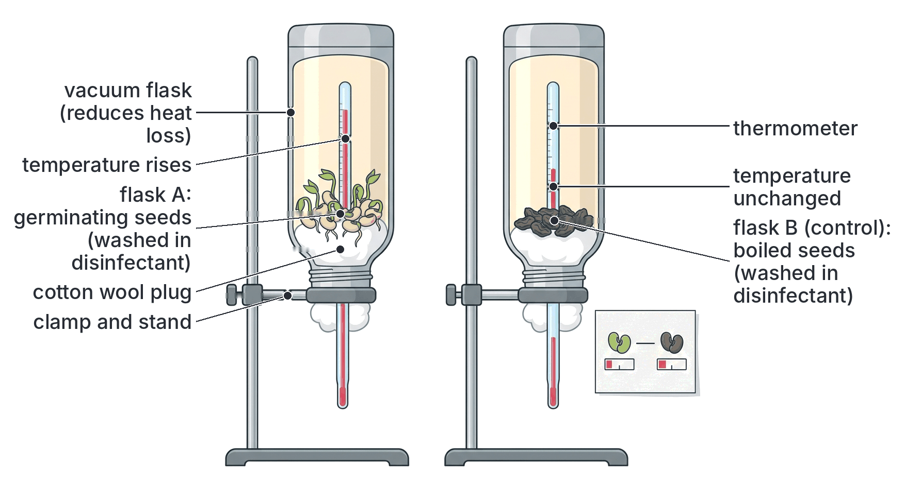

### Experiment 4: to show that oxygen is used during respiration (the simple respirometer)

**Aim:** to show that living organisms take in oxygen in respiration (and to measure the rate of oxygen uptake).

**Apparatus (a simple respirometer):**

1. A **boiling tube** (or test tube) containing **potassium hydroxide (KOH) solution** or **soda lime** at the bottom. **Purpose:** to **absorb the CO₂** given out by the organisms, so that any change in the volume of gas in the tube is due only to **oxygen** being taken in.
2. A **wire gauze platform** above the KOH, holding the **organisms** (e.g. germinating seeds, maggots, woodlice or grasshoppers), so they do not touch the caustic solution.
3. A rubber **bung** closing the tube, through which passes a **capillary tube** (or bent glass tube) with a **scale** beside it.
4. A drop of **coloured liquid** (an **index**, e.g. coloured water or oil) placed in the capillary tube.
5. Often a **screw clip** or syringe connected to the tube to reset the index, and a **water bath** to keep the temperature constant.

**Control:** an identical tube with **no living organisms**, or with **boiled seeds** (washed in disinfectant), or with **glass beads** of the same volume as the organisms. **Purpose:** to show that any movement of the index is due to the living organisms, and not to changes in temperature or pressure.

**Method:**

1. Set up both tubes and leave them in a water bath for a few minutes for the temperature to settle.
2. Mark the starting position of the coloured index.
3. Read the position of the index at regular intervals (e.g. every 5 minutes).

**Observation:** the coloured index in the tube with the living organisms **moves towards the organisms** (towards the boiling tube). In the control, the index does **not move**.

**Explanation:**

1. The organisms take in **oxygen** from the air in the tube for respiration.
2. They give out **CO₂**, but it is **absorbed by the KOH** at once.
3. So the total volume of gas in the tube **decreases**, the pressure falls, and the coloured liquid is drawn **towards the tube**.
4. The **distance moved** by the index in a given time (or the volume, if the tube is calibrated) measures the **rate of oxygen uptake**.

**Conclusion:** living organisms **take in oxygen** during respiration.

**Variation:** if the experiment is repeated **without KOH** (with water instead), the index hardly moves for organisms respiring glucose, because the volume of CO₂ given out equals the volume of oxygen taken in. Comparing the two results allows the **respiratory quotient (RQ)** to be worked out:

RQ = volume of CO₂ given out ÷ volume of oxygen taken in

The RQ is about **1.0** for carbohydrates, about **0.7** for fats and about **0.8–0.9** for proteins. (This is extra information; it is not required by the syllabus.)

**Another simple set-up:** germinating seeds are placed in a flask whose mouth is closed with a bung carrying a bent tube dipping into a beaker of coloured water, with a small tube of KOH hanging inside the flask. As the seeds use oxygen and the KOH absorbs the CO₂, the coloured water **rises up the tube**.

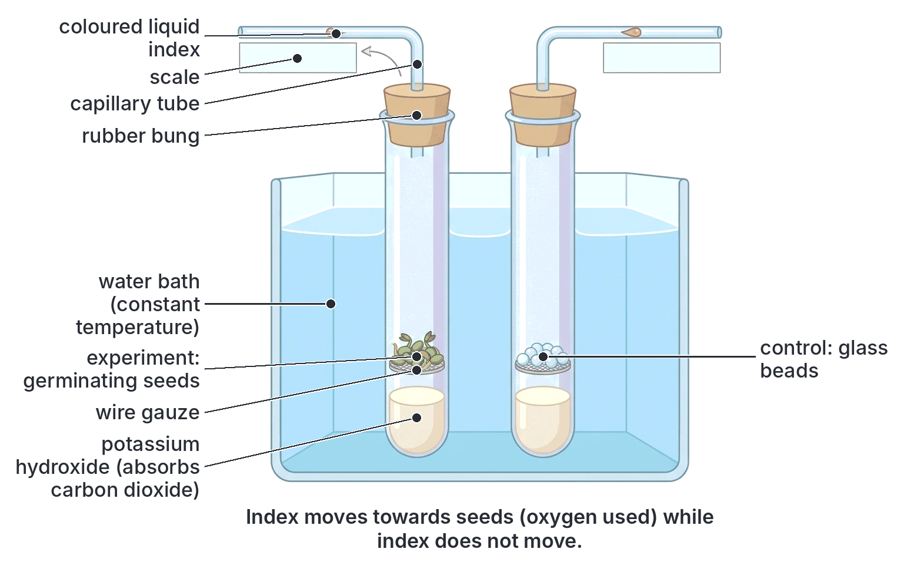

### How to deduce answers from experimental set-ups

| If the set-up contains... | It is there to... |
| --- | --- |
| **KOH, NaOH or soda lime** before the organism | Remove CO₂ from the incoming air |
| **Lime water** before the organism | Prove the incoming air has no CO₂ |
| **Lime water** after the organism | Detect CO₂ produced by respiration |
| **KOH or soda lime** inside a respirometer | Absorb CO₂ so that the movement of the index shows oxygen uptake |
| **A black cloth over a green plant** | Prevent photosynthesis, which would use up CO₂ |
| **Boiled seeds** | Act as a control (dead seeds do not respire) |
| **Disinfectant** | Kill microorganisms, which would otherwise respire and produce heat or CO₂ |
| **Vacuum flask** | Reduce heat loss, so heat released can be measured |
| **Thermometer** | Measure heat released |
| **Cotton wool plug** | Allow gases to pass and reduce heat loss |
| **Oil layer on a liquid** | Keep air (oxygen) out, to create anaerobic conditions |
| **Boiled and cooled sugar solution** | Remove dissolved oxygen and kill microorganisms (boiling), without killing the yeast added later (cooling) |
| **Water bath** | Keep the temperature constant (or at the best temperature for enzymes) |

## Fermentation by yeast

**Objective ix: use yeast cells and sugar solution to demonstrate the process of fermentation.**

### What is fermentation?

**Fermentation** is the **anaerobic breakdown of sugar** (or other organic substances) by microorganisms such as **yeasts** and **bacteria**, producing substances such as **ethanol** and **CO₂**, or **lactic acid**, and a small amount of energy. **Alcoholic fermentation** by yeast is the form used to make bread and alcoholic drinks.

**Yeast** is a **single-celled fungus** (the common baker's and brewer's yeast is *Saccharomyces cerevisiae*). Each cell is oval, with a cell wall, a nucleus, a vacuole and stored food granules. It reproduces asexually by **budding** (see Topic A2a). It is a **facultative anaerobe**: with oxygen it respires aerobically (and grows and multiplies quickly); without oxygen it respires anaerobically, producing **ethanol and CO₂**.

### Experiment 5: demonstrating fermentation with yeast and sugar solution

**Aim:** to show that yeast ferments sugar anaerobically, producing CO₂, ethanol and heat.

**Materials:** **glucose** (or sucrose) solution (e.g. about 5–10%), **dried or fresh baker's yeast**, two boiling tubes or conical flasks, a **delivery tube** and bung, a test tube of **lime water**, **liquid paraffin** (or vegetable oil), a **beaker of warm water** (water bath) at about **25–35 °C**, a thermometer, a Bunsen burner.

**Method, step by step:**

1. **Boil** the sugar solution for a few minutes, then **cool** it to about 30–35 °C.
   - **Why boil?** To **drive out dissolved oxygen** (so that conditions are anaerobic) and to **kill any microorganisms** already present.
   - **Why cool?** So that the high temperature does not **kill the yeast** (and destroy its enzymes) when it is added.
2. Pour the cooled sugar solution into tube **A** and add some **yeast**. Stir gently to mix.
3. Pour a thin layer of **liquid paraffin** (or oil) on top of the mixture. **Why?** To **prevent air (oxygen) from dissolving** in the mixture, keeping conditions **anaerobic**.
4. Fit a **bung with a delivery tube** and lead the tube into a test tube of **lime water**.
5. Place the tube in a **water bath** at about 25–35 °C, the **optimum** (best) temperature for the yeast's enzymes.
6. **Set up a control:** tube **B** with the same boiled sugar solution and **boiled yeast** (killed by boiling), with oil and lime water, in the same water bath. (Another possible control is yeast in water with no sugar.)
7. Leave for 30 minutes to an hour, and observe.

**Observations:**

| | Tube A (live yeast + sugar) | Tube B (control: boiled yeast + sugar) |
| --- | --- | --- |
| Bubbles of gas | Many **bubbles** rise through the mixture; froth may form | No bubbles |
| Lime water | Turns **milky** | Stays clear |
| Smell | Smells of **alcohol** (like palm wine or beer) | No smell of alcohol |
| Temperature (measured with a thermometer in the mixture) | Rises slightly | No change |
| Sugar | Decreases (the solution tastes less sweet; tests show less reducing sugar) | No change |

**Test for ethanol:** after fermentation, a little of the liquid (filtered) can be warmed with **acidified potassium dichromate**: the colour changes from **orange to green**, showing the presence of alcohol. Alternatively, the liquid can be **distilled**: the distillate smells of alcohol and burns with a pale blue flame (if enough is collected).

**Conclusion:** yeast **ferments** sugar in the absence of oxygen, producing **carbon (IV) oxide** (which turns lime water milky), **ethanol** (alcohol) and **heat** (energy).

glucose → (yeast enzymes, called zymase) → ethanol + carbon (IV) oxide + energy

**Factors affecting the rate of fermentation:** temperature (fastest at about 30–40 °C; slow when cold; stops above about 50–60 °C as the enzymes are destroyed), sugar concentration, amount of yeast, and pH. These can be investigated by counting the bubbles produced per minute in different conditions.

**Textbook variation:** older textbooks call the group of yeast enzymes that carry out alcoholic fermentation **zymase**. Modern books explain that "zymase" is really a mixture of many enzymes (the glycolysis enzymes plus pyruvate decarboxylase and alcohol dehydrogenase).

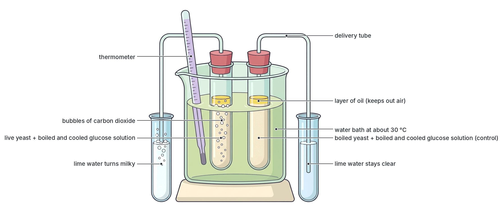

## Economic importance of yeasts

**Objective x: state the economic importance of yeasts.**

Yeasts are some of the most useful microorganisms to humans. Their importance comes mainly from **fermentation** (producing ethanol and CO₂) and from their **rich food value**.

### Beneficial (useful) uses of yeasts

#### 1. Bread making (baking)

1. Flour is mixed with water, a little sugar, salt and **baker's yeast** to make **dough**.
2. The dough is **kneaded** and left in a warm place (e.g. 25–35 °C) for an hour or so.
3. Enzymes in the flour and yeast break down some of the starch into sugar. The yeast **ferments** the sugar, producing **CO₂** and a little ethanol.
4. Bubbles of **CO₂** are trapped in the stretchy dough (which contains the protein gluten), making the dough **rise** (swell), so that the bread becomes **light and spongy**. This is called "proving".
5. The dough is baked in a hot oven. The heat **kills the yeast**, makes the gas bubbles expand further, **evaporates the ethanol**, and sets the bread.

Bread, buns, doughnuts and *puff-puff* (a popular Nigerian snack made from a fermented yeast batter) all depend on yeast.

#### 2. Brewing of beer

1. Grains of **barley** (or, in Nigeria, often **sorghum**, which is grown locally) are soaked and allowed to germinate. This is called **malting**; enzymes in the germinating grain change starch into sugar (maltose).
2. The malted grain is dried, crushed and mixed with hot water to dissolve the sugars, forming a sweet liquid called **wort**. **Hops** are added for flavour.
3. **Brewer's yeast** is added, and the wort is left to ferment in large closed tanks. The yeast changes the sugar into **ethanol** and **CO₂**.
4. The beer is filtered, matured, pasteurised and bottled; extra CO₂ makes it fizzy.

Nigeria has a large brewing industry, with many breweries producing lager beers and stouts. The industry provides **jobs** and **tax revenue**, and buys sorghum and maize from Nigerian farmers.

#### 3. Local (traditional) alcoholic drinks

| Drink | What it is made from | Notes |
| --- | --- | --- |
| **Palm wine** (*emu* in Yoruba, *mmanya ngwo* or *nkwu* in Igbo, *tombo* in some parts) | The **sap** of the **oil palm** or the **raffia palm**, tapped from the tree | Fermentation starts naturally as soon as the sap is collected, by **wild yeasts** (and bacteria) from the air, the tapper's equipment and the tree. Fresh palm wine is sweet; as fermentation continues, it becomes sour and more alcoholic |
| **Burukutu** | **Sorghum** (guinea corn), sometimes with millet or maize | A thick, creamy, sour local beer, popular in northern and middle-belt Nigeria; the malted grain is fermented by yeasts and lactic acid bacteria |
| **Pito** | **Sorghum** (and sometimes millet) | A local beer brewed in northern Nigeria and Ghana and nearby countries; made by malting, mashing and fermenting with yeast (often from a previous batch) |
| **Ogogoro** (local gin; also called *kai-kai*, *akpeteshie* in Ghana) | **Distilled palm wine** (or other fermented liquids) | Fermentation produces the alcohol; distillation concentrates it into a strong spirit. Badly distilled ogogoro can contain poisonous methanol |
| **Wines** | Grapes and other fruits | Wild or added yeasts on the fruit ferment its sugar |

**Note:** in the production of burukutu, pito and palm wine, many kinds of microorganisms (not just yeasts) take part, including lactic acid bacteria, which give the sour taste. Textbooks differ on which yeast species are most important; *Saccharomyces* species are usually named.

#### 4. Production of industrial alcohol (ethanol) and fuel

- Yeasts ferment sugars from **sugarcane**, **molasses** (a by-product of sugar making), **cassava**, **maize** and other starchy crops to produce **ethanol** on a large scale.
- Ethanol is used as a **solvent** (in perfumes, paints, varnishes and drugs), as an **antiseptic** and disinfectant (e.g. in hand sanitisers and methylated spirit), in making other chemicals, and as a **fuel**.
- **Biofuel:** ethanol can be mixed with petrol (e.g. "gasohol") or used alone as a fuel for cars, as in Brazil. Nigeria has policies that encourage making fuel ethanol from cassava and sugarcane.

#### 5. Source of vitamin B and food supplements

- Yeast cells are rich in **vitamins of the B group** (e.g. thiamine (B₁), riboflavin (B₂), niacin) and **protein**.
- **Yeast extract** (a dark, savoury paste made from used brewer's yeast) and **yeast tablets** are sold as sources of B vitamins.
- **Spent (used) brewer's yeast** and spent grains from breweries are used in **animal feed**, e.g. for poultry, pigs and fish, which is important to Nigerian livestock farmers.
- Yeasts can be grown on cheap materials to produce **single-cell protein (SCP)** for animal feed or human food.

#### 6. Other uses

- **Scientific research:** yeast (*Saccharomyces cerevisiae*) is a simple eukaryote that is easy to grow, so it is used to study genetics, cell division and ageing. It was the first eukaryote to have its whole DNA sequence (genome) worked out.
- **Biotechnology and medicine:** genetically engineered yeasts are used to make useful substances such as some **vaccines** (e.g. the hepatitis B vaccine) and **insulin**.
- **Production of enzymes and chemicals:** for example, invertase (used in making soft-centred sweets) and glycerol.
- **Flavourings** in food (yeast extract as a seasoning).

### Harmful effects of yeasts

1. **Food spoilage:** wild yeasts grow on and spoil sugary foods such as fruit juices, jams, honey, syrups and fresh fruits, making them taste sour or alcoholic and frothy.
2. **Diseases:** some yeasts cause disease in humans. *Candida albicans* causes **candidiasis** ("thrush"), an infection of the mouth (white patches), the vagina, the skin folds or nails, especially in babies, pregnant women, diabetics, people taking antibiotics for a long time, and people with weakened immunity (e.g. HIV/AIDS). Some other yeasts (e.g. *Cryptococcus*) cause serious infections in people with weak immunity.
3. **Alcohol abuse:** the alcoholic drinks that yeasts make can cause harm if drunk in excess: liver damage (cirrhosis), road accidents, violence and addiction.
4. **Spoilage of fermented products** by the wrong yeasts can ruin a batch of beer or wine.

### Summary table: economic importance of yeasts

| Use or effect | Product of yeast involved | Example |
| --- | --- | --- |
| Baking | **CO₂** (makes dough rise) | Bread, buns, puff-puff |
| Brewing | **Ethanol** and CO₂ | Beer, stout, burukutu, pito |
| Palm wine and wines | **Ethanol** | Palm wine from oil palm and raffia palm sap |
| Spirits | Ethanol (then distilled) | Ogogoro (local gin) |
| Industrial alcohol and biofuel | **Ethanol** | Solvents, antiseptics, fuel ethanol from cassava and sugarcane |
| Food supplements | **Vitamin B** and protein in yeast cells | Yeast extract, yeast tablets |
| Animal feed | Spent brewer's yeast; single-cell protein | Poultry, pig and fish feed |
| Research and biotechnology | The yeast cell itself | Genetics research; hepatitis B vaccine; insulin |
| Harmful: spoilage | Fermentation of sugars | Spoiled fruit juice, jam, honey |
| Harmful: disease | Growth of yeast in the body | Candidiasis (thrush) caused by *Candida albicans* |

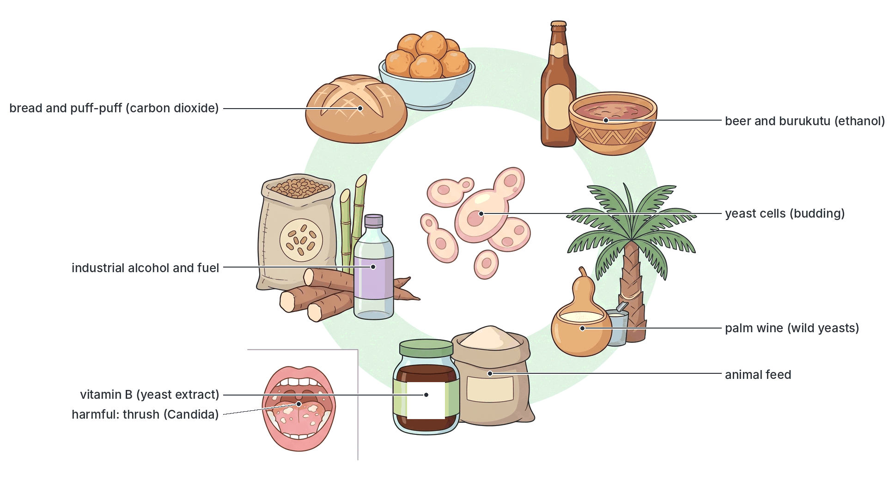

## Respiration, photosynthesis and breathing compared

### Respiration and photosynthesis

Respiration and photosynthesis are in many ways **opposite processes**. Photosynthesis **stores** energy in glucose; respiration **releases** it.

| Feature | Respiration | Photosynthesis |
| --- | --- | --- |
| Equation | C₆H₁₂O₆ + 6O₂ → 6CO₂ + 6H₂O + energy | 6CO₂ + 6H₂O + light energy → C₆H₁₂O₆ + 6O₂ (in the presence of chlorophyll) |
| Raw materials | Glucose and oxygen | Carbon (IV) oxide and water |
| Products | Carbon (IV) oxide, water and energy (ATP, heat) | Glucose (food) and oxygen |
| Energy | **Releases** energy (exergonic, catabolic: breaks down molecules) | **Stores** energy (endergonic, anabolic: builds up molecules); light energy is changed into chemical energy |
| Where it happens | In **all living cells** (plants, animals, fungi, bacteria) | Only in cells with **chlorophyll** (green plants, algae, some bacteria) |
| Organelle | **Mitochondria** (and cytoplasm) | **Chloroplasts** |
| When | **All the time**, day and night | Only in the **light** |
| Gases | Takes in O₂, gives out CO₂ | Takes in CO₂, gives out O₂ |
| Effect on dry mass | **Decreases** dry mass (food is used up) | **Increases** dry mass (food is made) |
| Light needed? | No | Yes |

### Respiration and breathing

| Feature | Respiration (cellular) | Breathing (ventilation) |
| --- | --- | --- |
| Nature | A **chemical** process (catalysed by enzymes) | A **physical** (mechanical) process: muscular movements |
| Where | Inside **every living cell** | In the respiratory organs (lungs, gills, tracheae) of animals |
| What happens | Food (glucose) is **broken down to release energy** | Air or water is **moved in and out** of the respiratory organs |
| Energy | **Releases** energy | **Uses** energy (muscle contraction) |
| Enzymes | Involved | Not involved |
| Organisms | **All** living organisms, including plants | Only animals with ventilation mechanisms; **plants do not breathe** |
| Products | CO₂, water (or ethanol or lactic acid) and ATP | No chemical products; exchanges air |

**Remember:** breathing **supplies the oxygen** needed for aerobic respiration and **removes the CO₂** it produces, but they are different processes. Gaseous exchange (diffusion of gases across the respiratory surface) links them (see B4a).

## Key terms

| Term | Meaning |
| --- | --- |
| Respiration | The chemical breakdown of food (mainly glucose) in living cells to release energy |
| Aerobic respiration | Respiration that uses oxygen and breaks glucose down completely to CO₂ and water, releasing much energy |
| Anaerobic respiration | Respiration without oxygen, breaking glucose down incompletely to ethanol and CO₂ or to lactic acid, releasing little energy |
| ATP (adenosine triphosphate) | The molecule that stores and supplies energy in cells ("energy currency") |
| ADP | Adenosine diphosphate; formed when ATP releases its energy |
| Phosphorylation | Adding a phosphate group to a molecule, e.g. ADP to ATP |
| Glycolysis | The splitting of glucose into two molecules of pyruvic acid in the cytoplasm, with a net gain of 2 ATP |
| Pyruvic acid (pyruvate) | The 3-carbon product of glycolysis |
| Link reaction | The conversion of pyruvic acid to acetyl coenzyme A and CO₂ in the mitochondrion |
| Krebs cycle (citric acid cycle) | A cycle of reactions in the mitochondrial matrix that releases CO₂ and hydrogen from acetyl CoA |
| NAD and FAD | Coenzymes that carry hydrogen from glycolysis and the Krebs cycle to the electron transport chain |
| Electron transport chain | A chain of carriers on the inner mitochondrial membrane that uses energy from electrons to make ATP, with oxygen as final acceptor |
| Oxidative phosphorylation | Making ATP using energy from the electron transport chain |
| Decarboxylation | Removal of carbon as CO₂ from a molecule |
| Dehydrogenation | Removal of hydrogen from a molecule (a form of oxidation) |
| Fermentation | The anaerobic breakdown of sugar by microorganisms, producing ethanol and CO₂ or lactic acid |
| Lactic acid | The product of anaerobic respiration in muscles |
| Oxygen debt | The extra oxygen needed after vigorous exercise to remove lactic acid |
| Fatigue | Tiredness and weakness of muscles after vigorous activity |
| Cramp | A sudden, painful, involuntary contraction of a muscle |
| Facultative anaerobe | An organism that can respire with or without oxygen, e.g. yeast |
| Obligate anaerobe | An organism that can live only without oxygen, e.g. *Clostridium tetani* |
| Respirometer | Apparatus used to measure oxygen uptake (rate of respiration) |
| Lime water | Calcium hydroxide solution that turns milky with CO₂ |
| Yeast | A single-celled fungus that reproduces by budding and ferments sugar |
| Zymase | The traditional name for the group of yeast enzymes that ferment sugar to ethanol and CO₂ |
| Respiratory quotient (RQ) | Volume of CO₂ given out divided by volume of oxygen taken in |

## Exam tips and common mistakes

- **Respiration is not breathing.** Respiration is a chemical process in all cells; breathing is a physical movement in animals. Plants respire all the time but do not breathe.
- **Glycolysis happens in the cytoplasm and needs no oxygen;** the Krebs cycle and electron transport chain happen in the mitochondria and need oxygen.
- **Net gain from glycolysis = 2 ATP.** Anaerobic respiration gives 2 ATP per glucose; aerobic gives 38 (traditional figure; 36 or about 30–32 in some books). Choose 38 if it is offered.
- **The Krebs cycle produces CO₂;** the electron transport chain produces water and most of the ATP. Oxygen is the **final hydrogen (electron) acceptor**, forming water.
- **Yeast: glucose → ethanol + CO₂. Muscle: glucose → lactic acid (no CO₂).** Do not say muscles produce alcohol.
- **Oxygen debt** is repaid by fast breathing after exercise; lactic acid goes to the liver, where part is oxidised and the rest turned back to glucose or glycogen.
- **In respiration experiments:** KOH or soda lime absorbs CO₂; lime water detects it; a black cloth stops photosynthesis; boiled seeds are the control; disinfectant kills microorganisms; a vacuum flask reduces heat loss.
- **In the respirometer, the index moves towards the organisms** because oxygen is used and the CO₂ given out is absorbed by KOH.
- **In the fermentation experiment, boil and cool the sugar solution** (boil to remove oxygen and kill microbes; cool so as not to kill the yeast), and add an oil layer to keep out air.
- **In bread making, the CO₂ makes the dough rise;** the alcohol evaporates during baking. In brewing, the alcohol is the main product.
- **Yeast is rich in vitamin B,** which is why it is used as a food supplement.

## Quick summary

1. Respiration is the enzyme-controlled breakdown of food (mainly glucose) in all living cells to release energy as ATP and heat; the energy is used for movement, growth, active transport, nerve impulses, cell division and keeping warm.
2. Aerobic respiration (glucose + oxygen → CO₂ + water + about 2,880 kJ) occurs in the cytoplasm and mitochondria in four stages: glycolysis, the link reaction, the Krebs cycle and the electron transport chain.
3. Glycolysis splits glucose into 2 pyruvic acid in the cytoplasm with a net gain of 2 ATP; the Krebs cycle in the mitochondrial matrix releases CO₂ and passes hydrogen to NAD and FAD; the electron transport chain makes most of the ATP, giving a traditional total of 38 ATP (36, or about 30–32, in other books).
4. Oxygen is the final acceptor of hydrogen in the electron transport chain; without it, only glycolysis can run, and anaerobic respiration produces ethanol and CO₂ (yeast, plants) or lactic acid (muscles), with only 2 ATP per glucose.
5. During vigorous exercise, muscles respire anaerobically, lactic acid builds up and causes fatigue and cramp; the oxygen debt is repaid afterwards by fast, deep breathing as the liver removes the lactic acid.
6. Experiments show that respiration produces CO₂ (lime water turns milky, with KOH removing CO₂ from incoming air), releases heat (germinating seeds in a vacuum flask) and uses oxygen (respirometer with KOH; the index moves towards the organisms).
7. Yeast ferments boiled and cooled sugar solution under a layer of oil, producing CO₂ (milky lime water), ethanol (alcohol smell) and heat; boiled yeast is the control.
8. Yeasts are used in baking, brewing beer and local drinks (palm wine, burukutu, pito), making ethanol and biofuel, and as a source of vitamin B and animal feed; some yeasts spoil food or cause disease (thrush).

## Practice questions

**1. In which part of the cell does glycolysis take place?**

- A. Mitochondrion
- B. Nucleus
- C. Cytoplasm
- D. Chloroplast

**Answer: C.** Glycolysis takes place in the cytoplasm and does not need oxygen; the Krebs cycle and electron transport chain take place in the mitochondria.

**2. The net gain of ATP molecules from glycolysis of one molecule of glucose is**

- A. 2
- B. 4
- C. 36
- D. 38

**Answer: A.** Glycolysis makes 4 ATP but uses 2 to activate the glucose, so the net gain is 2 ATP.

**3. The total number of ATP molecules produced by the complete aerobic oxidation of one molecule of glucose, according to the traditional textbook calculation, is**

- A. 2
- B. 12
- C. 24
- D. 38

**Answer: D.** The traditional figure is 38 ATP (2 from glycolysis, 2 from the Krebs cycle and 34 from the electron transport chain). Some books give 36 or about 30–32.

**4. The role of oxygen in aerobic respiration is to**

- A. act as the final acceptor of hydrogen to form water
- B. break glucose into pyruvic acid
- C. combine with carbon to release carbon (IV) oxide in glycolysis
- D. provide energy directly to the cell

**Answer: A.** Oxygen accepts hydrogen (electrons) at the end of the electron transport chain, forming water and allowing the chain and the Krebs cycle to continue.

**5. The products of anaerobic respiration in yeast are**

- A. lactic acid and energy
- B. ethanol, carbon (IV) oxide and energy
- C. carbon (IV) oxide, water and energy
- D. lactic acid, carbon (IV) oxide and energy

**Answer: B.** Yeast ferments glucose to ethanol and carbon (IV) oxide. Lactic acid is produced in muscles, and carbon (IV) oxide and water are the products of aerobic respiration.

**6. After a 100 m race, an athlete continues to breathe heavily for some minutes. This is mainly to**

- A. cool the body
- B. remove excess water from the lungs
- C. repay the oxygen debt by removing lactic acid
- D. replace the nitrogen used during the race

**Answer: C.** The extra oxygen is used to oxidise part of the lactic acid built up during anaerobic respiration and to convert the rest back to glucose or glycogen in the liver.

**7. In an experiment to show that germinating seeds produce heat, the seeds in the control flask are boiled and then washed in disinfectant. The disinfectant is used to**

- A. speed up germination
- B. kill microorganisms that might respire and produce heat
- C. remove carbon (IV) oxide from the flask
- D. prevent the loss of heat from the flask

**Answer: B.** Microorganisms growing on the dead seeds would respire and produce heat, giving a false result in the control.

**8. In a respirometer containing germinating seeds and potassium hydroxide solution, the coloured index moves towards the seeds because**

- A. the seeds give out oxygen
- B. the potassium hydroxide produces a gas
- C. the seeds give out water vapour
- D. oxygen is used by the seeds and the carbon (IV) oxide produced is absorbed

**Answer: D.** The volume of gas in the tube decreases as oxygen is used; the carbon (IV) oxide given out is absorbed by the potassium hydroxide, so the index is drawn inwards.

**9. In an experiment to demonstrate fermentation, the glucose solution is boiled and cooled before yeast is added. The solution is boiled in order to**

- A. dissolve the yeast
- B. remove dissolved oxygen and kill microorganisms
- C. increase the concentration of the glucose
- D. activate the enzymes in the yeast

**Answer: B.** Boiling drives out dissolved oxygen (making the conditions anaerobic) and kills any microorganisms; cooling then prevents the heat from killing the yeast.

**10. In bread making, the dough rises mainly because of the**

- A. ethanol produced by yeast
- B. lactic acid produced by bacteria
- C. carbon (IV) oxide produced by yeast
- D. oxygen produced by yeast

**Answer: C.** Yeast ferments sugar in the dough, and the carbon (IV) oxide produced is trapped as bubbles, making the dough rise; the ethanol evaporates during baking.
