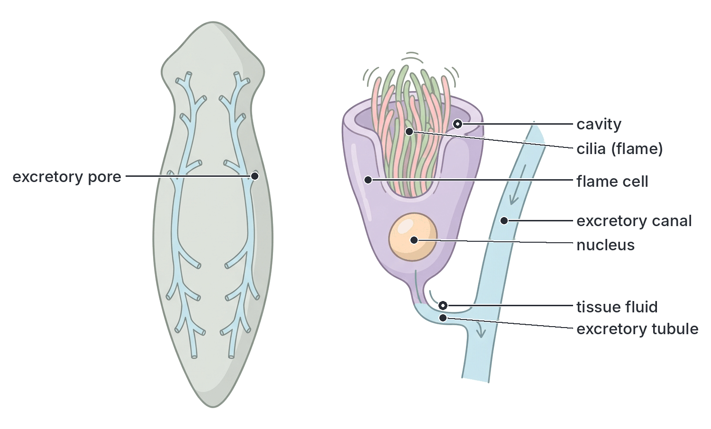
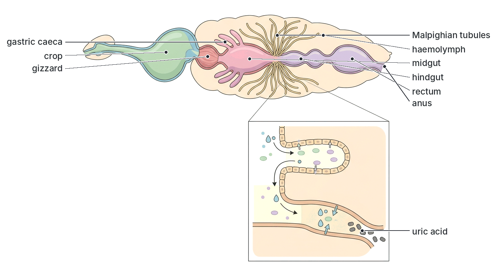
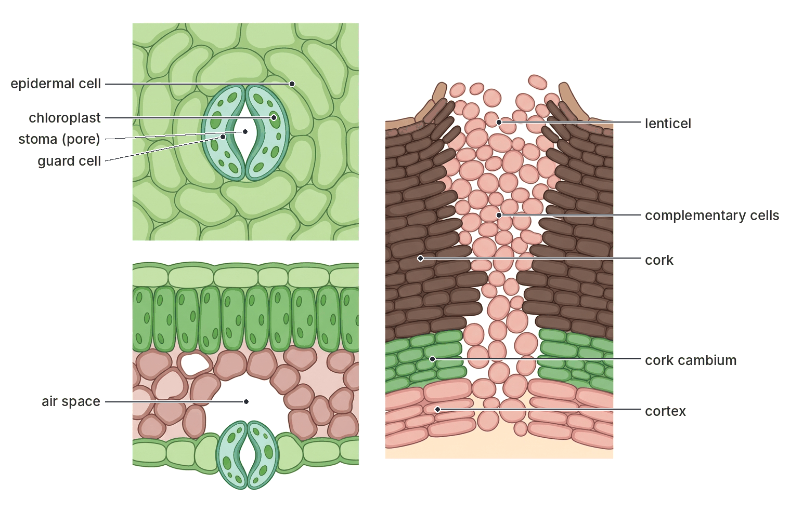
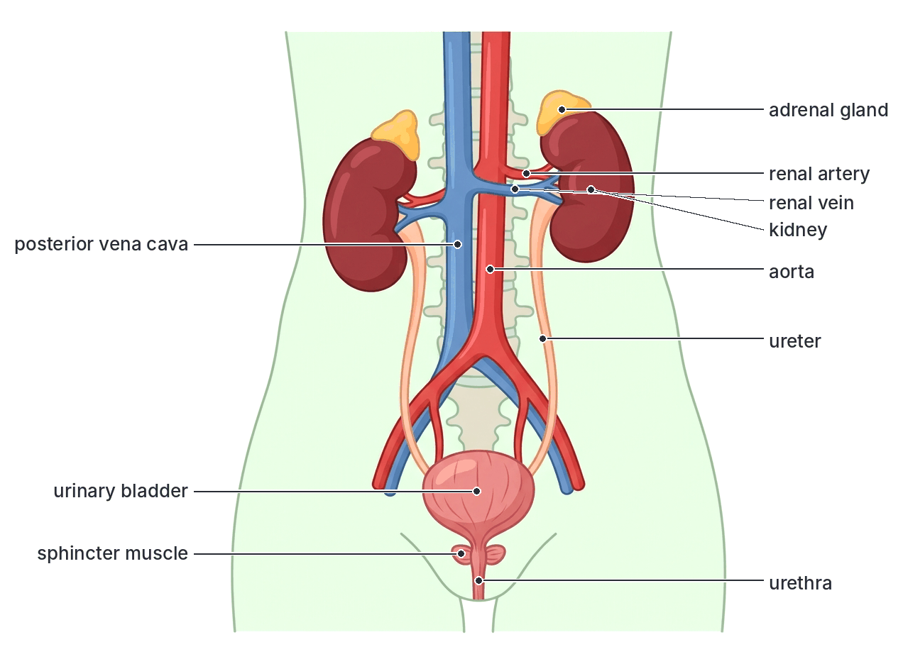
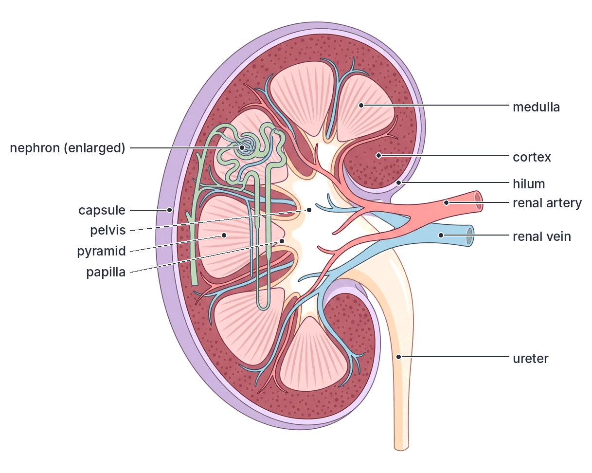
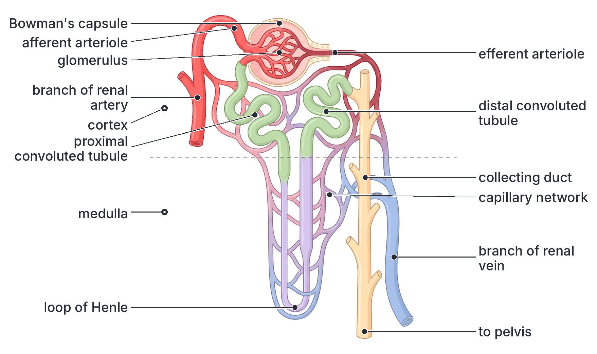
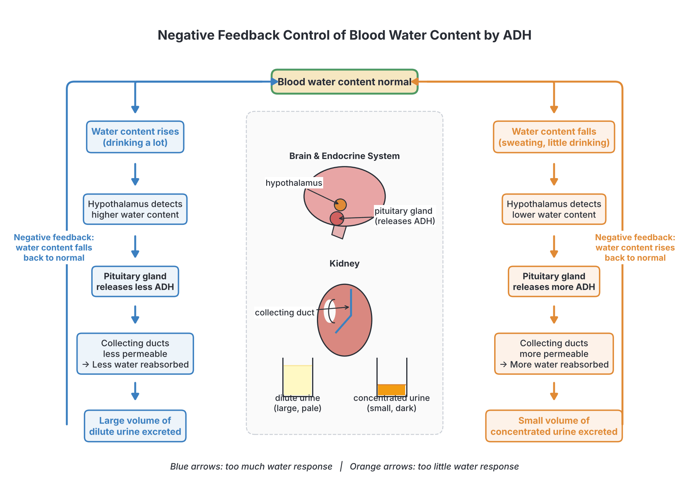
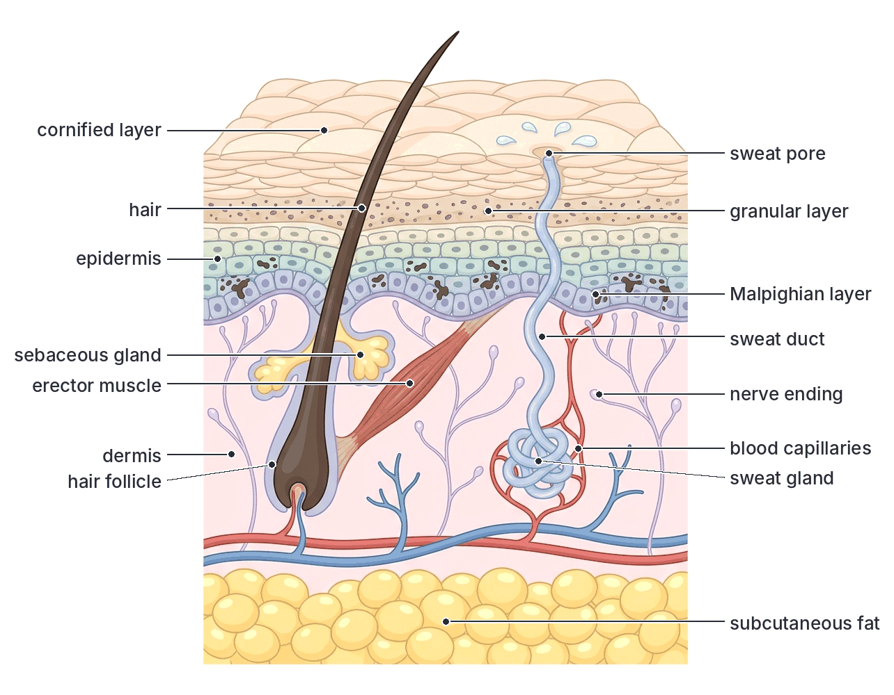
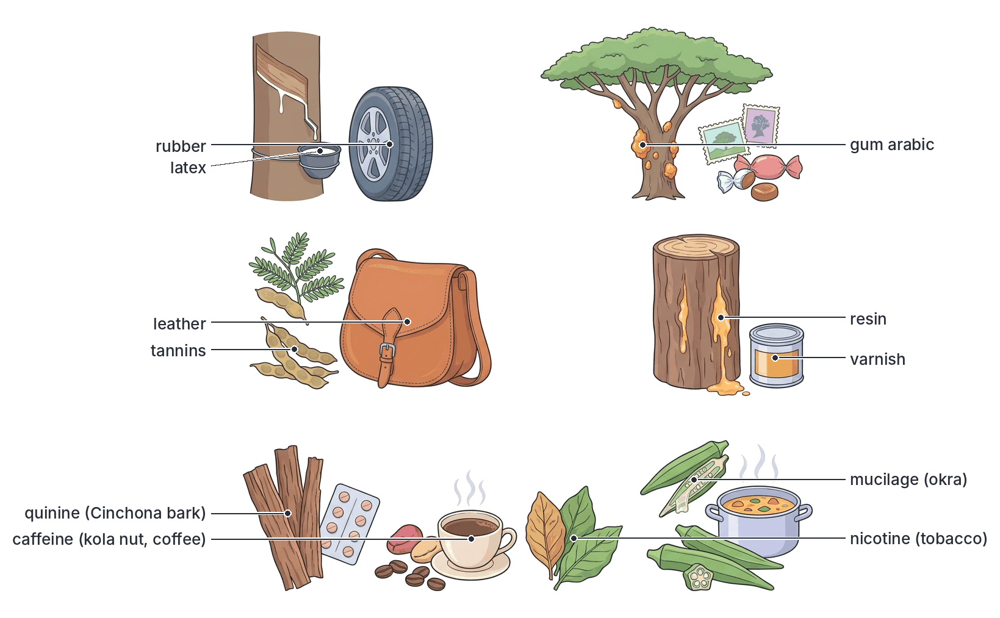

# JAMB Biology Notes: Excretion

## What JAMB expects

This topic is Section B, Topic 5 of the JAMB Biology syllabus: Form and Functions – Excretion. This file covers the whole topic. It has three content items:

- a. Types of excretory structures: contractile vacuole, flame cell, nephridium, Malpighian tubule, kidney, stoma and lenticel.
- b. Excretory mechanisms of the kidneys, lungs and skin.
- c. Excretory products of plants.

By the end of these notes, you should be able to:

1. Define excretion and state its significance (importance).
2. Relate the characteristics (features) of each excretory structure to its function.
3. Relate the structure of the kidneys to their excretory and osmoregulatory functions.
4. Identify the functions and excretory products of the lungs and the skin.
5. Deduce the economic importance of the excretory products of plants, e.g. carbon (IV) oxide, oxygen, tannins, resins, gums, mucilage, alkaloids and others.

**Note on the syllabus wording:** the syllabus lists the stoma and lenticel among "excretory structures". Plants have no true excretory organs; stomata and lenticels are pores for gaseous exchange through which waste gases and water vapour also leave the plant. They are explained below in that sense. The syllabus says "osmo-regulatory"; this is the same as osmoregulatory.

The kidney, lungs and skin also appear in other topics: the position of the excretory organs in the mammal (Topic B1, see `B1-internal-structure.md`), the lungs as respiratory organs (Topic B4) and the skin in temperature control (Topic A3, see `A3-adaptations.md`). Here the focus is on how they remove wastes.

## The meaning of excretion

**Objective i: define the meaning and state the significance of excretion.**

### Definition

**Excretion** is the removal from the body of the **waste products of metabolism** (the chemical reactions that take place inside living cells), and of substances that are present in excess, which would be harmful if they built up.

Every living cell is busy all the time: it respires, builds proteins, breaks down old molecules and so on. All of these reactions together are called **metabolism**. Like a kitchen that leaves smoke, peels and dirty water after cooking, metabolism leaves waste products. If they are not removed, they poison the cells.

**Textbook variation:** some textbooks define excretion simply as "the removal of metabolic waste products from the body". Others add "and of substances in excess of the body's needs" (such as extra water and salts). Both are accepted. The second definition explains why passing out extra water in urine after drinking a lot of zobo or water counts as excretion.

### The main excretory products and where they come from

| Excretory product | How it is formed (source) | Organisms and organs that remove it |
| --- | --- | --- |
| **Carbon (IV) oxide (CO₂)** | Respiration in every living cell | Lungs (mammals, birds, reptiles), gills (fish), body surface (earthworm, *Amoeba*), tracheae (insects), stomata and lenticels (plants) |
| **Water** | Respiration (metabolic water) and excess water taken in with food and drink | Kidneys, lungs (as water vapour), skin (in sweat), contractile vacuoles (protozoa), stomata (plants) |
| **Nitrogenous wastes** (ammonia, urea, uric acid) | Breakdown (deamination) of excess amino acids from proteins; uric acid also from nucleic acids | Kidneys, nephridia, Malpighian tubules, flame cells, gills, skin (small amounts of urea in sweat) |
| **Mineral salts** (e.g. sodium chloride) | Excess taken in with food | Kidneys, skin (sweat) |
| **Bile pigments** (bilirubin, biliverdin) | Breakdown of old red blood cells (haemoglobin) in the liver | Liver, passed out with bile into the intestine and leaves in the faeces |
| **Plant wastes** (oxygen, tannins, resins, gums, alkaloids, etc.) | Photosynthesis and other metabolism in plants | Stomata and lenticels (gases); stored in leaves, bark, fruits and vacuoles, or oozed out |

**Textbook variation (oxygen):** many West African textbooks, and the JAMB syllabus (objective v), list **oxygen** as an excretory product of plants, because it is a waste product of photosynthesis that the plant gives off. Other textbooks call it a **by-product** rather than an excretory product, because it is not made by breaking down food. For the exam, accept the syllabus view: oxygen given out in photosynthesis is an excretory product of plants.

### Nitrogenous wastes compared

When animals eat more protein than they need, the excess amino acids cannot be stored. In the liver (in vertebrates), the nitrogen-containing **amino group** is removed. This is called **deamination**. The amino group becomes **ammonia**, which is very poisonous. Animals either remove the ammonia quickly or turn it into a less poisonous substance.

| Feature | Ammonia | Urea | Uric acid |
| --- | --- | --- | --- |
| Toxicity | **Very poisonous** | Less poisonous | Least poisonous |
| Solubility in water | Very soluble | Soluble | **Almost insoluble** |
| Water needed to remove it | A lot (must be very dilute) | Moderate | Very little (removed as a paste or dry pellets) |
| Energy needed to make it | None (formed directly) | Some (made in the liver from ammonia and CO₂) | More |
| Animals that excrete it mainly | Freshwater animals: most bony fish, tadpoles, many aquatic invertebrates, protozoa | Mammals (including humans), adult amphibians (frogs, toads), cartilaginous fish (sharks) | Birds, reptiles (lizards, snakes), insects, land snails |
| Link with habitat | Plenty of water available to dilute and wash it away | Water available, but some must be saved | Saving water is vital (dry land, or developing inside a shelled egg) |

**Why birds' droppings are white:** the white part of a bird's or lizard's droppings is **uric acid**, which is excreted with very little water. This saves water and also allows the embryo inside a hard-shelled egg to store its waste as harmless crystals.

**How urea is made:** in the **liver**, ammonia from deamination is combined with carbon (IV) oxide to form **urea** in a series of reactions called the **ornithine cycle** (urea cycle). The urea goes into the blood and is carried to the kidneys, which remove it in urine. So the liver **makes** urea, but the kidneys **excrete** it.

### Excretion, egestion and secretion

These three words sound alike and are often confused.

| Feature | Excretion | Egestion | Secretion |
| --- | --- | --- | --- |
| Meaning | Removal of waste products of metabolism (made inside cells) | Removal of undigested food (faeces) from the alimentary canal | Release of a **useful** substance made by a cell or gland |
| Have the substances been made by cells? | Yes, by metabolism | No: most of the faeces never entered the body cells | Yes |
| Is the substance useful? | No, it is waste | No, it is waste | Yes |
| Examples | Urine, CO₂, sweat, bile pigments | Faeces (fibre, undigested food, bacteria) | Enzymes, hormones, saliva, mucus, milk |
| Organs involved | Kidneys, lungs, skin, liver | Anus (rectum) | Glands (e.g. salivary glands, pancreas, thyroid) |

**Note:** faeces do contain some excretory material, the **bile pigments**, which give faeces their brown colour. So, strictly, faeces are mainly egested matter with a small amount of excretory matter.

### Significance (importance) of excretion

1. **Removes poisonous substances.** Ammonia, urea and excess CO₂ are poisonous in high amounts. If urea builds up in the blood (as in kidney failure), a person becomes very ill and can die.
2. **Keeps the internal environment constant (homeostasis).** Excretion keeps the amount of water, salts and other substances in the blood and tissue fluid within narrow limits, so that cells can work properly.
3. **Controls the water balance of the body (osmoregulation).** Removing excess water stops cells from swelling and bursting; saving water stops them from shrinking. Too much water in cells, or too little, harms them.
4. **Keeps the pH of body fluids steady.** Excess CO₂ forms carbonic acid in the blood, which would make the blood too acidic. Removing CO₂, and the kidneys removing excess acid or alkali, keeps the pH near 7.4 in humans.
5. **Allows enzymes to work.** Enzymes work best at a particular pH and in the right concentration of salts; excretion maintains these conditions.
6. **Prevents waste from interfering with metabolism.** Wastes that build up can slow down or stop chemical reactions in cells.
7. **In plants,** storing or removing wastes stops them from harming the plant, and some stored wastes (tannins, alkaloids) also protect the plant from being eaten.

## Types of excretory structures

**Objective ii: relate the characteristics of each structure with functions.**

Different organisms have different excretory structures, depending on their size, complexity and habitat. Very small organisms can remove wastes through their whole body surface by **diffusion**, because they have a large surface area compared with their volume. Larger, more complex animals need special organs.

[IMAGE: A four-panel comparison of simple excretory structures. Panel 1: an Amoeba with one contractile vacuole, showing the vacuole full (large) and then contracting at the cell membrane to expel water. Panel 2: a single flame cell of a flatworm, cup-shaped, with a tuft of cilia inside the cavity and a tube leading away into an excretory canal. Panel 3: one segment of an earthworm showing a coiled nephridium with a ciliated funnel opening into the coelom in front of the septum and a pore opening on the body wall. Panel 4: the gut of an insect with many thin Malpighian tubules attached at the junction of the midgut and hindgut, floating in body fluid. Labels: contractile vacuole, nucleus, cell membrane, flame cell, cilia, excretory canal, nephrostome, septum, coiled tubule, bladder, nephridiopore, midgut, hindgut, Malpighian tubules, rectum. Soft blue for water, pale pink tissues. Clean flat textbook style, white background.]

### 1. The contractile vacuole

**Organisms:** single-celled freshwater organisms (protozoa and some algae), such as ***Amoeba***, ***Paramecium***, ***Euglena*** and ***Chlamydomonas***.

**Structure:** a small, clear, fluid-filled sac in the cytoplasm, bounded by a membrane. *Amoeba* has one contractile vacuole that can form anywhere in the cytoplasm. *Paramecium* has **two**, one at each end of the cell, in fixed positions. Each is surrounded by a ring of **radiating canals** that collect water from the cytoplasm, so it looks like a star. *Chlamydomonas* has two small contractile vacuoles near the base of its flagella.

**How it works:**

1. The cytoplasm of a freshwater protozoan contains many dissolved substances, so it is **more concentrated** (hypertonic) than the pond water around it.
2. Water therefore keeps entering the cell by **osmosis** through the cell membrane.
3. If nothing were done, the cell would swell and burst.
4. Excess water collects in the contractile vacuole (in *Paramecium*, through the radiating canals). The vacuole grows larger. This filling stage is called **diastole**.
5. When full, the vacuole moves to the cell surface, **contracts** and empties its water to the outside. This emptying stage is called **systole**.
6. A new vacuole forms, and the cycle repeats every few seconds to a minute or so.
7. Pumping water out against the osmotic flow needs **energy**, which comes from **mitochondria** clustered around the vacuole.

**Main function: osmoregulation** (controlling the water content of the cell). The contractile vacuole may also remove a little dissolved waste. Most of the cell's **CO₂ and ammonia** leave by **diffusion** across the whole cell membrane, because the cell is so small.

**Evidence that its main job is osmoregulation:**

- Marine (sea-water) protozoa, whose cytoplasm is about as concentrated as sea water, usually have **no** contractile vacuole or one that beats very slowly.
- If a freshwater protozoan is placed in a slightly salty solution, its contractile vacuole beats **more slowly**, because less water enters by osmosis.

**Textbook variation:** some textbooks call the contractile vacuole an "excretory and osmoregulatory organelle"; others stress that it is mainly osmoregulatory. For JAMB, remember that its main role is getting rid of **excess water**.

### 2. The flame cell

**Organisms:** flatworms (Platyhelminthes), such as ***Planaria*** (a free-living freshwater flatworm), the **liver fluke** (*Fasciola*) and the **tapeworm** (*Taenia*). Flame cells are also found in some other small invertebrates, such as rotifers.

**Structure:**

- A flame cell is a **hollow, cup-shaped** (or bulb-shaped) cell found among the body tissues.
- Inside its cavity is a **tuft of cilia**. When the cilia beat, they flicker like the flame of a candle, which is how the cell got its name.
- The cavity of each flame cell opens into a fine **excretory tubule**. Many tubules join to form **excretory canals** that run along each side of the body.
- The canals open to the outside through small **excretory pores**.

**How it works:**

1. Water and dissolved wastes **diffuse** from the surrounding tissue fluid into the flame cell.
2. The **beating cilia** create a current that drives the fluid out of the cavity and along the excretory tubules and canals.
3. As the fluid moves along the canals, some useful substances may be reabsorbed.
4. The fluid leaves the body through the **excretory pores**.

**Function:** in *Planaria*, which lives in fresh water, the main function is **osmoregulation** (removing excess water that enters by osmosis), together with removing some nitrogenous waste. Much of the flatworm's **ammonia** and **CO₂** also diffuse directly through its thin, flat body surface.

**How the structure suits the function:** the cilia keep the fluid moving in one direction; the very large number of flame cells spread all over the body means every cell is close to one; and the flat body gives a short diffusion distance.

The flame cell system is a simple type of excretory organ called a **protonephridium** (a "first" or primitive nephridium) because the tubules are closed at the inner end by the flame cell, not open to a body cavity.

### 3. The nephridium

**Organisms:** segmented worms (Annelida), especially the **earthworm** (e.g. *Lumbricus*, and the large African nightcrawler *Eudrilus eugeniae*, which is native to West Africa and is used in compost making).

**Structure:**

- The earthworm has a **pair of nephridia** (singular: nephridium) in almost every segment, one on each side. (The first few segments and the last one have none.)
- Each nephridium begins with a **ciliated funnel** called the **nephrostome**, which opens into the **coelom** (body cavity) of the segment in front.
- The funnel leads, through the septum (the wall between segments), into a long, **coiled tubule**. This tubule is surrounded by a network of **blood capillaries**.
- The tubule widens into a **muscular bladder** near the end.
- The bladder opens to the outside through a small pore on the body wall called the **nephridiopore**.

**How it works:**

1. The **cilia** of the nephrostome beat and draw **coelomic fluid** (containing water, urea, ammonia, salts and some useful substances) into the funnel.
2. The fluid passes along the long coiled tubule.
3. As it does so, **useful substances** (such as glucose and salts) are **reabsorbed** into the blood capillaries around the tubule. Wastes from the blood may also be added to the tubule.
4. The remaining fluid (urine) collects in the **bladder**.
5. The bladder contracts and the urine passes out through the **nephridiopore**.

**Excretory products:** mainly **urea** and **ammonia** in a dilute urine, as well as excess water. Earthworms live in moist soil, so they can afford to lose water. CO₂ leaves by diffusion through the moist **skin**, which is also the earthworm's respiratory surface.

**How the structure suits the function:** the ciliated funnel collects fluid from the body cavity; the long, coiled tubule gives a large surface for reabsorption; the network of capillaries carries reabsorbed substances away and brings wastes; the bladder stores urine; one pair per segment means wastes are removed all along the body.

**Textbook variation:** some earthworms (such as *Pheretima*) have several kinds of small nephridia (micronephridia), some of which open into the gut instead of to the outside. Textbooks for JAMB usually describe the simple "one pair per segment" type of *Lumbricus*, as here.

[IMAGE: One segment of an earthworm cut open (longitudinal view), showing a single nephridium. A ciliated funnel (nephrostome) opens into the coelom in front of the septum; a long coiled tubule surrounded by red blood capillaries lies in the next segment; the tubule widens into a muscular bladder that opens through the body wall at the nephridiopore. Small arrows show fluid entering the funnel. Labels: coelom, septum, nephrostome (ciliated funnel), coiled tubule, blood capillaries, bladder, nephridiopore, body wall, intestine. Pinkish-brown body colours. Clean flat textbook style, white background.]

### 4. The Malpighian tubules

**Organisms:** **insects** (e.g. the grasshopper, cockroach, housefly and butterfly) and some other arthropods, such as spiders. They are named after the Italian scientist **Marcello Malpighi**, who first described them.

**Structure:**

- Malpighian tubules are **long, thin, blind-ended tubes** (closed at the free end).
- They are attached to the alimentary canal at the **junction of the midgut and the hindgut**.
- Their free ends **float in the haemolymph** (the insect's blood), which fills the body cavity (the **haemocoel**).
- The number varies greatly between insects, from as few as two to more than a hundred.

**How they work:**

1. Insects have an **open circulatory system**: their blood (haemolymph) bathes the organs directly, including the Malpighian tubules.
2. The cells of the tubules take in **water, salts and nitrogenous wastes** (as soluble **potassium urate**) from the haemolymph, partly by **active transport**.
3. In the tubules, the wastes are passed along into the **hindgut**.
4. In the hindgut and especially the **rectum**, most of the **water and useful salts are reabsorbed** back into the haemolymph (some insects have special rectal pads or glands for this).
5. As water is removed, the urate turns into **uric acid**, which is almost insoluble and **precipitates** as solid crystals.
6. The uric acid leaves the body through the **anus**, together with the faeces, as **dry pellets**.

**How the structure suits the function:** many long, thin tubules give a **large surface area** for absorbing wastes; floating freely in the haemolymph puts them in direct contact with the blood; their link to the gut lets wastes leave with the faeces; reabsorption in the rectum saves water.

**Why uric acid?** Insects are small land animals with a large surface area, so they are in constant danger of drying out. Excreting **uric acid** as an almost dry paste, and reabsorbing nearly all the water in the rectum, is an important **adaptation for conserving water**. (Their waxy cuticle and spiracles that can close also save water.) Insects lose CO₂ through their **tracheae** and **spiracles**, not through the Malpighian tubules.

### 5. The kidney

**Organisms:** all **vertebrates**: fish, amphibians (frog, toad), reptiles (lizard, snake), birds and mammals (including humans, goats, cows).

**Structure in brief:** a pair of bean-shaped organs (in mammals) made of about a million tiny tubules called **nephrons** each, with a very rich blood supply. The kidney is described fully in the next main section.

**How it works in brief:** blood is filtered under high pressure in the glomeruli; useful substances are taken back into the blood; wastes, excess water and excess salts leave as **urine**, which flows down the ureters to the bladder.

**Functions:** excretion of **urea** (and other nitrogenous wastes), excess **salts** and excess **water**; **osmoregulation**; control of blood **pH**.

**Note:** in birds and reptiles, the kidneys excrete **uric acid**; in bony fish, most ammonia leaves through the **gills**, and the kidneys mainly control water balance.

### 6. The stoma

**Organisms:** flowering plants, ferns and some mosses; stomata (singular: stoma) are mostly in the **lower epidermis of leaves**, but are also found on young green stems.

**Structure:** a stoma is a tiny pore surrounded by two bean-shaped (kidney-shaped) **guard cells**. Guard cells contain **chloroplasts** (unlike ordinary epidermal cells), and their inner wall, next to the pore, is **thicker** than the outer wall. The pore opens into an **air space** (sub-stomatal chamber) inside the leaf, connected to the intercellular spaces of the spongy mesophyll.

**How it works as an excretory structure:**

1. When the guard cells take in water and become **turgid**, they bend outwards (because of their thicker inner walls), and the pore **opens**. When they lose water and become **flaccid**, the pore **closes**. (The mechanism is described in Topic B4, Respiration.)
2. When the pore is open, gases move in and out by **diffusion**, from where they are more concentrated to where they are less concentrated.
3. **By day**, photosynthesis is faster than respiration, so **oxygen** (a waste product of photosynthesis) builds up in the leaf and diffuses out through the stomata.
4. **At night** (and in very dim light), only respiration happens, so **carbon (IV) oxide** builds up and diffuses out.
5. **Water vapour** evaporates from the moist cells into the air spaces and diffuses out through the stomata. This is **transpiration**; it removes excess water.

**How the structure suits the function:** the guard cells can open and close the pore, controlling how much gas and water vapour leave; the pores are very numerous, especially on the lower leaf surface; the air spaces inside the leaf connect every cell to a stoma.

### 7. The lenticel

**Organisms:** woody plants (trees and shrubs) with bark, e.g. mango, orange, guava, kola and cashew trees; lenticels are also present on the skin of some fruits and on the surface of the Irish potato tuber.

**Structure:** a lenticel is a small, raised, often lens-shaped or oval **pore in the bark** of a woody stem (or root). The cork of the bark is waterproof and airtight, but in a lenticel the cells are **loosely packed** and rounded (called **complementary cells** or filling tissue), with many **air spaces** between them. Lenticels can be seen as small, pale, rough dots or short lines on the bark.

**How it works:** gases **diffuse** through the air spaces between the loosely packed cells. **Oxygen** enters for the respiration of the living cells inside the stem, and **carbon (IV) oxide** and some **water vapour** pass out. Lenticels work day and night and **cannot open and close** like stomata.

**How the structure suits the function:** the loosely packed cells and air spaces allow gases to pass through an otherwise airtight layer of cork, reaching the living tissues inside thick stems.

### Relating the characteristics of excretory structures to their functions (summary)

| Structure | Organism(s) | Key characteristics | Function | Main product(s) removed |
| --- | --- | --- | --- | --- |
| **Contractile vacuole** | *Amoeba*, *Paramecium*, *Euglena*, *Chlamydomonas* (freshwater protists) | Membrane-bound sac; fills and contracts rhythmically; radiating canals in *Paramecium*; surrounded by mitochondria | Removes excess water entering by osmosis (osmoregulation) | Water (some dissolved waste) |
| **Flame cell** | Flatworms: *Planaria*, liver fluke, tapeworm | Hollow cup-shaped cell with a tuft of beating cilia; joined to tubules, canals and pores | Drives fluid with wastes out of the body; osmoregulation | Water, ammonia |
| **Nephridium** | Earthworm (annelids) | One pair per segment; ciliated funnel (nephrostome); long coiled tubule with blood capillaries; bladder; nephridiopore | Collects coelomic fluid, reabsorbs useful substances, removes urine | Urea, ammonia, water |
| **Malpighian tubule** | Insects (grasshopper, cockroach, housefly) | Many thin, blind-ended tubes at the midgut–hindgut junction, bathed by haemolymph; rectum reabsorbs water | Removes nitrogenous waste while saving water | Uric acid (with faeces) |
| **Kidney** | Vertebrates (fish, frog, lizard, bird, man) | Millions of nephrons; glomeruli for filtration; tubules for reabsorption; rich blood supply | Removes nitrogenous waste, excess water and salts; osmoregulation | Urea (mammals), uric acid (birds, reptiles), water, salts |
| **Stoma** | Leaves and young stems of green plants | Pore between two guard cells that can open and close; connects to air spaces | Gaseous exchange; removes waste gases and water vapour | Oxygen (day), CO₂ (night), water vapour |
| **Lenticel** | Woody stems (mango, orange, guava) | Pore in bark filled with loosely packed cells and air spaces; always open | Gaseous exchange through bark | CO₂, water vapour |

**Pattern to notice:** as animals become larger and more complex, excretion moves from **simple diffusion over the whole surface** (protozoa), to **many small tubules spread through the body** (flame cells, nephridia), to **compact organs with a rich blood supply** (Malpighian tubules, kidneys). Animals on dry land excrete less-soluble wastes (uric acid) to save water.

## The mammalian kidney

**Objective iii: relate the structure of the kidneys to the excretory and osmo-regulatory functions.**

### The human urinary (excretory) system

The urinary system is made up of:

1. **Two kidneys:** dark red, bean-shaped organs, each about 10–12 cm long in an adult, found at the **back of the abdominal cavity**, one on each side of the vertebral column, just below the diaphragm. The **right kidney is slightly lower** than the left, because the large liver lies above it. Each kidney has an **adrenal gland** sitting on top of it (the adrenal gland is an endocrine gland, not part of the urinary system).
2. **Renal arteries:** branches of the **aorta** that bring blood, rich in urea and oxygen, to each kidney.
3. **Renal veins:** carry filtered blood, low in urea, from each kidney to the **posterior vena cava** (inferior vena cava).
4. **Two ureters:** narrow muscular tubes that carry urine from each kidney down to the bladder. Urine is pushed along by waves of muscle contraction (peristalsis).
5. **The urinary bladder:** a muscular, stretchy bag in the lower abdomen (pelvis) that stores urine. In an adult it can hold roughly 400–600 cm³ comfortably (textbooks give different figures).
6. **Sphincter muscles:** rings of muscle at the neck of the bladder that keep it closed until urination. The outer sphincter is under voluntary control (learned in early childhood).
7. **The urethra:** a tube that carries urine from the bladder to the outside. In males it is longer and passes through the penis (it also carries semen); in females it is short and opens in front of the vagina.

**Blood supply:** the kidneys receive a very large share of the blood pumped by the heart, about a fifth to a quarter of it at rest. All of the body's blood passes through the kidneys many times every day, so they can keep it clean.

### External and internal structure of the kidney

**Externally**, the kidney has a smooth surface covered by a tough, fibrous **capsule**. The inner, curved-in (concave) side is called the **hilum** (or hilus). At the hilum, the renal artery enters and the renal vein and the ureter leave.

**When a kidney is cut lengthwise (longitudinal section),** three regions can be seen:

| Region | Appearance | What it contains | Function |
| --- | --- | --- | --- |
| **Cortex** | Outer, darker red, granular layer | Bowman's capsules, glomeruli, proximal and distal convoluted tubules | Ultrafiltration; selective reabsorption |
| **Medulla** | Inner, paler layer made up of cone-shaped **pyramids** with a striped look | Loops of Henle, collecting ducts, blood vessels | Reabsorption of water; concentrating the urine |
| **Pelvis** | Funnel-shaped space at the hilum | Collects urine from the tips (papillae) of the pyramids | Passes urine into the ureter |

You can see this easily by cutting open a goat's or cow's kidney bought from the market (butchers often sell them with the fat around them; remove the fat first).

### The nephron: the working unit of the kidney

Each human kidney contains about **one million nephrons** (textbooks give figures from about 0.8 to 1.5 million). A **nephron** (kidney tubule, or uriniferous tubule) is the **structural and functional unit** of the kidney: it is where urine is made.

**Parts of a nephron, in the order fluid passes through them:**

1. **Bowman's capsule (renal capsule):** a cup-shaped, double-walled structure at the beginning of the nephron, in the cortex. Its inner wall is made of special cells (**podocytes**) with small gaps between them, so it lets small molecules through easily.
2. **Glomerulus:** a tight knot of blood **capillaries** sitting inside the cup of Bowman's capsule. Together, the glomerulus and Bowman's capsule are called a **Malpighian body** (renal corpuscle). (Do not confuse this with the Malpighian tubules of insects.)
3. **Afferent arteriole:** a small branch of the renal artery that brings blood **into** the glomerulus. It is **wide**.
4. **Efferent arteriole:** carries blood **out of** the glomerulus. It is **narrower** than the afferent arteriole. It then branches into capillaries that wrap around the tubule.
5. **Proximal (first) convoluted tubule:** a long, coiled tube in the cortex, leading from Bowman's capsule. Its walls are made of cells with **microvilli** (a "brush border") and many **mitochondria**.
6. **Loop of Henle:** a long, U-shaped loop that dips down into the **medulla** (descending limb) and comes back up to the cortex (ascending limb).
7. **Distal (second) convoluted tubule:** another coiled part in the cortex.
8. **Collecting duct:** many distal tubules empty into one collecting duct, which runs down through the medulla (pyramid) and opens into the **pelvis**.
9. **Blood capillaries** from the efferent arteriole surround the tubules and the loop of Henle and later join to form a branch of the **renal vein**.

### How urine is formed: step by step

Urine is formed in three main stages: **ultrafiltration**, **selective reabsorption** and **tubular secretion**. Water reabsorption controlled by ADH (osmoregulation) then decides how concentrated the urine will be.

#### Stage 1: Ultrafiltration (in the Malpighian body)

1. Blood from the renal artery enters the glomerulus through the wide **afferent arteriole**.
2. It leaves through the **narrower efferent arteriole**. Because more blood comes in than can easily get out, a **high blood pressure** builds up inside the glomerulus.
3. This high pressure **forces** small molecules out of the blood, through the thin walls of the glomerular capillaries and the inner wall of Bowman's capsule, into the cavity of the capsule. This is filtration under pressure, called **ultrafiltration** (pressure filtration).
4. The capillary walls and capsule wall act like a very fine sieve (a **filter membrane**). Small molecules pass through: **water, glucose, amino acids, urea, uric acid, mineral salts** (such as sodium chloride), vitamins and some hormones.
5. **Large molecules** (plasma **proteins** such as albumin) and **blood cells** (red cells, white cells, platelets) are **too big** to pass through, so they stay in the blood.
6. The fluid that collects in Bowman's capsule is called the **glomerular filtrate**. It is like blood plasma **without the proteins**.

The kidneys of an adult produce about **180 litres** of glomerular filtrate a day (about 125 cm³ every minute), yet only about **1 to 2 litres** of urine leave the body. So about **99%** of the filtrate must be taken back into the blood.

**How the structure suits ultrafiltration:**

- The **efferent arteriole is narrower** than the afferent, which raises the pressure in the glomerulus.
- The renal artery is a short, direct branch of the **aorta**, so the blood arrives at high pressure.
- The glomerulus is a **knot of many capillaries**, giving a large surface area for filtration.
- The capillary walls and the inner wall of Bowman's capsule are **very thin**, with tiny pores, so filtration is fast.
- The **cup shape** of Bowman's capsule surrounds the glomerulus and collects all the filtrate.

#### Stage 2: Selective reabsorption (in the tubules)

As the filtrate passes along the nephron, **useful substances are taken back** into the blood in the surrounding capillaries. Only what the body needs is reabsorbed, so this is called **selective reabsorption**.

1. **Proximal convoluted tubule:**
   - **All the glucose** and **all the amino acids** are reabsorbed (in a healthy person), by **active transport**, which uses energy.
   - Most of the **mineral salts** (e.g. sodium ions) are reabsorbed, also largely by active transport.
   - About two-thirds or more of the **water** follows by **osmosis**.
   - Vitamins and some small proteins that leaked through are also taken back.
   - **Urea** is not actively reabsorbed (a little diffuses back), so it becomes **more concentrated** in the filtrate as water is removed.
2. **Loop of Henle:** salts are pumped out of the ascending limb into the tissue of the medulla. This makes the medulla **very salty (hypertonic)**. The salty medulla later helps draw water out of the collecting ducts by osmosis. (Mammals that live in deserts have very long loops of Henle and can make very concentrated urine.)
3. **Distal convoluted tubule:** more salts and water are reabsorbed, according to the body's needs. The pH of the blood is also adjusted here.
4. **Collecting duct:** the final amount of **water** reabsorbed is decided here, under the control of **ADH** (see osmoregulation below).

**How the structure suits reabsorption:**

- The proximal tubule is **long and coiled**, giving a long time and a large surface area for reabsorption.
- Its cells have **microvilli**, which greatly increase the surface area.
- Its cells have many **mitochondria**, which supply the energy (ATP) for active transport.
- The tubules are surrounded by a **dense network of capillaries**, which carry away reabsorbed substances quickly and keep the concentration gradients steep.
- The **loop of Henle** creates the salty medulla that lets water be withdrawn.

#### Stage 3: Tubular secretion

Some substances are **actively secreted** from the blood in the capillaries **into the tubule**, especially in the distal convoluted tubule. These include some **hydrogen ions** (to control blood pH), **potassium ions**, **creatinine**, and some **drugs and poisons** (e.g. penicillin and some other medicines). This gets rid of wastes that were not filtered out in the glomerulus.

**Textbook variation:** many school textbooks describe only two stages (ultrafiltration and selective reabsorption) and mention secretion briefly or not at all. JAMB questions usually focus on ultrafiltration and selective reabsorption.

#### What happens to the urine

The fluid left in the collecting duct is **urine**. Collecting ducts open at the tips of the pyramids into the **pelvis**. Urine flows down the **ureter** to the **bladder**, where it is stored. When the bladder is fairly full, stretch receptors in its wall send impulses to the brain, and you feel the urge to urinate. The sphincters relax, the muscular wall of the bladder contracts, and urine passes out through the **urethra** (**micturition**, or urination).

[IMAGE: Flow diagram of urine formation along a simplified nephron. Arrows show: at the glomerulus and Bowman's capsule, "water, glucose, amino acids, urea, salts" forced into the capsule while "blood cells and plasma proteins" stay in the blood; along the proximal tubule, arrows of "all glucose, all amino acids, most salts, most water" leaving the tubule into the capillaries; at the loop of Henle, salts moving into the medulla; along the collecting duct, water leaving under the influence of ADH; at the end, "urine: water, urea, salts" going to the pelvis. Use three colours to separate the stages: orange for ultrafiltration, green for selective reabsorption, blue for water reabsorption. Labels: ultrafiltration, glomerulus, Bowman's capsule, glomerular filtrate, selective reabsorption, proximal convoluted tubule, loop of Henle, distal convoluted tubule, collecting duct, ADH, urine to pelvis. Clean flat textbook style, white background.]

### Comparing blood plasma, glomerular filtrate and urine

The figures below are **approximate** typical values, given in grams per 100 cm³. Different textbooks quote slightly different figures, but the pattern is always the same.

| Substance | Blood plasma (g/100 cm³) | Glomerular filtrate (g/100 cm³) | Urine (g/100 cm³) | What this shows |
| --- | --- | --- | --- | --- |
| Water | about 90–93 | about 97–99 | about 95–96 | Most water is reabsorbed; how much depends on ADH |
| Plasma proteins | about 7–9 | 0 | 0 | Proteins are too large to be filtered |
| Glucose | about 0.1 | about 0.1 | 0 | Filtered, then **all** reabsorbed |
| Amino acids | about 0.05 | about 0.05 | 0 | Filtered, then **all** reabsorbed |
| Urea | about 0.03 | about 0.03 | about 2.0 | Filtered and **concentrated** about 60 times as water is removed |
| Mineral salts (inorganic ions) | about 0.7–0.9 | about 0.7–0.9 | about 1.0–1.8 | Some reabsorbed, rest excreted; urine is usually more concentrated |

**Reading the table (a favourite type of JAMB question):**

- A substance found in plasma but **not** in the filtrate (protein) is **not filtered**.
- A substance found in plasma and filtrate but **not** in urine (glucose, amino acids) is **completely reabsorbed**.
- A substance much **more concentrated** in urine than in filtrate (urea) is **not reabsorbed** (or very little), while water is.

**Glucose in urine:** if glucose is found in urine, it usually means the blood glucose level is too high for the tubules to reabsorb it all. This is a sign of **diabetes mellitus** (caused by too little insulin, or the body not responding to insulin). **Protein in urine** may be a sign of damage to the glomeruli.

### Composition of normal human urine

Normal urine is a clear, pale yellow (straw-coloured) liquid. Its colour comes mainly from a pigment called **urochrome**, which comes from the breakdown of haemoglobin. Darker urine usually means the body is short of water. An adult passes about **1 to 2 litres** a day, depending on how much they drink, the weather and how much they sweat.

| Component | Approximate amount | Notes |
| --- | --- | --- |
| **Water** | About 95–96% | The solvent |
| **Urea** | About 2% | The main nitrogenous waste in humans |
| **Mineral salts** | About 1.5–2% | Mainly sodium chloride (common salt); also potassium, phosphate, sulphate and ammonium ions |
| **Other nitrogenous wastes** | Small amounts | **Uric acid**, **creatinine** (from muscles) and ammonia |
| **Pigment** | Trace | Urochrome (gives the yellow colour) |
| **Others** | Traces | Excess hormones, vitamins (e.g. excess vitamin C and B), drugs and their breakdown products |

Normal urine contains **no glucose, no protein and no blood cells**. Urine is usually slightly acidic, but its pH changes with diet.

**Textbook variation:** percentages for urine vary between textbooks (urea is given as 2% to 2.5%; water as 95% to 96%). Learn the order: water is the largest part, then urea, then salts.

### Osmoregulation by the kidney

**Osmoregulation** is the control of the **water content** and **salt concentration** (osmotic pressure) of the blood and body fluids, so that they stay almost constant. It is part of **homeostasis**. If the blood became too dilute, water would enter body cells by osmosis and they could swell and burst; if it became too concentrated, cells would lose water and shrink. The kidney is the main organ of osmoregulation in mammals.

#### The role of antidiuretic hormone (ADH)

**ADH** (antidiuretic hormone, also called **vasopressin**) is made in the **hypothalamus** of the brain and released into the blood by the **pituitary gland** (posterior lobe). Its target is the kidney. ADH makes the walls of the **distal convoluted tubule** and the **collecting duct** **more permeable to water**, so more water is reabsorbed into the blood and **less urine** is made. ("Antidiuretic" means "against making a lot of urine".)

**Case 1: when the body is short of water** (on a hot day in Maiduguri, after heavy sweating, after eating salty food, or after drinking little):

1. The blood becomes **more concentrated** (its water content falls).
2. **Receptors** (osmoreceptors) in the **hypothalamus** detect the change.
3. The pituitary gland releases **more ADH** into the blood. (You also feel **thirsty**.)
4. ADH reaches the kidney and makes the collecting ducts **more permeable** to water.
5. **More water** is reabsorbed by osmosis into the salty medulla and then into the blood.
6. A **small volume** of **concentrated**, dark yellow urine is produced.
7. The water content of the blood rises back to normal, and ADH release falls again.

**Case 2: when the body has too much water** (after drinking a lot of water, soft drinks or zobo, or in cold weather when you sweat little):

1. The blood becomes **more dilute** (its water content rises).
2. The hypothalamus detects the change.
3. The pituitary gland releases **less ADH**.
4. The collecting ducts become **less permeable** to water.
5. **Less water** is reabsorbed.
6. A **large volume** of **dilute**, pale urine is produced.
7. The water content of the blood falls back to normal.

This is an example of **negative feedback**: a change away from normal causes a response that brings conditions back to normal.

| Condition | Water content of blood | ADH released | Permeability of collecting duct | Volume of urine | Concentration of urine |
| --- | --- | --- | --- | --- | --- |
| Hot day, heavy sweating, little drinking | Low | **More** | High | **Small** | **Concentrated** (dark) |
| Cold day, drinking a lot | High | **Less** | Low | **Large** | **Dilute** (pale) |

**Diabetes insipidus:** if the pituitary does not produce enough ADH (or the kidney does not respond to it), the person passes very large amounts of dilute urine and is always thirsty. Do not confuse this with **diabetes mellitus** (glucose in urine, caused by an insulin problem).

**Alcohol and caffeine** reduce the release of ADH (or its effect), so they make people pass more urine. Such substances are called **diuretics**.

**Salt balance:** another hormone, **aldosterone** (from the adrenal cortex), makes the kidney tubules reabsorb more **sodium** when the body is short of salt. JAMB does not usually test aldosterone in detail.

### Other functions of the kidney (homeostasis)

1. **Excretion** of urea, uric acid, creatinine and other nitrogenous wastes.
2. **Osmoregulation:** control of the water and salt content of the blood.
3. **Regulation of blood pH:** removal of excess hydrogen ions (acids) or hydrogen carbonate (alkalis).
4. **Removal of foreign substances:** drugs, poisons and excess vitamins and hormones.
5. **Control of blood pressure:** by adjusting the volume of water kept in the blood (and by releasing a substance called renin).
6. **Hormone production:** the kidney releases **erythropoietin**, which stimulates the bone marrow to make red blood cells, and helps activate **vitamin D**.

### Kidney diseases and dialysis (in brief)

| Problem | Cause | Effect |
| --- | --- | --- |
| **Kidney stones** (renal calculi) | Salts (often calcium oxalate or uric acid) crystallise in the kidney, often when a person drinks too little water | Severe pain in the back and side; blockage of the ureter; blood in urine |
| **Nephritis** (inflammation of the kidney) | Infection or damage to the glomeruli | Protein and blood in urine; swelling of the body |
| **Kidney (renal) failure** | Long-term high blood pressure, uncontrolled diabetes, some infections, abuse of some painkillers and herbal mixtures, severe dehydration or blood loss | The kidneys stop working properly; **urea**, salts and water build up in the blood; it can be fatal without treatment |
| **Schistosomiasis (bilharzia), urinary type** | The blood fluke *Schistosoma haematobium*, caught from snail-infested fresh water in many parts of Nigeria | Blood in the urine (haematuria); damage to the bladder and, in severe cases, the kidneys |

**Treatment of kidney failure:**

- **Dialysis (haemodialysis, the "kidney machine"):** the patient's blood is passed through a machine in which it flows alongside a **dialysis fluid**, separated by a thin **partially permeable membrane** (dialysis tubing). Urea and excess salts **diffuse** out of the blood into the fluid, because the fluid has none of these (or less of them). The dialysis fluid contains the normal amount of **glucose** and useful salts, so these are not lost from the blood. Blood cells and proteins are too large to cross the membrane. The cleaned blood is returned to the patient. Patients usually need dialysis two or three times a week, for several hours each time.
- **Kidney transplant:** a healthy kidney from a donor (often a close relative) is placed in the patient's body. The tissues must match closely, and the patient takes drugs to stop the body from rejecting the new kidney. A person can live a normal life with one healthy kidney.

**Keeping the kidneys healthy:** drink enough clean water, especially in hot weather; avoid misuse of painkillers, alcohol and unknown herbal mixtures; control blood pressure and blood sugar; avoid bathing or swimming in water infested with snails (to prevent schistosomiasis).

## The lungs as excretory organs

**Objective iv (part 1): identify the functions and excretory products of the lungs.**

### Excretory products of the lungs

1. **Carbon (IV) oxide (CO₂):** produced by **respiration** in all the body's cells. It is carried in the blood (mostly as hydrogen carbonate ions in the plasma) to the lungs.
2. **Water vapour:** some of the water made in respiration (and water from body fluids) evaporates from the moist lining of the alveoli and leaves in the breath.
3. **Small amounts of other volatile substances**, such as **alcohol** after drinking (this is how a breathalyser test works) and some substances from strongly flavoured foods (e.g. garlic and onions).

### How the lungs excrete CO₂ and water vapour

1. Blood arriving at the lungs in the **pulmonary artery** is deoxygenated and **rich in CO₂**.
2. The blood flows through the network of **capillaries** around the millions of **alveoli** (air sacs).
3. The concentration of CO₂ is **higher in the blood** than in the air in the alveoli, so CO₂ **diffuses** out of the blood, across the thin capillary and alveolar walls, into the alveoli.
4. At the same time, **oxygen diffuses** in the opposite direction, from the alveoli into the blood.
5. Water evaporates from the moist alveolar surface into the air in the alveoli.
6. When we **breathe out** (expiration), the air containing the extra CO₂ and water vapour is pushed out of the lungs, through the bronchi, trachea, nose and mouth.

### Features of the lungs that suit them for excretion (and gaseous exchange)

- **Very large surface area:** millions of alveoli (often estimated at about 300 million in the two lungs; the total surface is roughly the size of a tennis court).
- **Very thin walls:** alveolar and capillary walls are each only one cell thick, giving a short diffusion distance.
- **Rich blood supply:** a dense network of capillaries around each alveolus keeps a steep concentration gradient.
- **Moist lining:** gases dissolve before diffusing across the walls.
- **Ventilation (breathing):** constantly replaces air in the alveoli, keeping CO₂ low inside them.

### Comparing inhaled and exhaled air

| Component | Inhaled air (approximately) | Exhaled air (approximately) |
| --- | --- | --- |
| Oxygen | 21% | 16% |
| Carbon (IV) oxide | 0.04% | 4% |
| Nitrogen | 78% | 78% (unchanged) |
| Water vapour | Variable (depends on weather) | Saturated (much more) |
| Temperature | Varies with surroundings | About body temperature |

**Textbook variation:** older textbooks give the CO₂ in inhaled air as 0.03%. It has risen over the years and is now about 0.04%.

### Experiment: to show that exhaled air contains more carbon (IV) oxide than inhaled air

- **Aim:** to show that the lungs excrete carbon (IV) oxide.
- **Materials:** two boiling tubes (or test tubes) A and B, each containing the same volume of clear **lime water**; delivery tubes; a mouthpiece connected so that breathing **in** draws air through tube A and breathing **out** blows air through tube B.
- **Method:** breathe gently in and out through the mouthpiece for about a minute. Inhaled air bubbles through A; exhaled air bubbles through B.
- **Observation:** the lime water in **B (exhaled air)** turns **milky** quickly. The lime water in **A (inhaled air)** stays clear, or turns slightly milky only after a long time.
- **Conclusion:** exhaled air contains **much more carbon (IV) oxide** than inhaled air, so the lungs excrete CO₂. (Tube A acts as the **control**.)
- **Note:** hydrogen carbonate indicator can be used instead; it changes from red to **yellow** with more CO₂.

**To show that exhaled air contains water vapour:** breathe onto a cold, dry mirror or glass. It becomes misty. The liquid formed turns **white anhydrous copper (II) sulphate blue** (or dry blue cobalt chloride paper **pink**), which shows it is water.

[IMAGE: Experimental set-up for comparing inhaled and exhaled air. Two boiling tubes in a rack, each containing clear lime water, connected by bent glass delivery tubes to a single Y-shaped mouthpiece. Tube A is set so that air is drawn in through the lime water when breathing in; tube B is set so that exhaled air bubbles through the lime water. Show tube B's lime water milky white and tube A's still clear, with small arrows showing the direction of air flow. Labels: mouthpiece, tube A (inhaled air), tube B (exhaled air), lime water, clear, milky, delivery tube. Clean flat textbook style, white background.]

### Other functions of the lungs

- **Gaseous exchange:** taking in oxygen for respiration (the main function; see Topic B4).
- **Helping to control blood pH** by changing the rate of CO₂ removal (faster breathing removes more CO₂ and makes the blood less acidic).
- **Some heat and water loss** in the exhaled air.
- **Voice production:** air expelled from the lungs passes over the vocal cords in the larynx.

## The skin as an excretory organ

**Objective iv (part 2): identify the functions and excretory products of the skin.**

### Excretory products of the skin

The skin excretes **sweat**, which is produced by **sweat glands** in the dermis. Sweat contains:

- **Water** (about 99%).
- **Mineral salts**, mainly **sodium chloride** (this is why sweat tastes salty and leaves white marks on dark clothes).
- **Small amounts of urea** and other nitrogenous wastes (e.g. a little uric acid and ammonia).
- Traces of **lactic acid** and some other substances.

### How the skin excretes (formation of sweat)

1. Each **sweat gland** is a long, coiled tube lying deep in the **dermis**. It is surrounded by blood **capillaries**.
2. Water, salts and a little urea pass from the blood in the capillaries into the cells of the coiled part of the gland, which form **sweat**.
3. Sweat travels up a narrow **sweat duct** through the epidermis.
4. It comes out on the skin surface through a tiny opening called a **sweat pore**.
5. On the surface, the water **evaporates**, taking heat away from the body; the salts and urea are left on the skin and are washed off when we bathe.

The amount of sweat produced depends mainly on the body's **temperature**: much more sweat is produced on hot days, in hot places (for example during the dry season in Sokoto or Kano), and during exercise.

**Textbook variation:** the main purpose of sweating is to **cool the body** (temperature regulation), not excretion. The amount of urea lost in sweat is small compared with urine. Most textbooks still call the skin an excretory organ because it removes water, salts and some urea. In very hot conditions or heavy work, a lot of salt can be lost in sweat, which is why people may need extra salt and water.

### Structure of the skin (related to excretion)

| Layer or structure | Description | Role |
| --- | --- | --- |
| **Epidermis** | Outer layer: dead, flattened cells on top (cornified layer), living layers below (granular layer and Malpighian/germinative layer, which divides to make new cells and contains the pigment melanin) | Protection; sweat ducts pass through it |
| **Dermis** | Thick inner layer of connective tissue | Contains sweat glands, blood vessels, nerve endings, hair follicles and sebaceous glands |
| **Sweat gland** | Coiled tube in the dermis | **Produces sweat (excretion and cooling)** |
| **Sweat duct and pore** | Tube and opening leading to the surface | Carries sweat to the surface |
| **Blood capillaries** | Network in the dermis | Bring water, salts and urea to the sweat glands; control heat loss |
| **Sebaceous gland** | Gland opening into the hair follicle | Secretes oily **sebum** that keeps skin and hair soft and waterproof (a secretion, not an excretion) |
| **Subcutaneous fat** | Layer of fat below the dermis | Insulation, food store |

### Functions of the skin

1. **Excretion:** removes water, salts and a little urea in sweat.
2. **Temperature regulation:** sweating, vasodilation and vasoconstriction of blood vessels, raising and lowering hairs, and the insulating fat layer (see Topic A3).
3. **Protection:** the tough epidermis protects the body from **injury**, **germs** (bacteria and fungi) and **drying out**; the pigment **melanin** protects the deeper tissues from harmful **ultraviolet** rays of the sun.
4. **Sense organ:** nerve endings detect **touch, pressure, pain, heat and cold**.
5. **Synthesis of vitamin D:** the skin makes vitamin D when exposed to sunlight.
6. **Storage:** the subcutaneous layer stores **fat**, a food reserve.
7. **Wound healing:** blood clots at the surface and the germinative layer divides to repair cuts.

## Other excretory organs in mammals: the liver

The syllabus names the kidneys, lungs and skin. Many textbooks also count the **liver** as an excretory organ, so it is worth knowing:

- The liver **deaminates** excess amino acids and makes **urea**, which the kidneys excrete.
- The liver breaks down old **red blood cells** and excretes their pigments (**bile pigments**: bilirubin and biliverdin) in **bile**. The bile flows into the duodenum and the pigments leave in the faeces. If the liver or bile duct is not working properly, bile pigments build up in the blood and the skin and eyes look yellow (**jaundice**).
- The liver breaks down (detoxifies) **alcohol**, many **drugs** and poisons, and excess **hormones**; the products are removed by the kidneys.

### Excretory organs of mammals compared

| Organ | Main excretory products | Form in which they leave | Main other functions |
| --- | --- | --- | --- |
| **Kidneys** | Urea, uric acid, creatinine, excess water, excess salts, drugs | Urine | Osmoregulation, pH control, blood pressure control |
| **Lungs** | Carbon (IV) oxide, water vapour | Exhaled air | Gaseous exchange (oxygen intake) |
| **Skin** | Water, mineral salts, a little urea | Sweat | Temperature control, protection, sensation, vitamin D |
| **Liver** | Bile pigments; makes urea | Bile (in faeces); urea goes to the kidneys | Deamination, detoxification, storage of glycogen, iron and vitamins |

## Excretion in plants

**Content c: excretory products of plants.**

### Why plants have no special excretory organs

Plants excrete much less, and much more slowly, than animals. They have no kidneys or similar organs because:

1. **Plants are less active** than animals (they do not move from place to place), so their rate of metabolism and respiration is **lower**, and they make less waste.
2. **Plants are autotrophs:** they build up their own proteins from simple substances (nitrates and carbohydrates) only as they need them, so they rarely have **excess amino acids**. They therefore produce very little nitrogenous waste. Nitrogen is valuable and scarce for plants, so they **re-use** it.
3. **Waste products are recycled:** the CO₂ made in respiration is used in **photosynthesis** by day, and the oxygen made by photosynthesis is used in **respiration**.
4. **Many plant wastes are not very poisonous**, so they can be safely **stored** in parts of the plant.
5. Plants have a lot of **dead tissue** (such as the wood and bark) in which wastes can be stored without harming living cells.

### How plants get rid of their wastes

| Method | What happens | Examples |
| --- | --- | --- |
| **Diffusion through stomata** | Oxygen (by day), CO₂ (at night) and water vapour diffuse out of the leaves | All green leaves |
| **Diffusion through lenticels** | CO₂ and water vapour leave through pores in the bark | Woody stems of mango, orange, guava |
| **Storage in leaves that fall off** | Wastes are moved into old leaves, which then drop off (leaf fall, abscission) | Deciduous trees, e.g. many savanna trees in the dry season; ageing leaves of most plants |
| **Storage in bark** | Wastes such as tannins and resins collect in the bark, which peels off | Mango, mahogany, mangrove |
| **Storage in vacuoles and cells** | Wastes are stored as harmless crystals or dissolved substances in cell vacuoles | Calcium oxalate crystals (raphides) in cocoyam and other aroids; alkaloids in tobacco leaves, kola nuts and coffee beans |
| **Storage in fruits, seeds and flowers** | Wastes are sent to fruits or petals, which are later shed | Caffeine in coffee and kola seeds; tannins in unripe fruits |
| **Oozing out (exudation)** | Gums, resins and latex ooze out, especially after injury | Gum arabic from *Acacia senegal*; latex from the rubber tree and pawpaw |
| **Guttation** | Drops of water containing dissolved salts are given out through special pores (hydathodes) at the leaf edges, usually at night or early morning when the soil is wet | Grasses, cocoyam leaves, tomato |
| **Through the roots** | Some wastes diffuse into the soil from the roots | Many plants |

**Textbook variation:** some textbooks call the wastes stored in plants "secondary metabolites" or "secondary products" rather than excretory products, because many of them help the plant (for example, by making it bitter or poisonous to animals that would eat it). The JAMB syllabus calls them excretory products.

**Did you know?** The itching or burning you feel when you eat badly cooked cocoyam, or touch some cocoyam leaves, is caused by needle-shaped crystals of **calcium oxalate** (raphides) stored in the cells. Proper boiling reduces this effect.

## Economic importance of the excretory products of plants

**Objective v: deduce the economic importance of the excretory products of plants e.g., carbon (IV) oxide, oxygen, tannins, resins, gums, mucilage, alkaloids etc.**

"Economic importance" means how a substance is **useful** (or harmful) to people, industry, farming and the environment.

### 1. Carbon (IV) oxide (CO₂)

**Source in plants:** respiration in all living cells, given out at night (and through lenticels and roots at all times).

**Economic importance:**

1. **Raw material for photosynthesis:** the CO₂ released by plants (and animals) is taken up by green plants by day to make food. All food crops (yam, maize, rice, cassava) depend on it.
2. **Part of the carbon cycle:** respiration by plants returns carbon to the air, so it can be used again.
3. **Industrial uses of carbon (IV) oxide** (generally obtained from industrial sources, not collected from plants): making **carbonated (fizzy) soft drinks** and soda water; **fire extinguishers** (CO₂ does not support burning); **dry ice** (solid CO₂) for keeping food and medicines cold; and in bread making, where the CO₂ produced by yeast makes dough rise (see Topic B4, uses of yeast).
4. **Harmful effect:** too much CO₂ in the atmosphere (mainly from burning fuels and destroying forests) is a **greenhouse gas** that contributes to **global warming** and climate change.

### 2. Oxygen

**Source in plants:** given out by green leaves by day as a waste product of **photosynthesis**.

**Economic importance:**

1. **Respiration:** almost all living organisms, including humans, livestock and the plants themselves, need oxygen to release energy from food. Green plants (and algae in water) **replace the oxygen** used up in respiration and burning, keeping the oxygen in the air at about 21%. This is one reason forests and tree planting are important.
2. **Aquatic life:** oxygen given out by water plants and algae dissolves in ponds and rivers and is used by fish (important in fish farming).
3. **Burning (combustion):** oxygen is needed for fuels such as firewood, kerosene and cooking gas to burn.
4. **Medical and industrial oxygen** (made industrially from air, not collected from plants) is used in hospitals for patients with breathing difficulty, in **welding and cutting** metals (oxy-acetylene flame), by divers and mountain climbers, and in steel making.

### 3. Tannins

**What they are:** bitter, astringent (mouth-drying) chemical compounds stored in the **bark**, **leaves**, **unripe fruits**, **seeds** and **wood** of many plants. They help protect plants from being eaten by animals and from attack by fungi.

**Plant sources:** the pods of *Acacia nilotica* (called **bagaruwa** in Hausa), mangrove bark, the bark of many trees, tea leaves, **kola nuts**, unripe banana and plantain, cashew, guava leaves.

**Economic importance:**

1. **Tanning leather:** tannins combine with the proteins in animal skins and turn raw hides into tough, long-lasting **leather** that does not rot. The famous traditional leather industry of **Kano** and **Sokoto** has long used the pods of *Acacia nilotica* (bagaruwa) to tan goat and cattle skins; the fine goatskin leather of this region is known worldwide.
2. **Making ink and dyes:** tannins react with iron salts to give dark blue-black colours, used in traditional inks and in dyeing.
3. **Medicines:** tannins are astringent; they are used in some medicines to treat diarrhoea, stop minor bleeding and treat burns. Many traditional herbal remedies made from bark contain tannins.
4. **Flavour in drinks:** tannins give the bitter, dry taste of **tea** and of kola nuts.
5. **Preserving wood and fishing nets:** tannin-rich bark extracts protect wood, ropes and nets from rotting.
6. **Harmful effect:** large amounts of tannins in animal feed reduce the digestion of proteins.

### 4. Resins

**What they are:** sticky, usually sweet-smelling substances that do not dissolve in water, produced in special **resin ducts** or canals, mainly in the bark and wood. They ooze out when a tree is wounded and harden in air, sealing the wound and keeping out insects and fungi.

**Plant sources:** pine trees and other conifers; the **frankincense** trees (*Boswellia* species, one of which, *Boswellia dalzielii*, grows in the savanna of northern Nigeria); the African elemi tree (*Canarium schweinfurthii*); mango and some other trees.

**Economic importance:**

1. **Varnishes, lacquers and paints:** resins form a hard, shiny, waterproof coating on wood and furniture.
2. **Turpentine and rosin:** distilling pine resin gives **turpentine** (a solvent for paints) and solid **rosin** (used on the bows of violins, in soldering, in making soap, paper sizing and sealing wax).
3. **Incense and perfumes:** **frankincense** and **myrrh** are resins burned as incense and used in perfumes. Resins are burned in some traditional and religious ceremonies.
4. **Medicines:** some resins are used in ointments, plasters and traditional remedies.
5. **Amber:** fossilised resin, used in jewellery; insects trapped in amber give scientists information about ancient life.
6. **Adhesives and printing inks.**

### 5. Gums

**What they are:** thick, sticky substances that **dissolve or swell in water** (unlike resins) to form a thick, gluey liquid. They are carbohydrates (polysaccharides). Gums ooze out from cracks or wounds in the bark and harden into "tears" or lumps in the air.

**Plant sources:** the most important is **gum arabic**, from ***Acacia senegal*** (now often called *Senegalia senegal*) and *Acacia seyal*, trees of the dry savanna and Sahel. In Nigeria, gum arabic is collected in the **northern states** (the "gum belt" includes states such as Borno, Yobe, Bauchi, Jigawa, Kano, Sokoto, Kebbi and Zamfara). Nigeria is one of the world's leading producers and exporters of gum arabic (Sudan is the largest). Collectors cut (tap) the bark in the dry season and pick the dried gum lumps a few weeks later.

**Textbook variation (name):** many botanists have moved *Acacia senegal* into a new genus, *Senegalia*, so it may be written *Senegalia senegal*. Most school textbooks still use *Acacia senegal*.

**Economic importance:**

1. **Food industry:** gum arabic is used as a **thickener, stabiliser and emulsifier** in sweets, chewing gum, soft drinks, ice cream and other foods (on food labels it is called E414).
2. **Adhesives:** used as glue on **postage stamps**, envelopes and labels, and in making office gum.
3. **Medicines:** binding tablets, making cough syrups and soothing mixtures.
4. **Printing, inks, paints and cosmetics.**
5. **Textiles:** used in finishing cloth.
6. **Income and foreign exchange:** gum arabic is an important **export crop**, providing income for many rural families in northern Nigeria. *Acacia senegal* trees also help to fight **desertification**: they hold the soil, fix nitrogen and can be planted in shelter belts.

### 6. Mucilage

**What it is:** a thick, slimy, gel-like substance (a polysaccharide) that **swells in water**. It is similar to gum but is usually found inside plant cells or cell walls, not oozing from wounds. It helps plants **store water**, helps seeds absorb water and stick to the soil when germinating, and protects growing root tips.

**Plant sources:** **okra** (*Abelmoschus esculentus*) pods; **ewedu** (jute leaves, *Corchorus olitorius*); **ogbono** (seeds of the bush mango, *Irvingia*), the seeds of some plants (e.g. basil); cactus and aloe leaves; the root tips and seed coats of many plants.

**Economic importance:**

1. **Food:** mucilage gives the "draw" (slimy texture) to popular Nigerian soups such as **okra soup**, **ewedu soup** and **ogbono soup**. It thickens soups and stews.
2. **Medicine:** used as a mild laxative and to soothe irritated throats and stomachs; used in some cough mixtures; *Aloe vera* gel is used on burns and skin.
3. **Adhesives (glue)** and **sizing** of paper and cloth.
4. **Cosmetics:** in creams and hair products.
5. **Agriculture:** mucilage around seeds and root tips helps seeds germinate and roots grow through soil.

**Gums and mucilage compared:**

| Feature | Gum | Mucilage |
| --- | --- | --- |
| Where found | Oozes out of bark, especially from wounds | Mostly inside cells, cell walls, seed coats and fleshy leaves |
| Reaction to water | Dissolves or swells to form a sticky liquid | Swells to form a slimy gel |
| Main use | Glue, food stabiliser (gum arabic) | Food thickener (okra, ewedu, ogbono), medicine |
| Examples | Gum arabic (*Acacia senegal*) | Okra, ewedu, ogbono, aloe |

### 7. Alkaloids

**What they are:** bitter, nitrogen-containing compounds that are often **poisonous** or have strong effects on the body (especially the nervous system) of animals and people. Plants store them in leaves, bark, seeds or roots, where they help protect the plant from being eaten. Many are important **medicines**, and some are **addictive drugs**.

| Alkaloid | Plant source | Part of plant | Economic importance |
| --- | --- | --- | --- |
| **Quinine** | ***Cinchona*** tree (originally from South America; grown in some tropical countries) | **Bark** | The first effective medicine for **malaria**; used for centuries to treat malaria and still used for severe or resistant cases. It is also the bitter flavour in **tonic water**. Many modern antimalarial drugs (e.g. chloroquine) were developed from its structure |
| **Caffeine** | **Coffee** beans, **tea** leaves, **kola nuts** (*Cola nitida* and *Cola acuminata*, widely grown in south-western Nigeria), cocoa beans (small amounts) | Seeds, leaves | A **stimulant** of the nervous system: keeps people awake and alert. Used in beverages (coffee, tea, cola drinks) and some medicines (e.g. some headache tablets). Kola nuts are a major trade item between southern and northern Nigeria and are important in culture and hospitality. Too much causes sleeplessness, fast heartbeat and dependence |
| **Nicotine** | **Tobacco** (*Nicotiana tabacum*) | Leaves | Used in **cigarettes**, snuff and other tobacco products; tobacco is a cash crop (grown in Nigeria, e.g. in Oyo and in parts of the north). Nicotine is very **addictive**. Tobacco smoking causes lung cancer, heart disease and bronchitis. Nicotine has been used as an **insecticide** |
| **Morphine** | **Opium poppy** (*Papaver somniferum*) | Latex of unripe seed pods (opium) | A powerful **painkiller** used in hospitals for severe pain (e.g. after surgery and in cancer). Related drugs include **codeine** (used in cough syrups and painkillers). **Heroin** is made from morphine and is highly addictive; abuse of these drugs, including codeine cough syrup, is a serious problem in Nigeria and their sale is controlled by law (NDLEA, NAFDAC) |
| **Cocaine** | **Coca** plant (*Erythroxylum coca*), South America | Leaves | Formerly used as a **local anaesthetic**; now mainly an illegal, highly addictive drug |
| **Others** | e.g. strychnine (*Strychnos* seeds), atropine (deadly nightshade), reserpine (*Rauvolfia*) | Various | Medicines and poisons. *Rauvolfia vomitoria*, a common West African shrub, contains reserpine, which has been used to lower blood pressure |

**Overall importance of alkaloids:**

1. **Medicines:** quinine (malaria), morphine and codeine (pain, cough), atropine (eye examinations), reserpine (blood pressure).
2. **Stimulant beverages:** caffeine in coffee, tea, kola and soft drinks.
3. **Cash crops and trade:** tobacco, coffee, tea, kola, cocoa.
4. **Insecticides:** nicotine (and other plant chemicals such as pyrethrum from *Chrysanthemum* flowers, which is not an alkaloid but is also a plant product).
5. **Harmful effects:** many alkaloids are **poisonous** or **addictive** (nicotine, morphine, heroin, cocaine), leading to drug abuse and health problems.

### 8. Latex (including rubber)

**What it is:** a milky (usually white) fluid found in special tubes called **latex vessels** (laticifers) in the stem, leaves or fruits of some plants. It oozes out when the plant is cut and helps seal wounds and protect against insects. Latex is a mixture of substances, including rubber, proteins, resins and alkaloids.

**Plant sources:** the **Pará rubber tree** (*Hevea brasiliensis*), grown on plantations in southern Nigeria, especially **Edo**, **Delta**, Ogun, Cross River and Akwa Ibom States; **pawpaw** (unripe fruits and leaves); the Sodom apple (*Calotropis procera*), common in the north; and many *Euphorbia* species. The opium poppy's latex contains morphine (above).

**Economic importance:**

1. **Natural rubber:** rubber trees are **tapped** by cutting a thin, sloping groove in the bark; the latex flows into a cup, is collected, thickened (coagulated) with acid and dried into sheets. Rubber is used to make **tyres**, tubes, shoes and slippers, balloons, rubber gloves, condoms, hoses, foam mattresses, erasers and many other goods. It is an important **export** and **cash crop** and provides jobs.
2. **Papain from pawpaw latex:** the latex of unripe pawpaw fruits contains the enzyme **papain**, which digests protein. It is used as a **meat tenderiser**, in brewing (to clear beer), in medicine and in leather processing.
3. **Chewing gum** was traditionally made from chicle, the latex of the sapodilla tree.
4. **Harmful effects:** the latex of some plants (e.g. some *Euphorbia* species) is **poisonous** and irritates the skin and eyes.

### Summary table: economic importance of plant excretory products

| Product | Example source (Nigerian where possible) | Main uses |
| --- | --- | --- |
| Carbon (IV) oxide | All plants (respiration) | Photosynthesis; carbon cycle; (industrial CO₂: fizzy drinks, fire extinguishers) |
| Oxygen | All green plants (photosynthesis) | Respiration of all organisms; burning; (industrial oxygen: hospitals, welding) |
| Tannins | *Acacia nilotica* pods (bagaruwa), mangrove bark, tea, kola | Tanning leather (Kano, Sokoto), ink, dyes, medicine |
| Resins | Pines, frankincense (*Boswellia*), *Canarium* | Varnish, paints, turpentine, rosin, incense, perfumes |
| Gums | Gum arabic from *Acacia senegal* (northern Nigeria) | Food stabiliser, glue for stamps and envelopes, medicines, export |
| Mucilage | Okra, ewedu, ogbono, aloe | Thickening soups, medicines, adhesives |
| Alkaloids | *Cinchona* (quinine), coffee/tea/kola (caffeine), tobacco (nicotine), poppy (morphine) | Medicines, stimulants, insecticides; some are addictive drugs |
| Latex | Rubber tree (Edo, Delta), pawpaw, *Calotropis* | Rubber goods (tyres, shoes, gloves), papain (meat tenderiser) |
| Calcium oxalate crystals | Cocoyam, other aroids | Cause itching; no major economic use, but explain why cocoyam must be well cooked |

## Key terms

| Term | Meaning |
| --- | --- |
| Excretion | Removal of the waste products of metabolism, and of substances in excess, from the body |
| Metabolism | All the chemical reactions that take place in living cells |
| Egestion | Removal of undigested food (faeces) from the alimentary canal |
| Secretion | Release of a useful substance made by a cell or gland |
| Deamination | Removal of the amino group from excess amino acids in the liver, producing ammonia |
| Urea | The main nitrogenous waste of mammals, made in the liver from ammonia and CO₂ |
| Uric acid | An almost insoluble nitrogenous waste excreted by birds, reptiles and insects |
| Contractile vacuole | A sac in freshwater protozoa that collects and expels excess water |
| Flame cell | A hollow excretory cell with beating cilia, found in flatworms |
| Nephridium | A coiled excretory tubule of the earthworm, one pair per segment |
| Malpighian tubules | Thin excretory tubes attached to the gut of insects |
| Lenticel | A pore in the bark of woody stems, filled with loosely packed cells, for gaseous exchange |
| Nephron | The structural and functional unit of the kidney |
| Glomerulus | A knot of capillaries inside Bowman's capsule where blood is filtered |
| Bowman's capsule | The cup-shaped start of a nephron that collects the glomerular filtrate |
| Ultrafiltration | Filtration of blood under high pressure in the glomerulus |
| Glomerular filtrate | The fluid in Bowman's capsule: plasma without proteins |
| Selective reabsorption | The taking back of useful substances from the filtrate into the blood |
| Osmoregulation | Control of the water and salt content of body fluids |
| ADH (antidiuretic hormone) | A hormone from the pituitary gland that increases water reabsorption in the kidney |
| Homeostasis | Keeping the internal environment of the body constant |
| Dialysis | Removing wastes from the blood by diffusion across a partially permeable membrane (kidney machine) |
| Ureter | Tube carrying urine from a kidney to the bladder |
| Urethra | Tube carrying urine from the bladder to the outside |
| Sweat gland | A coiled gland in the dermis that produces sweat |
| Tannins | Bitter plant substances used to tan leather |
| Resins | Sticky, water-insoluble plant substances used in varnishes and incense |
| Gums | Sticky plant substances that dissolve or swell in water, e.g. gum arabic |
| Mucilage | A slimy plant substance that swells in water, e.g. in okra |
| Alkaloids | Bitter nitrogen-containing plant substances, e.g. quinine, caffeine, nicotine, morphine |
| Latex | A milky plant fluid; rubber is made from it |

## Exam tips and common mistakes

- **Excretion is not egestion:** faeces are mainly undigested food that never entered the cells, so passing faeces is egestion. Urine, sweat and exhaled CO₂ are excretion.
- **Match the structure to the organism:** contractile vacuole (*Amoeba*, *Paramecium*), flame cell (*Planaria*, tapeworm, liver fluke), nephridium (earthworm), Malpighian tubule (insects such as the cockroach and grasshopper), kidney (vertebrates). These pairings are very commonly tested.
- **Contractile vacuoles are mainly for osmoregulation:** they remove excess water that enters by osmosis. Marine protozoa often lack them.
- **The liver makes urea; the kidney excretes it.** Do not say the kidney makes urea.
- **Ultrafiltration happens in the glomerulus/Bowman's capsule;** selective reabsorption happens mainly in the **proximal convoluted tubule**. The high pressure is caused by the efferent arteriole being **narrower** than the afferent arteriole.
- **Glucose and proteins:** glucose is filtered and then all reabsorbed (so it is in the filtrate but not in urine); proteins are not filtered at all (so they are in neither). Glucose in urine suggests diabetes mellitus.
- **ADH:** more ADH means **more** water reabsorbed and **less**, more concentrated urine. On a hot day, ADH goes **up**. ADH is released by the **pituitary gland**.
- **Renal artery vs renal vein:** the renal **vein** carries the blood with the **least urea** in the body.
- **Skin's main excretory product is sweat** (water, salts, a little urea). Do not say the skin excretes CO₂ in mammals.
- **Lungs excrete CO₂ and water vapour.** Lime water turns milky faster with exhaled air.
- **Plant excretory products:** remember the uses: tannins (leather), gum arabic (glue, food), resins (varnish), latex (rubber), quinine (malaria), caffeine (stimulant), nicotine (tobacco), morphine (painkiller).
- **Stomata give out oxygen by day and CO₂ at night;** lenticels are always open and found on woody stems.

## Quick summary

1. Excretion is the removal of metabolic wastes and excess substances; it prevents poisoning, maintains homeostasis, controls water balance and keeps pH steady.
2. Excretory structures vary with the organism: contractile vacuole (*Amoeba*, *Paramecium*), flame cell (flatworms), nephridium (earthworm), Malpighian tubules (insects), kidney (vertebrates), and stomata and lenticels (plants).
3. The mammalian kidney has a cortex, medulla and pelvis and about a million nephrons; urine is formed by ultrafiltration in the glomerulus and Bowman's capsule, selective reabsorption in the tubules, and tubular secretion.
4. Urine is mainly water, urea and salts; normal urine has no glucose or protein.
5. The kidney controls the water content of the blood (osmoregulation) under the control of ADH from the pituitary gland: more ADH gives less, more concentrated urine.
6. The lungs excrete carbon (IV) oxide and water vapour; the skin excretes sweat containing water, salts and a little urea, and also protects, senses and controls body temperature.
7. Plants excrete little because they are less active and recycle their wastes; they lose gases through stomata and lenticels and store other wastes in leaves, bark, vacuoles and fruits.
8. Plant excretory products are economically important: oxygen and CO₂ (life processes), tannins (leather), resins (varnish), gums such as gum arabic (food, glue), mucilage (soups), alkaloids such as quinine, caffeine, nicotine and morphine (medicines and stimulants) and latex (rubber).

## Practice questions

**1. Which of the following pairs of organism and excretory structure is correct?**

- A. Cockroach – Malpighian tubule
- B. Earthworm – flame cell
- C. *Planaria* – nephridium
- D. *Amoeba* – kidney

**Answer: A.** Insects such as the cockroach excrete through Malpighian tubules. The earthworm has nephridia, *Planaria* has flame cells and *Amoeba* has a contractile vacuole.

**2. The main function of the contractile vacuole in *Paramecium* is to**

- A. digest food
- B. remove excess water
- C. store food
- D. produce energy

**Answer: B.** Water keeps entering a freshwater protozoan by osmosis; the contractile vacuole collects and expels the excess water (osmoregulation).

**3. Ultrafiltration in the kidney takes place in the**

- A. loop of Henle
- B. collecting duct
- C. Malpighian body (glomerulus and Bowman's capsule)
- D. distal convoluted tubule

**Answer: C.** High blood pressure in the glomerulus forces small molecules into Bowman's capsule.

**4. A substance present in the blood plasma and in the glomerular filtrate of a healthy person but absent from the urine is**

- A. urea
- B. water
- C. mineral salts
- D. glucose

**Answer: D.** Glucose is filtered but then completely reabsorbed in the proximal convoluted tubule. Urea, water and salts are all present in urine.

**5. The high pressure of blood in the glomerulus is mainly due to**

- A. the afferent arteriole being narrower than the efferent arteriole
- B. the efferent arteriole being narrower than the afferent arteriole
- C. the renal vein being wider than the renal artery
- D. the presence of valves in the glomerulus

**Answer: B.** Blood enters through the wider afferent arteriole and leaves through the narrower efferent arteriole, so pressure builds up in the glomerulus.

**6. On a very hot day, a person who has not drunk much water will produce**

- A. more ADH and a small volume of concentrated urine
- B. less ADH and a small volume of concentrated urine
- C. more ADH and a large volume of dilute urine
- D. less ADH and a large volume of dilute urine

**Answer: A.** When the blood is short of water, more ADH is released; the collecting ducts reabsorb more water, so less, more concentrated urine is produced.

**7. Which of the following is NOT an excretory product of the skin?**

- A. Water
- B. Urea
- C. Sodium chloride
- D. Sebum

**Answer: D.** Sebum is an oily secretion of the sebaceous glands that keeps the skin and hair soft; it is not an excretory product. Sweat contains water, salts and a little urea.

**8. Lime water turns milky faster when exhaled air is bubbled through it than when inhaled air is used. This shows that the lungs excrete**

- A. oxygen
- B. water vapour
- C. carbon (IV) oxide
- D. nitrogen

**Answer: C.** Lime water turns milky with carbon (IV) oxide; exhaled air contains about 4% CO₂ compared with about 0.04% in inhaled air.

**9. Gum arabic, an important export product of northern Nigeria, is obtained from**

- A. *Hevea brasiliensis*
- B. *Cinchona* species
- C. *Acacia senegal*
- D. *Nicotiana tabacum*

**Answer: C.** Gum arabic oozes from the bark of *Acacia senegal*. *Hevea* gives rubber latex, *Cinchona* gives quinine, and *Nicotiana* (tobacco) gives nicotine.

**10. Which plant excretory product is used in the tanning of leather?**

- A. Alkaloids
- B. Latex
- C. Mucilage
- D. Tannins

**Answer: D.** Tannins combine with proteins in animal skins to turn them into leather; the Kano and Sokoto leather industries traditionally use tannin-rich *Acacia nilotica* pods.
