# JAMB Biology Notes: Support and Movement in Plants

## What JAMB expects

This topic is Section B, Topic 6 of the JAMB Biology syllabus: Form and Functions – Support and movement. The topic is split into two files:

- **This file (`B6a-support-and-movement-in-plants.md`)** covers the need for support and movement in organisms, support in plants, and movement in plants (content item a, objectives i to v).
- **`B6b-support-and-movement-in-animals.md`** covers supporting tissues in animals, the skeleton, joints and the functions of the skeleton (content items b and c, objectives vi to ix).

This file covers content item:

- a. Tropic, tactic, nastic and sleep movements in plants.

By the end of these notes, you should be able to:

1. Determine the need for support and movement in organisms.
2. Identify the supporting tissues in plants (collenchyma, sclerenchyma, xylem and phloem fibres).
3. Describe the distribution of supporting tissues in the root, stem and leaf.
4. Relate the responses of plants to the stimuli of light, water, gravity and touch (tropic, tactic, nastic and sleep movements).
5. Identify the regions of growth in roots and shoots and explain the roles of auxins in tropisms.

**Note on the syllabus wording:** objectives ii and iii of this topic repeat objectives iii and iv of Topic B1 (Internal structure of a flowering plant, see `B1-internal-structure.md`), almost word for word. In B1 the tissues are studied as part of the internal structure of the root, stem and leaf. Here they are explained fully again with the focus on **support**, together with support by **turgor**. The syllabus lists supporting tissues in plants only under the objectives, and supporting tissues in animals as content item b; both are covered across the two files.

## The need for support and movement in organisms

**Objective i: determine the need for support and movement in organisms.**

### What is support?

**Support** is the holding up of the body of an organism, keeping its shape and keeping its organs in their proper positions, against the pull of **gravity** and against forces such as **wind** and **water currents**. Without support, a large organism would collapse under its own weight.

Very small organisms living in water (such as *Amoeba*) need little support: water holds them up (buoyancy), and their cell membrane or pellicle is enough to keep their shape. As organisms became **larger** and moved onto **land**, where air gives almost no buoyancy, they needed special supporting tissues and structures.

### Why plants need support

1. **To hold the leaves up to the light:** leaves must be spread out and held in the best position to receive **sunlight** and **carbon (IV) oxide (CO₂)** for photosynthesis. Tall plants also avoid being shaded by their neighbours.
2. **To hold flowers up for pollination:** flowers held high and in the open are easily seen by insects and birds, or exposed to the wind.
3. **To hold fruits and seeds up for dispersal:** fruits on high branches are easily reached by birds, bats and monkeys or shaken by the wind (e.g. the pods of the silk cotton tree).
4. **To keep the plant upright** against gravity, and to stop it from breaking or being uprooted in strong winds and storms.
5. **To keep the shape of organs** (e.g. a flat, spread leaf blade) and keep the conducting tissues (xylem and phloem) open and in place.
6. **To anchor the plant** in the soil (roots), so that it can stand up and get water and minerals.

### Why animals need support

1. **To give the body its shape** and keep organs in their positions.
2. **To protect delicate organs** (e.g. the skull protects the brain; the ribs protect the heart and lungs).
3. **To provide surfaces for the attachment of muscles**, so that movement is possible.
4. **To raise the body off the ground,** so that the animal can move about quickly on land.
5. **To help in breathing** (e.g. the ribs in mammals).

These are explained fully in `B6b-support-and-movement-in-animals.md`.

### What is movement?

**Movement** is a change in position of an organism or of part of an organism. There are two kinds:

- **Locomotion:** the movement of the **whole organism** from one place to another, e.g. a goat walking, a fish swimming, *Chlamydomonas* swimming with its flagella.
- **Movement of parts:** only part of the organism moves, e.g. a sunflower head turning towards the sun, the leaves of *Mimosa pudica* folding when touched, a tendril coiling round a stick, a person moving an arm.

Most plants are fixed (rooted) in one place, so they **cannot move from place to place**. They show movement of parts, which is usually **slow** and is often a **growth movement**. Some small, single-celled plants and algae (*Chlamydomonas*, *Euglena*) and the sperm of mosses and ferns can move from place to place.

### Why plants need movement

1. **To obtain light:** shoots grow towards light, and leaves turn to face the sun, so that photosynthesis can take place.
2. **To obtain water and mineral salts:** roots grow down into the soil and towards water.
3. **To obtain support:** climbing plants (e.g. yam, passion fruit, cucumber, garden pea) grow and coil around other plants or stakes, which lets them reach the light without making a thick, strong stem.
4. **For protection:** the leaves of *Mimosa pudica* fold up when touched, which may discourage animals from eating them; some flowers close at night to protect pollen and nectar.
5. **For reproduction:** pollen tubes grow towards the ovule for fertilisation; the sperm of mosses and ferns swim towards the egg; flowers open at the right time for pollinators.
6. **To catch food:** carnivorous plants such as the Venus flytrap and sundew move to trap insects (see Topic B2).
7. **To reach a favourable environment:** single-celled algae swim towards a suitable light intensity.

### Why animals need movement

1. **To find food** (animals are heterotrophs and cannot make their own food).
2. **To escape from predators and danger.**
3. **To find mates** for reproduction.
4. **To find shelter** and favourable conditions (e.g. shade, water, a suitable temperature) and to avoid unfavourable ones.
5. **To disperse** (spread out) to new areas, which reduces competition and overcrowding.
6. **Movement of body parts** for feeding, breathing, pumping blood and moving food along the gut.

### Comparison: support and movement in plants and animals

| Feature | Plants | Animals |
| --- | --- | --- |
| Locomotion | Most cannot move from place to place (except some single-celled algae and male gametes) | Most move from place to place |
| Speed of movement | Usually slow (hours or days), mainly growth movements; a few fast turgor movements (e.g. *Mimosa pudica*) | Usually fast (seconds) |
| What causes movement | Growth (unequal cell elongation) or changes in turgor; flagella in some algae | Muscle contraction acting on a skeleton; cilia or flagella; pseudopodia |
| Coordination of movement | Plant hormones (e.g. auxins) and turgor changes; no nerves | Nerves and muscles, helped by hormones |
| Main support | Turgor of cells; collenchyma, sclerenchyma, xylem and phloem fibres; wood | Skeleton (exoskeleton, endoskeleton or hydrostatic skeleton); cartilage and bone |
| Main purpose of support | Hold leaves to light, flowers for pollination, fruits for dispersal | Shape, protection, muscle attachment, locomotion |

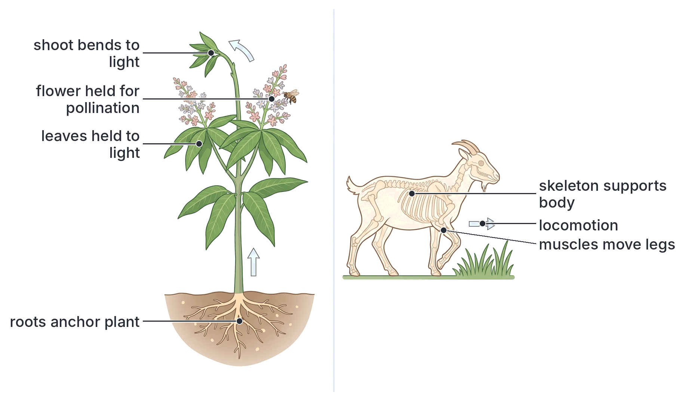

## Supporting tissues in plants

**Objective ii: identify supporting tissues in plants (collenchyma, sclerenchyma, xylem and phloem fibres).**

Plants have no bones. They are supported in two ways:

1. By the **turgor** (turgidity) of their living cells, which is enough for small, soft (herbaceous) plants and young organs.
2. By special **supporting (mechanical) tissues** with thickened cell walls: **collenchyma**, **sclerenchyma** (fibres and sclereids), **xylem**, and **phloem fibres**. In large plants, the woody xylem (wood) gives most of the support.

### Support by turgor (turgidity)

**Parenchyma** is the most common, unspecialised plant tissue. Its cells are living, thin-walled and roughly rounded, with air spaces between them. They are found in the cortex and pith of stems and roots and in the mesophyll of leaves.

**How turgor gives support, step by step:**

1. The cell sap in the large central **vacuole** of a plant cell contains dissolved sugars and salts, so it is more concentrated than the water around the cell.
2. Water enters the vacuole by **osmosis**.
3. The vacuole swells and pushes the cytoplasm and cell membrane hard against the **cell wall**.
4. The cellulose cell wall is strong and only slightly stretchy, so it pushes back (wall pressure). The cell becomes firm and stiff. It is now **turgid**.
5. Many turgid cells packed closely together press against each other, like the tightly blown-up inner tubes of a tyre, and make the whole organ **firm**.
6. This firmness keeps soft stems upright and keeps leaves flat and spread out.

**Wilting:** when a plant loses more water by transpiration than it takes in (on a hot afternoon in the dry season, or when the soil is dry), its cells lose water and become **flaccid** (soft). The leaves and soft stems droop. This is **wilting**. If the plant gets water again (e.g. in the cool of the evening or after watering), the cells become turgid again and the plant stands up. You can see this with amaranth (*tete*, *green*) or garden egg leaves on a hot afternoon. Wilting shows how important turgor is for support.

**Importance of turgor:**

- It is the **main means of support** in **herbaceous** (non-woody) plants and in leaves, young stems, flowers and seedlings.
- It keeps the **guard cells** of stomata working (stomata open when guard cells are turgid).
- It gives the force for some plant **movements**, such as the folding of *Mimosa pudica* leaves (see below).
- It allows young roots and shoots to push through the soil.

**Limitation:** turgor support depends on a steady supply of water. Large plants such as trees need permanent support from **thick-walled, lignified tissues** that do not depend on water.

### Collenchyma

**Structure:**

- **Living cells**, with a nucleus and cytoplasm; some have chloroplasts.
- Cells are **elongated** (longer than wide), roughly polygonal in cross-section.
- Their cell walls are **unevenly thickened** with extra **cellulose** and pectin, especially at the **corners** where cells meet. (In transverse section, the corners look thick and shiny.)
- They are **not lignified**, so the walls are flexible.
- Few or no air spaces between cells.

**Function:** collenchyma gives **mechanical support with flexibility**. Because it is living and not lignified, it can **stretch and grow**, so it is the main supporting tissue in **young, growing** stems, leaf stalks (petioles) and leaf midribs. It lets these organs bend in the wind without breaking.

**Where found:** just beneath the epidermis (**hypodermis**) of young **dicotyledonous stems** (often more strongly developed at the ridges or corners of square stems, such as in members of the mint family), in **petioles** and in the **midribs** of leaves. It is usually **absent from roots** and rare in monocotyledons.

**Textbook example:** the "strings" in a celery stalk (petiole) are strands of collenchyma (together with vascular bundles).

### Sclerenchyma

**Structure:**

- Cells have very **thick walls** that are evenly thickened with **lignin** (a hard, waterproof substance).
- When mature, the cells are **dead**: the lignin stops water and food from reaching the cytoplasm, which dies, leaving an empty space (**lumen**) in the middle.
- There are two kinds of sclerenchyma cells:
  1. **Fibres:** very **long**, narrow cells with tapering, pointed ends that overlap and interlock, forming strong strands. They are very strong when pulled (high tensile strength).
  2. **Sclereids (stone cells):** short, often rounded or irregular cells with extremely thick walls. They give **hardness**.

**Function:** sclerenchyma gives **strength and rigidity** to the **mature** (fully grown) parts of the plant. Fibres resist bending and pulling; sclereids make structures hard.

**Where found:**

- **Fibres:** in the **pericycle** (as caps on the outside of vascular bundles in dicot stems, sometimes called "bundle caps" or pericyclic fibres), as **sheaths** around the vascular bundles of **monocotyledons** (e.g. maize stem), in the **hypodermis** of monocot stems, in **xylem** (xylem fibres) and **phloem** (phloem fibres), and in leaf margins and the leaves of grasses.
- **Sclereids:** in the **hard shells of nuts and seeds** (e.g. the shell of a coconut, palm kernel shell, the stony endocarp of mango), the **gritty texture** of guava and pear fruits (the gritty bits are stone cells), and in some barks and leaves.

**Economic importance of fibres:** plant fibres (mainly sclerenchyma) are used to make ropes, sacks, mats and cloth. Examples: **jute** (*Corchorus*, the same genus as ewedu), **kenaf** (*Hibiscus cannabinus*, grown in parts of northern Nigeria), **sisal** (from *Agave* leaves), **raffia** (from raffia palm leaves), **hemp** and **flax** (linen). (Cotton is different: cotton fibres are long hairs that grow from the seed coat, not sclerenchyma.)

### Xylem

**Structure:** xylem is a **compound tissue** made of several cell types:

1. **Vessels:** long, continuous tubes made of many cells joined end to end, whose end walls have broken down. Their side walls are **lignified**, often in rings (annular), spirals, a ladder-like pattern or with pits. The mature cells are **dead** and hollow.
2. **Tracheids:** long, narrow, dead cells with tapering ends and lignified walls with pits. (In conifers, tracheids form almost all of the xylem.)
3. **Xylem fibres:** sclerenchyma fibres among the vessels, for extra strength.
4. **Xylem parenchyma:** living cells that store food.

**Functions:**

1. **Conduction:** carries **water** and **mineral salts** from the roots to the leaves (see Topic B3, Transport).
2. **Support:** because the walls of vessels, tracheids and xylem fibres are thick and **lignified**, xylem is very strong and rigid. In trees, the **wood** is made almost entirely of xylem (secondary xylem formed by the cambium). Wood is what holds up an iroko, mahogany or mango tree.

**Note:** the lignin rings and spirals in young vessels allow them to stretch as the organ grows, while still preventing them from collapsing inwards.

### Phloem fibres

**Phloem** is the tissue that carries manufactured food (mainly sucrose) from the leaves to other parts (see Topic B3). It is made of **sieve tubes**, **companion cells**, **phloem parenchyma** and **phloem fibres**.

- **Phloem fibres** (bast fibres) are long **sclerenchyma** fibres found among or outside the phloem.
- They are **dead** at maturity, with thick, **lignified** walls.
- **Function:** they give **strength and support** to the phloem and to the stem, and protect the soft sieve tubes.
- **Economic importance:** many commercial fibres are phloem (bast) fibres taken from stems: **jute**, **kenaf**, **flax** and **hemp**. The stems are soaked in water (retted) so that the soft tissues rot away, leaving the strong fibres.

### Comparison of the supporting tissues of plants

| Feature | Parenchyma (turgid) | Collenchyma | Sclerenchyma | Xylem (vessels and tracheids) | Phloem fibres |
| --- | --- | --- | --- | --- | --- |
| Living or dead at maturity | Living | **Living** | **Dead** | Dead (vessels and tracheids) | Dead |
| Cell wall | Thin, cellulose | Cellulose, **thickened at corners** | Very thick, evenly **lignified** | Lignified (rings, spirals, pits) | Thick, lignified |
| Shape of cells | Rounded, with air spaces | Elongated, polygonal | Long fibres or short sclereids | Long tubes or long cells | Long, pointed |
| Type of support | Turgor; needs water | Flexible support | Rigid, strong support | Rigid support and conduction | Strength in phloem and stem |
| Can it grow (stretch)? | Yes | **Yes** | No | Only the young annular and spiral vessels | No |
| Where found | Cortex, pith, mesophyll | Below epidermis of young dicot stems, petioles, midribs | Pericycle, bundle sheaths, hypodermis of monocots, nut shells, fruits | Vascular bundles; wood | Outside or among phloem |
| Example | Amaranth stem, leaf mesophyll | Celery strings, young sunflower stem | Coconut shell, guava grit, jute | Wood of mahogany, iroko | Jute, kenaf, flax |

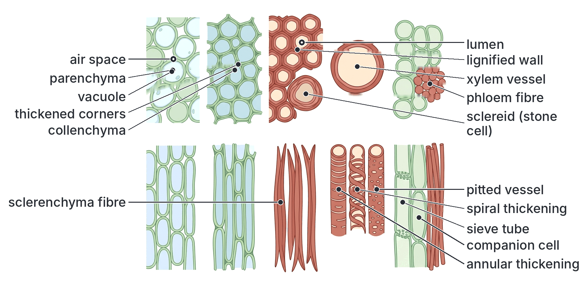

## Distribution of supporting tissues in the root, stem and leaf

**Objective iii: describe the distribution of supporting tissues in root, stem and leaf.**

The supporting tissues are not placed at random. They are arranged in the best positions to resist the particular **forces** that act on each organ.

- **Stems** are bent by **wind** and by the weight of leaves, flowers and fruits. They need to resist **bending** (and twisting). Supporting tissues are best placed **towards the outside**.
- **Roots** are pulled by the swaying of the stem above, and must **anchor** the plant. They need to resist **pulling** (tension) and squeezing by the soil. Supporting tissues are best placed **in the centre**.
- **Leaves** must be held **flat** and spread out, and must not tear in the wind. They need a framework of **veins** and a supported **midrib** and **margin**.

**Why the outside of a stem?** Think of a hollow metal pipe and a solid rod made of the same amount of metal. The pipe is much harder to bend, because when an object bends, the outer parts on one side are stretched and on the other side are squashed, while the centre hardly changes. Placing strong tissue near the outside is the best way to resist bending. This is why many bamboo stems are hollow and still very strong. A rope, by contrast, is strong when pulled, and its strands are packed together in the middle: this suits a root.

### Supporting tissues in the root

**Distribution in a young dicotyledonous root** (e.g. bean, groundnut):

1. **Xylem** forms a solid, **star-shaped core** (with 2 to 6 arms, often 4) in the **centre** of the root. The phloem lies between the arms of the xylem.
2. There is **no pith** (or only a very small one) in a dicot root.
3. **Collenchyma and sclerenchyma are usually absent** from young roots. (Older roots of trees develop secondary xylem, which becomes wood.)
4. The cortex is made of **parenchyma**, supported by **turgor**.

**Distribution in a monocotyledonous root** (e.g. maize): the xylem and phloem bundles are arranged in a **ring** around a central **pith**, with many (often more than 6) xylem groups. The endodermis and pericycle may become thickened, and some sclerenchyma may develop in older roots.

**How this suits the root's function:** the central core of xylem works like the **central strand of a cable or rope**. It is strong when **pulled**, so it resists the pulling force of the swaying stem and anchors the plant firmly. The flexible outer cortex allows the root to bend around stones as it grows through the soil.

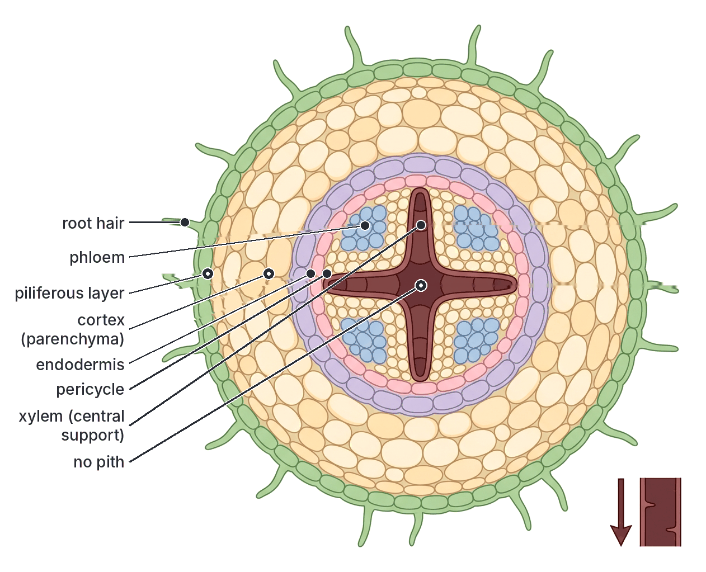

### Supporting tissues in the stem

**Distribution in a young dicotyledonous stem** (e.g. sunflower, *Tridax*, amaranth, balsam):

1. **Epidermis:** an outer layer of cells covered by a waxy cuticle, giving some protection.
2. **Collenchyma:** a band several cells thick just **below the epidermis** (the hypodermis), forming a **flexible ring** near the outside of the stem.
3. **Cortex:** parenchyma (turgid cells).
4. **Sclerenchyma (pericycle fibres):** **caps of fibres** on the **outside of each vascular bundle**, just outside the phloem (sometimes forming a complete ring).
5. **Vascular bundles:** arranged in a **ring** near the outside of the stem. Each has **phloem** on the outside, **xylem** on the inside and **cambium** between them. The **xylem** in each bundle gives support, and **phloem fibres** may be present.
6. **Pith:** a large central region of parenchyma (turgid cells). In some stems the pith breaks down, leaving the stem hollow (e.g. pumpkin, some grasses, bamboo).

**In older, woody dicot stems** (e.g. mango, orange, iroko, mahogany), the cambium makes a new ring of **secondary xylem** (wood) every growing season. The wood forms a thick, solid **cylinder** that supports the whole tree. In trees, the oldest, central wood (**heartwood**) is dead, hard and darker, and mainly supports; the outer, younger wood (**sapwood**) both conducts water and supports. Tree growth in Nigeria often forms visible rings because growth slows in the dry season.

**Distribution in a monocotyledonous stem** (e.g. maize, sugar cane, guinea corn):

1. A band of **sclerenchyma** lies just **below the epidermis** (hypodermis).
2. Many **vascular bundles** are **scattered** throughout the ground tissue, more crowded towards the outside.
3. Each bundle is surrounded by a strong **sheath of sclerenchyma fibres** (bundle sheath).
4. There is no cambium, so there is usually no secondary thickening, and no clear cortex and pith.

**How this suits the stem's function:** the strong tissues (collenchyma, sclerenchyma caps and the ring of vascular bundles) are arranged in a **ring near the outside**, like the walls of a hollow pipe or the steel rods near the edge of a concrete pillar. This gives the greatest resistance to **bending** by the wind, with the least amount of material. The flexible collenchyma lets the young stem bend without snapping; the turgid pith and cortex keep the stem firm and fill it out.

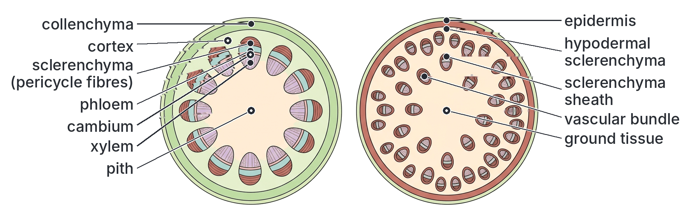

### Supporting tissues in the leaf

**Distribution in a dicotyledonous leaf** (e.g. mango, hibiscus, cocoyam):

1. **Midrib:** the large central vein contains a large **vascular bundle** (xylem above, phloem below), with **collenchyma** under the upper and lower epidermis, and often **sclerenchyma** fibres around the bundle. It is the "backbone" of the leaf.
2. **Veins:** a **network** of smaller vascular bundles branches through the leaf blade (lamina). The **xylem** in the veins forms a supporting **framework**, like the ribs of an umbrella, which holds the blade spread out flat.
3. **Petiole (leaf stalk):** contains vascular bundles and **collenchyma** near the outside, which supports the leaf blade and lets it move in the wind without breaking.
4. **Mesophyll:** made of turgid **parenchyma** cells (palisade and spongy mesophyll), which keep the leaf firm when well watered.
5. **Leaf margin:** in some leaves, the edge is strengthened with sclerenchyma or collenchyma to stop it from tearing.
6. **Cuticle and epidermis:** the waxy cuticle and the tightly packed epidermis add some strength.

**In monocotyledonous leaves** (e.g. maize, grasses, oil palm): the veins run **parallel** along the leaf, and strands of **sclerenchyma** run under the epidermis and around the bundles, so grass leaves are tough and hard to tear across. Some grass leaves can roll up when short of water.

**How this suits the leaf's function:** the leaf is held **flat** and **spread out** to catch as much light as possible; the network of veins and the midrib stop it from collapsing or tearing, while the petiole holds it in the best position towards the light.

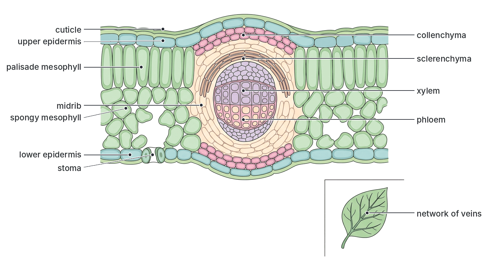

### Summary: distribution of supporting tissues

| Organ | Main force to resist | Position of strengthening tissues | Tissues involved |
| --- | --- | --- | --- |
| **Root** | Pulling (tension) | **Central** core | Xylem (star-shaped in dicots); turgid cortex |
| **Young dicot stem** | Bending (wind, weight) | **Peripheral ring** (near the outside) | Collenchyma under epidermis; sclerenchyma caps; ring of vascular bundles (xylem, phloem fibres); turgid pith and cortex |
| **Monocot stem** | Bending | Hypodermis and scattered bundles, crowded near the edge | Hypodermal sclerenchyma; sclerenchyma sheaths round bundles |
| **Woody stem (tree)** | Bending and weight | Solid cylinder of wood | Secondary xylem (wood) |
| **Leaf** | Collapse and tearing; must stay flat | Midrib, network of veins, petiole, margins | Xylem in veins; collenchyma in midrib and petiole; sclerenchyma; turgid mesophyll |

## Movements in plants: responses to stimuli

**Objective iv: relate the response of plants to the stimuli of light, water, gravity and touch.**

### Stimulus and response

A **stimulus** (plural: stimuli) is any change in the environment that an organism can detect, such as light, gravity, water, touch, temperature or chemicals. A **response** is the change in the organism (often a movement) caused by the stimulus. The ability to detect and respond to stimuli is called **irritability** (sensitivity), a characteristic of all living things (see `A1-living-organisms.md`).

Plants have no nerves or muscles. They respond mainly by:

- **Growth movements:** one side of an organ grows faster than the other, so the organ bends. These are slow and **permanent** (they cannot be reversed by the same organ).
- **Turgor movements:** cells in special regions gain or lose water, so a part moves. These can be fast and are **reversible**.
- **Swimming:** whole single-celled organisms or gametes swim using flagella or cilia.

### Naming plant movements

Movements are named after their **type** and their **stimulus**:

| Prefix | Stimulus |
| --- | --- |
| Photo- | Light |
| Geo- (or gravi-) | Gravity |
| Hydro- | Water |
| Thigmo- (or hapto-, or seismo- for shaking) | Touch or contact |
| Chemo- | Chemicals |
| Thermo- | Temperature |
| Nycti- (nycto-) | Night (darkness and light changes) |

| Suffix | Type of movement |
| --- | --- |
| -tropism | Tropic movement: growth of part of a plant, with direction set by the stimulus |
| -taxis (-tactic) | Tactic movement: whole organism (or cell) moves from place to place, with direction set by the stimulus |
| -nasty (-nastic) | Nastic movement: part of a plant moves, but the direction does **not** depend on the direction of the stimulus |

A response **towards** the stimulus is **positive**; a response **away** from the stimulus is **negative**.

So, for example: **positive phototropism** = growing towards light; **negative geotropism** = growing away from (against) gravity; **positive chemotaxis** = swimming towards a chemical.

### 1. Tropic movements (tropisms)

A **tropism** (tropic movement) is a **growth movement** of **part of a plant** in response to a stimulus that comes from **one direction**. The **direction of the response depends on the direction of the stimulus**. Tropisms are slow (they take hours or days) and are usually caused by **unequal growth** controlled by **auxins** (explained under objective v).

#### Phototropism (response to light)

**Phototropism** is the growth movement of a plant part in response to light coming from one direction (**unilateral light**).

- **Shoots** (stems) are **positively phototropic**: they bend and grow **towards** the light. You see this in a potted plant on a windowsill, whose shoot bends towards the window, and in seedlings growing under a tree, which bend towards the open sky.
- **Roots** are usually **negatively phototropic** (they grow away from light) or not affected.
- **Leaves** usually turn so that their flat surfaces face the light at right angles (sometimes called **diaphototropism** or transverse phototropism), so they catch the most light. This produces a **leaf mosaic**, where leaves are arranged so they shade each other as little as possible (e.g. pawpaw, cocoyam).

**Importance:** shoots and leaves get the **maximum light for photosynthesis**.

**Experiment: to show phototropism in shoots**

- **Aim:** to show that shoots grow towards light from one side.
- **Materials:** two pots (or tins) of young seedlings (e.g. maize, beans or sorghum), two cardboard boxes, one with a slit (window) cut in one side.
- **Method:**
  1. Place pot A inside the box with a slit on one side, so that light enters from **one side only**.
  2. Place pot B (the **control**) in the open, where it receives light **evenly from all sides** (or on a **clinostat** in one-sided light, see below), or inside a box with no slit in total darkness.
  3. Water both and leave them for 2 to 4 days.
- **Observation:** the shoots in pot A **bend towards the slit**. The shoots in pot B (all-round light) grow **straight up**. (Seedlings kept in total darkness grow straight, tall, thin and pale yellow: they are **etiolated**.)
- **Conclusion:** shoots are **positively phototropic**: they grow towards light coming from one direction.

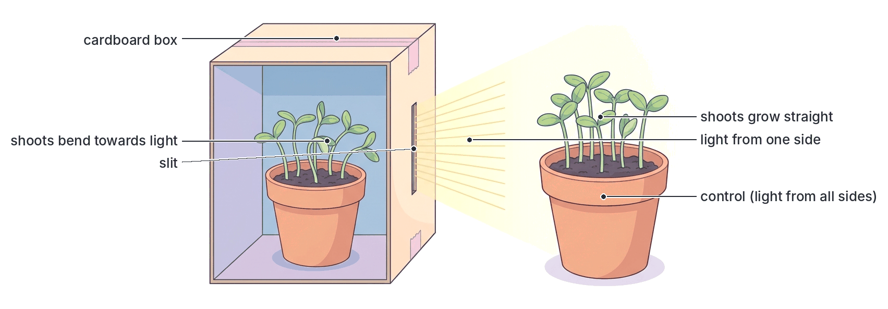

#### Geotropism (response to gravity)

**Geotropism** (also called **gravitropism**) is the growth movement of a plant part in response to the pull of **gravity**.

- **Main roots** (tap roots, radicles) are **positively geotropic**: they grow **downwards**, towards the pull of gravity, into the soil.
- **Main shoots** (stems) are **negatively geotropic**: they grow **upwards**, away from gravity.
- **Lateral (side) roots** and many **branches** grow at an angle or horizontally (**plagiogeotropism**), which helps spread the root system through the soil and spread the branches out.
- **Rhizomes** and **runners** grow horizontally (**diageotropism**).

**Importance:** roots go down into the soil to **anchor** the plant and find **water and minerals**; shoots grow up into the **light and air**. Whichever way up a seed (e.g. a bean or maize grain) is planted, its radicle turns to grow down and its plumule turns to grow up.

**Experiment: to show geotropism in roots and shoots (with a clinostat as control)**

- **Aim:** to show that roots grow towards gravity and shoots away from gravity.
- **Materials:** germinating bean seedlings with straight radicles (about 2 cm long) and plumules; a **clinostat** (see below); moist cotton wool; pins; two cork discs or boxes; a dark cupboard.
- **Method:**
  1. Pin several seedlings to cork disc A with their radicles and plumules pointing **horizontally**. Cover with moist cotton wool to keep them moist. Keep disc A **still** (stationary).
  2. Pin similar seedlings, also horizontal, to cork disc B, which is attached to the **clinostat**. Switch on the clinostat so the disc turns slowly (about one turn every 15 minutes or so; textbooks give different speeds).
  3. Keep both in the **dark** (so that light does not affect the result) for 2 days.
- **Observation:** on the stationary disc A, the **radicles bend downwards** and the **plumules bend upwards**. On the rotating clinostat B, the radicles and plumules continue to **grow straight** (horizontally).
- **Explanation:** on the clinostat, the slow rotation means every side of the root and shoot is pulled by gravity **equally** in turn, so the effect of gravity from one side is cancelled out. Growth is equal on all sides, so there is no bending.
- **Conclusion:** roots are **positively geotropic** and shoots are **negatively geotropic**. The clinostat seedlings are the **control**.

#### The clinostat

A **clinostat** is an apparatus with a **slowly rotating** disc or axle driven by a small motor (older types were driven by clockwork). A plant or seedlings are fixed to it.

- **Use in geotropism experiments:** turning the seedling slowly on a **horizontal axis** makes the pull of gravity act equally on all sides, so it **cancels the one-sided effect of gravity**.
- **Use in phototropism experiments:** turning a pot of seedlings slowly on a **vertical axis** in front of a light from one side makes every side receive light equally, so it **cancels the one-sided effect of light**; the shoots grow straight.
- In both cases, the clinostat seedlings act as the **control**.

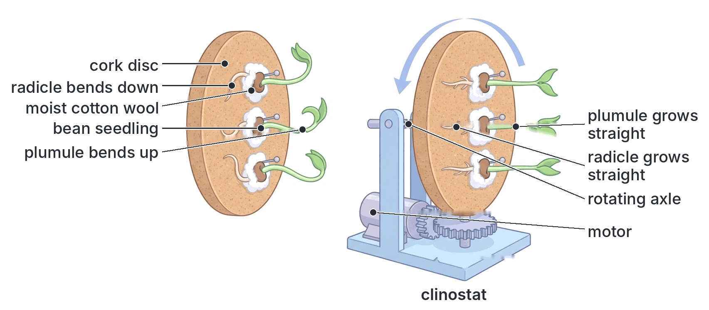

#### Hydrotropism (response to water)

**Hydrotropism** is the growth movement of a plant part in response to **water** (moisture) coming from one direction.

- **Roots** are **positively hydrotropic**: they grow **towards** moist areas of soil.
- The response of roots to water is often **stronger than** their response to gravity, so roots can grow sideways or even upwards towards water. (This is why tree roots can grow into leaking pipes, septic tanks and wells.)

**Importance:** roots find **water** for the plant, which is needed for photosynthesis, transport, support (turgor) and cooling.

**Experiment: to show hydrotropism in roots**

- **Aim:** to show that roots grow towards water.
- **Materials:** a sieve (or wire-mesh tray) filled with **moist sawdust**; soaked bean or maize seeds; a support so the sieve can be **tilted** or hung at an angle.
- **Method:**
  1. Plant soaked seeds in the moist sawdust in the sieve.
  2. Hang the sieve at an angle (tilted) and keep the sawdust moist. Keep it in the dark (or shade) so light does not affect the result.
  3. Leave for several days.
- **Observation:** the radicles first grow **downwards** out through the mesh of the sieve (because of positive geotropism). Once in the **dry air** below, the roots **bend back** and grow along the underside of the mesh, back **towards the moist sawdust**.
- **Conclusion:** roots are **positively hydrotropic**; the pull of water overcomes the pull of gravity.
- **Control:** a similar set-up with **dry** sawdust in a **humid** chamber (moist air all round), where roots grow straight down. (Textbook set-ups for the control differ.)

**Alternative set-up:** seeds are planted in a box of dry soil with a porous clay pot of water buried at one side; the roots grow towards the moist soil around the pot.

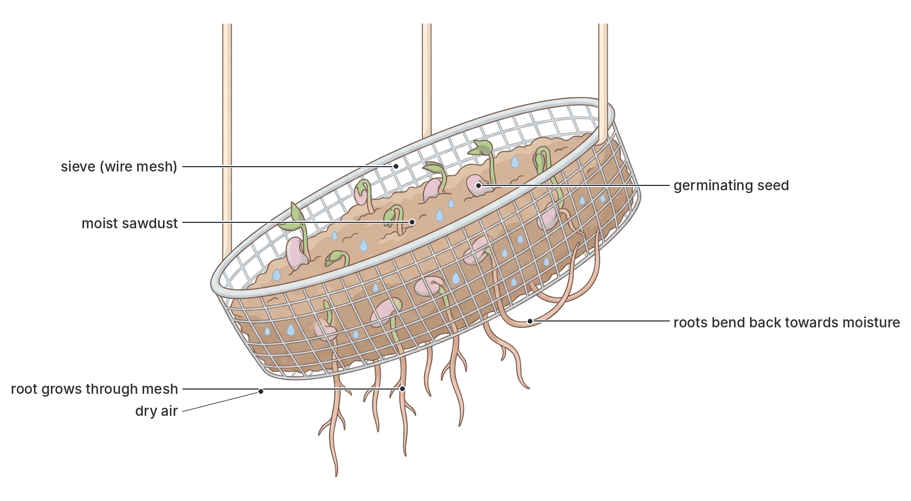

#### Thigmotropism or haptotropism (response to touch or contact)

**Thigmotropism** (also called **haptotropism**) is the growth movement of a plant part in response to **touch** or **contact** with a solid object.

**Examples:**

- **Tendrils** of the garden pea, cucumber, pumpkin (*ugu* / fluted pumpkin), watermelon, passion fruit and grape vine.
- **Twining stems** of yam, morning glory and some beans, which wind around stakes or other plants.

**How a tendril coils, step by step:**

1. A tendril is a thin, sensitive, thread-like part (a modified leaf, leaflet or stem) that sweeps around slowly in circles as it grows, until it touches a support (e.g. a stake, string or another plant).
2. The cells on the side that **touches** the support **grow more slowly** (or even shrink slightly).
3. The cells on the **opposite side** (away from the support) **grow faster** (elongate more).
4. Because the outer side grows longer than the inner side, the tendril **curves around** the support and coils around it, gripping it firmly.
5. The part of the tendril between the support and the stem often then coils like a **spring**. This pulls the plant closer to the support and acts as a shock absorber in the wind.
6. Later, the tendril may become woody and strong.

**Importance:** climbing plants get **support** and can climb up towards the **light** without spending food on building a thick, woody stem. Yam farmers in Nigeria put **stakes** beside yam plants for the twining stems to climb.

**Textbook variation:** some textbooks treat the coiling of tendrils as **thigmotropism**, while others note that part of the response (the rapid curling, which does not depend on the side touched in some species) is a **thigmonasty**. JAMB follows the usual school-level view: tendril coiling is thigmotropism (haptotropism). "Haptotropism" and "thigmotropism" mean the same thing.

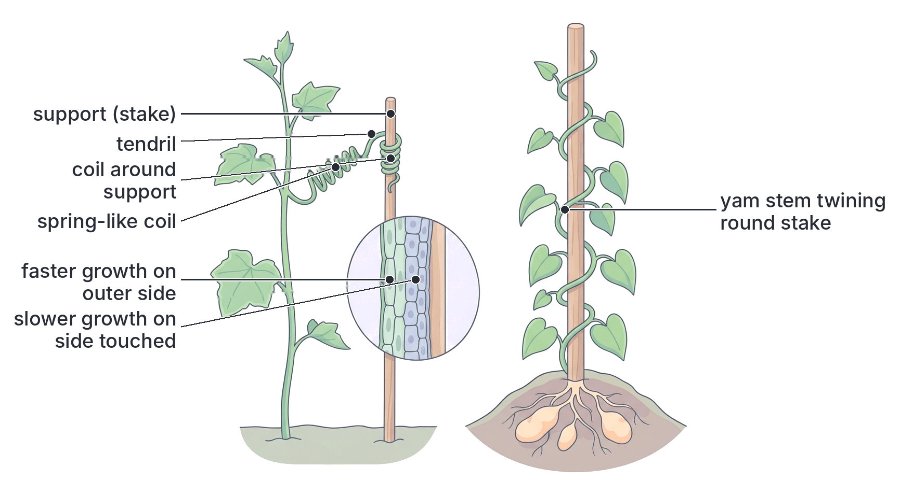

#### Chemotropism (response to chemicals)

**Chemotropism** is the growth movement of a plant part in response to a **chemical** stimulus.

**Main example:** the growth of the **pollen tube**. After pollination, a pollen grain on the stigma germinates and produces a **pollen tube**. The pollen tube grows down through the style **towards the ovule**, attracted by chemicals (including sugars and special proteins) secreted by the ovule and the cells around the micropyle. The pollen tube is **positively chemotropic**. This guides the male gametes to the egg for **fertilisation** (see Topic B7, sexual reproduction in flowering plants, in `B7b-reproduction-in-flowering-plants.md`).

**Other examples:** roots grow towards areas of soil rich in certain **mineral salts** (positive chemotropism) and away from harmful chemicals (negative chemotropism); fungal hyphae grow towards food.

### 2. Tactic movements (taxes)

A **tactic movement** (taxis; plural: taxes) is the movement of a **whole organism** (or a whole cell, such as a gamete) **from one place to another** in response to a stimulus from **one direction**. The direction of movement depends on the direction of the stimulus. Tactic movements are **fast** compared with tropisms and are **not growth movements**. They are shown by **motile** organisms: single-celled algae (*Chlamydomonas*, *Euglena*), bacteria, and the swimming male gametes (**sperm** or antherozoids) of mosses and ferns. (Animals also show taxes; for example, woodlice move away from light.)

#### Phototaxis

**Phototaxis** is the movement of a whole organism in response to light from one direction.

- ***Chlamydomonas*** (a single-celled green alga) swims, using its **two flagella**, towards light of **moderate intensity**. Its red **eyespot** (stigma) detects the direction of the light. It is **positively phototactic** in moderate light; in **very bright** light it may swim away (**negatively phototactic**), avoiding damage.
- ***Euglena*** (a single-celled flagellate) swims with its **flagellum** towards moderate light. Its **eyespot** shades a light-sensitive swelling at the base of the flagellum, which allows it to detect the direction of light.

**Importance:** these organisms move into light that is good for **photosynthesis**, but avoid light that is too strong.

**Experiment: to show phototaxis in *Chlamydomonas* or *Euglena***

- **Aim:** to show that these organisms swim towards light.
- **Materials:** a test tube or Petri dish of pond water rich in green *Chlamydomonas* or *Euglena* (the water looks green); black paper or a box with a small window.
- **Method:** wrap the container in black paper, leaving a small uncovered "window" on one side, or cover half of a Petri dish. Place it in a room lit from one side. Leave it for about an hour.
- **Observation:** when the cover is removed, the green colour (the organisms) is **concentrated near the window** (the lit part); the rest of the water is clearer.
- **Conclusion:** *Chlamydomonas* (or *Euglena*) is **positively phototactic**.
- **Control:** a similar dish uncovered and evenly lit, where the organisms remain evenly spread.

#### Chemotaxis

**Chemotaxis** is the movement of a whole organism or cell in response to a **chemical** stimulus.

- **Sperm of mosses and ferns:** the male gametes (antherozoids) of mosses (e.g. *Funaria*) and ferns (e.g. *Dryopteris*) swim, using flagella, in a film of **water** (dew or rainwater) towards the female sex organ (**archegonium**). The archegonium releases chemicals (e.g. **malic acid** in ferns and **sucrose** or proteins in mosses, according to many textbooks) that attract the sperm. This is **positive chemotaxis**. It ensures **fertilisation** (see `A2b-evolution-plants.md`). It is also why mosses and ferns need water for reproduction.
- **Bacteria** swim towards food substances such as sugars (positive chemotaxis) and away from harmful chemicals such as acids (negative chemotaxis).
- **Human sperm** are also thought to be guided towards the egg partly by chemicals (chemotaxis).
- **Some protozoa** (e.g. *Paramecium*) move away from harmful chemicals.

**Textbook variation:** the attracting chemicals named for moss and fern sperm vary between textbooks. The key point is that sperm swim towards chemicals released by the archegonium.

#### Other taxes

- **Thermotaxis:** movement in response to temperature (e.g. some protozoa move towards a favourable temperature).
- **Aerotaxis:** movement in response to oxygen (some bacteria swim towards oxygen).

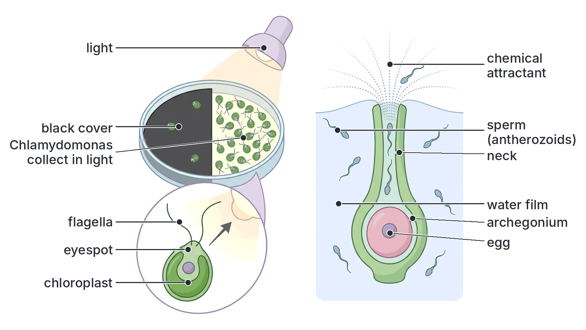

### 3. Nastic movements (nasties)

A **nastic movement** (nasty) is a movement of **part of a plant** in response to a stimulus, where the **direction of the response does not depend on the direction of the stimulus**. The stimulus is often **diffuse** (comes from all around, e.g. a change in temperature or general light intensity), or, if it comes from one side, the part always moves the same way. Nastic movements are caused either by **unequal growth** of the upper and lower sides of an organ (e.g. petals opening), or by **changes in turgor** in special cells (fast, reversible movements).

#### Thigmonasty (seismonasty): response to touch or shock

**Main example: *Mimosa pudica*** (the **sensitive plant**, also called **touch-me-not** or "shame plant"), a small, prickly legume common as a weed on roadsides, lawns and farms in Nigeria.

- When a leaflet is **touched**, shaken, burned or cut, the **leaflets fold together** in pairs, starting from the point touched. If the stimulus is strong, the **whole leaf droops** downwards at its base, and the response can spread to other leaves.
- The folding takes only a **few seconds**. After about **10 to 30 minutes** (textbooks give different times), the leaves slowly reopen.
- The direction of folding is always the same, whichever side is touched, so it is a **nastic** movement.

**How *Mimosa pudica* folds, step by step (turgor mechanism):**

1. At the base of each leaf, leaflet and pinna there is a swollen joint called a **pulvinus** (plural: pulvini), made of large, thin-walled parenchyma cells.
2. Normally, the cells of the pulvinus are **turgid**, especially those on the lower side, and they hold the leaf up and the leaflets spread open.
3. When the leaf is touched, an **electrical signal** (and chemical signals) travels quickly from the point of contact to the pulvini.
4. The cells on the **lower side** of the main pulvinus (and the corresponding side of the leaflet pulvini) suddenly lose **potassium ions**, and then **water** moves out of them by osmosis into the spaces between cells.
5. These cells become **flaccid**, so they can no longer hold the leaf up.
6. The leaflets fold together and the whole leaf droops at the pulvinus.
7. Slowly, the cells take back ions and water and become **turgid** again, and the leaf reopens.

**Possible advantages:** the sudden folding may **startle** or **discourage** grazing animals and insects, make the plant look less appealing (wilted), and expose the plant's **prickles**; it may also reduce water loss during strong winds.

**Other examples of thigmonasty:**

- The **Venus flytrap** (*Dionaea*): the two halves of its leaf snap shut in less than a second when an insect touches the trigger hairs twice. (This is a carnivorous plant; see Topic B2.)
- The **tentacles of sundew** (*Drosera*) bend over to trap an insect.

#### Photonasty (response to light intensity)

**Photonasty** is the opening or closing of flowers (or leaves) in response to a **change in light intensity** (not light direction).

- Many flowers **open in the morning** when it becomes light and **close in the evening** when it becomes dark, e.g. the flowers of many **daisy-like** plants and the **water lily** (many water lilies open by day).
- Some flowers do the opposite and **open in the evening**, e.g. the **four o'clock flower** (*Mirabilis jalapa*, a common garden plant in Nigeria, whose flowers open in the late afternoon) and the evening primrose; these are often pollinated by **moths**.

**Mechanism:** the upper (inner) and lower (outer) surfaces of the petals grow at **different rates** in light and dark. When the **inner** surface grows faster, the flower **opens**; when the **outer** surface grows faster, it **closes**. (Some flowers open and close by turgor changes instead.)

**Importance:** flowers are open when their **pollinators** are active, and are closed (protecting pollen and nectar from rain, cold or the wrong visitors) at other times.

#### Thermonasty (response to temperature)

**Thermonasty** is the opening or closing of flowers in response to a **change in temperature**.

- The best-known examples are the flowers of the **tulip** and **crocus** (temperate garden plants), which **open when warm** and **close when cool**. You can make a closed tulip open by bringing it into a warm room.
- **Mechanism:** a rise in temperature makes the **inner** surface of the petals grow faster than the outer surface, so the flower opens; a fall in temperature makes the outer surface grow faster, so it closes.

**Note:** tulips and crocuses are not common in Nigeria, but they are the examples used in most textbooks. Many flowers respond to both light and temperature, so it is not always easy to separate photonasty from thermonasty.

### 4. Sleep movements (nyctinasty)

**Sleep movements** (also called **nyctinastic** or **nyctinasty** movements) are the regular **daily** movements of leaves (and some flowers) in which they **fold up or droop in the evening** (at night) and **open and spread out in the morning** (by day). The leaves take up a "sleeping" position at night. This was studied in detail by **Charles Darwin**, who wrote a book on plant movements (1880).

**Examples (especially in legumes, family Fabaceae/Leguminosae, which have compound leaves with pulvini):**

| Plant | Sleep movement |
| --- | --- |
| ***Bauhinia*** (camel's foot or orchid tree; several species grow in Nigeria, both wild in the savanna and as ornamentals) | Each leaf is two-lobed (like a camel's footprint or a butterfly). At night the two lobes **fold together** along the midrib, like a closed book |
| ***Crotalaria*** (rattlepod or rattlebox, a common legume shrub of farms and fallow land) | The leaves or leaflets **fold upwards or droop** at night |
| **Flamboyant** (*Delonix regia*, the "flame of the forest" with bright red flowers, planted along roads and in compounds) | Its very many small **leaflets fold together** in pairs at dusk and open again in the morning |
| ***Mimosa pudica*** | Besides responding to touch, its leaflets also **fold up at night** |
| Other legumes, e.g. **tamarind**, ***Albizia***, ***Leucaena***, beans, groundnut, clover | Leaflets fold together or droop at night |
| Wood sorrel (*Oxalis*) and the prayer plant (*Maranta*), which are not legumes | Leaflets droop or leaves fold upwards at night |

**Mechanism:**

1. Most sleep movements are **turgor movements** of the **pulvini** at the bases of the leaves and leaflets.
2. At dusk, cells on one side of each pulvinus lose ions and water and become **flaccid**, while cells on the other side stay turgid, so the leaflet folds.
3. In the morning, the process is reversed, and the leaflets open.
4. The changes are triggered by the change between **light and darkness**, but are also controlled by an internal **biological clock** (a **circadian rhythm**, roughly 24 hours long). Even if the plant is kept in constant light or darkness for a few days, the leaves continue to open and close at about the same times each day, showing that the clock is inside the plant.

**Possible advantages:** scientists are not fully certain why plants show sleep movements. Suggested reasons include **reducing heat loss** at night, **reducing water loss**, avoiding the effect of **moonlight** on the plant's timing (photoperiod) system, and shedding dew or rain from the leaves. Textbooks differ on this.

**Sleep movements and Mimosa compared:** the folding of *Mimosa pudica* when **touched** is **thigmonasty** (fast, seconds); its folding **at night** is a **sleep movement** (nyctinasty, slower, daily rhythm). Both use pulvini.

[IMAGE: Day and night views of three leguminous plants, arranged in three columns (Bauhinia, flamboyant, Mimosa pudica), each with a "day" row on top (bright sunny background tint) and a "night" row below (deep blue background tint with a moon). Bauhinia: a two-lobed leaf open by day and folded together along the midrib by night. Flamboyant: a feathery twice-compound leaf with many small leaflets spread by day and folded in pairs by night. Mimosa pudica: leaflets spread by day and folded with the leaf drooping by night. Add an enlarged inset of a pulvinus at the base of a leaf. Labels: Bauhinia, flamboyant (Delonix regia), Mimosa pudica, day: leaves open, night: leaves folded (sleep position), pulvinus. Clean flat textbook style, white background.]

### Comparison of the types of plant movement

| Feature | Tropic movement (tropism) | Tactic movement (taxis) | Nastic movement (nasty) | Sleep movement (nyctinasty) |
| --- | --- | --- | --- | --- |
| What moves | **Part** of a plant (root, shoot, tendril, pollen tube) | The **whole organism** or cell (*Chlamydomonas*, *Euglena*, sperm) | **Part** of a plant (leaves, leaflets, petals) | **Part** of a plant (leaves, leaflets; some flowers) |
| Direction of stimulus | From **one direction** | From **one direction** | Diffuse, or direction not important | Daily change from light to dark |
| Does the direction of response depend on the direction of the stimulus? | **Yes** | **Yes** | **No** | **No** |
| Type of movement | **Growth** (unequal growth) | **Locomotion** (swimming with flagella or cilia) | Growth or **turgor** changes | Mostly **turgor** changes in pulvini; controlled by a biological clock |
| Speed | **Slow** (hours to days) | **Fast** (seconds to minutes) | Fast (turgor, e.g. *Mimosa*: seconds) or slow (growth, e.g. flower opening) | Slow (over minutes to hours, at dusk and dawn) |
| Reversible? | No (permanent growth) | Yes (organism can move again) | Yes (turgor types reopen) | Yes (repeated every day) |
| Hormone control | **Auxins** | No auxins; eyespot and flagella | Not auxins (electrical signals and ion movement in turgor types) | Biological clock and light |
| Examples | Phototropism (shoots), geotropism (roots), hydrotropism (roots), thigmotropism (tendrils), chemotropism (pollen tube) | Phototaxis (*Chlamydomonas*, *Euglena*), chemotaxis (moss and fern sperm) | Thigmonasty (*Mimosa pudica*), photonasty (flowers), thermonasty (tulip, crocus) | *Bauhinia*, *Crotalaria*, flamboyant, *Mimosa* at night |

### Summary of responses to light, water, gravity and touch

| Stimulus | Response of shoot | Response of root | Other responses |
| --- | --- | --- | --- |
| **Light** | Positive phototropism (grows towards light) | Negative phototropism or none | Phototaxis (*Chlamydomonas*, *Euglena*); photonasty (flowers open or close); sleep movements |
| **Water** | — | Positive hydrotropism (grows towards water) | — |
| **Gravity** | Negative geotropism (grows upwards) | Positive geotropism (grows downwards) | Lateral roots and branches grow at an angle |
| **Touch** | Tendrils and twining stems: positive thigmotropism (coil around support) | Roots grow around stones | Thigmonasty (*Mimosa pudica*, Venus flytrap) |
| **Chemicals** | — | Grow towards some minerals | Pollen tube (chemotropism); sperm of mosses and ferns (chemotaxis) |
| **Temperature** | — | — | Thermonasty (tulip, crocus flowers) |

## Regions of growth and the role of auxins in tropism

**Objective v: identify the regions of growth in roots and shoots and the roles of auxins in tropism.**

### Where plants grow: meristems

Unlike animals, which grow all over their bodies, plants grow only in special regions called **meristems**. A **meristem** is a tissue of small, actively **dividing** cells (by **mitosis**), with thin walls, dense cytoplasm, large nuclei and no (or tiny) vacuoles.

| Type of meristem | Where found | What it does |
| --- | --- | --- |
| **Apical meristems** | At the **tips** of roots and shoots (in the root tip and in the terminal and axillary buds) | **Primary growth**: increase in **length** (height of shoots, depth of roots) |
| **Lateral meristems** (vascular cambium and cork cambium) | In a ring inside stems and roots of dicots and conifers | **Secondary growth**: increase in **thickness (girth)**, making wood and bark |
| **Intercalary meristems** | At the bases of internodes and leaves in grasses and other monocots (e.g. maize, guinea grass) | Allow stems and leaves to grow again after grazing or cutting |

### Regions of growth in the root

Behind the tip of a growing root (e.g. a bean or maize radicle), four regions can be seen in a longitudinal section:

1. **Root cap:** a thimble-shaped cap of loosely arranged cells covering the tip. It **protects** the delicate meristem as the root pushes through the soil. Its outer cells wear away and are replaced, and they release slimy **mucilage** that eases the root's passage. The root cap is also believed to **detect gravity**: its cells contain heavy starch grains (**statoliths**) that settle to the lower side.
2. **Region of cell division (meristematic zone):** just behind (above) the root cap, about 1–2 mm long. Here the cells of the **apical meristem** divide rapidly by **mitosis**, making new cells. The cells are small, thin-walled, with large nuclei and dense cytoplasm. This region also replaces root cap cells.
3. **Region of cell elongation (zone of elongation):** just behind the zone of division, a few millimetres long. The new cells take in water, develop **vacuoles** and **lengthen** greatly (often to many times their original length). This is where the root actually **gets longer** and pushes the tip forward. It is also the region where **bending** occurs in tropisms.
4. **Region of cell differentiation (maturation, or zone of root hairs):** behind the zone of elongation. The cells stop growing and become **specialised** (differentiated) into the permanent tissues: epidermis with **root hairs**, cortex, endodermis, xylem and phloem. The **root hairs** are found here.

**Textbook variation:** some textbooks give three regions (cell division, elongation and differentiation) and treat the root cap separately; others name a fourth region, the "zone of maturation", or join differentiation and maturation. All agree on the order from the tip: root cap → division → elongation → differentiation (root hairs).

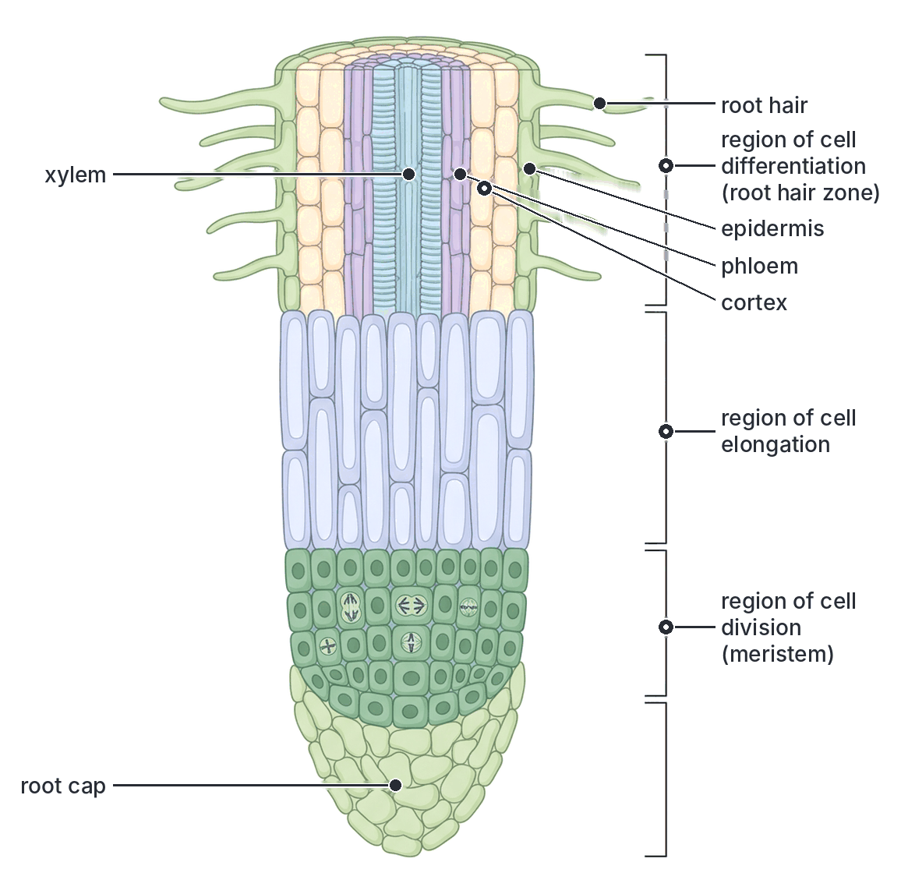

### Experiment: to locate the region of growth in a root

- **Aim:** to find which part of a root grows (elongates) fastest.
- **Materials:** a germinating bean (or maize) seedling with a straight radicle about 2–3 cm long; Indian ink (or waterproof marker) and a fine thread or a ruler marked in millimetres; pins; a moist chamber (a jar with moist cotton wool or blotting paper).
- **Method:**
  1. Gently dry the radicle with filter paper.
  2. Starting from the tip, use the thread dipped in Indian ink to make **marks at equal intervals**, e.g. every **2 mm**, along the radicle (about 10 marks).
  3. Pin the seedling in the moist chamber with the radicle hanging **vertically downwards** (so that it does not bend) and leave in the dark for 24 to 48 hours.
  4. Observe the spacing of the marks.
- **Observation:** the marks just behind the tip (about 2 to 10 mm from the tip) have become **widely spaced**. The marks at the very tip are only slightly apart, and the marks further back (near the seed) have **not moved apart** at all.
- **Conclusion:** the region of greatest growth (elongation) is **just behind the tip** of the root (the zone of elongation). The older part of the root does not grow in length.

The same experiment can be done on a young shoot, marking it just below the tip; the region of greatest growth is a little behind the shoot tip.

[IMAGE: Before and after diagram of the root-marking experiment. Left ("start"): a germinating bean seed with a straight radicle hanging downwards, marked with ten evenly spaced black ink lines 2 mm apart from the tip. Right ("after 48 hours"): the same seedling, with a longer radicle; the marks near the tip are only slightly further apart, the marks in the region 2 to 10 mm behind the tip are widely spaced, and the marks near the seed are still close together. A small ruler beside each. Labels: bean seed, radicle, ink marks 2 mm apart, start, after 48 hours, marks widely spaced (zone of elongation), marks unchanged (older region), root tip. Clean flat textbook style, white background.]

### Regions of growth in the shoot

At the tip of every shoot is a **terminal (apical) bud**. In a longitudinal section:

1. **Apical meristem (growing point):** a small dome of dividing cells at the very tip of the stem. Unlike the root, it has **no cap**; instead it is protected by the young leaves folded over it.
2. **Leaf primordia (young leaves):** small bumps that form at the sides of the apical meristem and grow into leaves. They fold over and protect the growing point.
3. **Axillary bud primordia:** small groups of meristem cells in the angle (axil) between a young leaf and the stem; they can later grow into branches or flowers.
4. **Region of cell elongation:** below the apex, the internodes lengthen as the cells elongate. This is the main region of growth in **length**, and the region where the shoot **bends** in tropisms.
5. **Region of differentiation (maturation):** further down, the cells become specialised into epidermis, cortex, vascular bundles and pith.

The stem is divided into **nodes** (where leaves are attached) and **internodes** (the parts between the nodes). Growth in length occurs mainly in the **young internodes** near the tip.

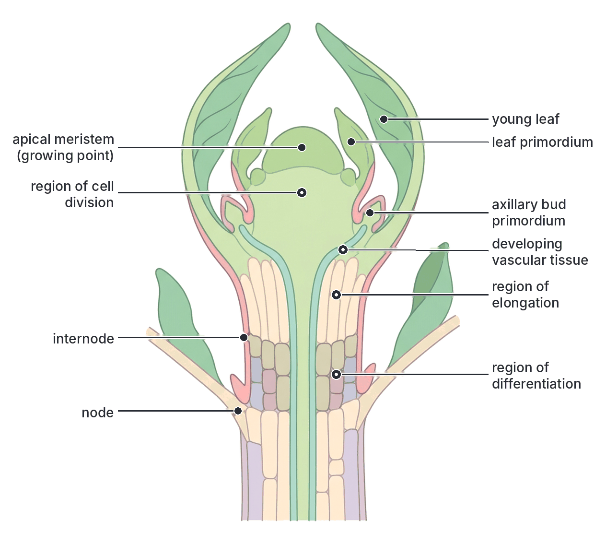

### Growth regions of roots and shoots compared

| Feature | Root tip | Shoot tip |
| --- | --- | --- |
| Protection of the meristem | **Root cap** | Young leaves folded over it (no cap) |
| Position of the meristem | Just behind the root cap (sub-terminal) | At the very tip (terminal) |
| Lateral organs formed near the tip | None (lateral roots arise later from the **pericycle**, deep inside) | Leaves and axillary buds formed at the apex |
| Nodes and internodes | Absent | Present |
| Hairs | Root hairs in the zone of differentiation | Some shoots have epidermal hairs, but not for absorption |
| Region where bending occurs in tropisms | Zone of elongation | Zone of elongation (below the tip) |

### What are auxins?

**Auxins** are **plant hormones** (plant growth substances) that control growth, especially **cell elongation**. The main natural auxin is **indoleacetic acid (IAA)**.

**Key facts about auxins:**

1. Auxins are made in the **tips of shoots** (and young leaves) and, in smaller amounts, in **root tips**.
2. They move (diffuse and are actively transported) **from the tip backwards**, to the zone of elongation, where they act.
3. In the shoot, auxin **stimulates** (promotes) **cell elongation**: the more auxin (within the normal range), the more the cells elongate.
4. **Roots are much more sensitive** to auxin than shoots. A concentration of auxin that stimulates growth in a shoot **inhibits** (slows) growth in a root. Very low concentrations stimulate root growth.
5. Auxins are moved **away from light** (to the shaded side) and **towards gravity** (to the lower side) of a root or shoot.
6. The **unequal distribution** of auxin on the two sides of an organ causes **unequal growth**, so the organ **bends**. This is how auxins cause **tropisms**.

### Role of auxins in phototropism (step by step)

**When light comes from all sides (or in darkness):**

1. Auxin made in the shoot tip moves down **equally** on all sides.
2. Cells on all sides elongate equally.
3. The shoot grows **straight up**.

**When light comes from one side:**

1. Auxin is made in the **shoot tip**.
2. The light from one side causes auxin to move (be redistributed) towards the **shaded (dark) side** of the tip.
3. More auxin therefore passes down the **shaded side** into the zone of elongation; less passes down the lit side.
4. On the **shaded side**, more auxin makes the cells **elongate more**.
5. On the **lit side**, less auxin means the cells elongate **less**.
6. The shaded side grows longer than the lit side, so the shoot **bends towards the light**.
7. Once the tip faces the light directly, light falls evenly on all sides, auxin is distributed evenly, and the shoot grows straight towards the light.

**Textbook variation:** older textbooks say that light **destroys** auxin on the lit side. Experiments (e.g. by Went and later scientists) show that the total amount of auxin does not change much; instead, auxin is mainly **moved sideways** to the shaded side. Some recent research suggests that, in some plants, growth-inhibiting substances on the lit side are also involved. For JAMB, the standard answer is: **more auxin on the shaded side → more elongation on the shaded side → shoot bends towards light.**

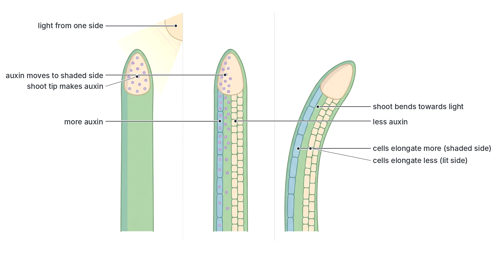

### Role of auxins in geotropism (step by step)

**When a seedling is placed horizontally:**

1. Gravity causes auxin to collect on the **lower side** of both the root and the shoot.

**In the shoot:**

2. The **lower side** of the shoot has **more auxin**.
3. In shoots, more auxin **stimulates** elongation, so the cells on the **lower side elongate more** than those on the upper side.
4. The lower side grows longer, so the shoot **bends upwards**: **negative geotropism**.

**In the root:**

2. The **lower side** of the root also has **more auxin**.
3. Roots are very sensitive; this higher concentration **inhibits** elongation, so the cells on the **lower side elongate less**.
4. The **upper side**, with less auxin, grows **faster** than the lower side.
5. The upper side becomes longer, so the root **bends downwards**: **positive geotropism**.

**On a clinostat**, the seedling rotates slowly, so auxin does not collect on any one side; growth is even and there is no bending.

**Textbook variation:** in roots, the root cap (with its statoliths) detects gravity and is thought to send growth inhibitors, together with auxin, to the lower side. Many textbooks explain root geotropism only in terms of auxin, as above; some mention other inhibitors such as abscisic acid. The JAMB answer is the auxin explanation.

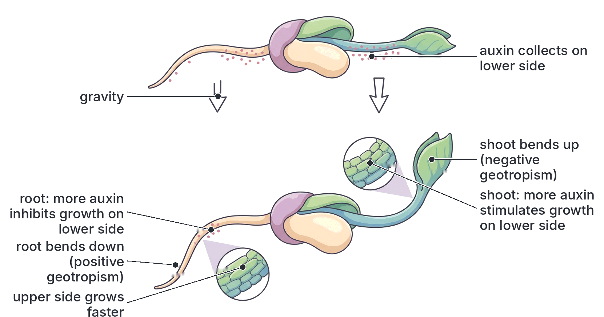

### The auxin concentration curve

The different responses of roots and shoots can be summarised:

| Auxin concentration | Effect on root growth | Effect on shoot (stem) growth |
| --- | --- | --- |
| Very low | Stimulates | Little effect |
| Medium | Inhibits | Stimulates strongly |
| High | Strongly inhibits | Stimulates less, then inhibits at very high levels |

So the **optimum** (best) auxin concentration for root growth is **much lower** than for shoot growth.

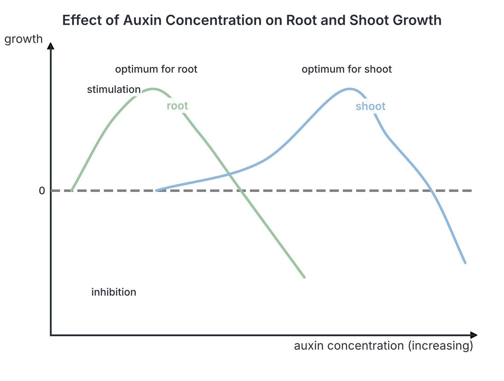

### Classic experiments on auxins and phototropism

These experiments, done on **coleoptiles** (the protective sheath around the first leaves of grass seedlings, such as oats, wheat, maize or canary grass), led to the discovery of auxin. Coleoptiles are used because they are simple and bend clearly towards light.

#### Darwin's experiments (Charles and Francis Darwin, 1880)

Charles Darwin and his son Francis grew **canary grass** seedlings and shone light on them from one side.

| Treatment | Result | What it showed |
| --- | --- | --- |
| A. Coleoptile left untreated (control) | Bends towards the light | Normal phototropism |
| B. **Tip cut off** | **No bending** (and little growth) | The tip is needed for the response |
| C. Tip covered with an **opaque (light-proof) cap** | **No bending** | The **tip detects** the light |
| D. Tip covered with a **transparent cap** | Bends towards the light | The cap itself does not stop the response; light must reach the tip |
| E. Region **below the tip** covered with an opaque sleeve, tip exposed | **Bends** towards the light | The bending happens below the tip, but the light is detected by the tip |

**Conclusion:** the **tip** detects the light, and "some influence" (a message) is passed from the tip down to the region below, where the bending happens. The Darwins did not know what the influence was.

#### Boysen-Jensen's experiments (about 1910–1913)

The Danish scientist Peter Boysen-Jensen showed that the influence is a **chemical**:

- When the tip was cut off and put back on a thin block of **gelatin** (which lets chemicals pass), the coleoptile still bent towards the light.
- When a thin plate of **mica** (which chemicals cannot pass through) was pushed into the **shaded side** just below the tip, the coleoptile did **not** bend; when it was pushed into the **lit side**, it **did** bend. This showed that the chemical moves down the **shaded side**.

**Textbook variation:** some textbooks also mention the Hungarian scientist Árpád Paál (1919), who showed that putting a cut tip back on **one side** of the stump, in the dark, makes the coleoptile bend away from that side.

#### Went's experiments (Frits Went, 1926–1928)

The Dutch scientist **Frits Went** worked with **oat** (*Avena*) coleoptiles.

1. He cut off the tips of oat coleoptiles and placed them on small blocks of **agar** (a jelly) for some time. The chemical from the tips **diffused into the agar**.
2. He placed an agar block **squarely on top** of a decapitated (tipless) coleoptile in the **dark**. The coleoptile grew **straight up**: the chemical in the agar replaced the tip.
3. He placed an agar block **on one side** of the cut surface of a decapitated coleoptile in the **dark**. The coleoptile **bent away from the side with the block** (because the cells under the block received more of the chemical and elongated more).
4. Plain agar blocks that had **not** touched a tip caused **no growth or bending** (**control**).
5. The **more tips** used to make the block (the more chemical), the **greater the angle of bending**.
6. When tips were placed on agar blocks divided by a barrier and lit from one side, **more** of the chemical collected in the block under the **shaded side**.

**Conclusion:** a **growth-promoting chemical** is made in the tip, moves down the coleoptile, and causes cells to elongate; in one-sided light, more of it goes to the shaded side. Went named this chemical **auxin** (from a Greek word meaning "to grow"). It was later identified as **indoleacetic acid (IAA)**. Went's method of measuring auxin by the angle of bending is called the **Avena curvature test**.

[IMAGE: A two-row diagram of classic coleoptile experiments with light coming from the right in the top row. Top row (Darwin): five coleoptiles labelled A to E: A intact and bent towards light; B with the tip cut off and straight; C with an opaque black cap on the tip and straight; D with a transparent cap and bent; E with an opaque sleeve below the tip and bent. Bottom row (Went, in darkness): a cut tip sitting on an agar block; an agar block centred on a decapitated coleoptile growing straight; an agar block placed on one side of a decapitated coleoptile, which bends away from the block; a plain agar block on a decapitated coleoptile with no growth (control). Labels: light, intact (control), tip removed, opaque cap, transparent cap, opaque sleeve below tip, agar block, auxin diffuses into agar, block centred: straight growth, block on one side: bends away, plain agar: no bending, darkness. Clean flat textbook style, white background.]

### Other roles of auxins (for interest and understanding)

- **Apical dominance:** auxin from the terminal bud stops the axillary buds below it from growing. If the tip is cut off (pruning), side branches grow and the plant becomes bushy. Farmers and gardeners use this in pruning hedges (e.g. *Ixora*, *Duranta*) and some crops.
- **Rooting of cuttings:** synthetic auxins (rooting powders) make stem cuttings form roots quickly (see `B7a-asexual-reproduction.md`).
- **Fruit development:** auxins help fruits develop; spraying them on flowers can produce seedless fruits (**parthenocarpy**) in some plants, and can reduce early fruit drop.
- **Weedkillers (herbicides):** synthetic auxins such as **2,4-D** kill broad-leaved (dicot) weeds by making them grow abnormally fast, but do little harm to cereals and grasses (monocots) such as maize, rice and sugar cane.
- **Cell division in the cambium** and **differentiation of xylem**.

Other plant hormones include **gibberellins** (stem elongation, seed germination), **cytokinins** (cell division), **abscisic acid** (closing stomata, dormancy) and **ethylene** (fruit ripening). These are not required by this objective.

## Key terms

| Term | Meaning |
| --- | --- |
| Support | Holding up the body and keeping its shape against gravity and other forces |
| Locomotion | Movement of the whole organism from place to place |
| Turgor (turgidity) | The firmness of a plant cell when its vacuole is full of water and presses against the cell wall |
| Wilting | Drooping of a plant when its cells lose water and become flaccid |
| Parenchyma | Unspecialised living plant tissue with thin walls; supports by turgor |
| Collenchyma | Living supporting tissue with cell walls thickened with cellulose at the corners; gives flexible support |
| Sclerenchyma | Dead supporting tissue with thick, lignified walls (fibres and sclereids); gives rigid support |
| Lignin | A hard, waterproof substance that strengthens the walls of xylem and sclerenchyma |
| Sclereid (stone cell) | A short sclerenchyma cell with very thick walls, e.g. in nut shells and guava |
| Phloem fibres | Sclerenchyma fibres in or beside the phloem; source of jute and kenaf |
| Stimulus | A change in the environment that an organism can detect |
| Tropism | A growth movement of part of a plant whose direction depends on the direction of the stimulus |
| Taxis | Movement of a whole organism or cell in response to a directional stimulus |
| Nastic movement | Movement of part of a plant whose direction does not depend on the direction of the stimulus |
| Sleep movement (nyctinasty) | Daily folding of leaves at night and opening by day |
| Phototropism | Growth response to light from one direction |
| Geotropism (gravitropism) | Growth response to gravity |
| Hydrotropism | Growth response to water |
| Thigmotropism (haptotropism) | Growth response to touch or contact |
| Chemotropism | Growth response to chemicals, e.g. the pollen tube |
| Phototaxis | Movement of a whole organism in response to light, e.g. *Chlamydomonas* |
| Chemotaxis | Movement of a whole organism or cell in response to chemicals, e.g. fern sperm |
| Pulvinus | A swollen joint at the base of a leaf or leaflet whose turgor changes cause movement |
| Clinostat | A slowly rotating apparatus that cancels the one-sided effect of gravity or light |
| Meristem | A tissue of actively dividing cells, e.g. at root and shoot tips |
| Zone of elongation | The region behind the tip where new cells lengthen; where bending occurs |
| Auxin (IAA) | A plant hormone made at shoot and root tips that controls cell elongation |
| Coleoptile | The sheath protecting the first leaf of a grass seedling, used in auxin experiments |
| Etiolation | Tall, thin, pale growth of a plant kept in darkness |

## Exam tips and common mistakes

- **Tropism vs taxis vs nasty:** tropism = part of a plant grows in a direction set by the stimulus; taxis = whole organism moves; nasty = direction of response not set by the direction of the stimulus. Ask: "Does the whole organism move?" (taxis) and "Does the direction of the stimulus matter?" (tropism yes, nasty no).
- ***Mimosa pudica* folding when touched is a nastic movement (thigmonasty), not a tropism.** It is caused by turgor changes in the pulvini, not by growth.
- **Tendril coiling is thigmotropism (haptotropism).** Pollen tube growth is **chemotropism**. Sperm swimming to the archegonium is **chemotaxis**. *Chlamydomonas* swimming to light is **phototaxis**.
- **Roots: positively geotropic and hydrotropic, negatively phototropic. Shoots: positively phototropic, negatively geotropic.**
- **The clinostat cancels one-sided stimuli;** seedlings on it are the control and grow straight.
- **Auxin in phototropism:** more auxin on the **shaded side**; shaded side grows more; shoot bends **towards** light. Do not say auxin collects on the lit side.
- **Auxin in roots:** high auxin **inhibits** root growth. In a horizontal root, auxin collects on the lower side, the upper side grows faster, and the root bends down.
- **Darwin's opaque cap experiment:** covering the tip stops bending, so the tip detects light.
- **Collenchyma is living, flexible and thickened at the corners; sclerenchyma is dead and lignified.** Collenchyma is common in young dicot stems, not in roots.
- **Root support is central (to resist pulling); stem support is peripheral (to resist bending).**
- **The zone of elongation, not the zone of cell division, is where most lengthening and bending happen.**

## Quick summary

1. Organisms need support to keep their shape, hold organs (leaves, flowers, fruits) in position and resist gravity and wind; they need movement to obtain light, water, food and mates and to escape danger. Most plants move parts of their bodies, usually slowly, by growth or turgor.
2. Plants are supported by turgor (parenchyma) and by collenchyma (living, thickened at the corners, flexible), sclerenchyma (dead, lignified fibres and sclereids), xylem (lignified vessels and tracheids, forming wood) and phloem fibres.
3. Supporting tissues are central in roots (to resist pulling), in a peripheral ring in stems (to resist bending), and in the midrib, veins and petiole of leaves (to hold the blade flat).
4. Tropisms are directional growth movements of plant parts: phototropism, geotropism, hydrotropism, thigmotropism and chemotropism; experiments with boxes, sieves and clinostats demonstrate them.
5. Taxes are movements of whole organisms or cells (phototaxis in *Chlamydomonas* and *Euglena*; chemotaxis in moss and fern sperm); nastic movements are non-directional (thigmonasty in *Mimosa pudica*, photonasty and thermonasty in flowers); sleep movements are daily folding of leaves at night, e.g. *Bauhinia*, *Crotalaria* and flamboyant.
6. Growth occurs in meristems; behind the root tip are the root cap, and the regions of cell division, elongation and differentiation (root hairs); shoots grow from an apical meristem protected by young leaves.
7. Auxin (IAA), made at the tips, promotes cell elongation in shoots but inhibits it in roots at the same concentration; its unequal distribution (to the shaded side, or the lower side) causes tropic bending, as shown by the experiments of Darwin, Boysen-Jensen and Went.

## Practice questions

**1. The growth of a pollen tube towards the ovule is an example of**

- A. chemotropism
- B. chemotaxis
- C. phototropism
- D. thigmonasty

**Answer: A.** The pollen tube is part of a plant that grows towards chemicals released by the ovule, so it is a chemotropism (growth movement), not a taxis.

**2. The folding of the leaflets of *Mimosa pudica* when touched is an example of**

- A. thigmotropism
- B. haptotropism
- C. nastic movement
- D. phototaxis

**Answer: C.** The direction of folding does not depend on the direction of the touch, and it is caused by turgor changes in the pulvini, so it is a nastic movement (thigmonasty).

**3. Which of the following supporting tissues consists of living cells with walls thickened with cellulose at the corners?**

- A. Sclerenchyma
- B. Collenchyma
- C. Xylem vessels
- D. Phloem fibres

**Answer: B.** Collenchyma is living and unevenly thickened with cellulose; the others are dead and lignified at maturity.

**4. In a young dicotyledonous root, the main supporting tissue is located**

- A. in a ring just below the epidermis
- B. as caps outside the vascular bundles
- C. scattered throughout the cortex
- D. in the centre as a core of xylem

**Answer: D.** Roots resist pulling forces, and a central core of xylem works like the central strand of a rope.

**5. Seedlings placed horizontally on a slowly rotating clinostat in the dark grow straight because**

- A. gravity acts equally on all sides of the root and shoot
- B. light is absent
- C. auxin is destroyed by the rotation
- D. the seedlings cannot absorb water

**Answer: A.** The rotation cancels the one-sided effect of gravity, so auxin does not collect on one side and growth is even.

**6. A shoot bends towards light from one side because**

- A. auxin is more concentrated on the lit side, which grows faster
- B. auxin is more concentrated on the shaded side, which grows faster
- C. light stimulates cell division on the lit side
- D. the shaded side loses water and shrinks

**Answer: B.** Auxin moves to the shaded side, where it causes more cell elongation, so the shoot curves towards the light.

**7. In Darwin's experiment, a coleoptile with its tip covered by an opaque cap did not bend towards light. This shows that**

- A. the region below the tip detects light
- B. auxin is destroyed by light
- C. the tip is the region that detects light
- D. growth occurs only at the tip

**Answer: C.** When light could not reach the tip, there was no bending, so the tip detects the light.

**8. The movement of *Chlamydomonas* towards moderate light is**

- A. positive phototropism
- B. photonasty
- C. negative phototaxis
- D. positive phototaxis

**Answer: D.** The whole organism swims towards the light, so it is a taxis, and it is positive because it moves towards the stimulus.

**9. In a root tip, the region where cells increase most in length is the**

- A. root cap
- B. region of cell division
- C. region of cell elongation
- D. root hair region

**Answer: C.** New cells made in the zone of division take in water and lengthen greatly in the zone of elongation, pushing the root tip forward.

**10. The closing together of the leaflets of the flamboyant tree and *Bauhinia* at night is called**

- A. sleep (nyctinastic) movement
- B. thermotropism
- C. geotropism
- D. chemotaxis

**Answer: A.** The daily folding of leaves at night and opening in the morning is a sleep movement (nyctinasty), caused by turgor changes in the pulvini and controlled by a biological clock.
