# JAMB Biology Notes: Support and Movement in Animals

## What JAMB expects

This topic is Section B, Topic 6 of the JAMB Biology syllabus: Form and Functions – Support and movement. The topic is split into two files:

- **`B6a-support-and-movement-in-plants.md`** covers the need for support and movement in organisms, supporting tissues in plants, plant movements (tropic, tactic, nastic and sleep movements) and the regions of growth and auxins (content item a, objectives i to v).
- **This file (`B6b-support-and-movement-in-animals.md`)** covers support and movement in animals.

This file covers content items:

- b. Supporting tissues in animals.
- c. Types and functions of the skeleton:
  - i. Exoskeleton
  - ii. Endoskeleton
  - iii. Functions of the skeleton in animals

By the end of these notes, you should be able to:

1. Determine the need for support and movement in animals (objective i, for animals).
2. Relate the location of chitin, cartilage and bone to their supporting function (objective vi).
3. Relate the structure and the general layout of the mammalian skeleton to its supportive, locomotive and respiratory functions (objective vii).
4. Differentiate types of joints using appropriate examples (objective viii).
5. Apply the protective, supportive, locomotive and respiratory functions of the skeleton to the wellbeing of the animal (objective ix).

**Note on the syllabus wording:** the syllabus names only two types of skeleton (exoskeleton and endoskeleton). Many textbooks add a third, the **hydrostatic skeleton** (e.g. in the earthworm). It is explained briefly below so that you are not caught out. The syllabus does not mention muscles, tendons and ligaments by name, but you cannot explain joints and movement without them, so they are included.

## The need for support and movement in animals

**Objective i: determine the need for support and movement in organisms.**

The general need for support and movement in all organisms, and in plants, is explained in `B6a-support-and-movement-in-plants.md`. In animals:

### Why animals need support

1. **Shape:** the skeleton gives the body a definite shape and form.
2. **Holding organs in place:** organs are held in their correct positions and are not squashed by the weight of the body.
3. **Raising the body off the ground:** on land, air gives almost no buoyancy, so land animals need strong limbs and a backbone to hold the body up and allow fast movement. (Large water animals such as whales are partly held up by water; a stranded whale can be crushed by its own weight.)
4. **Protection:** hard skeletons protect soft, delicate organs such as the brain, spinal cord, heart and lungs.
5. **Attachment for muscles:** muscles need firm structures to pull against in order to produce movement.

### Why animals need movement

1. **To search for food:** animals are heterotrophs and must find their food.
2. **To escape from predators** and other dangers.
3. **To find mates** for reproduction.
4. **To find shelter and favourable conditions** (shade, water, a suitable temperature) and avoid unfavourable ones, e.g. migration of birds and of Fulani cattle herds in the dry season.
5. **To disperse** to new areas, reducing overcrowding and competition.
6. **Movement of parts** for feeding (chewing), breathing, pumping blood and moving food along the gut.

**Movement in animals depends on three things working together:** a **skeleton** (rigid levers to move and to pull against), **muscles** (which contract to pull on the skeleton) and **joints** (where bones meet and movement takes place), all controlled by the **nervous system**.

## Types of skeleton

**Content c: types and functions of the skeleton (exoskeleton, endoskeleton, functions of the skeleton in animals).**

A **skeleton** is a framework of hard (or firm) material that supports the body, protects internal organs and allows movement. There are three main types.

### 1. The hydrostatic skeleton

**Textbook variation:** the JAMB syllabus lists only exoskeleton and endoskeleton. Many textbooks also describe the **hydrostatic skeleton** (hydroskeleton), so learn it briefly.

- A hydrostatic skeleton is a **fluid-filled body cavity** surrounded by muscles. Fluids cannot be squashed (compressed), so when muscles contract and press on the fluid, the fluid pushes back and the body changes shape. This is like a water-filled balloon that gets longer and thinner when you squeeze it.
- **Examples:** the **earthworm** (its coelom, divided into segments, is filled with fluid), *Hydra*, sea anemones, jellyfish, slugs and roundworms.
- **How an earthworm moves:** it has two layers of muscle in the body wall: **circular muscles** (around the body) and **longitudinal muscles** (along the body). When the circular muscles of a segment contract, that segment becomes **long and thin** and pushes forward. When the longitudinal muscles contract, the segment becomes **short and fat**. Bristles called **chaetae** grip the soil and stop the worm from slipping backwards. Waves of these contractions pass along the body, so the worm crawls forward.
- **Advantages:** light; allows flexible, squeezing movements through soil and narrow spaces.
- **Disadvantages:** gives little protection, cannot support a large body on land, and cannot give fast movement.

### 2. The exoskeleton

An **exoskeleton** is a hard skeleton found on the **outside** of the body, covering it like a coat of armour.

**Examples:**

- **Arthropods:** insects (grasshopper, cockroach, beetles, termites), crustaceans (crabs, prawns, crayfish), spiders, scorpions, millipedes and centipedes. Their exoskeleton is the **cuticle**, made mainly of **chitin**.
- **Molluscs:** the shells of **snails** (including the giant African land snail, *Archachatina* and *Achatina*, eaten in southern Nigeria), oysters and periwinkles are made mainly of **calcium carbonate**.
- **Others:** the shell of tortoises and turtles (bony plates covered by horny scales, joined to the backbone and ribs, so it is partly an endoskeleton); the scales of some fish and reptiles are sometimes described as exoskeletal.

**Structure of the arthropod (insect) exoskeleton:**

1. **Epicuticle:** a very thin, outermost layer containing **wax**, which makes the cuticle **waterproof** and reduces water loss.
2. **Procuticle:** the thick main layer made of **chitin** and protein. Its outer part (exocuticle) is **hardened** (tanned, or sclerotised) and dark; its inner part (endocuticle) is softer and more flexible. In crustaceans (crabs, prawns), it is also hardened with **calcium carbonate**.
3. **Epidermis:** a single layer of living cells underneath, which **secretes** the cuticle.

The exoskeleton is divided into hard plates (**sclerites**), joined by thin, soft, flexible **joint membranes** (articular membranes) where the cuticle is not hardened. This allows the body segments and the jointed limbs to bend. **Muscles** are attached to the **inside** of the exoskeleton, often to inward projections called **apodemes**.

**Moulting (ecdysis):** the hard exoskeleton cannot grow or stretch. To grow, an arthropod must **moult**:

1. The epidermis secretes enzymes that digest the inner part of the old cuticle, and begins to make a new, soft, folded cuticle underneath.
2. The old cuticle splits (often along the back) and the animal wriggles out.
3. The animal swallows air or water to **swell up** quickly before the new cuticle hardens. This makes the new exoskeleton bigger.
4. The new cuticle **hardens** over a few hours or days.
5. During this time the animal is **soft and very vulnerable** to predators and to drying out, so it usually hides.

Growth in arthropods therefore happens in **steps** (stepwise or discontinuous growth), each stage between moults being called an **instar**. This is controlled by the hormone **ecdysone** (moulting hormone).

**Advantages of an exoskeleton:**

1. **Protection** from injury and predators.
2. **Prevents water loss** (the waxy layer), which helped insects to live successfully on land, even in dry places.
3. **Light and strong** for small animals; gives a large area inside for muscle attachment.
4. Provides **support** and shape.
5. In flying insects, the light exoskeleton forms the **wings**.

**Disadvantages of an exoskeleton:**

1. It **cannot grow**, so the animal must **moult**, which is dangerous.
2. It becomes **too heavy** for large animals: if an insect were as big as a goat, its exoskeleton would have to be so thick and heavy that the animal could hardly move. This is one reason why land arthropods are small.
3. It limits flexibility; movement is only possible at the joints.

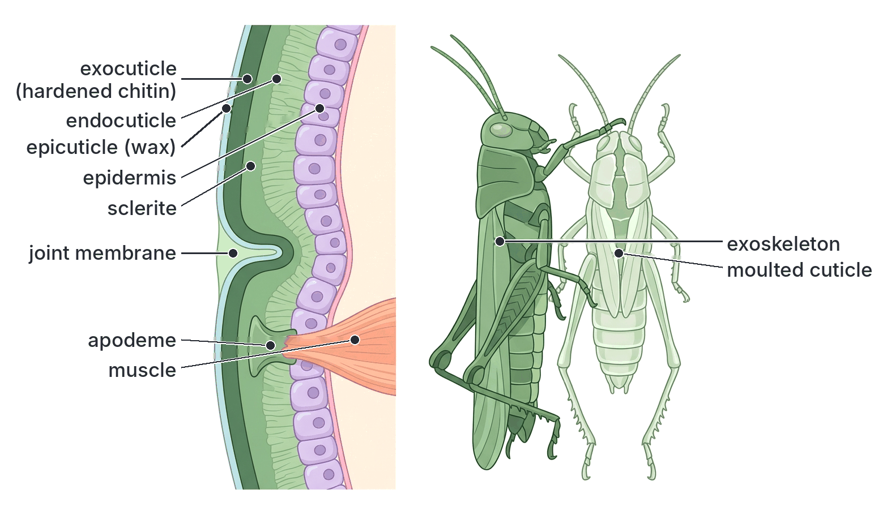

### 3. The endoskeleton

An **endoskeleton** is a skeleton found **inside** the body, surrounded by muscles and other soft tissues.

**Examples:** all **vertebrates**: fish, amphibians (frog, toad), reptiles (lizard, snake, crocodile), birds and mammals (including humans). The endoskeleton is made of **bone** and **cartilage**. In cartilaginous fish (sharks and rays), it is made almost entirely of **cartilage**. (Echinoderms such as starfish have a different internal skeleton of chalky plates.)

**Features:**

- Made of **living tissues** (bone and cartilage) that contain cells and receive a blood supply (bone) or nutrients by diffusion (cartilage).
- **Grows with the body**, so there is **no need to moult**.
- **Muscles are attached to the outside** of the bones, by **tendons**.
- Bones are joined at **joints**, held together by **ligaments**.
- It is jointed, giving a wide range of movements.

**Advantages of an endoskeleton:**

1. **Grows with the animal:** no moulting, so there is no dangerous soft stage.
2. **Supports large bodies:** bones are strong for their weight, so vertebrates can grow very large (elephants, giraffes, whales).
3. **Can repair itself** when broken (fractures heal).
4. **Flexible:** many joints allow a great variety of movements.
5. **Produces blood cells** (red bone marrow) and stores minerals.

**Disadvantages of an endoskeleton:**

1. Gives **less protection** to the outer surface of the body (the skin and muscles are exposed), so injuries such as cuts are more likely.
2. Does **not prevent water loss** (the skin must do this).

### Exoskeleton and endoskeleton compared

| Feature | Exoskeleton | Endoskeleton |
| --- | --- | --- |
| Position | **Outside** the body | **Inside** the body |
| Material | **Chitin** (arthropods), hardened by protein or calcium carbonate; calcium carbonate shells (molluscs) | **Bone** and **cartilage** |
| Living or non-living | **Non-living** (secreted by the epidermis) | **Living** tissue (cells, blood supply in bone) |
| Growth | **Cannot grow**; the animal must **moult** (ecdysis) | **Grows** with the body; no moulting |
| Attachment of muscles | Muscles attached to the **inner** surface | Muscles attached to the **outer** surface by tendons |
| Protection | Covers and protects the **whole body** | Protects certain organs (brain, heart, lungs); body surface not protected |
| Water loss | **Reduces** water loss (waxy layer) | Does not prevent water loss |
| Size of animal | Limits animals to a **small size** | Allows **large size** |
| Repair | Cannot repair itself (only replaced at moulting) | Can repair itself (fractures heal) |
| Joints | Thin, soft joint membranes between hard plates | Synovial, cartilaginous and fibrous joints |
| Examples | Insects, crabs, prawns, spiders, millipedes, snails (shell) | Fish, frog, lizard, birds, mammals (man, goat, dog) |

### Functions of the skeleton in animals (summary)

1. **Support:** gives shape and holds up the body.
2. **Protection:** of delicate organs (brain, spinal cord, heart, lungs, and the whole body in arthropods).
3. **Locomotion (movement):** provides levers and points of attachment for muscles; joints allow movement.
4. **Respiration (breathing):** the ribs and sternum, moved by intercostal muscles, help change the volume of the chest in mammals.
5. **Production of blood cells:** in the red bone marrow (vertebrates).
6. **Storage of minerals:** calcium and phosphate in bones.
7. **Hearing:** the tiny ear ossicles (malleus, incus, stapes) carry sound vibrations.
8. **Water conservation:** the waxy exoskeleton of insects.

These functions, and how they affect the wellbeing of the animal, are explained under objective ix below.

## Supporting tissues in animals: chitin, cartilage and bone

**Content b: supporting tissues in animals.**

**Objective vi: relate the location of chitin, cartilage and bone to their supporting function.**

### Chitin

**What it is:** chitin is a tough, flexible, nitrogen-containing **polysaccharide** (a complex carbohydrate, similar to cellulose but containing nitrogen). It is not soluble in water and resists most chemicals. Pure chitin is fairly soft and flexible; it becomes hard when combined with hardened (tanned) proteins or with **calcium carbonate**.

**Location:**

1. The **exoskeleton (cuticle)** of **arthropods**: insects, crustaceans (crabs, prawns, lobsters), spiders, scorpions, millipedes and centipedes.
2. The lining of the **tracheae** of insects (as spiral thickenings that keep the tubes open).
3. The lining of the **foregut** and **hindgut** of insects.
4. The **cell walls of fungi** (e.g. mushrooms, *Rhizopus*, yeast).
5. The **chaetae** (bristles) of earthworms, and the jaws or other hard parts of some other invertebrates.

**How its location relates to its supporting function:**

- On the **outside** of arthropods, chitin forms a **rigid tube or case** around each body segment and limb. This gives the body its **shape**, **supports** the soft tissues inside, and gives **firm places on the inside for muscles to attach**. The limbs are hollow, jointed tubes: a hollow tube is strong for its weight, like a bicycle frame.
- Being on the outside, it also **protects** the whole body from injury and predators and, with its wax layer, **prevents drying out**.
- At the **joints**, the chitin is thin and not hardened, so the joints can **bend**, allowing **locomotion** (walking, jumping, flying).
- In the **tracheae**, rings of chitin **hold the air tubes open**, like the cartilage rings in our trachea.
- In the **cell walls of fungi**, chitin gives each hypha **shape and strength** and stops it bursting.

### Cartilage

**What it is:** cartilage (gristle) is a firm but **flexible**, smooth, bluish-white **connective tissue**.

**Structure:**

- It consists of living cells called **chondrocytes**, which lie in small spaces (**lacunae**), often in groups of two or four.
- The cells are surrounded by a firm, rubbery **matrix** (ground substance) made of a protein-carbohydrate material (**chondrin**), containing **collagen** fibres (and, in some types, elastic fibres).
- It is covered by a fibrous layer called the **perichondrium** (except at joints).
- It has **no blood vessels** and **no nerves**: the cells get food and oxygen by **diffusion** through the matrix. Because of this, cartilage **heals very slowly** when damaged.

**Types of cartilage and their locations:**

| Type | Features | Location | Supporting function |
| --- | --- | --- | --- |
| **Hyaline cartilage** (the most common) | Smooth, glassy, bluish; few fine collagen fibres | **Ends of bones at joints** (articular cartilage); **rings of the trachea** and bronchi; the **larynx**; the **nose**; the **costal cartilages** joining the ribs to the sternum; the skeleton of the **embryo**; the **growth plates** of young bones | Provides a smooth, slippery surface at joints to reduce friction; holds the trachea open; gives shape with flexibility; allows the rib cage to move during breathing; template for bone formation |
| **Elastic cartilage** | Contains many **elastic fibres**; yellowish and very flexible | **Pinna** (outer ear flap), **epiglottis**, parts of the larynx | Gives support and shape while allowing bending and springing back |
| **Fibrocartilage (white fibrous cartilage)** | Contains many thick bundles of **collagen** fibres; very tough | **Intervertebral discs** (between the vertebrae), the **pubic symphysis**, the cartilage pads (menisci) of the knee | Acts as a **shock absorber**, resisting pressure and pulling; joins bones firmly but allows slight movement |

**How its location relates to its supporting function:**

1. **At the ends of bones (articular cartilage):** its smooth, slippery surface **reduces friction** so that bones can move easily against each other, and it **absorbs shock** when we walk, run or jump.
2. **In the trachea and bronchi:** C-shaped rings of cartilage **keep the air passages open** so they do not collapse when we breathe in, while still letting the neck bend and food pass down the oesophagus behind.
3. **In the nose and pinna:** it gives **shape and support** while being flexible, so these parts can bend without breaking.
4. **Between vertebrae (intervertebral discs):** it **cushions** the vertebrae, absorbs shock and allows the backbone to bend slightly.
5. **Joining ribs to the sternum:** it allows the rib cage to move during **breathing**.
6. **In the skeleton of sharks and rays** (cartilaginous fish) and the **embryo** of all vertebrates: it forms the whole supporting skeleton. In the embryo, most cartilage is later replaced by bone (**ossification**).

### Bone

**What it is:** bone is a very hard, strong, living **connective tissue** that makes up most of the vertebrate endoskeleton.

**Composition:**

- About **two-thirds** of the weight of bone is **inorganic** (mineral) matter, mainly **calcium phosphate** (with some calcium carbonate and other salts). This makes bone **hard and rigid** and strong when compressed (squashed).
- About **one-third** is **organic** matter, mainly the protein **collagen**. This makes bone **tough** and slightly **flexible**, and strong when pulled, so that it does not shatter like glass.

**Textbook variation:** the proportions are given as about 60–70% mineral and 30–40% organic in different textbooks. Young people's bones have more organic matter and are more flexible; old people's bones have relatively more mineral and break more easily.

**Experiment: to show the two components of bone**

- **Aim:** to show that bone contains both mineral and organic matter.
- **Method and observations:**
  1. Soak a chicken leg bone in **dilute hydrochloric acid** (or strong vinegar) for several days. The acid **dissolves the mineral salts**. The bone becomes **soft and rubbery**; it can be bent or even tied in a knot. Only the **organic matter (collagen)** is left.
  2. **Heat** (burn) another bone strongly in a flame. The **organic matter burns away**. The bone keeps its shape but becomes **white, brittle** and **crumbles** easily. Only the **mineral matter** is left.
- **Conclusion:** the **mineral salts** make bone **hard**; the **organic matter** makes it **tough and flexible**. Both are needed for strong, healthy bones.

**Microscopic structure of compact bone:**

1. Bone is made of many units called **Haversian systems** (osteons).
2. In the centre of each system is a **Haversian canal**, which contains **blood vessels** and **nerves**.
3. Around the canal are many concentric rings (layers) of hard matrix called **lamellae**.
4. Between the lamellae are small spaces called **lacunae**, each containing a living **bone cell (osteocyte)**.
5. Tiny channels called **canaliculi** radiate from each lacuna and connect the bone cells with each other and with the Haversian canal. Food and oxygen pass through them.
6. Bone cells that build new bone are called **osteoblasts**; cells that break down (reabsorb) bone are called **osteoclasts**. Bone is constantly being rebuilt.

**Structure of a long bone (e.g. the femur or humerus):**

1. **Diaphysis (shaft):** the long middle part. Its wall is made of thick **compact bone**, forming a **hollow tube**.
2. **Marrow cavity (medullary cavity):** the hollow centre of the shaft, filled with **yellow bone marrow** (mainly fat) in adults.
3. **Epiphyses (heads):** the two enlarged ends of the bone. They are made of **spongy bone** (cancellous bone: a network of thin bony struts called trabeculae with spaces between them), covered by a thin layer of compact bone. The spaces in spongy bone contain **red bone marrow**, which makes **blood cells**.
4. **Articular cartilage:** a layer of smooth **hyaline cartilage** covering the ends of the bone where it forms a joint.
5. **Growth plate (epiphyseal plate):** a disc of cartilage between the shaft and each head in **young** animals. It is where the bone **grows in length**. When growth stops (in early adulthood), it is replaced by bone.
6. **Periosteum:** a tough, fibrous membrane covering the outside of the bone (except at the joints). It contains bone-forming cells, carries blood vessels into the bone, and is where **tendons and ligaments are attached**.
7. **Blood vessels and nerves** enter the bone through small holes (nutrient foramina).

**How the structure and location of bone relate to its supporting function:**

1. **Bone forms the endoskeleton of vertebrates,** inside the body, so it supports the body from within and allows large size.
2. **Hardness and rigidity** (from calcium phosphate) let bones support the body's weight and act as **firm levers** for muscles.
3. **Toughness** (from collagen) stops bones from snapping easily.
4. **Hollow, tube-shaped long bones** are very strong for their weight (like a steel pipe), so the limbs are strong but not too heavy. Birds have air spaces in many bones, making them light for flight.
5. **Spongy bone at the ends** is arranged along the lines of stress, giving strength with less weight, and absorbs shock.
6. **Enlarged ends** give a large surface for joints and for the attachment of muscles and ligaments.
7. **Bones in the skull and rib cage** are shaped as boxes and cages that **protect** the organs inside.
8. **Living cells and a blood supply** mean bone can **grow**, **repair** itself after a fracture and **reshape** itself according to use (exercise makes bones stronger).

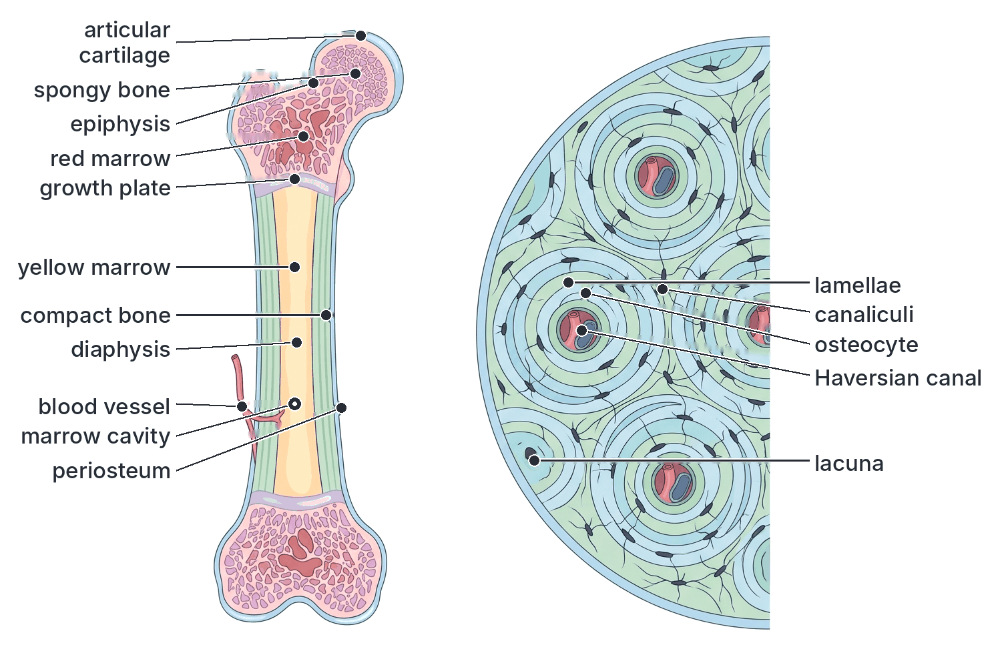

### Chitin, cartilage and bone compared

| Feature | Chitin | Cartilage | Bone |
| --- | --- | --- | --- |
| Nature | Nitrogen-containing polysaccharide (non-living material) | Living connective tissue | Living connective tissue |
| Found in | Exoskeleton of arthropods; fungal cell walls | Endoskeleton of vertebrates (joints, trachea, nose, pinna, discs); whole skeleton of sharks and embryos | Endoskeleton of most vertebrates |
| Position in body | Outside (exoskeleton) | Inside | Inside |
| Hardness | Tough and flexible; hard when tanned or calcified | Firm but **flexible** and elastic | Very **hard and rigid** |
| Main components | Chitin and proteins (and calcium carbonate in crustaceans) | Chondrocytes in a matrix of chondrin and collagen | Osteocytes in a matrix of calcium phosphate and collagen |
| Blood supply | None (non-living) | **None**; nutrients by diffusion | **Rich** blood supply (Haversian canals) |
| Can it grow? | No (moulting needed) | Yes, slowly | Yes |
| Repair after damage | No | Very slow | Fairly quick (fractures heal in weeks) |
| Main supporting function | Shape, support, protection, muscle attachment from inside, water-proofing | Smooth joint surfaces, shock absorption, keeping air tubes open, flexible support | Support of body weight, levers for movement, protection of organs |

### Cartilage and bone compared (quick table)

| Cartilage | Bone |
| --- | --- |
| Flexible | Rigid |
| No blood vessels | Has blood vessels |
| No mineral salts (or very little), except in calcified cartilage | About two-thirds mineral salts (calcium phosphate) |
| Cells (chondrocytes) in lacunae, no canaliculi | Cells (osteocytes) in lacunae connected by canaliculi |
| No Haversian systems | Haversian systems present |
| No marrow | Marrow present (red and yellow) |

## The mammalian skeleton

**Objective vii: relate the structure and the general layout of the mammalian skeleton to their supportive, locomotive and respiratory function.**

The adult human skeleton has about **206 bones**. (A newborn baby has about 270–300 bones or bony parts, many of which fuse together during growth; textbooks give different figures for babies.) Other mammals (rabbit, goat, dog, rat) have the same basic plan, though the numbers of some bones differ.

The mammalian skeleton is divided into two parts:

1. **The axial skeleton:** the central axis of the body: the **skull**, the **vertebral column** (backbone), the **ribs** and the **sternum** (breastbone).
2. **The appendicular skeleton:** the **girdles** and the **limbs** (appendages): the **pectoral (shoulder) girdle** and **forelimbs** (arms), and the **pelvic (hip) girdle** and **hindlimbs** (legs).

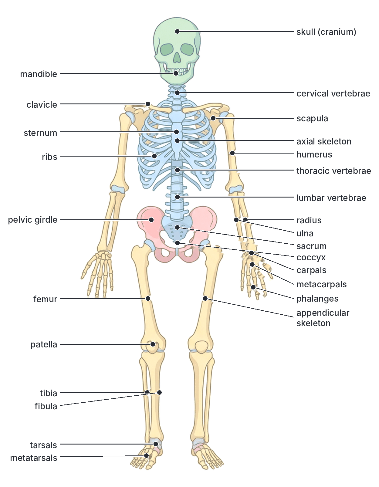

### The axial skeleton

#### The skull

The skull is made up of:

1. **The cranium (brain box):** a hollow case of flat bones that encloses and **protects the brain**. In adults, the bones of the cranium are joined firmly together by wavy, **immovable joints** called **sutures**. In a newborn baby, the bones are not yet joined, and there are soft areas called **fontanelles** (the "soft spot" on a baby's head), which allow the skull to change shape slightly at birth and the brain to grow. They close during the first two years or so.
2. **The facial bones:** form the face, the **orbits** (eye sockets, which protect the eyes), the **nasal cavity** and the upper jaw (**maxilla**), which carries the upper teeth.
3. **The lower jaw (mandible):** the only **movable** bone of the skull. It carries the lower teeth and is hinged to the cranium, allowing **chewing** and **speech**.
4. **The ear ossicles** (malleus, incus and stapes), tiny bones inside the middle ear for **hearing**.

At the back of the base of the skull is a large hole, the **foramen magnum**, through which the **spinal cord** joins the brain. On either side of it are two smooth bumps, the **occipital condyles**, which fit into the first vertebra (the atlas), allowing the head to **nod**.

**Functions of the skull:** protection of the brain and sense organs (eyes, ears, nose, tongue); support for the teeth and jaws (feeding); framework of the face; attachment of jaw and neck muscles.

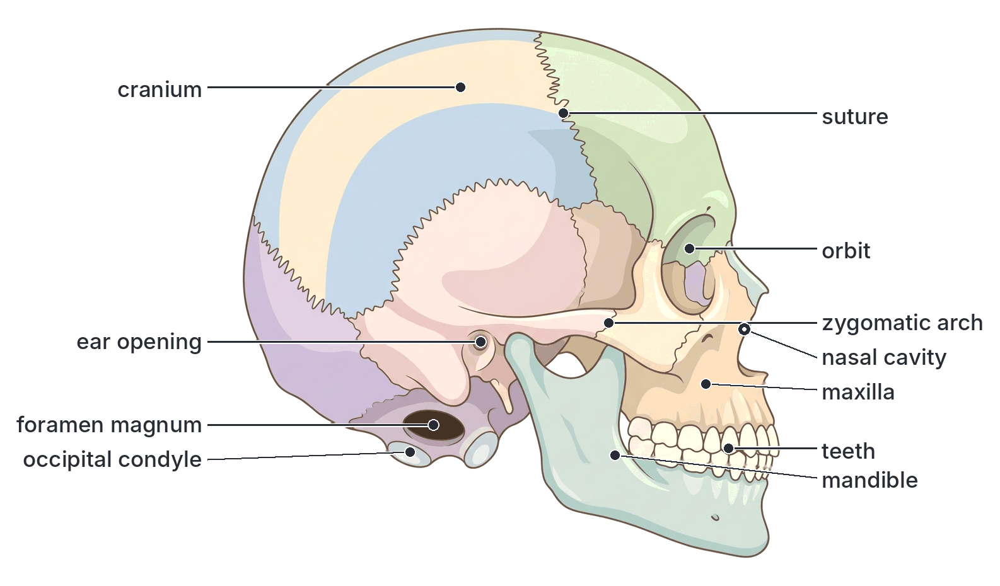

#### The vertebral column (backbone)

The vertebral column is a strong, flexible column of small bones called **vertebrae** (singular: vertebra), joined end to end and separated by **intervertebral discs** of fibrocartilage. It runs from the base of the skull to the tail.

**Functions of the vertebral column:**

1. **Supports** the body and holds it up; it is the main axis to which the skull, ribs and girdles are attached.
2. **Protects** the **spinal cord**, which runs through the neural canal of the vertebrae.
3. Allows **movement** of the body: bending forwards, backwards and sideways, and twisting, because it is made of many small bones.
4. Provides **attachment for muscles** of the back, neck and limbs.
5. **Absorbs shock** (through the intervertebral discs and the curves of the spine) when we walk, run or jump.
6. Attachment for the **ribs**, which help in **breathing**.

**Regions of the human vertebral column:**

| Region | Number of vertebrae (human) | Position |
| --- | --- | --- |
| **Cervical** | 7 | Neck |
| **Thoracic** | 12 | Chest (bear ribs) |
| **Lumbar** | 5 | Lower back (abdomen) |
| **Sacral** | 5, **fused** to form the **sacrum** | Hip region (joined to the pelvic girdle) |
| **Caudal (coccygeal)** | 4 (usually 3 to 5), **fused** to form the **coccyx** | Tail region (a tiny "tail bone" in humans) |
| **Total** | 33 (26 separate bones in the adult, counting the sacrum and coccyx as one each) | |

**Note:** almost **all mammals have 7 cervical vertebrae**, whether the neck is very long (giraffe) or very short (whale). The numbers in the other regions vary between species. For example, the **rabbit** is usually given as 7 cervical, 12 thoracic, 7 lumbar, 4 sacral and about 15–16 caudal vertebrae.

**Textbook variation:** the number of caudal vertebrae in humans is given as 4 by most textbooks, but it varies from 3 to 5 between people; the number in rabbits is given as anything from 15 to 18 in different books. The numbers of sacral vertebrae in the rabbit are also given as 3 or 4.

**The curves of the human spine:** seen from the side, the human backbone has an S-shaped double curve (forward in the neck and lower back, backward in the chest and hip region). This helps balance the body upright over the legs and acts like a spring to absorb shock.

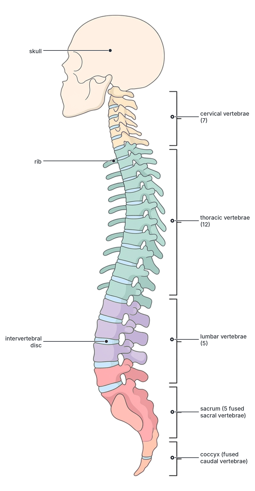

#### General structure of a vertebra

Most vertebrae share the same basic plan:

1. **Centrum (body):** the solid, cylindrical, weight-bearing part at the front (in humans) or underneath (in four-legged animals). Centra are separated by intervertebral discs.
2. **Neural arch:** an arch of bone above (behind) the centrum.
3. **Neural canal:** the hole enclosed by the centrum and neural arch, through which the **spinal cord** passes.
4. **Neural spine:** a projection on top of the neural arch, for the attachment of **back muscles and ligaments**.
5. **Transverse processes:** a pair of side projections, for the attachment of **muscles** (and, in thoracic vertebrae, the ribs).
6. **Articular facets (zygapophyses):** small, smooth surfaces where each vertebra joins (articulates with) the next. The **prezygapophyses** at the front face upwards; the **postzygapophyses** at the back face downwards. They allow slight gliding movement and prevent the vertebrae from slipping.

#### The cervical vertebrae (neck)

**Typical cervical vertebra** (3rd to 7th):

- **Small centrum**.
- **Short, small neural spine** (sometimes forked).
- **Wide neural canal**.
- Short, broad transverse processes, each with a small hole, the **vertebrarterial canal** (transverse foramen), through which the **vertebral artery** passes to the brain.
- In some mammals (e.g. rabbit, dog), the transverse processes carry small extensions called **cervical ribs** (fused rib remnants).

**Function:** support the head and neck; allow the neck to bend and turn; protect the spinal cord and vertebral arteries; muscle attachment.

**The atlas (1st cervical vertebra):**

- Shaped like a **ring**; it has **no centrum** (its centrum has become the odontoid process of the axis).
- **No neural spine** (or a very tiny one).
- **Wide, flat, wing-like transverse processes** for the attachment of neck muscles.
- Two large, concave, kidney-shaped **articular facets** on its upper surface, into which the **occipital condyles** of the skull fit.
- A very **large neural canal**: the front (lower) part holds the **odontoid process** of the axis, and the back part holds the spinal cord, separated by a ligament.

**Function:** supports the **skull** and allows the **nodding** movement of the head (up and down, as in saying "yes"), at the joint between the skull and the atlas.

**The axis (2nd cervical vertebra):**

- Has a peg-like projection called the **odontoid process** (dens) sticking up from the front of its centrum. The odontoid process fits into the front part of the atlas's neural canal.
- A **large, flat, blade-like neural spine** for the attachment of strong neck muscles.
- Small transverse processes with vertebrarterial canals.

**Function:** the atlas (with the skull) **rotates (pivots)** around the odontoid process of the axis, allowing the head to turn **from side to side** (as in saying "no"). This is a **pivot joint**.

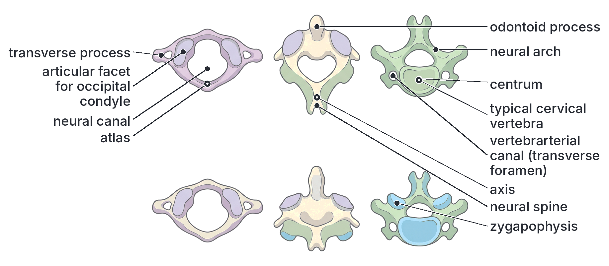

#### The thoracic vertebrae (chest)

- **Long neural spine** that points **backwards** (downwards), for the attachment of back and neck muscles (especially long in grazing mammals such as goats and cows, to hold up the heavy head).
- **Large centrum** (larger than cervical).
- **Short transverse processes**, each with a smooth **facet (tubercular facet)** for the **tubercle** of a rib.
- Small **facets (capitular facets or demi-facets)** on the sides of the centrum, for the **head (capitulum)** of a rib.
- Round, fairly small neural canal.

**Function:** carry the **ribs**, and so form the back of the **rib cage**; support; protection of the spinal cord; attachment of muscles. Their joints with the ribs allow the ribs to move up and down during **breathing**.

#### The lumbar vertebrae (lower back)

- **Very large, thick centrum**: the lumbar vertebrae carry the **weight of the upper body**, so they are the largest and strongest.
- **Long, broad transverse processes**, often pointing forwards and downwards, for the attachment of the large **back and abdominal muscles**.
- Broad, flat **neural spine**.
- In some mammals such as the rabbit, extra processes (**metapophyses** and **anapophyses**) give more surfaces for muscle attachment and lock the vertebrae together.
- **No rib facets.**

**Function:** **support** the weight of the upper body; give large surfaces for the attachment of the powerful muscles used in bending, lifting and (in four-legged animals such as rabbits) jumping and running; allow bending of the trunk.

#### The sacral vertebrae (sacrum)

- Several sacral vertebrae are **fused** together to form one strong, triangular bone, the **sacrum**.
- The first sacral vertebra has large, wing-like transverse processes that **fuse with (articulate firmly with) the ilium** of the pelvic girdle.
- The neural spines are small; the neural canal becomes narrow towards the end.

**Function:** forms a strong, rigid joint with the **pelvic girdle**, so that the **weight of the body** is transferred to the hind legs, and the **thrust of the legs** during walking, running and jumping is passed to the backbone. It also protects the pelvic organs.

#### The caudal vertebrae (tail)

- In humans, 3 to 5 tiny vertebrae are fused into the **coccyx**.
- In tailed mammals (rabbit, dog, goat, monkey, rat), the caudal vertebrae form the **tail**. The first few are like small, typical vertebrae; towards the tip, the vertebrae become **smaller and simpler**, losing the neural arch and processes, until only a small **rod-like centrum** remains.

**Function:** support the **tail**. The tail is used for **balance** (rat, squirrel, cat), **driving away flies** (cow, goat, horse), **grasping** (some monkeys), signalling and communication (dog), and as a muscle attachment for the anus and pelvic floor in humans (coccyx).

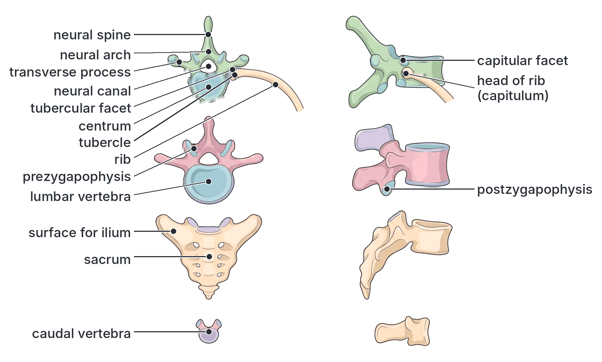

#### Comparison of the types of vertebrae

| Feature | Atlas | Axis | Typical cervical | Thoracic | Lumbar | Sacral | Caudal |
| --- | --- | --- | --- | --- | --- | --- | --- |
| Centrum | **Absent** | Present, with **odontoid process** | Small | Medium, with facets for rib heads | **Very large** and thick | Fused to form sacrum | Small; only centrum remains near the tip |
| Neural spine | Absent or tiny | **Large, flat, blade-like** | Short | **Long, pointing backwards** | Broad, flat | Small, fused | Reduced or absent |
| Transverse processes | **Wide, flat, wing-like** | Small | Short, with **vertebrarterial canal** | Short, with **facets for ribs** | **Long and broad** | Large and fused with the **ilium** (first one) | Small or absent |
| Neural canal | **Very large** | Large | Wide | Small, round | Medium (triangular) | Narrow | Small or absent |
| Special feature | Facets for **occipital condyles** | **Odontoid process** | **Vertebrarterial canals** | **Rib facets** | **Metapophyses and anapophyses** (in rabbit) | **Fused** into one bone | Reduced, simple |
| Main function | **Nodding** of the head; supports skull | **Turning** the head (pivot) | Support and movement of neck | Attachment of **ribs**; breathing | Support of body weight; muscle attachment | Attachment of **pelvic girdle**; transfer of weight to legs | Support of the **tail** |

#### The rib cage: ribs and sternum

**The ribs:**

- Humans have **12 pairs of ribs**, one pair for each thoracic vertebra.
- Each rib is a long, thin, curved bone. Its back end has a **head (capitulum)**, which articulates with the **centrum** (capitular facets) of the thoracic vertebra, and a **tubercle**, which articulates with the **transverse process** (tubercular facet).
- At the front, most ribs are joined to the sternum by bars of flexible **costal cartilage**.
  - **True ribs (pairs 1–7):** joined directly to the sternum by their own cartilage.
  - **False ribs (pairs 8–10):** joined to the sternum indirectly, through the cartilage of the rib above.
  - **Floating ribs (pairs 11–12):** not joined to the sternum at all at the front.
- Between the ribs are the **intercostal muscles** (external and internal).

**Textbook variation:** some textbooks count floating ribs as a kind of false rib (so false ribs = pairs 8–12). Both groupings are seen.

**The sternum (breastbone):** a flat, dagger-shaped bone in the middle of the front of the chest, made of three parts: the **manubrium** (top, to which the clavicles attach), the **body** (middle) and the **xiphoid process** (a small cartilage tip at the bottom). In birds, the sternum has a large **keel** for the attachment of the powerful flight muscles.

**Functions of the rib cage:**

1. **Protection:** forms a strong, springy cage around the **heart, lungs** and the major blood vessels; the lower ribs also partly protect the **liver, stomach, spleen and kidneys**.
2. **Breathing (respiration):** the ribs and the intercostal muscles, together with the diaphragm, change the volume of the thorax:
   - **Inspiration (breathing in):** the **external intercostal muscles contract**, pulling the ribs **upwards and outwards** (and the sternum forwards); the **diaphragm contracts and flattens**. The volume of the thorax **increases**, the pressure inside falls, and air rushes into the lungs.
   - **Expiration (breathing out):** the external intercostal muscles **relax** (and the internal intercostals contract in forced breathing), so the ribs move **downwards and inwards**; the diaphragm relaxes and domes upwards. The volume of the thorax **decreases**, the pressure rises, and air is forced out.
   - The **flexible costal cartilages** and the **joints between the ribs and vertebrae** make these movements possible.
3. **Support:** supports the chest wall and gives attachment to the muscles of the chest, back and shoulders (and the pectoral girdle).

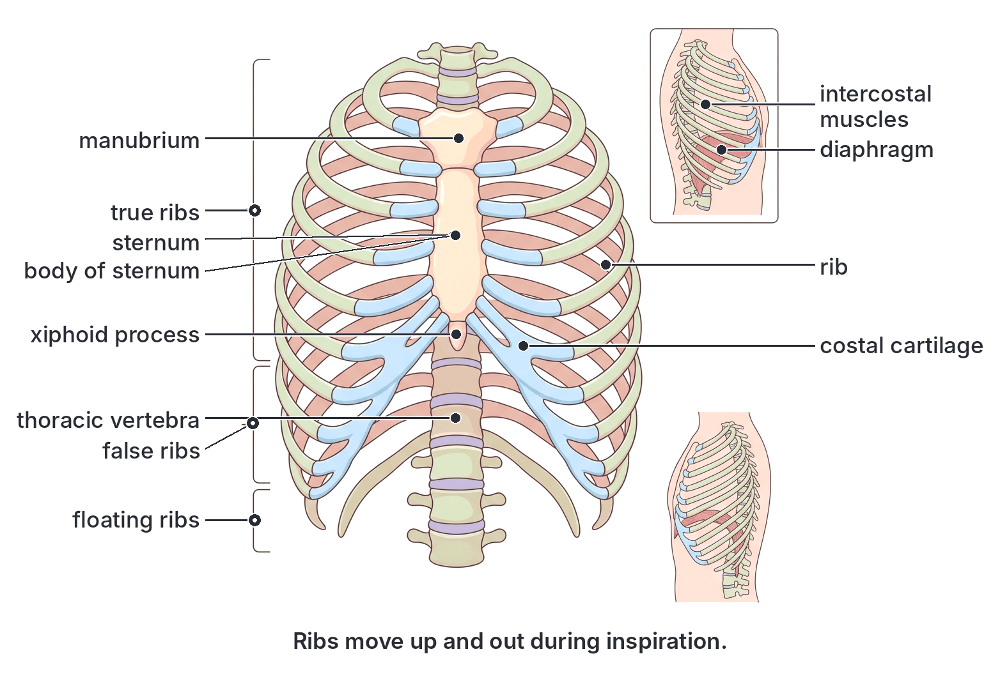

### The appendicular skeleton

The appendicular skeleton is made of the **girdles**, which attach the limbs to the axial skeleton, and the **limbs** themselves.

#### The pectoral (shoulder) girdle

On each side, the pectoral girdle consists of two bones:

1. **Scapula (shoulder blade):** a large, flat, triangular bone lying over the back of the upper ribs. It has a **ridge (spine)** running across it, ending in a projection called the **acromion process**, for muscle attachment. At its outer angle is a shallow cup, the **glenoid cavity**, into which the head of the humerus fits to form the **shoulder joint**. A hook-like **coracoid process** also gives muscle attachment. Its broad, flat surface gives a large area for the attachment of the muscles that move the arm.
2. **Clavicle (collar bone):** a thin, S-shaped rod that joins the scapula to the **sternum** at the front. It acts as a strut, holding the shoulder out to the side. (The clavicle is reduced or absent in many fast-running mammals, such as the goat, cow, horse and dog, which only move their forelegs forwards and backwards.)

**Note:** the pectoral girdle is **not joined directly to the backbone**. It is held to the trunk mainly by **muscles**. This makes the shoulder very **flexible** and allows a wide range of arm movements, and the muscles act as **shock absorbers** when a four-legged animal lands on its forelegs.

#### The forelimb (arm)

| Part | Bone(s) | Features |
| --- | --- | --- |
| Upper arm | **Humerus** (1) | Long bone; its rounded **head** fits into the glenoid cavity; its lower end forms the elbow joint |
| Forearm | **Radius** and **ulna** (2) | The **ulna** has a projection called the **olecranon process**, which forms the point of the elbow and stops the arm from bending backwards beyond straight; the triceps muscle is attached to it. The **radius** can rotate around the ulna, allowing the palm to be turned up and down |
| Wrist | **Carpals** (8 in humans) | Small bones arranged in two rows; gliding joints between them |
| Palm | **Metacarpals** (5) | Long bones of the palm |
| Fingers | **Phalanges** (14 in each hand: 2 in the thumb, 3 in each finger) | Allow grasping and fine movements |

#### The pelvic (hip) girdle

- The pelvic girdle is made of two halves (the **hip bones** or **innominate bones**). Each half is made of **three bones fused together**: the **ilium** (the upper, broad, flat part), the **ischium** (the lower back part, on which we sit) and the **pubis** (the lower front part).
- At the front, the two pubic bones meet at the **pubic symphysis**, a slightly movable cartilaginous joint.
- At the back, each **ilium** is **firmly fused (joined) to the sacrum**, forming a strong, rigid ring of bone called the **pelvis**.
- On the outer side of each half is a deep cup, the **acetabulum**, into which the head of the femur fits to form the **hip joint**.
- A large hole, the **obturator foramen**, between the ischium and pubis, makes the bone lighter and lets nerves and blood vessels pass.
- **In females**, the pelvis is **wider and shallower**, with a larger opening, to allow a baby to pass through during **birth**.

**Functions of the pelvic girdle:** transfers the weight of the upper body to the legs (support); provides attachment for the strong muscles of the legs, back and abdomen (locomotion); protects the **bladder, reproductive organs** and lower intestines; supports the developing baby during pregnancy.

#### The hindlimb (leg)

| Part | Bone(s) | Features |
| --- | --- | --- |
| Thigh | **Femur** (1) | The **longest and strongest bone** of the body; its rounded **head** fits into the acetabulum; it has projections (**trochanters**) for the attachment of large muscles |
| Knee cap | **Patella** (1) | A small bone in the tendon in front of the knee; protects the knee joint and improves the leverage of the thigh muscles |
| Shank (lower leg) | **Tibia** (shin bone, the larger, bearing most of the weight) and **fibula** (thin, on the outer side) (2) | In some mammals (e.g. rabbit), the tibia and fibula are partly fused |
| Ankle | **Tarsals** (7 in humans) | Include the **calcaneus** (heel bone), to which the Achilles tendon (calf muscle) is attached, and the talus, which joins the tibia |
| Sole | **Metatarsals** (5) | Form the arch of the foot |
| Toes | **Phalanges** (14 in each foot) | Help balance and push off when walking |

**The pentadactyl limb:** the forelimb and hindlimb of all mammals (and of other land vertebrates) are built on the same basic plan, with **one** upper bone, **two** lower bones, a group of wrist or ankle bones, and up to **five digits** (fingers or toes). This is the **pentadactyl** ("five-fingered") **limb**. In different animals it is modified for different uses (e.g. the wing of a bat, the flipper of a whale, the hoof of a goat, which walks on the tips of its third and fourth digits). This shared plan is evidence of evolution (see Section E, Topic E1).

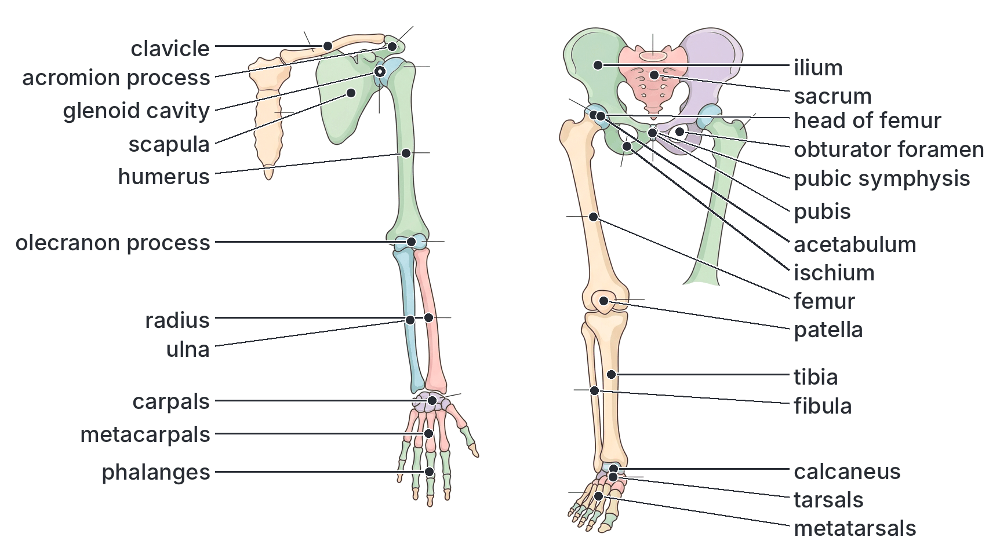

### Pectoral and pelvic girdles compared

| Feature | Pectoral girdle | Pelvic girdle |
| --- | --- | --- |
| Bones (each side) | Scapula and clavicle (separate) | Ilium, ischium and pubis (**fused** into one hip bone) |
| Attachment to the backbone | **Not attached** directly; held by muscles | **Firmly fused to the sacrum** |
| Socket for the limb | **Glenoid cavity** (shallow) | **Acetabulum** (deep) |
| Limb attached | Forelimb (humerus) | Hindlimb (femur) |
| Strength and flexibility | Flexible, allows a wide range of movement | Strong and rigid, bears weight; less flexible |
| Main function | Wide movement of the arms; shock absorption in four-legged animals | Support of body weight; transfer of thrust from legs to body; protection of pelvic organs |

### Forelimb and hindlimb compared

| Forelimb | Hindlimb |
| --- | --- |
| Humerus (upper arm) | Femur (thigh) |
| Radius and ulna (forearm) | Tibia and fibula (shank) |
| Olecranon process on ulna forms the elbow | Patella (knee cap) in front of the knee |
| Carpals (wrist) | Tarsals (ankle) |
| Metacarpals | Metatarsals |
| Phalanges (fingers) | Phalanges (toes) |
| Joined to pectoral girdle at the glenoid cavity (shoulder) | Joined to pelvic girdle at the acetabulum (hip) |

### How the structure of the mammalian skeleton relates to its functions

| Function | Parts of the skeleton involved and how their structure helps |
| --- | --- |
| **Support** | The **vertebral column** is the central pillar; the **lumbar vertebrae** have large centra to carry the weight of the upper body; the **sacrum** is fused to the pelvic girdle to pass weight to the legs; the **limb bones** are long, strong, hollow tubes; the **S-shaped spine** balances the body upright; the skull is balanced on the atlas |
| **Locomotion** | **Long limb bones** act as **levers**, moved by muscles attached by tendons; **joints** (ball and socket at shoulder and hip, hinge at elbow and knee) allow movement; **processes** (neural spines, transverse processes, olecranon, trochanters) give extra surfaces for muscle attachment; the pelvic girdle passes the thrust of the legs to the body; the flexible backbone helps running and jumping in four-legged animals |
| **Respiration** | The **ribs** (with movable joints at the vertebrae and flexible costal cartilages) and the **sternum** form a cage that can be raised and lowered by the **intercostal muscles**; this changes the volume of the thorax, together with the diaphragm |
| **Protection** | **Cranium** (brain), **orbits** (eyes), **vertebrae** (spinal cord), **rib cage** (heart, lungs), **pelvis** (bladder, reproductive organs) |

## Joints

**Objective viii: differentiate types of joints using appropriate examples.**

A **joint** (articulation) is a place where **two or more bones meet**. Joints hold the skeleton together and, in most cases, allow movement.

### Types of joints by degree of movement

Joints are grouped according to how much movement they allow.

#### 1. Immovable joints (fibrous joints)

- The bones are joined **tightly** by **fibrous connective tissue**, and **no movement** is possible.
- **Examples:**
  - The **sutures** between the bones of the **cranium** (skull).
  - The joints between the fused bones of the **pelvic girdle** (ilium, ischium and pubis) and between the fused vertebrae of the **sacrum** in adults (here the bones have fused completely).
  - The fixing of **teeth** in their sockets in the jaw bones (a special fibrous joint called a gomphosis, in some textbooks).
- **Function:** give **strength** and **protection** (e.g. the skull forms a rigid box around the brain).

#### 2. Slightly movable joints (cartilaginous joints)

- The bones are joined by a pad or plate of **cartilage**, which allows **only a little movement**.
- **Examples:**
  - The joints **between the centra of the vertebrae**, separated by **intervertebral discs** of fibrocartilage. Each joint moves only slightly, but together they let the whole backbone bend and twist.
  - The **pubic symphysis**, where the two halves of the pelvic girdle meet at the front (it loosens slightly during childbirth).
  - The joints between the **ribs and the sternum** (through the costal cartilages).
- **Function:** allow a **small amount of movement** with **strength**, and **absorb shock**.

#### 3. Freely movable joints (synovial joints)

- The bones are separated by a **cavity** containing a lubricating fluid (**synovial fluid**), and are held together by **ligaments**. These joints allow **free movement**.
- They are the most common type of joint in the limbs.
- There are several types, according to the shape of the bone ends and the movement allowed (explained below).

### Structure of a synovial joint

**Parts of a synovial joint and their functions:**

| Part | Description | Function |
| --- | --- | --- |
| **Articular cartilage** | A smooth layer of **hyaline cartilage** covering the ends of the bones | Reduces **friction** between the bones; **absorbs shock** |
| **Synovial membrane** | A thin membrane lining the inside of the joint capsule | **Secretes synovial fluid** |
| **Synovial fluid** | A thick, slippery fluid (like egg white) filling the joint cavity | **Lubricates** the joint, reducing friction and wear; nourishes the articular cartilage; absorbs shock |
| **Synovial (joint) cavity** | The space between the bones | Contains synovial fluid; allows free movement |
| **Joint capsule (capsular ligament)** | A tough, fibrous sleeve enclosing the joint | Holds the bones together and encloses the synovial fluid |
| **Ligaments** | Tough, slightly elastic bands of fibrous tissue joining **bone to bone** | Hold the bones together firmly while allowing movement; prevent dislocation |
| **Tendons** (around the joint) | Tough, inelastic cords joining **muscle to bone** | Transfer the pull of the muscles to the bones to cause movement |
| **Cartilage pads (menisci)** (in some joints, e.g. the knee) | Pads of fibrocartilage | Help the bones fit together and absorb shock |

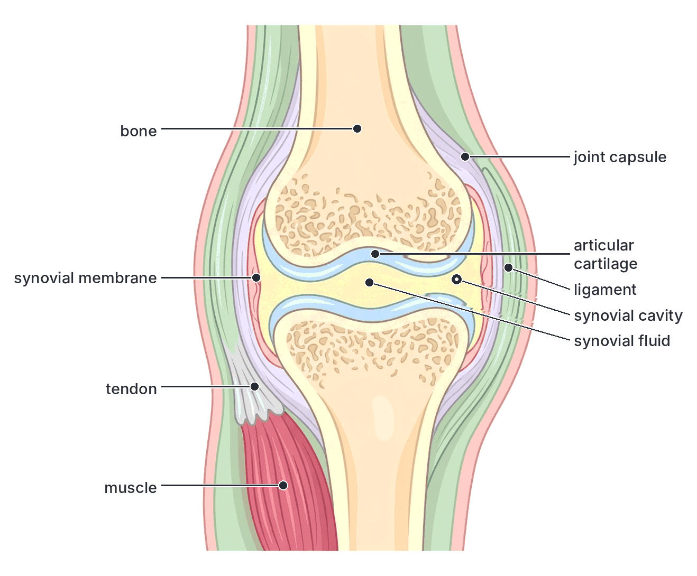

### Types of synovial (movable) joints

#### Ball and socket joint

- The **rounded (ball-shaped) head** of one bone fits into a **cup-shaped socket** in another bone.
- Allows movement in **all directions (all planes)**: forwards, backwards, sideways and **rotation** (circular movement). It gives the **widest range of movement** of any joint.
- **Examples:**
  - The **shoulder joint**: the head of the **humerus** in the **glenoid cavity** of the scapula. The socket is shallow, giving great freedom of movement (e.g. swinging the arm in a circle when bowling a cricket ball or throwing), but making the shoulder easier to **dislocate**.
  - The **hip joint**: the head of the **femur** in the **acetabulum** of the pelvic girdle. The socket is deep, giving a more stable, strong joint that carries the body's weight but has a slightly smaller range of movement.

#### Hinge joint

- The convex surface of one bone fits into the concave surface of another, like the **hinge of a door**.
- Allows movement in **one plane only** (bending and straightening: **flexion** and **extension**), like opening and closing a door.
- **Examples:**
  - The **elbow joint** (between the humerus and the ulna).
  - The **knee joint** (between the femur and the tibia; it also allows slight rotation when bent).
  - The joints between the **phalanges** of the fingers and toes.
  - The **ankle joint** (between the tibia and fibula and the talus) is usually described as a hinge joint.
  - The joint between the **lower jaw** and the skull is often given as a hinge joint in school textbooks, although it also allows some side-to-side and gliding movement for grinding food.

#### Pivot joint

- A **peg** or ring of one bone **rotates** within a ring (or around a peg) formed by another bone.
- Allows **rotation** only (turning around an axis).
- **Examples:**
  - The joint between the **atlas** and the **axis**: the atlas (carrying the skull) rotates around the **odontoid process** of the axis, allowing the head to turn **from side to side**.
  - The joint between the upper ends of the **radius and ulna** at the elbow: the radius rotates, allowing the palm to be turned up and down.

#### Gliding joint

- Two **flat (or slightly curved) surfaces** slide over each other.
- Allows only **small sliding movements** in several directions; no rotation or bending.
- **Examples:**
  - The joints between the **carpals** (wrist bones).
  - The joints between the **tarsals** (ankle bones).
  - The joints between the **articular facets (zygapophyses)** of adjacent vertebrae.
  - The joint between the **clavicle** and the scapula or sternum.

**Textbook variation:** some textbooks also describe **saddle joints** (e.g. at the base of the thumb, allowing the thumb to move across the palm) and **condyloid (ellipsoid) joints** (e.g. between the radius and the carpals, or the knuckles), which allow movement in two planes. JAMB usually tests the four main types: ball and socket, hinge, pivot and gliding.

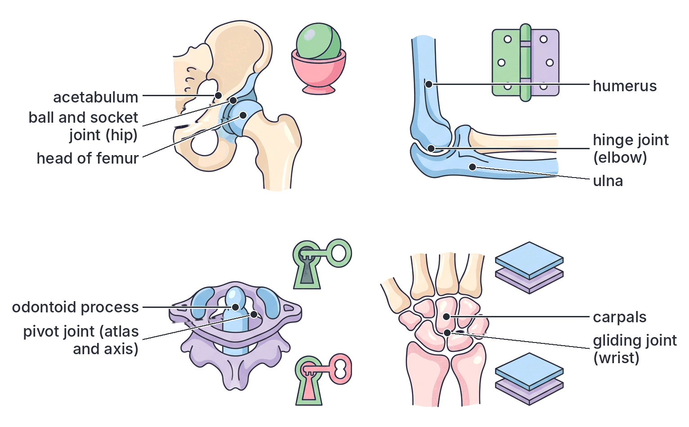

### Types of joints compared

| Type of joint | Degree of movement | Structure | Movement allowed | Examples |
| --- | --- | --- | --- | --- |
| **Immovable (fibrous, suture)** | None | Bones joined tightly by fibrous tissue | None | Sutures of the **skull**; fused bones of the **pelvis** and **sacrum**; teeth in sockets |
| **Slightly movable (cartilaginous)** | Slight | Bones joined by cartilage pads or plates | Slight bending and twisting | Between **vertebrae** (intervertebral discs); **pubic symphysis**; **ribs and sternum** |
| **Ball and socket (synovial)** | Free | Ball-shaped head in a cup-shaped socket | **All directions**, including rotation | **Shoulder** (humerus–scapula); **hip** (femur–pelvis) |
| **Hinge (synovial)** | Free | Convex surface in concave surface | **One plane** (bending and straightening) | **Elbow**, **knee**, **finger and toe joints**, ankle |
| **Pivot (synovial)** | Free | Peg rotates in a ring | **Rotation** only | **Atlas and axis** (turning the head); radius and ulna |
| **Gliding (synovial)** | Free but small | Flat surfaces slide over each other | **Sliding** | **Wrist** (carpals), **ankle** (tarsals), **between vertebrae** (zygapophyses) |

**Ball and socket and hinge joints compared:**

| Feature | Ball and socket joint | Hinge joint |
| --- | --- | --- |
| Shape of bone ends | Round ball fits into a cup-shaped socket | Convex surface fits into a concave groove |
| Directions of movement | All directions (many planes), including rotation | One plane only (back and forth) |
| Range of movement | Widest of all joints | Limited |
| Examples | Shoulder, hip | Elbow, knee, fingers |

### Muscles, tendons and ligaments

#### Skeletal muscles

Movement of the skeleton is caused by **skeletal muscles** (also called voluntary or striated muscles), which are attached to the bones.

- Muscles can only **pull**; they cannot push. A muscle **contracts** (gets shorter and fatter) and pulls on the bone, or **relaxes** (lengthens) and is pulled back to its original length by another muscle.
- Each muscle is attached to bones at two points, usually by **tendons**:
  - The **origin:** the end attached to the bone that **does not move** (the fixed point).
  - The **insertion:** the end attached to the bone that **moves** when the muscle contracts.
- The muscle crosses the joint, so when it contracts, it pulls the insertion towards the origin, and the bone moves at the joint.

#### Tendons and ligaments compared

| Feature | Tendon | Ligament |
| --- | --- | --- |
| Joins | **Muscle to bone** | **Bone to bone** |
| Main fibres | **Collagen** (white fibres) | **Collagen** with some **elastic** (yellow) fibres |
| Elasticity | **Inelastic** (does not stretch) | **Slightly elastic** (can stretch a little) |
| Function | Transmits the **pull of the muscle** to the bone, causing movement | **Holds bones together** at a joint, allowing movement but preventing dislocation |
| Example | The **Achilles tendon** joining the calf muscle to the heel bone | The ligaments of the knee and ankle |

**Why the difference in elasticity matters:** a tendon must not stretch, otherwise some of the muscle's pull would be wasted in stretching it instead of moving the bone. A ligament must stretch a little so that the joint can move, but not too much, or the bones would come apart.

#### Antagonistic muscles: movement at the elbow joint

Because muscles can only pull, they work in **pairs** that pull in **opposite directions**. When one muscle of a pair contracts, the other relaxes. Such a pair of muscles is called an **antagonistic pair**.

**The biceps and triceps at the elbow:**

| Muscle | Position | Origin | Insertion | Action when it contracts |
| --- | --- | --- | --- | --- |
| **Biceps** | Front of the upper arm | **Scapula** (shoulder blade) | **Radius**, just below the elbow | **Flexor**: bends the arm at the elbow |
| **Triceps** | Back of the upper arm | **Scapula** and **humerus** | **Ulna** (olecranon process) | **Extensor**: straightens the arm at the elbow |

**Bending (flexing) the arm, step by step:**

1. A nerve impulse from the brain reaches the **biceps**.
2. The **biceps contracts** (shortens and becomes fatter; you can feel it bulge).
3. At the same time, the **triceps relaxes** (lengthens).
4. The biceps pulls on its tendon, which pulls the **radius** upwards.
5. The forearm **moves up**, bending the arm at the **elbow**, which works as a **hinge joint** (the fulcrum).

**Straightening (extending) the arm, step by step:**

1. A nerve impulse reaches the **triceps**.
2. The **triceps contracts**.
3. The **biceps relaxes**.
4. The triceps pulls on the **olecranon process** of the **ulna**.
5. The forearm **moves down**, and the arm is **straightened** at the elbow.

A muscle that bends a joint is called a **flexor**; one that straightens it is an **extensor**. Other antagonistic pairs include the muscles at the front and back of the thigh (which straighten and bend the knee), the calf and shin muscles (at the ankle), and the circular and longitudinal muscles of the earthworm and of the gut.

**The arm as a lever:** the forearm works as a **lever**. The **elbow joint** is the **fulcrum** (pivot); the **biceps** provides the **effort**, pulling at its insertion close to the elbow; the **load** is the weight of the forearm and anything held in the hand. Because the effort is applied close to the fulcrum, a small contraction of the biceps produces a large, fast movement of the hand.

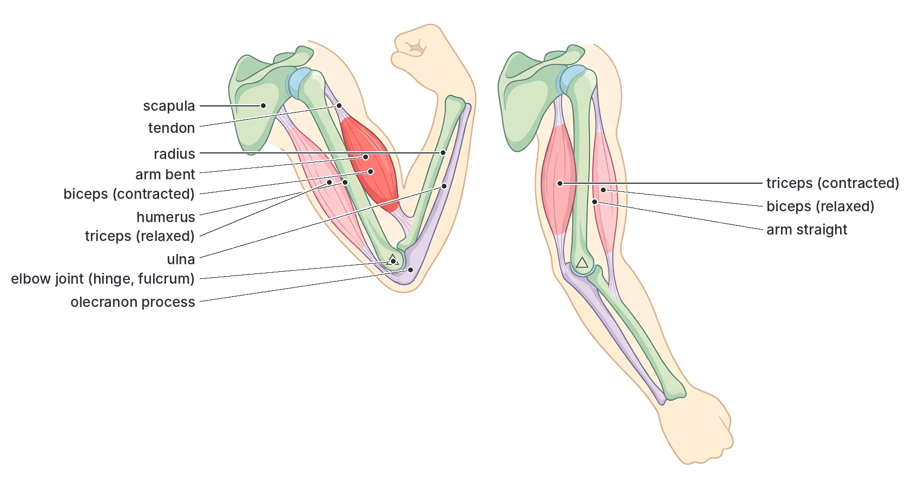

## Functions of the skeleton and the wellbeing of the animal

**Objective ix: apply the protective, supportive, locomotive and respiratory functions of the skeleton to the wellbeing of the animal.**

"Wellbeing" means the health, safety and survival of the animal. Each function of the skeleton helps the animal to live a healthy, active life. Damage to the skeleton, or diseases of the bones, harm its wellbeing.

### 1. Protective function

**How the skeleton protects:**

| Part of the skeleton | Organ(s) protected |
| --- | --- |
| Cranium | Brain |
| Orbits (eye sockets) | Eyes |
| Vertebral column | Spinal cord |
| Rib cage and sternum | Heart, lungs and major blood vessels; partly liver, stomach, spleen and kidneys |
| Pelvic girdle | Bladder, reproductive organs (including the uterus and a growing baby), lower intestine |
| Exoskeleton of arthropods | The whole body |
| Shell of snail and tortoise | The whole soft body |

**Application to wellbeing:**

- Protection of the brain, spinal cord, heart and lungs is **vital for survival**. A blow to the head that cracks the skull, or a broken neck or back that damages the spinal cord, can cause brain injury, **paralysis** or death.
- **We can help our skeleton protect us:** wear **helmets** on motorcycles (okada), bicycles and building sites; wear **seat belts** in cars; avoid fighting and dangerous games; take care when climbing trees (e.g. palm-wine tappers and fruit pickers should use safety belts or ropes).
- In arthropods, the exoskeleton protects the animal from **predators**, injury and **drying out**; snails withdraw into their shells; tortoises pull their heads and legs into their shells.

### 2. Supportive function

**How the skeleton supports:** it gives the body its shape, holds the organs in place, holds the body upright (humans) or off the ground (four-legged animals), and keeps the airways open (cartilage rings in the trachea).

**Application to wellbeing:**

- Good support means the animal can **stand, move and feed** properly. A weak or deformed skeleton (e.g. bowed legs in rickets) makes movement difficult and painful.
- **Good posture** (sitting and standing straight, carrying heavy loads properly, lifting with the knees bent and the back straight) protects the vertebral column. Poor posture over many years, for example carrying heavy loads badly or slouching over a desk, can cause **back pain** and abnormal curves of the spine:
  - **Kyphosis:** excessive outward curve of the upper back (hunchback).
  - **Lordosis:** excessive inward curve of the lower back.
  - **Scoliosis:** sideways curve of the spine.
- **Strong bones need a good diet:** **calcium** and **phosphorus** (from milk, eggs, fish such as crayfish and small dried fish eaten whole, green vegetables, beans) and **vitamin D** (from sunlight on the skin, fish liver oil, eggs, milk). See Topic B2 (Nutrition).
- **Regular exercise** (walking, running, sports) makes bones **thicker and stronger**; bones of people who do not exercise, or who are bedridden for a long time, become thinner and weaker.

### 3. Locomotive function

**How the skeleton helps movement:** bones act as **levers**, muscles pull on them through **tendons**, and **joints** act as pivots. The arrangement of the limbs, girdles and backbone allows walking, running, jumping, climbing, swimming and flying.

**Application to wellbeing:**

- Locomotion lets the animal **find food and water**, **escape from predators** and danger, **find mates** and **shelter**. An antelope or goat with a broken leg cannot escape a predator or keep up with the herd, and may die.
- Movement of the **jaws** (at the jaw joint) allows **feeding** (chewing).
- In humans, the ability to move freely is needed for **work, sport and daily life**. Keeping joints healthy (regular exercise, avoiding excess body weight, warming up before sports) prevents injuries such as sprains and dislocations and reduces wear on the joints.

### 4. Respiratory function

**How the skeleton helps breathing:** the **ribs**, **sternum** and **costal cartilages** form a movable cage. The **intercostal muscles** raise and lower the ribs, and with the **diaphragm**, change the volume of the thorax, drawing air into the lungs and pushing it out. The rib cage also keeps the chest from collapsing. Cartilage rings keep the **trachea** and **bronchi** open.

**Application to wellbeing:**

- Efficient breathing supplies **oxygen** for respiration and removes **carbon (IV) oxide**, so the animal has energy for all its activities.
- **Broken ribs** make breathing painful and can puncture a lung.
- **Deformities of the chest** (e.g. "pigeon chest" or a row of bumps along the ribs, the "rickety rosary", in children with rickets) or a badly curved spine can reduce the space for the lungs and make breathing less efficient.
- **Exercise** strengthens the breathing muscles and keeps the rib joints flexible.

### 5. Other functions of the skeleton

1. **Production of blood cells:** the **red bone marrow** in the spongy ends of long bones and in flat bones (sternum, ribs, vertebrae, skull and pelvis) makes **red blood cells**, **white blood cells** and **platelets** (this process is called haemopoiesis). This is vital for carrying oxygen, fighting infection and clotting blood. Diseases of the bone marrow (e.g. leukaemia) or damage by radiation reduce blood cell production. (In **sickle cell disease**, common in Nigeria, the bone marrow works very hard to replace red cells, and blocked blood vessels in the bones cause painful "crises".)
2. **Storage of minerals:** bones store **calcium** and **phosphate**. When the blood calcium level falls, calcium is released from the bones; when it is high, calcium is deposited in them. Calcium is needed for muscle contraction, nerve impulses and blood clotting.
3. **Storage of fat:** **yellow marrow** in the shafts of long bones stores fat as an energy reserve.
4. **Hearing:** the **ear ossicles** pass sound vibrations from the eardrum to the inner ear.
5. **Shape and appearance:** the skeleton gives each species, and each person, their shape.
6. **Water conservation:** in insects, the waxy exoskeleton reduces water loss.
7. **Production of sound** in some insects (e.g. crickets rub parts of the exoskeleton together).

### Common disorders of the skeleton (in brief)

| Disorder | Cause | Effect | Prevention or treatment |
| --- | --- | --- | --- |
| **Rickets** (in children) | Lack of **vitamin D** (too little sunlight or vitamin D in food) or of **calcium** and phosphate | Bones are **soft** and bend: **bowed legs** or knock knees, a swollen wrist, delayed walking, chest deformities | Sunlight, diet rich in calcium and vitamin D (milk, eggs, fish, fish liver oil) |
| **Osteomalacia** (in adults) | Lack of vitamin D or calcium | Soft, weak, painful bones | As for rickets |
| **Osteoporosis** | Loss of calcium and bone tissue with age, especially in **women after menopause**; lack of exercise | Bones become **thin, porous and brittle** and break easily (e.g. hip and wrist fractures in old people); stooping | Calcium and vitamin D, exercise, avoid smoking; medicines |
| **Arthritis** | **Osteoarthritis:** wear and tear of the articular cartilage, with age, injury or excess weight. **Rheumatoid arthritis:** the body's immune system attacks the joint lining. **Gout:** uric acid crystals deposited in joints | **Pain, swelling and stiffness** of the joints; difficulty moving | Healthy weight, exercise, medicines, physiotherapy, in severe cases joint replacement |
| **Fracture** | A **break** in a bone, usually from a fall, accident or blow | Pain, swelling, inability to use the part. **Simple (closed)** fracture: the skin is not broken. **Compound (open)** fracture: the broken bone pierces the skin, with a high risk of infection. **Greenstick** fracture: an incomplete break, common in children whose bones are flexible | First aid: keep the part still with a **splint**; do not try to straighten it; take the person to a hospital. The bone is set (realigned) and held still with a **cast (POP)** or, if needed, metal plates or pins, while it heals |
| **Dislocation** | A bone is forced out of its joint (common at the shoulder, fingers and jaw) | Pain, deformity, the joint cannot move | Put back in place by a trained health worker; rest |
| **Sprain** | **Ligaments** are stretched or torn, often at the ankle or wrist, by a sudden twist | Pain, swelling, bruising | Rest, ice (cold compress), compression with a bandage, raising the limb |
| **Slipped (prolapsed) disc** | An **intervertebral disc** bulges out and presses on a nerve, often after lifting heavy loads badly | Back pain, pain down the leg | Rest, physiotherapy; lift loads correctly |

**Note on fractures in Nigeria:** many people visit traditional **bone setters**. Untrained setting or very tight binding can lead to badly healed bones, infection, or loss of blood supply to the limb (which can lead to gangrene and amputation). A broken bone should be examined at a hospital, where it can be X-rayed and set properly.

**How a fracture heals (step by step):**

1. A **blood clot** forms at the break.
2. Cells move in and form soft tissue and **cartilage** that bridges the gap (a **callus**).
3. **Osteoblasts** lay down new **bone** in the callus.
4. Over weeks to months, the new bone is **remodelled** by osteoblasts and osteoclasts to its original shape. Healing is quicker in children than in old people.

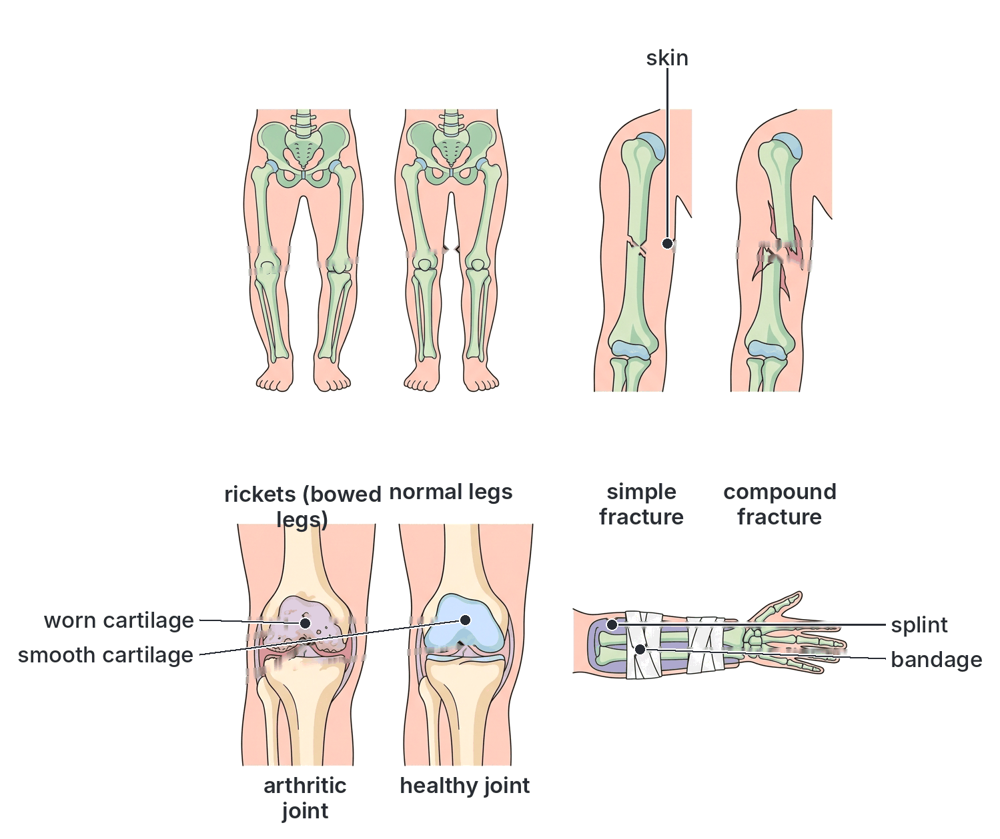

### Summary: applying the functions of the skeleton to wellbeing

| Function | Benefit to wellbeing | Example of what happens when it fails | How to keep it healthy |
| --- | --- | --- | --- |
| Protective | Vital organs are kept safe from injury | Skull fracture causing brain damage; spinal injury causing paralysis | Helmets, seat belts, safety at work |
| Supportive | Body keeps its shape, stands upright, organs in place | Rickets (bowed legs); osteoporosis; poor posture causing back pain | Calcium, vitamin D, sunlight, good posture, exercise |
| Locomotive | Animal can find food, escape danger, find mates, work and play | Fractures, dislocations, arthritis, sprains limit movement | Exercise, warm-up, healthy weight, first aid and hospital care |
| Respiratory | Efficient breathing supplies oxygen and removes CO₂ | Broken ribs; chest deformities reduce breathing efficiency | Exercise; prevent rickets; avoid chest injuries |
| Blood cell production | Supplies red cells, white cells and platelets | Anaemia, infections or bleeding when marrow fails | Good nutrition (iron, protein, vitamins); avoid harmful radiation and chemicals |
| Mineral storage | Steady blood calcium for muscles, nerves and clotting | Weak bones when calcium is drawn out and not replaced | Calcium-rich diet |

## Key terms

| Term | Meaning |
| --- | --- |
| Skeleton | A framework of hard or firm material that supports and protects the body and allows movement |
| Hydrostatic skeleton | Support given by fluid under pressure in a body cavity surrounded by muscles, e.g. earthworm |
| Exoskeleton | A skeleton on the outside of the body, e.g. the chitin cuticle of insects |
| Endoskeleton | A skeleton inside the body, made of bone and cartilage, e.g. in mammals |
| Chitin | A tough, nitrogen-containing polysaccharide forming the exoskeleton of arthropods |
| Ecdysis (moulting) | Shedding of the old exoskeleton so that an arthropod can grow |
| Cartilage | A firm, flexible connective tissue with no blood vessels, found at joints, in the trachea, nose and ear |
| Bone | A hard, living connective tissue of calcium phosphate and collagen, forming most of the vertebrate skeleton |
| Osteocyte | A bone cell, found in a lacuna |
| Haversian system | A unit of compact bone with a central canal surrounded by rings of matrix and bone cells |
| Periosteum | The fibrous membrane covering a bone |
| Bone marrow | Tissue inside bones: red marrow makes blood cells; yellow marrow stores fat |
| Axial skeleton | Skull, vertebral column, ribs and sternum |
| Appendicular skeleton | Girdles and limbs |
| Vertebra | One of the bones of the backbone |
| Atlas | The first cervical vertebra, which supports the skull and allows nodding |
| Axis | The second cervical vertebra, with the odontoid process, allowing the head to turn |
| Odontoid process | A peg on the axis around which the atlas rotates |
| Centrum | The solid, weight-bearing body of a vertebra |
| Neural canal | The hole in a vertebra through which the spinal cord passes |
| Pectoral girdle | The shoulder girdle (scapula and clavicle) |
| Pelvic girdle | The hip girdle (ilium, ischium and pubis fused), joined to the sacrum |
| Glenoid cavity | The socket of the scapula for the head of the humerus |
| Acetabulum | The socket of the pelvic girdle for the head of the femur |
| Joint | A place where two or more bones meet |
| Suture | An immovable joint between skull bones |
| Synovial joint | A freely movable joint with a cavity containing synovial fluid |
| Synovial fluid | The lubricating fluid in a movable joint |
| Ligament | A slightly elastic band joining bone to bone |
| Tendon | An inelastic cord joining muscle to bone |
| Antagonistic muscles | A pair of muscles that pull in opposite directions, e.g. biceps and triceps |
| Flexor / extensor | A muscle that bends / straightens a joint |

## Exam tips and common mistakes

- **Exoskeleton vs endoskeleton:** exoskeleton is outside, non-living, made of chitin, cannot grow (moulting needed); endoskeleton is inside, living (bone and cartilage), grows with the animal. Learn the comparison table.
- **Chitin is found in arthropods (and fungal cell walls), not in vertebrates.** Bone and cartilage are found in vertebrates.
- **Cartilage has no blood vessels; bone has a rich blood supply.** Cartilage is found at the ends of bones, in the trachea rings, the nose, the pinna and between vertebrae.
- **Atlas = nodding ("yes"); axis = turning ("no").** The atlas has no centrum and no neural spine; the axis has the odontoid process.
- **Vertebrarterial canals are a feature of cervical vertebrae; rib facets are a feature of thoracic vertebrae; the largest centrum is in the lumbar vertebrae.**
- **Human vertebral numbers:** 7 cervical, 12 thoracic, 5 lumbar, 5 sacral (fused), 4 caudal (fused). Nearly all mammals have 7 cervical vertebrae.
- **Glenoid cavity (shoulder) vs acetabulum (hip):** do not mix them up. The pectoral girdle is not joined to the backbone; the pelvic girdle is fused to the sacrum.
- **The olecranon process is on the ulna** and forms the point of the elbow.
- **Joint examples:** ball and socket (shoulder, hip); hinge (elbow, knee, fingers); pivot (atlas and axis); gliding (wrist, ankle, between vertebrae); immovable (skull sutures); slightly movable (between vertebrae, pubic symphysis).
- **Tendon = muscle to bone (inelastic); ligament = bone to bone (slightly elastic).** This is one of the most common JAMB mistakes.
- **Muscles can only pull;** the biceps bends (flexes) the arm and the triceps straightens (extends) it. When one contracts, the other relaxes.
- **Rickets** is caused by lack of vitamin D (or calcium); it causes soft, bowed bones in children.

## Quick summary

1. Animals need support for shape, protection and muscle attachment, and movement to find food, escape danger and find mates; skeletons may be hydrostatic (earthworm), exoskeletons (chitin in arthropods; shells in snails) or endoskeletons (bone and cartilage in vertebrates).
2. The exoskeleton protects the whole body and reduces water loss but cannot grow, so arthropods moult; the endoskeleton is living, grows with the body, allows large size and can repair itself.
3. Chitin (in arthropod exoskeletons) gives shape, protection and inner muscle attachment; cartilage (at joints, trachea, nose, ear and intervertebral discs) is flexible, smooth and shock-absorbing; bone (calcium phosphate and collagen, with Haversian systems) is hard, strong and living.
4. The mammalian skeleton has an axial part (skull, vertebral column of cervical, thoracic, lumbar, sacral and caudal vertebrae, ribs and sternum) and an appendicular part (pectoral and pelvic girdles and the pentadactyl limbs).
5. Each type of vertebra is suited to its job: the atlas allows nodding, the axis turning, thoracic vertebrae carry the ribs, lumbar vertebrae bear weight and anchor muscles, and the sacrum joins the pelvic girdle; the ribs and sternum with the intercostal muscles help breathing.
6. Joints may be immovable (skull sutures), slightly movable (between vertebrae) or freely movable synovial joints: ball and socket (shoulder, hip), hinge (elbow, knee), pivot (atlas–axis) and gliding (wrist, ankle).
7. Movement results from antagonistic pairs of muscles (e.g. biceps and triceps) pulling on bones through tendons, with ligaments holding the bones together at joints.
8. The skeleton's protective, supportive, locomotive and respiratory functions, together with blood cell production and mineral storage, are vital for wellbeing; good diet (calcium, vitamin D), exercise, good posture and safety measures prevent disorders such as rickets, osteoporosis, arthritis and fractures.

## Practice questions

**1. Which of the following is a disadvantage of an exoskeleton?**

- A. It reduces water loss from the body
- B. It must be shed periodically for the animal to grow
- C. It protects the whole body
- D. It provides surfaces for muscle attachment

**Answer: B.** The exoskeleton cannot grow, so the animal must moult (ecdysis), during which it is soft and vulnerable. The other options are advantages.

**2. Chitin is the main supporting material in the**

- A. skeleton of a shark
- B. bones of a bird
- C. exoskeleton of a grasshopper
- D. shell of a snail

**Answer: C.** The cuticle of arthropods such as the grasshopper is made mainly of chitin. A shark's skeleton is cartilage, bird bones are bone, and a snail's shell is mainly calcium carbonate.

**3. Which of these features is found in cartilage but NOT in bone?**

- A. Absence of blood vessels
- B. Living cells in lacunae
- C. Collagen fibres in the matrix
- D. Ability to support the body

**Answer: A.** Cartilage has no blood vessels; its cells get nutrients by diffusion. Both tissues have living cells in lacunae, collagen fibres and a supporting role.

**4. The vertebra which has an odontoid process is the**

- A. atlas
- B. thoracic vertebra
- C. lumbar vertebra
- D. axis

**Answer: D.** The odontoid process is a peg on the axis (second cervical vertebra) around which the atlas and skull rotate.

**5. Vertebrarterial canals are characteristic of the**

- A. cervical vertebrae
- B. thoracic vertebrae
- C. lumbar vertebrae
- D. sacral vertebrae

**Answer: A.** The transverse processes of cervical vertebrae are pierced by vertebrarterial canals, through which the vertebral arteries pass to the brain.

**6. The head of the femur fits into the**

- A. glenoid cavity
- B. acetabulum
- C. obturator foramen
- D. olecranon process

**Answer: B.** The acetabulum is the socket of the pelvic girdle that forms the hip joint with the femur. The glenoid cavity of the scapula receives the humerus.

**7. The joint between the humerus and the ulna at the elbow is an example of a**

- A. ball and socket joint
- B. pivot joint
- C. hinge joint
- D. gliding joint

**Answer: C.** The elbow allows movement in one plane only (bending and straightening), like a door hinge.

**8. Which of the following joins a muscle to a bone?**

- A. Tendon
- B. Ligament
- C. Cartilage
- D. Synovial membrane

**Answer: A.** Tendons are tough, inelastic cords that join muscles to bones. Ligaments join bone to bone.

**9. When the arm is bent at the elbow,**

- A. the biceps and triceps both contract
- B. the triceps contracts and the biceps relaxes
- C. the biceps and triceps both relax
- D. the biceps contracts and the triceps relaxes

**Answer: D.** The biceps (flexor) contracts and pulls the radius up, while its antagonist, the triceps, relaxes.

**10. Which part of the mammalian skeleton is most directly involved in breathing?**

- A. Pelvic girdle
- B. Rib cage
- C. Skull
- D. Pectoral girdle

**Answer: B.** The ribs and sternum, moved by the intercostal muscles together with the diaphragm, change the volume of the thorax, drawing air into and out of the lungs.
