# JAMB Biology Notes: Reproduction (Part 2): Sexual Reproduction in Flowering Plants

## What JAMB expects

This is Part 2 of Section B, Topic 7 of the JAMB Biology syllabus: Form and Functions – Reproduction. Part 1 (`B7a-asexual-reproduction.md`) covers asexual reproduction (content item a and objectives i to iii). Part 3 (`B7c-reproduction-in-mammals.md`) covers reproduction in mammals (content item c and objectives vii to xi).

The syllabus content covered in this file is **b. Sexual reproduction in flowering plants**:

- i. Floral parts and their functions.
- ii. Pollination and fertilisation.
- iii. Products of sexual reproduction (seeds and fruits).

By the end of these notes, you should be able to:

1. Relate the parts of a flower to their functions and to the reproductive process (objective iv).
2. State the advantages of cross-pollination (objective v).
3. Deduce the different types of placentation that develop into simple, aggregate, multiple and succulent fruits (objective vi).

**Note on the syllabus wording:** objective vi joins two separate ideas. **Placentation** is the way the ovules are attached inside the ovary. **Fruit type** (simple, aggregate, multiple) depends mainly on how many flowers and how many separate or joined carpels form the fruit, and "succulent" describes a fruit with a fleshy wall. Placentation does not by itself decide whether a fruit is simple, aggregate or multiple. These notes explain both ideas and then show honestly how the ovary and its placentation are linked to the fruit that forms (see "How the ovary and placentation relate to the fruit").

## Sexual reproduction in plants: the big picture

**Sexual reproduction** involves the fusion of two **gametes** (sex cells), one male and one female, to form a **zygote**. In flowering plants (angiosperms), the **flower** is the organ of sexual reproduction.

The whole process happens in this order:

1. The flower produces **pollen grains** (which contain the male gametes) in the anthers, and **ovules** (which contain the female gamete, the egg cell) in the ovary.
2. **Pollination:** pollen is carried from an anther to a stigma.
3. The pollen grain germinates and grows a **pollen tube** down to an ovule.
4. **Fertilisation:** a male gamete fuses with the egg cell to form a zygote. (In flowering plants, a second male gamete also fuses with the polar nuclei. This is called **double fertilisation**.)
5. The zygote grows into an **embryo**; the **ovule becomes the seed**; the **ovary becomes the fruit**.
6. Seeds and fruits are **dispersed** away from the parent plant, and the seeds germinate into new plants (see `B8-growth.md`).

The offspring of sexual reproduction are **not identical** to their parents. They show **variation**, because they get half their genes from each parent. (Asexual reproduction is compared with sexual reproduction in `B7a-asexual-reproduction.md`.)

## Floral parts and their functions

**Objective iv: relate parts of flower to their functions and reproductive process.**

A **flower** is a shortened, specialised shoot whose leaves have been changed into parts for reproduction. A typical flower has four **whorls** (rings) of parts attached to a swollen stalk tip called the **receptacle**. From the outside inwards they are:

1. **Calyx** (the sepals).
2. **Corolla** (the petals).
3. **Androecium** (the stamens): the male part.
4. **Gynoecium** or **pistil** (the carpels): the female part.

The calyx and corolla are the **accessory (non-essential) whorls**: they help, but do not make gametes. The androecium and gynoecium are the **essential whorls**, because they produce the gametes. A flower can reproduce without sepals or petals, but not without stamens or carpels.

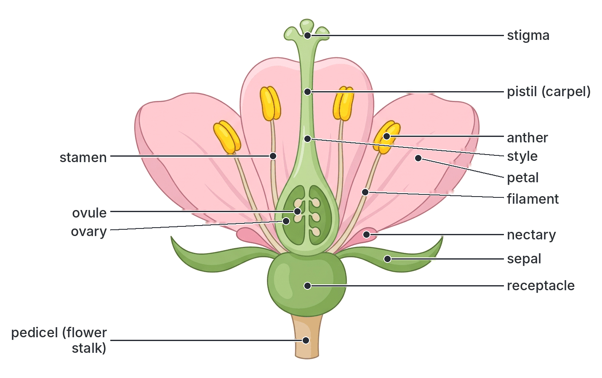

### The pedicel and receptacle

- **Pedicel (flower stalk):** holds the flower in a good position for pollinators or wind to reach it. It carries water and food to the flower and, later, to the developing fruit.
- **Receptacle (thalamus):** the swollen tip of the pedicel to which all the floral parts are attached. In some plants it becomes part of the fruit (for example, the fleshy part of the strawberry; see "False fruits").
- Some flowers grow in the axil of a small leaf-like **bract**. In Hibiscus there is also an extra ring of small bract-like parts outside the calyx, called the **epicalyx**.

### The calyx (sepals)

The **calyx** is the outermost whorl, made of **sepals**. Sepals are usually green and leaf-like.

**Functions of the sepals:**

1. **Protect the inner parts of the flower when it is a bud**, covering it against insects, rain, drying out and physical damage.
2. Being green, they can carry out a little **photosynthesis**.
3. In some flowers the sepals are brightly coloured (**petaloid**) and help to **attract pollinators**, for example the red inner surface of the sepals of Flamboyant.
4. In some plants the calyx stays on the fruit (it is **persistent**) and protects it. In roselle (*Hibiscus sabdariffa*), the red calyx swells and becomes fleshy around the fruit. These fleshy calyces are dried and boiled to make the popular Nigerian drink **zobo**. The calyx also stays on the fruits of garden egg and tomato.

Sepals may be **free** (separate, a **polysepalous** calyx) or **joined** (a **gamosepalous** calyx, as in Hibiscus).

### The corolla (petals)

The **corolla** is the second whorl, made of **petals**.

**Functions of the petals:**

1. **Attract insects and birds** for pollination by their bright colours, patterns and scent. Some petals have lines called **nectar guides** (honey guides) that lead insects to the nectar.
2. Many petals have **nectaries** at their base, which produce sugary **nectar** as food for pollinators.
3. Some petals form a **landing platform** for insects.
4. Petals protect the stamens and carpels inside.

Petals may be free (**polypetalous**, as in Flamboyant) or joined into a tube (**gamopetalous**, as in morning glory and *Ixora*).

In many wind-pollinated flowers, such as grasses and maize, the petals are tiny or absent, because they do not need to attract animals.

The calyx and corolla together are called the **perianth**. When sepals and petals look alike (for example in lilies and onion), each part is called a **tepal**.

### The androecium (stamens): the male part

The **androecium** is made of **stamens**. Each stamen has:

- **Filament:** a thin stalk that holds the anther up in a good position for pollen to be picked up by insects or blown by wind. It carries water and food to the anther through a vascular strand.
- **Anther:** usually has two lobes, each with two **pollen sacs**. Inside the pollen sacs, cells divide by **meiosis** to produce **pollen grains**. When ripe, the anther splits open (**dehisces**) to release the pollen.

**Pollen grains** are the male spores. Each pollen grain develops two nuclei: a **tube nucleus** and a **generative nucleus**. The generative nucleus later divides by mitosis to form **two male gametes (male nuclei)**. The pollen grain has a tough outer wall (the **exine**), often sculptured with spikes or ridges, and a thin inner wall (the **intine**).

**Function of the androecium:** to produce, hold and release pollen grains, which carry the male gametes.

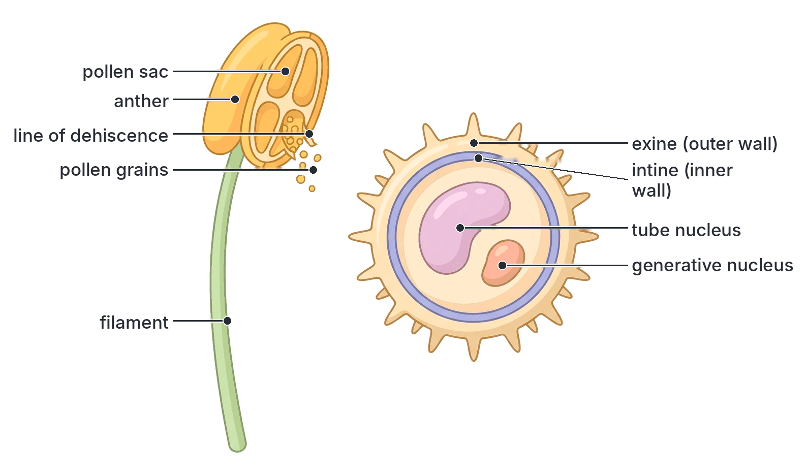

### The gynoecium (pistil): the female part

The **gynoecium** (also called the **pistil**) is made of one or more **carpels**. Each carpel has:

- **Stigma:** the tip that **receives pollen**. It is often sticky, hairy or feathery to catch and hold pollen grains. It produces a sugary fluid that makes the right pollen germinate.
- **Style:** a stalk joining the stigma to the ovary. It holds the stigma in a good position to receive pollen, and the **pollen tube grows down through it**.
- **Ovary:** the swollen base. It contains one or more **ovules**, attached to the ovary wall by short stalks (**funicles**) at a place called the **placenta**. The ovary protects the ovules and, after fertilisation, **becomes the fruit**.
- **Ovules:** each ovule contains an **embryo sac** with the **egg cell** (female gamete). After fertilisation, each **ovule becomes a seed**.

**Function of the gynoecium:** to receive pollen, produce the female gametes, provide the place where fertilisation happens, and develop into the fruit and seeds.

A gynoecium can have:

- **One carpel** (**monocarpellary**), as in bean, cowpea and Flamboyant.
- **Several free carpels** (**apocarpous**), as in custard apple, soursop and *Bryophyllum*.
- **Several carpels joined together** (**syncarpous**), as in Hibiscus, okra, orange, tomato and pawpaw.

#### Structure of the ovule

A mature ovule has:

- **Funicle:** the stalk attaching it to the placenta.
- **Integuments:** one or two protective coats, which later become the **testa** (seed coat).
- **Micropyle:** a tiny opening in the integuments, through which the pollen tube usually enters.
- **Nucellus:** tissue inside the integuments that nourishes the embryo sac.
- **Embryo sac:** usually contains **eight nuclei in seven cells**:
  - at the micropyle end: the **egg cell** (female gamete) and two **synergids** beside it;
  - in the middle: **two polar nuclei** (these often fuse to form one diploid **secondary nucleus**, also called the central or definitive nucleus);
  - at the opposite end: three **antipodal cells**.
- **Chalaza:** the base of the ovule, opposite the micropyle, where the funicle joins.

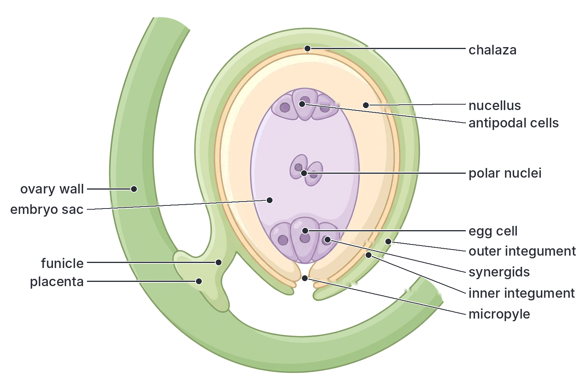

### Summary of the floral parts and their functions

| Part | Whorl | Main function(s) | What it becomes after fertilisation |
| --- | --- | --- | --- |
| Pedicel | – | Holds the flower up; carries food and water | Fruit stalk |
| Receptacle | – | Bears all the floral parts | Usually nothing; becomes fleshy in some false fruits |
| Sepals | Calyx | Protect the bud; photosynthesis; sometimes attract pollinators | Usually fall off; persist in some (roselle, tomato, garden egg) |
| Petals | Corolla | Attract pollinators; bear nectaries; landing platform | Wither and fall off |
| Stamens (filament and anther) | Androecium | Produce and release pollen (male gametes) | Wither and fall off |
| Stigma | Gynoecium | Receives pollen | Withers |
| Style | Gynoecium | Holds up stigma; pollen tube grows through it | Withers (sometimes stays as a scar or a remnant, e.g. the "silk" scar on a maize grain) |
| Ovary | Gynoecium | Contains and protects ovules | **Fruit** (ovary wall becomes the **pericarp**) |
| Ovule | Inside ovary | Contains the egg cell | **Seed** |
| Egg cell | Inside ovule | Female gamete | Zygote, then **embryo** |

### Describing flowers: floral terms

JAMB questions often use these terms.

| Term | Meaning | Example |
| --- | --- | --- |
| **Complete flower** | Has all four whorls (calyx, corolla, androecium, gynoecium) | Hibiscus, Flamboyant |
| **Incomplete flower** | One or more whorls missing | Maize flowers (no true petals or sepals) |
| **Bisexual (hermaphrodite, perfect) flower** | Has both stamens and carpels | Hibiscus, Flamboyant, Pride of Barbados |
| **Unisexual (imperfect) flower** | Has only stamens (**staminate**, male) or only carpels (**pistillate**, female) | Maize, pumpkin, oil palm, pawpaw |
| **Actinomorphic (regular, radially symmetrical)** | Can be cut into two equal halves along more than one plane | Hibiscus, orange, morning glory |
| **Zygomorphic (irregular, bilaterally symmetrical)** | Can be cut into two equal halves along only one plane | Flamboyant, Pride of Barbados, cowpea, *Crotalaria* |
| **Hypogynous flower (superior ovary)** | Sepals, petals and stamens are attached **below** the ovary | Hibiscus, Flamboyant, bean, tomato |
| **Perigynous flower** | The receptacle forms a cup around the ovary, and the other parts are attached to the rim of the cup | Rose, some members of the bean family |
| **Epigynous flower (inferior ovary)** | The ovary is sunk in the receptacle, and the other parts are attached **above** it | Guava, cucumber, pumpkin, sunflower, banana |
| **Monoecious plant** | Male and female flowers are separate but on the **same** plant | Maize, pumpkin, oil palm, castor oil |
| **Dioecious plant** | Male and female flowers are on **different** plants | Fluted pumpkin (ugu), date palm; pawpaw is usually dioecious |

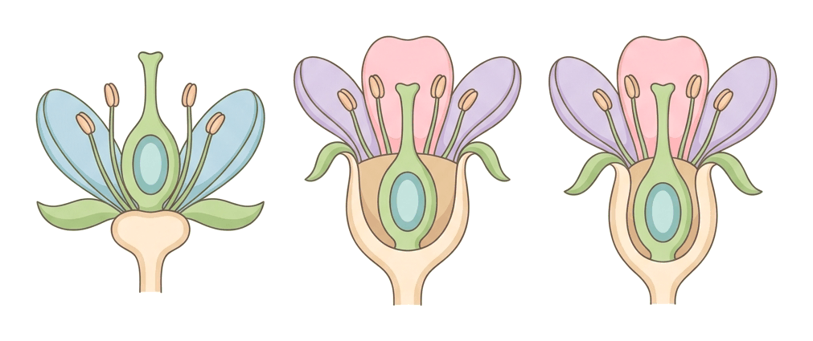

An **inflorescence** is a group of flowers on one stalk. For example, a sunflower or *Tridax* "flower" is really a head (capitulum) of many tiny flowers called florets, and a maize tassel and cob are inflorescences of male and female flowers. Inflorescences matter because a **multiple (composite) fruit** forms from a whole inflorescence (see later).

### Floral types: examples from the syllabus

The flowers below are commonly studied in Nigerian schools. Learn their parts so that you can relate each part to its function.

#### Flamboyant (*Delonix regia*)

The Flamboyant (flame of the forest) is the large ornamental tree with umbrella-shaped crowns and brilliant scarlet flowers often planted along roads, in schools and on university campuses. It belongs to the bean (legume) family (Fabaceae, subfamily Caesalpinioideae).

- **Calyx:** five sepals, green outside and red inside, joined only at the base. Their red inner surface adds to the colour that attracts pollinators.
- **Corolla:** five free petals, each with a narrow base (a "claw") and a broad, frilly blade. Four are scarlet; one (the **standard**) is larger and is white or yellowish with red streaks. This difference makes the flower **zygomorphic**.
- **Androecium:** ten free stamens with long, curved red filaments.
- **Gynoecium:** one carpel (**monocarpellary**) with a superior ovary, a long style and a small stigma. The ovules are attached along one edge: **marginal placentation**.
- **Fruit:** a very long, flat, woody, dark brown **pod (legume)**, which splits along two sides when dry.
- **Pollination:** by insects and birds attracted by the bright colours and nectar.

#### Pride of Barbados (*Caesalpinia pulcherrima*)

A shrub common in gardens and hedges, with orange-red or yellow flowers. Also in the bean family.

- **Calyx:** five sepals; one is larger and hooded.
- **Corolla:** five free petals with crinkled edges; one is smaller than the others. The flower is **zygomorphic**.
- **Androecium:** ten free stamens with very long red filaments that stick far out of the flower.
- **Gynoecium:** one carpel with a superior ovary and a very long style; **marginal placentation**.
- **Fruit:** a flat pod (legume) that splits open.
- **Pollination:** the long stamens and style stick out beyond the petals, where they touch the bodies of visiting butterflies and birds as these feed on nectar.

#### Hibiscus (*Hibiscus rosa-sinensis*)

The common red, pink or yellow ornamental shrub used for hedges in many Nigerian compounds. It belongs to the Malvaceae (the family of okra, cotton and roselle).

- **Epicalyx:** a ring of about five to eight narrow green bracts outside the calyx.
- **Calyx:** five green sepals **joined** into a cup (gamosepalous), with five pointed lobes.
- **Corolla:** five large, free, brightly coloured petals, joined at their bases to the staminal tube. The flower is **actinomorphic**.
- **Androecium:** many stamens. Their filaments are **joined into a tube (the staminal column)** around the style; the anthers are scattered along the upper part of the column. Stamens joined by their filaments into one bundle are called **monadelphous**.
- **Gynoecium:** five carpels **fused together** (syncarpous), with a superior ovary of five chambers. The ovules are attached to the central axis: **axile placentation**. The single style runs up inside the staminal column and divides at the top into **five branches**, each with a round, hairy stigma.
- **Fruit:** a **capsule** in Hibiscus species that set fruit (for example okra and roselle). The ornamental *H. rosa-sinensis* rarely sets fruit in Nigeria and is usually grown from stem cuttings.
- **Pollination:** the large bright petals and nectar attract insects and sunbirds. The stigmas stand **above** the anthers at the tip of the column, which reduces self-pollination.

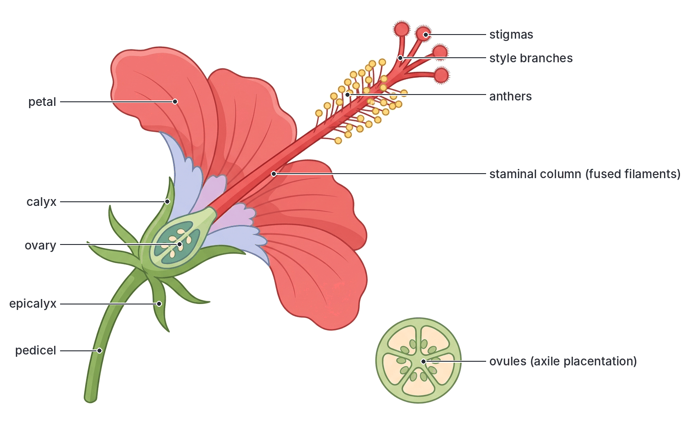

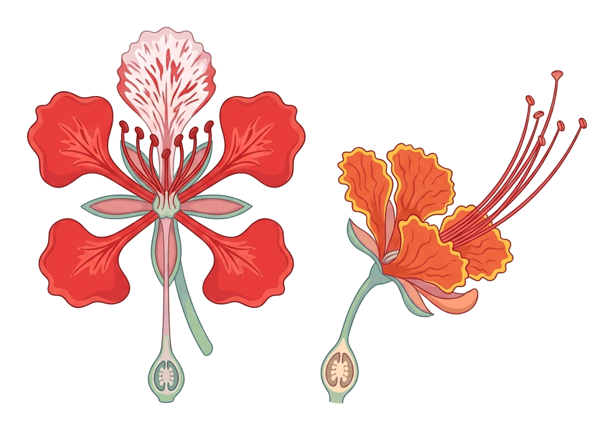

#### Comparing the three flowers

| Feature | Flamboyant | Pride of Barbados | Hibiscus |
| --- | --- | --- | --- |
| Family | Bean family (Fabaceae) | Bean family (Fabaceae) | Malvaceae |
| Symmetry | Zygomorphic | Zygomorphic | Actinomorphic |
| Epicalyx | Absent | Absent | Present |
| Calyx | 5 sepals, red inside | 5 sepals, one hooded | 5 sepals joined |
| Corolla | 5 free clawed petals; one large standard | 5 free crinkled petals | 5 large free petals |
| Stamens | 10, free | 10, free, very long | Many, filaments joined into a column (monadelphous) |
| Carpels | 1 | 1 | 5, fused |
| Ovary position | Superior | Superior | Superior |
| Placentation | Marginal | Marginal | Axile |
| Fruit | Woody pod (legume) | Pod (legume) | Capsule (where fruit is formed) |

### Floral formula and floral diagram (brief)

Botanists summarise a flower in a short code called a **floral formula**, and in a plan drawing called a **floral diagram**.

**Common floral formula symbols:**

| Symbol | Meaning |
| --- | --- |
| ⊕ | Actinomorphic (regular) |
| % (or ↑) | Zygomorphic (irregular) |
| ⚥ | Bisexual flower |
| K | Calyx (number of sepals) |
| C | Corolla (number of petals) |
| A | Androecium (number of stamens) |
| G | Gynoecium (number of carpels) |
| ( ) | Brackets show the parts are joined, e.g. K(5) = five joined sepals |
| ∞ | Many (more than about ten) |
| Line under the G number | Superior ovary |
| Line over the G number | Inferior ovary |

**Examples (written in words for the ovary position):**

- **Hibiscus:** ⊕ ⚥ Epicalyx 5–8, K(5), C5, A(∞), G(5), ovary superior.
- **Flamboyant:** % ⚥ K5, C5, A10, G1, ovary superior.

A **floral diagram** is a ground plan of the flower as if seen from above, with the parts drawn as rings: sepals on the outside, then petals, then stamens (anthers drawn in section), and the ovary cut across in the centre showing its chambers and placentation. The position of the main stem (the axis) is shown as a small circle at the top.

**Textbook variation:** the symbols used in floral formulae vary between textbooks. Some use "P" for perianth, some write the ovary position as a bar and others in words, and some use different signs for symmetry and sex. JAMB rarely asks you to write a full floral formula; it is more important to know what each part does and to recognise terms such as superior ovary, zygomorphic and syncarpous.

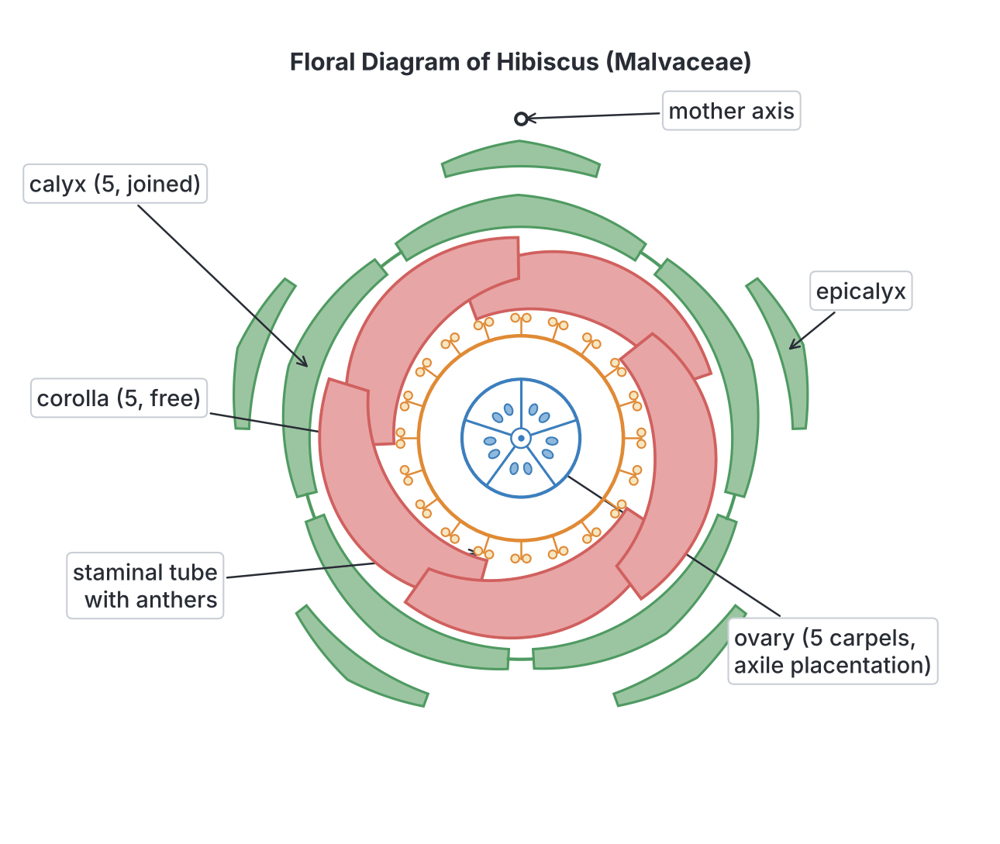

## Pollination

**Pollination** is the transfer of pollen grains from the **anther** to the **stigma** of a flower. It must happen before fertilisation can take place.

There are two types of pollination: self-pollination and cross-pollination.

### Self-pollination

**Self-pollination** is the transfer of pollen from the anther of a flower to the stigma of the **same flower**, or to the stigma of **another flower on the same plant**.

Self-pollination is common in plants whose flowers open after the pollen has already reached the stigma, or whose flowers never open fully (called **cleistogamy**). Many cultivated crops are mainly self-pollinated, for example **cowpea**, **groundnut**, **rice**, **soya bean** and **tomato**.

**Textbook variation:** transfer of pollen between two flowers on the **same plant** (called **geitonogamy**) is counted as self-pollination in most school textbooks, because the plant's genes are the same. A few books count it as a kind of cross-pollination because an agent must carry the pollen from one flower to another. For JAMB, treat it as **self-pollination**.

### Cross-pollination

**Cross-pollination** is the transfer of pollen from the anther of a flower on one plant to the stigma of a flower on **another plant of the same species**.

Examples of mainly cross-pollinated plants: **maize**, **oil palm**, **pawpaw**, **fluted pumpkin (ugu)**, **cocoa**, **mango**, **melon (egusi)** and many fruit trees.

### Advantages of cross-pollination

**Objective v: state the advantages of cross pollination.**

Cross-pollination brings together genes from **two different parent plants**. This gives these advantages:

1. **Variation:** the offspring are different from each other and from both parents. Variation is the raw material for natural selection and evolution.
2. **Better adaptation:** because the offspring vary, some are more likely to survive changes in the environment, such as new diseases, pests or drought.
3. **Hybrid vigour (heterosis):** offspring of cross-pollination are often stronger and more vigorous, grow faster and give higher yields. Hybrid maize varieties used by Nigerian farmers are an example.
4. **More and better seeds:** cross-pollinated plants often produce more seeds, which are more viable (more likely to germinate) than self-pollinated seeds of the same species.
5. **Healthier offspring:** cross-pollination reduces the harmful effects of **inbreeding** (in-breeding depression), where harmful recessive genes come together.
6. **New varieties:** plant breeders use controlled cross-pollination to combine good qualities (for example high yield and disease resistance) into new crop varieties.

**Disadvantages of cross-pollination** (useful for comparison):

- It depends on an outside **agent** (wind, insects and so on), so it may fail.
- **A lot of pollen is wasted**, especially in wind pollination.
- Plants must spend energy on making nectar, scent, colourful petals or huge amounts of pollen.
- Good qualities of a variety may be **lost** because the offspring do not breed true.

**Advantages of self-pollination:** it is more certain (it does not need an agent or a second plant), less pollen is wasted, and it keeps good qualities of a pure variety unchanged from generation to generation. Its main disadvantages are little variation, weaker offspring after many generations, and poorer adaptation to change.

### Self-pollination and cross-pollination compared

| Feature | Self-pollination | Cross-pollination |
| --- | --- | --- |
| Source of pollen | Same flower or another flower on the same plant | A flower on a different plant of the same species |
| Number of parent plants | One | Two |
| Need for an agent | Not always (may happen directly) | Always needs an agent (wind, insect, bird, water, humans) |
| Certainty | More certain | Less certain; depends on agents |
| Pollen produced and wasted | Small amounts; little waste | Often large amounts; much waste (especially with wind) |
| Variation in offspring | Little; offspring are similar to the parent | Much; offspring vary |
| Vigour of offspring | May become weaker over many generations | Often more vigorous (hybrid vigour) |
| Adaptation to change | Poorer | Better |
| Purity of variety | Kept pure | Not kept pure |
| Typical flower features | Bisexual flowers; anthers and stigma ripen at the same time; flowers may not open | Mechanisms that prevent self-pollination (see below); showy or wind-adapted flowers |
| Examples | Cowpea, groundnut, rice, tomato | Maize, oil palm, pawpaw, ugu, melon, mango |

### Agents of pollination

An **agent of pollination** is anything that carries pollen from anthers to stigmas.

| Agent | Name of the process | Examples of plants |
| --- | --- | --- |
| **Insects** (bees, butterflies, moths, beetles, flies, wasps) | Entomophily | Hibiscus, Flamboyant, Pride of Barbados, *Crotalaria*, pumpkin, melon, mango, sunflower; oil palm is pollinated mainly by small weevils (*Elaeidobius* species) |
| **Wind** | Anemophily | Maize, guinea grass, elephant grass, millet, sorghum and other grasses |
| **Birds** (e.g. sunbirds) | Ornithophily | Flamboyant, *Spathodea* (African tulip tree), *Erythrina* (coral tree), Pride of Barbados |
| **Bats** | Chiropterophily | Baobab (*Adansonia*), African locust bean (*Parkia biglobosa*), sausage tree (*Kigelia africana*) |
| **Water** | Hydrophily | Some water plants, e.g. *Vallisneria* and *Hydrilla* |
| **Humans** (artificial or hand pollination) | Artificial pollination | Assisted pollination of oil palm in plantations; vanilla; date palm; plant breeding experiments |

#### Insect-pollinated flowers

Insects visit flowers to feed on **nectar** and **pollen**. As they move around inside the flower, pollen sticks to their hairy bodies, and some of it rubs off on the stigma of the next flower they visit.

**Features of insect-pollinated flowers and why each helps:**

1. **Large, brightly coloured petals:** easy for insects to see.
2. **Scent:** attracts insects, especially at night (for moths).
3. **Nectar and nectaries:** reward the insect with food, so it keeps visiting flowers of that species.
4. **Nectar guides:** lines or patches that lead the insect towards the nectar, past the anthers and stigma.
5. **Anthers held inside the flower**, firmly attached, so they rub against the insect.
6. **Stigma inside the flower**, often flat, lobed and **sticky**, so pollen sticks to it.
7. **Small amounts of pollen** (compared with wind-pollinated flowers), because insects carry it directly.
8. **Large, sticky or rough (spiky) pollen grains** that cling to the insect's body.
9. Often a **landing platform** of petals.

#### Wind-pollinated flowers

**Features of wind-pollinated flowers and why each helps:**

1. **Small, dull (green or brown) flowers, with tiny or no petals:** there is no need to attract animals, and petals would block the wind.
2. **No scent and no nectar.**
3. **Long, thin filaments** with anthers **hanging outside** the flower, loosely attached (**versatile**), so the wind shakes pollen out easily.
4. **Large, feathery, branched stigmas hanging outside** the flower, giving a large surface to catch pollen from the air (for example the maize "silk", which is the long styles and stigmas).
5. **Very large amounts of pollen**, because most of it is wasted.
6. **Small, light, smooth, dry pollen grains** that are easily carried by wind.
7. Flowers are often held **high up** above the leaves (for example the maize **tassel** at the top of the plant), or appear before the leaves.

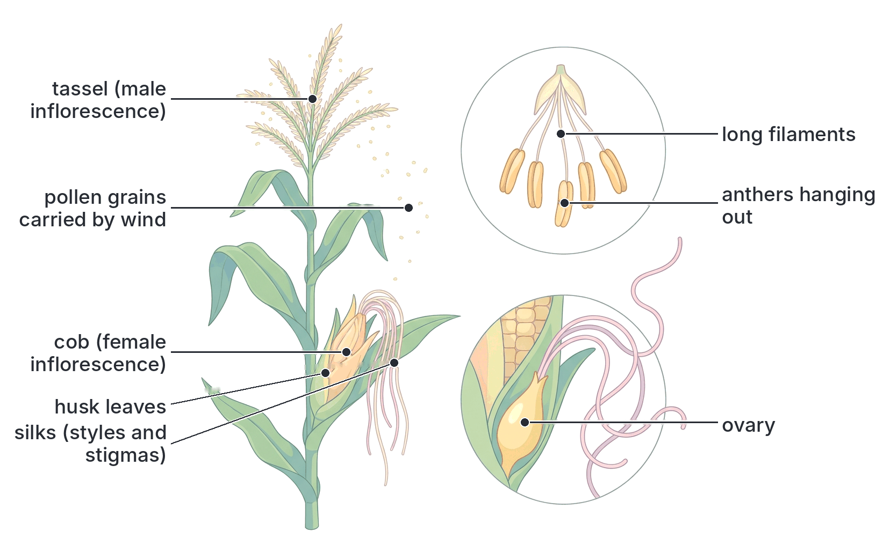

#### Insect-pollinated and wind-pollinated flowers compared

| Feature | Insect-pollinated flower | Wind-pollinated flower |
| --- | --- | --- |
| Petals | Large and brightly coloured | Small, dull or absent |
| Scent | Usually scented | No scent |
| Nectar | Usually present | Absent |
| Nectar guides | Often present | Absent |
| Position of anthers | Inside the flower | Hanging outside the flower |
| Attachment of anthers | Firmly fixed to filament | Loosely attached (versatile), swing freely |
| Filaments | Short and stiff | Long and thin |
| Stigma | Small, flat or lobed, sticky, inside the flower | Large, feathery or branched, hanging outside |
| Amount of pollen | Relatively small | Very large |
| Pollen grains | Large, heavy, sticky or spiky | Small, light, smooth and dry |
| Landing platform | Often present | Absent |
| Examples | Hibiscus, Flamboyant, Pride of Barbados, *Crotalaria*, pumpkin | Maize, guinea grass, millet, sorghum, elephant grass |

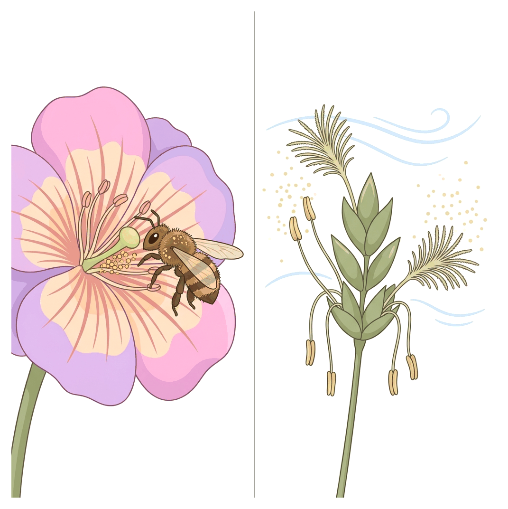

### Mechanisms that prevent self-pollination (and so encourage cross-pollination)

Many plants have features that make self-pollination difficult or impossible, so cross-pollination becomes more likely. These are sometimes called **contrivances (devices) for cross-pollination**.

#### 1. Dichogamy

In **dichogamy**, the anthers and the stigma of the same flower **mature at different times**, so the flower's own pollen is not ready when its stigma is ready (or the other way round).

- **Protandry:** the **anthers ripen first** and shed their pollen **before** the stigma of the same flower is ready to receive pollen. By the time the stigma is mature, the flower's own pollen has gone. Examples: sunflower and other members of the daisy family (such as *Tridax*), and Hibiscus. Protandry is the more common type.
- **Protogyny:** the **stigma ripens first** and is ready to receive pollen **before** the anthers of the same flower release their pollen. By the time the anthers open, the stigma has already been pollinated by pollen from another flower or has withered. Examples: custard apple and soursop (*Annona* species), magnolia, and many grasses such as pearl millet.

**Textbook variation:** the plants given as examples of protandry and protogyny differ between textbooks. In many plants the timing overlaps a little, so dichogamy reduces self-pollination but does not always stop it.

#### 2. Self-sterility (self-incompatibility)

In **self-sterile** plants, pollen that lands on the stigma of the same flower (or same plant) **cannot germinate**, or its pollen tube stops growing in the style, so fertilisation does not happen. Only pollen from a different plant can fertilise the ovules. This is controlled by genes. Examples: yellow passion fruit, tobacco (some species), many varieties of cocoa, and many members of the cabbage family.

#### 3. Heterostyly

In **heterostyly**, plants of the same species produce flowers with **styles of different lengths**:

- **Pin-eyed flowers** have a **long style** (the stigma is at the mouth of the flower) and short stamens (low in the corolla tube).
- **Thrum-eyed flowers** have a **short style** and long stamens.

An insect visiting a pin flower picks up pollen low on its body; when it visits a thrum flower, that part of its body touches the low stigma. So pollen moves mainly between the two types of flower (which grow on different plants). The classic example is the **primrose** (*Primula*), a temperate plant; heterostyly is also found in some tropical plants, such as some *Oxalis* species.

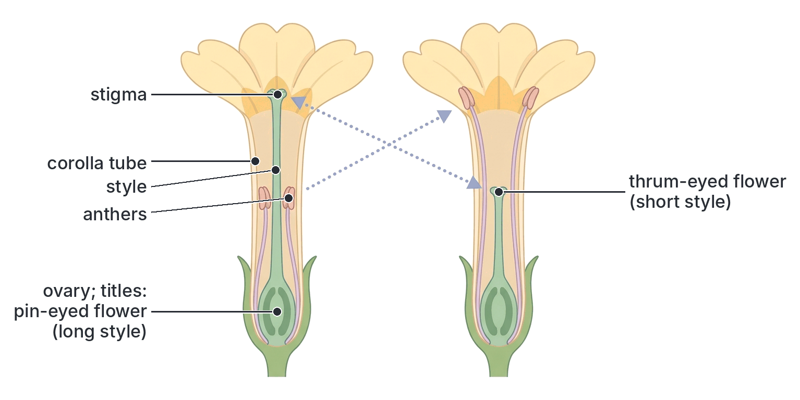

#### 4. Unisexual flowers: monoecy and dioecy

If a flower has **only stamens or only carpels**, it cannot pollinate itself.

- **Monoecious plants** have separate male and female flowers on the **same plant**. Self-pollination between flowers of the same plant is still possible, but it is reduced, especially when the male and female flowers open at different times. Examples:
  - **Maize:** the male tassel at the top and the female cob lower down. The tassel usually sheds pollen a little before the silks of the same plant are ready.
  - **Oil palm:** produces separate male and female inflorescences, usually in cycles, so that one palm often has only male or only female flowers open at a time.
  - **Pumpkin, melon (egusi), cucumber** and **castor oil**.
- **Dioecious plants** have male and female flowers on **different plants**, so cross-pollination is the **only** possibility. Examples: **fluted pumpkin (ugu, *Telfairia occidentalis*)**, **date palm**, and **pawpaw** (*Carica papaya*).

**Textbook variation:** pawpaw is usually described as dioecious (with "male pawpaw" and "female pawpaw" trees), but some pawpaw trees bear bisexual flowers, and some trees change their flower type, so it is better described as having male, female and bisexual (hermaphrodite) forms.

#### 5. Other mechanisms

- **Herkogamy (position of parts):** the stigma is placed so that the flower's own pollen cannot easily reach it, for example the stigmas of Hibiscus stand above and beyond the anthers on the staminal column.
- **Flower structure that guides insects:** the insect touches the stigma before the anthers as it enters a flower.

#### Summary table of the mechanisms

| Mechanism | How it prevents self-pollination | Examples |
| --- | --- | --- |
| Protandry (dichogamy) | Anthers ripen before the stigma | Sunflower, *Tridax*, Hibiscus |
| Protogyny (dichogamy) | Stigma ripens before the anthers | Custard apple, soursop, magnolia, pearl millet |
| Self-sterility | Own pollen cannot germinate or cannot fertilise | Yellow passion fruit, many cocoa varieties, tobacco |
| Heterostyly | Styles and stamens of different lengths in different flowers | Primrose, some *Oxalis* |
| Unisexual flowers (monoecious) | Separate male and female flowers on the same plant | Maize, oil palm, pumpkin, castor oil |
| Unisexual flowers (dioecious) | Male and female flowers on different plants | Ugu (fluted pumpkin), date palm, pawpaw |
| Herkogamy | Stigma placed out of reach of the flower's own anthers | Hibiscus |

## Fertilisation in flowering plants

**Fertilisation** is the **fusion of a male gamete (nucleus) with a female gamete (egg cell)** to form a **zygote**. In flowering plants it follows pollination.

### What happens after pollination: step by step

1. **Pollen lands on the stigma.** The stigma surface "recognises" pollen of the right species. Pollen of the wrong species usually does not germinate.
2. **The pollen grain germinates.** It absorbs water and sugar from the sticky fluid on the stigma and grows a **pollen tube** out through a thin spot (pore) in its wall.
3. **The pollen tube grows down the style.** It produces enzymes that digest a path through the tissues of the style, and it absorbs food from them. It grows towards chemicals released by the ovule (this growth towards chemicals is **chemotropism**).
4. **The nuclei move down the tube.** The **tube nucleus** stays near the growing tip and is thought to control its growth. The **generative nucleus** divides by **mitosis** to form **two male gametes (male nuclei)**, which follow behind the tube nucleus.
5. **The pollen tube enters the ovule**, usually through the **micropyle**.
6. **The tip of the tube bursts** inside the embryo sac (beside one of the synergids), releasing the two male nuclei. The tube nucleus breaks down.
7. **First fusion:** one male nucleus fuses with the **egg cell** nucleus to form a **diploid zygote (2n)**. This is true fertilisation.
8. **Second fusion:** the second male nucleus fuses with the **two polar nuclei** (or with the secondary nucleus they formed) to form a **triploid primary endosperm nucleus (3n)**.

Because two fusions take place, the process is called **double fertilisation**. Double fertilisation is found only in flowering plants.

**Note:** the fusion of the second male nucleus with the polar nuclei is sometimes called **triple fusion**, because three nuclei (one male, two polar) fuse.

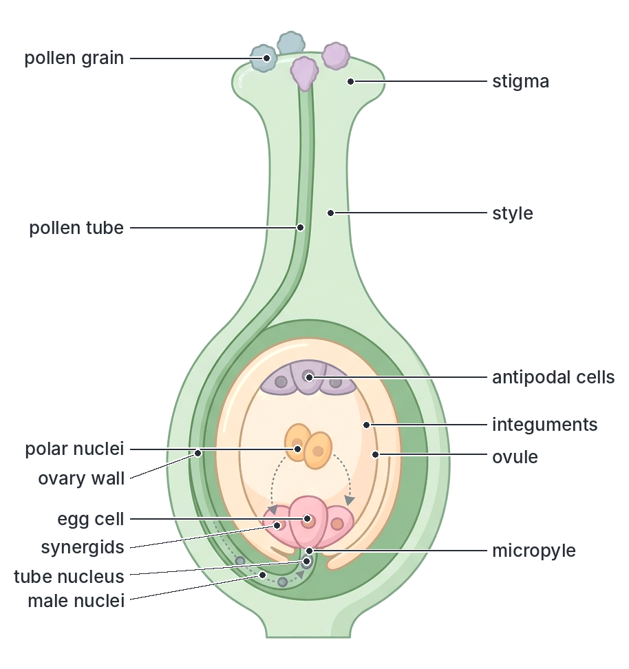

### What happens after fertilisation

After fertilisation, the flower changes into the fruit and seeds:

| Part before fertilisation | What it becomes after fertilisation |
| --- | --- |
| Zygote | **Embryo** (radicle, plumule and cotyledons) |
| Primary endosperm nucleus | **Endosperm** (food store), in endospermic seeds such as maize; in non-endospermic seeds such as bean, the endosperm is absorbed by the cotyledons as they develop |
| Integuments | **Testa** (and tegmen), the seed coat |
| Micropyle | Micropyle of the seed (a small pore that lets in water when the seed germinates) |
| Funicle | Seed stalk; when the seed breaks off, it leaves a scar called the **hilum** |
| Ovule | **Seed** |
| Ovary wall | **Pericarp** (fruit wall) |
| Ovary | **Fruit** |
| Nucellus | Usually used up (in a few seeds it remains as a food store called **perisperm**) |
| Synergids and antipodal cells | Break down |
| Petals, stamens, style and stigma | Usually wither and fall off |
| Sepals | Usually fall off, but persist in some fruits (roselle, garden egg, tomato) |

The fruit then grows, often storing water, sugar or oil, and the seed dries out and becomes **dormant** until conditions are right for germination.

## Products of sexual reproduction: seeds and fruits

### The seed

A **seed** is a **fertilised, ripened ovule**. It contains:

- an **embryo** (a young plant, with a **radicle** that becomes the root, a **plumule** that becomes the shoot, and one or two **cotyledons** or seed leaves);
- a **food store** (in the cotyledons, as in bean and groundnut, or in the endosperm, as in maize and castor oil);
- a protective **testa** with a **hilum** and a **micropyle**.

The structure of the bean seed and maize grain is explained in `B8-growth.md`.

### The fruit

A **fruit** is a **fertilised, ripened ovary**. It contains one or more seeds. The fruit wall, called the **pericarp**, may have three layers:

- **Epicarp (exocarp):** the outer skin.
- **Mesocarp:** the middle layer, often fleshy (as in mango) or fibrous (as in coconut and oil palm).
- **Endocarp:** the inner layer, which may be stony (as in mango), papery, or juicy (the juice sacs of orange).

A fruit always has **two scars**: one where it was attached to the stalk, and one where the style was attached (the **style scar**). A seed has only **one scar**: the hilum.

#### Seed and fruit compared

| Feature | Seed | Fruit |
| --- | --- | --- |
| Develops from | The ovule | The ovary |
| Protective covering | Testa (seed coat) | Pericarp (fruit wall), which encloses one or more seeds |
| Number of scars | One (the hilum) | Two (stalk scar and style scar) |
| Contains | An embryo and food store | One or more seeds |
| Micropyle | Present | Absent |
| Example | Bean seed inside a pod; orange "pip" | Bean pod; the whole orange; the maize grain (a fruit, not a seed) |

**Watch out:** many things called "seeds" in everyday life are really **fruits**, for example the maize grain, rice grain, sunflower "seed" and *Tridax* "seed". Their pericarp is thin and dry, but they still have two scars and come from an ovary. On the other hand, the **kola nut** is not a nut at all: it is the **seed** (the large cotyledons) of the kola fruit, which is a pod-like follicle.

### Placentation

**Placentation** is the **arrangement of the ovules** (and of the placentae on which they are attached) **inside the ovary**. The placenta is the ridge of tissue on the ovary wall or axis to which the ovules are attached by their funicles. You see the placentation by cutting the ovary (or young fruit) across or along its length.

The main types are:

#### Marginal placentation

- The ovary is formed from **one carpel** (monocarpellary) and has **one chamber**.
- The ovules are attached in a row along **one side (margin)** of the ovary, where the two edges of the folded carpel join (the ventral suture).
- **Examples:** bean, cowpea, groundnut, pea, Flamboyant, Pride of Barbados, *Crotalaria* and other legumes.
- **Fruit formed:** typically a **legume (pod)**, a simple dry fruit. When you open a pod of cowpea, you can see the seeds attached in a row along one edge.

#### Axile placentation

- The ovary is formed from **two or more fused carpels** (syncarpous) and is divided by walls (septa) into **two or more chambers (loculi)**.
- The ovules are attached to the **central axis**, where the walls meet in the middle.
- **Examples:** orange and other citrus, Hibiscus, okra, cotton, tomato, garden egg, pepper, lily.
- **Fruits formed:** capsules (okra, cotton), berries (tomato, pepper, garden egg) and the hesperidium (orange). When you cut an orange across, the segments are the chambers and the seeds are near the centre.

#### Parietal placentation

- The ovary is formed from **two or more fused carpels** but has only **one chamber** (no walls in the middle, or only incomplete ones).
- The ovules are attached to the **inner wall** of the ovary, along the lines where the carpels are joined.
- **Examples:** pawpaw, passion fruit, cucumber, melon (egusi), pumpkin and other gourds, and the mustard and cabbage family.
- **Fruits formed:** often berries such as pawpaw and passion fruit, or pepos (gourd-type berries). When you cut a pawpaw across, the black seeds are attached to the inside of the wall around a hollow centre.

**Textbook variation:** in the pumpkin family (cucumber, melon, pumpkin), the parietal placentae grow very large and fleshy and may meet in the middle, so the cut fruit can look as if it has axile placentation. Most textbooks still call it parietal.

#### Free-central placentation

- The ovary is formed from **fused carpels** and has **one chamber**.
- The ovules are attached to a **central column** that rises from the base of the ovary but is **not joined to the wall** by any partitions.
- **Examples:** pinks and carnations (*Dianthus*), primrose and purslane (*Portulaca*).
- **Fruit formed:** usually a capsule.

#### Basal placentation

- The ovary has **one chamber**, usually with **a single ovule** attached at the **base** of the ovary.
- **Examples:** sunflower, *Tridax* and other members of the daisy family; grasses such as maize, rice and millet.
- **Fruits formed:** one-seeded dry indehiscent fruits such as the **cypsela** (sunflower, *Tridax*) and the **caryopsis** (maize, rice).

#### Superficial placentation

- The ovary has **several chambers**, and the ovules are attached all over the **inner surface of the ovary walls and partitions**, not just at the edges or the axis.
- **Example:** water lily (*Nymphaea*), common in Nigerian ponds and swamps.

**Textbook variation:** some school textbooks list only five types (marginal, axile, parietal, free-central and basal) and leave out superficial placentation, while others include it. Some books also call free-central placentation simply "central".

[IMAGE: A grid of six ovary cross-sections (and one longitudinal section where needed), each drawn as a simple outline with green ovary walls and small round cream ovules. 1. Marginal: one chamber with ovules in a row on one side (show as a longitudinal view of a pea pod opened). 2. Axile: a round ovary with five chambers and ovules on the central axis. 3. Parietal: a round ovary with one chamber and ovules attached to the inner wall at three points. 4. Free-central: longitudinal section of a one-chambered ovary with a central column bearing ovules, not joined to the wall. 5. Basal: longitudinal section of a one-chambered ovary with a single ovule at the base. 6. Superficial: cross-section with several chambers and ovules scattered over all the inner wall surfaces. Labels: ovary wall, ovule, placenta, chamber (locule), septum, central axis, central column; titles under each: marginal, axile, parietal, free-central, basal, superficial. Clean flat textbook style, white background.]

#### Placentation types compared

| Type | Number of carpels | Number of chambers | Where ovules are attached | Examples |
| --- | --- | --- | --- | --- |
| **Marginal** | One | One | Along one margin (edge) of the carpel | Bean, cowpea, groundnut, Flamboyant |
| **Axile** | Two or more, fused | Two or more | Central axis where the walls meet | Orange, Hibiscus, okra, tomato, cotton |
| **Parietal** | Two or more, fused | One | Inner wall of the ovary | Pawpaw, cucumber, melon, passion fruit |
| **Free-central** | Two or more, fused | One | A central column not joined to the wall | *Dianthus*, primrose, *Portulaca* |
| **Basal** | Usually two, fused (or one) | One | Base of the ovary (usually one ovule) | Sunflower, *Tridax*, maize, rice |
| **Superficial** | Several, fused | Several | All over the inner walls and partitions | Water lily |

### Types of fruits

Fruits are classified in two main ways:

1. **By how many flowers and how many ovaries form them:** **simple**, **aggregate** and **multiple (composite)** fruits.
2. **By the nature of the pericarp:** **dry** fruits and **succulent (fleshy)** fruits. Dry fruits are further divided into **dehiscent** (split open to release the seeds) and **indehiscent** (do not split open).

There are also **false fruits**, where parts other than the ovary form part of the fruit.

#### Simple fruits

A **simple fruit** develops from the **single ovary of a single flower**. The ovary may have one carpel (as in bean) or several carpels joined together (as in orange). Most fruits are simple fruits. A simple fruit can be dry or succulent.

##### Simple dry dehiscent fruits

These fruits have a dry pericarp that **splits open** when ripe to release the seeds. They usually contain **many seeds**.

| Fruit type | Description | Examples |
| --- | --- | --- |
| **Legume (pod)** | Develops from **one carpel** (marginal placentation); splits along **both** sides (sutures) | Bean, cowpea, pigeon pea, Flamboyant, *Crotalaria*, Pride of Barbados |
| **Follicle** | Develops from one carpel; splits along **one** side only | Sodom apple (*Calotropis procera*), kola (the kola fruit) |
| **Capsule** | Develops from **two or more fused carpels** (often axile placentation); splits along several lines or opens by pores or a lid | Okra, cotton, castor oil, *Datura*, *Hura crepitans* (sandbox tree) |
| **Siliqua** | Long fruit from two fused carpels with a false partition; splits from the bottom upwards | Mustard, cabbage family |

**Note:** **groundnut** is a legume, but it is an exception: its pod develops underground and does **not** split open (it is indehiscent).

**How a legume opens:** as the pod dries, its two halves dry unevenly and twist in opposite directions. The tension builds up until the pod suddenly splits along both sutures, often throwing the seeds out. This is why cowpea and *Crotalaria* pods can be heard cracking on hot afternoons.

##### Simple dry indehiscent fruits

These fruits have a dry pericarp that **does not split open**. They usually contain **one seed**, and the whole fruit is dispersed and germinates as one unit.

| Fruit type | Description | Examples |
| --- | --- | --- |
| **Achene** | Small, one-seeded fruit from **one carpel**; the pericarp is thin and **free from** the seed coat | The tiny "seeds" on the outside of a strawberry; *Clematis*; the fruitlets of *Annona* are sometimes described as achene-like |
| **Caryopsis (grain)** | Small, one-seeded; the pericarp is **fused with the testa**, so they cannot be separated | Maize, rice, wheat, millet, sorghum (all grasses) |
| **Cypsela** | One-seeded fruit from an **inferior** ovary of two fused carpels; usually crowned with hairs (a **pappus**) or bristles | Sunflower, *Tridax procumbens*, bitter leaf (*Vernonia*), *Bidens* |
| **Nut** | One-seeded fruit with a **hard, woody** pericarp, formed from an ovary of two or more carpels | Cashew nut (the true fruit of the cashew), oak acorn |
| **Samara** | One- or two-seeded dry fruit with a **wing** | *Combretum* (four-winged fruit), *Terminalia* species |
| **Schizocarp** | Formed from several fused carpels; splits into one-seeded parts (mericarps) that do not themselves open | *Desmodium* (a jointed pod, also called a lomentum) |

**Textbook variation:** many school textbooks call the sunflower and *Tridax* fruits **achenes**, while others use the stricter term **cypsela** (an achene-like fruit formed from an inferior ovary). Some books also classify the schizocarp as a separate group (dry splitting fruits) rather than under indehiscent fruits.

##### Simple succulent (fleshy) fruits

**Succulent fruits** have a **fleshy, juicy pericarp**. They are usually eaten by animals, which disperse the seeds. Most do not split open.

| Fruit type | Description | Examples |
| --- | --- | --- |
| **Berry** | The **whole pericarp is fleshy** (except the thin skin); usually **many seeds**; no stony layer | Tomato, pawpaw, garden egg, pepper, guava, banana (cultivated bananas are seedless), grape |
| **Hesperidium** (a special berry) | Thick, leathery epicarp with oil glands; white spongy mesocarp; endocarp forms segments filled with juice sacs | Orange, lime, lemon, grapefruit, tangerine |
| **Pepo** (a special berry) | Hard or tough rind from an inferior ovary; fleshy inside; many seeds on parietal placentae | Cucumber, watermelon, pumpkin, melon (egusi), fluted pumpkin |
| **Drupe** | Pericarp has three distinct layers: thin epicarp, fleshy or fibrous mesocarp, and **hard, stony endocarp** around **usually one seed** | Mango, oil palm fruit, coconut, African pear (*ube*, *Dacryodes edulis*), plum, almond |

**Berry and drupe compared:**

| Feature | Berry | Drupe |
| --- | --- | --- |
| Endocarp | Soft, fleshy or juicy | Hard and stony (forms the "stone" or shell) |
| Number of seeds | Usually many | Usually one |
| Layers of pericarp | Not clearly separated (except in hesperidium) | Three distinct layers |
| Examples | Tomato, pawpaw, orange, guava | Mango, coconut, oil palm, African pear |

**Fibrous drupes:** in **coconut** and **oil palm**, the mesocarp is **fibrous** rather than juicy. The coconut "husk" is the fibrous mesocarp; the hard shell is the stony endocarp; the white "meat" and coconut water are the endosperm of the seed. In oil palm, **palm oil** comes from the fibrous, oily **mesocarp**, while **palm kernel oil** comes from the **kernel** (the seed) inside the stony endocarp (the shell).

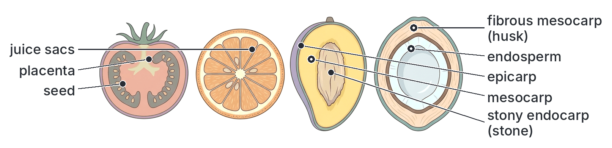

#### Aggregate fruits

An **aggregate fruit** develops from **one flower** that has **many free (separate) carpels** (an **apocarpous** gynoecium). Each carpel forms a small fruitlet, and the fruitlets stay together on the same receptacle, forming one "fruit".

**Examples:**

- **Custard apple** and **soursop** (*Annona* species): each "segment" of the flesh with its black seed came from one carpel. In soursop and custard apple, the fruitlets press together and partly fuse with the fleshy receptacle.
- **Strawberry:** an aggregate of small **achenes** (the "seeds" on the outside) on a large, fleshy receptacle. It is also a false fruit.
- **Raspberry** and **blackberry:** aggregates of tiny drupes (**drupelets**).
- *Bryophyllum* and *Clematis*: aggregates of small follicles or achenes.

**Textbook variation:** some botanists describe the soursop and custard apple, whose carpels fuse together, as a special type called a **syncarp**; most school textbooks simply call them aggregate fruits.

#### Multiple (composite) fruits

A **multiple fruit** (also called a **composite fruit** or **collective fruit**) develops from a **whole inflorescence**: the ovaries of **many separate flowers** grow and join together, often with their bracts, perianths and the inflorescence axis, to form one large fruit.

**Examples:**

- **Pineapple:** each "eye" on the surface of the pineapple is one flower. The fruits of all the flowers, their bracts and the fleshy central axis (the hard core) fuse into one fruit. Cultivated pineapples are usually seedless.
- **Breadfruit** (*Artocarpus altilis*) and **African breadfruit** (*ukwa*, *Treculia africana*): large fruits formed from many flowers on a fleshy axis. The seeds of *ukwa* are cooked and eaten in south-eastern Nigeria.
- **Jackfruit**, **fig** and **mulberry**.

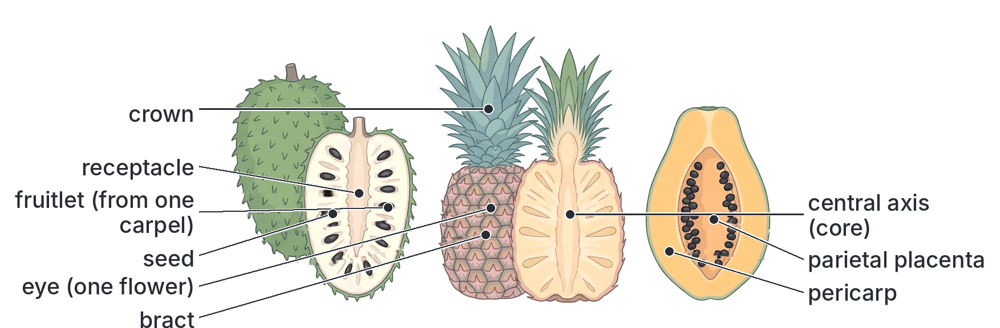

#### Simple, aggregate and multiple fruits compared

| Feature | Simple fruit | Aggregate fruit | Multiple (composite) fruit |
| --- | --- | --- | --- |
| Number of flowers | One | One | Many (a whole inflorescence) |
| Ovaries involved | One ovary (one carpel, or several fused carpels) | Many free carpels of one flower | Ovaries of many flowers |
| Gynoecium | Monocarpellary or syncarpous | Apocarpous (free carpels) | Many flowers, each with its own gynoecium |
| Other parts involved | Usually none (except in false fruits) | The receptacle often holds the fruitlets together | Bracts, perianths and the inflorescence axis often fuse in |
| Examples | Bean, maize, orange, mango, tomato, okra | Custard apple, soursop, strawberry, raspberry | Pineapple, breadfruit, *ukwa*, fig, mulberry |

### How the ovary and placentation relate to the fruit

**Objective vi: deduce the different types of placentation that develop into simple, aggregate, multiple and succulent fruits.**

The syllabus links placentation to fruit types. Here is the honest relationship.

**1. Placentation tells you how the ovary is built, and the ovary becomes the fruit.** After fertilisation, the ovary grows into the fruit and keeps its basic plan: the same number of chambers and the same placentation. So you can **deduce the placentation by cutting the fruit open**:

- Cut a **cowpea or bean pod** open: the seeds are in a row along one edge → **marginal** placentation (one carpel).
- Cut an **orange, tomato or okra** across: several chambers with seeds near the middle → **axile** placentation (several fused carpels).
- Cut a **pawpaw, cucumber or passion fruit** across: one chamber with seeds on the wall → **parietal** placentation.
- Cut a **maize grain**, **sunflower** or ***Tridax*** fruit: one seed at the base → **basal** placentation.

**2. Placentation alone does not decide whether a fruit is simple, aggregate or multiple.** That depends on:

- **Simple fruit:** one flower, one ovary. A simple fruit can have **any** type of placentation: marginal (bean pod), axile (orange, tomato, okra), parietal (pawpaw, cucumber), free-central (*Dianthus* capsule) or basal (maize grain, sunflower).
- **Aggregate fruit:** one flower with **many free carpels**. Each free carpel is a one-carpel ovary, so its ovules are normally attached at its **margin** (marginal placentation), or a carpel may hold only one ovule at its base. For example, each fruitlet of soursop came from one carpel with a single ovule.
- **Multiple fruit:** **many flowers** in an inflorescence. Each flower's ovary has its own placentation; in pineapple, each ovary has three chambers with axile placentation, though the cultivated fruit is usually seedless.

**3. Placentation also does not decide whether a fruit is succulent or dry.** That depends on whether the **pericarp becomes fleshy** (succulent fruits such as tomato, mango and pawpaw) or **dry** (pods, capsules, grains). For example, both okra (dry capsule) and tomato (succulent berry) have axile placentation.

**4. But there are useful patterns that JAMB likes to test:**

| Placentation | Ovary | Fruits it commonly gives | Examples |
| --- | --- | --- | --- |
| Marginal | One carpel, one chamber | Simple dry dehiscent **legume**; the free carpels of **aggregate** fruits | Bean, cowpea, groundnut, Flamboyant; fruitlets of custard apple |
| Axile | Fused carpels, several chambers | Simple **capsules** (dry) and simple **berries** or **hesperidia** (succulent) | Okra, cotton (capsules); tomato, pepper, garden egg (berries); orange (hesperidium) |
| Parietal | Fused carpels, one chamber | Mostly simple **succulent** fruits: berries and pepos | Pawpaw, passion fruit, cucumber, melon, pumpkin |
| Free-central | Fused carpels, one chamber | Simple dry **capsules** | *Dianthus*, *Portulaca* |
| Basal | One chamber, one ovule | Simple dry **indehiscent** one-seeded fruits | Maize, rice (caryopsis); sunflower, *Tridax* (cypsela) |
| Superficial | Fused carpels, several chambers | A spongy, berry-like fruit | Water lily |

**How to answer a JAMB question on this:** read the description or diagram, identify where the seeds are attached (that is the placentation), count the carpels or chambers, then decide how many flowers or free carpels formed the fruit (simple, aggregate or multiple), and whether its wall is dry or fleshy (succulent).

### False fruits (pseudocarps)

A **true fruit** develops only from the **ovary**. A **false fruit** (pseudocarp) is a fruit in which **other parts of the flower** (such as the receptacle, the flower stalk, the calyx or the bracts) **also form part of the fruit**, often the main fleshy part.

| False fruit | Part that forms the fleshy part | Where the true fruit is |
| --- | --- | --- |
| **Cashew** | The swollen, juicy flower stalk (pedicel) and receptacle: the "cashew apple" | The kidney-shaped **cashew nut** hanging at the bottom |
| **Strawberry** | The swollen, fleshy receptacle | The tiny achenes on its surface |
| **Apple** and **pear** | The swollen receptacle around the ovary | The "core" with the seeds |
| **Pineapple** | The bracts and the inflorescence axis, with the ovaries | The fused ovaries ("eyes") |
| **Fig** and **breadfruit** | The swollen inflorescence axis | Many tiny fruits from the flowers |

**Textbook variation:** some textbooks describe the cashew apple as a swollen **receptacle**, others as a swollen **pedicel** (flower stalk); in fact both take part. Some textbooks also call fruits from an inferior ovary (such as cucumber and guava) false fruits, because part of the receptacle is fused to the ovary wall; most simply treat them as true berries.

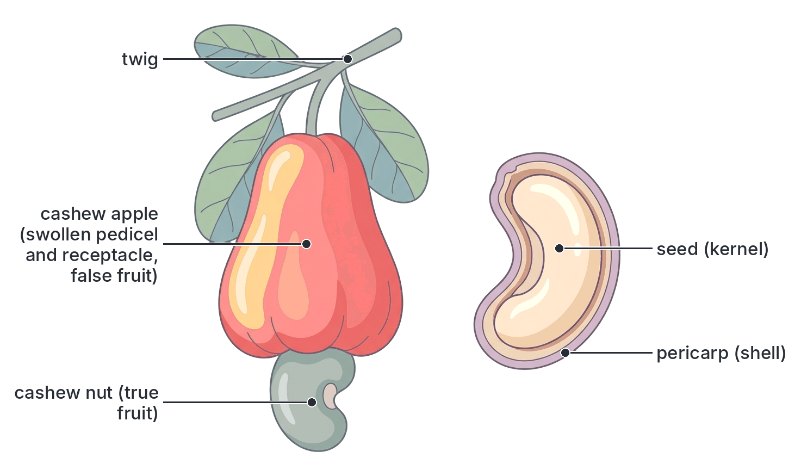

### Dispersal of seeds and fruits

**Dispersal** is the **spreading of seeds and fruits away from the parent plant**.

**Why dispersal is important:**

1. It reduces **overcrowding** and **competition** between the young plants and the parent (and among the young plants themselves) for light, water, nutrients and space.
2. It allows the plant to **colonise new areas**.
3. It reduces the spread of **pests and diseases** that attack plants growing close together.
4. It increases the chance that at least some seeds land in a **suitable place** to germinate and grow.

The main agents of dispersal are **wind**, **water**, **animals (including humans)** and the **plant itself (explosive or self-dispersal)**.

#### Dispersal by wind

Fruits and seeds dispersed by wind are **small and light**, and often have **hairs**, **wings** or **parachutes** that increase their surface area so they float in the air.

- **Hairy seeds or fruits:** cotton seeds (with long cotton fibres), seeds of the silk cotton tree (*Ceiba pentandra*), whose floss is called kapok, and seeds of Sodom apple (*Calotropis procera*).
- **Parachute (pappus):** fruits of *Tridax*, bitter leaf and sunflower relatives have a ring of hairs (pappus) on top.
- **Wings:** *Combretum*, *Terminalia* and *Triplochiton scleroxylon* (obeche/arere, a major Nigerian timber tree) have winged fruits.
- **Very tiny, dust-like seeds:** orchids.
- **Censer mechanism:** some capsules sway in the wind and shake out small seeds through pores.

#### Dispersal by water

These fruits or seeds are **light**, **buoyant** (they float) and have **waterproof coverings**.

- **Coconut:** the fibrous mesocarp traps air so the fruit floats, and the hard endocarp and waxy epicarp keep out sea water. Coconuts can float for long distances.
- **Water lily:** spongy fruits and seeds with air spaces.
- **Raffia palm** and some swamp plants.
- **Mangroves** (*Rhizophora*) of the Niger Delta: the seed germinates while still on the parent tree (this is called **vivipary**), and the long seedling drops into the water and floats until it lodges in mud.

#### Dispersal by animals

**1. Succulent (fleshy) fruits eaten by animals.** Fruits such as **mango, guava, pawpaw, tomato, oil palm, African star apple (agbalumo/udara) and fig** have bright colours, sweet scent and juicy, nutritious flesh. Animals (birds, bats, monkeys, squirrels and humans) eat them.

- Small seeds (guava, tomato, pawpaw, pepper) have **hard testas** that resist digestion. They pass through the gut and are dropped in the faeces, often far away, with manure.
- Large seeds (mango, African pear) are thrown away after the flesh is eaten.

**2. Hooked or sticky fruits.** These fruits have **hooks, spines or sticky hairs** that catch on the fur of animals and the clothing of humans. They are carried away and later fall or are brushed off.

- **Examples:** *Bidens pilosa* (black-jack or "beggar's ticks"), *Desmodium*, *Urena lobata*, *Achyranthes aspera* (devil's horsewhip) and *Boerhavia* (sticky glands).

**3. Hoarding.** Squirrels and rodents carry nuts and seeds away to store, and some are forgotten and germinate.

**4. Humans** disperse seeds deliberately by **farming** (planting crops such as maize, cassava and cocoa far from their original homes) and by trade, and accidentally on shoes, clothes, vehicles and in contaminated seed.

#### Self-dispersal (explosive mechanism)

Some **dry dehiscent fruits** burst open suddenly when ripe and throw out their seeds. The pericarp dries unevenly, building up tension until it splits violently.

- **Legumes:** cowpea, pigeon pea, *Crotalaria*, and the Flamboyant pod (which splits into two twisted woody halves).
- **Capsules:** **castor oil**, **balsam** (*Impatiens*), and the **sandbox tree** (*Hura crepitans*), whose ripe fruits explode loudly and can throw seeds many metres.
- Okra capsules also split open along lines when dry, releasing their seeds.

#### Summary of dispersal methods

| Agent | Features of the fruit or seed | Examples |
| --- | --- | --- |
| **Wind** | Small, light; hairs, pappus or wings | Cotton, kapok (*Ceiba*), *Calotropis*, *Tridax*, *Combretum*, obeche |
| **Water** | Light, buoyant, fibrous or spongy; waterproof covering | Coconut, water lily, raffia palm, mangrove |
| **Animals (eaten)** | Bright colour, scent, juicy edible flesh; seeds with hard testa | Mango, guava, pawpaw, tomato, oil palm, African star apple |
| **Animals (attached)** | Hooks, spines or sticky hairs | *Bidens*, *Desmodium*, *Urena*, *Achyranthes*, *Boerhavia* |
| **Self (explosive)** | Dry dehiscent pericarp that splits suddenly | Cowpea, *Crotalaria*, Flamboyant, castor oil, balsam, sandbox tree |
| **Humans** | Useful or attractive fruits and seeds | Crops (maize, cassava, cocoa), ornamental plants |

[IMAGE: A panel of six small fruit and seed drawings grouped by dispersal method, each in its own rounded box. 1. Wind: a Tridax fruit with a feathery pappus, and a four-winged Combretum fruit. 2. Wind: a cotton seed with long white fibres. 3. Water: a coconut floating on water, cut-away showing the fibrous husk with air spaces. 4. Animal (eaten): a ripe guava cut open with many small seeds, and a small bird eating it. 5. Animal (attached): a Bidens fruit with two barbed spines caught in animal fur. 6. Explosive: a dry cowpea pod splitting and twisting, with seeds flying out. Labels: pappus, wing, hairs (fibres), fibrous mesocarp, hard seeds, barbed spines, twisted pod valves; box titles: wind, wind, water, animals (eaten), animals (hooks), self (explosive). Clean flat textbook style, white background.]

## Key terms

| Term | Meaning |
| --- | --- |
| Flower | The reproductive shoot of a flowering plant |
| Receptacle | The swollen tip of the flower stalk to which the floral parts are attached |
| Calyx | The outer whorl of the flower, made of sepals |
| Corolla | The whorl of petals |
| Androecium | The male part of the flower, made of stamens |
| Gynoecium (pistil) | The female part of the flower, made of carpels |
| Carpel | One unit of the gynoecium: stigma, style and ovary |
| Ovule | The structure in the ovary that contains the egg cell and becomes the seed |
| Epicalyx | An extra ring of bracts outside the calyx, as in Hibiscus |
| Monadelphous | Stamens joined by their filaments into one bundle, as in Hibiscus |
| Apocarpous | Having separate (free) carpels |
| Syncarpous | Having carpels fused together |
| Zygomorphic | Bilaterally symmetrical; can be cut into two equal halves along one plane only |
| Actinomorphic | Radially symmetrical; can be cut into equal halves along several planes |
| Pollination | The transfer of pollen from an anther to a stigma |
| Self-pollination | Pollen transfer within the same flower or between flowers of the same plant |
| Cross-pollination | Pollen transfer between flowers of different plants of the same species |
| Dichogamy | Anthers and stigma of a flower ripening at different times |
| Protandry | Anthers ripen before the stigma |
| Protogyny | Stigma ripens before the anthers |
| Self-sterility | Inability of a plant's own pollen to fertilise its ovules |
| Heterostyly | Flowers of a species having styles of different lengths |
| Monoecious | Separate male and female flowers on the same plant |
| Dioecious | Male and female flowers on different plants |
| Double fertilisation | One male nucleus fuses with the egg, and the other fuses with the polar nuclei |
| Endosperm | A triploid food-storage tissue formed from the primary endosperm nucleus |
| Placentation | The arrangement of ovules inside the ovary |
| Pericarp | The fruit wall, formed from the ovary wall |
| Dehiscent | Splitting open when ripe to release seeds |
| Indehiscent | Not splitting open when ripe |
| Succulent fruit | A fruit with a fleshy, juicy pericarp |
| Aggregate fruit | A fruit formed from the many free carpels of one flower |
| Multiple (composite) fruit | A fruit formed from the flowers of a whole inflorescence |
| False fruit (pseudocarp) | A fruit in which parts other than the ovary form part of the fruit |
| Dispersal | The spreading of seeds and fruits away from the parent plant |

## Exam tips and common mistakes

- **Ovule vs ovary:** the **ovule** becomes the **seed**; the **ovary** becomes the **fruit**. Swapping these is the most common mistake in this topic.
- **Integuments become the testa; ovary wall becomes the pericarp:** don't mix up the seed coat and the fruit wall.
- **Two scars or one:** a fruit has two scars (stalk and style); a seed has one (hilum). The maize grain is a **fruit** (caryopsis), not a seed.
- **Double fertilisation products:** zygote is **diploid (2n)**; endosperm nucleus is **triploid (3n)**. JAMB often asks for the ploidy of the endosperm.
- **The generative nucleus, not the tube nucleus, forms the male gametes.** The tube nucleus controls the growth of the pollen tube and does not fuse with anything.
- **Wind-pollinated flowers produce a lot of pollen:** because most of it is wasted. Don't think insect-pollinated flowers produce more.
- **Feathery stigmas = wind pollination; sticky stigmas inside the flower = insect pollination.**
- **Protandry vs protogyny:** "andro" means male (anthers ripen first); "gyn" means female (stigma ripens first).
- **Unisexual flowers and dioecy:** only **dioecious** plants make cross-pollination certain. Monoecious plants (maize, oil palm) can still self-pollinate between flowers of the same plant.
- **Placentation does not decide simple, aggregate or multiple:** count the flowers and carpels. Aggregate = one flower, many free carpels; multiple = many flowers.
- **Marginal placentation = legumes** (bean, cowpea, groundnut, Flamboyant). **Axile = orange, tomato, okra, Hibiscus. Parietal = pawpaw, cucumber, melon.** These are the commonest exam examples.
- **Drupe vs berry:** a drupe has a hard stony endocarp (mango, coconut, oil palm); a berry does not (tomato, pawpaw, orange).
- **Coconut husk is the mesocarp:** the shell is the endocarp; the meat and water are endosperm.
- **Palm oil vs palm kernel oil:** palm oil comes from the mesocarp; palm kernel oil comes from the seed.
- **Cashew:** the "apple" is a false fruit part; the true fruit is the nut.
- **Pineapple** is a **multiple (composite)** fruit and a false fruit, not an aggregate fruit.

## Quick summary

1. The flower is the reproductive organ of flowering plants. The calyx protects the bud, the corolla attracts pollinators, the androecium (stamens) produces pollen, and the gynoecium (carpels: stigma, style, ovary) receives pollen and contains the ovules.
2. Pollination is the transfer of pollen from anther to stigma. Self-pollination is within one plant; cross-pollination is between two plants, and it gives variation, hybrid vigour, better adaptation and more viable seeds.
3. Insect-pollinated flowers are large, bright, scented and have nectar and sticky stigmas; wind-pollinated flowers are small and dull, with hanging anthers, feathery stigmas and huge amounts of light pollen.
4. Self-pollination is prevented by dichogamy (protandry and protogyny), self-sterility, heterostyly and unisexual flowers (monoecy and dioecy).
5. In double fertilisation, one male nucleus fuses with the egg to form the diploid zygote, and the other fuses with the polar nuclei to form the triploid endosperm nucleus. The ovule becomes the seed and the ovary becomes the fruit.
6. Placentation is the arrangement of ovules in the ovary: marginal (legumes), axile (orange, okra), parietal (pawpaw, cucumber), free-central, basal (maize, sunflower) and superficial (water lily). The fruit keeps the placentation of its ovary.
7. Simple fruits come from one ovary of one flower; aggregate fruits from many free carpels of one flower (soursop, strawberry); multiple fruits from a whole inflorescence (pineapple, breadfruit). Fruits are dry (dehiscent or indehiscent) or succulent (berry, drupe); false fruits include cashew and strawberry.
8. Seeds and fruits are dispersed by wind, water, animals and explosive mechanisms, which reduces overcrowding and competition and spreads the species.

## Practice questions

**1. Which part of a flower develops into the seed after fertilisation?**

- A. Ovary
- B. Ovule
- C. Receptacle
- D. Style

**Answer: B.** The fertilised ovule becomes the seed. The ovary becomes the fruit.

**2. In double fertilisation in flowering plants, the second male nucleus fuses with the**

- A. egg cell to form the zygote
- B. synergids to form the endosperm
- C. polar nuclei to form a triploid endosperm nucleus
- D. antipodal cells to form the testa

**Answer: C.** One male nucleus fuses with the egg (zygote, 2n); the other fuses with the two polar nuclei to give the triploid (3n) primary endosperm nucleus.

**3. Which of the following is an advantage of cross-pollination?**

- A. It keeps the qualities of a variety pure
- B. It does not need any agent
- C. Less pollen is wasted
- D. The offspring show more variation and vigour

**Answer: D.** Cross-pollination combines genes from two parents, giving variation and often hybrid vigour. Options A, B and C describe self-pollination.

**4. A flower has large feathery stigmas hanging outside it, long filaments and no nectar. It is most likely pollinated by**

- A. wind
- B. insects
- C. birds
- D. bats

**Answer: A.** Feathery, exposed stigmas, long filaments and lack of nectar are features of wind-pollinated flowers such as maize and grasses.

**5. A condition in which the anthers of a flower mature before its stigma is called**

- A. protogyny
- B. heterostyly
- C. protandry
- D. self-sterility

**Answer: C.** In protandry the anthers ripen first, so the flower's own pollen is shed before its stigma is ready.

**6. When a cowpea pod is opened, the seeds are seen attached in a row along one edge. This type of placentation is**

- A. axile
- B. marginal
- C. parietal
- D. basal

**Answer: B.** Cowpea has a single carpel, and the ovules are attached along one margin: marginal placentation.

**7. The pineapple is an example of a**

- A. simple fruit
- B. aggregate fruit
- C. drupe
- D. multiple fruit

**Answer: D.** A pineapple forms from the flowers of a whole inflorescence fused together, so it is a multiple (composite) fruit.

**8. Which of the following fruits is a drupe?**

- A. Mango
- B. Tomato
- C. Pawpaw
- D. Okra

**Answer: A.** Mango has a thin epicarp, fleshy mesocarp and a hard stony endocarp around one seed. Tomato and pawpaw are berries; okra is a capsule.

**9. The part of the coconut fruit that helps it to float and be dispersed by water is the**

- A. endosperm
- B. stony endocarp
- C. fibrous mesocarp
- D. testa

**Answer: C.** The fibrous husk (mesocarp) traps air, which makes the coconut buoyant.

**10. Which of these plants is dioecious, so that cross-pollination is the only possibility?**

- A. Maize
- B. Fluted pumpkin (ugu)
- C. Hibiscus
- D. Cowpea

**Answer: B.** Fluted pumpkin bears male and female flowers on separate plants. Maize is monoecious (both sexes on one plant), while Hibiscus and cowpea have bisexual flowers.
