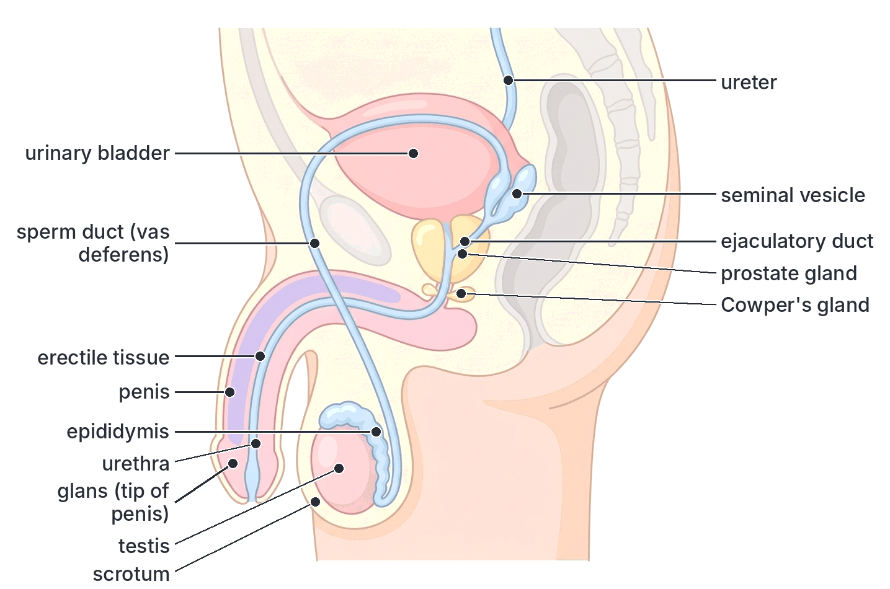
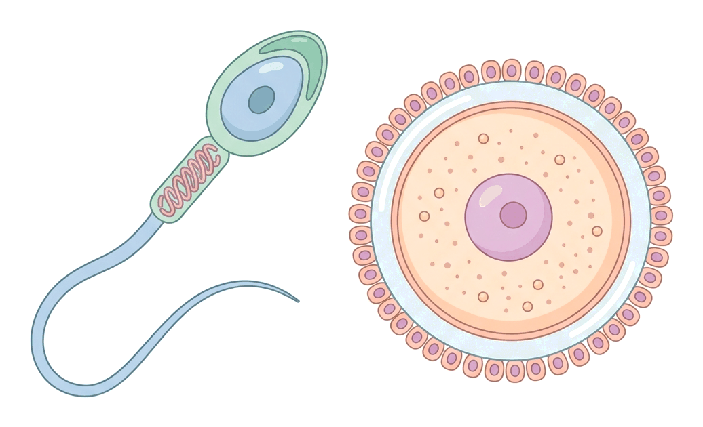
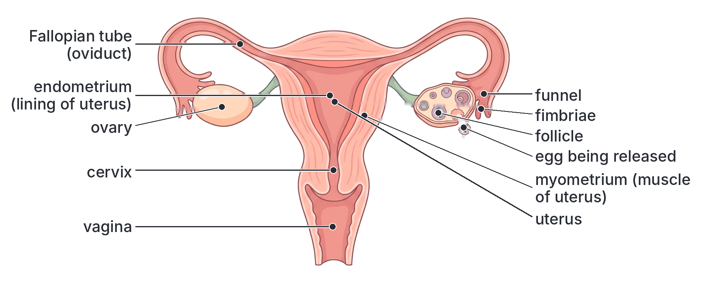
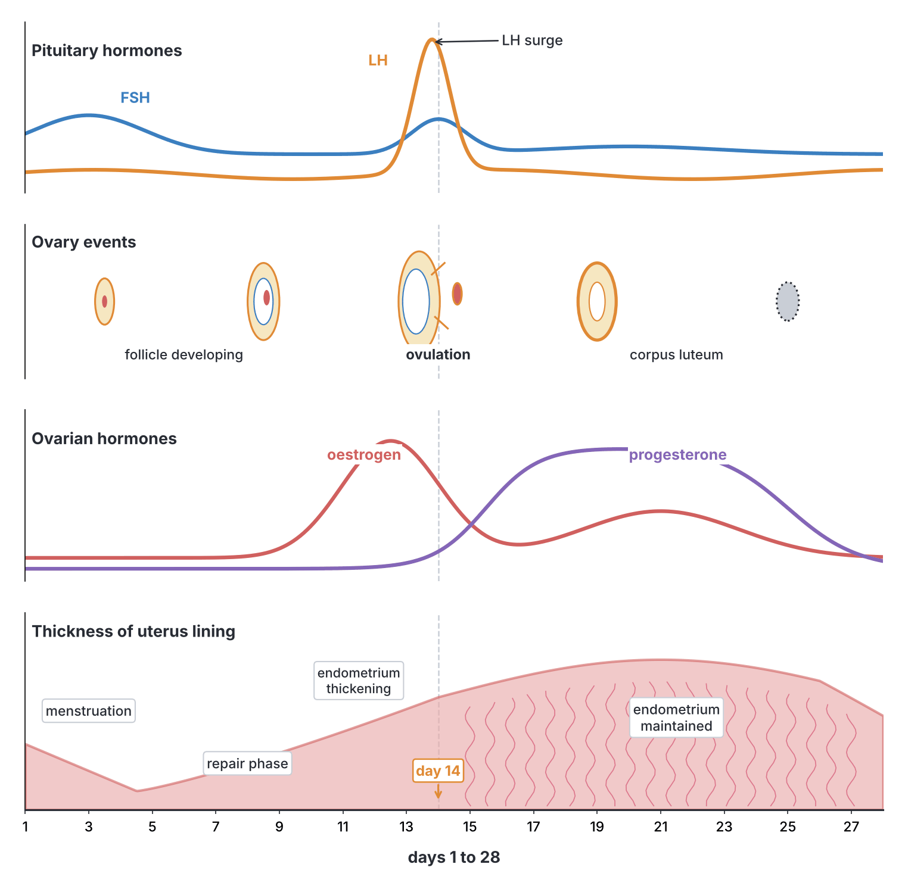
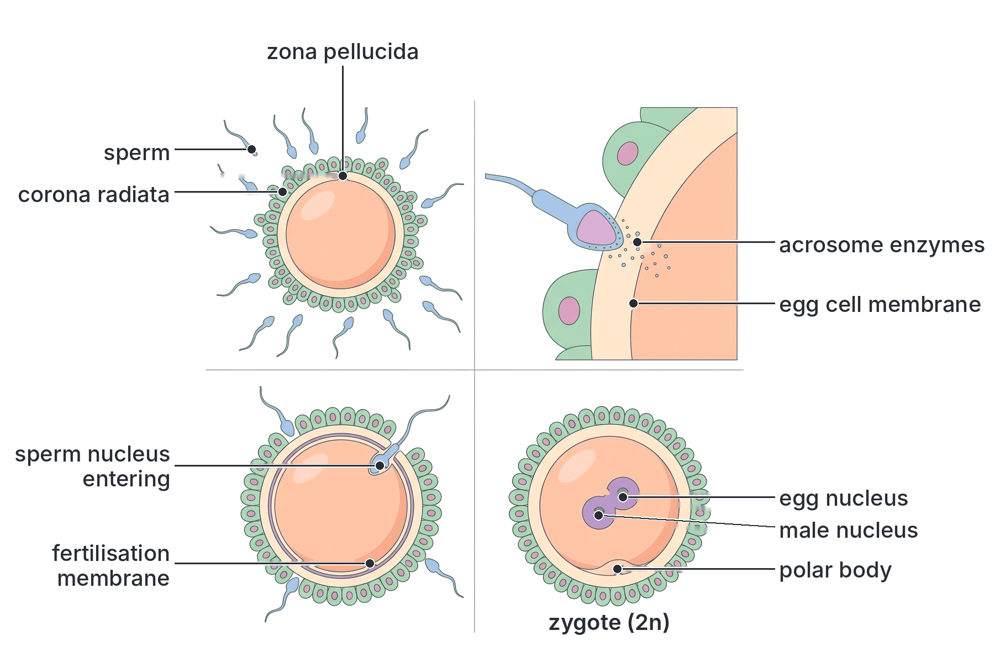
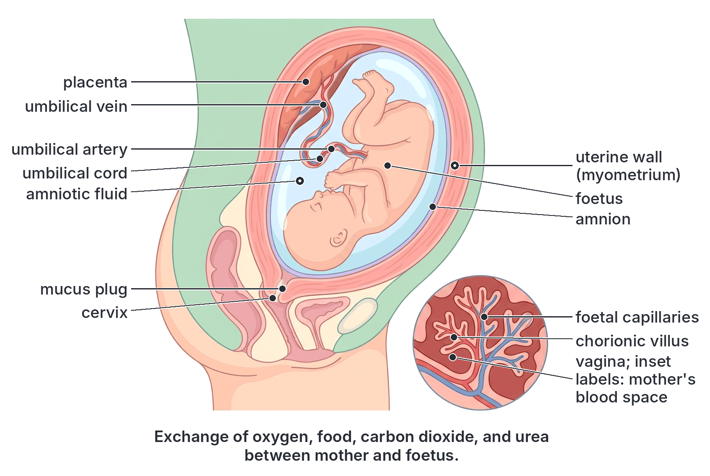
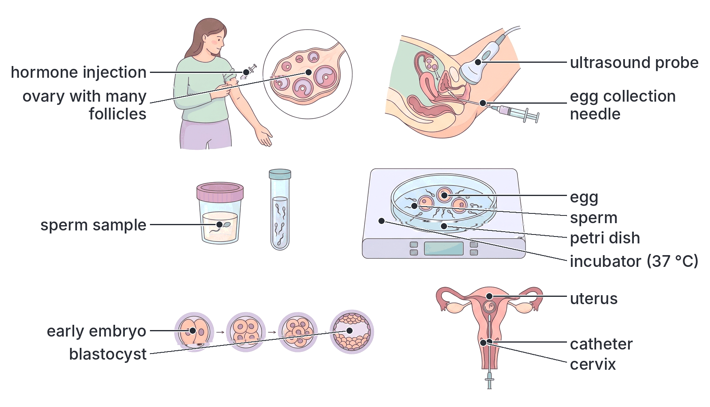

# JAMB Biology Notes: Reproduction (Part 3): Reproduction in Mammals

## What JAMB expects

This is Part 3 of Section B, Topic 7 of the JAMB Biology syllabus: Form and Functions – Reproduction. Part 1 (`B7a-asexual-reproduction.md`) covers asexual reproduction. Part 2 (`B7b-reproduction-in-flowering-plants.md`) covers sexual reproduction in flowering plants.

The syllabus content covered in this file is **c. Reproduction in mammals**:

- i. Structures and functions of the male and female reproductive organs.
- ii. Fertilisation and development (fusion of gametes).

By the end of these notes, you should be able to:

1. Differentiate between the male and female reproductive organs (objective vii).
2. Relate their structure and function to the production of offspring (objective viii).
3. Describe the fusion of gametes as the process of fertilisation (objective ix).
4. Relate the effects of the mother's health, nutrition and indiscriminate use of drugs to the developmental stages of the embryo up to birth (objective x).
5. Explain the modern methods of regulating reproduction, e.g. in vitro fertilisation and birth control (objective xi).

**Note on the syllabus wording:** objective xi is printed as "explain the modern methods of regulating reproduction on e.g., invitro fertilization and birth control". "Invitro" should be written as two words, ***in vitro*** (Latin for "in glass"), and the word "on" before "e.g." is a stray word. The objective means: explain modern methods of regulating reproduction, such as in vitro fertilisation (IVF) and birth control.

The human is used as the main example of a mammal throughout these notes, as in all Nigerian textbooks. Other mammals (goats, cattle, rabbits, rats) have the same basic plan.

## Reproduction in mammals: an overview

Mammals reproduce **sexually**. Their main features are:

1. The sexes are **separate**: there are males and females.
2. Males produce **sperm** (spermatozoa) in the **testes**; females produce **eggs** (ova) in the **ovaries**. Sperm and eggs are **gametes**: they are **haploid** (they have half the normal number of chromosomes; in humans 23 instead of 46).
3. **Fertilisation is internal:** the male deposits sperm inside the female's body, so the gametes do not dry out, and fewer gametes are wasted.
4. **Development is internal (viviparity):** the embryo develops inside the female's **uterus**, nourished through a **placenta**.
5. The young are born alive and are fed on **milk** from the mother's mammary glands. Parents care for the young.

(The only exceptions are the egg-laying monotremes, the platypus and spiny anteaters of Australia and New Guinea; see `A2c-evolution-animals.md`.)

## The male reproductive system

### Parts of the male reproductive system and their functions

#### Testes (singular: testis)

- **Structure:** two oval organs, each about 4–5 cm long, held outside the abdomen in a skin bag called the **scrotum**. Each testis is packed with hundreds of tightly coiled **seminiferous tubules**. Between the tubules are the **interstitial cells** (Leydig cells). The tubules also contain **Sertoli cells**, which nourish the developing sperm.
- **Functions:**
  1. Produce **sperm** (spermatozoa) in the seminiferous tubules, by **meiosis**. This is **spermatogenesis**.
  2. Produce the male sex hormone **testosterone** (from the interstitial cells). Testosterone controls sperm production and the development of male **secondary sexual characteristics** at puberty: deepening of the voice, growth of facial, pubic and body hair, growth of muscles, and enlargement of the penis and testes.

#### Scrotum

- **Structure:** a bag of skin and muscle hanging outside the body cavity, holding the testes.
- **Function:** keeps the testes about **2–3 °C cooler** than normal body temperature (37 °C). Sperm production works best at this lower temperature. When it is cold, the scrotal muscles contract and pull the testes closer to the body for warmth; when it is hot, they relax and let the testes hang lower.

#### Epididymis

- **Structure:** a long, very tightly coiled tube lying on the back of each testis. (If uncoiled, it would be several metres long.)
- **Function:** **stores** sperm and is where sperm **mature** and become able to swim.

#### Sperm duct (vas deferens)

- **Structure:** a muscular tube leading from each epididymis up into the abdomen, looping over the ureter, and joining the urethra.
- **Function:** carries sperm from the epididymis to the urethra. Its muscular walls contract (peristalsis) to push sperm along during ejaculation. (Cutting and tying these ducts is the basis of **vasectomy**; see the section on birth control.)

#### Accessory glands

These glands add fluids to the sperm. Sperm plus these fluids make **semen** (seminal fluid).

| Gland | Number | Fluid and function |
| --- | --- | --- |
| **Seminal vesicles** | Two | Produce most of the volume of semen (roughly 60%). The thick fluid contains **fructose** (a sugar that provides energy for the sperm to swim) and other substances; it is alkaline |
| **Prostate gland** | One | Surrounds the urethra just below the bladder. Adds a thin, milky fluid containing enzymes and other substances that help sperm to move and keep the semen liquid |
| **Cowper's glands** (bulbourethral glands) | Two | Release a small amount of clear, slippery mucus before ejaculation, which lubricates the urethra and neutralises any acid left from urine |

Semen as a whole is slightly **alkaline**, which helps to neutralise the **acidity of the vagina**, which would otherwise harm the sperm.

**Textbook variation:** many school textbooks say that the prostate fluid is alkaline. In fact, prostate fluid itself is slightly acidic, and most of the alkalinity of semen comes from the seminal vesicle fluid. For JAMB, remember that the **accessory glands together make semen alkaline** to protect the sperm in the acidic vagina.

#### Urethra

- **Structure:** a tube running from the bladder through the penis to the outside.
- **Function:** carries **urine** from the bladder and **semen** during ejaculation (but not both at the same time: a ring of muscle closes the bladder outlet during ejaculation). In males, the urethra is therefore part of both the excretory and the reproductive systems.

#### Penis

- **Structure:** a cylindrical organ containing **spongy erectile tissue** with many blood spaces, surrounding the urethra. The tip is the sensitive **glans**, covered by the **foreskin** (which is removed in circumcision).
- **Function:** during sexual excitement, blood fills the erectile tissue, so the penis becomes **erect** (stiff). This allows it to be placed into the female's vagina during sexual intercourse (**copulation**), so that semen is deposited close to the cervix. It also passes urine.

### Spermatogenesis: how sperm are made

Sperm are made continuously from **puberty** (about 12–14 years in boys) throughout life, although production falls in old age. Millions are made every day.

1. **Spermatogonia** (diploid, 2n) on the outer wall of each seminiferous tubule divide repeatedly by **mitosis**.
2. Some grow into **primary spermatocytes** (2n).
3. Each primary spermatocyte divides by the **first division of meiosis** to give two **secondary spermatocytes** (n, haploid).
4. Each secondary spermatocyte undergoes the **second division of meiosis** to give two **spermatids** (n).
5. The spermatids, nourished by the Sertoli cells, change shape (they grow a tail and lose most of their cytoplasm) to become **spermatozoa** (sperm). They are released into the centre of the tubule.

So **one primary spermatocyte forms four sperm**. The whole process takes roughly two to two and a half months in humans.

### Structure of a sperm cell and how it is adapted

A human sperm is a tiny cell, about 0.05–0.06 mm (50–60 micrometres) long, mostly tail.

| Part | Structure | Function (adaptation) |
| --- | --- | --- |
| **Head** | Flattened and oval; contains a **haploid nucleus** (23 chromosomes) | Carries the father's genetic material; the streamlined shape helps swimming |
| **Acrosome** | A cap at the front of the head, containing **enzymes** | Enzymes digest the layers around the egg so the sperm can get in |
| **Middle piece (neck)** | Packed with **mitochondria** coiled around the base of the tail | Release **energy** (by respiration of fructose) for the tail to beat |
| **Tail (flagellum)** | Long, whip-like | Lashes from side to side so the sperm can **swim** towards the egg |

Sperm have very little cytoplasm and no food store, so they cannot live long. Inside the female body they can survive for up to about **five days**.

## The female reproductive system

### Parts of the female reproductive system and their functions

#### Ovaries

- **Structure:** two almond-shaped organs, each about 3–4 cm long, in the lower abdomen on either side of the uterus. Each ovary contains thousands of **follicles**; each follicle is an immature egg (oocyte) surrounded by layers of follicle cells.
- **Functions:**
  1. Produce **eggs (ova)**, usually **one each month** from puberty to menopause. This is **oogenesis**. The release of an egg is called **ovulation**.
  2. Produce the female sex hormones **oestrogen** (from the growing follicle) and **progesterone** (from the corpus luteum, the "yellow body" left behind after ovulation). Oestrogen controls the female **secondary sexual characteristics** at puberty: development of the breasts, widening of the hips, growth of pubic and underarm hair, and the start of menstruation. Both hormones control the menstrual cycle and pregnancy.

#### Oviducts (Fallopian tubes)

- **Structure:** two narrow tubes, each about 10 cm long, running from near each ovary to the top of the uterus. The end near the ovary is a wide **funnel** with finger-like **fimbriae**. The inner lining has **cilia** and the wall has smooth muscle.
- **Functions:**
  1. The funnel and fimbriae catch the egg when it is released from the ovary.
  2. Cilia and muscular contractions (peristalsis) move the egg along towards the uterus.
  3. **Fertilisation usually takes place in the upper third of the oviduct.**
  4. They carry the early embryo to the uterus.

(An embryo that implants in the oviduct instead of the uterus causes an **ectopic pregnancy**, a dangerous emergency, because the tube can burst.)

#### Uterus (womb)

- **Structure:** a hollow, pear-shaped organ about the size of a fist (in a non-pregnant woman), with a thick wall of **smooth muscle** (the **myometrium**) and a soft inner lining rich in blood vessels (the **endometrium**).
- **Functions:**
  1. The embryo **implants** in the endometrium, which provides nourishment.
  2. The **placenta** forms here, and the foetus **develops** here until birth. The uterus stretches greatly as the foetus grows.
  3. Its muscular wall **contracts** strongly during labour to push the baby out.
  4. If there is no pregnancy, the endometrium breaks down and is lost during **menstruation**.

#### Cervix

- **Structure:** the narrow neck of the uterus, opening into the vagina. It is a ring of strong muscle with mucus-producing glands.
- **Functions:** keeps the uterus closed during pregnancy (with a mucus plug that keeps out germs). Its mucus changes during the cycle: thin and watery around ovulation (lets sperm through), thick at other times. It **dilates** (opens wide, to about 10 cm) during birth.

#### Vagina

- **Structure:** a muscular, elastic tube from the cervix to the outside. Its lining is moist and slightly **acidic**, which helps to kill germs.
- **Functions:** receives the penis and **semen** during intercourse; it is the **birth canal** through which the baby passes; menstrual blood flows out through it.

#### Vulva

The external parts: the **labia** (folds of skin) that protect the openings of the vagina and urethra, and the **clitoris**, a small sensitive organ. In females, the urethra opens separately from the vagina, so the excretory and reproductive passages are separate.

### Oogenesis: how eggs are made

1. **Before a girl is born**, **oogonia** (2n) in her ovaries divide by **mitosis** and grow into **primary oocytes** (2n). These begin the first division of meiosis and then **stop**. A baby girl is born with all the primary oocytes she will ever have (about one to two million), most of which degenerate before puberty.
2. **From puberty** (about 10–14 years in girls; this varies), each month one follicle usually matures. Its primary oocyte completes the **first meiotic division**, forming a large **secondary oocyte** (n) and a tiny **first polar body**, which degenerates.
3. The **secondary oocyte** is released at **ovulation**. It starts the second meiotic division but stops halfway.
4. The second meiotic division is **completed only if a sperm enters**. This produces the mature **ovum** (n) and a **second polar body**, which degenerates.

So **one primary oocyte forms only one egg** (plus polar bodies). The unequal divisions give the egg nearly all the cytoplasm, which is food for the early embryo. Only about 400–500 eggs are released in a woman's lifetime. Egg release stops at the **menopause**, usually between about 45 and 55 years.

**Note:** in everyday language, and in most school textbooks, the cell released at ovulation is called the **egg** or **ovum**, even though strictly it is a secondary oocyte.

### Structure of the egg (ovum) and how it is adapted

The human egg is about **0.1 mm** across, large enough to be just visible to the naked eye, and much larger than a sperm.

| Part | Function (adaptation) |
| --- | --- |
| **Haploid nucleus** (23 chromosomes) | Carries the mother's genetic material |
| **Cytoplasm** with a small amount of **yolk** (food) | Nourishes the zygote and early embryo for the first few days, until it implants |
| **Cell membrane** | After one sperm enters, it changes to stop other sperm from entering |
| **Zona pellucida** (jelly coat) | A protective glycoprotein layer; sperm must bind to it and digest a path through it. It changes after fertilisation to block other sperm |
| **Corona radiata** | A layer of follicle cells around the egg, which the sperm must pass through |

The egg **cannot move by itself**; it is moved by the cilia and muscles of the oviduct. It survives for only about **12–24 hours** after ovulation if not fertilised.

## Male and female reproductive organs compared

**Objective vii: differentiate between male and female reproductive organs.**

| Feature | Male | Female |
| --- | --- | --- |
| Gonads (primary sex organs) | **Testes** | **Ovaries** |
| Position of gonads | Outside the body cavity, in the scrotum | Inside the abdominal cavity |
| Gametes produced | **Sperm** (spermatozoa) | **Eggs** (ova) |
| Number of gametes | Millions daily, continuously from puberty into old age | Usually one per month, from puberty to menopause |
| Size and movement of gametes | Very small; swim with a tail | Large; cannot move by itself |
| Food store in gamete | Almost none | Some yolk in the cytoplasm |
| Gametes from one primary cell | Four sperm | One egg (plus polar bodies) |
| Main sex hormone | **Testosterone** | **Oestrogen** and **progesterone** |
| Ducts | Epididymis, sperm duct (vas deferens), urethra | Oviducts (Fallopian tubes) |
| Accessory glands | Seminal vesicles, prostate gland, Cowper's glands | No equivalent glands adding to the gametes (cervical glands produce mucus) |
| Copulatory organ | Penis (deposits semen) | Vagina (receives semen; birth canal) |
| Organ for development of young | None | Uterus |
| Urethra | Carries both urine and semen | Carries urine only; separate from the vagina |
| Cycle | No monthly cycle | Monthly menstrual cycle |
| Feeding of young after birth | No | Mammary glands produce milk |

## Relating structure and function to the production of offspring

**Objective viii: relate their structure and function to the production of offspring.**

Every part of the reproductive systems is adapted to one goal: bringing a sperm and an egg together, then protecting and nourishing the new individual until it can live on its own.

| Structure | How its structure suits its role in producing offspring |
| --- | --- |
| Testes in the scrotum | Being outside the body keeps them cool, which sperm production needs; many coiled tubules give a huge area for making millions of sperm |
| Millions of sperm | Most sperm die on the way (in the acidic vagina, at the cervix, or going up the wrong oviduct), so huge numbers improve the chance that one reaches the egg |
| Sperm structure | Tail for swimming, mitochondria for energy, acrosome enzymes to get into the egg, haploid nucleus to carry genes |
| Seminal fluid | Gives a liquid for sperm to swim in, fructose for energy, and alkalinity to neutralise vaginal acid |
| Erectile tissue of the penis | Allows semen to be placed deep in the vagina near the cervix, so fertilisation can be internal |
| Ovaries | Release a mature egg at the right time each month, and produce hormones that prepare the uterus |
| Egg with yolk | Food for the early embryo until it implants |
| Oviduct funnel, fimbriae and cilia | Catch the egg and move it towards the sperm and the uterus; fertilisation happens here |
| Thick, blood-rich endometrium | Ready to receive and nourish the embryo; the placenta forms here |
| Muscular, stretchy uterus | Holds the growing foetus and pushes it out at birth |
| Cervix | Holds the foetus in and keeps germs out during pregnancy; dilates at birth |
| Elastic vagina | Receives the penis; stretches to let the baby pass at birth |
| Mammary glands | Produce milk to feed the baby after birth |

### The menstrual cycle

From puberty to menopause, a woman's body goes through a regular monthly cycle that **prepares an egg for fertilisation and the uterus for pregnancy**. If no pregnancy occurs, the uterine lining is shed and the cycle starts again. This is the **menstrual cycle**.

- The average cycle is **28 days**, but it commonly ranges from about **21 to 35 days**, and it can vary in the same woman.
- **Day 1** is the first day of menstruation (bleeding).

#### The hormones that control the cycle

| Hormone | Produced by | Main effects |
| --- | --- | --- |
| **FSH** (follicle-stimulating hormone) | Anterior pituitary gland | Stimulates a follicle in the ovary to grow and mature; stimulates the follicle to produce oestrogen |
| **Oestrogen** | Growing follicle in the ovary | Repairs and thickens the endometrium; at low levels it inhibits FSH, but a high peak just before ovulation triggers the LH surge |
| **LH** (luteinising hormone) | Anterior pituitary gland | A sudden surge of LH (around day 14) causes **ovulation**; LH then turns the empty follicle into the **corpus luteum** |
| **Progesterone** | Corpus luteum | Maintains the thick endometrium, ready for implantation; inhibits FSH and LH, so no new follicle develops; in pregnancy it keeps the uterus lining in place and the uterine muscles relaxed |

#### The stages of the menstrual cycle (for a 28-day cycle)

1. **Menstruation (about days 1–5):** progesterone and oestrogen levels are low. The thick endometrium breaks down and is shed through the vagina with some blood. This is the **menstrual flow** ("period"). Meanwhile, the pituitary starts releasing FSH.
2. **Follicular (repair) phase (about days 6–13):** FSH makes a follicle grow in the ovary. The growing follicle (a **Graafian follicle**) produces **oestrogen**, which makes the endometrium **repair and thicken** again.
3. **Ovulation (about day 14):** rising oestrogen causes the pituitary to release a large surge of **LH** (and some FSH). The LH surge causes the mature follicle to burst and **release the egg** into the oviduct funnel.
4. **Luteal (secretory) phase (about days 15–28):** the empty follicle becomes the **corpus luteum**, which produces **progesterone** (and some oestrogen). Progesterone keeps the endometrium thick, soft and full of blood vessels, ready for an embryo. It also stops FSH and LH, so no new egg develops.
5. **If the egg is not fertilised:** the corpus luteum breaks down after about 10–14 days. Progesterone and oestrogen levels fall, the endometrium can no longer be maintained, and **menstruation** starts again. With progesterone low, FSH rises again and the next cycle begins.
6. **If the egg is fertilised:** the embryo implants and produces the hormone **hCG** (human chorionic gonadotrophin), which keeps the corpus luteum alive. Progesterone stays high, so **there is no menstruation** during pregnancy. (Pregnancy tests detect hCG in urine.) Later, the placenta itself takes over making progesterone and oestrogen.

**Fertile period:** because sperm live up to about 5 days and the egg about 1 day, a woman is most likely to become pregnant if intercourse happens in the few days before ovulation or on the day of ovulation. In a regular 28-day cycle this is roughly days 9–15, but ovulation does not always happen on day 14.

**Textbook variation:** the number of days for each phase differs slightly between textbooks (for example, menstruation "days 1–5" or "days 1–4"), and real cycles vary from woman to woman. Ovulation usually happens about **14 days before the next period starts**, so in a 35-day cycle it would be around day 21.

## Fertilisation: the fusion of gametes

**Objective ix: describe the fusion of gametes as a process of fertilisation.**

**Fertilisation** is the **fusion of the nucleus of a male gamete (sperm) with the nucleus of a female gamete (egg)** to form a **diploid zygote**. In mammals it is **internal** and normally happens in the **upper third of the oviduct**.

### Step by step

1. **Copulation (sexual intercourse):** the erect penis is placed in the vagina. At the climax, muscular contractions push semen from the epididymis and sperm ducts, mixed with the gland secretions, out through the urethra (**ejaculation**). The semen, typically a few millilitres containing many millions of sperm, is deposited at the top of the vagina near the cervix.
2. **Journey of the sperm:** the sperm swim through the cervix (whose mucus is thin and watery around ovulation), up through the uterus and into the oviducts. Contractions of the uterus and oviduct help. Most sperm die or get lost on the way; only a few hundred reach the egg.
3. **Capacitation:** in the female tract, the sperm undergo chemical changes that make them able to fertilise the egg.
4. **Meeting the egg:** if ovulation has happened recently, the egg (secondary oocyte) is moving down the oviduct. Sperm surround it.
5. **Acrosome reaction:** when a sperm reaches the egg, its **acrosome releases enzymes** that digest a path through the **corona radiata** and the **zona pellucida**.
6. **Fusion of membranes:** the first sperm to get through reaches the egg's cell membrane. The membranes of the sperm and egg **fuse**, and the sperm's **head (nucleus)** enters the egg. The tail is usually left outside or broken down.
7. **Blocking other sperm:** immediately, the egg releases chemicals from granules just under its membrane (the **cortical reaction**). This hardens the zona pellucida into a **fertilisation membrane**, which stops any other sperm from entering. This ensures only **one** sperm fertilises the egg.
8. **Completion of meiosis:** the entry of the sperm triggers the egg to complete its second meiotic division, forming the mature ovum nucleus and a second polar body.
9. **Fusion of nuclei:** the sperm nucleus (23 chromosomes) and the egg nucleus (23 chromosomes) move together and **fuse**. The fertilised egg, now with **46 chromosomes** (23 pairs, diploid), is called a **zygote**. Fertilisation is complete.

### Why fertilisation matters

- It **restores the diploid number** of chromosomes (46 in humans), which meiosis had halved.
- It **combines genes from two parents**, so each child is genetically unique (except identical twins). This gives **variation**.
- It **determines the sex** of the child. Every egg carries an **X** chromosome. A sperm carries either an **X** or a **Y** chromosome. If an X-carrying sperm fertilises the egg, the zygote is **XX (female)**; if a Y-carrying sperm does, it is **XY (male)**. So it is the **father's sperm** that decides the sex of the baby (see Section D, Heredity).
- It **activates the egg** to start dividing.

**Twins:** **identical (monozygotic) twins** form when **one zygote** splits into two separate embryos early on; they have the same genes and are always the same sex. **Non-identical (fraternal, dizygotic) twins** form when **two eggs** are released and each is fertilised by a **different sperm**; they are no more alike than other brothers and sisters. Nigeria, especially among the Yoruba of the south-west (for example Igbo-Ora in Oyo State, often called the "twin capital of the world"), has one of the highest twinning rates in the world, mostly of non-identical twins.

## Development from zygote to birth

**Objective x: relate the effects of the mother's health, nutrition and indiscriminate use of drugs on the developmental stages of the embryo up to birth.**

To understand how the mother's health affects the baby, you first need to know the stages of development.

### Stages of development

#### 1. Zygote

The fertilised egg, a single diploid cell, in the oviduct.

#### 2. Cleavage

Within about a day, the zygote starts dividing by **mitosis** as it is moved slowly down the oviduct by cilia. It divides into 2 cells, then 4, 8, 16 and so on. These early divisions are called **cleavage**. The cells get smaller with each division because the embryo does not yet grow in overall size. After about 3–4 days, the embryo is a solid ball of about 16 or more cells called a **morula** (from the Latin for mulberry).

#### 3. Blastocyst

By about day 4–5, the morula reaches the uterus and becomes a hollow ball of cells filled with fluid, called a **blastocyst**. It has:

- an outer layer of cells, the **trophoblast**, which will help form the **placenta** and the membranes around the embryo;
- an **inner cell mass** on one side, which will become the **embryo** itself.

#### 4. Implantation

At about **6–7 days** after fertilisation, the blastocyst sinks into the thick, soft **endometrium** of the uterus. This is **implantation**. The trophoblast cells grow finger-like projections (**villi**) into the uterine lining and start absorbing nourishment. Implantation is complete within about a week. The implanted embryo starts to produce **hCG**, which keeps the corpus luteum producing progesterone, so the lining is not shed.

**Textbook variation:** textbooks give slightly different days for these stages (for example, implantation "about a week after fertilisation", "day 6–10"). The order of the stages is what matters.

[IMAGE: Front-view diagram of the female reproductive tract showing the journey from ovulation to implantation. On the right, an ovary releasing an egg into the funnel of the oviduct; along the oviduct, a numbered sequence of small drawings: fertilisation (sperm meeting egg) in the upper third of the oviduct, the zygote, 2-cell stage, 4-cell stage, 8-cell stage, morula (solid ball), then entering the uterus as a blastocyst (hollow ball with an inner cell mass), and finally the blastocyst embedding in the thick endometrium on the uterine wall. Labels: ovary, ovulation, oviduct, fertilisation, zygote, 2-cell stage, 4-cell stage, 8-cell stage, morula (day 3–4), blastocyst (day 4–5), inner cell mass, trophoblast, implantation (day 6–7), endometrium, uterus. Soft pink tract with lilac embryos. Clean flat textbook style, white background.]

#### 5. The embryo (up to about week 8)

After implantation, the inner cell mass forms three layers of cells (ectoderm, mesoderm and endoderm), which develop into all the tissues and organs. From implantation until the end of about the **eighth week**, the developing baby is called an **embryo**. This is the period when **all the main organs form** (organogenesis):

- The **heart** begins to beat at around the end of the third or start of the fourth week.
- The brain, spinal cord, eyes, limb buds, liver and gut start to form in the first two months.
- By the end of week 8, the embryo is only about 3 cm long, but it has all its major organs and a recognisably human shape.

Because the organs are forming at this time, **the embryo is most sensitive to harmful substances, infections and poor nutrition during the first three months (the first trimester)**. Damage during this time often causes **birth defects** or **miscarriage**.

#### 6. The foetus (from about week 9 to birth)

From about the **ninth week** until birth, the developing baby is called a **foetus** (also spelled fetus). During this time the organs grow and mature, the bones harden, the baby gains weight, and it begins to move (the mother usually feels movements from about 18–20 weeks).

#### The membranes and the placenta

As the embryo develops, membranes and organs form around it:

- **Amnion:** a thin membrane forming a sac filled with **amniotic fluid** around the foetus. The fluid **protects** the foetus from shocks and bumps, keeps its temperature steady, and allows it to move and grow freely.
- **Chorion:** the outer membrane; its villi grow into the uterine wall and form the foetal part of the placenta.
- **Umbilical cord:** connects the foetus (at the navel) to the placenta. It contains **two umbilical arteries** (carrying deoxygenated blood and wastes **from the foetus to the placenta**) and **one umbilical vein** (carrying oxygenated blood and food **from the placenta to the foetus**).
- **Placenta:** a disc-shaped organ formed partly from the embryo's chorion and partly from the mother's endometrium.

#### Functions of the placenta

In the placenta, the **foetal blood** (in capillaries inside the villi) comes very close to the **mother's blood** (in spaces around the villi), separated by thin membranes. The two bloods **do not mix**. Substances pass across by diffusion and active transport. The villi give a **large surface area** for exchange.

1. **Gaseous exchange (acts as the lungs):** oxygen passes from the mother's blood to the foetus; carbon (IV) oxide (CO₂) passes from the foetus to the mother.
2. **Nutrition (acts as the gut):** digested food (glucose, amino acids, fatty acids, glycerol), vitamins, minerals and water pass from mother to foetus.
3. **Excretion (acts as the kidneys):** wastes such as **urea** and CO₂ pass from the foetus to the mother, who excretes them.
4. **Protection (immunity):** some of the mother's **antibodies** pass to the foetus, giving it temporary **passive immunity** for the first few months after birth.
5. **Barrier:** the placenta keeps the two blood systems **separate**. This protects the foetus from the mother's higher **blood pressure** and stops blood cells (which may be of a different blood group) from mixing. It blocks many bacteria and some harmful substances.
6. **Hormone production (endocrine organ):** the placenta produces **hCG** early in pregnancy, and later **progesterone** and **oestrogen**, which maintain the pregnancy (keep the uterine lining in place, stop ovulation and menstruation, and prepare the breasts for milk).
7. **Attachment:** it anchors the foetus to the uterine wall.

**But the barrier is not perfect.** Some harmful things **can** cross the placenta: **alcohol**, **nicotine** and **carbon monoxide** from smoking, many **medicines and hard drugs**, and some **germs**, especially viruses (such as rubella and HIV) and the bacterium that causes syphilis. Malaria parasites can also infect the placenta itself. This is why the mother's health and behaviour directly affect the developing baby.

#### Gestation

**Gestation** (pregnancy) is the period from fertilisation (or conception) to birth. In humans it lasts about **38 weeks from fertilisation**, which doctors count as about **40 weeks (about nine months) from the first day of the last menstrual period**.

**Textbook variation:** some textbooks say "about 280 days", others "nine months", "38 weeks" or "40 weeks". They are describing the same length, counted from different starting points.

Gestation periods of some other mammals (approximate):

| Mammal | Approximate gestation |
| --- | --- |
| Rat | About 3 weeks |
| Rabbit | About 1 month |
| Dog | About 2 months |
| Pig | About 4 months |
| Goat and sheep | About 5 months |
| Human | About 9 months |
| Cow | About 9 months |
| Elephant | About 22 months |

In general, larger mammals have longer gestation periods.

#### Birth (parturition)

At the end of pregnancy, the foetus usually lies **head downwards** near the cervix. **Birth** (also called **parturition** or **labour**) happens in three stages:

1. **Stage 1, dilation of the cervix:** progesterone levels fall and the hormone **oxytocin** (released from the posterior pituitary gland) makes the muscles of the uterus wall **contract** rhythmically (labour pains). The contractions become stronger and more frequent. They push the baby's head against the cervix, which gradually **dilates** (opens) to about 10 cm. The amnion usually bursts and the amniotic fluid flows out through the vagina ("**breaking of the waters**"). This is usually the longest stage, lasting several hours.
2. **Stage 2, delivery of the baby:** strong contractions of the uterus, helped by the mother pushing with her abdominal muscles, push the baby out through the cervix and vagina, usually **head first**. The baby takes its first breath and cries, which inflates its lungs. The **umbilical cord** is clamped and cut. (The stump later dries and falls off, leaving the navel.)
3. **Stage 3, delivery of the afterbirth:** a little later, further contractions push out the **placenta** and the membranes, called the **afterbirth**. The uterus contracts strongly, which closes off the blood vessels and reduces bleeding.

**Note:** if a baby is lying with its bottom or feet first (a **breech** position), or if birth is not possible through the vagina, a **Caesarean section** (an operation to deliver the baby through a cut in the abdomen and uterus) may be done.

#### After birth: breastfeeding

After birth, the hormone **prolactin** (from the anterior pituitary) stimulates the mammary glands to produce **milk**, and **oxytocin** causes the milk to be released when the baby sucks. The first milk, **colostrum**, is yellowish and rich in **antibodies** and protein, which protect the newborn from infections. Breast milk contains all the nutrients a baby needs for the first six months, and the World Health Organization recommends **exclusive breastfeeding for the first six months**.

### Effects of the mother's health, nutrition and drug use on the embryo and foetus

What the mother eats, drinks, takes and catches can reach the baby through the placenta. Harmful effects are most serious during the **first trimester**, when the organs are forming, but can happen at any time in pregnancy.

#### The mother's general health

- **Age:** pregnancies in very young girls (under about 18) and in women over about 35 carry higher risks, such as obstructed labour, high blood pressure, low birth weight, and (in older mothers) chromosomal conditions such as Down's syndrome.
- **High blood pressure and pre-eclampsia:** a dangerous condition of pregnancy with high blood pressure and protein in the urine. It reduces blood flow to the placenta (slowing the baby's growth) and can lead to fits (eclampsia), which can kill both mother and baby. It is a major cause of maternal deaths in Nigeria.
- **Diabetes:** poorly controlled diabetes can cause a very large baby, birth defects and difficult delivery.
- **Anaemia:** reduces the oxygen carried to the baby, causing low birth weight and premature birth, and increasing the danger of bleeding at delivery.
- **Rhesus factor:** if a Rhesus-negative mother carries a Rhesus-positive baby, her antibodies may attack the red blood cells of a later Rhesus-positive baby. This is prevented by an injection (anti-D) given to the mother.
- **Exposure to X-rays and harmful chemicals** (such as lead or some pesticides) can damage the developing baby.
- **Stress, overwork and lack of rest** may contribute to low birth weight and premature birth.

#### The mother's nutrition

The mother must eat a **balanced diet**, with more of some nutrients than usual, because she is "eating for the baby too" (but she does not need to eat for two adults).

| Nutrient | Why it is needed | Effect of shortage | Good Nigerian sources |
| --- | --- | --- | --- |
| **Protein** | Building the baby's cells, tissues and organs | Poor growth; low birth weight | Beans, eggs, fish, meat, milk, soya, groundnut |
| **Iron** | Making haemoglobin for the extra blood of mother and baby | **Anaemia** in mother; low birth weight; premature birth | Liver, red meat, green leafy vegetables (ugu, waterleaf), beans; iron tablets in antenatal care |
| **Folic acid** (folate, a B vitamin) | Cell division and formation of the brain and spinal cord in the first weeks | **Neural tube defects** such as spina bifida; anaemia | Green leafy vegetables, beans, liver; folic acid tablets (ideally from before conception) |
| **Calcium** (with vitamin D) | Forming the baby's bones and teeth | Weak bones and teeth; the mother's own bones and teeth lose calcium | Milk, small dried fish (eaten with bones), crayfish, green vegetables |
| **Iodine** | Making thyroxine for the baby's brain development | **Cretinism** (stunted growth and severe mental disability); miscarriage | Iodised salt, seafood |
| **Vitamins** (A, C and others) | General health, resistance to infection | Infections; eye problems | Fruits, vegetables, palm oil (vitamin A) |
| **Energy foods** (carbohydrates and fats) | Energy for the growing baby and the mother | Low birth weight | Yam, rice, garri, maize, plantain, palm oil |

**Effects of poor nutrition (malnutrition) in general:** low birth weight, premature birth, miscarriage or stillbirth, birth defects, poor brain development, and weak babies that easily catch infections. **Over-nutrition** (obesity) also increases the risks of diabetes and high blood pressure in pregnancy.

#### Indiscriminate use of drugs

**Indiscriminate drug use** means taking drugs without a doctor's prescription, taking wrong doses, or using hard (illegal) drugs. In Nigeria, buying medicines over the counter from patent medicine stores and taking herbal mixtures of unknown content and dose are common, and are dangerous in pregnancy.

- **Prescription and over-the-counter medicines:** many medicines cross the placenta. Some can cause birth defects or harm the baby. The best-known case is **thalidomide**, a drug given to pregnant women for morning sickness in the late 1950s and early 1960s. Thousands of babies were born with severely shortened or missing arms and legs. Another example: the antibiotic **tetracycline** can stain the baby's developing teeth and affect bone growth. **A pregnant woman should take only medicines prescribed by a qualified health worker who knows she is pregnant.**
- **Herbal mixtures** of unknown strength and content may contain substances that cause miscarriage, harm the baby's organs or bring on premature labour.
- **Hard drugs** (such as cocaine and heroin) and abuse of drugs such as **codeine** cough syrup and **tramadol**: can cause miscarriage, premature birth, low birth weight, damage to the brain and, in babies of addicted mothers, **withdrawal symptoms** after birth (shaking, crying, poor feeding), because the baby was also dependent on the drug.

#### Alcohol

- Alcohol passes easily across the placenta into the baby's blood. The baby's liver cannot break it down well.
- Heavy drinking can cause **fetal alcohol syndrome** (part of a range called fetal alcohol spectrum disorders): a small head and brain, typical facial features, poor growth, heart defects, and **learning and behaviour problems** that last for life.
- Alcohol also increases the risk of **miscarriage**, **stillbirth** and **low birth weight**.
- **No amount of alcohol is known to be safe** in pregnancy, so pregnant women are advised not to drink at all (including palm wine and local gin).

#### Smoking

Cigarette smoke contains **nicotine**, **carbon monoxide** and many other harmful chemicals.

- **Carbon monoxide** combines with **haemoglobin** much more strongly than oxygen does, so the mother's blood carries **less oxygen** to the baby.
- **Nicotine** narrows (constricts) blood vessels, including those of the placenta, reducing the supply of oxygen and food.
- **Effects:** **low birth weight**, **premature birth**, **miscarriage**, **stillbirth**, and a higher risk of sudden infant death. Breathing other people's smoke (passive smoking) is also harmful.

#### Infections

Some germs cross the placenta or infect the baby during birth.

| Infection | Cause | Effect on the embryo, foetus or baby | Prevention |
| --- | --- | --- | --- |
| **Rubella** (German measles) | Rubella virus | If the mother is infected in the **first three months**, the baby may have **congenital rubella syndrome**: deafness, blindness (cataracts), heart defects and mental disability; also miscarriage or stillbirth. The mother's illness is usually mild | **Vaccination** of girls and women before pregnancy (the vaccine must not be given during pregnancy) |
| **HIV** | Human immunodeficiency virus | Can pass from mother to child during pregnancy, during birth, or through breastfeeding (**mother-to-child transmission**), leading to HIV infection and AIDS in the child | HIV testing in antenatal care; **antiretroviral drugs** for the mother and baby (PMTCT: prevention of mother-to-child transmission), which greatly reduce the risk; safe delivery and feeding advice |
| **Syphilis** | The bacterium *Treponema pallidum* | Crosses the placenta: **miscarriage**, **stillbirth**, premature birth, or **congenital syphilis** (rashes, bone and teeth deformities, blindness, deafness, brain damage) | Testing in antenatal care; treatment of the mother (and partner) with **penicillin** |
| **Malaria** | *Plasmodium* (especially *P. falciparum*), spread by female *Anopheles* mosquitoes | Pregnant women catch malaria more easily and more severely. Parasites build up in the **placenta**, reducing the flow of food and oxygen: **low birth weight**, premature birth, miscarriage, stillbirth; the mother may develop severe **anaemia** | Sleeping under **insecticide-treated nets**; **intermittent preventive treatment** with sulfadoxine-pyrimethamine (SP) given in antenatal care; prompt treatment |
| **Gonorrhoea** | The bacterium *Neisseria gonorrhoeae* | Can infect the baby's eyes during birth, causing a serious eye infection that can lead to **blindness** | Testing and treatment of the mother; eye ointment for the newborn |
| **Hepatitis B** | Hepatitis B virus | Passed to the baby, mainly at birth; can cause long-term liver disease | Testing; vaccination of the baby at birth |

#### Summary of the effects

| Factor | Main effects on the developing baby |
| --- | --- |
| Poor nutrition | Low birth weight, poor growth and brain development, birth defects (e.g. spina bifida from lack of folic acid; cretinism from lack of iodine), miscarriage |
| Indiscriminate drug use | Birth defects (e.g. thalidomide), damage to organs, miscarriage, premature birth, withdrawal symptoms |
| Alcohol | Fetal alcohol syndrome, learning problems, low birth weight, miscarriage |
| Smoking | Less oxygen to the foetus; low birth weight, premature birth, miscarriage, stillbirth |
| Rubella | Deafness, blindness, heart defects (if in the first trimester) |
| HIV | Transmission of HIV to the baby |
| Syphilis | Stillbirth, congenital syphilis |
| Malaria | Low birth weight, maternal anaemia, miscarriage, stillbirth |

### Antenatal care

**Antenatal care** is the medical care and advice a pregnant woman receives from health workers **before the baby is born**. It aims to keep both mother and baby healthy and to detect problems early. A woman should start ("book") antenatal care as early as possible in pregnancy.

**What antenatal care includes:**

1. **Regular check-ups:** measuring the mother's **weight**, **blood pressure** (to detect pre-eclampsia), and the growth and position of the baby; listening to the baby's heartbeat.
2. **Tests:** blood tests for **anaemia** (haemoglobin or PCV), **blood group and Rhesus factor**, **HIV**, **syphilis** and **hepatitis B**; **urine tests** for protein (a sign of pre-eclampsia) and sugar (a sign of diabetes); and often an **ultrasound scan** to check the baby's growth and position.
3. **Supplements:** **iron and folic acid** tablets to prevent anaemia and neural tube defects.
4. **Prevention of malaria:** insecticide-treated nets and intermittent preventive treatment.
5. **Vaccination:** tetanus toxoid injections, which protect the mother and the newborn baby from **tetanus** (especially from infection of the cut umbilical cord).
6. **Treatment** of any infections or illnesses found.
7. **Health education:** about a balanced diet, rest, personal hygiene, avoiding alcohol, smoking and self-medication, the danger signs of pregnancy (bleeding, severe headache, swelling of the face and hands, fits, fever, reduced baby movements), breastfeeding and family planning.
8. **Birth preparedness:** planning to deliver with a **skilled birth attendant** (a trained midwife, nurse or doctor) in a health facility, and recognising when to seek emergency care.

**Textbook variation:** older guidance recommended at least **four** antenatal visits; the World Health Organization now (since 2016) recommends at least **eight** antenatal contacts. Textbooks may quote either figure.

## Modern methods of regulating reproduction

**Objective xi: explain the modern methods of regulating reproduction on e.g., invitro fertilization and birth control.**

"Regulating reproduction" means controlling **whether** and **when** children are born. Modern methods help:

- couples who **cannot have children** (who are infertile) to have them, using **assisted reproductive technologies** such as in vitro fertilisation and artificial insemination; and
- couples who want to **space or limit** their children to do so, using **birth control (contraception or family planning)**.

### Causes of infertility (why assisted reproduction is needed)

**Infertility** is the failure to become pregnant after about one year of regular unprotected intercourse. It can be caused by problems in either partner:

- **In women:** blocked or damaged oviducts (often after infections such as gonorrhoea or chlamydia, or after unsafe abortion), failure to ovulate, fibroids in the uterus, hormone problems, or older age.
- **In men:** low sperm count, weak or abnormal sperm, blocked ducts, infections (such as mumps affecting the testes), or hormone problems.

### In vitro fertilisation (IVF)

***In vitro*** is Latin for "**in glass**". In **in vitro fertilisation**, the egg is fertilised by sperm **outside the woman's body**, in a glass or plastic dish in a laboratory. The resulting embryo is then placed in the woman's uterus. Babies born this way are sometimes called "**test-tube babies**". The world's first IVF baby, Louise Brown, was born in England in 1978. IVF is now carried out in many fertility clinics in Nigeria.

**IVF is used when:** the woman's oviducts are blocked or damaged; the man has a low sperm count or weak sperm; the cause of infertility is unknown; or other treatments have failed.

#### IVF step by step

1. **Stimulating the ovaries:** the woman is given **hormone injections** (FSH-like hormones) for about 10–14 days, so that **several eggs** mature at once instead of the usual one. Ultrasound scans and blood tests check how the follicles are growing.
2. **Final maturation:** an injection of a hormone (hCG or a similar hormone that acts like LH) is given to make the eggs complete their maturation.
3. **Egg collection:** about 34–36 hours later, the doctor collects the eggs from the ovaries using a fine **needle** passed through the wall of the vagina, guided by ultrasound, while the woman is sedated.
4. **Sperm collection:** a sample of semen is collected from the husband (or a donor). The healthiest, most active sperm are separated out ("washed").
5. **Fertilisation in the laboratory:** the eggs and sperm are **mixed together in a dish** containing a nutrient solution and kept in an incubator at body temperature. If the sperm are very weak or few, a single sperm may be **injected directly into each egg** with a fine glass needle (this is called **ICSI**, intracytoplasmic sperm injection).
6. **Checking fertilisation and growing the embryos:** the next day, the eggs are checked for signs of fertilisation. The zygotes are allowed to divide for about **2–5 days**, until they are embryos of several cells or blastocysts.
7. **Embryo transfer:** one or two of the healthiest embryos are placed into the woman's **uterus** through the cervix using a thin, soft tube (catheter). (Extra good embryos may be frozen for later use.)
8. **Support and pregnancy test:** the woman is given **progesterone** to help the uterine lining support implantation. About two weeks later, a **pregnancy test** shows whether an embryo has implanted. If it has, the pregnancy continues normally.

**Advantages of IVF:** allows many infertile couples to have their own children; can help where the oviducts are blocked; spare embryos can be frozen for later attempts.

**Disadvantages of IVF:** it is **expensive** (often several attempts are needed); the success rate per attempt is limited and falls sharply as the woman gets older; there is a higher chance of **multiple births** (twins, triplets) if more than one embryo is transferred; the hormone treatment can cause side effects (rarely, a serious over-stimulation of the ovaries); and it raises ethical and religious questions (for example, about what happens to spare embryos).

### Artificial insemination

**Artificial insemination (AI)** is the placing of semen into the female reproductive tract **by artificial means** (using a syringe or thin tube) instead of by sexual intercourse. Fertilisation then takes place **inside** the female's body in the normal way.

**How it works (humans):**

1. Semen is collected from the husband or from a **donor** (in which case it comes from a sperm bank, where semen is frozen and stored in liquid nitrogen).
2. The semen is prepared, and at the time of **ovulation**, the doctor places it in the vagina, at the cervix, or directly into the uterus through a thin tube (**intrauterine insemination**, IUI).

**Uses in humans:** when the man has a low sperm count or cannot have intercourse normally, when the cervical mucus blocks sperm, or when donor sperm is needed.

**Uses in animal breeding:** artificial insemination is widely used in **livestock farming**, for example in dairy and beef cattle, pigs and goats. Semen from one high-quality male can be frozen, transported far and used to inseminate many females, improving the herd. It also reduces the cost and danger of keeping bulls, and reduces the spread of some diseases passed on during mating.

### Surrogacy (brief)

In **surrogacy**, a woman (the **surrogate mother**) carries and gives birth to a baby for another couple, who will raise the child. In the most common type today (**gestational surrogacy**), an embryo made by IVF from the couple's own egg and sperm (or donor gametes) is placed in the surrogate's uterus, so the baby is not genetically related to her. Surrogacy is used when a woman cannot carry a pregnancy (for example, after removal of her uterus or because of serious illness). It raises legal, ethical and religious questions, and laws on it differ between countries.

### Birth control (contraception and family planning)

**Birth control** (contraception) is the use of methods to **prevent pregnancy**. **Family planning** is the deliberate decision by a couple on **how many children to have and when to have them**, using birth control.

**Why family planning is important:**

- **Spacing births** (at least about two years apart) gives the mother's body time to recover and improves the health and survival of both mother and children.
- Couples can have the number of children they can feed, educate and care for.
- It reduces the risks of pregnancy in very young and older women, and reduces unsafe abortions.
- At national level, it helps to control rapid population growth (see Section C on population).
- **Condoms** also protect against sexually transmitted infections, including HIV.

Birth control methods work in one of these ways: **preventing ovulation**, **preventing sperm from reaching the egg**, **preventing implantation**, or **preventing the production or release of gametes permanently**.

#### 1. Natural methods

These methods use **no devices or drugs**.

- **Abstinence:** not having sexual intercourse at all. It is the only method that is 100% effective in preventing pregnancy and sexually transmitted infections.
- **Rhythm (calendar or "safe period") method:** the couple avoids intercourse during the woman's **fertile period** (the days around ovulation), worked out from the dates of her previous cycles. It is unreliable when cycles are irregular.
- **Temperature method:** a woman's body temperature (taken first thing each morning) rises slightly (by about 0.2–0.5 °C) **after ovulation** and stays up until her next period. Intercourse is avoided until the temperature has stayed up for about three days.
- **Cervical mucus (Billings) method:** around ovulation, the cervical mucus becomes clear, slippery and stretchy (like raw egg white). The couple avoids intercourse on these days and for a few days after.
- **Withdrawal (coitus interruptus):** the man withdraws his penis from the vagina before ejaculation. It is unreliable, because some sperm may be released before ejaculation and the man may not withdraw in time.
- **Lactational amenorrhoea method:** full, frequent breastfeeding delays the return of ovulation for up to about six months after birth, as long as the woman's periods have not returned. After that, or if feeding is not exclusive, another method is needed.

**Advantages:** no cost, no side effects, acceptable to many religions. **Disadvantages:** less reliable (high failure rate), need careful record-keeping and cooperation of both partners, no protection against sexually transmitted infections (except abstinence).

#### 2. Barrier methods

These methods put a **physical or chemical barrier** between the sperm and the egg.

- **Male condom:** a thin rubber (latex) sheath placed over the erect penis before intercourse. It traps the semen. It also gives good **protection against sexually transmitted infections**, including **HIV**.
- **Female condom:** a soft plastic pouch placed inside the vagina; it lines the vagina and traps semen. It also protects against STIs.
- **Diaphragm and cervical cap:** a dome-shaped rubber cap placed over the cervix before intercourse, usually with a spermicide, and left in for several hours after.
- **Spermicides:** chemicals (creams, foams, gels, tablets) placed in the vagina that **kill sperm**. They are not reliable on their own and are best used with a diaphragm or condom.

#### 3. Hormonal methods

These use **synthetic hormones** similar to oestrogen and progesterone (progestogens).

- **Combined oral contraceptive pill:** contains oestrogen and a progestogen. Taken every day, it **prevents ovulation** (by inhibiting FSH and LH from the pituitary), thickens the cervical mucus so sperm cannot pass, and thins the uterine lining.
- **Progestogen-only pill ("mini-pill"):** mainly **thickens the cervical mucus**; in some women it also stops ovulation. It must be taken at the same time each day.
- **Injectables:** a progestogen injection given every **two or three months** (depending on the type); prevents ovulation.
- **Implants:** small, flexible rods placed under the skin of the upper arm that slowly release a progestogen for **three to five years**, depending on the type; they prevent ovulation and thicken mucus.
- **Emergency contraception ("morning-after pill"):** a hormone pill taken as soon as possible (within a few days) after unprotected intercourse; it mainly delays or prevents ovulation. It is for emergencies only, not for regular use.

#### 4. Intrauterine devices (IUDs)

An **intrauterine device** (IUD, also called a coil or loop) is a small, T-shaped device placed inside the **uterus** by a trained health worker.

- **Copper IUD (e.g. the Copper T):** the copper is **toxic to sperm and eggs**, so it prevents fertilisation; it also makes the uterine lining unsuitable for implantation. It can stay in place for about **10 years** or more.
- **Hormonal IUD:** releases a progestogen that thickens cervical mucus and thins the lining; it lasts for several years.

An IUD can be removed whenever the woman wants to become pregnant.

#### 5. Surgical methods (sterilisation)

These are **permanent** methods for people who are sure they do not want any more children. They are very difficult or impossible to reverse.

- **Vasectomy (male sterilisation):** a small operation in which the two **sperm ducts (vasa deferentia)** are **cut and tied** (or sealed). Sperm can no longer reach the urethra, so the semen contains no sperm. The man still produces testosterone, has normal erections and ejaculates semen as usual. It is not effective immediately: sperm already stored beyond the cut must be cleared, so another method is used for about **three months**, until a semen test shows no sperm.
- **Tubal ligation (female sterilisation):** an operation in which the two **oviducts (Fallopian tubes)** are **cut and tied**, clipped or blocked. Eggs can no longer meet sperm. The woman still ovulates and has periods; the egg simply breaks down.

#### Birth control methods compared

| Method | Type | How it works | Reliability (how well it prevents pregnancy) | Protects against STIs? | Main advantages and disadvantages |
| --- | --- | --- | --- | --- | --- |
| **Abstinence** | Natural | No intercourse, so no sperm enter | Complete (if kept to) | Yes | No cost or side effects; requires strong self-control |
| **Rhythm / safe period** | Natural | Avoids intercourse during the fertile days | Low to moderate | No | No cost; unreliable with irregular cycles |
| **Temperature and mucus methods** | Natural | Detect ovulation and avoid intercourse around it | Moderate (with careful use) | No | No cost; needs daily records and training |
| **Withdrawal** | Natural | Penis withdrawn before ejaculation | Low | No | No cost; very unreliable |
| **Male condom** | Barrier | Traps semen, so sperm do not enter the vagina | Moderate to high (higher with correct use every time) | **Yes** | Cheap, easy to get, protects against HIV; can tear or slip |
| **Female condom** | Barrier | Lines the vagina and traps semen | Moderate | **Yes** | Woman-controlled; more expensive |
| **Diaphragm / cap with spermicide** | Barrier | Covers the cervix; spermicide kills sperm | Moderate | Little or none | Reusable; must be fitted and inserted before intercourse |
| **Spermicides** | Barrier (chemical) | Kill sperm in the vagina | Low on their own | No | Easy to use; best combined with another method |
| **Combined pill** | Hormonal | Prevents ovulation; thickens cervical mucus | High (if taken daily) | No | Reliable, regular periods; must be taken daily; possible side effects |
| **Progestogen-only pill** | Hormonal | Thickens cervical mucus; may stop ovulation | High (if taken on time) | No | Can be used while breastfeeding; strict timing |
| **Injectable** | Hormonal | Prevents ovulation | High | No | Only every 2–3 months; delayed return of fertility; irregular bleeding |
| **Implant** | Hormonal | Prevents ovulation; thickens mucus | Very high | No | Lasts 3–5 years; needs a trained worker to insert and remove |
| **Copper IUD** | Device | Copper is toxic to sperm and egg; prevents fertilisation and implantation | Very high | No | Lasts about 10 years; heavier periods in some women |
| **Vasectomy** | Surgical (male) | Sperm ducts cut and tied; no sperm in semen | Very high (after sperm are cleared) | No | Permanent; simple operation; hard to reverse |
| **Tubal ligation** | Surgical (female) | Oviducts cut and tied; egg and sperm cannot meet | Very high | No | Permanent; requires an operation; hard to reverse |

**Note:** only **condoms** (and abstinence) protect against **sexually transmitted infections** such as HIV, gonorrhoea and syphilis. A couple using another method may also need condoms for this protection.

**Textbook variation:** textbooks quote different failure rates for each method, because effectiveness depends on whether the method is used perfectly or as people typically use it. The order of reliability shown above (implants, IUDs and sterilisation most reliable; withdrawal and rhythm least reliable) is consistent across sources.

[IMAGE: A chart-style panel of birth control methods arranged in five labelled boxes. Box 1 natural: a calendar with some days shaded red (menstruation) and green (fertile days) and a thermometer. Box 2 barrier: a rolled male condom, a female condom and a dome-shaped diaphragm. Box 3 hormonal: a blister pack of pills, a syringe for an injectable and a small flexible implant rod beside an outline of an upper arm. Box 4 IUD: a small T-shaped copper IUD shown in position inside an outline of the uterus. Box 5 surgical: a simple outline of the male system with the sperm ducts cut and tied (vasectomy) and an outline of the female system with both oviducts cut and tied (tubal ligation). Labels: calendar (rhythm method), thermometer (temperature method), male condom, female condom, diaphragm, contraceptive pills, injectable, implant, copper IUD, uterus, sperm duct cut and tied, oviduct cut and tied; box titles: natural, barrier, hormonal, intrauterine device, surgical. Soft pastel colours. Clean flat textbook style, white background.]

## Key terms

| Term | Meaning |
| --- | --- |
| Gamete | A haploid sex cell: sperm or egg |
| Gonad | An organ that produces gametes: testis or ovary |
| Seminiferous tubules | Coiled tubes in the testes in which sperm are made |
| Epididymis | A coiled tube on the testis that stores sperm and where they mature |
| Vas deferens (sperm duct) | The tube carrying sperm from the epididymis to the urethra |
| Semen | Sperm mixed with fluids from the seminal vesicles, prostate and Cowper's glands |
| Testosterone | The male sex hormone, made in the testes |
| Oviduct (Fallopian tube) | The tube that carries the egg from the ovary to the uterus; where fertilisation occurs |
| Endometrium | The blood-rich inner lining of the uterus |
| Spermatogenesis | The production of sperm by meiosis in the testes |
| Oogenesis | The production of eggs in the ovaries |
| Ovulation | The release of an egg from the ovary |
| Corpus luteum | The "yellow body" formed from the empty follicle after ovulation; it makes progesterone |
| Menstruation | The monthly shedding of the endometrium with blood when no pregnancy occurs |
| FSH | Follicle-stimulating hormone; makes a follicle grow |
| LH | Luteinising hormone; triggers ovulation |
| Acrosome | A cap on the sperm head containing enzymes that digest a way into the egg |
| Fertilisation | The fusion of the nuclei of a sperm and an egg to form a zygote |
| Zygote | The diploid cell formed by fertilisation |
| Cleavage | Rapid mitotic divisions of the zygote |
| Blastocyst | A hollow ball of cells that implants in the uterus |
| Implantation | The embedding of the blastocyst in the endometrium |
| Embryo | The developing baby up to about week 8 |
| Foetus | The developing baby from about week 9 until birth |
| Placenta | The organ through which the foetus exchanges materials with the mother |
| Amnion | The membrane forming the fluid-filled sac around the foetus |
| Gestation | The period of pregnancy, from conception to birth |
| Parturition | The process of giving birth |
| Antenatal care | Health care for a pregnant woman before the baby is born |
| In vitro fertilisation (IVF) | Fertilisation of an egg by sperm outside the body, in a laboratory dish |
| Artificial insemination | Placing semen in the female tract by artificial means |
| Contraception | Methods used to prevent pregnancy |
| Vasectomy | Cutting and tying the sperm ducts |
| Tubal ligation | Cutting and tying the oviducts |

## Exam tips and common mistakes

- **Where fertilisation happens:** in the **oviduct** (upper third), not in the uterus. **Implantation** happens in the **uterus**.
- **Sperm are made in the seminiferous tubules, stored in the epididymis:** a common wrong option says sperm are stored in the seminal vesicles.
- **Testosterone comes from the interstitial cells**, not from the tubules that make sperm.
- **The scrotum keeps the testes cooler,** not warmer, than the body.
- **Who decides the baby's sex:** the **father's** sperm (X or Y). Every egg carries an X.
- **Ovulation is triggered by LH**; follicle growth by FSH; the uterine lining is repaired by oestrogen and maintained by progesterone.
- **Why there is no menstruation in pregnancy:** progesterone stays high (from the corpus luteum, kept alive by hCG, and later from the placenta).
- **Mother's and foetus's blood do not mix** in the placenta. Substances pass across thin membranes.
- **Umbilical vein carries oxygenated blood to the foetus;** umbilical arteries carry deoxygenated blood away. This is the opposite of the usual rule for adults, so read questions carefully.
- **Embryo vs foetus:** embryo up to about 8 weeks (organs form), foetus from about 9 weeks to birth (organs grow and mature).
- **The first trimester is the most dangerous time** for drugs, alcohol, X-rays and rubella, because the organs are forming.
- **Smoking reduces oxygen to the foetus** mainly because carbon monoxide binds to haemoglobin.
- **Vasectomy does not stop the production of sperm or testosterone;** it only stops sperm from leaving. Tubal ligation does not stop ovulation or periods.
- **Only condoms (and abstinence) protect against STIs and HIV.** The pill does not.
- **IVF vs artificial insemination:** in IVF, fertilisation happens **outside** the body; in artificial insemination, semen is placed in the female tract and fertilisation happens **inside** the body.
- **Spelling:** *in vitro* is two words (the syllabus prints "invitro").

## Quick summary

1. The male system has testes (in the scrotum) that make sperm and testosterone, ducts (epididymis, sperm duct, urethra) that store and carry sperm, glands (seminal vesicles, prostate, Cowper's) that add fluid to form alkaline semen, and the penis that deposits semen in the vagina.
2. The female system has ovaries that release an egg each month and make oestrogen and progesterone, oviducts where fertilisation takes place, a uterus where the foetus develops, a cervix and a vagina (the birth canal).
3. The menstrual cycle (about 28 days) is controlled by FSH and LH from the pituitary and by oestrogen and progesterone from the ovary: menstruation, repair, ovulation (about day 14, triggered by LH) and a luteal phase.
4. In fertilisation, a sperm's acrosome enzymes digest a way through the layers around the egg, one sperm enters, a fertilisation membrane blocks others, and the haploid nuclei fuse to form a diploid zygote.
5. The zygote undergoes cleavage, forms a morula and a blastocyst, implants in the endometrium about a week after fertilisation, and develops as an embryo (to about week 8) then a foetus, nourished by the placenta, until birth at about 40 weeks.
6. The placenta exchanges gases, food and wastes, passes antibodies and makes hormones, but alcohol, nicotine, carbon monoxide, many drugs and germs such as rubella, HIV, syphilis and malaria parasites can harm the baby. Good nutrition and antenatal care protect mother and baby.
7. IVF fertilises eggs outside the body and transfers the embryo to the uterus; artificial insemination places semen in the female tract.
8. Birth control methods are natural, barrier, hormonal, intrauterine devices and surgical (vasectomy and tubal ligation). Only condoms (and abstinence) also protect against sexually transmitted infections.

## Practice questions

**1. In humans, fertilisation normally takes place in the**

- A. uterus
- B. vagina
- C. oviduct
- D. ovary

**Answer: C.** The egg is fertilised in the upper third of the oviduct (Fallopian tube); the embryo then moves to the uterus to implant.

**2. Which structure in the male stores sperm and is where they mature?**

- A. Epididymis
- B. Seminal vesicle
- C. Prostate gland
- D. Urethra

**Answer: A.** Sperm made in the seminiferous tubules pass to the epididymis, where they are stored and mature.

**3. The function of the acrosome of a sperm is to**

- A. provide energy for swimming
- B. carry the genetic material
- C. move the sperm forward
- D. release enzymes that digest a path into the egg

**Answer: D.** The acrosome contains enzymes that digest the corona radiata and zona pellucida. Energy comes from the mitochondria of the middle piece.

**4. Which hormone causes ovulation?**

- A. Progesterone
- B. Luteinising hormone (LH)
- C. Oestrogen
- D. Testosterone

**Answer: B.** A surge of LH from the anterior pituitary, around day 14 of a 28-day cycle, makes the mature follicle release the egg.

**5. Which of these does NOT normally cross the placenta from mother to foetus?**

- A. The mother's red blood cells
- B. Oxygen
- C. Antibodies
- D. Glucose

**Answer: A.** The mother's and the foetus's blood do not mix; blood cells cannot cross. Oxygen, antibodies and glucose pass across the placental membranes.

**6. A pregnant woman who smokes is likely to have a baby with low birth weight mainly because**

- A. nicotine kills the sperm
- B. smoke destroys the amnion
- C. carbon monoxide reduces the oxygen carried to the foetus
- D. smoking increases the mother's appetite

**Answer: C.** Carbon monoxide binds to haemoglobin, so the mother's blood carries less oxygen to the foetus, slowing its growth. Nicotine also narrows blood vessels.

**7. A mother who catches rubella in the first three months of pregnancy is most likely to have a baby with**

- A. sickle cell anaemia
- B. deafness, blindness or heart defects
- C. malaria
- D. Down's syndrome

**Answer: B.** Rubella in early pregnancy can cause congenital rubella syndrome, including deafness, cataracts and heart defects.

**8. In vitro fertilisation means that**

- A. the egg is fertilised outside the body
- B. semen is placed in the uterus with a syringe
- C. the oviducts are cut and tied
- D. the embryo develops in a glass container until birth

**Answer: A.** In IVF, eggs are fertilised by sperm in a laboratory dish; the early embryo is then placed in the uterus, where it develops normally.

**9. Vasectomy prevents pregnancy because**

- A. it stops the testes from producing sperm
- B. it stops the production of testosterone
- C. it prevents the release of semen
- D. it prevents sperm from passing along the sperm ducts

**Answer: D.** The sperm ducts are cut and tied, so sperm cannot reach the urethra. Sperm and testosterone are still produced, and semen is still released, but it contains no sperm.

**10. Which method of birth control also gives good protection against HIV infection?**

- A. Combined pill
- B. Copper IUD
- C. Male condom
- D. Tubal ligation

**Answer: C.** The condom traps semen and prevents contact with body fluids, so it protects against sexually transmitted infections as well as pregnancy.
